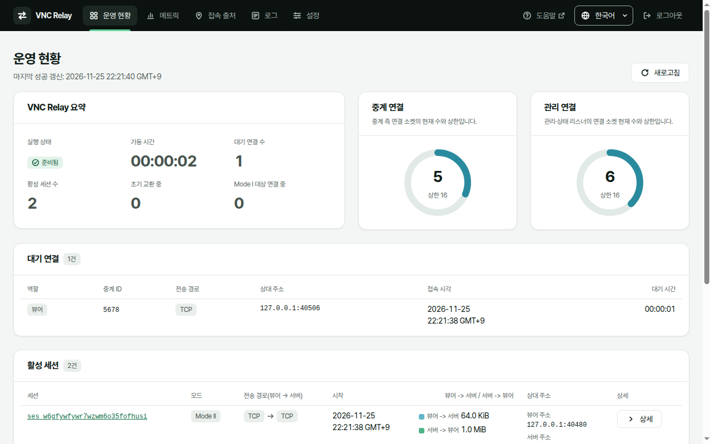
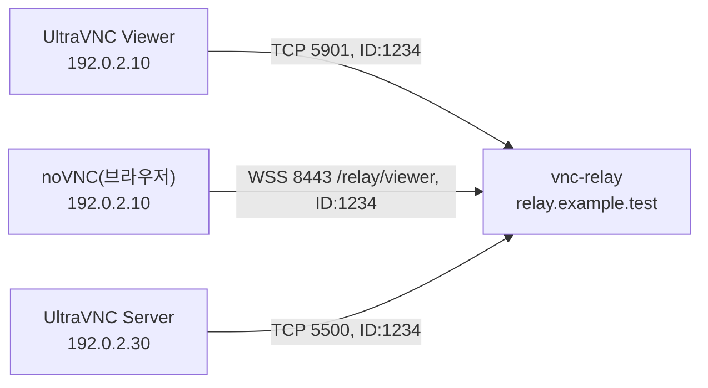

# vnc-relay

[English](README.md) | **한국어**

`vnc-relay`는 UltraVNC Repeater와 호환되는 VNC 중계 서버다. TCP·WS·WSS 중계와 웹 관리 대시보드를 실행파일 하나로 제공한다. Rust로 독립 구현했다.



- 버전: 2026.11.11. 버전은 `연.월.순서`다([릴리스 how-to](docs/how-to/release.md)).
- 기준: 이 README는 `main`의 현재 소스를 설명한다. 현재 소스로 빌드한 실행파일도 다음 릴리스 전까지 위 버전을 출력한다.
- 지원 OS: Windows 11 x64, Ubuntu 24.04 LTS x64. Windows Server와 다른 OS·아키텍처는 검증 범위가 아니다.
- 운영자 도움말: [한국어](https://kayden-kim.github.io/vnc-relay/ko/) · [English](https://kayden-kim.github.io/vnc-relay/en/)
- 라이선스: [MIT](LICENSE)

## 주요 기능

### 중계

- **UltraVNC Repeater 호환.** UltraVNC Viewer와 Server가 Repeater 초기 교환으로 접속한다. UltraVNC 1.8.3.0과 noVNC 1.7.0으로 확인했다([호환성 검증 기록](docs/contracts/repeater-compat-record.md)).
- **Mode I: 뷰어가 대상을 지정.** 뷰어가 대상 주소를 보내면 vnc-relay가 그 대상에 연결한다. 대상은 허용 목록 안에서만 연다. vnc-relay에서 내부망의 VNC 서버에 연결할 수 있고 뷰어만 바깥에 있을 때 쓴다.
- **Mode II: 중계 ID로 짝짓기.** 같은 중계 ID로 들어온 뷰어와 서버를 짝지어 중계한다. 어느 쪽이 먼저 접속해도 된다. 원격 지원처럼 서버가 NAT·방화벽 뒤에 있어 들어오는 연결을 받을 수 없을 때 쓴다. 상황별 시나리오는 [PRD 5절](docs/requirements/PRD.md#5-사용자와-주요-시나리오)에 있다.
- **TCP·WS·WSS 진입점.** 뷰어와 서버(역접속)가 각 전송 방식으로 접속한다. TCP는 역할마다 리스너가 따로 있다. WS·WSS는 리스너 하나에서 요청 경로로 역할을 나눈다. `/relay/viewer`는 뷰어, `/relay/server`는 서버(Mode II만) 역할이다([ADR-0008](docs/decisions/ADR-0008-shared-ws-listener-path-roles.md)). 평문 WS는 기본으로 꺼져 있다.

### 보안과 접근 제한

- **내장 TLS.** WSS와 관리 HTTPS의 TLS를 VNC Relay가 직접 처리한다. TLS 1.2 미만은 거절한다. 인증서는 운영자가 준비한다.
- **프록시 TLS 종료.** 중계 WS·WSS 앞에서 역방향 프록시가 TLS를 끝내는 배치도 지원한다. 관리 리스너는 이 배치에서 제외한다([ADR-0007](docs/decisions/ADR-0007-proxy-tls-termination.md)).
- **출발지 IP 허용 목록.** 진입점마다 단일 IP·CIDR·범위로 허용 목록을 둔다. WS·WSS는 역할마다 IP·`Origin` 허용 목록을 따로 둔다.
- **신뢰 프록시.** 신뢰 프록시(`trusted_proxies`)를 거친 요청은 `X-Forwarded-For`의 전달 주소로 판정한다.
- **차단 목록.** 모든 진입점에 함께 쓰는 출발지 IP 차단 목록(`[relay.deny] sources`)을 허용 목록보다 먼저 적용한다. 목록을 바꾸면 차단된 주소의 대기 연결과 활성 세션도 끊는다([ADR-0013](docs/decisions/ADR-0013-relay-source-deny-list.md)).
- **선택형 접속 ticket.** WS·WSS는 역할마다 접속 ticket 확인을 켤 수 있다. 켠 역할은 외부 발급 쪽이 서명한 유효한 ticket이 있을 때만 업그레이드를 받는다. 기본은 꺼짐이고 TCP에는 적용하지 않는다([ADR-0009](docs/decisions/ADR-0009-optional-relay-access-ticket.md)).

### 웹 대시보드

- **내장 로그인.** Argon2id 비밀번호 해시를 쓰는 계정으로 대시보드와 관리 API(`/api/v1/`)를 보호한다. 기본 계정은 없다.
- **운영 현황.** VNC Relay 상태, 대기 연결, 활성 세션, 최근 종료 목록을 본다. 세션 상세에서 주소와 전송량을 보고 활성 세션을 종료할 수 있다.
- **로그(`/#/logs`).** 최근 운영 로그를 필터·검색·자동 갱신하고 JSON Lines로 내려받는다.
- **메트릭(`/#/metrics`).** 핵심 지표, 최근 1시간 또는 최근 24시간 추이 차트, 시간 분포, 원인별 수, 프로세스 자원을 본다.
- **접속 출처(`/#/sources`).** 최근 1시간 또는 최근 24시간의 연결 시도·거절·중단·세션 수를 클라이언트 주소·국가·ASN별로 보고 ipinfo.io 조회 링크를 연다. 설정 편집이 켜져 있으면 이 화면에서 주소를 바로 차단하거나 차단을 해제한다.
- **설정.** 실행 중인 설정을 본다. `management.config_edit = true`이면 동적 설정을 편집해 설정 파일에 저장한다.
- **한국어·영어.** 모든 화면을 두 언어로 제공한다.

### 운영

- **실행파일 하나.** OS마다 실행파일 하나로 동작한다. Windows 묶음에는 트레이 앱이 더 있고, `vnc-relay service install`로 Windows 11 서비스에 등록한다.
- **상태 확인.** 인증 없는 상태 리스너가 `/livez`와 `/readyz`를 제공한다.
- **운영 로그.** JSON Lines로 표준 출력이나 파일에 쓴다. 최근 로그(기본 1000건, 0~10000, 바꾸면 재시작)는 대시보드용으로 메모리에 둔다.
- **재시작 없는 반영.** 설정 파일이 바뀌면 44개 키를 자동으로 다시 읽고, 그중 38개 키는 대시보드에서 편집한다. 종료할 때는 활성 세션에 종료 유예 G를 준다.
- **Prometheus 메트릭.** `[metrics] enabled = true`이면 상태 리스너의 `/metrics`가 OpenTelemetry 이름 규칙의 메트릭을 Prometheus 텍스트로 낸다. 기본은 꺼짐이고 바꾸면 재시작해야 한다([ADR-0011](docs/decisions/ADR-0011-pull-metrics-on-status-listener.md)).
- **로컬 IP 정보.** 국가·ASN은 운영자가 내려받아 `[ip_info]`에 지정한 DB-IP Lite·IPinfo Lite·MaxMind GeoLite MMDB 파일에서 찾는다. VNC Relay는 외부에 요청하지 않고, 파일 내용이 바뀌면 재시작 없이 다시 읽는다([ADR-0012](docs/decisions/ADR-0012-local-ip-info-databases.md)).

### 계약 버전

현재 소스가 구현한 버전은 설정 [vnc-relay-config 4.4.0](docs/contracts/config-v4.md), 운영 로그 [ops-info 2.3.0](docs/contracts/ops-info-v2.md), WebSocket [websocket-relay 2.2.0](docs/contracts/websocket-relay-v2.md), 관리 API [management-api 1.5.0](docs/contracts/management-api-v1.md), 메트릭 [vnc-relay-metrics 1.2.0](docs/contracts/metrics-v1.md)이다. 접속 ticket과 `/metrics`는 기본으로 꺼져 있다.

noVNC 클라이언트는 포함하지 않는다. noVNC는 외부 클라이언트로 접속할 수 있고, 상호운용 시험에만 쓴다.

## 빠른 시작

아래 절차는 루프백 주소에서 TCP Mode II만 켜는 [예시 설정](examples/relay.toml)을 쓴다. 공개 배치에 그대로 쓰지 않는다. 전체 절차와 공개 배치 주의 사항은 [실행파일을 묶고 수동 운영하는 방법](docs/how-to/operate-relay.md)에 있다.

1. OS에 맞는 배포 묶음을 준비한다. [GitHub Releases](https://github.com/kayden-kim/vnc-relay/releases)에서 내려받거나 저장소에서 직접 만든다. 내려받았으면 함께 있는 `.sha256` 파일로 해시를 확인하고 3단계로 간다. 직접 만들려면 빌드 도구가 필요하다. Windows는 Visual Studio Build Tools 2022의 C++ 빌드 도구, Ubuntu는 `cc`(gcc)를 쓴다. Rust 툴체인은 `rust-toolchain.toml`(Rust 1.99.1)이 정한다. 자세한 내용은 [개발 환경 준비](docs/how-to/set-up-and-verify.md)를 따른다.
2. 직접 만들 때는 저장소 루트에서 묶음을 만든다. Windows에서 NASM이 없으면 먼저 PowerShell에서 `$env:AWS_LC_SYS_PREBUILT_NASM = "1"`을 실행한다.

   ```shell
   cargo xtask package
   ```

   결과는 `target/package/`의 `vnc-relay-<버전>-windows-x64.zip` 또는 `vnc-relay-<버전>-linux-x64.tar.gz`와 SHA-256 파일이다.

3. 묶음을 풀고, 생긴 `vnc-relay-<버전>-<os>-x64/` 디렉터리로 이동한다. 실행파일과 `relay.toml`이 이 디렉터리에 있다. 아래 명령은 이 디렉터리에서 실행한다.
4. 관리자 계정을 만든다. 비밀번호는 숨김 입력으로 두 번 묻는다. 기본 계정은 없고, 계정이 없으면 VNC Relay가 시작하지 않는다.

   ```shell
   ./vnc-relay admin add opsadmin --config ./relay.toml
   ```

5. VNC Relay를 시작한다. 프로세스는 터미널을 점유하고 `relay.log`에 운영 로그를 쓴다.

   ```shell
   ./vnc-relay serve --config ./relay.toml
   ```

6. 다른 터미널에서 준비 상태를 확인한다. 준비되면 HTTP 200과 `{"status":"ready"}`가 나온다.

   ```shell
   curl --fail http://127.0.0.1:18081/readyz
   ```

7. 브라우저에서 `http://127.0.0.1:18080/`을 열고 만든 계정으로 로그인한다.
8. VNC Relay는 Ctrl+C로 정상 종료한다.

Windows PowerShell에서는 `./vnc-relay`를 `.\vnc-relay.exe`로, `curl`을 `curl.exe`로 바꾼다.

운영 로그를 터미널(표준 출력)에서 보려면 VNC Relay를 시작하기 전에 `relay.toml`의 `[log]`에서 `output`을 `"stdout"`으로 바꾼다.

## 연결 구성 예

뷰어와 서버는 서로 직접 연결하지 않는다. 둘 다 vnc-relay에 접속하고, vnc-relay가 같은 중계 ID로 들어온 둘을 짝지어 중계한다(Mode II). 어느 쪽이 먼저 접속해도 된다.

아래 예에서 vnc-relay 호스트는 `relay.example.test`(192.0.2.20)이고, 중계 ID는 `1234`다. 뷰어로는 UltraVNC Viewer와 브라우저의 noVNC 가운데 하나를 쓴다.



vnc-relay의 `relay.toml`은 다음과 같다. 계정 파일은 빠른 시작 4단계처럼 만든다.

```toml
[admin]
accounts_file = "admin-accounts.toml"

[relay.tcp_viewer]
enabled = true
listen = "0.0.0.0:5901"
allow = ["192.0.2.10"]

[relay.tcp_server]
enabled = true
listen = "0.0.0.0:5500"
allow = ["192.0.2.30"]

[relay.wss]
listen = "0.0.0.0:8443"
cert_file = "tls/relay-chain.pem"
key_file = "tls/relay-key.pem"

[relay.wss.viewer]
enabled = true
allow = ["192.0.2.10"]
allowed_origins = ["https://viewer.example.test"]

[mode2]
enabled = true

[management]
listen = "127.0.0.1:18080"

[status]
listen = "127.0.0.1:18081"

[log]
output = "relay.log"
```

- `allow`에는 해당 진입점에 접속할 PC의 IP를 넣는다. 목록 밖의 출발지는 거절한다.
- `cert_file`·`key_file`은 `relay.example.test`용 인증서 체인과 개인키다. 브라우저가 신뢰하는 인증서여야 한다.
- `allowed_origins`에는 noVNC 페이지를 제공하는 사이트의 origin을 넣는다. 브라우저는 WebSocket 요청에 이 값을 `Origin` 헤더로 보낸다. 목록이 비어 있으면 브라우저의 접속은 모두 거절된다.
- `output`은 운영 로그의 출력 위치다. 파일 경로 또는 `"stdout"`을 넣는다. 이 예는 `relay.log` 파일에 이어 쓴다. `"stdout"`이면 표준 출력으로 쓴다. `output`을 생략해도 표준 출력이다. 출력 위치를 바꾸면 재시작해야 적용된다.

각 PC에서는 다음과 같이 접속한다. UltraVNC 명령은 UltraVNC 1.8.3.0에서 확인한 형식이다([호환성 검증 기록 6절](docs/contracts/repeater-compat-record.md#6-모드전송-조합-검증)).

| 역할 | 접속 방법 |
| --- | --- |
| UltraVNC Server(192.0.2.30) | `winvnc.exe -id:1234 -connect 192.0.2.20::5500 -run` |
| UltraVNC Viewer(192.0.2.10) | `vncviewer.exe -proxy 192.0.2.20:5901 ID:1234` |
| noVNC(192.0.2.10의 브라우저) | `https://viewer.example.test/vnc.html?autoconnect=true&host=relay.example.test&port=8443&encrypt=true&path=relay/viewer&repeaterID=1234` |

noVNC는 `repeaterID` 값 앞에 `ID:`를 붙여 보낸다. 같은 ID를 다른 뷰어가 이미 쓰고 있으면(대기 중이거나 중계 중) 뒤에 온 뷰어는 거절된다.

같은 파일에 다음 설정을 더하면 다른 연결 방식도 쓸 수 있다.

- WebSocket으로 접속하는 서버: `[relay.wss.server]`에 `enabled = true`와 `allow = ["192.0.2.30"]`을 넣는다. 서버는 `wss://relay.example.test:8443/relay/server`로 접속하고, 이 경로는 Mode II만 받는다.
- Mode I(뷰어가 대상을 지정): `[mode1]`에 `enabled = true`와 `allow_targets = ["192.0.2.30:5900"]`을 넣는다. 뷰어가 `vncviewer.exe -connect 192.0.2.30::5900 -proxy 192.0.2.20:5901`로 접속하면 vnc-relay가 그 대상에 연결한다. 이때 서버는 vnc-relay에 접속하지 않고 대상 포트에서 기다린다.

[예시 설정](examples/relay.toml)은 모든 설정 키를 담는다. 쓰지 않는 키는 주석 줄로 기본값이나 예시 값을 보여 준다. 키별 규칙은 [설정 계약 v4](docs/contracts/config-v4.md)에, 운영 배치 절차는 [실행파일을 묶고 수동 운영하는 방법](docs/how-to/operate-relay.md)에 있다.

## 명령

| 명령 | 하는 일 |
| --- | --- |
| `vnc-relay serve --config <path>` | VNC Relay를 포그라운드로 실행한다. |
| `vnc-relay admin add <account> --config <path>` | 관리자 계정을 추가한다. |
| `vnc-relay admin passwd <account> --config <path>` | 비밀번호를 바꾼다. |
| `vnc-relay admin remove <account> [--yes] --config <path>` | 계정을 삭제한다. |
| `vnc-relay admin list --config <path>` | 계정 이름을 나열한다. |
| `vnc-relay service install --config <path> [--operator <name>]...` | Windows 11 전용. 서비스 `vnc-relay`를 등록한다. 관리자 권한 터미널에서 실행한다. |
| `vnc-relay service uninstall` | Windows 11 전용. 중지된 서비스 `vnc-relay`를 지운다. 관리자 권한 터미널에서 실행한다. |
| `vnc-relay service run --config <path>` | Windows 11 전용. 서비스 제어 관리자가 서비스를 시작할 때 쓴다. 직접 실행하지 않는다. |
| `vnc-relay --help`, `vnc-relay --version` | 사용법이나 버전을 출력한다. |

계정 변경은 VNC Relay를 다시 시작해야 적용된다. 옵션·종료 코드·입력 규칙은 [CLI 계약](docs/contracts/cli-v1.md)이, 설정 키와 기본값은 [설정 계약 v4](docs/contracts/config-v4.md)가 정한다.

## 개발

변경을 마치기 전에 저장소 루트에서 다음 명령을 실행한다. 모두 종료 코드 0이어야 한다. 대시보드 브라우저 시험에는 Chrome 또는 Edge가 필요하다.

```shell
cargo fmt --all --check
cargo clippy --workspace --all-targets -- -D warnings
cargo xtask layers
cargo xtask tokens --check
cargo xtask scenarios
cargo deny check licenses
```

`cargo xtask scenarios`는 `cargo test --workspace`를 함께 실행하고, 스펙 시나리오별 결과를 `.work/reports/scenario-report.md`로 쓴다. 변경 범위별 명령과 OS별 준비는 [개발 환경 준비와 검증](docs/how-to/set-up-and-verify.md)을 따른다. 작업 규칙은 [AGENTS.md](AGENTS.md)에 있다.

## 저장소 구조

| 위치 | 내용 |
| --- | --- |
| `src/` | 실행파일 `vnc-relay`. CLI와 `serve`·`admin` 조립 |
| `crates/domain/` | 초기 교환·매칭·세션·주소·예산·계정 규칙. 입출력 없음 |
| `crates/app/` | 중계·관리·재로드·준비 상태 사용 사례. 외부 기능은 포트로 정의 |
| `crates/adapters/` | 네트워크·TLS·WebSocket·관리 HTTP·파일·로그 구현 |
| `web/dashboard/` | 정적 HTML·CSS·JS 대시보드. 빌드 단계와 JS 외부 의존성 없음 |
| `xtask/` | 시나리오 보고·레이어 검사·토큰 생성·배포 고지 생성·시험용 접속 ticket 발급 도구 |
| `tests/` | 실행파일 수준의 통합·시스템 시험 |
| `examples/` | 모든 설정 키를 담은 비밀 값 없는 예시 설정 |
| `docs/` | 요구사항·스펙·계약·설계·절차 문서 |

코드 위치와 호출 흐름은 [코드 지도](docs/architectures/code-map.md)에 있다.

## 문서

운영자 도움말은 한국어·영어로 제공한다. `docs/` 아래 다른 문서는 한국어다.

| 문서 | 내용 |
| --- | --- |
| [운영자 도움말](https://kayden-kim.github.io/vnc-relay/ko/) | 운영자를 위한 설치·설정·대시보드·운영·문제 해결 안내 |
| [문서 안내](docs/README.md) | 문서 종류와 변경별로 읽을 문서 |
| [PRD](docs/requirements/PRD.md) | 제품 요구사항과 수용 기준 |
| [스펙 목록](docs/specs/README.md) | 중계·WebSocket·관리·대시보드·운영의 외부 동작과 수용 시나리오 |
| [계약 목록](docs/contracts/README.md) | 설정·CLI·관리 API·운영 로그·메트릭·WebSocket·Repeater 초기 교환 형식 |
| [호환성 검증 기록](docs/contracts/repeater-compat-record.md) | UltraVNC 1.8.3.0·Repeater·noVNC 1.7.0과의 대조 결과 |
| [실행파일을 묶고 수동 운영하는 방법](docs/how-to/operate-relay.md) | 배포 묶음 설치·설정·업그레이드·롤백 절차 |
| [용어집](GLOSSARY.md) | 업무 용어의 이름과 뜻 |

## 독립 구현과 라이선스

UltraVNC·websockify·noVNC의 소스를 복사·번역·포팅하지 않았다. 공개 문서와 실행 관찰로 통신 규칙을 확인해 새로 작성했다. 검토 기록은 [의존성 라이선스 검사](docs/how-to/check-dependency-licenses.md)에 있다.

이 프로젝트는 [MIT 라이선스](LICENSE)를 따른다. Copyright (c) 2026 vnc-relay contributors. 실행파일에 들어가는 의존성과 글꼴(Pretendard, SIL Open Font License 1.1)의 고지는 [THIRD-PARTY-NOTICES.txt](THIRD-PARTY-NOTICES.txt)에 있다. 배포 묶음에는 `LICENSE`와 `THIRD-PARTY-NOTICES.txt`를 함께 넣는다.
