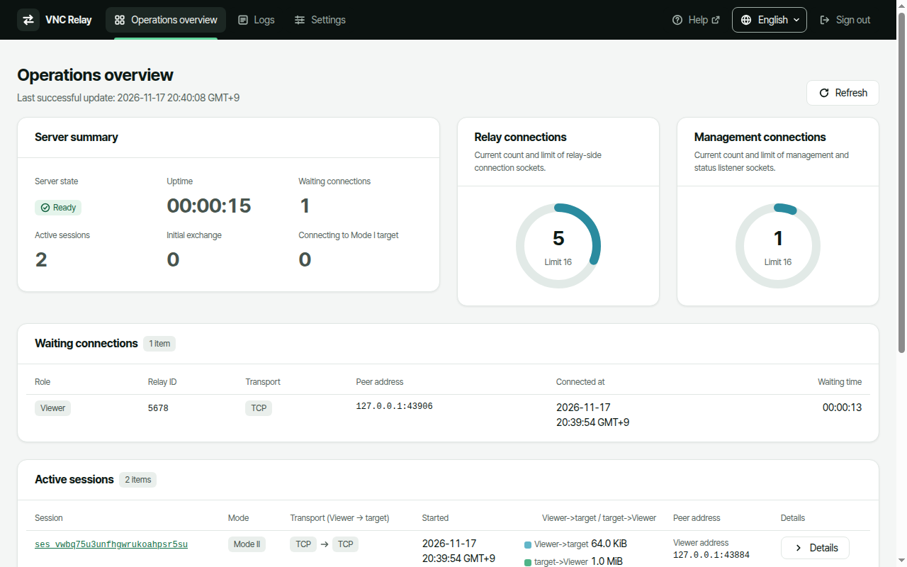
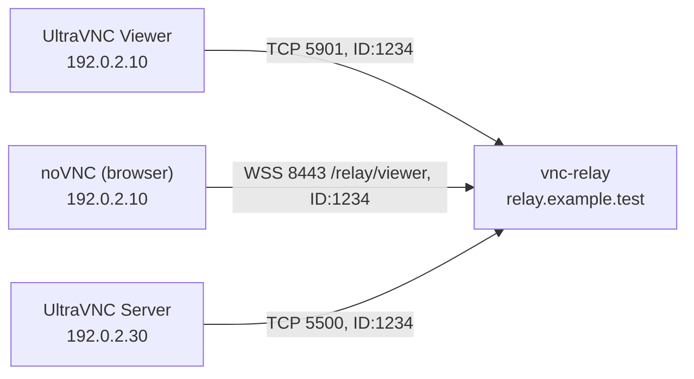

# vnc-relay

**English** | [한국어](README.ko.md)

`vnc-relay` is a VNC relay server compatible with the UltraVNC Repeater. One executable provides TCP, WS, and WSS relaying and a web management dashboard. It is an independent implementation in Rust.



- Version: 2026.11.9. Versions use `year.month.sequence` ([release how-to](docs/how-to/release.md)).
- Basis: this README describes the current source on `main`. An executable built from the current source prints the version above until the next release.
- Supported OS: Windows 11 x64 and Ubuntu 24.04 LTS x64. Windows Server and other OSes or architectures are outside the verified scope.
- Operator help: [English](https://kayden-kim.github.io/vnc-relay/en/) · [한국어](https://kayden-kim.github.io/vnc-relay/ko/)
- License: [MIT](LICENSE)

## Features

### Relay

- **UltraVNC Repeater compatible.** UltraVNC Viewer and Server connect with the Repeater handshake. Checked against UltraVNC 1.8.3.0 and noVNC 1.7.0 ([compatibility record](docs/contracts/repeater-compat-record.md)).
- **Mode I: the Viewer picks the target.** The Viewer sends a target address and vnc-relay connects to it. vnc-relay opens only targets in the allow list. Use it when vnc-relay can reach a VNC Server on an internal network and only the Viewer is outside.
- **Mode II: pairing by relay ID.** vnc-relay pairs a Viewer and a Server that arrive with the same relay ID. Either side can connect first. Use it for remote support, where the Server is behind NAT or a firewall and cannot accept incoming connections. Scenarios are in [PRD section 5](docs/requirements/PRD.md#5-사용자와-주요-시나리오).
- **TCP, WS, and WSS entry points.** Viewers and Servers (reverse connections) can use each transport. TCP has a separate listener per role. WS and WSS share one listener and choose the role by path: `/relay/viewer` for Viewers and `/relay/server` for Servers (Mode II only) ([ADR-0008](docs/decisions/ADR-0008-shared-ws-listener-path-roles.md)). Plain WS is off by default.

### Security and access control

- **Built-in TLS.** The server handles TLS for WSS and management HTTPS itself and rejects versions below TLS 1.2. The operator supplies certificates.
- **Reverse proxy TLS termination.** A reverse proxy can end TLS in front of relay WS and WSS. The management listener does not support this layout ([ADR-0007](docs/decisions/ADR-0007-proxy-tls-termination.md)).
- **Source IP allow lists.** Each entry point has an allow list of single IPs, CIDRs, and ranges. WS and WSS have separate IP and `Origin` allow lists per role.
- **Trusted proxies.** For requests through a trusted proxy (`trusted_proxies`), vnc-relay checks the forwarded address in `X-Forwarded-For`.
- **Deny list.** One source IP deny list (`[relay.deny] sources`) covers all entry points and applies before the allow lists. When the list changes, vnc-relay also closes waiting connections and active sessions from denied addresses ([ADR-0013](docs/decisions/ADR-0013-relay-source-deny-list.md)).
- **Optional access tickets.** WS and WSS can require a ticket per role. An enabled role accepts the upgrade only with a valid ticket signed by an external issuer. Tickets are off by default and do not apply to TCP ([ADR-0009](docs/decisions/ADR-0009-optional-relay-access-ticket.md)).

### Web dashboard

- **Built-in sign-in.** Accounts with Argon2id password hashes protect the dashboard and the management API (`/api/v1/`). There is no default account.
- **Operations overview.** Server state, waiting connections, active sessions, and recently closed sessions. Session details show addresses and traffic, and an administrator can terminate an active session.
- **Logs (`/#/logs`).** Filter, search, and auto-refresh recent operations logs. Download them as JSON Lines.
- **Metrics (`/#/metrics`).** Key indicators, trend charts for the last hour or 24 hours, time distributions, counts by cause, and process resources.
- **Sources (`/#/sources`).** Connection attempts, rejections, aborts, and sessions per client address, country, and ASN for the last hour or 24 hours, with an ipinfo.io lookup link. With config editing on, block or unblock an address from this screen.
- **Settings.** View the running configuration. With `management.config_edit = true`, edit dynamic settings and save them to the configuration file.
- **Korean and English.** Every screen is available in both languages.

### Operations

- **Single executable.** One executable per OS. The Windows bundle adds a tray app, and `vnc-relay service install` registers a Windows 11 service.
- **Health checks.** An unauthenticated status listener serves `/livez` and `/readyz`.
- **Operations logs.** JSON Lines to standard output or a file. The latest entries (default 1000, 0–10000, restart to change) stay in memory for the dashboard.
- **Reload without restart.** 44 keys reload automatically when the configuration file changes, and 38 of them can be edited in the dashboard. On shutdown, active sessions get a grace period G.
- **Prometheus metrics.** With `[metrics] enabled = true`, `/metrics` on the status listener serves metrics with OpenTelemetry names in Prometheus text format. Off by default; restart to change ([ADR-0011](docs/decisions/ADR-0011-pull-metrics-on-status-listener.md)).
- **Local IP information.** Country and ASN come from DB-IP Lite, IPinfo Lite, or MaxMind GeoLite MMDB files that the operator downloads and sets in `[ip_info]`. The server sends no outside requests and rereads a file without restart when its content changes ([ADR-0012](docs/decisions/ADR-0012-local-ip-info-databases.md)).

### Contract versions

The current source implements configuration [vnc-relay-config 4.4.0](docs/contracts/config-v4.md), operations log [ops-info 2.3.0](docs/contracts/ops-info-v2.md), WebSocket [websocket-relay 2.2.0](docs/contracts/websocket-relay-v2.md), management API [management-api 1.5.0](docs/contracts/management-api-v1.md), and metrics [vnc-relay-metrics 1.2.0](docs/contracts/metrics-v1.md). Access tickets and `/metrics` are off by default.

The noVNC client is not included. noVNC can connect as an external client and is used only for interoperability tests.

## Quick start

These steps use the [example configuration](examples/relay.toml), which enables only TCP Mode II on loopback addresses. Do not use it as is for a public deployment. The full procedure and public deployment cautions are in [packaging and operating the executable](docs/how-to/operate-relay.md).

1. Get the bundle for your OS. Download it from [GitHub Releases](https://github.com/kayden-kim/vnc-relay/releases) or build it from the repository. If you downloaded it, check the hash with the `.sha256` file next to it and go to step 3. To build it, you need build tools: the C++ build tools of Visual Studio Build Tools 2022 on Windows, or `cc` (gcc) on Ubuntu. `rust-toolchain.toml` pins the Rust toolchain (Rust 1.99.1). See [setting up the development environment](docs/how-to/set-up-and-verify.md).
2. To build it, make the bundle from the repository root. On Windows without NASM, first run `$env:AWS_LC_SYS_PREBUILT_NASM = "1"` in PowerShell.

   ```shell
   cargo xtask package
   ```

   The result is `vnc-relay-<version>-windows-x64.zip` or `vnc-relay-<version>-linux-x64.tar.gz` and its SHA-256 file in `target/package/`.

3. Extract the bundle and go to the new `vnc-relay-<version>-<os>-x64/` directory. The executable and `relay.toml` are in it. Run the commands below in this directory.
4. Create an administrator account. The password prompt is hidden and asks twice. There is no default account, and the server does not start without one.

   ```shell
   ./vnc-relay admin add opsadmin --config ./relay.toml
   ```

5. Start the server. The process keeps the terminal and writes operations logs to `relay.log`.

   ```shell
   ./vnc-relay serve --config ./relay.toml
   ```

6. In another terminal, check readiness. When ready, it returns HTTP 200 and `{"status":"ready"}`.

   ```shell
   curl --fail http://127.0.0.1:18081/readyz
   ```

7. Open `http://127.0.0.1:18080/` in a browser and sign in with the account.
8. Stop the server with Ctrl+C.

In Windows PowerShell, use `.\vnc-relay.exe` instead of `./vnc-relay` and `curl.exe` instead of `curl`.

To see operations logs in the terminal (standard output), set `output` in the `[log]` table of `relay.toml` to `"stdout"` before you start the server.

## Example deployment

The Viewer and the Server do not connect to each other. Both connect to vnc-relay, and vnc-relay pairs the two that arrive with the same relay ID (Mode II). Either side can connect first.

In this example, the vnc-relay host is `relay.example.test` (192.0.2.20) and the relay ID is `1234`. The Viewer is either UltraVNC Viewer or noVNC in a browser.



The `relay.toml` of vnc-relay is below. Create the account file as in step 4 of the quick start.

```toml
[admin]
accounts_file = "admin-accounts.toml"

[relay.tcp_viewer]
enabled = true
listen = "0.0.0.0:5901"
allow = ["192.0.2.10"]

[relay.tcp_server]
enabled = true
listen = "0.0.0.0:5500"
allow = ["192.0.2.30"]

[relay.wss]
listen = "0.0.0.0:8443"
cert_file = "tls/relay-chain.pem"
key_file = "tls/relay-key.pem"

[relay.wss.viewer]
enabled = true
allow = ["192.0.2.10"]
allowed_origins = ["https://viewer.example.test"]

[mode2]
enabled = true

[management]
listen = "127.0.0.1:18080"

[status]
listen = "127.0.0.1:18081"

[log]
output = "relay.log"
```

- `allow` holds the IPs of the PCs that connect to that entry point. vnc-relay rejects other sources.
- `cert_file` and `key_file` are the certificate chain and private key for `relay.example.test`. Browsers must trust the certificate.
- `allowed_origins` holds the origin of the site that serves the noVNC page. Browsers send this value in the `Origin` header of WebSocket requests. If the list is empty, vnc-relay rejects all browser connections.
- `output` is where operations logs go: a file path or `"stdout"`. This example appends to `relay.log`. With `"stdout"`, or without `output`, logs go to standard output. A change takes effect after a restart.

Each PC connects as follows. The UltraVNC commands use the format checked with UltraVNC 1.8.3.0 ([compatibility record section 6](docs/contracts/repeater-compat-record.md#6-모드전송-조합-검증)).

| Role | How to connect |
| --- | --- |
| UltraVNC Server (192.0.2.30) | `winvnc.exe -id:1234 -connect 192.0.2.20::5500 -run` |
| UltraVNC Viewer (192.0.2.10) | `vncviewer.exe -proxy 192.0.2.20:5901 ID:1234` |
| noVNC (browser on 192.0.2.10) | `https://viewer.example.test/vnc.html?autoconnect=true&host=relay.example.test&port=8443&encrypt=true&path=relay/viewer&repeaterID=1234` |

noVNC sends the `repeaterID` value with `ID:` in front. If another Viewer already uses the same ID (waiting or relaying), vnc-relay rejects the later Viewer.

Add these settings to the same file for other connection types.

- Server over WebSocket: put `enabled = true` and `allow = ["192.0.2.30"]` in `[relay.wss.server]`. The Server connects to `wss://relay.example.test:8443/relay/server`. This path accepts Mode II only.
- Mode I (the Viewer picks the target): put `enabled = true` and `allow_targets = ["192.0.2.30:5900"]` in `[mode1]`. When the Viewer connects with `vncviewer.exe -connect 192.0.2.30::5900 -proxy 192.0.2.20:5901`, vnc-relay connects to that target. The Server does not connect to vnc-relay and waits on the target port.

The [example configuration](examples/relay.toml) contains every configuration key. Unused keys appear as comment lines with their default or example values. Key rules are in [configuration contract v4](docs/contracts/config-v4.md), and the deployment procedure is in [packaging and operating the executable](docs/how-to/operate-relay.md).

## Commands

| Command | What it does |
| --- | --- |
| `vnc-relay serve --config <path>` | Runs the server in the foreground. |
| `vnc-relay admin add <account> --config <path>` | Adds an administrator account. |
| `vnc-relay admin passwd <account> --config <path>` | Changes a password. |
| `vnc-relay admin remove <account> [--yes] --config <path>` | Removes an account. |
| `vnc-relay admin list --config <path>` | Lists account names. |
| `vnc-relay service install --config <path> [--operator <name>]...` | Windows 11 only. Registers the `vnc-relay` service. Run it in an administrator terminal. |
| `vnc-relay service uninstall` | Windows 11 only. Removes the stopped `vnc-relay` service. Run it in an administrator terminal. |
| `vnc-relay service run --config <path>` | Windows 11 only. The service control manager uses it to start the service. Do not run it yourself. |
| `vnc-relay --help`, `vnc-relay --version` | Prints usage or the version. |

Account changes take effect after a server restart. The [CLI contract](docs/contracts/cli-v1.md) defines options, exit codes, and input rules. The [configuration contract v4](docs/contracts/config-v4.md) defines configuration keys and defaults.

## Development

Before you finish a change, run these commands from the repository root. All must exit with code 0. The dashboard browser tests need Chrome or Edge.

```shell
cargo fmt --all --check
cargo clippy --workspace --all-targets -- -D warnings
cargo xtask layers
cargo xtask tokens --check
cargo xtask scenarios
cargo deny check licenses
```

`cargo xtask scenarios` also runs `cargo test --workspace` and writes per-scenario results to `scenario-report.md`. For commands per change type and OS setup, see [setting up and verifying](docs/how-to/set-up-and-verify.md). Working rules are in [AGENTS.md](AGENTS.md).

## Repository layout

| Location | Contents |
| --- | --- |
| `src/` | The `vnc-relay` executable. CLI and assembly of `serve` and `admin` |
| `crates/domain/` | Rules for the initial exchange, matching, sessions, addresses, budgets, and accounts. No I/O |
| `crates/app/` | Use cases for relaying, management, reload, and readiness. External functions are defined as ports |
| `crates/adapters/` | Network, TLS, WebSocket, management HTTP, file, and log implementations |
| `web/dashboard/` | Static HTML, CSS, and JS dashboard. No build step and no external JS dependencies |
| `xtask/` | Tools for scenario reports, layer checks, token generation, bundle notices, and test access tickets |
| `tests/` | Integration and system tests at the executable level |
| `examples/` | Example configuration with every key and no secret values |
| `docs/` | Requirements, specs, contracts, design, and procedure documents |

Code locations and call flows are in the [code map](docs/architectures/code-map.md).

## Documentation

The operator help is in Korean and English. The other documents under `docs/` are in Korean.

| Document | Contents |
| --- | --- |
| [Operator help](https://kayden-kim.github.io/vnc-relay/en/) | Installation, configuration, dashboard, operation, and troubleshooting for operators |
| [Documentation guide](docs/README.md) | Document types and what to read for each kind of change |
| [PRD](docs/requirements/PRD.md) | Product requirements and acceptance criteria |
| [Specs](docs/specs/README.md) | External behavior and acceptance scenarios for relaying, WebSocket, management, dashboard, and operations |
| [Contracts](docs/contracts/README.md) | Formats for configuration, CLI, management API, operations logs, metrics, WebSocket, and the Repeater initial exchange |
| [Compatibility record](docs/contracts/repeater-compat-record.md) | Comparison results with UltraVNC 1.8.3.0, the Repeater, and noVNC 1.7.0 |
| [Packaging and operating the executable](docs/how-to/operate-relay.md) | Bundle installation, configuration, upgrade, and rollback |
| [Glossary](GLOSSARY.md) | Names and meanings of domain terms |

## Independent implementation and license

The source of UltraVNC, websockify, and noVNC was not copied, translated, or ported. The protocol was confirmed from public documents and observed behavior and written from scratch. The review record is in [dependency license check](docs/how-to/check-dependency-licenses.md).

This project uses the [MIT license](LICENSE). Copyright (c) 2026 vnc-relay contributors. Notices for the dependencies and the font (Pretendard, SIL Open Font License 1.1) in the executable are in [THIRD-PARTY-NOTICES.txt](THIRD-PARTY-NOTICES.txt). Bundles include `LICENSE` and `THIRD-PARTY-NOTICES.txt`.
