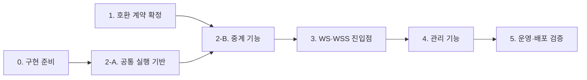

# 구현 작업 목록

이 문서는 vnc-relay 구현에서 할 작업을 단계별로 모은 목록이다. 작업마다 선행 조건과 완료 조건을 적는다. 요구사항·동작·교환 형식은 이 문서에서 정하지 않는다. 각 작업은 기준 문서를 링크하며, 이 목록과 기준 문서가 다르면 기준 문서를 따르고 이 목록을 고친다.

이 목록은 사용자 요청(2026-10-20)으로 만들었다. [문서 유형](README.md)에 속하지 않는 작업 추적용 문서다. 요구사항은 [PRD](requirements/PRD.md), 동작은 [스펙](specs/README.md), 교환 형식은 [계약](contracts/README.md)이 기준이다.

## 사용 규칙

- 단계는 [PRD 11절 구현 순서 제안](requirements/PRD.md#11-구현-순서-제안)을 따른다. 그 앞에 0단계 구현 준비를 둔다.
- `[ ]`는 끝나지 않은 작업이고 `[x]`는 끝난 작업이다. 완료 조건의 검증 증거가 생긴 뒤에만 `[x]`로 바꾼다. 증거는 [검증 기록](AGENTS.md#검증-기록)에 따른 커버리지·결과 보고서와 실행 기록에 둔다. 이 목록에는 결과를 복제하지 않는다.
- 작업 번호는 `단계.순번`이다. 작업을 지워도 번호를 다시 쓰지 않는다.
- "(결정)"이 붙은 작업은 사용자나 담당자의 결정이 필요하다. 결정 전에는 그 결정에 의존하는 작업만 멈추고 나머지는 진행한다.
- 시나리오 ID 뒤의 "(일부)"는 그 작업이 시나리오의 일부만 구현한다는 뜻이다. 시나리오는 마지막 관련 작업이 끝나야 통과로 판정한다.
- 모듈을 처음 만들 때는 모듈 설계를 `Target`으로 먼저 쓴다. 코드 파일이나 호출 경로가 바뀌면 같은 작업에서 코드 지도와 모듈 설계를 갱신한다([작업 순서](../AGENTS.md#작업-순서와-필수-참조)).
- 구현 작업은 완료 조건의 시나리오 테스트를 같은 작업에서 작성한다. 테스트 소스에는 시나리오 메타 정보(예: `relay.md:RLY-001`)를 넣는다. 관련 계약 5절 표의 계약 테스트도 함께 작성하고 그 표의 테스트 위치와 결과를 채운다.

## 단계 흐름

1단계와 2-A는 함께 진행할 수 있다. 2-A는 Repeater 초기 교환 계약에 의존하지 않는다. 4.1(관리자 계정 준비 CLI), 4.7(화면 문구), 4.8(토큰 CSS와 공통 컴포넌트)도 앞 단계와 함께 진행할 수 있다.

## 0. 구현 준비

기능 코드를 쓰기 전에 빌드·컨벤션·검증 기반을 만든다. [프로젝트 작업 안내](README.md#프로젝트-작업-안내) 표의 "미작성" 항목을 채운다.

- [x] **0.1 Rust 작업 공간**: 실행파일 `vnc-relay` 하나를 만드는 Cargo 프로젝트를 만든다. Rust 툴체인 버전을 고정한다.
  - 기준: [PRD 확정 기준](requirements/PRD.md#확정-기준)의 "실행 형태"·"구현 기술" 행, [ADR-0004](decisions/ADR-0004-tokio-rustls.md)
  - 완료 조건: Windows 11 x64와 Ubuntu 24.04 LTS x64에서 빌드하고 `vnc-relay --version`을 실행한다.
- [x] **0.2 rustls 암호 모듈 선택(OPS-TBD-009, 결정)**: aws-lc-rs와 ring을 두 OS에서 빌드하고 라이선스를 확인한 뒤 고른다. TLS 어댑터 crate(tokio-rustls 등)도 함께 정한다.
  - 기준: [운영 스펙 8절](specs/operations.md#8-미결정-사항), [ADR-0004 후속 작업](decisions/ADR-0004-tokio-rustls.md#후속-작업)
  - 완료 조건: 운영 스펙에서 OPS-TBD-009를 해소하고 [설정 계약 1.9절](contracts/config-v2.md#19-인증서개인키-파일-형식)과 PRD를 갱신한다. [ADR 작성 조건](decisions/AGENTS.md)을 만족하면 ADR을 쓴다.
  - 선행: 0.1
- [x] **0.3 조건부 채택 라이브러리 검토**: axum, tokio-tungstenite, toml·serde, argon2, notify, clap, tracing의 라이선스와 고지 의무를 확인한다.
  - 기준: [PRD 확정 기준](requirements/PRD.md#확정-기준)의 "구현 기술" 행, [OPS-021](specs/operations.md#7-수용-테스트)
  - 완료 조건: 검토 결과를 기록하고 PRD "구현 기술" 행을 확정 상태로 고친다. 조건을 통과하지 못한 라이브러리가 있으면 대안을 사용자에게 묻는다.
  - 선행: 0.1
- [x] **0.4 코드 컨벤션**: 이름 짓기(용어집 영어 이름 prefix와 suffix 목록), 모듈 배치, 공식 포매터·린터 적용 범위와 확인 방법을 정한다.
  - 기준: [컨벤션 작성 규칙](conventions/AGENTS.md), [용어집](../GLOSSARY.md)
  - 완료 조건: [컨벤션 목록](conventions/README.md)에 등록하고 프로젝트 작업 안내 표를 갱신한다.
  - 선행: 0.1
- [x] **0.5 테스트 컨벤션**: 시나리오 메타 정보 문법, 테스트 종류(단위·통합·E2E·계약)별 위치, 커버리지·결과 보고 명령과 보고서 위치를 정한다.
  - 기준: [검증 기록](AGENTS.md#검증-기록), [컨벤션 작성 규칙](conventions/AGENTS.md)
  - 완료 조건: 컨벤션 목록에 등록한다.
  - 선행: 0.4
- [x] **0.6 시나리오 커버리지 보고 도구**: 스펙 수용 테스트 표의 시나리오 ID, 테스트 메타 정보, 테스트 실행 결과를 모아 보고서를 만든다. 테스트가 없는 시나리오는 `미연결`, 없는 시나리오를 가리키는 메타 정보는 `오류`로 표시하고 시나리오별 통과·실패를 보고한다.
  - 기준: [검증 기록](AGENTS.md#검증-기록)
  - 완료 조건: 스펙 5개의 모든 시나리오가 `미연결`로 나오는 보고서를 만든다.
  - 선행: 0.5
- [x] **0.7 코드 지도(Target)**: 초기 교환·매칭·중계·WebSocket·관리·설정·운영 로그의 구성요소와 계획 경로, 레이어별 허용 의존, 의존 위반 확인 방법을 정한다.
  - 기준: [아키텍처 작성 규칙](architectures/AGENTS.md), [PRD 8절](requirements/PRD.md#8-비기능-요구사항)의 유지보수성, [ADR-0003](decisions/ADR-0003-single-instance-memory-state.md)
  - 완료 조건: [아키텍처 목록](architectures/README.md)에 등록하고 프로젝트 작업 안내 표의 코드 지도 행을 갱신한다.
  - 선행: 0.1
- [x] **0.8 개발 환경·검증 how-to**: 환경·버전·실행 위치, 빌드·테스트 명령, 변경 범위별 검증 명령, 전체 완료 명령과 성공 조건을 쓴다. 두 OS의 차이를 적는다.
  - 기준: [how-to 작성 규칙](how-to/AGENTS.md), [프로젝트 작업 안내](README.md#프로젝트-작업-안내)
  - 완료 조건: [how-to 목록](how-to/README.md)에 등록한다. 프로젝트 작업 안내 표의 실행·검증 행과 루트 [AGENTS.md](../AGENTS.md)의 "구현 코드와 실행·검증 설정은 없다" 문장을 갱신한다.
  - 선행: 0.5, 0.6
- [x] **0.9 프런트엔드 컨벤션과 검증 방법(DESIGN-TBD-005)**: DESIGN.md YAML에서 토큰 CSS를 만들고 대조하는 방법을 정한다. 정적 파일 구조, 실행파일에 넣는 방식, 컴포넌트 미리보기 위치, 시안 대조·접근성·브라우저 확인 방법도 정한다. 빌드 단계와 JS 의존성은 두지 않는다.
  - 기준: [디자인 기준 미결정 사항](design/DESIGN.md#미결정-사항), [컨벤션 작성 규칙](conventions/AGENTS.md), [frontend-workflow 6절](../.agents/skills/frontend-workflow/references/frontend-workflow.md#6-검증-환경과-통과-기준)
  - 완료 조건: DESIGN-TBD-005를 해소하고 [디자인 기준 검증 절](design/DESIGN.md#검증)에 how-to를 연결한다.
  - 선행: 0.4, 0.8
  - 현재: [프런트엔드 컨벤션](conventions/frontend.md)을 채택했다. FE-TBD-001~015는 사용자 결정 2026-10-22(Q32~Q38)로 정했고 DESIGN-TBD-005를 해소했다. [대시보드 프런트엔드 검증 how-to](how-to/verify-dashboard-frontend.md)를 디자인 기준 검증 절에 연결했다. 성능 지표(FE-TBD-016)는 화면 구현 뒤 정한다(사용자 결정 2026-10-22(Q39)). `cargo xtask tokens`·`dashboard-serve`와 브라우저 시험은 작업 4.8에서 구현했다.

## 1. 호환 계약 확정

Mode I·II 초기 흐름을 추정 없이 설명할 수 있게 한다. 관찰은 [Repeater 초기 교환 계약 6절](contracts/repeater-handshake-v1.md#6-초안을-확정하기-전에-해결할-사항)을 따른다. UltraVNC·websockify·noVNC 소스 코드는 관찰·분석에 쓰지 않는다.

- [x] **1.1 관찰 허용 검토(결정)**: 패킷 관찰의 사용 권한과 법적 허용 여부를 관할법·제품 약관 기준으로 검토한다. 프로젝트 소유자가 판단한다.
  - 기준: [PRD 9절](requirements/PRD.md#9-호환성-조사와-독립-구현-원칙), [관찰 절차 1단계](contracts/repeater-handshake-v1.md#61-관찰-절차), [OPS-TBD-005](specs/operations.md#8-미결정-사항)
  - 완료 조건: 검토 결과가 호환성 검증 기록에 있다. 검토 전에는 1.4를 시작하지 않는다.
- [x] **1.2 호환성 검증 기록 문서**: 관찰 증거와 호환성 검증 결과를 남길 문서를 만든다. 위치는 [문서 배치](AGENTS.md#문서-배치) 규칙에 맞춰 정한다.
  - 기준: [기록할 증거](contracts/repeater-handshake-v1.md#62-기록할-증거)
  - 완료 조건: 초기 교환 계약과 [OPS-020](specs/operations.md#7-수용-테스트)이 이 문서를 링크한다.
- [x] **1.3 검증 대상 버전 고정(RLY-TBD-001·WS-TBD-005)**: 공식 최신 안정판 UltraVNC Server·Viewer·Repeater와 noVNC의 버전, 배포본 해시, 받은 날짜·주소, OS를 기록하고 고정한다.
  - 기준: [미결정 항목의 해소 조건](contracts/repeater-handshake-v1.md#63-미결정-항목의-해소-조건)
  - 완료 조건: 호환성 검증 기록을 작성한다. PRD "호환 버전" 행, [중계 스펙 8절](specs/relay.md#8-미결정-사항), [WebSocket 스펙 8절](specs/websocket.md#8-미결정-사항)을 갱신한다.
  - 선행: 1.2
- [x] **1.4 통제된 환경에서 관찰**: 인터넷과 분리한 테스트 네트워크에서 관찰 절차 5단계의 시나리오(Mode I, Mode II, 오류, 분할·후속 바이트, 종료·재접속, 외부 WebSocket)를 각각 2회 이상 실행하고 캡처한다.
  - 기준: [관찰 절차](contracts/repeater-handshake-v1.md#61-관찰-절차)
  - 완료 조건: 기록할 증거 표의 모든 항목을 기록한다.
  - 선행: 1.1, 1.3
  - 설치 뒤 `vncviewer.exe`의 파일 버전을 확인하고 [호환성 검증 기록](contracts/repeater-compat-record.md) 3절에 적는다. 설치 파일에 `UltraVNC_Viewer` 구성 요소가 들었는지도 이때 확인한다. 설치 파일 안의 `repeater.exe`는 관찰만 하고 고정하지 않는다.
  - 현재: 2026-11-01에 관찰을 마쳤다. 여섯 시나리오 묶음을 각각 2회 이상, 모두 76회차를 증거로 캡처했고 증거 회차는 모두 첫 시도에서 유효했다(p10 첫 실행의 무효 시도 2회는 증거에서 뺐다). 6.2절의 증거(대상·환경·입력·원본·결과·해석·승인)는 [호환성 검증 기록 3절](contracts/repeater-compat-record.md#3-관찰-증거-todo-14)에 있다. 계약 1절 항목별 해석은 3.5절, 캡처 해시와 보관 위치는 3.6절이다. 게스트 Windows는 평가판 알림 모드로 썼다(사용자 결정 2026-11-01(Q67)). 관찰에서 나온 결정 사항은 기록 4절 4.10~4.13에 있다. ID 비교 규칙(4.10)은 1.5, 같은 역할 중복 ID(4.11)는 1.6, noVNC `Sec-WebSocket-Protocol` 미전송(4.4)은 1.7의 입력이다.
- [x] **1.5 초기 교환 계약 채택(RLY-TBD-002, 결정)**: 계약 1절 표의 "관찰로 확정할 항목"에 증거를 연결하고 증거 기반 표로 바꾼다. 오류 응답 바이트(메시지D)가 있는지 확인한다. 2절 오류 코드 이름을 정한다.
  - 기준: [Repeater 초기 교환 계약](contracts/repeater-handshake-v1.md), [중계 스펙 8절](specs/relay.md#8-미결정-사항)
  - 완료 조건: 프로젝트 소유자가 채택해 계약이 Active가 된다. 중계 스펙 8절을 갱신하고, 필요하면 [WebSocket 중계 계약](contracts/websocket-relay-v1.md)의 close 코드 대응도 고친다.
  - 선행: 1.4
  - 현재: 2026-11-01에 프로젝트 소유자가 계약을 채택했다(Active, 사용자 결정 Q73). 1절은 관찰 증거로 다시 썼다. 오류 응답 바이트는 없고, Viewer 쪽 시작 바이트 12바이트만 있다. 2절 오류 코드 이름은 그대로 채택했다(Q72). 중계 ID는 숫자 1~247자리이고 바이트열이 정확히 같을 때만 같다(Q68·Q69). Mode I은 대괄호 IPv6를 받는다(Q70). 상한 I(`limits.initial_message_bytes`)를 지우고 [설정 계약](contracts/config-v2.md)을 2.0.0으로 올렸다(Q71). [중계 스펙 8절](specs/relay.md#8-미결정-사항)에서 RLY-TBD-002를 뺐고, [WebSocket 중계 계약](contracts/websocket-relay-v1.md)의 4008 뜻과 101 직후 시작 바이트를 고쳤다. 대상 버전과 다르게 처리하는 입력은 [계약 3.1절](contracts/repeater-handshake-v1.md#31-대상-버전-repeater와-다르게-처리하는-입력)에 있다.
- [x] **1.6 중복 ID 정책(RLY-TBD-003, 결정)**: 대상 버전에서 같은 역할 중복 중계 ID의 결과를 기록한다. 제안 정책(후발 거절)과 같으면 채택한다. 다르면 차이를 기록하고 프로젝트 소유자가 정책을 고른다.
  - 기준: [미결정 항목의 해소 조건](contracts/repeater-handshake-v1.md#63-미결정-항목의-해소-조건), [중계 스펙 3.3절](specs/relay.md#33-mode-ii)
  - 완료 조건: 초기 교환 계약 2절, 중계 스펙 3.3절, PRD를 갱신한다.
  - 선행: 1.4
  - 현재: 2026-11-01에 정했다. 대상 버전은 후발 연결을 등록하지 않지만 닫지도 않아 제안 정책과 달랐다([호환성 검증 기록 4.11](contracts/repeater-compat-record.md#4-미해결-항목)). 프로젝트 소유자가 후발 거절을 골랐다(사용자 결정 Q74). 뒤에 온 연결은 바로 닫고(TCP FIN, WS·WSS close 4004), 기존 연결과 활성 세션은 유지한다. 활성 세션 ID의 중복은 추가로 관찰하지 않는다(Q75). [초기 교환 계약 2절·3.1절](contracts/repeater-handshake-v1.md#2-오류), [중계 스펙 3.3절](specs/relay.md#33-mode-ii)·4절·RLY-015, PRD 확정 기준 표, [운영 정보 계약](contracts/ops-info-v1.md) 1.6절 근거 열을 갱신했다.
- [x] **1.7 관찰 결과를 다른 계약에 반영**: 중계 ID의 JSON 문자열 표현과 고정 버전 noVNC가 보내는 `Sec-WebSocket-Protocol` 값을 관찰 결과로 확정한다.
  - 기준: [관리 API 계약 6절](contracts/management-api-v1.md#6-초안을-확정하기-전에-해결할-사항), [WebSocket 중계 계약 6절](contracts/websocket-relay-v1.md#6-초안을-확정하기-전에-해결할-사항)
  - 완료 조건: 두 계약 6절의 해당 항목을 해소한다.
  - 선행: 1.4
  - 현재: 2026-11-01에 마쳤다. 중계 ID는 [초기 교환 계약 1.2절](contracts/repeater-handshake-v1.md#12-초기-요청-250바이트)대로 ASCII 숫자 1~247자라 JSON 문자열로 그대로 나타낼 수 있다(Q68·Q69). [관리 API 계약](contracts/management-api-v1.md) 1.7절 `relay_id`에 값 범위와 수 변환 금지를 적고 6절 항목을 닫았다. noVNC 1.7.0은 WS·WSS 모두 `Sec-WebSocket-Protocol` 헤더를 보내지 않았다([호환성 검증 기록](contracts/repeater-compat-record.md) 3.4절 W-02·W-03b). [WebSocket 중계 계약](contracts/websocket-relay-v1.md) 1.2절 규칙과 같아 규칙은 그대로 두고, 1.2절의 추정 문단을 관찰 사실로 고쳐 6절 항목을 닫았다. [WebSocket 스펙 8절](specs/websocket.md#8-미결정-사항)에서 WS-TBD-005를 뺐다. 두 계약 모두 규칙이 바뀌지 않아 버전을 올리지 않았다.

## 2. TCP Repeater

단계 완료 조건은 AC-01~04와 관련 AC-06~07·AC-15·AC-18·AC-26 통과다([PRD 11절](requirements/PRD.md#11-구현-순서-제안)). AC-08은 작업 5.4에서 확인한다(사용자 결정 2026-11-06(Q117)).

### 2-A. 공통 실행 기반

- [x] **2.1 설정 로더**: TOML 설정 파일을 읽고 검증해 유효 설정을 만든다. 키 표, IP 항목·Origin·Mode I 대상 문법, 값 관계 검사, 필수 키, 진단 수집을 구현한다.
  - 기준: [설정 계약 1·2절](contracts/config-v2.md#1-형식과-의미), [운영 스펙 3.1절](specs/operations.md#31-설정-검증과-시작)
  - 완료 조건: OPS-001(일부), OPS-038(일부), OPS-040(일부). [설정 계약 5절](contracts/config-v2.md#5-예제와-계약-테스트)의 설정 로더 계약 테스트.
  - 선행: 0.1, 0.5
- [x] **2.2 `serve` 시작과 CLI 골격**: 하위 명령 처리, 사용법 오류, 오류 출력 형식, 종료 코드를 구현한다. 시작 순서(설정 검증, 관리자 계정 파일 읽기, 리스너 열기)와 준비 실패 때 자원 회수를 구현한다.
  - 기준: [CLI 계약 1.1·1.5·1.7·1.8·2절](contracts/cli-v1.md#1-형식과-의미), [운영 스펙 3.1절](specs/operations.md#31-설정-검증과-시작)
  - 완료 조건: OPS-001, OPS-002(일부), OPS-039(일부: 두 번째 프로세스의 시작 실패와 자원 회수, 첫 프로세스의 리스너 유지). [CLI 계약 5절](contracts/cli-v1.md#5-예제와-계약-테스트)의 `serve` 계약 테스트.
  - 선행: 2.1
- [x] **2.3 운영 로그 출력**: JSON Lines 출력(표준 출력·파일), 공통 필드, `level`, 중계 ID의 키 있는 해시(`relay_id_ref`), `peer_ip` 표기, 로그에 넣지 않는 값 규칙을 구현한다. 사건은 각 기능 작업에서 추가한다.
  - 기준: [운영 정보 계약 1.1~1.4·1.9~1.11절](contracts/ops-info-v1.md#1-형식과-의미)
  - 완료 조건: OPS-012(일부). [운영 정보 계약 5절](contracts/ops-info-v1.md#5-예제와-계약-테스트)의 공통 규칙 계약 테스트.
  - 선행: 2.1
- [x] **2.4 TCP 진입점과 출발지 IP 검사**: TCP Viewer·TCP Server 진입점을 연다. 접속 수락 직후, 데이터를 읽기 전에 그 진입점의 출발지 IP 허용 목록을 검사한다. 전체 허용 항목은 경고를 기록한다.
  - 기준: [중계 스펙 3.1절](specs/relay.md#31-초기-교환), [운영 스펙 4절](specs/operations.md#4-보안과-신뢰-경계), [ADR-0002](decisions/ADR-0002-source-ip-allowlist.md)
  - 완료 조건: RLY-023(일부: 기존 세션 유지는 2.10에서 확인), RLY-024, OPS-037(일부), OPS-038(일부)
  - 선행: 2.2, 2.3
- [x] **2.5 연결 상한과 시간 제한**: L·Lm·Lw를 따로 세는 연결 예산을 만들고 TCP 진입점에 L을 적용한다. 초기 교환 시간 H와 TCP keepalive를 적용한다. Lm은 2.6·4.2, Lw는 2.9, Mode I 대상 연결의 L 집계는 2.8이 같은 예산으로 연결한다(사용자 결정 2026-10-20).
  - 기준: [운영 스펙 2절](specs/operations.md#2-상태와-검증-매개변수)과 [4.1절](specs/operations.md#41-판정-가능한-규칙)의 OPS-R03·OPS-R20, [설정 계약 1.2절](contracts/config-v2.md#12-키-표), [연결 상한과 시간 제한 모듈 설계](architectures/connection-limits.md)
  - 완료 조건: OPS-004(일부: 관리·상태 연결을 L에 세지 않는지는 2.6에서 확인), OPS-033(일부: 예산 독립성 단위 테스트), OPS-006(일부: TCP 초기 교환의 H), RLY-005(일부: 바이트 전 상대 종료와 H)
  - 선행: 2.4
- [x] **2.6 상태 리스너**: `/livez`·`/readyz`를 관리 리스너와 다른 리스너에서 인증 없이 응답한다. 다른 필수 리스너보다 먼저 연다. 연결은 Lm으로 센다. 준비됨 상태에 들어갈 때 `server_ready` 사건을 기록한다(작업 2.3에서 옮김, 사용자 결정 2026-10-20).
  - 기준: [운영 정보 계약 1.12·2절](contracts/ops-info-v1.md#112-상태-리스너와-엔드포인트), [상태 리스너와 준비 상태 모듈 설계](architectures/status-listener.md)
  - 완료 조건: OPS-013(일부: 실행 중인 프로세스의 준비됨과 단위·계약 테스트의 시작 중·종료 중), OPS-032, OPS-004(일부: 상태 연결을 L에 세지 않음), OPS-033(일부: 상태 연결). 관리 연결 부분은 관리 리스너가 생기는 4.2에서 확인한다.
  - 선행: 2.2, 2.5

### 2-B. 중계 기능

초기 교환 계약은 1.5에서 채택했다(2026-11-01). 초기 교환 바이트 형식은 그 계약 1절만 따르고 추정해 구현하지 않는다.

- [x] **2.7 초기 교환 처리**: 채택된 계약대로 초기 교환 요청을 해석한다. Viewer 쪽 시작 바이트, 250바이트 초기 요청의 분할·병합 수신, 후속 바이트 보존, 시간 H, 비활성 모드 거절을 구현한다.
  - 기준: [중계 스펙 3.1절](specs/relay.md#31-초기-교환), [Repeater 초기 교환 계약](contracts/repeater-handshake-v1.md)
  - 완료 조건: RLY-001~005, RLY-022, OPS-006(일부)
  - 선행: 1.5, 2.5
  - 현재: 완료 조건을 모두 채웠다. RLY-001~005·RLY-022는 실행파일과 실제 TCP 진입점을 쓰는 비부분 시험으로 두 OS에서 통과했다. OPS-006은 이 작업 몫인 H 부분을 부분 시험으로 확인한다. WS·WSS 진입점도 같은 공통 서비스에 연결했다(`638cf09`). 커밋 `4e4a271`에서 Windows·WSL 전체 완료 검증을 통과했다([중계 세션 설계 8절](architectures/relay-session.md#8-현재-코드와의-차이와-연결-순서)).
- [x] **2.8 Mode I**: 대상 주소를 해석하고 실제 연결할 IP·포트에 대상 허용 정책을 적용한다. 주소 해석 실패·연결 거절·시간 C 초과를 구분한다.
  - 기준: [중계 스펙 3.2절](specs/relay.md#32-mode-i), [설정 계약 1.5절](contracts/config-v2.md#15-mode-i-대상-허용-항목-문법). 설계: [대상 연결·매칭·중계 수명 모듈 설계 4.1절](architectures/relay-session.md#41-작업-28-mode-i-대상-연결)(Draft, Target)
  - 완료 조건: RLY-007~009, OPS-023(대상 연결도 L에 셈)
  - 선행: 2.7
  - 현재: TCP·WS·WSS 진입점과 시작 조립에 연결했다(`68a427b`·`638cf09`). RLY-007·RLY-008은 비부분 시험으로 두 OS에서 통과했다. RLY-009·OPS-023의 비부분 시험은 Linux 전용이며 WSL 검증에서 통과했다. Windows에는 주소 해석 실패와 응답 없는 연결 시도를 결정적으로 만들 수단이 없어 부분 시험만 실행한다. 앞서 받아들인 OS별 검증 범위를 유지한다. RLY-006(실제 UltraVNC Server·Viewer의 화면과 입력)은 2.13으로 옮기고 2.8을 닫는다(사용자 결정 2026-11-02(Q87)).
- [x] **2.9 Mode II 매칭**: 대기 등록, 양쪽 접속 순서, 원자적 매칭, 대기 시간 W 만료, 대기 상한 Lw, 중복 ID 정책, 세션 식별자 발급을 구현한다. 프로세스 시작 때 `relay_id_ref` 키(`RelayIdKey`)를 만들도록 시작 순서에 넣고, 만들지 못할 때의 시작 실패 처리를 정한다(사용자 결정 2026-10-20).
  - 기준: [중계 스펙 3.3절](specs/relay.md#33-mode-ii). 설계: [대상 연결·매칭·중계 수명 모듈 설계 4.2절](architectures/relay-session.md#42-작업-29-mode-ii-등록과-원자적-매칭)(Draft, Target)
  - 완료 조건: RLY-012~016, OPS-005
  - 선행: 1.6, 2.7
  - 현재: 시작 키(`RelayIdKey`, 세션 식별자 키) 생성 실패는 `runtime_unavailable`, 종료 코드 1이다(사용자 결정 2026-11-01(Q76), `68a427b`). RLY-012~016·OPS-005는 비부분 시험으로 두 OS에서 통과했다(커밋 `4e4a271`). RLY-010·RLY-011의 실제 화면과 입력 확인은 2.13으로 옮기고 2.9를 닫는다(사용자 결정 2026-11-02(Q87)).
- [x] **2.10 양방향 중계와 종료**: 바이트 순서·내용 보존, 버퍼 B에 맞춘 읽기 제어, 한쪽 EOF 뒤 정리 제한 시간 E, 연결 오류 격리, 종료 원인 기록, 방향별 전송량 집계를 구현한다.
  - 기준: [중계 스펙 3.4절](specs/relay.md#34-중계와-eof), [관리 스펙 2.1절](specs/management.md#21-전송량의-의미). 설계: [대상 연결·매칭·중계 수명 모듈 설계 4.3절](architectures/relay-session.md#43-작업-210-두-방향-중계)(Draft, Target)
  - 완료 조건: RLY-017~019, RLY-020(EOF·연결 오류 부분), RLY-021, RLY-023(비허용 IP 거절 중 기존 세션 유지), MGT-005(일부), OPS-039(첫 프로세스의 대기·활성 세션 유지)
  - 선행: 2.8 또는 2.9
  - 현재: RLY-017~019·RLY-021·RLY-023·OPS-039는 비부분 시험으로 두 OS에서 통과했다(커밋 `4e4a271`). MGT-005는 완료 조건대로 방향별 전송량 집계 부분만 시험한다. RLY-020은 EOF와 연결 오류 부분을 시험했다. 관리자 종료 부분은 4.5로 옮기고 2.10을 닫는다(사용자 결정 2026-11-02(Q87)).
- [x] **2.11 끊긴 연결 감지**: TCP keepalive로 응답 없는 대기 연결·활성 세션을 시간 K 안에 회수한다. 상대가 응답하는 유휴 연결은 유지한다.
  - 기준: [중계 스펙 2.1절](specs/relay.md#21-판정-가능한-규칙)의 RLY-R18·RLY-R19
  - 완료 조건: RLY-025~027
  - 선행: 2.10
  - 현재: RLY-027은 비부분 시험으로 두 OS에서 통과했다(커밋 `1a6f93e`). RLY-025·RLY-026은 WSL의 Linux netns와 nftables DROP으로 응답 없이 끊긴 네트워크를 만들어 시험한다. Windows는 부분 시험으로 유지한다(사용자 결정 2026-11-02(Q86)). 시험은 `unshare --user --map-root-user --net` 안에서 root 없이 실행한다. Linux에서 필요한 도구가 없으면 시험은 건너뛰지 않고 실패한다(사용자 결정 2026-11-02(Q93)). 준비 절차는 [개발 환경 how-to의 WSL 끊긴 연결 감지 시험 준비](how-to/set-up-and-verify.md#wsl-끊긴-연결-감지-시험-준비)에 있다.
  - 현재: 커밋 `59fc535`가 Linux 전용 시험 `tests/relay_dead_peer_linux.rs`(RLY-025·026 전체 표식)를 더했다. 실제 keepalive 만료가 `dead_connection`으로 기록되도록 Linux 소켓의 `ETIMEDOUT`·`EHOSTUNREACH`·`ENETUNREACH`를 `DeadConnection`으로 분류한다([연결 상한과 시간 제한 설계](architectures/connection-limits.md), 이 문서의 구현 판단). 사용자 요청(2026-11-02)으로 WSL에 `nftables`를 설치했다. 커밋 `bf27d30`이 시험의 L 최솟값 위반과 벽시계 시간 판정을 고쳤고, 같은 커밋의 WSL 게이트에서 RLY-025·026이 통과했다. Windows는 부분이다(사용자 결정 2026-11-02(Q86)). 실행 기록은 [대상 연결·매칭·중계 수명 모듈 설계](architectures/relay-session.md#전체-게이트-실행-기록-커밋-bf27d30)와 [운영 정보 계약 실행 기록](contracts/ops-info-v1.md#계약-테스트-실행-기록)에 있다.
  - 현재: 수락 소켓의 keepalive 설정 실패 처리는 사용자 결정 2026-11-02(Q85)로 확정하고 커밋 `5a38bfc`에서 구현했다. `connection_accepted` → K 설정 실패 → 전송별 현재 stage의 `connection_aborted(reason=connection_error, error_kind=io_error)` → 소켓 닫기·L 반환 순서다([연결 상한과 시간 제한 설계 6절](architectures/connection-limits.md#6-오류-처리)). 단위 시험 `net::accept_tests::keepalive_failure_aborts_accepted_connections_and_releases_l`이 커밋 `59fc535`의 두 OS 게이트에서 통과했다.
- [x] **2.12 중계 사건 로그**: 접속 수락·거절, 대기 등록, 매칭, 대상 연결 실패, 세션 종료 사건을 기록한다.
  - 기준: [운영 정보 계약 1.5~1.7절](contracts/ops-info-v1.md#15-사건-목록)
  - 완료 조건: OPS-011(일부), OPS-012(일부). 운영 정보 계약 5절의 해당 계약 테스트.
  - 선행: 2.3, 2.10
  - 현재: 완료 조건을 모두 채웠다. 실행파일 시스템 시험이 중계 사건(접속 수락·거절, 대기 등록·만료·제거, 매칭, 대상 연결 실패, 세션 종료, 초기 교환 중단)의 줄 형식·필드·식별자 연결을 확인한다(OPS-011 일부). 같은 시험 파일이 중계 스트림·초기 요청·업그레이드 헤더의 비밀 값과 중계 ID 원문이 로그와 `/livez`·`/readyz` 응답에 없음을 확인한다(OPS-012 일부). 관리자 종료 사건은 작업 4.5의 몫이다. 커밋 `1a6f93e`에서 두 OS의 전체 완료 검증을 통과했다([운영 정보 계약 실행 기록](contracts/ops-info-v1.md#계약-테스트-실행-기록)).
- [x] **2.13 2단계 완료 확인**: 고정한 버전의 실제 UltraVNC Server·Viewer로 Mode I·II의 화면과 입력을 확인한다.
  - 기준: [PRD 10절](requirements/PRD.md#10-검증-및-수용-기준)
  - 완료 조건: RLY-006, RLY-010, RLY-011, AC-01~04, AC-06~07·AC-15·AC-18·AC-26의 TCP 부분 통과. AC-08은 5.4로 옮겼다(사용자 결정 2026-11-06(Q117)).
  - 선행: 1.3, 2.6~2.12
  - 현재: RLY-006·RLY-010·RLY-011의 실제 화면과 입력 확인을 2.8·2.9에서 이 작업으로 옮겼다(사용자 결정 2026-11-02(Q87)). 실행은 에이전트가 VM 안의 실제 Viewer·Server를 자동으로 조작하고, 사용자는 판정 캡처를 검토한다(사용자 결정 2026-11-05(Q116), Q87의 수동 실행 분담을 대신함). 2026-11-05·06에 커밋 `ceb6a7c`의 Windows debug 빌드로 절차의 22~31·34단계를 모두 실행했고 모두 성공 조건과 맞았다. RLY-006·010·011은 각각 독립 2회 통과했다. 사용자가 2026-11-06에 판정 캡처를 검토했고 문제가 없었다. Ubuntu VNC Relay는 분리 실행 환경이 없어 how-to 규칙대로 미실행으로 남긴다. Mode II 역접속 Server는 VNC 인증을 요구하지 않았고 Viewer의 인증 없음 확인 창을 거쳤다. 32단계 자동 증거 대조(커밋 `13129d1`의 두 OS 게이트)에서 AC-01~04·06·07·15·18·26의 TCP 부분은 통과다. AC-08은 OPS-017 판정 구간이 정해지지 않아 5.4로 옮겼다(사용자 결정 2026-11-06(Q117)). 실행 중 `log_contract`가 계약의 `ops-info/1.3.0`이 아니라 1.2.0인 결함을 찾아 고쳤다. 기록은 [실제 UltraVNC 수동 확인 방법 4절](how-to/verify-ultravnc-manually.md#4-검증)이다.

## 3. WS·WSS 진입점

단계 완료 조건은 WS·WSS 각각 AC-05·AC-16~17·AC-33과 WebSocket 관련 경계·종료 검증 통과다.

- [x] **3.1 내장 TLS**: rustls로 TLS를 종료한다. PEM 인증서·개인키를 읽고 TLS 1.2 미만 협상은 거절한다. 지원하는 개인키 종류(RSA·ECDSA 등)를 확인해 설정 계약 1.9절에 적는다. WSS와 관리 HTTPS가 함께 쓴다.
  - 기준: [ADR-0001](decisions/ADR-0001-built-in-tls.md), [ADR-0004](decisions/ADR-0004-tokio-rustls.md), [설정 계약 1.9절](contracts/config-v2.md#19-인증서개인키-파일-형식)
  - 완료 조건: OPS-036, WS-013, OPS-002
  - 선행: 0.2, 2.2
- [x] **3.2 WebSocket 업그레이드**: WS·WSS Viewer 진입점, 업그레이드 경로·헤더 검사 순서, 서브프로토콜, Origin 정확 일치, 업그레이드 직전 IP 재검사, 업그레이드·TLS 시간 U를 구현한다. 평문 WS는 설정으로 켰을 때만 열고 시작 경고를 기록한다.
  - 기준: [WebSocket 중계 계약 1.1~1.3·2.1절](contracts/websocket-relay-v1.md#11-업그레이드-요청), [WebSocket 스펙 3절](specs/websocket.md#3-정상-흐름과-규칙), [설정 계약 1.4절](contracts/config-v2.md#14-origin-값-문법과-비교)
  - 완료 조건: WS-012, WS-014~015, WS-021, WS-023~024, WS-027, OPS-006, OPS-016, OPS-037
  - 선행: 2.4, 3.1
  - 현재: 101 뒤 보류(사용자 결정 2026-10-22(Q21))는 `638cf09`에서 없애고 공통 초기 교환·중계에 연결했다. WS-012·WS-014·WS-015·WS-021·WS-023·WS-024·WS-027은 비부분 시험으로 통과했다. 그때 OPS-006·OPS-037은 부분 시험만 있었다. OPS-016의 "공개 접속은 WSS만 허용" 부분은 나중에 정하기로 했다(사용자 결정 2026-10-22(Q27)).
  - 현재: OPS-016은 사용자 결정 2026-11-04(Q96)으로 정했다. 제품은 기본 비활성·명시적 켜기·시작 경고만 지키고, 공개 접속을 WSS로만 두는 것은 운영자 책임으로 수동 운영 안내(작업 5.6)에 적는다. `tests/serve.rs`의 `plaintext_ws_listener_is_off_by_default_and_warns_at_start_when_enabled`가 WSS·관리 HTTPS·TCP 진입점의 평문 업그레이드 거절까지 확인하는 비부분 시험이 됐다(커밋 `ad5cfb2`).
  - 현재: 완료 조건을 모두 채웠다. 커밋 `534d4f7`에서 `tests/serve.rs`에 실행파일 시험 두 개를 더했다. `initial_tls_and_upgrade_deadlines_have_distinct_causes_and_release_capacity`는 OPS-006 전체(TCP·WS·WSS의 H, WSS TLS와 WS·WSS 업그레이드의 U, 원인 구분, L 자리 회수)를 확인한다. `every_relay_entry_point_accepts_only_its_own_source_ip`는 OPS-037 전체(네 진입점과 출발지 `127.0.0.2`~`127.0.0.5`의 16쌍)를 확인한다. 같은 커밋의 두 OS 게이트(Windows `ALL PASSED (all)` 통과 107·부분 39·실패 0, Ubuntu `ALL PASSED` 통과 111·부분 34·실패 0)에서 두 시나리오가 통과했다. 기록: [운영 정보 계약 실행 기록](contracts/ops-info-v1.md#계약-테스트-실행-기록), [WebSocket 진입점 대조 기록](architectures/websocket-entry-point.md). 제품 코드는 바꾸지 않았다.
- [x] **3.3 바이너리 메시지 중계**: 바이너리 메시지를 중계 스트림으로 바꾼다. 텍스트 메시지 거절, ping·pong, 분할 프레임, 메시지 크기 M, 버퍼 B를 처리한다. M이 B보다 클 때의 처리를 확인해 기록한다.
  - 기준: [WebSocket 중계 계약 1.4절](contracts/websocket-relay-v1.md#14-데이터-메시지와-제어-프레임), [WebSocket 스펙 8절](specs/websocket.md#8-미결정-사항)의 WS-TBD-004. 설계: [WebSocket 스트림 어댑터 모듈 설계 3~5절](architectures/websocket-stream.md#3-내부-구조와-b-소유권)(Draft, Target)
  - 완료 조건: WS-007~011, WS-018~019. WS-TBD-004를 해소한다.
  - 선행: 2.7, 3.2
  - 범위: 공통 초기 교환과 세션에 필요한 스트림 어댑터는 2.7 완료 전에 가져온다. 9.1~9.3절은 사용자 결정 2026-11-01(Q77~Q79)로 해결했다. [9.5절의 Kw 정책](architectures/websocket-stream.md#95-kw의-여러-ping과-b-backpressure)은 3.4 범위다.
  - 현재: 완료 조건을 모두 채웠다. WS-007~011·WS-018~019는 실제 WS·WSS 소켓을 쓰는 비부분 시험으로 두 OS에서 통과했다(커밋 `4e4a271`). WS-TBD-004는 사용자 결정 2026-11-01(Q78)로 해소했다. M이 B보다 커도 프레임 안에서 스트리밍하며 방향당 보관 바이트는 B 이하다([설계 9.2절](architectures/websocket-stream.md#92-ws-tbd-004-m-b와-제어-진행)).
- [x] **3.4 WebSocket 종료와 끊긴 연결 감지**: close 코드, 종료 의미, 서버 ping 주기 Kw를 구현한다. 잘못된 프레임에 WebSocket 라이브러리가 자동으로 보내는 종료 코드가 계약과 같은지 확인한다.
  - 기준: [WebSocket 중계 계약 1.5·1.6·2.2절](contracts/websocket-relay-v1.md#15-close-코드). 설계: [WebSocket 스트림 어댑터 모듈 설계 6절](architectures/websocket-stream.md#6-제어-프레임kw종료-상태)(Draft, Current)
  - 완료 조건: WS-016~017, WS-026
  - 선행: 3.3
  - 범위: 여러 Ping과 backpressure 중 Pong 기한은 [설계 9.5절](architectures/websocket-stream.md#95-kw의-여러-ping과-b-backpressure)의 선택 A로 확정했다(사용자 결정 2026-11-02(Q84)). 고정 Ping 주기와 빈 Ping별 기한 FIFO를 쓰며 상한은 `ceil(pong_timeout / ping_interval) + 1`이다. Pong은 가장 오래된 대기 기한을 지운다. M > B의 저장·스트리밍 상한은 [9.2절](architectures/websocket-stream.md#92-ws-tbd-004-m-b와-제어-진행)에 따라 3.3에서 다룬다. 이미 헤더를 쓴 프레임과 Close의 경합은 [9.4절 선택 A](architectures/websocket-stream.md#94-해결-수신-close와-이미-시작한-출력-프레임)로 해결했다(사용자 결정 2026-11-01(Q83)).
  - 현재: 완료 조건을 모두 채웠다. WS-016·WS-017·WS-026은 비부분 시험으로 커밋 `59fc535`의 두 OS 게이트에서 통과했다. Kw는 고정 주기 빈 Ping, Ping별 기한 FIFO, 상한 `ceil(pong_timeout / ping_interval) + 1`로 구현했다(`crates/adapters/src/websocket_stream/keepalive.rs`). 자기 Pong 기한 만료는 Close 없이 TCP를 닫고, 반대쪽이 끊긴 연결이면 살아 있는 WS 쪽에 4006을 보낸다. 같은 커밋의 WSL 게이트는 이 작업과 무관한 RLY-025·026 netns 시험 2건이 `nft` 없음으로 실패해 `FAILED: scenarios`였다(작업 2.11, 사용자 결정 2026-11-02(Q93)). 실행 기록은 [WebSocket 스트림 설계 대조·실행 기록](architectures/websocket-stream.md#대조실행-기록)과 [WebSocket 계약 실행 기록](contracts/websocket-relay-v1.md#계약-테스트-실행-기록)에 있다.
- [x] **3.5 전송·모드 조합 검증**: WS·WSS와 Mode I·II의 모든 조합, noVNC·websockify 없는 배포, 고정 버전 noVNC `repeaterID` 상호운용을 확인한다.
  - 기준: [WebSocket 스펙 6절](specs/websocket.md#6-전송모드-검증-조합)
  - 완료 조건: WS-001~006, WS-020, WS-025. AC-05·AC-16~17·AC-33 통과.
  - 선행: 1.3, 2.8, 2.9, 3.4
  - 현재: 완료 조건을 모두 채웠다. 커밋 `f62f11d`의 두 OS 전체 게이트(Windows `ALL PASSED (all)`, Ubuntu `ALL PASSED`)에서 WS-001~024·026·027이 통과했다. WS-020은 `tests/websocket_browser.rs`가 Chromium 내장 WebSocket으로 실제 실행파일의 WS·WSS × Mode I·II 4조합을 확인한다. WS-025는 고정 noVNC 1.7.0 압축 파일이 필요해 `#[ignore]`이고, 게이트에서는 `미실행`이다. 두 OS에서 `--include-ignored`로 실행해 WS·WSS × Server 선접속·후접속 4조합 모두 통과했다. 시험 쪽 TCP Server는 최소 RFB 3.8 서버다. 실제 UltraVNC Server와의 조합은 작업 5.5에서 WS·WSS × Mode I·II 모두 확인했다([호환성 검증 기록 6절](contracts/repeater-compat-record.md#6-모드전송-조합-검증-todo-55)). 이에 따라 AC-05(WS-001~022)·AC-16(WS-023~024)·AC-17(WS-025)·AC-33(WS-027)이 통과다. 공통 CDP 클라이언트는 `tests/common/cdp.rs`로 분리해 대시보드 실서버 시험과 함께 쓴다(Q112의 승인 의존성만 사용). 기록은 [WebSocket 중계 계약 실행 기록](contracts/websocket-relay-v1.md#계약-테스트-실행-기록)과 [WebSocket 진입점 설계 대조 기록](architectures/websocket-entry-point.md#대조-기록)에 있다.

## 4. 관리 기능

단계 완료 조건은 AC-09~10, AC-14의 계정 준비 검증, AC-19~22, AC-25, AC-27~28, AC-30~31, AC-36 통과다.

### 4-A. 관리자 계정과 관리 API

- [x] **4.1 관리자 계정 준비 CLI**: `vnc-relay admin add|passwd|remove|list`, 숨김 비밀번호 입력, Argon2id 해시, 관리자 계정 파일의 원자적 교체를 구현한다. 먼저 CLI 계약 6절의 Windows 확인 사항(콘솔 신호·파일 권한·코드 페이지)과 Unix 권한 경고·잠금 파일의 필요성을 확인한다.
  - 기준: [CLI 계약 1.1~1.6절](contracts/cli-v1.md#1-형식과-의미), [CLI 계약 6절](contracts/cli-v1.md#6-초안을-확정하기-전에-해결할-사항), [운영 스펙 3.2절](specs/operations.md#32-로컬-cli-계정-준비)
  - 완료 조건: OPS-029(일부), OPS-030. CLI 계약 5절의 `admin` 계약 테스트.
  - 선행: 2.2
- [x] **4.2 관리 리스너**: 관리 HTTPS와 루프백 전용 평문 HTTP, 요청 처리 순서, 실제 소켓 상대 주소 사용, Lm 집계를 구현한다.
  - 기준: [관리 API 계약 1.1~1.3절](contracts/management-api-v1.md#1-형식과-의미), [운영 스펙 4.1절](specs/operations.md#41-판정-가능한-규칙)의 OPS-R18
  - 완료 조건: OPS-014, OPS-034, OPS-033(일부: 관리 연결), OPS-004(일부: 관리 연결을 L에 세지 않음)
  - 선행: 2.5, 3.1
  - 현재: OPS-014·OPS-034는 비부분 시험으로 통과했다(커밋 `856c100`, 두 OS). OPS-033·OPS-004는 완료 조건대로 관리 연결 부분만 시험한다.
- [x] **4.3 로그인과 관리 세션**: 로그인·로그아웃·세션 정보, 관리 세션 쿠키, CSRF 토큰, 유휴 만료 Si·절대 수명 Sa, 자동 폴링 표시, 로그인 실패 제한, 재시작 무효를 구현한다. 관리 API 계약 6절에 남은 브라우저 기본 인증 창과 로그인 CSRF 방어를 확인한다. 로그인 응답 시간 판정은 구조 시험으로 정했다(사용자 결정 2026-10-22(Q31)).
  - 기준: [관리 API 계약 1.4·1.5절](contracts/management-api-v1.md#14-관리-세션), [관리 스펙 3.0절](specs/management.md#30-관리자-로그인과-세션), [관리 API 계약 6절](contracts/management-api-v1.md#6-초안을-확정하기-전에-해결할-사항)
  - 완료 조건: MGT-014, MGT-017~020, MGT-022, MGT-025, MGT-027, OPS-029. 조회·종료 경로가 필요한 시나리오는 4.4·4.5에서 마무리한다.
  - 현재: 설계 문서(Draft), 도메인·응용·어댑터 코드와 시험을 구현했다. 완료 조건 중 MGT-018·022는 시험이 완결됐다(`8c87e69`). MGT-017·019·020·025·027·OPS-029는 부분 구현·부분 시험이며, 조회·종료 경로가 필요한 부분은 4.4·4.5가 마무리한다. 구현 대조는 커밋 `a143539` 기준으로 마쳤다([대조 기록](architectures/management-session.md#대조-기록)). 4.3 구현 선택은 사용자 결정 2026-10-22(Q25·Q30·Q31)로 관리 로그인과 세션 설계 6·7·9절에 반영했다. 남은 미결정은 9절이다.
  - 현재: 2026-11-04에 MGT-017·019·020·025·027·OPS-029의 비부분 시험을 추가했다(`c0d3b59`, `34cefe5`). 커밋 `b0c25f9`의 두 OS 게이트에서 MGT-014·017·018·019·020·022·025는 두 OS 통과다. 브라우저 기본 인증 창과 로그인 CSRF 방어는 Chrome·Edge·Firefox에서 확인했다(Safari 제외, 4.12에서 확인). 남은 것: MGT-027(Windows 콘솔 정상 종료 뒤 재시작)과 OPS-029(Windows 숨김 입력)의 Windows 비부분 시험이다. ConPTY로 자동화할 수 있으므로 Q99 예외로 판정하지 않는다. 작업 5.3의 Windows 콘솔 시험 파일(사용자 결정 2026-11-04(Q103))에서 만든 뒤 닫는다([대조 기록](architectures/management-session.md#작업-43-증거-보강과-브라우저-관찰2026-11-04)).
  - 현재: 작업 5.3의 Windows 콘솔 시험(커밋 `976550f`, `tests/windows_console.rs`)에서 MGT-027(`graceful_restart_ends_the_admin_session_and_login_works_again`, ConPTY Ctrl+C 정상 종료 뒤 재시작)과 OPS-029(`cli_prepared_admins_have_hidden_salted_credentials_and_equal_relay_rights`, ConPTY 숨김 입력)의 Windows 비부분 시험을 통과시켰다. 커밋 `de693ad`의 두 OS 게이트(WSL `ALL PASSED`, Windows `ALL PASSED (all)`)에서 4.3의 모든 완료 조건 시나리오(MGT-014, MGT-017~020, MGT-022, MGT-025, MGT-027, OPS-029)가 두 OS에서 비부분 시험으로 통과해 완료했다([관리 로그인과 세션 완료 대조](architectures/management-session.md#작업-43-완료-대조2026-11-04)).
  - 선행: 4.1, 4.2
- [x] **4.4 조회 API**: 서버 요약, 대기 연결 목록, 활성 세션 목록·상세, 최근 종료 목록(최대 개수 R), 폴링 주기 전달을 구현한다. 한 응답 안의 기준 시점 일관성을 지킨다. IPv4 매핑 IPv6 주소의 표기와 `server_shutdown` 항목이 조회되는지 확인한다.
  - 기준: [관리 API 계약 1.6~1.8·1.10·1.12절](contracts/management-api-v1.md#1-형식과-의미), [관리 스펙 2절](specs/management.md#2-조회-대상과-상태)
  - 완료 조건: MGT-001~007, MGT-013, MGT-015, MGT-016, MGT-021, MGT-023~024, MGT-026, OPS-033
  - 선행: 2.10, 3.3, 4.3
  - 현재: 설계 `bc7e762`와 구현·시험 `ec05fd1`, MGT-002 시험 보강 `b20b8dc`를 반영했다. 조회 API와 정수 집계, `ActivePeer`의 필수 상대 주소, `HandshakingGuard`를 구현했다. Windows·WSL 게이트와 남은 증거는 [관리 조회 API 대조 기록](architectures/management-query.md#대조-기록)에 있다.
  - 현재: MGT-001·002·003·006·015·021·024는 두 OS에서 전체 증거로 통과했다. MGT-002는 `b20b8dc`에서 E = 5초의 반닫기로 목록·상세의 `closing`과 활성 집계 포함, 정리 뒤 상세 404·최근 종료 포함을 확인했다.
  - 현재: 남은 부분 시나리오를 2026-11-04에 비부분 시험으로 보강했다. MGT-004(`bb44c4f`, Q95), MGT-013(`bb44c4f`, Q95), OPS-033(`e9221c6`), MGT-005·007·016(`fb8a362`), MGT-026 Windows(`0196cab`)다. MGT-005는 공개 `RelayStream` 포트로 부분 쓰기와 쓰기 실패를 넣는다. MGT-007의 프로세스 재시작은 같은 시험 안의 새 런타임·리스너로 대신한다(사용자 결정 2026-11-04(Q101)). MGT-016은 집계·목록·`as_of`의 일관성을 확인하고, L·Lm 사용량은 따로 읽는 값으로 판정한다(사용자 결정 2026-11-04(Q100)). MGT-026 Windows 시험은 Windows가 닫힌 포트로의 연결을 약 2초 재시도하는 동안의 요약 응답으로 판정한다. 커밋 `b0c25f9`의 두 OS 게이트 결과는 [관리 조회 API 대조 기록](architectures/management-query.md#작업-44-완료-대조2026-11-04)에 있다.
  - 현재: IPv4 매핑 IPv6 표기는 `IpAddr::to_canonical()`으로 `a.b.c.d`를 쓰도록 확정했다(사용자 결정 2026-11-02(Q88)). 커밋 `35329fc`가 `query_api.rs`의 `format_ip`에 적용했고 단위 시험 3개가 커밋 `59fc535`의 두 OS 게이트에서 통과했다. `server_shutdown` 항목은 `completion_mgt023_shutdown_history_is_queryable_and_preserves_prior_eof_cause`(`fb8a362`)가 실제 Grace → Force 뒤 최근 종료 목록 API로 확인했다.
  - 현재: MGT-004의 "조회 오류"는 실제 조회 경로의 400·404로 판정한다. 조회 처리에는 500 경로가 없다. MGT-013의 `500 terminate_failed` 본문은 실패하는 가짜 중계 제어 포트를 실제 관리 HTTP 리스너·인증·직렬화에 연결한 통합 시험으로 확인한다. 제품 코드는 바꾸지 않는다(사용자 결정 2026-11-04(Q95)).
  - 현재: 완료 조건 시나리오가 모두 두 OS에서 비부분 시험으로 통과해 완료했다. WSL은 커밋 `b0c25f9` 게이트, Windows는 커밋 `a70df88` 게이트(MGT-026 Windows 시험 포함)다. 선행 작업 4.3에 남은 Windows 증거(MGT-027·OPS-029)는 4.4 완료 조건과 관계없다.
- [x] **4.5 관리자 종료 API**: 세션 식별자로 지정한 활성 세션 하나만 정리하고, 정리가 끝난 뒤 응답한다. 관리자 종료 사건 로그에 계정명을 기록한다.
  - 기준: [관리 API 계약 1.9절](contracts/management-api-v1.md#1-형식과-의미), [관리 스펙 3.2절](specs/management.md#32-관리자-종료), [운영 정보 계약 1.8절](contracts/ops-info-v1.md#18-관리자-계정명-기록-규칙)
  - 완료 조건: MGT-008~012, OPS-011, RLY-020(관리자 종료 부분)
  - 선행: 4.4
  - 현재: 설계 [관리자 종료 API](architectures/management-terminate.md)(Active, Current)에 본문은 항상 400(사용자 결정 2026-11-02(Q89)), 감사 `already_closed`(사용자 결정 2026-11-02(Q90)), 관리자 E 초과의 `close_timeout`·side·계정 규칙(사용자 결정 2026-11-02(Q91)), 검증·수락된 완료 대기 중 U 중지(사용자 결정 2026-11-02(Q92))를 반영했다. RLY-020의 관리자 종료 부분은 2.10에서 이 작업으로 옮겼다(사용자 결정 2026-11-02(Q87)).
  - 현재: 커밋 `7c706c6`에서 구현하고 `59fc535`의 두 OS 게이트로 확인했다. MGT-008·009·010·011은 비부분 시험(`tests/management_terminate.rs`)으로 두 OS에서 통과했다. 세션 소유 작업이 panic으로 끝나면 `internal_error`를 기록한다(사용자 결정 2026-11-02(Q94)). 이때 WS Close를 보내지 못하는 것은 구현 한계다([WebSocket 계약 2.2절](contracts/websocket-relay-v1.md#22-close-코드와-스펙-오류의-대응)).
  - 현재: MGT-012는 실패하는 가짜 중계 제어 포트를 쓴 통합 시험으로 HTTP 500 종단 간 경로와 응답 유실을 한 함수에서 확인한다(`bb44c4f`, 사용자 결정 2026-11-04(Q95)). OPS-011과 RLY-020의 관리자 종료 부분은 실행파일 시험으로 비부분 표식이 됐다(`b5c1a78`).
  - 현재: 커밋 `b0c25f9`의 두 OS 게이트(WSL `ALL PASSED`, Windows `ALL PASSED (all)`)에서 MGT-008~012, OPS-011, RLY-020이 모두 두 OS에서 비부분 시험으로 통과해 완료했다([관리자 종료 설계 8절](architectures/management-terminate.md#8-현재-구조와-검증-범위), [관리 API 실행 기록](contracts/management-api-v1.md#5-예제와-계약-테스트)).
- [x] **4.6 정적 대시보드 제공**: 실행파일에 넣은 정적 파일을 관리 리스너가 제공한다. 인증 없이 받을 수 있는 파일은 로그인 화면에 필요한 파일뿐이다.
  - 기준: [관리 API 계약 1.11절](contracts/management-api-v1.md#111-정적-대시보드-경로와-비인증-접근-범위)
  - 완료 조건: [관리 API 계약 5절](contracts/management-api-v1.md#5-예제와-계약-테스트)의 정적 경로 계약 테스트, DASH-014(일부)
  - 선행: 0.9, 4.2
  - 현재: 제공 표(`crates/adapters/src/dashboard_assets.rs`), 세션 확인, 보안 헤더(CSP 포함)와 정적 경로 계약 시험을 구현했다(커밋 `54a59e7`). `GET /login/`·`GET /`의 HTML 응답 확인은 HTML 파일을 만드는 4.9·4.10의 완료 조건으로 옮겼다(사용자 결정 2026-10-22(Q43)).

### 4-B. 대시보드 화면

[frontend-workflow](../.agents/skills/frontend-workflow/SKILL.md)의 5단계(구현과 대조)를 따른다. [디자인 기준](design/DESIGN.md)과 [HTML 시안](design/mockups/dashboard.html)은 2026-10-20에 채택됐다. 시안 검토 결과는 구현 검증의 증거가 아니다.

- [x] **4.7 화면 문구 확정(DASH-TBD-003, 결정)**: 로그인·세션 오류를 포함한 화면 문구를 한국어와 영어로 정한다. 시안의 문구는 예시다.
  - 기준: [화면 스펙 9절](specs/dashboard.md#9-화면-문구), [화면 언어](specs/dashboard.md#화면-언어)
  - 완료 조건: 화면 스펙에서 DASH-TBD-003을 해소한다.
  - 현재: 화면 스펙 9절의 문구를 승인해 DASH-TBD-003을 해소했다(사용자 결정 2026-10-22(Q44~Q49)). 새 상태 행 세 개(SCR-002 잘못된 세션 식별자, SCR-003 로그인 요청 실패, SCR-003 로그아웃 결과 확인 필요)와 시나리오 DASH-026·DASH-027을 더했고(사용자 결정 2026-10-22(Q51)), 시안에 프레임 세 개를 더했다(사용자 결정 2026-10-22(Q52)).
- [x] **4.8 토큰 CSS와 공통 컴포넌트**: DESIGN.md YAML에서 토큰 CSS를 만든다. Components 절의 공통 컴포넌트와 미리보기를 구현한다. 새 컴포넌트의 책임과 API는 모듈 설계에 적는다.
  - 기준: [디자인 기준](design/DESIGN.md), 0.9의 프런트엔드 컨벤션
  - 완료 조건: 프런트엔드 컨벤션이 정한 토큰 대조와 미리보기 확인을 통과한다.
  - 선행: 0.9
  - 현재: `cargo xtask tokens`·`--check`, 공통 컴포넌트, 미리보기, `dashboard-serve`, 브라우저 시험을 구현했다. 미리보기 확인은 에이전트 검토로 갈음했다(사용자 결정 2026-10-22(Q42)). 사람의 시안 대조는 4.12에서 한다. WSL Ubuntu에 Google Chrome 156.0.8078.47을 설치한 뒤(사용자 결정 2026-10-22(Q41)) 커밋 `df3b5b2`에서 두 OS의 전체 완료 검증이 통과했다([개발 환경 how-to 실행 기록 4](how-to/set-up-and-verify.md#4-검증)).
- [x] **4.9 화면 언어와 로그인 화면(SCR-003)**: 브라우저 선호 언어 자동 선택, 고른 언어 저장, 문서 언어 정보, 로그인 입력 검증과 실패 안내를 구현한다.
  - 기준: [화면 스펙 3절 SCR-003](specs/dashboard.md#scr-003-관리자-로그인), [화면 언어](specs/dashboard.md#화면-언어)
  - 완료 조건: DASH-017~018, DASH-024~025, DASH-027. `GET /login/`이 로그인 화면 HTML을 세션 없이 `200`으로 주는 정적 경로 계약 시험(사용자 결정 2026-10-22(Q43)).
  - 선행: 4.3, 4.6, 4.7, 4.8
  - 현재: 로그인 화면(`web/dashboard/login/`)과 세션 없는 `GET /login/` 200 시험을 구현했다. 커밋 `9cdebc6`의 두 OS 전체 게이트에서 실서버 로그인·관리 조회·세 화면의 언어 유지·실패 안내가 통과했다. CDP와 시험용 전달 프록시는 사용자 결정 2026-11-05(Q112·Q113)을 따른다. [실행 기록 4.19절](how-to/verify-dashboard-frontend.md#419-실서버-대시보드-시험과-수동-스모크-2026-11-05)에 범위와 결과를 남겼다. 사람의 시안·접근성·화면 호환 확인은 4.12에 남긴다.
- [x] **4.10 운영 현황(SCR-001)**: 서버 요약, 연결 사용량, 대기 연결, 활성 세션, 최근 종료 목록을 구현한다. 시각·전송량 표시 형식, 폴링 주기 P와 조회 중첩 방지, 조회 실패와 빈 결과 구분, 권한 없음 처리, 로그아웃도 구현한다. 전송량이 2^53 − 1 바이트를 넘을 때 표시가 정확한지 확인한다.
  - 기준: [화면 스펙 3절](specs/dashboard.md#3-화면-구성과-와이어프레임)·[4절](specs/dashboard.md#4-화면-상태와-갱신), [디자인 기준 표시 형식](design/DESIGN.md#표시-형식)
  - 완료 조건: DASH-001~005, DASH-008, DASH-016, DASH-019~022. 세션이 있는 `GET /`가 운영 화면 HTML을 `200`으로 주는 정적 경로 계약 시험(사용자 결정 2026-10-22(Q43)).
  - 선행: 4.4, 4.9
  - 현재: 운영 화면(`web/dashboard/app/`)과 관리 조회 API(4.4)를 구현했다. 구조는 [운영 현황 앱 구조](architectures/dashboard-operations-overview.md)를 따른다. 커밋 `9cdebc6`의 두 OS 전체 게이트에서 실제 중계 상태·조회·폴링·로그아웃과 프록시의 지연·실패·응답 유실 시험이 통과했다. Si=300초의 실제 만료도 두 OS에서 확인했다(Q112·Q113). 전송량의 표시 한계(Q53), 로그아웃 403의 CPY-076 처리(Q54), CPY-078~080 문구(Q55)는 유지한다. [실행 기록 4.19절](how-to/verify-dashboard-frontend.md#419-실서버-대시보드-시험과-수동-스모크-2026-11-05)에 실제 응답과 주입 입력의 경계를 구분했다.
- [x] **4.11 세션 상세와 관리자 종료(SCR-002)**: 세션 상세, 대상 소멸, 종료 확인 대화상자, 종료 결과 불명 처리, 관리 세션 없는 직접 진입을 구현한다.
  - 기준: [화면 스펙 SCR-002](specs/dashboard.md#scr-002-세션-상세), [화면 스펙 5절](specs/dashboard.md#5-입력-검증과-종료-오류)
  - 완료 조건: DASH-006~007, DASH-009~014, DASH-026
  - 선행: 4.5, 4.10
  - 현재: 세션 상세(`web/dashboard/app/session.js`), 라우터·셸·조회 상태를 구현했다. 커밋 `9cdebc6`의 두 OS 전체 게이트에서 실제 활성 세션의 목록→상세→확인·취소·종료와 대상 소멸·잘못된 ID·미인증 직접 진입이 통과했다. 프록시의 주입 실패·실제 종료 응답 유실도 확인했다(Q112·Q113). 실패·결과 불명일 때 자동으로 종료 요청을 다시 보내지 않는다. [실행 기록 4.19절](how-to/verify-dashboard-frontend.md#419-실서버-대시보드-시험과-수동-스모크-2026-11-05)을 따른다. DASH-015의 사람 확인은 4.12에 남긴다.
- [x] **4.12 시안 대조와 화면 호환**: 구현 화면을 채택된 시안과 같은 폭·같은 상태로 대조하고 차이를 해소한다. 데스크톱·모바일 폭, 최신 Chrome·Edge·Firefox·Safari, 키보드 이동, 긴 값을 확인한다.
  - 기준: [HTML 시안](design/mockups/dashboard.html), [화면 스펙 6절](specs/dashboard.md#6-화면-크기와-접근성)
  - 완료 조건: DASH-015, DASH-023. 디자인 기준 검증 표에서 미실행인 스크린 리더·Firefox·Safari·Edge·실제 모바일 기기 확인. Safari 확인은 Playwright WebKit 자동 확인으로 대신한다(사용자 결정 2026-11-07(Q135)). 스크린 리더와 실제 모바일 기기 확인은 완료 조건에서 뺀다(사용자 결정 2026-11-07(Q136·Q137)). 사람의 시안 비교는 시안과 구현을 나란히 놓은 비교 페이지를 사용자가 검토해 마친다(사용자 결정 2026-11-07(Q138)).
  - 선행: 4.9~4.11
  - 현재: 로그인 배치·요약 격자·SCR-001 표·연결 카드와 실제 키 입력을 고쳤다. 기존 Chrome·Firefox·Edge 대조 범위는 [검토 기록 4.14~4.17절](how-to/verify-dashboard-frontend.md#417-검토-기록-작업-412-표-수정-뒤-firefoxedge-재확인-2026-10-23)에 있다. 개수 배지 문구는 사용자 결정 2026-11-05(Q115)로 승인해 CPY-084·085에 반영했다. 기존 중립 배지로 구현했고 실제 서버의 0·1·여러 항목과 한국어·영어, 1280·320px 화면을 확인했다. 커밋 `177040d`의 두 OS 전체 게이트도 통과했다([Q115 기록](how-to/verify-dashboard-frontend.md#420-목록-개수-배지-q115-2026-11-05)). 이 시점에는 Safari·실기기·스크린 리더·사람의 시안 비교가 남아 있었다. 남은 항목의 현재 상태는 마지막 줄을 따른다.
  - 현재: 2026-11-07 Q135에 따라 WebKit 27.2(Playwright 1.64.1)로 확인했다. 시험 페이지 396회에서 CSP 검사 외의 실패는 0건이었다. 실서버에서 로그인부터 로그아웃까지의 6회(1280·390·320px, 한국어·영어)를 모두 통과했다. 마우스로 취소한 뒤 포커스가 종료 버튼으로 돌아오지 않는 결함을 찾아 `dialog.js`의 `returnFocus`로 고쳤고 DASH-009 시험에 경우를 더했다. 수정 뒤 두 OS 전체 게이트가 통과했다. WebKit의 `<select>` CSP 보고, 링크를 건너뛰는 Tab, 인증 창 대조 불성립, SameSite 미적용은 엔진·도구 차이로 나누어 적었다([WebKit 기록 4.21절](how-to/verify-dashboard-frontend.md#421-webkit-대체-확인-작업-412-q135-2026-11-07)). 남은 항목의 현재 상태는 마지막 줄을 따른다.
  - 현재: 2026-11-07 Q136·Q137로 실기기와 스크린 리더 확인을 완료 조건에서 뺐다. Q138에 따라 시안 26개 프레임과 같은 상태의 구현 화면을 6개 폭(1280·1024·1023·768·390·320px)으로 나란히 놓은 비교 페이지(`target/mockup-compare-q138/index.html`, 156쌍)를 만들었다([비교 기록 4.22절](how-to/verify-dashboard-frontend.md#422-시안구현-비교-페이지-작업-412-q138-2026-11-07)). 남은 것은 사용자의 비교 검토와 그 결과의 처리다. 검토를 마치기 전에는 `[x]`로 바꾸지 않는다.
  - 현재: 2026-11-07 사용자 지시와 Q139~Q142에 따라 글꼴을 내장 Pretendard(400·700)로 바꾸고 자간 -3%, 행간(여러 줄 역할 150%, 한 줄 역할 `normal`), 값 글꼴 12px을 적용했다. 두 OS 전체 게이트가 통과했고 비교 페이지를 다시 찍었다([검증 4.23절](how-to/verify-dashboard-frontend.md#423-pretendard-글꼴과-자간행간-q139q142-2026-11-07)). 남은 것은 위 줄과 같다.
  - 현재: 2026-11-07 사용자가 비교 페이지를 검토했다. 전반적으로 받아들였고, "조회 중" 표시가 자리마다 다르다고 지적했다. SCR-001의 조회 중 표시를 모든 자리에서 같은 정보 배지로 바꿨다([검증 4.24절](how-to/verify-dashboard-frontend.md#424-조회-중-표시-통일-작업-412-사용자-지적-2026-11-07)). Q143에 따라 SCR-002 첫 조회 중 화면도 항목 이름과 같은 배지를 보이게 바꿨다([검증 4.25절](how-to/verify-dashboard-frontend.md#425-scr-002-첫-조회-중-화면-작업-412-q143-2026-11-07)). 두 변경 모두 두 OS 전체 게이트가 통과했다. 남은 것은 수정 결과의 사용자 확인이다.
  - 현재: 완료 조건을 모두 채웠다. 사용자가 2026-11-07에 4.24·4.25절의 수정 결과를 받아들였다. 제품 기준 `ae4e98b`의 실서버에서 Chrome 157.0.8103.38·Edge 156.0.4314.58·Firefox 159.0·WebKit 27.2로 1280·390·320px × 한국어·영어 6회씩 로그인부터 로그아웃까지 통과했다. 네 엔진 모두 실제 키 입력으로 로그인 Tab 순서·포커스 링·Enter 실행·대화상자 포커스 규칙을 확인했다(사용자 결정 2026-11-07(Q145), DASH-015). 사용자 결정 2026-11-07(Q144)에 따라 업데이트를 시도했으나 버전이 바뀌지 않았다. 사용자 결정 2026-11-07(Q146)에 따라 현재 버전으로 판정하고 최신 안정판(Chrome 158·Edge 157·Firefox 159.0.1)과의 차이를 기록했다. 시나리오 보고서의 DASH-015 `부분`·DASH-023 `미연결`은 저장소 밖 브라우저 확인이라 그대로이며, [완료 판정 4.26절](how-to/verify-dashboard-frontend.md#426-작업-412-완료-판정-q144q146-2026-11-07)로 판정한다.
- [x] **4.13 4단계 완료 확인**: 관리 기능 단계의 수용 기준을 확인한다.
  - 기준: [PRD 10절](requirements/PRD.md#10-검증-및-수용-기준)
  - 완료 조건: AC-09~10, AC-14의 계정 준비 검증, AC-19~22, AC-25, AC-27~28, AC-30~31, AC-36 통과
  - 선행: 4.1~4.12
  - 현재: 완료 조건을 모두 채웠다. 커밋 `cce6c50`의 두 OS 전체 게이트(Windows `ALL PASSED (all)`, 2026-11-07T03:12:02Z 보고서 통과 137·부분 11·실패 0·미실행 3·미연결 2. WSL `ALL PASSED`, 03:29:19Z 보고서 통과 140·부분 7·실패 0·미실행 4·미연결 2. WSL 보고 대상 `cce6c50 + 미커밋 변경`은 줄 끝 차이뿐이다)에서 AC-09(DASH-015 제외)·AC-10·AC-19~22·AC-25·AC-27~28·AC-30·AC-36의 시나리오(MGT-001~027, DASH-001~014·016~022·024~025, OPS-001·011·029·034·036)는 두 OS 모두 통과다. WSL의 미실행 4건(OPS-017·018·044, WS-025)은 4.13 조건 밖이다. AC-14의 계정 준비 검증(OPS-029·OPS-030)도 두 OS 통과다. OPS-030은 Windows 비부분 시험이 없어 Windows에서 부분이었다. 그래서 `tests/windows_console.rs`에 ConPTY 시험 `every_failed_preparation_keeps_the_account_file_and_prints_no_secret`를 더했다(`22b09c7`, [CLI 계약 실행 기록](contracts/cli-v1.md#계약-테스트-실행-기록)). OPS-031(배포)은 작업 5.6 범위다. DASH-015(AC-09)와 DASH-023(AC-31)은 보고서에서 `부분`·`미연결`로 남는다. 두 시나리오는 저장소 밖 네 엔진 확인으로 [대시보드 검증 4.26절](how-to/verify-dashboard-frontend.md#426-작업-412-완료-판정-q144q146-2026-11-07)에서 판정해 통과다(작업 2.13의 수동 기록 판정과 같은 방식, 이 문서의 판단, 사용자 결정 없음). 첫 Windows 게이트(`4513b0a`)에서 DASH-025 실서버 시험이 Q143 뒤 생긴 대기 경합으로 실패해 시험만 고쳤다(`cce6c50`, 같은 4.26절).

## 5. 운영·배포 검증

단계 완료 조건은 AC-08(TCP 부분, 사용자 결정 2026-11-06(Q117))·AC-11~14·AC-23~24·AC-29·AC-32·AC-34~35와 전체 수용 기준 충족이다.

- [x] **5.1 파일 감지 세부 확정(OPS-TBD-007, 결정)**: 플랫폼별 파일 알림, 변경 안정화, 교체 저장 감지, 동시성 처리 방식을 정한다.
  - 기준: [운영 스펙 3.3절](specs/operations.md#33-파일-변경-자동-감지와-부분-재로드)·[8절](specs/operations.md#8-미결정-사항)
  - 완료 조건: 운영 스펙에서 OPS-TBD-007을 해소한다.
  - 현재: [파일 감지 모듈 설계](architectures/file-watch.md) 9.1절의 권장안을 모두 채택해 OPS-TBD-007을 해소했다(사용자 결정 2026-10-22(Q50)). Windows 디렉터리·편집기 핸들(9절 항목 14)은 5.2의 Windows 관찰 뒤 한계로 문서화했다(사용자 결정 2026-10-23(Q57)).
- [x] **5.2 자동 부분 재로드**: 설정 파일과 인증서·개인키 파일의 변경을 OS 알림과 주기 확인(Dp)으로 감지한다. 안정된 뒤 D 안에 재로드 후보를 검증해 원자적으로 적용한다. 재시작 필요 비교, 최신 후보만 적용, 감지 장애 처리, 재로드 사건 로그를 구현한다.
  - 기준: [운영 스펙 3.3절](specs/operations.md#33-파일-변경-자동-감지와-부분-재로드), [설정 계약 1.8절](contracts/config-v2.md#18-재로드-구분)·[2.3절](contracts/config-v2.md#23-재로드-결과)
  - 완료 조건: OPS-003, OPS-024~028, OPS-035, OPS-038, OPS-040, OPS-041, WS-022
  - 선행: 2.1, 3.2, 5.1
  - 현재: 구현했다([파일 감지 모듈 설계](architectures/file-watch.md)의 `ReloadWatcher`, `ReloadService`, `ReloadSnapshot`). 바이너리 시험 10건(`tests/reload.rs`)과 시작 시험 1건(`tests/serve.rs`의 역순·혼합·잘못된 표기 항목, 종료 코드 3), 어댑터·서비스 단위 시험이 있다. 완전: OPS-003·024·026·027·028·035·038·041. 부분: OPS-040. OPS-025·WS-022는 비부분 시험으로 두 OS에서 통과했다(커밋 `59991f2`, 게이트 `1a6f93e`). OPS-040은 IPv6 경계 조건을 단위 시험 증거로 판정해 남은 조건이 없다(사용자 결정 2026-10-23(Q58)). 모든 조건을 혼자 실행하는 비부분 시험이 없어 보고서에서는 부분으로 남는다. Windows 핸들(9절 항목 14)은 한계로 문서화했다(사용자 결정 2026-10-23(Q57)). 검증 기록은 [파일 감지 모듈 설계 대조 기록](architectures/file-watch.md#대조-기록)에 있다.
- [x] **5.3 정상 종료와 재시작**: 신규 접속 중지, 미완성 작업 정리, 종료 유예 G, 유예 중 관리 처리, 두 번째 종료 요청의 즉시 정리를 구현한다. Windows 콘솔 창 닫기는 G 없이 즉시 강제 정리한다(Q102). 실행 중 필수 리스너의 복구 불가 오류는 치명적 실패로 종료한다(사용자 결정 2026-11-05(Q114)).
  - 기준: [운영 스펙 3.4절](specs/operations.md#34-정상-종료와-재시작), [CLI 계약 1.8절](contracts/cli-v1.md#18-수동-시작과-종료)
  - 완료 조건: OPS-007~010, OPS-013, OPS-042~044, OPS-046(Q114 후속)
  - 선행: 2.6, 2.10, 4.5
  - 현재: 기존 정상 종료·재시작과 Windows Ctrl+C·Ctrl+Break·콘솔 창 닫기 경로는 커밋 `de693ad`의 두 OS 게이트에서 통과했다. 공통 본문은 `tests/common/shutdown.rs`이며 Linux와 Windows의 실제 실행파일로 확인했다. OPS-013의 시작·유예 상태 판정은 Q108을 따른다. 기존 실행 기록은 [CLI 계약](contracts/cli-v1.md#계약-테스트-실행-기록), [운영 정보 계약](contracts/ops-info-v1.md#계약-테스트-실행-기록), [관리 API 계약](contracts/management-api-v1.md#5-예제와-계약-테스트)에 있다.
  - 현재: Q114의 필수 리스너 오류 감독을 커밋 `b5dc9b5`에 구현했다. 일시적인 `accept` 오류는 재시도하고 복구 불가 오류만 `listener_failed`→`fatal_error` 종료로 보낸다. OPS-046은 `src/serve/listener_tests.rs`의 한 비부분 시험이 전체 조건을 확인한다. 커밋 `9cdebc6`의 두 OS 전체 게이트에서 통과했고, 실제 OS 오류·상태 HTTP·중계·자원 회수는 두 OS의 별도 스모크로도 확인했다. 실행 중인 제품 바이너리의 소켓을 물리적으로 손상시키는 시험은 아니다. 범위와 결과는 [운영 정보 계약 실행 기록](contracts/ops-info-v1.md#계약-테스트-실행-기록)에 있다.
- [x] **5.4 성능 측정**: 두 OS에서 활성 100세션을 측정한다.
  - 기준: [PRD 8절](requirements/PRD.md#8-비기능-요구사항), [운영 스펙 6절](specs/operations.md#6-비기능호환성출처-수용-조건)
  - 완료 조건: OPS-017~018. AC-08의 TCP 부분(RLY-018·RLY-021·OPS-004~005·OPS-017)도 여기서 확인한다(2.13에서 옮김, 사용자 결정 2026-11-06(Q117)). 2.13 시점에 RLY-018·021·OPS-005는 두 OS에서 통과, OPS-004는 부분, OPS-017은 미연결이었다. OPS-004는 2026-11-06 `tests/serve.rs`의 비부분 시험으로 두 OS 게이트에서 통과했다.
  - 현재: 측정 환경과 합격 수치는 사용자 결정 2026-11-04(Q98)로 정해 OPS-TBD-004를 해소했다. 개발 PC의 Windows 11 x64와 WSL2 Ubuntu 24.04, 루프백, 전송 조합마다 활성 100세션, 세션마다 양방향 각 1 Mbit/s, 10분. 합격 수치는 유실·혼입 0건, 추가 지연 p99 10 ms 이하, CPU 평균 1코어 이하, RSS 256 MiB 이하, RSS 증가 10% 이하다. OPS-017의 허용 오버헤드(Q118), 잔여 자원 판정 구간(Q119·Q122·Q123), AC-08의 느린 수신자 부하(Q120·Q121)는 사용자 결정 2026-11-06으로 정해 [운영 스펙 6절](specs/operations.md#6-비기능호환성출처-수용-조건)에 적었다. 측정 도구는 `tests/performance.rs`, 절차와 기록은 [성능 측정 how-to](how-to/measure-performance.md)다. 측정 중 찾은 중계 소켓 Nagle 지연을 커밋 `abaf76e`에서 고쳤다. 커밋 `e75eb25`의 정식 측정에서 OPS-018은 두 OS·세 전송 모두 통과했다. 그때 OPS-017은 RSS 잔여 기준(15라운드 − 10라운드 ≤ 2 MiB)이 Windows WS, Ubuntu WS·WSS에서 실패했고, 나머지 OPS-017 기준은 모두 통과했다.
  - 현재: 잔여 자원 판정을 Q124~Q127(사용자 결정 2026-11-06)로 보완해 커밋 `811491e`에 반영했다. 수명 반복은 예열한 새 서버에서 하고, Linux 수명 서버는 `MALLOC_ARENA_MAX=1`로 실행하며, RSS는 11~15라운드 최고점과 1~10라운드 최고점을 비교한다. 같은 커밋의 정식 측정에서 OPS-017·OPS-018이 두 OS·세 전송 모두 통과했다. AC-08의 TCP 부분(RLY-018·RLY-021·OPS-004~005·OPS-017)도 두 OS에서 통과다. 두 시험은 `#[ignore]`이므로 게이트의 시나리오 보고서에는 미실행으로 남고, 증거는 [성능 측정 how-to 4절](how-to/measure-performance.md#4-검증-기록)에 있다.
  - 현재: 작업 5.9 판정을 준비하며 커밋 `d4c5678`에서 다시 측정했다. Windows OPS-017의 TCP 핸들 수가 1라운드보다 1개 많아 간헐 실패했다(정식 1회와 반복 4회, 모두 5회 중 3회 실패). 진단(사용자 결정 2026-11-07(Q147)) 결과 늘어난 핸들은 Winsock이 스레드의 첫 호출 때 만들어 유지하는 Event였고, 그 뒤 늘지 않았다. Windows는 Event가 아닌 핸들만 1라운드와 엄격히 비교하고, Event 핸들은 1라운드 값 + 2 × 논리 코어 수 이하로 판정하도록 바꿨다(사용자 결정 2026-11-07(Q148)). 종류별 핸들 수를 읽는 Windows 모듈은 `unsafe` 예외다(사용자 결정 2026-11-07(Q149), [Rust 컨벤션](conventions/rust.md)). 커밋 `509ca52`의 정식 측정에서 OPS-017·OPS-018이 두 OS·세 전송 모두 통과했다. Event가 1개 늘어난 Windows 실행도 통과했다([성능 측정 how-to 4절](how-to/measure-performance.md#4-검증-기록)).
  - 선행: 2.13, 3.5
- [x] **5.5 호환성 검증**: 1.3에서 고정한 버전으로 모든 모드·전송 조합을 실행하고 결과와 차이를 호환성 검증 기록에 남긴다.
  - 기준: [운영 스펙 6절](specs/operations.md#6-비기능호환성출처-수용-조건), [WebSocket 스펙 6절](specs/websocket.md#6-전송모드-검증-조합)
  - 완료 조건: OPS-020
  - 선행: 1.2, 2.13, 3.5
  - 현재: 2026-11-06에 커밋 `70ff541`의 Windows release 빌드로 Hyper-V VM 3대에서 실행했다(사용자 결정 2026-11-06(Q128)). 실제 UltraVNC Server 1.8.3.0을 상대로 아홉 조합이 모두 통과했다. TCP Mode I·Mode II 두 접속 순서는 UltraVNC Viewer 1.8.3.0, WS·WSS Mode II 두 접속 순서는 noVNC 1.7.0(Edge headless), WS·WSS Mode I은 UltraVNC Viewer와 시험용 바이트 중계 스크립트를 썼다. 프로젝트 소유자가 판정 캡처를 검토했고 문제가 없었다(Q130·Q131). Repeater 1.6.0.0과의 차이는 계약 3.1절 밖에서 나오지 않았다. Ubuntu VNC Relay와 실제 UltraVNC의 조합은 미실행이고, Ubuntu 자동 시험을 Ubuntu 쪽 증거로 인정했다(Q129). OPS-020은 시험 코드에 연결하지 않은 수동 기록이므로 시나리오 보고서에서는 `미연결`로 남는다. 기록은 [호환성 검증 기록 6절](contracts/repeater-compat-record.md#6-모드전송-조합-검증-todo-55)에 있다. 계약 6.4절의 비교 캡처도 2026-11-07에 Windows VM에서 마쳤다(사용자 결정 2026-11-06(Q133)). 1.4의 시나리오 37개를 VNC Relay로 다시 실행했고, 3.1절에 없던 차이 두 가지(Mode I 대상 연결 시간, 정상 EOF 뒤 종료)를 계약 3.1절에 더했다. 구현은 바꾸지 않았다. 회차마다 새로 부팅하는 Q67의 절차는 따르지 않았지만, 사용자 결정 2026-11-07(Q134)에 따라 이 비교 캡처는 Q67 충족으로 본다. Ubuntu 비교 캡처는 미실행이다. 기록은 [호환성 검증 기록 7절](contracts/repeater-compat-record.md#7-계약-64-비교-캡처-q133)에 있다.
- [x] **5.6 배포 산출물**: 두 OS용 실행파일, 비밀 없는 설정 예시, 수동 운영 안내를 만든다. 안내에는 계정 준비·시작·재로드·종료, 인증서 교체 절차, 로그 보관·접근 권장 사항을 넣는다. 인터넷에 공개하는 WebSocket 진입점은 WSS로 두고 평문 WS는 보호된 네트워크에서만 켜라는 권장 사항도 넣는다(사용자 결정 2026-11-04(Q96)). 로그 파일을 교체할 때 서버가 파일을 다시 여는지 확인한다.
  - 기준: [PRD 확정 기준](requirements/PRD.md#확정-기준)의 "배포 산출물" 행, [ADR-0001 후속 작업](decisions/ADR-0001-built-in-tls.md#후속-작업), [설정 계약 6절](contracts/config-v2.md#6-초안을-확정하기-전에-해결할-사항)
  - 완료 조건: OPS-019, OPS-031, OPS-045(로그 파일 다시 열기, 사용자 결정 2026-11-04(Q104·Q109·Q110))
  - 선행: 4.1, 5.2, 5.3
  - 현재: 2026-11-04 조사에서 운영 로그는 시작할 때 파일을 한 번 열고 그 핸들에 계속 썼다(`crates/adapters/src/ops_log.rs` `JsonLinesEventSink::open`). 그때 배포 산출물·설정 예시 파일·운영 안내는 없었다. 사용자 결정 2026-11-04: 운영자가 로그 파일을 교체(회전)하면 서버가 경로를 감시해 새 파일을 자동으로 다시 연다(Q104). 이 동작은 스펙·계약·설계에 먼저 적은 뒤 구현한다. 배포 산출물은 how-to의 수동 빌드·묶음 절차로 만든다(Q105). 설정 예시는 저장소 파일로 두고, 시험이 실제 설정 로더로 읽어 통과하는지와 비밀·기본 비밀번호가 없는지 확인한다(Q106). OPS-019·OPS-031 증거는 자동 시험(설정 예시, 릴리스 실행파일의 시작·중계·종료)과 두 OS의 안내 절차 수동 실행 기록을 함께 쓴다(Q107).
  - 현재: 2026-11-04 Windows 11 관찰에서 Rust std로 이어 쓰기 중인 파일도 이름 바꾸기·삭제가 됐고, 이름을 바꾼 뒤에는 옛 파일에 계속 썼다(원래 경로에 새 파일 없음). 사용자 결정 2026-11-04: 로그 경로의 이름 변경·삭제·생성 알림을 받으면 곧바로, 그리고 알림을 놓친 경우를 위해 `reload.poll_secs`(Dp)마다 항상 경로를 다시 연다(Q109). 다시 열기가 실패하면 옛 파일에 계속 쓰고, 실패가 시작될 때 한 번 stderr 경고와 로그의 warn 사건을 남기며, 다음 알림·주기에 다시 시도한다(Q110).
  - 현재: 로그 다시 열기(Q104·Q109·Q110), 로그 디렉터리 알림 등록 실패 때 경고 후 시작 계속(사용자 결정 2026-11-04(Q111)), 설정 예시 [`examples/relay.toml`](../examples/relay.toml), [수동 운영 안내](how-to/operate-relay.md), 배포 시험(`tests/distribution.rs`, `tests/windows_console.rs`)을 커밋 `a4716e9`에 구현했다. 그 Windows 게이트가 `tests/relay_log_scenarios.rs`의 대상 포트 가정(5000 이상)과 시간 제한 없는 수락 때문에 멈춰, 커밋 `1c7c7a9`에서 시험을 고쳤다. 커밋 `1c7c7a9`의 두 OS 게이트(Windows `ALL PASSED (all)` 통과 105·부분 41·실패 0, Ubuntu `ALL PASSED` 통과 109·부분 36·실패 0)에서 OPS-019·OPS-045가 통과했다. OPS-031은 자동 시험(부분)과 2026-11-05 두 OS release 묶음의 안내 3.1~3.8절 수동 실행으로 판정해 통과했다(Q107, [CLI 계약 실행 기록](contracts/cli-v1.md#계약-테스트-실행-기록)). 자동 시험은 debug 실행파일을 쓰고, release 실행파일은 수동 기록으로 확인했다(이 문서의 판단, 사용자 결정 없음). 묶음의 `LICENSE`는 작업 5.7(Q97 대기)에서 더한다. 그 전 묶음은 내부 검증용이다.
- [ ] **5.7 출처·라이선스(OPS-TBD-005, 결정)**: 원본 코드를 복사·번역·포팅하지 않았다는 검토 기록, 의존성 라이선스·고지 목록, 대시보드 JS 의존성 없음 확인을 만든다. 저작권자와 적용 연도를 확정한 MIT LICENSE를 쓴다. 저작권자와 연도는 프로젝트 소유자가 정한다.
  - 기준: [운영 스펙 6절](specs/operations.md#6-비기능호환성출처-수용-조건), [PRD 12절](requirements/PRD.md#12-미확정-결정과-주요-위험)
  - 완료 조건: OPS-021. OPS-TBD-005를 해소한다.
  - 선행: 0.3
  - 현재: 출처 검토, 두 배포 대상의 의존성 고지 전문(`THIRD-PARTY-NOTICES.txt`, `cargo xtask notices --check`), 대시보드 외부 JS 의존성 없음 확인을 [라이선스 검사 기록](how-to/check-dependency-licenses.md#41-출처-검토-기록-2026-11-04)에 남겼다. 오프라인 고지 대조 시험(`tests/dependency_notices.rs`)은 OPS-021 `partial`이다. 저작권자와 적용 연도는 나중에 정한다(사용자 결정 2026-11-04(Q97)). MIT LICENSE를 쓰고 검토하기 전까지 완료로 표시하지 않는다.
- [x] **5.8 구조 대조**: 코드 지도·모듈 설계와 실제 코드의 책임 위치를 대조하고 코드 지도를 `Current`로 바꾼다.
  - 기준: [아키텍처 작성 규칙](architectures/AGENTS.md)
  - 완료 조건: OPS-022
  - 선행: 0.7
  - 현재: `tests/code_map.rs`(OPS-022 비부분, `8d21a4f`)가 코드 지도 2절의 경로·심볼, 3절 진입 연결, 4절 흐름 연결을 현재 코드와 대조한다. 코드 지도는 `Current`·`Verified`로 바꿨다(`a15e55e`). 중계 모듈 설계 세 문서도 현재 코드에 맞췄다(`24e97b4`). OPS-022는 커밋 `b0c25f9`의 두 OS 게이트에서 통과했다. 책임 문장의 뜻은 사람이 검토한다.
- [ ] **5.9 전체 수용 기준 확인**: 커버리지 보고서와 계약 테스트 결과로 전체 범위를 확인한다.
  - 기준: [PRD 10절](requirements/PRD.md#10-검증-및-수용-기준), [검증 기록](AGENTS.md#검증-기록)
  - 완료 조건: 두 OS의 시나리오 보고서에서 `오류`와 실패가 0건이다. 모든 스펙 시나리오를 통과로 판정한다. 보고서에서 `부분`·`미실행`·`미연결`로 남는 시나리오는 5.9 판정표에서 시나리오마다 근거(수동 실행 기록, 무시된 시험의 실행 기록, 사용자 결정)를 링크해 판정한다. 도구는 바꾸지 않는다(사용자 결정 2026-11-06(Q132)). 한 OS에서 비부분 시험으로 통과하고 다른 OS에서는 자동화할 수 없는 시나리오는, 그 OS의 자동화 불가 이유와 부분 증거를 기록하면 통과로 인정한다(사용자 결정 2026-11-04(Q99)). PRD AC-01~37을 충족한다(PRD 10절에 AC-37 로그 파일 교체가 있어 범위를 PRD에 맞췄다). 스펙·계약의 상태와 지원 범위 문장을 실제 결과에 맞춰 갱신한다.
  - 현재: 커밋 `ee0314f`의 두 OS 게이트에서 `오류`·`실패`는 0건이다. 보고서에 남은 17개 시나리오의 판정은 [개발 환경·검증 how-to 4.1절](how-to/set-up-and-verify.md#41-작업-59-판정표)에 있다. 16개는 통과로 판정했다. OPS-021(AC-12)은 MIT LICENSE의 저작권자·적용 연도(사용자 결정 2026-11-04(Q97))를 기다려 통과가 아니다. AC-01~37 가운데 AC-12를 뺀 36개는 연결된 시나리오가 모두 통과다. 스펙 5개는 Active로 바꿨다(사용자 결정 2026-11-07(Q150)). 운영 정보 계약의 소비자 시험은 해당 없음으로 정했다(사용자 결정 2026-11-07(Q151)). 스펙·계약·아키텍처 목록의 상태와 지원 범위 문장을 현재 결과에 맞췄다. 계약 시험 표에는 덮는 시험이 없는 규칙 세 가지가 미실행으로 남았다: 계정 파일 내용 변경의 재시작 뒤 반영([CLI 계약](contracts/cli-v1.md)), WS Close 1011 송신([WebSocket 계약](contracts/websocket-relay-v1.md)), 관리 TLS 버전 거절의 JSON 줄 형식([운영 정보 계약](contracts/ops-info-v1.md)). 그래서 이 작업은 열어 둔다.
  - 선행: 0~4단계와 5.1~5.8
