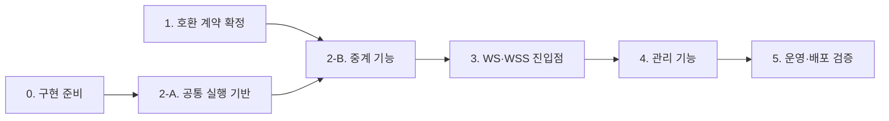

# 구현 작업 목록

이 문서는 vnc-relay 구현에서 할 작업을 단계별로 모은 목록이다. 작업마다 선행 조건과 완료 조건을 적는다. 요구사항·동작·교환 형식은 이 문서에서 정하지 않는다. 각 작업은 기준 문서를 링크하며, 이 목록과 기준 문서가 다르면 기준 문서를 따르고 이 목록을 고친다.

이 목록은 사용자 요청(2026-10-20)으로 만들었다. [문서 유형](README.md)에 속하지 않는 작업 추적용 문서다. 요구사항은 [PRD](requirements/PRD.md), 동작은 [스펙](specs/README.md), 교환 형식은 [계약](contracts/README.md)이 기준이다.

## 사용 규칙

- 단계는 [PRD 11절 구현 순서 제안](requirements/PRD.md#11-구현-순서-제안)을 따른다. 그 앞에 0단계 구현 준비를 둔다.
- `[ ]`는 끝나지 않은 작업이고 `[x]`는 끝난 작업이다. 완료 조건의 검증 증거가 생긴 뒤에만 `[x]`로 바꾼다. 증거는 [검증 기록](AGENTS.md#검증-기록)에 따른 커버리지·결과 보고서와 실행 기록에 둔다. 이 목록에는 결과를 복제하지 않는다.
- 작업 번호는 `단계.순번`이다. 작업을 지워도 번호를 다시 쓰지 않는다.
- "(결정)"이 붙은 작업은 사용자나 담당자의 결정이 필요하다. 결정 전에는 그 결정에 의존하는 작업만 멈추고 나머지는 진행한다.
- 시나리오 ID 뒤의 "(일부)"는 그 작업이 시나리오의 일부만 구현한다는 뜻이다. 시나리오는 마지막 관련 작업이 끝나야 통과로 판정한다.
- 모듈을 처음 만들 때는 모듈 설계를 `Target`으로 먼저 쓴다. 코드 파일이나 호출 경로가 바뀌면 같은 작업에서 코드 지도와 모듈 설계를 갱신한다([작업 순서](../AGENTS.md#작업-순서와-필수-참조)).
- 구현 작업은 완료 조건의 시나리오 테스트를 같은 작업에서 작성한다. 테스트 소스에는 시나리오 메타 정보(예: `relay.md:RLY-001`)를 넣는다. 관련 계약 5절 표의 계약 테스트도 함께 작성하고 그 표의 테스트 위치와 결과를 채운다.

## 단계 흐름

1단계와 2-A는 함께 진행할 수 있다. 2-A는 Repeater 초기 교환 계약(Draft)에 의존하지 않는다. 4.1(관리자 계정 준비 CLI), 4.7(화면 문구), 4.8(토큰 CSS와 공통 컴포넌트)도 앞 단계와 함께 진행할 수 있다.

## 0. 구현 준비

기능 코드를 쓰기 전에 빌드·컨벤션·검증 기반을 만든다. [프로젝트 작업 안내](README.md#프로젝트-작업-안내) 표의 "미작성" 항목을 채운다.

- [ ] **0.1 Rust 작업 공간**: 실행파일 `vnc-relay` 하나를 만드는 Cargo 프로젝트를 만든다. Rust 툴체인 버전을 고정한다.
  - 기준: [PRD 확정 기준](requirements/PRD.md#확정-기준)의 "실행 형태"·"구현 기술" 행, [ADR-0004](decisions/ADR-0004-tokio-rustls.md)
  - 완료 조건: Windows 11 x64와 Ubuntu 24.04 LTS x64에서 빌드하고 `vnc-relay --version`을 실행한다.
- [ ] **0.2 rustls 암호 모듈 선택(OPS-TBD-009, 결정)**: aws-lc-rs와 ring을 두 OS에서 빌드하고 라이선스를 확인한 뒤 고른다. TLS 어댑터 crate(tokio-rustls 등)도 함께 정한다.
  - 기준: [운영 스펙 8절](specs/operations.md#8-미결정-사항), [ADR-0004 후속 작업](decisions/ADR-0004-tokio-rustls.md#후속-작업)
  - 완료 조건: 운영 스펙에서 OPS-TBD-009를 해소하고 [설정 계약 1.9절](contracts/config-v1.md#19-인증서개인키-파일-형식)과 PRD를 갱신한다. [ADR 작성 조건](decisions/AGENTS.md)을 만족하면 ADR을 쓴다.
  - 선행: 0.1
- [x] **0.3 조건부 채택 라이브러리 검토**: axum, tokio-tungstenite, toml·serde, argon2, notify, clap, tracing의 라이선스와 고지 의무를 확인한다.
  - 기준: [PRD 확정 기준](requirements/PRD.md#확정-기준)의 "구현 기술" 행, [OPS-021](specs/operations.md#7-수용-테스트)
  - 완료 조건: 검토 결과를 기록하고 PRD "구현 기술" 행을 확정 상태로 고친다. 조건을 통과하지 못한 라이브러리가 있으면 대안을 사용자에게 묻는다.
  - 선행: 0.1
- [ ] **0.4 코드 컨벤션**: 이름 짓기(용어집 영어 이름 prefix와 suffix 목록), 모듈 배치, 공식 포매터·린터 적용 범위와 확인 방법을 정한다.
  - 기준: [컨벤션 작성 규칙](conventions/AGENTS.md), [용어집](../GLOSSARY.md)
  - 완료 조건: [컨벤션 목록](conventions/README.md)에 등록하고 프로젝트 작업 안내 표를 갱신한다.
  - 선행: 0.1
- [ ] **0.5 테스트 컨벤션**: 시나리오 메타 정보 문법, 테스트 종류(단위·통합·E2E·계약)별 위치, 커버리지·결과 보고 명령과 보고서 위치를 정한다.
  - 기준: [검증 기록](AGENTS.md#검증-기록), [컨벤션 작성 규칙](conventions/AGENTS.md)
  - 완료 조건: 컨벤션 목록에 등록한다.
  - 선행: 0.4
- [ ] **0.6 시나리오 커버리지 보고 도구**: 스펙 수용 테스트 표의 시나리오 ID, 테스트 메타 정보, 테스트 실행 결과를 모아 보고서를 만든다. 테스트가 없는 시나리오는 `미연결`, 없는 시나리오를 가리키는 메타 정보는 `오류`로 표시하고 시나리오별 통과·실패를 보고한다.
  - 기준: [검증 기록](AGENTS.md#검증-기록)
  - 완료 조건: 스펙 5개의 모든 시나리오가 `미연결`로 나오는 보고서를 만든다.
  - 선행: 0.5
- [x] **0.7 코드 지도(Target)**: 초기 교환·매칭·중계·WebSocket·관리·설정·운영 로그의 구성요소와 계획 경로, 레이어별 허용 의존, 의존 위반 확인 방법을 정한다.
  - 기준: [아키텍처 작성 규칙](architectures/AGENTS.md), [PRD 8절](requirements/PRD.md#8-비기능-요구사항)의 유지보수성, [ADR-0003](decisions/ADR-0003-single-instance-memory-state.md)
  - 완료 조건: [아키텍처 목록](architectures/README.md)에 등록하고 프로젝트 작업 안내 표의 코드 지도 행을 갱신한다.
  - 선행: 0.1
- [ ] **0.8 개발 환경·검증 how-to**: 환경·버전·실행 위치, 빌드·테스트 명령, 변경 범위별 검증 명령, 전체 완료 명령과 성공 조건을 쓴다. 두 OS의 차이를 적는다.
  - 기준: [how-to 작성 규칙](how-to/AGENTS.md), [프로젝트 작업 안내](README.md#프로젝트-작업-안내)
  - 완료 조건: [how-to 목록](how-to/README.md)에 등록한다. 프로젝트 작업 안내 표의 실행·검증 행과 루트 [AGENTS.md](../AGENTS.md)의 "구현 코드와 실행·검증 설정은 없다" 문장을 갱신한다.
  - 선행: 0.5, 0.6
- [ ] **0.9 프런트엔드 컨벤션과 검증 방법(DESIGN-TBD-005)**: DESIGN.md YAML에서 토큰 CSS를 만들고 대조하는 방법을 정한다. 정적 파일 구조, 실행파일에 넣는 방식, 컴포넌트 미리보기 위치, 시안 대조·접근성·브라우저 확인 방법도 정한다. 빌드 단계와 JS 의존성은 두지 않는다.
  - 기준: [디자인 기준 미결정 사항](design/DESIGN.md#미결정-사항), [컨벤션 작성 규칙](conventions/AGENTS.md), [frontend-workflow 6절](../.agents/skills/frontend-workflow/references/frontend-workflow.md#6-검증-환경과-통과-기준)
  - 완료 조건: DESIGN-TBD-005를 해소하고 [디자인 기준 검증 절](design/DESIGN.md#검증)에 how-to를 연결한다.
  - 선행: 0.4, 0.8

## 1. 호환 계약 확정

Mode I·II 초기 흐름을 추정 없이 설명할 수 있게 한다. 관찰은 [Repeater 초기 교환 계약 6절](contracts/repeater-handshake-v1.md#6-초안을-확정하기-전에-해결할-사항)을 따른다. UltraVNC·websockify·noVNC 소스 코드는 관찰·분석에 쓰지 않는다.

- [ ] **1.1 관찰 허용 검토(결정)**: 패킷 관찰의 사용 권한과 법적 허용 여부를 관할법·제품 약관 기준으로 검토한다. 프로젝트 소유자가 판단한다.
  - 기준: [PRD 9절](requirements/PRD.md#9-호환성-조사와-독립-구현-원칙), [관찰 절차 1단계](contracts/repeater-handshake-v1.md#61-관찰-절차), [OPS-TBD-005](specs/operations.md#8-미결정-사항)
  - 완료 조건: 검토 결과가 호환성 검증 기록에 있다. 검토 전에는 1.4를 시작하지 않는다.
- [ ] **1.2 호환성 검증 기록 문서**: 관찰 증거와 호환성 검증 결과를 남길 문서를 만든다. 위치는 [문서 배치](AGENTS.md#문서-배치) 규칙에 맞춰 정한다.
  - 기준: [기록할 증거](contracts/repeater-handshake-v1.md#62-기록할-증거)
  - 완료 조건: 초기 교환 계약과 [OPS-020](specs/operations.md#7-수용-테스트)이 이 문서를 링크한다.
- [ ] **1.3 검증 대상 버전 고정(RLY-TBD-001·WS-TBD-005)**: 공식 최신 안정판 UltraVNC Server·Viewer·Repeater와 noVNC의 버전, 배포본 해시, 받은 날짜·주소, OS를 기록하고 고정한다.
  - 기준: [미결정 항목의 해소 조건](contracts/repeater-handshake-v1.md#63-미결정-항목의-해소-조건)
  - 완료 조건: 호환성 검증 기록을 작성한다. PRD "호환 버전" 행, [중계 스펙 8절](specs/relay.md#8-미결정-사항), [WebSocket 스펙 8절](specs/websocket.md#8-미결정-사항)을 갱신한다.
  - 선행: 1.2
- [ ] **1.4 통제된 환경에서 관찰**: 인터넷과 분리한 테스트 네트워크에서 관찰 절차 5단계의 시나리오(Mode I, Mode II, 오류, 분할·후속 바이트, 종료·재접속, 외부 WebSocket)를 각각 2회 이상 실행하고 캡처한다.
  - 기준: [관찰 절차](contracts/repeater-handshake-v1.md#61-관찰-절차)
  - 완료 조건: 기록할 증거 표의 모든 항목을 기록한다.
  - 선행: 1.1, 1.3
- [ ] **1.5 초기 교환 계약 채택(RLY-TBD-002, 결정)**: 계약 1절 표의 "관찰로 확정할 항목"에 증거를 연결하고 증거 기반 표로 바꾼다. 오류 응답 바이트(메시지D)가 있는지 확인한다. 2절 오류 코드 이름을 정한다.
  - 기준: [Repeater 초기 교환 계약](contracts/repeater-handshake-v1.md), [중계 스펙 8절](specs/relay.md#8-미결정-사항)
  - 완료 조건: 프로젝트 소유자가 채택해 계약이 Active가 된다. 중계 스펙 8절을 갱신하고, 필요하면 [WebSocket 중계 계약](contracts/websocket-relay-v1.md)의 close 코드 대응도 고친다.
  - 선행: 1.4
- [ ] **1.6 중복 ID 정책(RLY-TBD-003, 결정)**: 대상 버전에서 같은 역할 중복 중계 ID의 결과를 기록한다. 제안 정책(후발 거절)과 같으면 채택한다. 다르면 차이를 기록하고 프로젝트 소유자가 정책을 고른다.
  - 기준: [미결정 항목의 해소 조건](contracts/repeater-handshake-v1.md#63-미결정-항목의-해소-조건), [중계 스펙 3.3절](specs/relay.md#33-mode-ii)
  - 완료 조건: 초기 교환 계약 2절, 중계 스펙 3.3절, PRD를 갱신한다.
  - 선행: 1.4
- [ ] **1.7 관찰 결과를 다른 계약에 반영**: 중계 ID의 JSON 문자열 표현과 고정 버전 noVNC가 보내는 `Sec-WebSocket-Protocol` 값을 관찰 결과로 확정한다.
  - 기준: [관리 API 계약 6절](contracts/management-api-v1.md#6-초안을-확정하기-전에-해결할-사항), [WebSocket 중계 계약 6절](contracts/websocket-relay-v1.md#6-초안을-확정하기-전에-해결할-사항)
  - 완료 조건: 두 계약 6절의 해당 항목을 해소한다.
  - 선행: 1.4

## 2. TCP Repeater

단계 완료 조건은 AC-01~04와 관련 AC-06~08·AC-15·AC-18·AC-26 통과다([PRD 11절](requirements/PRD.md#11-구현-순서-제안)).

### 2-A. 공통 실행 기반

- [ ] **2.1 설정 로더**: TOML 설정 파일을 읽고 검증해 유효 설정을 만든다. 키 표, IP 항목·Origin·Mode I 대상 문법, 값 관계 검사, 필수 키, 진단 수집을 구현한다.
  - 기준: [설정 계약 1·2절](contracts/config-v1.md#1-형식과-의미), [운영 스펙 3.1절](specs/operations.md#31-설정-검증과-시작)
  - 완료 조건: OPS-001(일부), OPS-038(일부), OPS-040(일부). [설정 계약 5절](contracts/config-v1.md#5-예제와-계약-테스트)의 설정 로더 계약 테스트.
  - 선행: 0.1, 0.5
- [ ] **2.2 `serve` 시작과 CLI 골격**: 하위 명령 처리, 사용법 오류, 오류 출력 형식, 종료 코드를 구현한다. 시작 순서(설정 검증, 관리자 계정 파일 읽기, 리스너 열기)와 준비 실패 때 자원 회수를 구현한다.
  - 기준: [CLI 계약 1.1·1.5·1.7·1.8·2절](contracts/cli-v1.md#1-형식과-의미), [운영 스펙 3.1절](specs/operations.md#31-설정-검증과-시작)
  - 완료 조건: OPS-001, OPS-002(일부), OPS-039. [CLI 계약 5절](contracts/cli-v1.md#5-예제와-계약-테스트)의 `serve` 계약 테스트.
  - 선행: 2.1
- [ ] **2.3 운영 로그 출력**: JSON Lines 출력(표준 출력·파일), 공통 필드, `level`, 중계 ID의 키 있는 해시(`relay_id_ref`), `peer_ip` 표기, 로그에 넣지 않는 값 규칙을 구현한다. 사건은 각 기능 작업에서 추가한다.
  - 기준: [운영 정보 계약 1.1~1.4·1.9~1.11절](contracts/ops-info-v1.md#1-형식과-의미)
  - 완료 조건: OPS-012(일부). [운영 정보 계약 5절](contracts/ops-info-v1.md#5-예제와-계약-테스트)의 공통 규칙 계약 테스트.
  - 선행: 2.1
- [ ] **2.4 TCP 진입점과 출발지 IP 검사**: TCP Viewer·TCP Server 진입점을 연다. 접속 수락 직후, 데이터를 읽기 전에 그 진입점의 출발지 IP 허용 목록을 검사한다. 전체 허용 항목은 경고를 기록한다.
  - 기준: [중계 스펙 3.1절](specs/relay.md#31-초기-교환), [운영 스펙 4절](specs/operations.md#4-보안과-신뢰-경계), [ADR-0002](decisions/ADR-0002-source-ip-allowlist.md)
  - 완료 조건: RLY-023, RLY-024, OPS-037(일부), OPS-038(일부)
  - 선행: 2.2, 2.3
- [ ] **2.5 연결 상한과 시간 제한**: 중계 측 연결 상한 L과 관리·상태 연결 상한 Lm을 따로 센다. Mode I 대상 연결도 L에 센다. 대기 상한 Lw, 초기 교환 시간 H, TCP keepalive를 적용한다.
  - 기준: [운영 스펙 2절](specs/operations.md#2-상태와-검증-매개변수)과 [4.1절](specs/operations.md#41-판정-가능한-규칙)의 OPS-R03·OPS-R20, [설정 계약 1.2절](contracts/config-v1.md#12-키-표)
  - 완료 조건: OPS-004, OPS-023(일부), OPS-033(일부)
  - 선행: 2.4
- [ ] **2.6 상태 리스너**: `/livez`·`/readyz`를 관리 리스너와 다른 리스너에서 인증 없이 응답한다. 다른 필수 리스너보다 먼저 연다. 연결은 Lm으로 센다.
  - 기준: [운영 정보 계약 1.12·2절](contracts/ops-info-v1.md#112-상태-리스너와-엔드포인트)
  - 완료 조건: OPS-013(일부), OPS-032
  - 선행: 2.2, 2.5

### 2-B. 중계 기능

1.5에서 초기 교환 계약을 채택하기 전에는 초기 교환 바이트 형식을 추정해 구현하지 않는다.

- [ ] **2.7 초기 교환 처리**: 채택된 계약대로 초기 교환 요청을 해석한다. 분할·병합 수신, 후속 바이트 보존, 크기 상한 I, 시간 H, 비활성 모드 거절을 구현한다.
  - 기준: [중계 스펙 3.1절](specs/relay.md#31-초기-교환), [Repeater 초기 교환 계약](contracts/repeater-handshake-v1.md)
  - 완료 조건: RLY-001~005, RLY-022, OPS-006(일부)
  - 선행: 1.5, 2.5
- [ ] **2.8 Mode I**: 대상 주소를 해석하고 실제 연결할 IP·포트에 대상 허용 정책을 적용한다. 주소 해석 실패·연결 거절·시간 C 초과를 구분한다.
  - 기준: [중계 스펙 3.2절](specs/relay.md#32-mode-i), [설정 계약 1.5절](contracts/config-v1.md#15-mode-i-대상-허용-항목-문법)
  - 완료 조건: RLY-006~009, OPS-023
  - 선행: 2.7
- [ ] **2.9 Mode II 매칭**: 대기 등록, 양쪽 접속 순서, 원자적 매칭, 대기 시간 W 만료, 대기 상한 Lw, 중복 ID 정책, 세션 식별자 발급을 구현한다.
  - 기준: [중계 스펙 3.3절](specs/relay.md#33-mode-ii)
  - 완료 조건: RLY-010~016, OPS-005
  - 선행: 1.6, 2.7
- [ ] **2.10 양방향 중계와 종료**: 바이트 순서·내용 보존, 버퍼 B에 맞춘 읽기 제어, 한쪽 EOF 뒤 정리 제한 시간 E, 연결 오류 격리, 종료 원인 기록, 방향별 전송량 집계를 구현한다.
  - 기준: [중계 스펙 3.4절](specs/relay.md#34-중계와-eof), [관리 스펙 2.1절](specs/management.md#21-전송량의-의미)
  - 완료 조건: RLY-017~021, MGT-005(일부)
  - 선행: 2.8 또는 2.9
- [ ] **2.11 끊긴 연결 감지**: TCP keepalive로 응답 없는 대기 연결·활성 세션을 시간 K 안에 회수한다. 상대가 응답하는 유휴 연결은 유지한다.
  - 기준: [중계 스펙 2.1절](specs/relay.md#21-판정-가능한-규칙)의 RLY-R18·RLY-R19
  - 완료 조건: RLY-025~027
  - 선행: 2.10
- [ ] **2.12 중계 사건 로그**: 접속 수락·거절, 대기 등록, 매칭, 대상 연결 실패, 세션 종료 사건을 기록한다.
  - 기준: [운영 정보 계약 1.5~1.7절](contracts/ops-info-v1.md#15-사건-목록)
  - 완료 조건: OPS-011(일부), OPS-012(일부). 운영 정보 계약 5절의 해당 계약 테스트.
  - 선행: 2.3, 2.10
- [ ] **2.13 2단계 완료 확인**: 고정한 버전의 실제 UltraVNC Server·Viewer로 Mode I·II의 화면과 입력을 확인한다.
  - 기준: [PRD 10절](requirements/PRD.md#10-검증-및-수용-기준)
  - 완료 조건: AC-01~04, AC-06~08·AC-15·AC-18·AC-26의 TCP 부분 통과
  - 선행: 1.3, 2.6~2.12

## 3. WS·WSS 진입점

단계 완료 조건은 WS·WSS 각각 AC-05·AC-16~17·AC-33과 WebSocket 관련 경계·종료 검증 통과다.

- [ ] **3.1 내장 TLS**: rustls로 TLS를 종료한다. PEM 인증서·개인키를 읽고 TLS 1.2 미만 협상은 거절한다. 지원하는 개인키 종류(RSA·ECDSA 등)를 확인해 설정 계약 1.9절에 적는다. WSS와 관리 HTTPS가 함께 쓴다.
  - 기준: [ADR-0001](decisions/ADR-0001-built-in-tls.md), [ADR-0004](decisions/ADR-0004-tokio-rustls.md), [설정 계약 1.9절](contracts/config-v1.md#19-인증서개인키-파일-형식)
  - 완료 조건: OPS-036, WS-013, OPS-002
  - 선행: 0.2, 2.2
- [ ] **3.2 WebSocket 업그레이드**: WS·WSS Viewer 진입점, 업그레이드 경로·헤더 검사 순서, 서브프로토콜, Origin 정확 일치, 업그레이드 직전 IP 재검사, 업그레이드·TLS 시간 U를 구현한다. 평문 WS는 설정으로 켰을 때만 열고 시작 경고를 기록한다.
  - 기준: [WebSocket 중계 계약 1.1~1.3·2.1절](contracts/websocket-relay-v1.md#11-업그레이드-요청), [WebSocket 스펙 3절](specs/websocket.md#3-정상-흐름과-규칙), [설정 계약 1.4절](contracts/config-v1.md#14-origin-값-문법과-비교)
  - 완료 조건: WS-012, WS-014~015, WS-021, WS-023~024, WS-027, OPS-006, OPS-016, OPS-037
  - 선행: 2.4, 3.1
- [ ] **3.3 바이너리 메시지 중계**: 바이너리 메시지를 중계 스트림으로 바꾼다. 텍스트 메시지 거절, ping·pong, 분할 프레임, 메시지 크기 M, 버퍼 B를 처리한다. M이 B보다 클 때의 처리를 확인해 기록한다.
  - 기준: [WebSocket 중계 계약 1.4절](contracts/websocket-relay-v1.md#14-데이터-메시지와-제어-프레임), [WebSocket 스펙 8절](specs/websocket.md#8-미결정-사항)의 WS-TBD-004
  - 완료 조건: WS-007~011, WS-018~019. WS-TBD-004를 해소한다.
  - 선행: 2.7, 3.2
- [ ] **3.4 WebSocket 종료와 끊긴 연결 감지**: close 코드, 종료 의미, 서버 ping 주기 Kw를 구현한다. 잘못된 프레임에 WebSocket 라이브러리가 자동으로 보내는 종료 코드가 계약과 같은지 확인한다.
  - 기준: [WebSocket 중계 계약 1.5·1.6·2.2절](contracts/websocket-relay-v1.md#15-close-코드)
  - 완료 조건: WS-016~017, WS-026
  - 선행: 3.3
- [ ] **3.5 전송·모드 조합 검증**: WS·WSS와 Mode I·II의 모든 조합, noVNC·websockify 없는 배포, 고정 버전 noVNC `repeaterID` 상호운용을 확인한다.
  - 기준: [WebSocket 스펙 6절](specs/websocket.md#6-전송모드-검증-조합)
  - 완료 조건: WS-001~006, WS-020, WS-025. AC-05·AC-16~17·AC-33 통과.
  - 선행: 1.3, 2.8, 2.9, 3.4

## 4. 관리 기능

단계 완료 조건은 AC-09~10, AC-14의 계정 준비 검증, AC-19~22, AC-25, AC-27~28, AC-30~31, AC-36 통과다.

### 4-A. 관리자 계정과 관리 API

- [ ] **4.1 관리자 계정 준비 CLI**: `vnc-relay admin add|passwd|remove|list`, 숨김 비밀번호 입력, Argon2id 해시, 관리자 계정 파일의 원자적 교체를 구현한다. 먼저 CLI 계약 6절의 Windows 확인 사항(콘솔 신호·파일 권한·코드 페이지)과 Unix 권한 경고·잠금 파일의 필요성을 확인한다.
  - 기준: [CLI 계약 1.1~1.6절](contracts/cli-v1.md#1-형식과-의미), [CLI 계약 6절](contracts/cli-v1.md#6-초안을-확정하기-전에-해결할-사항), [운영 스펙 3.2절](specs/operations.md#32-로컬-cli-계정-준비)
  - 완료 조건: OPS-029(일부), OPS-030. CLI 계약 5절의 `admin` 계약 테스트.
  - 선행: 2.2
- [ ] **4.2 관리 리스너**: 관리 HTTPS와 루프백 전용 평문 HTTP, 요청 처리 순서, 실제 소켓 상대 주소 사용, Lm 집계를 구현한다.
  - 기준: [관리 API 계약 1.1~1.3절](contracts/management-api-v1.md#1-형식과-의미), [운영 스펙 4.1절](specs/operations.md#41-판정-가능한-규칙)의 OPS-R18
  - 완료 조건: OPS-014, OPS-034, MGT-015, OPS-033(일부)
  - 선행: 2.5, 3.1
- [ ] **4.3 로그인과 관리 세션**: 로그인·로그아웃·세션 정보, 관리 세션 쿠키, CSRF 토큰, 유휴 만료 Si·절대 수명 Sa, 자동 폴링 표시, 로그인 실패 제한, 재시작 무효를 구현한다. 관리 API 계약 6절에 남은 브라우저 기본 인증 창, 로그인 CSRF 방어, 로그인 응답 시간 판정 방법을 확인한다.
  - 기준: [관리 API 계약 1.4·1.5절](contracts/management-api-v1.md#14-관리-세션), [관리 스펙 3.0절](specs/management.md#30-관리자-로그인과-세션), [관리 API 계약 6절](contracts/management-api-v1.md#6-초안을-확정하기-전에-해결할-사항)
  - 완료 조건: MGT-014, MGT-017~020, MGT-022, MGT-025, MGT-027, OPS-029. 조회·종료 경로가 필요한 시나리오는 4.4·4.5에서 마무리한다.
  - 선행: 4.1, 4.2
- [ ] **4.4 조회 API**: 서버 요약, 대기 연결 목록, 활성 세션 목록·상세, 최근 종료 목록(최대 개수 R), 폴링 주기 전달을 구현한다. 한 응답 안의 기준 시점 일관성을 지킨다. IPv4 매핑 IPv6 주소의 표기와 `server_shutdown` 항목이 조회되는지 확인한다.
  - 기준: [관리 API 계약 1.6~1.8·1.10·1.12절](contracts/management-api-v1.md#1-형식과-의미), [관리 스펙 2절](specs/management.md#2-조회-대상과-상태)
  - 완료 조건: MGT-001~007, MGT-013, MGT-016, MGT-021, MGT-023~024, MGT-026, OPS-033
  - 선행: 2.10, 3.3, 4.3
- [ ] **4.5 관리자 종료 API**: 세션 식별자로 지정한 활성 세션 하나만 정리하고, 정리가 끝난 뒤 응답한다. 관리자 종료 사건 로그에 계정명을 기록한다.
  - 기준: [관리 API 계약 1.9절](contracts/management-api-v1.md#1-형식과-의미), [관리 스펙 3.2절](specs/management.md#32-관리자-종료), [운영 정보 계약 1.8절](contracts/ops-info-v1.md#18-관리자-계정명-기록-규칙)
  - 완료 조건: MGT-008~012, OPS-011
  - 선행: 4.4
- [ ] **4.6 정적 대시보드 제공**: 실행파일에 넣은 정적 파일을 관리 리스너가 제공한다. 인증 없이 받을 수 있는 파일은 로그인 화면에 필요한 파일뿐이다.
  - 기준: [관리 API 계약 1.11절](contracts/management-api-v1.md#111-정적-대시보드-경로와-비인증-접근-범위)
  - 완료 조건: [관리 API 계약 5절](contracts/management-api-v1.md#5-예제와-계약-테스트)의 정적 경로 계약 테스트, DASH-014(일부)
  - 선행: 0.9, 4.2

### 4-B. 대시보드 화면

[frontend-workflow](../.agents/skills/frontend-workflow/SKILL.md)의 5단계(구현과 대조)를 따른다. [디자인 기준](design/DESIGN.md)과 [HTML 시안](design/mockups/dashboard.html)은 2026-10-20에 채택됐다. 시안 검토 결과는 구현 검증의 증거가 아니다.

- [ ] **4.7 화면 문구 확정(DASH-TBD-003, 결정)**: 로그인·세션 오류를 포함한 화면 문구를 한국어와 영어로 정한다. 시안의 문구는 예시다.
  - 기준: [화면 스펙 8절](specs/dashboard.md#8-미결정-사항), [화면 언어](specs/dashboard.md#화면-언어)
  - 완료 조건: 화면 스펙에서 DASH-TBD-003을 해소한다.
- [ ] **4.8 토큰 CSS와 공통 컴포넌트**: DESIGN.md YAML에서 토큰 CSS를 만든다. Components 절의 공통 컴포넌트와 미리보기를 구현한다. 새 컴포넌트의 책임과 API는 모듈 설계에 적는다.
  - 기준: [디자인 기준](design/DESIGN.md), 0.9의 프런트엔드 컨벤션
  - 완료 조건: 프런트엔드 컨벤션이 정한 토큰 대조와 미리보기 확인을 통과한다.
  - 선행: 0.9
- [ ] **4.9 화면 언어와 로그인 화면(SCR-003)**: 브라우저 선호 언어 자동 선택, 고른 언어 저장, 문서 언어 정보, 로그인 입력 검증과 실패 안내를 구현한다.
  - 기준: [화면 스펙 3절 SCR-003](specs/dashboard.md#scr-003-관리자-로그인), [화면 언어](specs/dashboard.md#화면-언어)
  - 완료 조건: DASH-017~018, DASH-024~025
  - 선행: 4.3, 4.6, 4.7, 4.8
- [ ] **4.10 운영 현황(SCR-001)**: 서버 요약, 연결 사용량, 대기 연결, 활성 세션, 최근 종료 목록을 구현한다. 시각·전송량 표시 형식, 폴링 주기 P와 조회 중첩 방지, 조회 실패와 빈 결과 구분, 권한 없음 처리, 로그아웃도 구현한다. 전송량이 2^53 − 1 바이트를 넘을 때 표시가 정확한지 확인한다.
  - 기준: [화면 스펙 3절](specs/dashboard.md#3-화면-구성과-와이어프레임)·[4절](specs/dashboard.md#4-화면-상태와-갱신), [디자인 기준 표시 형식](design/DESIGN.md#표시-형식)
  - 완료 조건: DASH-001~005, DASH-008, DASH-016, DASH-019~022
  - 선행: 4.4, 4.9
- [ ] **4.11 세션 상세와 관리자 종료(SCR-002)**: 세션 상세, 대상 소멸, 종료 확인 대화상자, 종료 결과 불명 처리, 관리 세션 없는 직접 진입을 구현한다.
  - 기준: [화면 스펙 SCR-002](specs/dashboard.md#scr-002-세션-상세), [화면 스펙 5절](specs/dashboard.md#5-입력-검증과-종료-오류)
  - 완료 조건: DASH-006~007, DASH-009~014
  - 선행: 4.5, 4.10
- [ ] **4.12 시안 대조와 화면 호환**: 구현 화면을 채택된 시안과 같은 폭·같은 상태로 대조하고 차이를 해소한다. 데스크톱·모바일 폭, 최신 Chrome·Edge·Firefox·Safari, 키보드 이동, 긴 값을 확인한다.
  - 기준: [HTML 시안](design/mockups/dashboard.html), [화면 스펙 6절](specs/dashboard.md#6-화면-크기와-접근성)
  - 완료 조건: DASH-015, DASH-023. 디자인 기준 검증 표에서 미실행인 스크린 리더·Firefox·Safari·Edge·실제 모바일 기기 확인.
  - 선행: 4.9~4.11
- [ ] **4.13 4단계 완료 확인**: 관리 기능 단계의 수용 기준을 확인한다.
  - 기준: [PRD 10절](requirements/PRD.md#10-검증-및-수용-기준)
  - 완료 조건: AC-09~10, AC-14의 계정 준비 검증, AC-19~22, AC-25, AC-27~28, AC-30~31, AC-36 통과
  - 선행: 4.1~4.12

## 5. 운영·배포 검증

단계 완료 조건은 AC-11~14·AC-23~24·AC-29·AC-32·AC-34~35와 전체 수용 기준 충족이다.

- [ ] **5.1 파일 감지 세부 확정(OPS-TBD-007, 결정)**: 플랫폼별 파일 알림, 변경 안정화, 교체 저장 감지, 동시성 처리 방식을 정한다.
  - 기준: [운영 스펙 3.3절](specs/operations.md#33-파일-변경-자동-감지와-부분-재로드)·[8절](specs/operations.md#8-미결정-사항)
  - 완료 조건: 운영 스펙에서 OPS-TBD-007을 해소한다.
- [ ] **5.2 자동 부분 재로드**: 설정 파일과 인증서·개인키 파일의 변경을 OS 알림과 주기 확인(Dp)으로 감지한다. 안정된 뒤 D 안에 재로드 후보를 검증해 원자적으로 적용한다. 재시작 필요 비교, 최신 후보만 적용, 감지 장애 처리, 재로드 사건 로그를 구현한다.
  - 기준: [운영 스펙 3.3절](specs/operations.md#33-파일-변경-자동-감지와-부분-재로드), [설정 계약 1.8절](contracts/config-v1.md#18-재로드-구분)·[2.3절](contracts/config-v1.md#23-재로드-결과)
  - 완료 조건: OPS-003, OPS-024~028, OPS-035, OPS-038, OPS-040, OPS-041, WS-022
  - 선행: 2.1, 3.2, 5.1
- [ ] **5.3 정상 종료와 재시작**: 신규 접속 중지, 미완성 작업 정리, 종료 유예 G, 유예 중 관리 처리, 두 번째 종료 요청의 즉시 정리를 구현한다. Windows 콘솔 닫기·로그오프 신호 처리를 확인한다.
  - 기준: [운영 스펙 3.4절](specs/operations.md#34-정상-종료와-재시작), [CLI 계약 1.8절](contracts/cli-v1.md#18-수동-시작과-종료)
  - 완료 조건: OPS-007~010, OPS-013, OPS-042~043
  - 선행: 2.6, 2.10, 4.5
- [ ] **5.4 성능 목표와 측정(OPS-TBD-004, 결정)**: 측정 환경과 처리량·추가 지연·CPU·메모리의 합격 수치를 정한다. 그 뒤 두 OS에서 활성 100세션을 측정한다.
  - 기준: [PRD 8절](requirements/PRD.md#8-비기능-요구사항), [운영 스펙 6절](specs/operations.md#6-비기능호환성출처-수용-조건)
  - 완료 조건: OPS-TBD-004를 해소한다. OPS-017~018.
  - 선행: 2.13, 3.5
- [ ] **5.5 호환성 검증**: 1.3에서 고정한 버전으로 모든 모드·전송 조합을 실행하고 결과와 차이를 호환성 검증 기록에 남긴다.
  - 기준: [운영 스펙 6절](specs/operations.md#6-비기능호환성출처-수용-조건), [WebSocket 스펙 6절](specs/websocket.md#6-전송모드-검증-조합)
  - 완료 조건: OPS-020
  - 선행: 1.2, 2.13, 3.5
- [ ] **5.6 배포 산출물**: 두 OS용 실행파일, 비밀 없는 설정 예시, 수동 운영 안내를 만든다. 안내에는 계정 준비·시작·재로드·종료, 인증서 교체 절차, 로그 보관·접근 권장 사항을 넣는다. 로그 파일을 교체할 때 서버가 파일을 다시 여는지 확인한다.
  - 기준: [PRD 확정 기준](requirements/PRD.md#확정-기준)의 "배포 산출물" 행, [ADR-0001 후속 작업](decisions/ADR-0001-built-in-tls.md#후속-작업), [설정 계약 6절](contracts/config-v1.md#6-초안을-확정하기-전에-해결할-사항)
  - 완료 조건: OPS-019, OPS-031
  - 선행: 4.1, 5.2, 5.3
- [ ] **5.7 출처·라이선스(OPS-TBD-005, 결정)**: 원본 코드를 복사·번역·포팅하지 않았다는 검토 기록, 의존성 라이선스·고지 목록, 대시보드 JS 의존성 없음 확인을 만든다. 저작권자와 적용 연도를 확정한 MIT LICENSE를 쓴다. 저작권자와 연도는 프로젝트 소유자가 정한다.
  - 기준: [운영 스펙 6절](specs/operations.md#6-비기능호환성출처-수용-조건), [PRD 12절](requirements/PRD.md#12-미확정-결정과-주요-위험)
  - 완료 조건: OPS-021. OPS-TBD-005를 해소한다.
  - 선행: 0.3
- [ ] **5.8 구조 대조**: 코드 지도·모듈 설계와 실제 코드의 책임 위치를 대조하고 코드 지도를 `Current`로 바꾼다.
  - 기준: [아키텍처 작성 규칙](architectures/AGENTS.md)
  - 완료 조건: OPS-022
  - 선행: 0.7
- [ ] **5.9 전체 수용 기준 확인**: 커버리지 보고서와 계약 테스트 결과로 전체 범위를 확인한다.
  - 기준: [PRD 10절](requirements/PRD.md#10-검증-및-수용-기준), [검증 기록](AGENTS.md#검증-기록)
  - 완료 조건: 모든 스펙 시나리오가 연결·통과하고 `미연결`·`오류`·실패가 0건이다. PRD AC-01~36을 충족한다. 스펙·계약의 상태와 지원 범위 문장을 실제 결과에 맞춰 갱신한다.
  - 선행: 0~4단계와 5.1~5.8
