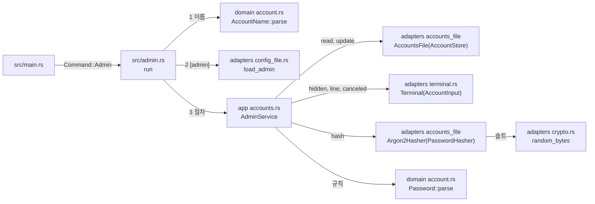

# 관리자 계정 준비 CLI 모듈 설계

`vnc-relay admin add|passwd|remove|list`가 관리자 계정 파일을 읽고 바꾸는 구조를 다룬다. 이름 검사와 설정 읽기, 숨김 비밀번호 입력, Argon2id 해시, 잠금 파일과 임시 파일을 쓴 원자적 교체가 대상이다. 명령별 순서와 출력은 [CLI 계약 1.5·1.6절](../contracts/cli-v1.md#15-입력과-출력-규칙)을 따른다.

| 항목 | 값 |
| --- | --- |
| 구조 시점 | Current |
| 문서 상태 | Draft |
| 구현 대조 | 미대조 — 2026-10-21 변경(Windows 콘솔 입력 모드 저장·복원, 5절·7절)은 아직 대조하지 않았다. 이전 대조는 [대조 기록](#대조-기록)에 있다. |
| 코드 위치 | `crates/domain/src/account.rs`(`Password`), `crates/app/src/accounts.rs`(`AdminService`, `AdminFailure`, `AccountsWarning`, `LoadedAccounts`), `crates/app/src/ports.rs`(`AccountStore`, `AccountInput`, `PasswordHasher`), `crates/adapters/src/accounts_file.rs`·`crates/adapters/src/accounts_file/`(`AccountsFile`, `HashFloor`, `Argon2Hasher`), `crates/adapters/src/terminal.rs`(`Terminal`), `crates/adapters/src/terminal/windows_console.rs`(`SavedInputMode`, Windows 전용), `crates/adapters/src/config_file.rs`(`load_admin`), `src/cli.rs`(`Command::Admin`), `src/admin.rs` |
| 코드 지도 | [코드 지도 2절](code-map.md#2-코드-위치와-구성요소), [3절](code-map.md#3-진입점) |
| 관련 스펙 | [운영 스펙 3.2절](../specs/operations.md#32-로컬-cli-계정-준비), OPS-R15, OPS-029(일부: 로그인 제외), OPS-030 |
| 관련 계약 | [CLI 계약](../contracts/cli-v1.md) 1.1~1.6절·2절, [설정 계약 1.2절](../contracts/config-v1.md#12-키-표)(`[admin]`) |
| 관련 ADR | 없음 |

## 1. 책임과 경계

- 맡는 책임:
  - 명령 해석: `admin add <account>`, `admin passwd <account>`, `admin remove <account> [--yes]`, `admin list`. 모두 `--config <path>`가 필요하다. 사용법 오류는 `usage_error`(종료 코드 2)이고 사용법을 함께 쓴다.
  - 이름 검사: 설정을 읽기 전에 계정 이름 규칙(1.2절)을 검사한다. 어기면 `account_name_invalid`(종료 코드 2)다. 사용법은 쓰지 않는다.
  - 설정 읽기: 설정 파일의 TOML 구문 전체와 `[admin]` 테이블만 검사한다. 다른 테이블은 보지 않는다. 오류는 `config_*`(종료 코드 3)다.
  - 계정 파일 읽기: `serve`와 같은 1.3·1.4절 검사를 한다. 다만 해시 매개변수가 하한 미만이어도 받는다. 상한을 넘는 매개변수가 하나라도 있으면 하한 미만이 함께 있어도 `accounts_file_invalid`로 거절한다(`serve`는 같은 해시를 하한 미만으로 보고한다). 경고는 내지 않는다(사용자 결정 2026-10-20). 하한 미만 해시를 `admin passwd`로 바꿀 수 있어야 하기 때문이다. Ubuntu에서 그룹·기타 권한이 있으면 `accounts_file_permissive`를 경고한다.
  - 비밀번호 입력: 첫 입력 → 규칙 검사 → 확인 입력 → 비교. 표준 입력이 터미널이 아니면 `not_interactive`다. Ctrl+C와 빈 입력의 Ctrl+D(EOF)는 `input_canceled`다. Unix에서는 터미널 표시 설정을 되돌린다. Windows에서는 콘솔 입력 모드를 읽기 전에 저장하고 끝난 뒤 되돌린다(7절).
  - 해시: 설정의 `admin.argon2` 값과 운영체제 난수원의 16바이트 솔트로 Argon2id PHC 문자열을 만든다.
  - 저장: 1.6절 1~7단계. 잠금 파일, 다시 읽기, 임시 파일(Ubuntu `0600`), 디스크 반영과 검증, 교체, 디렉터리 반영(Ubuntu), 잠금 해제.
  - 출력: 성공 문장은 stdout, 프롬프트·오류·경고·`notice`는 stderr. 비밀번호와 해시는 어디에도 쓰지 않는다.
- 맡지 않는 책임:
  - 로그인 검증. 작업 4.3이 같은 해시 문자열을 읽어 검증한다.
  - Windows 접근 제어 목록 설정과 권한 경고. CLI는 바꾸지 않고 경고도 하지 않는다. 안내만 한다(사용자 결정 2026-10-20, [CLI 계약 1.6절](../contracts/cli-v1.md#16-저장과-파일-권한)).
  - 오래된 잠금 파일 지우기. 운영자가 지운다. `accounts_file_locked` 메시지가 방법을 알린다(사용자 결정 2026-10-20).
  - 운영 로그. `admin` 명령은 운영 로그를 쓰지 않는다.
- 다른 모듈에 공개하는 기능:
  - `vnc_relay_domain::account::{Password, PasswordError}`
  - `vnc_relay_app::accounts::{AdminService, AdminFailure, LoadedAccounts, AccountsWarning, list}`
  - `vnc_relay_app::ports::{AccountStore, AccountInput, InputError, PasswordHasher, HashError}`
  - `vnc_relay_adapters::accounts_file::{AccountsFile, HashFloor, Argon2Hasher, load, parse}`
  - `vnc_relay_adapters::terminal::Terminal`
  - `vnc_relay_adapters::config_file::load_admin`

## 2. 내부 구조

화살표는 실행 중 호출이다. crate 의존 방향은 [코드 지도 레이어 표](code-map.md#레이어와-의존-방향)를 따른다.

| 요소(파일·심볼) | 역할 | 만들어지는 시점과 소유자 | 의존 대상 |
| --- | --- | --- | --- |
| `crates/domain/src/account.rs` `Password`, `PasswordError` | 비밀번호 규칙(1.2절): 12~128자, UTF-8 512바이트 이하, 제어 문자(`char::is_control`) 없음. `Debug`는 값을 가린다. | 입력을 검사할 때 | 없음 |
| `crates/app/src/accounts.rs` `AdminService` | 명령별 절차(1.5절 순서). 포트 세 개와 해시 매개변수를 받는다. 경고는 호출한 쪽의 함수로 넘긴다. | `src/admin.rs`가 명령마다 하나 | `ports`, domain |
| `crates/app/src/accounts.rs` `AdminFailure` | 절차 실패: `NotInteractive`, `AccountExists(AccountName)`, `AccountNotFound(AccountName)`, `PasswordInvalid(String)`, `PasswordMismatch`, `InputCanceled`, `RuntimeUnavailable(String)`, `Accounts(Vec<AccountsDiagnostic>)`(계정 파일 진단). 코드와 메시지를 준다. `report`가 줄을 쓴다. | 반환 값 | domain |
| `crates/app/src/accounts.rs` `AccountsWarning` | `FilePermissive`, `LastAccountRemoved`, `CleanupFailed(String)`. `code`와 `message`를 준다. `serve`는 `load`가 돌려준 경고를 같은 코드와 메시지로 stderr에 쓴다. | 반환 값 | 없음 |
| `crates/app/src/ports.rs` `AccountStore` | `read`(파일이 없으면 `None`)와 `update`(잠금 안에서 다시 읽고 바꾸고 교체) | 포트 | `accounts` |
| `crates/app/src/ports.rs` `AccountInput` | `hidden`(숨김 한 줄), `line`(보이는 한 줄, 끝이면 `None`), `canceled`(입력을 연 뒤 Ctrl+C가 왔는지) | 포트 | 없음 |
| `crates/app/src/ports.rs` `PasswordHasher` | 비밀번호와 매개변수로 `PasswordHash`를 만든다. | 포트 | domain |
| `crates/adapters/src/accounts_file.rs` `load`, `parse`, `HashFloor` | 읽기와 검사. `HashFloor::Reject`(`serve`)는 하한 미만을 `accounts_hash_below_minimum`으로 거절한다. `HashFloor::Accept`(`admin`)는 하한 미만을 받되, 상한 초과는 하한 미만과 함께 있어도 `accounts_file_invalid`로 거절한다. | 호출마다 | toml, app, domain |
| `crates/adapters/src/accounts_file/store.rs` `AccountsFile` | `AccountStore` 구현. 1.6절 단계와 계정 파일 TOML 쓰기(이름순) | `src/admin.rs`가 하나 | std, app, domain |
| `crates/adapters/src/accounts_file/hasher.rs` `Argon2Hasher` | `PasswordHasher` 구현. argon2 crate의 Argon2id·버전 19·출력 32바이트 | `src/admin.rs`가 하나 | argon2, `crypto`, app, domain |
| `crates/adapters/src/crypto.rs` `random_bytes` | 운영체제 난수로 바이트 배열을 채운다. `RelayIdKey::generate`도 쓴다. | 호출마다 | aws-lc-rs |
| `crates/adapters/src/terminal.rs` `Terminal` | `AccountInput` 구현. 숨김 입력은 rpassword, 확인 입력은 표준 입력 한 줄. Ctrl+C 감지기를 등록한다. Windows에서는 숨김 입력 전에 콘솔 입력 모드를 저장하고 끝난 뒤(취소 포함) 되돌린다(`windows_console.rs`). | `add`·`passwd`·`remove`에서 `src/admin.rs`가 하나 | rpassword, tokio(`signal`), app, windows-sys(Windows) |
| `crates/adapters/src/terminal/windows_console.rs` `SavedInputMode` | Windows 콘솔 입력 모드를 저장하고 되돌린다. `CONIN$`을 `CreateFileW`로 열고 `GetConsoleMode`·`SetConsoleMode`를 부른다. 핸들은 `Drop`에서 닫는다. 이 파일이 `unsafe`를 쓰는 유일한 곳이다. 다른 OS에서는 `terminal.rs`의 빈 대체 타입(`KeptInputMode`)을 쓴다. | `Terminal::hidden`이 읽기 전후에 부른다 | windows-sys(Windows 전용) |
| `crates/adapters/src/config_file.rs` `load_admin` | 설정 파일을 읽어 TOML 구문 전체와 `[admin]`만 검사한다. 파일 읽기는 `load`와 같은 `read_text`를 쓴다. 구문 검사 뒤 `[admin]` 테이블만 `read_admin`으로 검사한다. | `admin` 실행마다 | toml, app, domain |
| `src/cli.rs` `Command::Admin`, `AdminAction` | `admin` 하위 명령 해석 | `main`이 한 번 | clap |
| `src/admin.rs` `run` | 이름 검사, 설정 읽기, 구현체 연결, 절차 실행, 진단·성공 문장·`notice` 출력, 종료 코드 결정 | `admin` 실행마다 | adapters, app, domain, `cli` |

## 3. 데이터 모델

| 이름 | 필드·형태 | 저장 위치 | 제약과 항상 지켜야 할 조건 |
| --- | --- | --- | --- |
| 계정 파일 쓰기 형식 | `version = 1` 한 줄, 이어서 계정마다 빈 줄 하나와 `[[account]]`·`name = "…"`·`password_hash = "…"` 줄 | 계정 파일 | 이름순(바이트 순서). 이름과 해시 문자열에는 따옴표·역슬래시가 없으므로 TOML 기본 문자열에 그대로 쓴다. 주석은 보존하지 않는다. |
| 잠금 파일 | `<계정 파일 이름>.lock`, 내용 없음 | 계정 파일과 같은 디렉터리 | `create_new`로 만든다. 저장을 마치거나 실패하면 지운다. |
| 임시 파일 | `<계정 파일 이름>.<프로세스 ID>.tmp` | 같은 디렉터리 | `create_new`로 만든다. Ubuntu는 만들 때 `0600`이다. 교체 전 실패하면 지운다. 같은 이름의 파일이 이미 있으면 만들지 못하고 그 파일을 지우지 않는다. |
| PHC 문자열 | `$argon2id$v=19$m=<m>,t=<t>,p=
$<솔트>$<해시>` | 계정 파일 | 솔트 16바이트, 해시 32바이트. 만든 뒤 `PasswordHash::parse`로 형식을 확인한다. |
| `LoadedAccounts` | `accounts: Vec<Account>`, `warnings: Vec<AccountsWarning>` | 반환 값 | 파일 순서. `list`가 이름순으로 정렬한다. |

## 4. 처리 순서

대표 시나리오는 OPS-029의 계정 준비 부분이다. 계정 파일이 없는 상태에서 `admin add alice`를 실행한다.

| 순서 | 코드 위치(파일·심볼) | 조건·계산 | 바뀌는 상태 | 결과를 쓰는 곳 |
| --- | --- | --- | --- | --- |
| 1 | `src/main.rs` `main`, `src/cli.rs` `parse` | 인수를 `Command::Admin`으로 해석한다. | 없음 | 2단계 |
| 2 | `src/admin.rs` `run`, `AccountName::parse` | 이름 규칙 위반이면 `account_name_invalid`, 종료 코드 2 | 없음 | stderr |
| 3 | `config_file::load_admin` | 구문 전체와 `[admin]`을 검사한다. 실패하면 진단마다 한 줄, 종료 코드 3 | 없음 | stderr |
| 4 | `Terminal::open` | Ctrl+C 감지기를 등록한다. 실패하면 `runtime_unavailable`, 종료 코드 1 | 감지 스레드 | 5단계 |
| 5 | `AdminService::add`, `AccountsFile::read` | 파일이 없으면 계정 0개로 본다. 같은 이름이 있으면 `account_exists` | 없음 | 6단계 |
| 6 | `AdminService::new_hash`, `Terminal::hidden`, `Password::parse` | `비밀번호: `를 쓰고 숨김 입력 → 규칙 검사 → `비밀번호 확인: ` → 비교 → 해시 계산 | 없음 | 7단계 |
| 7 | `Argon2Hasher::hash` | 16바이트 솔트와 설정 매개변수로 해시 | 없음 | 8단계 |
| 8 | `AdminService::save`, `Terminal::canceled` | 저장 직전에 Ctrl+C가 왔으면 `input_canceled` | 없음 | 9단계 |
| 9 | `AccountsFile::update` | 1.6절 1~7단계. 다시 읽은 목록에 같은 이름이 생겼으면 `account_exists`. 계정을 더해 이름순으로 쓴다. | 계정 파일 교체 | 10단계 |
| 10 | `src/admin.rs` `run` | `계정 'alice'을(를) 추가했다.`를 stdout에, `notice: 실행 중인 서버에는 반영되지 않는다. …`를 stderr에 쓰고 종료 코드 0 | 없음 | stdout, stderr |

다른 명령의 차이:

- `passwd`: 5단계에서 이름이 없으면 `account_not_found`. 프롬프트는 `새 비밀번호: `·`새 비밀번호 확인: `. 9단계는 그 계정의 해시만 바꾼다. 다시 읽은 목록에 이름이 없으면 `account_not_found`.
- `remove`: 5단계 뒤 `--yes`가 없으면 `계정 '<이름>'을(를) 삭제할까요? [y/N] `를 쓰고 한 줄을 읽는다. `y`·`yes`(대소문자 무시)만 승인이다. 다른 값과 EOF는 `input_canceled`. 표준 입력이 터미널이 아니면 `not_interactive`. 저장 뒤 계정이 0개면 `last_account_removed`를 경고한다.
- `list`: 4단계가 없다. 파일이 없으면 stdout은 비우고 stderr에 `notice:` 한 줄을 쓴 뒤 종료 코드 0. 있으면 이름순으로 한 줄에 하나씩 쓴다.

## 5. 상태와 초기화

- 초기화 시점: `Terminal::open`이 감지 스레드 하나를 띄운다. 그 스레드는 tokio 현재 스레드 런타임으로 Ctrl+C를 기다리고, 받으면 공유 플래그를 켠다. 프로세스가 끝날 때까지 남는다.
- 감지기를 먼저 등록하는 이유: rpassword는 숨김 입력 중 터미널의 신호 생성(`ISIG`)을 끄고, Ctrl+C를 읽으면 스스로 `SIGINT`를 보낸다(Unix). 처리기가 없으면 프로세스가 터미널 설정을 되돌리기 전에 끝난다. 처리기가 있으면 rpassword가 `Interrupted`를 돌려주고 터미널 설정을 되돌린다. Windows에서는 rpassword의 되돌리기가 읽기가 끝난 뒤에야 실행되므로, 숨김 입력 전에 콘솔 입력 모드를 저장하고 끝난 뒤(취소 포함) `windows_console.rs`로 되돌린다(사용자 결정 2026-10-21, 7절).
- Ctrl+C 무시 상속: `CreateProcess`에 `CREATE_NEW_PROCESS_GROUP`을 주면 새 프로세스에 Ctrl+C 무시 설정(`SetConsoleCtrlHandler(NULL, TRUE)`와 같은 설정)이 생기고, 이 설정은 자식 프로세스에 상속된다. 무시 설정이 있는 프로세스에는 Ctrl+C가 전달되지 않으므로 그 상태의 숨김 입력은 Ctrl+C로 끝나지 않는다. 근거: [CreateProcess](https://learn.microsoft.com/en-us/windows/win32/api/processthreadsapi/nf-processthreadsapi-createprocessa), [SetConsoleCtrlHandler](https://learn.microsoft.com/en-us/windows/console/setconsolectrlhandler).
- 확인 입력(`line`)과 숨김 입력(`hidden`)은 읽기 스레드를 띄우고 50밀리초마다 플래그를 본다. 읽기 스레드는 Windows 콘솔 읽기를 Ctrl+C로 끝낼 수 없어서 따로 띄운다. 플래그가 켜지면 500밀리초까지 읽기가 끝나기를 기다린 뒤 `input_canceled`로 끝낸다. 남은 읽기는 프로세스가 끝날 때 함께 끝난다. 취소된 프롬프트는 줄을 바꾼 뒤 오류 줄을 쓴다. 읽기 스레드를 띄우지 못하거나 읽기가 결과 없이 끝나면 `runtime_unavailable`로 끝낸다(취소가 아니다). 숨김 입력에서 콘솔 입력 모드를 읽거나 되돌리지 못해도 `runtime_unavailable`로 끝낸다(7절).
- 상태 소유자와 제거 시점: 잠금 파일은 `update`가 만들고 같은 호출에서 지운다. 실패해도 지운다. 지우지 못하면 경고한다.
- 동시 실행과 순서: 두 `admin` 명령이 같은 파일을 고치면 늦게 잠금 파일을 만들려는 쪽이 `accounts_file_locked`로 끝난다. 실행 중인 `serve`는 파일을 다시 읽지 않는다(1.7절).

## 6. 오류 처리

| 실패 지점 | 처리 방법 | 남는 상태 | 관련 스펙 시나리오 |
| --- | --- | --- | --- |
| 이름 규칙 위반 | `account_name_invalid`, 종료 코드 2 | 없음 | OPS-030 |
| 설정 오류 | `config_*`, 종료 코드 3 | 없음 | OPS-030 |
| 감지기·감지 스레드 준비 실패, 입력 읽기 스레드를 만들지 못함 또는 결과 없이 끝남, Windows 콘솔 입력 모드를 읽거나 되돌리지 못함(7절), 난수·해시 계산 실패 | `runtime_unavailable`, 종료 코드 1 | 계정 파일 그대로 | 없음 |
| 계정 파일 읽기·형식 오류 | 진단마다 한 줄, 종료 코드 5 | 그대로 | OPS-030 |
| 터미널이 아님 | `not_interactive`, 종료 코드 2. 사용법은 쓰지 않는다. | 그대로 | OPS-029 |
| 같은 이름, 없는 이름 | `account_exists`·`account_not_found`, 종료 코드 1 | 그대로 | OPS-029 |
| 비밀번호 규칙 위반, 확인 불일치 | `password_invalid`·`password_mismatch`, 종료 코드 1. UTF-8이 아닌 입력은 `password_invalid`다. | 그대로 | OPS-030 |
| Ctrl+C, 빈 입력의 EOF, 삭제 거절 | `input_canceled`, 종료 코드 1 | 그대로 | OPS-030 |
| 잠금 파일이 있음 | `accounts_file_locked`, 종료 코드 5. 메시지에 잠금 파일 경로와 지우는 조건을 쓴다. | 그대로 | OPS-030 |
| 잠금 파일 만들기 실패(디렉터리 없음·권한), 임시 파일 쓰기·반영·검증 실패, 교체 실패 | 임시 파일을 지우고 `accounts_file_write_failed`, 종료 코드 5. 기존 계정 파일은 그대로다. | 그대로 | OPS-030 |
| 임시 파일 이름이 이미 있음 | `accounts_file_write_failed`, 종료 코드 5. 이미 있던 파일은 지우지 않는다. | 이미 있던 임시 파일이 남는다 | OPS-030 |
| 교체 뒤 디렉터리 반영 실패, 잠금 파일 지우기 실패 | `accounts_file_cleanup_failed` 경고를 `warn`으로 보낸다. 교체가 성공했으면 성공으로 끝난다. 교체가 실패하면 원래 오류가 결과이고 이 경고가 함께 나올 수 있다. | 바뀐 계정 파일. 잠금 파일이 남을 수 있다. | 없음 |

`accounts_file_*` 진단의 `key`는 `admin.accounts_file`이다. 파일 안의 형식 오류는 파일 안 경로(`account[1].name` 등)다.

## 7. 설계 선택

| 선택 | 이유 | 검토한 다른 방법 | 근거 |
| --- | --- | --- | --- |
| `admin`은 하한 미만 해시를 경고 없이 받고, 상한 초과 해시는 거절한다. | 하한을 올린 뒤 기존 해시를 `admin passwd`로 바꿔야 한다(3절). 거절하면 고칠 방법이 파일 직접 편집뿐이다. | 경고하고 받기, 거절하기 | 사용자 결정 2026-10-20 |
| 교체 뒤 정리 실패는 경고 코드 하나 `accounts_file_cleanup_failed`로 알린다. 교체가 실패한 뒤 잠금 파일 삭제가 실패해도 이 경고를 원래 오류와 함께 쓴다. | 교체가 끝났으면 계정 파일은 이미 바뀌었다. 교체가 실패했으면 그대로다. 운영자가 할 일(잠금 파일 확인)은 같다. | 단계별 코드 두 개, 경고 없이 무시 | 사용자 결정 2026-10-20, [CLI 계약 2.2절](../contracts/cli-v1.md#22-오류-코드) 1.3.0. 실패한 교체 뒤 잠금 파일 삭제 실패는 사용자 결정 2026-10-21([CLI 계약 1.6절](../contracts/cli-v1.md#16-저장과-파일-권한)). |
| Ctrl+C는 tokio 신호 감지기로 받는다. 감지기는 한 번 등록하면 프로세스 끝까지 남는다. | Unix에서 rpassword의 숨김 입력이 터미널 설정을 되돌리려면 `SIGINT` 처리기가 있어야 한다. tokio는 이미 쓰는 crate이고 두 OS의 Ctrl+C를 같은 방식으로 받는다. `unsafe`는 금지다. 예외는 다음 행의 `windows_console.rs` 한 파일뿐이다. | 직접 `sigaction`(unsafe), ctrlc crate(PRD 목록 밖) | [PRD "구현 기술" 행](../requirements/PRD.md#확정-기준), [Rust 코드 컨벤션](../conventions/rust.md) |
| Windows 숨김 입력 전후에 콘솔 입력 모드를 저장하고 끝난 뒤 되돌린다(`windows_console.rs`). `CONIN$`을 `CreateFileW`로 열고 `GetConsoleMode`·`SetConsoleMode`를 쓴다. | rpassword는 되돌리기를 읽기가 끝난 뒤에야 한다. 그래서 Ctrl+C로 취소되면 모드 일부가 남는다(관찰: cmd `0x1E7`→`0x007`, PowerShell `0x1E4`→`0x000`). 직접 저장하고 되돌리면 취소 뒤에도 같은 모드로 돌아갈 수 있다. 이 호출은 `unsafe`와 `windows-sys` 직접 의존성이 필요하다. 사용자가 둘 다 받아들였다. | 지금 동작을 받아들이고 계약에 예외를 적기. Ctrl+C 뒤 Enter를 기다려 rpassword가 되돌리게 하기. | 사용자 결정 2026-10-21, [CLI 계약 1.5절](../contracts/cli-v1.md#15-입력과-출력-규칙) |
| 저장 단계는 `AccountStore::update` 한 호출에 묶고, 바꾸는 내용은 함수로 넘긴다. | 1.6절 2단계가 잠금 안에서 다시 읽기를 요구한다. 다시 읽은 목록에 같은 검사를 다시 해야 한다. | app이 잠금·읽기·쓰기를 따로 부르기. 잠금 수명이 app에 드러난다. | [CLI 계약 1.6절](../contracts/cli-v1.md#16-저장과-파일-권한) |
| 계정 파일은 직접 문자열로 쓴다. | 형식이 고정되어 있고 값에 이스케이프가 필요한 문자가 없다. toml crate의 쓰기 기능(`display`)을 켜지 않아도 된다. 쓴 뒤 다시 읽어 검사한다. | toml 직렬화 | [CLI 계약 1.3절](../contracts/cli-v1.md#13-계정-파일-형식) |
| argon2 crate는 기본 기능을 끄고 `alloc`·`password-hash`만 켠다. 솔트는 aws-lc-rs 난수로 만든다. | 기본 기능의 `getrandom`은 새 의존성이다. 난수원은 이미 aws-lc-rs를 쓴다. | 기본 기능 사용 | [의존성 라이선스 검사](../how-to/check-dependency-licenses.md) |
| `not_interactive`와 `account_name_invalid`에는 사용법을 쓰지 않는다. | 둘은 명령 형식 오류가 아니다. 사용법을 붙이면 원인 줄이 묻힌다. 종료 코드는 2로 같다. | 종료 코드 2면 모두 사용법 쓰기 | 사용자 결정 2026-10-20, [CLI 계약 2.1절](../contracts/cli-v1.md#21-종료-코드) |

## 8. 현재 코드와의 차이

2026-10-21 변경(`windows_console.rs`, `Terminal::hidden`의 콘솔 입력 모드 저장·복원, 5절·7절)은 아직 대조하지 않았다. 대조 뒤 이 절을 다시 적는다. 이전 대조에서 고친 문서 차이는 [대조 기록](#대조-기록)에 적었다.

## 대조 기록

| 대조 범위 | 환경 | 확인 방법 | 결과 |
| --- | --- | --- | --- |
| 작업 4.1 변경(기준 커밋 `ed68104` + 작업 트리): 1~7절 파일·심볼·흐름, 계정 파일 저장, 숨김 입력과 Ctrl+C 감지기 | Ubuntu 24.04.4 LTS(WSL2), Rust 1.99.1 | `vr-full.sh`를 실행했다: `cargo build`, `cargo fmt --all --check`, `cargo clippy --workspace --all-targets -- -D warnings`, `cargo xtask layers`, `cargo xtask scenarios`, `cargo deny check licenses`. 1~7절의 파일·심볼·흐름은 소스와 대조했다. 테스트 수(바이너리별): vnc-relay 6, admin 21, cli 2, serve 18, vnc_relay_adapters 7, accounts_contract 11, config_contract 21, ops_info_contract 14, vnc_relay_app 9, vnc_relay_domain 27, xtask 12. 시나리오: 통과 4, 부분 14, 실패 0, 미실행 0, 미연결 130, 오류 0. | 통과 |
| 작업 4.1 변경(기준 커밋 `ed68104` + 작업 트리) | Windows 11 Pro 10.0.26200, Rust 1.99.1(`x86_64-pc-windows-msvc`) | `vr-win.ps1 -Only all`: versions·build·version·fmt·clippy·layers·scenarios·deny 모두 종료 코드 0. 취소 시험은 `CREATE_NEW_CONSOLE`(`CREATE_NEW_PROCESS_GROUP` 없음)로 띄운 콘솔에 `WriteConsoleInputW`로 키를 넣었다. `add`의 `비밀번호:`·`비밀번호 확인:`, `passwd`의 `새 비밀번호:`, `remove`의 `[y/N]` 프롬프트마다 Ctrl+C 5회, 총 20회: 모두 종료 코드 1, `input_canceled`, 계정 파일 그대로, 534–592밀리초, 멈춤 없음. 숨김 입력 취소 뒤 콘솔 입력 모드: cmd `0x1E7`→`0x007`, PowerShell `0x1E4`→`0x000`. 테스트 수(바이너리별): vnc-relay 6, admin 14, cli 2, serve 12, vnc_relay_adapters 6, accounts_contract 10, config_contract 21, ops_info_contract 13, vnc_relay_app 9, vnc_relay_domain 27, xtask 12. 시나리오: 통과 3, 부분 14, 실패 0, 미실행 1(OPS-007, Unix 신호 전용), 미연결 130, 오류 0. 콘솔 관찰(같은 임시 하네스): 코드 페이지 949에서 한글 메시지가 깨지지 않았다. UTF-8 바이트로 만든 한글 비밀번호 해시가 argon2-cffi 검증과 맞았다. cp949·UTF-16LE 바이트로 만든 해시는 맞지 않았다(음성 대조). Ctrl+Z 뒤 Enter는 `password_invalid`로 끝났다. 이 관찰은 숨김 읽기가 도우미 스레드로 옮겨지기 전에 했다. 읽기 함수(`rpassword::read_password`)는 같다. | 통과(설계와 코드가 같다). 숨김 입력 취소 뒤 콘솔 입력 모드는 9절의 미결정 사항이다. |
| 작업 수정(기준 커밋 `1aed781` + 작업 트리): 상한 초과 해시 거절, 입력 실패 분류(`InputError::Unavailable` → `runtime_unavailable`), 계약 테스트, 1~7절 파일·심볼·흐름 | Ubuntu 24.04.4 LTS(WSL2), Rust 1.99.1 | `vr-full.sh`: `cargo build`, `vnc-relay --version`, `cargo fmt --check`, `cargo clippy --workspace --all-targets -- -D warnings`, `cargo xtask layers`, `cargo xtask scenarios`(내부에서 `cargo test --workspace --no-fail-fast`), `cargo deny check licenses`. `tests/admin.rs`를 20번 반복(매번 21건 통과). 수정한 문서 행의 심볼(`HashFloor`, `Argon2Params::exceeds_maximum`, `InputError::Unavailable`, `AdminFailure::RuntimeUnavailable`)은 소스에서 찾았다. 시나리오: 통과 4, 부분 14, 실패 0, 미실행 0, 미연결 130, 오류 0 | 통과 |
| 같은 작업 트리(기준 커밋 `1aed781` + 작업 트리) | Windows 11 Pro 10.0.26200, Rust 1.99.1(`x86_64-pc-windows-msvc`) | `vr-win.ps1 -Only all`: versions·build·version·fmt·clippy·layers·scenarios·deny 모두 종료 코드 0. 콘솔 하네스: `CREATE_NEW_CONSOLE`로 띄운 `cmd.exe`에서 `vnc-relay admin` 실행, `WriteConsoleInputW`로 키 입력. `add`에서 Ctrl+Z 뒤 Enter 2회: `password_invalid`. `add`에서 Ctrl+D 뒤 Enter 2회: `input_canceled`(원인: rpassword 7.5.4 `src/lib.rs` 140–147행이 빈 입력의 Ctrl+D를 `UnexpectedEof`로 돌려주고, `Terminal::hidden`이 이를 `input_canceled`로 옮긴다. 코드 읽기로 확인). `remove`의 `[y/N]`에서 Ctrl+Z 뒤 Enter 3회: `input_canceled`. `add`에서 Ctrl+C 3회: `input_canceled`. 실패 10회 모두 계정 파일 그대로. 시나리오: 통과 3, 부분 14, 실패 0, 미실행 1(OPS-007, 이번 실행에 없음), 미연결 130 | 통과. Ctrl+Z 뒤 Enter는 §9 열린 항목으로 남았다. Ctrl+C 뒤 콘솔 입력 모드는 이번에 측정하지 않았다 |

## 9. 미결정 사항

2026-10-21 사용자 결정으로 두 항목을 정했다. Windows 숨김 입력 취소 뒤 콘솔 입력 모드는 저장·복원으로 구현했다(7절). Windows 숨김 입력의 Ctrl+Z 뒤 Enter는 코드를 바꾸지 않고, 입력 끝 키가 빈 입력의 Ctrl+D라고 [CLI 계약 1.5절](../contracts/cli-v1.md#15-입력과-출력-규칙)에 적었다. 남은 미결정 사항은 없다.
