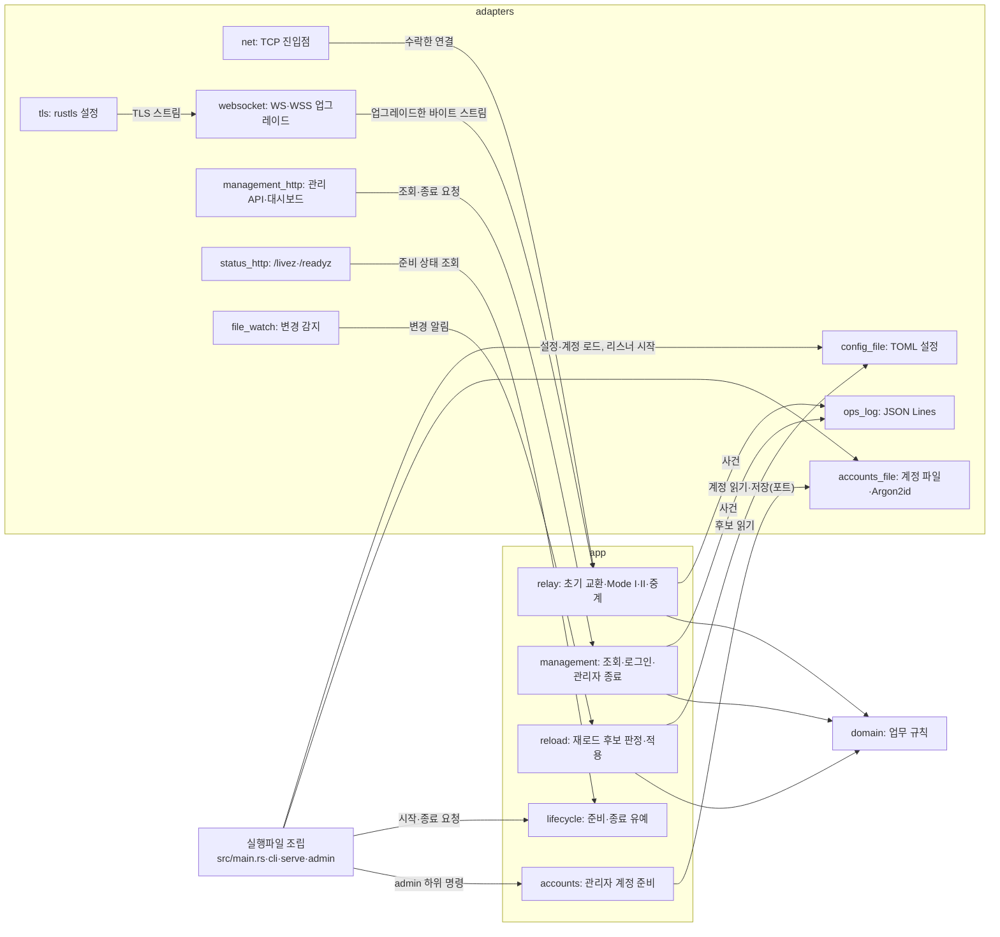
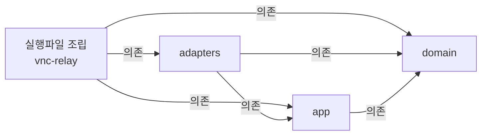

# VNC Relay 코드 지도

VNC Relay는 TCP·WS·WSS로 들어온 Viewer를 Mode I 대상이나 Mode II Server와 이어 중계 스트림을 전달하고, 관리 리스너에서 대시보드와 관리 API를 제공한다. 코드는 Cargo 작업 공간의 crate 네 개로 나눈다. 업무 규칙(domain), 사용 사례(app), 외부 연결 어댑터(adapters), 실행파일 조립(루트 crate `vnc-relay`)이다. 대표 흐름은 진입점이 접속을 수락하는 데서 시작해 초기 교환·매칭을 거쳐 활성 세션의 정리와 운영 로그 기록에서 끝난다.

| 항목 | 값 |
| --- | --- |
| 구조 시점 | Target |
| 문서 상태 | Draft |
| 구현 대조 | 미대조 |
| 관련 PRD | [PRD](../requirements/PRD.md) [8절 유지보수성](../requirements/PRD.md#8-비기능-요구사항), [1절 구현 기술](../requirements/PRD.md#확정-기준) |
| 관련 ADR | [ADR-0001 내장 TLS](../decisions/ADR-0001-built-in-tls.md), [ADR-0003 단일 인스턴스·메모리 상태](../decisions/ADR-0003-single-instance-memory-state.md), [ADR-0004 tokio·rustls](../decisions/ADR-0004-tokio-rustls.md) |

현재 코드는 개발 도구 `xtask/`, 설정 로딩, `serve` 시작과 CLI 골격이다. 설정 로딩은 `crates/domain`·`crates/app`·`crates/adapters`의 설정 모듈이다. `serve` 시작은 루트 crate의 `src/main.rs`·`src/cli.rs`·`src/serve.rs`와 계정 파일 읽기·리스너 바인드 모듈이다. 세 부분 모두 구현과 대조했다([xtask 모듈 설계](xtask.md), [설정 로딩 모듈 설계](config-loading.md), [`serve` 시작 모듈 설계](serve-startup.md), 모두 Current). 이 문서의 나머지 경로와 심볼은 모두 계획(Target)이다. 레이어를 crate로 나누는 방식은 사용자가 2026-10-20에 골랐다. 각 crate의 나머지 모듈은 해당 구현 작업에서 만든다.

## 1. 전체 구조

그림은 실행 중 호출 관계다. 화살표 `A → B`는 "A가 B를 호출하거나 B에 값을 넘긴다"는 뜻이다. 레이어 의존 방향은 아래 [레이어와 의존 방향](#레이어와-의존-방향)이 정한다. 모듈 내부 함수, 오류 변환, 테스트 코드는 생략했다.

app이 adapters를 부르는 화살표(`RELAY → LOG`, `ADMIN → ACC` 등)는 app이 정의한 포트(trait)를 통한 호출이다. app 코드는 adapters 타입을 이름으로 알지 못한다. 실행파일 조립 코드가 adapters의 구현체를 포트 자리에 넣는다.

### 레이어와 의존 방향

레이어 규칙은 [아키텍처 문서 작성 규칙](../architectures/AGENTS.md#작성-규칙)을 따른다. 아래 화살표 `A → B`는 "A가 B에 의존한다"는 뜻이다.

| 레이어 | 코드 위치 | 책임 | 의존할 수 있는 레이어 | 의존 위반 확인 방법 |
| --- | --- | --- | --- | --- |
| domain | `crates/domain` (`vnc-relay-domain`) | 업무 규칙과 값. 초기 교환 해석, 중계 ID, 대기 연결 표, 활성 세션 상태와 종료 원인, 출발지 IP 허용 목록 판정, 대상 허용 정책, Origin 비교, 연결 예산, 계정 이름·비밀번호 규칙, 최근 종료 목록. 입출력·시계·난수를 직접 쓰지 않고 값으로 받는다. | 없음. 외부 crate도 쓰지 않는다. | Cargo가 선언하지 않은 crate의 `use`를 컴파일 오류로 막는다. 외부 의존 0개는 `cargo xtask layers`가 검사한다. |
| app | `crates/app` (`vnc-relay-app`) | 사용 사례. 접속 처리 순서, Mode I 대상 연결과 Mode II 매칭, 중계 스트림 전달과 정리, 관리 조회·로그인·관리자 종료, 재로드 판정·적용, 준비·종료 유예 관리, 관리자 계정 준비 절차. 외부 입출력은 포트(trait)로 정의한다. | domain. 외부 crate는 tokio의 동기화·시간·입출력 trait만 쓴다. | crate 의존은 컴파일과 `cargo xtask layers`가 검사한다. 소켓·파일·신호 같은 tokio·std 입출력 타입은 `crates/app/clippy.toml`의 `disallowed-types`·`disallowed-methods`로 막고 `cargo clippy`가 검사한다. |
| adapters | `crates/adapters` (`vnc-relay-adapters`) | 외부와 연결. TCP 리스너, TLS, WebSocket, 관리·상태 HTTP, 설정 파일, 계정 파일과 Argon2id, 운영 로그 출력, 파일 변경 감지, 터미널 숨김 입력, 난수·HMAC. app의 포트를 구현한다. | domain, app, [PRD "구현 기술" 행](../requirements/PRD.md#확정-기준)의 라이브러리 | `cargo xtask layers`가 외부 crate가 PRD 목록 안에 있는지 검사한다. 라이선스는 [의존성 라이선스 검사](../how-to/check-dependency-licenses.md)를 따른다. |
| 실행파일 조립 | 루트 crate `vnc-relay`의 `src/` | 명령행 해석과 종료 코드, 시작 순서, 비동기 런타임 생성과 종료 신호 받기, 포트에 구현체를 넣는 객체 연결. 업무 규칙을 두지 않는다. | domain, app, adapters, clap, tokio | 코드 리뷰. 이 crate에 업무 규칙 함수가 생기면 domain이나 app으로 옮긴다. |
| 개발 도구 | `xtask/` | 시나리오 커버리지 보고, 레이어 검사 같은 개발용 명령. 제품 실행파일에 들어가지 않는다. | 제품 crate에 의존하지 않는다. | `cargo xtask layers`가 검사한다. |
| 정적 대시보드 | `web/dashboard/` | 정적 HTML·CSS·JS. 내부 파일 구조는 [작업 0.9](../TODO.md)에서 정한다. | 관리 API만 HTTP로 부른다. JS 의존성이 없다. | 프런트엔드 컨벤션(작업 0.9)의 검증 방법 |

경계 규칙:

- 안쪽 레이어(domain, app)는 바깥 레이어의 타입·함수를 알지 못한다. app이 바깥 기능을 써야 하면 app에 포트(trait)를 두고 adapters가 구현한다.
- 레이어 사이에서는 domain·app의 타입으로 값을 넘긴다. 라이브러리 타입(axum 요청, tungstenite 메시지, toml 값)을 app으로 넘기지 않는다. 바이트 스트림은 tokio의 `AsyncRead`·`AsyncWrite` trait으로 넘긴다.
- 상태는 프로세스 메모리에만 둔다([ADR-0003](../decisions/ADR-0003-single-instance-memory-state.md)). 대기 연결 표, 활성 세션, 최근 종료 목록, 관리 세션은 app이 소유한다.
- 이 구조에서 벗어나려면 [ADR](../decisions/AGENTS.md)을 작성한다.

## 2. 코드 위치와 구성요소

경로는 모두 계획이다. 파일을 모듈 디렉터리로 나눌지는 구현할 때 모듈 설계에서 정한다.

| 코드 위치 | 구성요소 | 주된 책임 | 맡지 않는 책임 | 의존 대상 | 모듈 설계 |
| --- | --- | --- | --- | --- | --- |
| `crates/domain/src/handshake.rs` | 초기 교환 해석 | 받은 바이트로 Mode I 대상 주소 또는 중계 ID와 역할을 해석한다. 분할·병합 수신과 후속 데이터 보존을 다룬다. 형식은 [Repeater 초기 교환 계약](../contracts/repeater-handshake-v1.md)을 따른다. | 소켓 읽기, 제한 시간 | 없음 | 없음(작업 2.7에서 작성) |
| `crates/domain/src/relay_id.rs` | 중계 ID | 중계 ID 값과 비교 규칙 | `relay_id_ref` 계산(HMAC은 adapters) | 없음 | 없음 |
| `crates/domain/src/matching.rs` | 대기 연결 표 | Mode II 대기 등록, 짝 찾기, 중복 ID 판정, 대기 상한 Lw | 대기 시간 측정, 소켓 | `relay_id` | 없음(작업 2.9에서 작성) |
| `crates/domain/src/session.rs` | 활성 세션 상태 | 세션 상태 전이, 종료 원인(`close_cause`), 방향별 전송량 | 바이트 전달 | 없음 | 없음 |
| `crates/domain/src/entry_point.rs` | 진입점 | 진입점 네 종류의 이름(`tcp_viewer` 등)과 TCP 진입점 기본 포트 | 리스너 열기 | 없음 | [설정 로딩 모듈 설계](config-loading.md) |
| `crates/domain/src/allow_list.rs` | 출발지 IP 허용 목록 | 단일 IP·CIDR·범위 항목 해석과 허용 판정, 전체 허용 항목 판별 | 설정 파일 읽기 | 없음 | [설정 로딩 모듈 설계](config-loading.md)(항목 해석). 허용 판정은 작업 2.4에서 더한다. |
| `crates/domain/src/target_policy.rs` | 대상 허용 정책 | Mode I 대상 항목 해석, 최종 연결 IP·포트 허용 판정 | 주소 해석, 연결 | `allow_list` | [설정 로딩 모듈 설계](config-loading.md)(항목 해석). 허용 판정은 작업 2.8에서 더한다. |
| `crates/domain/src/origin.rs` | Origin 비교 | Origin 정규화와 정확 일치 비교([설정 계약 1.4절](../contracts/config-v1.md#14-origin-값-문법과-비교)) | HTTP 헤더 읽기 | 없음 | [설정 로딩 모듈 설계](config-loading.md) |
| `crates/domain/src/budget.rs` | 연결 예산 | 중계 측 연결 L, 관리·상태 연결 Lm의 집계 규칙 | 소켓 수락 | 없음 | 없음 |
| `crates/domain/src/account.rs` | 관리자 계정 규칙 | 계정 이름 규칙, Argon2id 해시 문자열 형식과 승인 매개변수 범위([CLI 계약 1.2·1.4절](../contracts/cli-v1.md#12-계정-이름과-비밀번호-규칙)). 비밀번호 규칙은 작업 4.1에서 더한다. | 해시 계산, 파일 | 없음 | [`serve` 시작 모듈 설계](serve-startup.md) |
| `crates/domain/src/recent_closed.rs` | 최근 종료 목록 | 최대 R개 보관, 오래된 항목 제거 | 시각 읽기 | `session` | 없음 |
| `crates/app/src/ports.rs` | 포트 | 시계, 사건 기록, 대상 연결, 계정 저장소, 비밀번호 검증, 난수 등 바깥 기능의 trait | 구현 | domain | 없음 |
| `crates/app/src/settings.rs` | 유효 설정 | 검증을 마친 설정 값의 타입, 설정 오류·경고 코드, 진단. 재로드 대상과 재시작 필요 값을 구분한다. | TOML 해석 | domain | [설정 로딩 모듈 설계](config-loading.md) |
| `crates/app/src/relay/` | 중계 | 접속 처리 순서, 초기 교환 제한 시간 H, Mode I 대상 연결, Mode II 매칭과 대기 W, 중계 스트림 전달, 한쪽 종료와 정리 제한 시간 E, 끊긴 연결 처리 | 소켓 수락, TLS, WebSocket 프레임 | domain, `ports` | 없음(작업 2.7에서 작성) |
| `crates/app/src/management/` | 관리 | 서버 요약·대기 연결·활성 세션·최근 종료 조회, 관리자 종료, 로그인·관리 세션·CSRF 토큰, 로그인 실패 제한 | HTTP 해석, 쿠키 헤더 | domain, `ports` | 없음(작업 4.3에서 작성) |
| `crates/app/src/reload/` | 재로드 | 재로드 후보를 실행 중 유효 설정과 비교하고 원자적으로 적용, 결과 사건 | 파일 감지, 파일 읽기 | domain, `settings`, `ports` | 없음 |
| `crates/app/src/lifecycle.rs` | 수명 | 준비 상태, 종료 유예 G, 두 번째 종료 요청 처리 | 신호 수신 | domain, `ports` | 없음 |
| `crates/app/src/accounts.rs` | 관리자 계정 | 계정 파일 오류·경고 코드와 진단, 계정 없음 거절(작업 2.2). `admin add`·`passwd`·`remove`·`list`의 절차(작업 4.1) | 숨김 입력, 파일 잠금·교체 | domain, `ports` | [`serve` 시작 모듈 설계](serve-startup.md)(오류 코드). 절차는 작업 4.1에서 작성 |
| `crates/adapters/src/net.rs`, `crates/adapters/src/net/` | TCP 리스너·진입점 | 리스너 바인드와 실패 수집(작업 2.2), 수락 직후 출발지 IP 검사, TCP keepalive | 초기 교환 해석 | app, domain | [`serve` 시작 모듈 설계](serve-startup.md)(바인드). 진입점은 작업 2.4에서 작성 |
| `crates/adapters/src/tls.rs` | TLS | rustls 서버 설정, PEM 인증서·개인키 읽기, 인증서 교체 | 리스너 | app | 없음 |
| `crates/adapters/src/websocket/` | WebSocket | HTTP 업그레이드, Origin·IP 재검사 호출, 바이너리 메시지와 바이트 스트림 변환, ping | 중계 규칙 | app, domain | 없음(작업 3.2에서 작성) |
| `crates/adapters/src/management_http/` | 관리 HTTP | 관리 API 경로, 쿠키·CSRF 헤더, 오류 본문, 정적 대시보드 파일 제공 | 관리 규칙 | app | 없음 |
| `crates/adapters/src/status_http.rs` | 상태 HTTP | `/livez`·`/readyz` 응답 | 준비 판정 | app | 없음 |
| `crates/adapters/src/config_file.rs`, `crates/adapters/src/config_file/`, `crates/adapters/src/toml_text.rs` | 설정 파일 | TOML 해석과 검증, `config_*` 오류. `toml_text.rs`는 TOML 구문 오류 위치를 계정 파일과 함께 쓴다. | 재로드 판정 | app, domain | [설정 로딩 모듈 설계](config-loading.md) |
| `crates/adapters/src/accounts_file.rs`, `crates/adapters/src/accounts_file/` | 계정 파일 | 계정 파일 읽기·검증(작업 2.2), 잠금·원자적 교체, Argon2id 해시·검증 | 계정 규칙 | app, domain | [`serve` 시작 모듈 설계](serve-startup.md)(읽기). 쓰기는 작업 4.1에서 작성 |
| `crates/adapters/src/ops_log.rs` | 운영 로그 | 사건을 JSON Lines로 표준 출력이나 파일에 쓴다([운영 정보 계약](../contracts/ops-info-v1.md)). | 사건 내용 결정 | app | 없음 |
| `crates/adapters/src/file_watch.rs` | 파일 변경 감지 | OS 파일 알림과 주기 확인 | 후보 검증 | app | 없음 |
| `crates/adapters/src/terminal.rs` | 터미널 입력 | 숨김 비밀번호 입력, 삭제 확인 입력 | 비밀번호 규칙 | app | 없음 |
| `crates/adapters/src/crypto.rs` | 난수·HMAC | 관리 세션 식별자·CSRF 토큰·`session_id` 난수, `relay_id_ref` HMAC-SHA-256 | 사용처 규칙 | app | 없음 |
| `src/main.rs`, `src/cli.rs` | 명령행 | 하위 명령·옵션 해석, 사용법 오류, 진단 출력 형식, 종료 코드([CLI 계약](../contracts/cli-v1.md)) | 명령 실행 내용 | `serve`, `admin`, clap | [`serve` 시작 모듈 설계](serve-startup.md) |
| `src/serve.rs` | 서버 조립 | 시작 순서([CLI 계약 1.8절](../contracts/cli-v1.md#18-수동-시작과-종료))대로 설정·계정·감지·리스너를 준비하고 포트에 구현체를 넣는다. 비동기 런타임을 만들고 종료 신호를 수명 관리에 넘긴다. | 업무 규칙 | adapters, app, tokio | [`serve` 시작 모듈 설계](serve-startup.md) |
| `src/admin.rs` | 계정 명령 조립 | `admin` 하위 명령에 구현체를 넣고 app 절차를 실행한다. | 계정 규칙 | adapters, app | 없음 |
| `xtask/` | 개발 도구 | `cargo xtask scenarios`(시나리오 커버리지 보고), `cargo xtask layers`(레이어 의존 검사) | 제품 기능 | serde_json. 제품 crate에 의존하지 않는다. | [xtask 모듈 설계](xtask.md) |
| `web/dashboard/` | 대시보드 | 정적 화면 | 서버 규칙 | 관리 API(HTTP) | 없음(작업 0.9에서 구조 결정) |

## 3. 진입점

| 진입점 종류 | 코드 위치(파일·심볼) | 시작 조건 | 다음으로 호출하는 곳 |
| --- | --- | --- | --- |
| CLI 명령 | `src/main.rs` `main` | 운영자가 `vnc-relay`를 실행 | `src/cli.rs` `parse` → `src/serve.rs` `run` 또는 `src/admin.rs` `run` |
| TCP 접속 | `crates/adapters/src/net/` `TcpEntryPoint::run` | TCP Viewer·TCP Server 진입점이 접속을 수락 | `crates/app/src/relay/` `RelayService::handle_connection` |
| WS·WSS 접속 | `crates/adapters/src/websocket/` `WebSocketEntryPoint::run` | WS·WSS Viewer 진입점이 접속을 수락하고 업그레이드 | `crates/app/src/relay/` `RelayService::handle_connection` |
| 관리 HTTP 요청 | `crates/adapters/src/management_http/` `router` | 관리 리스너가 요청을 받음 | `crates/app/src/management/` `ManagementService`의 조회·종료·로그인 함수 |
| 상태 HTTP 요청 | `crates/adapters/src/status_http.rs` `router` | 상태 리스너가 `/livez`·`/readyz` 요청을 받음 | `crates/app/src/lifecycle.rs` `LifecycleService::readiness` |
| 파일 변경 | `crates/adapters/src/file_watch.rs` `ReloadWatcher::run` | OS 파일 알림 또는 주기 확인이 변경을 찾음 | `crates/app/src/reload/` `ReloadService::on_change` |
| 종료 신호 | `src/serve.rs` `ShutdownSignal::wait` | Ctrl+C, SIGTERM(Ubuntu), Ctrl+Break(Windows) | 지금은 리스너를 닫고 종료 코드 0으로 끝난다. 작업 5.3에서 `crates/app/src/lifecycle.rs` `LifecycleService::request_shutdown`을 부른다. |
| 예약 작업 | `crates/app/src/relay/`, `crates/app/src/lifecycle.rs`의 타이머 | 대기 W, 초기 교환 H, 정리 E, 종료 유예 G 만료 | 각 사용 사례의 정리 함수 |

## 4. 핵심 흐름

대표 시나리오는 Mode II에서 Server가 먼저 접속하고 Viewer가 같은 중계 ID로 접속해 세션이 성립하는 경우다. 관련 스펙 시나리오: [중계 스펙](../specs/relay.md#7-수용-테스트) RLY-010. 초기 교환의 바이트 형식은 Draft 계약이 확정된 뒤 정한다(작업 1.5).

| 순서 | 코드 위치(파일·심볼) | 하는 일 | 넘기는 값·바뀌는 상태 |
| --- | --- | --- | --- |
| 1 | `crates/adapters/src/net/` `TcpEntryPoint::run` | TCP Server 진입점에서 접속을 수락한다. 데이터를 읽기 전에 출발지 IP를 허용 목록으로 판정하고 연결 예산 L을 확보한다. | `TcpStream`, `peer_ip`, 진입점 종류를 `RelayService::handle_connection`에 넘긴다. 허용이면 `connection_accepted`, 거절이면 `connection_rejected` 사건 |
| 2 | `crates/domain/src/allow_list.rs` `AllowList::permits`, `crates/domain/src/budget.rs` `ConnectionBudget::try_acquire` | 허용 여부와 예산을 판정한다. | 허용·거절 결과, 예산 사용량 증가 |
| 3 | `crates/app/src/relay/` `RelayService::handle_connection` | 제한 시간 H 안에 초기 교환을 읽는다. | 바이트를 `HandshakeParser`에 넣는다. |
| 4 | `crates/domain/src/handshake.rs` `HandshakeParser::feed` | 받은 바이트를 해석한다. | Mode II, 역할 Server, `RelayId`, 이미 받은 후속 바이트 |
| 5 | `crates/app/src/relay/` `RelayService::register_or_match`, `crates/domain/src/matching.rs` `WaitingTable::register` | 짝이 없으므로 대기 연결로 등록하고 대기 시간 W를 잰다. | 대기 연결 표에 등록, `waiting_registered` 사건 |
| 6 | 1~4와 같은 경로 | TCP Viewer 진입점에 같은 중계 ID의 Viewer가 접속한다. | Mode II, 역할 Viewer, 같은 `RelayId` |
| 7 | `crates/domain/src/matching.rs` `WaitingTable::take_peer` | 대기 중인 Server를 꺼내 한 번만 짝짓는다. | 대기 연결 표에서 제거, 짝이 된 두 연결 |
| 8 | `crates/app/src/relay/` `RelayService::run_session` | 활성 세션을 만들고 양방향으로 바이트를 전달한다. 후속 바이트를 먼저 보낸다. 쓰기 성공한 바이트를 센다. | `session_id` 발급, 활성 세션 목록에 등록, `session_started` 사건 |
| 9 | `crates/app/src/relay/` `RelayService::close_session` | 한쪽 EOF·오류·관리자 종료·끊긴 연결에서 정리한다. | 활성 세션에서 제거, 최근 종료 목록에 추가, 예산 반환, `session_closed` 사건 |
| 10 | `crates/adapters/src/ops_log.rs` `JsonLinesEventSink::record` | 사건을 한 줄 JSON으로 쓴다. | 표준 출력이나 로그 파일에 한 줄 |

사건 이름은 [운영 정보 계약 1.5절](../contracts/ops-info-v1.md#15-사건-목록)이 기준이다. 위 표의 사건 이름은 흐름 설명용이며 구현할 때 계약과 대조한다.

## 5. 시작과 연결

- 시작 순서: `src/serve.rs` `run`이 [CLI 계약 1.8절](../contracts/cli-v1.md#18-수동-시작과-종료)의 순서를 따른다. (1) 설정 읽기·검증, (2) 계정 파일 읽기·검증, (3) 파일 변경 감지 준비, (4) 비동기 런타임·종료 신호 처리기 준비, 인증서·개인키 검사 뒤 리스너 바인드. 모두 성공하면 수명 상태를 준비됨으로 바꾸고 리스너 작업을 시작한다. 실패하면 확보한 자원을 회수하고 종료 코드를 돌려준다. 지금 구현은 (3)과 인증서 검사, 수명 상태, 리스너 작업이 없다([`serve` 시작 모듈 설계](serve-startup.md) 1절).
- 설정 위치: `crates/adapters/src/config_file/`가 `--config` 파일을 읽어 `crates/app/src/settings.rs`의 유효 설정을 만든다. 환경 변수는 읽지 않는다.
- 객체 연결 위치: `src/serve.rs`와 `src/admin.rs`. DI 프레임워크는 쓰지 않는다. 함수 인수와 `Arc`로 포트 구현체를 넘긴다.

## 6. 처음 읽을 코드

구현 뒤 경로다.

1. `src/serve.rs` — 시작 순서와 구성요소 연결을 한곳에서 볼 수 있다.
2. `crates/app/src/relay/` — 접속 처리 순서와 세션 수명이 모인 곳이다.
3. `crates/domain/src/matching.rs` — Mode II 매칭 규칙의 중심이다.

## 7. 확인하지 못한 부분

| 항목 | 확인하지 못한 이유 | 확인 방법 |
| --- | --- | --- |
| 설정 로딩, `serve` 시작, `xtask/`를 뺀 경로·심볼 | 구현 전 계획이다. | 각 구현 작업에서 모듈 설계를 쓰고, 작업 5.8에서 코드와 대조해 `Current`로 바꾼다. |
| 초기 교환 해석의 입력 단위 | Repeater 초기 교환 계약이 Draft다. | 작업 1.5에서 계약을 채택한 뒤 `handshake` 모듈 설계에 반영한다. |
| app의 tokio 입출력 금지 목록 | `crates/app/clippy.toml`은 std의 파일·소켓·프로세스·환경 변수·시각 읽기를 막는다(작업 2.1). app은 아직 tokio에 의존하지 않아 tokio 입출력 타입 목록은 정하지 않았다. | app에 tokio를 더하는 작업에서 같은 파일에 `tokio::net`·`tokio::fs`·`tokio::process`·`tokio::signal` 항목을 더하고 이 행을 지운다. |
