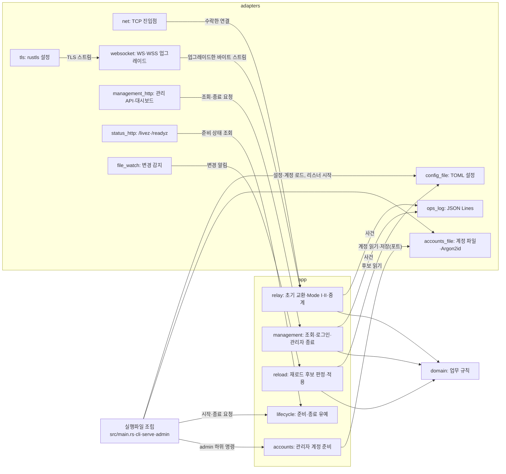
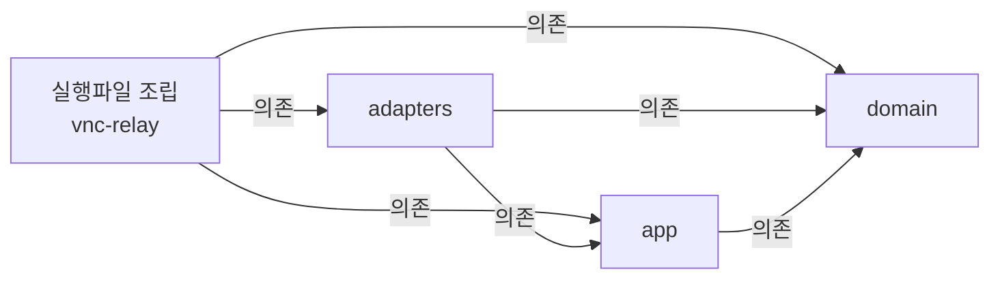

# VNC Relay 코드 지도

VNC Relay는 TCP·WS·WSS로 들어온 Viewer를 Mode I 대상이나 Mode II Server와 이어 중계 스트림을 전달하고, 관리 리스너에서 대시보드와 관리 API를 제공한다. 코드는 Cargo 작업 공간의 crate 네 개로 나눈다. 업무 규칙(domain), 사용 사례(app), 외부 연결 어댑터(adapters), 실행파일 조립(루트 crate `vnc-relay`)이다. 대표 흐름은 진입점이 접속을 수락하는 데서 시작해 초기 교환·매칭을 거쳐 활성 세션의 정리와 운영 로그 기록에서 끝난다.

| 항목 | 값 |
| --- | --- |
| 구조 시점 | Target |
| 문서 상태 | Draft |
| 구현 대조 | Verified(구현된 행만) — [대조 기록](#대조-기록) |
| 관련 PRD | [PRD](../requirements/PRD.md) [8절 유지보수성](../requirements/PRD.md#8-비기능-요구사항), [1절 구현 기술](../requirements/PRD.md#확정-기준) |
| 관련 ADR | [ADR-0001 내장 TLS](../decisions/ADR-0001-built-in-tls.md), [ADR-0003 단일 인스턴스·메모리 상태](../decisions/ADR-0003-single-instance-memory-state.md), [ADR-0004 tokio·rustls](../decisions/ADR-0004-tokio-rustls.md) |

현재 코드는 개발 도구 `xtask/`, 설정 로딩, `serve` 시작과 CLI 골격, 운영 로그, TCP 진입점, WS·WSS 진입점, 연결 상한과 시간 제한, 상태 리스너와 준비 상태, 내장 TLS 파일 검사와 acceptor, 관리 리스너, 관리 로그인·세션, 관리 조회 API, 관리자 계정 준비 CLI다. 설정 로딩은 `crates/domain`·`crates/app`·`crates/adapters`의 설정 모듈이다. `serve` 시작은 루트 crate의 `src/main.rs`·`src/cli.rs`·`src/serve.rs`와 계정 파일 읽기·리스너 바인드 모듈이다. 운영 로그는 사건 타입(`crates/app/src/events.rs`), 사건 기록 포트(`crates/app/src/ports.rs`), JSON Lines 출력(`crates/adapters/src/ops_log.rs`), `relay_id_ref` 계산(`crates/adapters/src/crypto.rs`), 상대 IP 값(`crates/domain/src/peer_ip.rs`)이다. TCP 진입점은 수락 반복(`crates/adapters/src/net.rs` `TcpEntryPoint`, 공유 수락 함수 `accept_connections`), 허용 판정(`crates/domain/src/allow_list.rs` `AllowList::permits`), 연결 식별자(`crates/domain/src/conn_id.rs`)다. WS·WSS 진입점(`crates/adapters/src/websocket.rs` `WsEntryPoint`)은 같은 수락 함수와 허용 판정·연결 식별자를 쓰고, 업그레이드 검사(`crates/adapters/src/upgrade.rs`)와 WSS 협상(`Wire::Tls`의 `TlsIo`)을 더한다. 연결 상한과 시간 제한은 연결 예산(`crates/domain/src/budget.rs` `ConnectionBudget`)과 TCP 진입점의 L·H·keepalive 처리(`crates/adapters/src/net.rs` `AcceptPolicy`, `hold`), WS·WSS 진입점의 L·U·H 처리(`crates/adapters/src/websocket.rs` `WsPolicy`)다. 상태 리스너와 준비 상태는 준비 상태(`crates/app/src/lifecycle.rs` `LifecycleService`)와 `/livez`·`/readyz` 응답·Lm 판정(`crates/adapters/src/status_http.rs` `StatusListener`)이다. 내장 TLS 파일 검사와 acceptor는 `crates/adapters/src/tls.rs`의 `load_acceptor`와 `crates/adapters/src/tls_listener.rs`의 `TlsListener`다([내장 TLS 모듈 설계](tls.md), 작업 3.1). 관리 리스너는 `crates/adapters/src/management_http.rs`의 `ManagementListener`와 `crates/adapters/src/admission.rs`의 `AdmittingListener`다([관리 리스너 모듈 설계](management-listener.md), 작업 4.2). 관리 로그인·세션은 `crates/app/src/management.rs`의 `AdminAuth`(로그인, 세션 검사, CSRF, 로그아웃), 도메인 `crates/domain/src/admin_session.rs`·`crates/domain/src/login_limit.rs`, 관리 API 세션 처리 `crates/adapters/src/management_http/session_api.rs`다([관리 로그인과 세션 설계](management-session.md), 작업 4.3). 관리 조회는 `crates/app/src/management/query.rs`의 `ManagementQueryService`, `crates/app/src/ports.rs`의 `RelayStateSource`, `crates/app/src/relay.rs`의 상태 스냅샷·`ActivePeer`·`HandshakingGuard`, HTTP 응답을 만드는 `crates/adapters/src/management_http/query_api.rs`다([관리 조회 API 모듈 설계](management-query.md), 작업 4.4, `ec05fd1` 구조 대조). 관리자 계정 준비 CLI는 계정 규칙(`crates/domain/src/account.rs` `Password`), 절차와 `list`(`crates/app/src/accounts.rs` `AdminService`, `accounts::list`), 포트(`crates/app/src/ports.rs`), 계정 파일 저장과 해시(`crates/adapters/src/accounts_file/store.rs`, `crates/adapters/src/accounts_file/hasher.rs`), 숨김 입력(`crates/adapters/src/terminal.rs`), 설정의 `[admin]` 읽기(`crates/adapters/src/config_file.rs` `load_admin`), 명령 조립(`src/admin.rs`)이다. 여덟 부분 모두 구현과 대조했다([xtask 모듈 설계](xtask.md), [설정 로딩 모듈 설계](config-loading.md), [`serve` 시작 모듈 설계](serve-startup.md), [운영 로그 모듈 설계](ops-log.md), [TCP 진입점 모듈 설계](tcp-entry-point.md), [연결 상한과 시간 제한 모듈 설계](connection-limits.md), [상태 리스너와 준비 상태 모듈 설계](status-listener.md), [관리자 계정 준비 CLI 모듈 설계](admin-accounts.md), 모두 Current). WS·WSS 진입점은 [WebSocket 진입점 모듈 설계](websocket-entry-point.md)를 따른다. 위와 §2의 Current 행에 적지 않은 경로와 심볼은 계획(Target)이다. 내장 TLS와 관리 리스너 모듈 설계의 나머지 부분(작업 4.5의 관리자 종료 등)도 계획(Target)이다. WS·WSS 진입점의 101 뒤 중계는 `638cf09`에서 연결했다. 레이어를 crate로 나누는 방식은 사용자가 2026-10-20에 골랐다. 각 crate의 나머지 모듈은 해당 구현 작업에서 만든다.

## 1. 전체 구조

그림은 실행 중 호출 관계다. 화살표 `A → B`는 "A가 B를 호출하거나 B에 값을 넘긴다"는 뜻이다. 레이어 의존 방향은 아래 [레이어와 의존 방향](#레이어와-의존-방향)이 정한다. 모듈 내부 함수, 오류 변환, 테스트 코드는 생략했다.

app이 adapters를 부르는 화살표(`RELAY → LOG`, `ADMIN → ACC` 등)는 app이 정의한 포트(trait)를 통한 호출이다. app 코드는 adapters 타입을 이름으로 알지 못한다. 실행파일 조립 코드가 adapters의 구현체를 포트 자리에 넣는다.

### 레이어와 의존 방향

레이어 규칙은 [아키텍처 문서 작성 규칙](../architectures/AGENTS.md#작성-규칙)을 따른다. 아래 화살표 `A → B`는 "A가 B에 의존한다"는 뜻이다.

| 레이어 | 코드 위치 | 책임 | 의존할 수 있는 레이어 | 의존 위반 확인 방법 |
| --- | --- | --- | --- | --- |
| domain | `crates/domain` (`vnc-relay-domain`) | 업무 규칙과 값. 초기 교환 해석, 중계 ID, 대기 연결 표, 활성 세션 상태와 종료 원인, 출발지 IP 허용 목록 판정, 대상 허용 정책, Origin 비교, 연결 예산, 계정 이름·비밀번호 규칙, 최근 종료 목록. 입출력·시계·난수를 직접 쓰지 않고 값으로 받는다. | 없음. 외부 crate도 쓰지 않는다. | Cargo가 선언하지 않은 crate의 `use`를 컴파일 오류로 막는다. 외부 의존 0개는 `cargo xtask layers`가 검사한다. |
| app | `crates/app` (`vnc-relay-app`) | 사용 사례. 접속 처리 순서, Mode I 대상 연결과 Mode II 매칭, 중계 스트림 전달과 정리, 관리 조회·로그인·관리자 종료, 재로드 판정·적용, 준비·종료 유예 관리, 관리자 계정 준비 절차. 외부 입출력은 포트(trait)로 정의한다. | domain. 외부 crate는 tokio의 동기화·시간·입출력 trait만 쓴다. | crate 의존은 컴파일과 `cargo xtask layers`가 검사한다. 소켓·파일·신호 같은 tokio·std 입출력 타입은 `crates/app/clippy.toml`의 `disallowed-types`·`disallowed-methods`로 막고 `cargo clippy`가 검사한다. |
| adapters | `crates/adapters` (`vnc-relay-adapters`) | 외부와 연결. TCP 리스너, TLS, WebSocket, 관리·상태 HTTP, 설정 파일, 계정 파일과 Argon2id, 운영 로그 출력, 파일 변경 감지, 터미널 숨김 입력, 난수·HMAC. app의 포트를 구현한다. | domain, app, [PRD "구현 기술" 행](../requirements/PRD.md#확정-기준)의 라이브러리 | `cargo xtask layers`가 외부 crate가 PRD 목록 안에 있는지 검사한다. 라이선스는 [의존성 라이선스 검사](../how-to/check-dependency-licenses.md)를 따른다. |
| 실행파일 조립 | 루트 crate `vnc-relay`의 `src/` | 명령행 해석과 종료 코드, 시작 순서, 비동기 런타임 생성과 종료 신호 받기, 포트에 구현체를 넣는 객체 연결. 업무 규칙을 두지 않는다. | domain, app, adapters, clap, tokio, rustls(개발 의존성: `tests/serve.rs`의 TLS 클라이언트만) | 코드 리뷰. 이 crate에 업무 규칙 함수가 생기면 domain이나 app으로 옮긴다. |
| 개발 도구 | `xtask/` | 시나리오 커버리지 보고, 레이어 검사, 토큰 CSS 생성과 대조, 로컬 미리보기 서버 같은 개발용 명령. 제품 실행파일에 들어가지 않는다. | 제품 crate에 의존하지 않는다. | `cargo xtask layers`가 검사한다. |
| 정적 대시보드 | `web/dashboard/` | 정적 HTML·CSS·JS. 공통 컴포넌트(`app/components/`), 토큰 CSS(`app/tokens.css`), 운영 현황 화면(SCR-001)과 세션 상세 화면(SCR-002), 둘이 같이 쓰는 라우터·셸·조회 상태(`app/`: `index.html`, `main.js`, `router.js`, `operations.js`, `session.js`, `shell.js`, `query.js`, `model.js`, `panels.js`, `api.js`, `format.js`, `copy.js`, `language.js`, `app.css`), 로그인 화면(SCR-003, `login/`: `index.html`, `main.js`, `login.js`, `login.css`)과 생성 복사본(`login/components/`, `login/styles/`, `login/language.js`, `login/tokens.css`. `login/language.js`는 `app/language.js`의 복사본이다), 미리보기(`preview/`), 브라우저 시험 페이지(`tests/`)를 담는다. 생성 복사본은 `cargo xtask tokens`가 `app/`에서 만들고 `--check`가 같은지 대조한다. 내부 파일 구조는 [프런트엔드 컨벤션 1.1절](../conventions/frontend.md#11-정적-파일-구조)에 적는다. | 관리 API만 HTTP로 부른다. JS 의존성이 없다. | [프런트엔드 컨벤션](../conventions/frontend.md)과 [대시보드 검증 방법](../how-to/verify-dashboard-frontend.md). 컴포넌트 책임과 API는 [대시보드 공통 컴포넌트 모듈 설계](dashboard-components.md). |

경계 규칙:

- 안쪽 레이어(domain, app)는 바깥 레이어의 타입·함수를 알지 못한다. app이 바깥 기능을 써야 하면 app에 포트(trait)를 두고 adapters가 구현한다.
- 레이어 사이에서는 domain·app의 타입으로 값을 넘긴다. 라이브러리 타입(axum 요청, tungstenite 메시지, toml 값)을 app으로 넘기지 않는다. 바이트 스트림은 tokio의 `AsyncRead`·`AsyncWrite` trait으로 넘긴다.
- 상태는 프로세스 메모리에만 둔다([ADR-0003](../decisions/ADR-0003-single-instance-memory-state.md)). 대기 연결 표, 활성 세션, 최근 종료 목록, 관리 세션은 app이 소유한다.
- 이 구조에서 벗어나려면 [ADR](../decisions/AGENTS.md)을 작성한다.

## 2. 코드 위치와 구성요소

구현된 경로는 설정 로딩, `serve` 시작, 운영 로그, TCP 진입점, WS·WSS 진입점(101 응답 뒤 공통 서비스 호출까지), 연결 상한과 시간 제한, 상태 리스너와 준비 상태, 관리자 계정 준비 CLI, `xtask/`, 내장 TLS 파일 검사와 acceptor, 관리 리스너, 관리 로그인·세션, 관리 조회 API, 초기 교환 domain·공통 app 처리·거절 사건·JSON이다. 관리 조회 API와 조회용 포트·상태 타입은 `ec05fd1` 코드와 대조했다. TCP 진입점은 초기 교환 뒤 `RelayService::handle_connection`과 `dispatch`를 같은 연결 작업에서 호출한다. WS·WSS 진입점은 101 전송·flush 완료 뒤 `handle_connection`과 `dispatch`를 호출한다(`638cf09`). 아래 새 2.8~2.10 항목은 Target이다. domain 구현은 별도 작업에서 진행 중이며 이 지도에서 구현 대조를 완료하지 않았다. 파일 분할과 API의 목표는 [대상 연결·매칭·중계 수명 설계](relay-session.md)를 따른다. 새 WS 스트림 어댑터와 WS → 공통 서비스 흐름도 Target이다. [WebSocket 스트림 설계](websocket-stream.md)는 Draft이며 9.1~9.3절은 사용자 결정 Q77~Q79로 해결했다.

| 코드 위치 | 구성요소 | 주된 책임 | 맡지 않는 책임 | 의존 대상 | 모듈 설계 |
| --- | --- | --- | --- | --- | --- |
| `crates/domain/src/handshake.rs` | 초기 교환 해석(Current) | 250바이트를 모아 모드와 Mode I 대상 또는 중계 ID를 해석한다. `HandshakePolicy`로 활성 모드를 검사한다. 역할은 기존 `EntryPoint::role`을 쓴다. `feed`는 소비 길이를 돌려주며 후속 바이트는 소비하지 않는다. | 소켓 읽기, H, 후속 데이터 버퍼 소유 | `entry_point`, `relay_id`, `allow_list::parse_address`, `origin::is_dns_name`, `target_policy::parse_port`, 표준 `Ipv6Addr` | [초기 교환 처리 모듈 설계](initial-exchange.md#3-domain-api와-데이터-모델)(domain 부분 구현) |
| `crates/domain/src/relay_id.rs` | 중계 ID(Current) | ASCII 숫자 1~247자리의 값과 바이트열 정확 일치·해시. 앞자리 0을 보존한다. `Debug`는 원문을 가린다. | 숫자 변환, `relay_id_ref` 계산(HMAC은 adapters) | 없음 | [초기 교환 처리 모듈 설계](initial-exchange.md#3-domain-api와-데이터-모델)(domain 부분 구현) |
| `crates/domain/src/matching.rs` | 대기·점유 표(Target) | `WaitingTable`: 정확한 `RelayId`별 `Waiting`·`Claimed`·`Active`·`Closing` 전이와 중복 판정. 연결·세션 식별자를 비교해 이전 정리가 새 점유를 지우지 못하게 한다. | 소켓, W 측정, Lw 확보. app이 같은 잠금 아래 스트림·예산과 연결한다. | `relay_id`, `entry_point::Role`, `conn_id`, `session::SessionId` | [대상 연결·매칭·중계 수명 설계 3.3절](relay-session.md#33-공유-메모리-상태), [4.2절](relay-session.md#42-작업-29-mode-ii-등록과-원자적-매칭)(Draft, Target) |
| `crates/domain/src/session.rs` | 활성 세션 상태(Target) | `SessionId`, `Session`, `CloseCause`: 식별자 형식, `active`·`closing`, 종료 원인, 방향별 성공 쓰기 카운터. | 바이트 전달, 난수·키 생성, 시각 읽기 | std 값 | [대상 연결·매칭·중계 수명 설계 3.3절](relay-session.md#33-공유-메모리-상태), [4.3절](relay-session.md#43-작업-210-두-방향-중계), [6절](relay-session.md#6-사건오류정리)(Draft, Target) |
| `crates/domain/src/entry_point.rs` | 진입점 | 진입점 네 종류의 이름(`tcp_viewer` 등)과 TCP 진입점 기본 포트, 연결의 역할(`Role`)과 진입점별 역할 | 리스너 열기 | 없음 | [설정 로딩 모듈 설계](config-loading.md), [TCP 진입점 모듈 설계](tcp-entry-point.md)(`Role`) |
| `crates/domain/src/allow_list.rs` | 출발지 IP 허용 목록 | 단일 IP·CIDR·범위 항목 해석과 허용 판정(`AllowList::permits`), 전체 허용 항목 판별 | 설정 파일 읽기 | `peer_ip` | [설정 로딩 모듈 설계](config-loading.md)(항목 해석), [TCP 진입점 모듈 설계](tcp-entry-point.md)(허용 판정) |
| `crates/domain/src/conn_id.rs` | 연결 식별자 | 프로세스 안에서 유일한 `conn_id`(`c1`, `c2`, …) 발급 | 사건 기록 | 없음 | [TCP 진입점 모듈 설계](tcp-entry-point.md) |
| `crates/domain/src/target_policy.rs` | 대상 허용 정책 | 현재: Mode I 대상 항목을 해석한다. Target: `TargetPolicy::permits_name`과 `permits_ip`로 이름·포트와 최종 단일 IP·포트를 각각 검사한다. | DNS 해석, 소켓 연결 | `allow_list` | [설정 로딩 모듈 설계](config-loading.md)(항목 해석), [대상 연결·매칭·중계 수명 설계 4.1절](relay-session.md#41-작업-28-mode-i-대상-연결)(허용 판정은 Draft, Target) |
| `crates/domain/src/origin.rs` | Origin 비교 | Origin 정규화와 정확 일치 비교([설정 계약 1.4절](../contracts/config-v2.md#14-origin-값-문법과-비교)) | HTTP 헤더 읽기 | 없음 | [설정 로딩 모듈 설계](config-loading.md) |
| `crates/domain/src/peer_ip.rs` | 상대 IP | 소켓 상대 IP 값. IPv4-mapped IPv6를 IPv4로 바꾸고, 포트·영역 식별자 없이 표기한다([운영 정보 계약 1.10절](../contracts/ops-info-v1.md#110-상대-주소-표기)). | 소켓 읽기, 허용 판정 | 없음 | [운영 로그 모듈 설계](ops-log.md) |
| `crates/domain/src/budget.rs` | 연결 예산 | 상한 하나 아래에서 자리를 잡고 돌려주는 `ConnectionBudget`·`BudgetPermit`. 중계 측 연결 L, 관리·상태 연결 Lm, 대기 Mode II 연결 Lw가 같은 타입을 쓴다. 지금은 TCP·WS·WSS 진입점이 L 하나를 같이 쓰고(작업 2.5, 3.2), 상태 리스너와 관리 리스너가 Lm 하나를 같이 쓴다(작업 2.6, 4.2). `current`는 현재 점유량을 원자적으로 읽고, 관리 조회가 `limit`과 함께 사용한다(작업 4.4, Current). | 소켓 수락 | 없음 | [연결 상한과 시간 제한 모듈 설계](connection-limits.md), [관리 조회 API 모듈 설계](management-query.md) |
| `crates/domain/src/account.rs` | 관리자 계정 규칙 | 계정 이름 규칙과 비밀번호 규칙(`Password`), Argon2id 해시 문자열 형식과 승인 매개변수 범위([CLI 계약 1.2·1.4절](../contracts/cli-v1.md#12-계정-이름과-비밀번호-규칙)). | 해시 계산, 파일 | 없음 | [`serve` 시작 모듈 설계](serve-startup.md), [관리자 계정 준비 CLI 모듈 설계](admin-accounts.md)(`Password`) |
| `crates/domain/src/recent_closed.rs` | 최근 종료 목록(Target) | `RecentClosedList`: 정리 완료된 세션 요약을 최대 R개 보관한다. R 초과 때 가장 오래된 항목을 지우며 R=0이면 보관하지 않는다. | 시각 읽기, 대기 만료·대상 연결 실패 보관 | `session` | [대상 연결·매칭·중계 수명 설계 3.3절](relay-session.md#33-공유-메모리-상태), [6절 정리 순서](relay-session.md#정리-순서와-정확히-한-번-반환)(Draft, Target) |
| `crates/domain/src/admin_session.rs` | 관리 세션 | 관리 세션 토큰(64자리 소문자 16진수)과 CSRF 토큰, 유휴·절대 만료, 세션 표(`AdminSessionTable`). 로그인 실패 제한은 `login_limit.rs`가 맡는다. | 시각을 값으로 받는다 | 없음 | [관리 로그인과 세션 설계](management-session.md) |
| `crates/domain/src/login_limit.rs` | 로그인 실패 제한 | 계정 이름과 원격 주소별 실패 횟수, 잠금 기간(`LoginLimiter`). 잠금 중 시도는 실패로 세지 않는다. | 시각을 값으로 받는다 | 없음 | [관리 로그인과 세션 설계](management-session.md) |
| `crates/app/src/ports.rs` | 포트 | 바깥 기능의 trait. 지금은 사건 기록(`EventSink`), 계정 저장소(`AccountStore`), 계정 입력(`AccountInput`, `InputError`), 비밀번호 해시(`PasswordHasher`, `HashError`), 로그인 검증(`PasswordVerifier`), 시계(`Clock`), 토큰 난수(`TokenSource`, `RandomError`)가 있다. Target: DNS와 단일 IP 연결의 `TargetConnector`, ref의 `RelayIdSource`, 식별자의 `SessionIdSource`, 종료 action을 포함한 `RelayStream`을 더한다. | 포트 구현, 라이브러리 소켓 타입 노출 | domain, Target: tokio 입출력 trait | [운영 로그 모듈 설계](ops-log.md)(`EventSink`), [관리자 계정 준비 CLI 모듈 설계](admin-accounts.md)(`AccountStore`·`AccountInput`·`PasswordHasher`), [관리 로그인과 세션 설계](management-session.md)(`PasswordVerifier`·`Clock`·`TokenSource`), [대상 연결·매칭·중계 수명 설계 3.2절](relay-session.md#32-전송-수명-인터페이스), [3.3절](relay-session.md#33-공유-메모리-상태), [4.1절](relay-session.md#41-작업-28-mode-i-대상-연결), [5.1절](relay-session.md#51-프로세스-시작과-키)(추가는 Draft, Target) |
| `crates/app/src/ports.rs` `RelayStateSource` | 중계 상태 조회 포트(Current) | `snapshot(&dyn Clock)`으로 조회용 `RelaySnapshot`을 받는 경계를 정한다. `ManagementQueryService`가 사용하고 `RelayRuntime`이 구현한다. | HTTP·JSON 처리, 스트림 읽기 | `Clock`, `relay::RelaySnapshot` | [관리 조회 API 모듈 설계](management-query.md) |
| `crates/app/src/settings.rs` | 유효 설정 | 검증을 마친 설정 값의 타입, 설정 오류·경고 코드, 진단. 재로드 대상과 재시작 필요 값을 구분한다. 바인드할 리스너 계획(`Settings::status_listener`, `Settings::management_listener`, `Settings::other_listeners`)을 만든다. | TOML 해석 | domain | [설정 로딩 모듈 설계](config-loading.md), [`serve` 시작 모듈 설계](serve-startup.md)(리스너 계획) |
| `crates/app/src/events.rs` | 운영 로그 사건 | 사건 종류(`Event`)와 사건 이름·`level`, `phase`·`stage`·`reason`·`error_kind` 값, `relay_id_ref` 값 타입, `log_contract` 값([운영 정보 계약 1.3~1.7절](../contracts/ops-info-v1.md#15-사건-목록)). 기능 작업이 사건을 더한다. 지금은 시작·종료 사건, 설정 경고, 접속 수락·거절·중단(작업 2.4), 상한 거절과 H·상대 종료·연결 오류 중단(작업 2.5), `server_ready`와 Lm 거절(작업 2.6), TLS 버전 거절(`Stage::Tls`·`RejectReason::TlsVersionUnsupported`, 관리 리스너 작업 4.2·WSS 작업 3.2), WS·WSS 업그레이드 거절(`Event::UpgradeRejected`, 사건 이름 `connection_rejected`, `stage`는 항상 `upgrade`, 작업 3.2), 협상·업그레이드 제한 시간 중단(`AbortReason::TlsUpgradeTimeout`, 작업 3.2), 관리 로그인 성공·실패·제한 사건(`Event::AdminLoginSucceeded`·`AdminLoginFailed`·`AdminLoginLimited`, 작업 4.3), 초기 교환 거절(`HandshakeRejected`, `HandshakeInvalid`·`ModeDisabled`, `mode: Option<Mode>`, 작업 2.7 일부)이 있다. 초기 교환 진입점 호출은 TCP와 WS·WSS에 있다(`638cf09`). Target: 대상 연결 실패·거절, 대기 등록·제거·만료, 세션 시작·최종 종료 사건과 필드를 더한다. | 줄 형식, 출력 | `settings`, domain(`handshake::Mode` 포함) | [운영 로그 모듈 설계](ops-log.md), [TCP 진입점 모듈 설계](tcp-entry-point.md)(접속 사건), [WebSocket 진입점 모듈 설계](websocket-entry-point.md)(업그레이드 거절), [연결 상한과 시간 제한 모듈 설계](connection-limits.md)(상한·시간 제한 원인), [상태 리스너와 준비 상태 모듈 설계](status-listener.md)(`server_ready`, `admin_connection_limit`), [관리 로그인과 세션 설계](management-session.md)(관리 로그인 사건), [초기 교환 설계 6절](initial-exchange.md#6-사건오류자원-회수)(초기 교환 거절), [대상 연결·매칭·중계 수명 설계 6절](relay-session.md#6-사건오류정리)(추가는 Draft, Target) |
| `crates/app/src/relay.rs`, `crates/app/src/relay/` | 중계(초기 교환은 구현, 이후 단계는 Target) | 현재: `handle_connection`이 Viewer 시작 바이트와 H 안의 요청 해석을 처리한다. 유효 요청은 후속 데이터·B 잔여량·L 자리를 가진 `PreparedConnection<S>`로 반환한다. 실패는 자원 해제 뒤 사건 하나를 쓴다. TCP·WS·WSS 진입점은 `handle_connection` 뒤 `dispatch`를 호출한다(`638cf09`). Target: `RelayService::dispatch`의 대기·매칭·중계 세부, 공유 `RelayState`, Mode I의 `relay/target.rs`, Mode II의 `relay/matching.rs`, 중계·E·정리의 `relay/session.rs::run_session`을 더한다. B와 L 소유권은 단계마다 이동한다. | 소켓 수락, DNS·TCP 구현, TLS, WebSocket 프레임 | domain, `ports`, tokio `time`·`sync`·`io-util`. 시험 전용 `macros`·`rt`·`test-util` | [초기 교환 처리 모듈 설계](initial-exchange.md), [대상 연결·매칭·중계 수명 설계 2~4절](relay-session.md#2-내부-구조), [8절 연결 순서](relay-session.md#8-현재-코드와의-차이와-연결-순서)(추가는 Draft, Target) |
| `crates/app/src/relay.rs` `RelayRuntime::snapshot`, `RelaySnapshot`, `WaitingSnapshot`, `ActiveSessionSnapshot`, `ClosedSessionSnapshot` | 관리 조회용 상태(Current) | 상태 잠금을 한 번 잡아 수명 상태, 초기 교환·대상 연결 중 개수, 대기·활성·최근 종료 목록과 R을 복사한다. 대기 시간과 활성 세션 경과 시간은 전달받은 시계의 단조 시각으로 계산한다. `engine_completed` 항목은 활성 목록에서 뺀다. | HTTP 응답, L·Lm 사용량의 동시 포착, 스트림 입출력 | domain, `Clock`, `RelayStateSource` | [관리 조회 API 모듈 설계](management-query.md) |
| `crates/app/src/relay.rs` `ActivePeer` | 활성 세션 상대 주소(Current) | `Server(ConnectionContext)`는 Mode II Server의 실제 소켓 주소를 보존한다. `Target(SocketAddr)`는 Mode I 대상 주소를 보존한다. `ActiveSessionSnapshot.peer`와 `target_address`로 조회 응답의 상대 주소를 제공한다. | 주소 해석, 전달 헤더 처리 | `ConnectionContext`, std `SocketAddr` | [관리 조회 API 모듈 설계](management-query.md) |
| `crates/app/src/relay.rs` `RelayRuntime::track_handshaking`, `HandshakingGuard` | 초기 교환 중 개수(Current) | 가드를 만들 때 `handshaking`을 늘리고 가드 해제 때 줄인다. TCP는 `net.rs`의 `handle_connection` 직전에 만든다. WS·WSS는 `websocket.rs`의 101 전송·flush 뒤 같은 호출 직전에 만든다. 정상 반환 때 `dispatch` 전에 해제하며, 연결 작업이 중단되어도 자동 해제한다. | TLS·WS 업그레이드 중 개수, 대상 연결 중 개수 | `RelayRuntime`, `RelayState` | [관리 조회 API 모듈 설계](management-query.md) |
| `crates/app/src/management.rs`, `crates/app/src/management/` | 관리 | `AdminAuth`: 로그인(`login.rs`, 실패 제한·사건 포함)과 세션 검사·CSRF·로그아웃(`session.rs`). 조회는 `query.rs`의 `ManagementQueryService`가 맡는다(Current, 작업 4.4). 관리자 종료는 작업 4.5가 더한다(Target). | HTTP 해석, 쿠키 헤더 | domain, `ports` | [관리 로그인과 세션 설계](management-session.md), [관리 조회 API 모듈 설계](management-query.md) |
| `crates/app/src/management/query.rs` `ManagementQueryService` | 관리 조회(Current) | `summary`, `waiting`, `sessions`, `session_detail`, `closed_sessions`가 `SummaryView`·`WaitingListView`·`SessionListView`·`SessionDetailView`·`ClosedSessionsView`를 만든다. `RelayStateSource`로 상태를 받고 요약에서 L·Lm의 현재 사용량·상한을 따로 읽는다. `Clock`으로 `as_of`와 가동 시간을 만든다. 상세는 `session_id` 형식을 검사하고 활성 목록에서만 찾는다. | 인증, HTTP·JSON, 관리자 종료, 중계 데이터 소비 | domain `ConnectionBudget`, `ports::RelayStateSource`·`Clock`, `relay` 스냅샷 타입 | [관리 조회 API 모듈 설계](management-query.md) |
| `crates/app/src/reload/` | 재로드 | 재로드 후보를 실행 중 유효 설정과 비교하고 원자적으로 적용, 결과 사건 | 파일 감지, 파일 읽기 | domain, `settings`, `ports` | [파일 변경 감지 모듈 설계](file-watch.md) |
| `crates/app/src/lifecycle.rs` | 수명 | 준비 상태(`Readiness`, `LifecycleService`: 시작 중·준비됨·종료 중, 작업 2.6). 종료 유예 G, 두 번째 종료 요청 처리는 작업 5.3이 더한다. | 신호 수신 | std 원자 변수. G를 더할 때 domain, `ports` | [상태 리스너와 준비 상태 모듈 설계](status-listener.md) |
| `crates/app/src/accounts.rs` | 관리자 계정 | 계정 파일 오류·경고 코드와 진단, 계정 없음 거절(작업 2.2). `admin` 절차(`AdminService`)와 `list` 함수 | 숨김 입력, 파일 잠금·교체 | domain, `ports` | [`serve` 시작 모듈 설계](serve-startup.md)(오류 코드), [관리자 계정 준비 CLI 모듈 설계](admin-accounts.md)(절차) |
| `crates/adapters/src/net.rs` | TCP 리스너·진입점 | 현재: 리스너 바인드·`bind_one`, 공유 수락 반복 `accept_connections`, 수락 직후 IP·L 판정, TCP keepalive(`set_keepalive`). TCP 스트림 래퍼 `TcpRelayStream`이 `RelayStream`(FIN·종료 action)을 구현한다. `TcpEntryPoint::run`은 `RelayService::handle_connection`을 실행하고, `Ok(prepared)`이면 같은 연결 작업에서 `dispatch`를 실행한다. `net/` 디렉터리는 현재 없다. | 초기 요청 문법·매칭 규칙 재정의 | app, domain, tokio, socket2 | [`serve` 시작 모듈 설계](serve-startup.md), [TCP 진입점 모듈 설계](tcp-entry-point.md), [연결 상한과 시간 제한 모듈 설계](connection-limits.md), [초기 교환 처리 모듈 설계](initial-exchange.md), [대상 연결·매칭·중계 수명 설계 3.2절](relay-session.md#32-전송-수명-인터페이스), [8절](relay-session.md#8-현재-코드와의-차이와-연결-순서)(추가는 Draft, Target) |
| `crates/adapters/src/target.rs` | Mode I 대상 연결(Target) | `TcpTargetConnector`: DNS 해석과 검사가 끝난 단일 `SocketAddr`의 TCP 연결을 분리한다. 연결 성공 뒤 K를 적용하고 실제 IP·포트를 돌려준다. 이름을 연결 API에 다시 넘기지 않는다. | 대상 허용 정책 판정, C 재시작, 자체 L 예산 | app(`TargetConnector`, `RelayStream`), domain, tokio, socket2 | [대상 연결·매칭·중계 수명 설계 4.1절](relay-session.md#41-작업-28-mode-i-대상-연결)(Draft, Target) |
| `crates/adapters/src/tls.rs` | TLS | rustls 서버 설정, PEM 인증서·개인키 읽기와 오류 분류(작업 3.1), 재로드 후보 만들기(작업 5.2) | 리스너 | rustls, rustls-pki-types, tokio-rustls | [내장 TLS 모듈 설계](tls.md) |
| `crates/adapters/src/websocket.rs`, `crates/adapters/src/upgrade.rs` | WS·WSS 진입점 | 현재: `WsEntryPoint::run`은 공유 수락·IP·L, WSS 협상, U 안의 머리 읽기·검사·IP 재검사와 101 응답을 처리한다. 101 전송·flush 완료 뒤 `WsRelayStream`을 만들어 `handle_connection` → `dispatch`로 넘긴다(`638cf09`). 머리 뒤 원시 바이트는 `upgrade.rs`의 `HeadRead::Complete`가 보존한다. Q16·Q21의 101 뒤 보류는 제거되었다. 단일 메시지 임시 해석기는 만들지 않았다. | 중계 규칙, 초기 요청 문법 재정의 | app, domain, tokio, tokio-rustls, tokio-tungstenite | [WebSocket 진입점 모듈 설계](websocket-entry-point.md), [초기 교환 설계 9절 2번](initial-exchange.md#2-해결-wswss를-27에서-연결할지), [WebSocket 스트림 설계 4절](websocket-stream.md#4-101부터-공통-서비스까지) |
| `crates/adapters/src/websocket_stream.rs` | WS·WSS 스트림 어댑터 | `WsRelayStream<S>`가 공통 `RelayStream`을 구현한다. 시작 바이트 12바이트를 바이너리 메시지 하나로 보낸다. 바이너리 페이로드만 읽고 쓰며 원시 후속 바이트·app 방향 버퍼를 같은 B에 센다. 종료 action과 형식 있는 오류를 WS Close 코드에 대응시킨다. | H·C·W·E·G 판정, 사건 기록, 별도 B 크기 데이터 큐 | app의 `RelayStream`·`RelayCloseAction`·`RelayStreamError`, domain, tokio. 프레임 도구 선택은 9.1절 미결정 | [WebSocket 스트림 설계 3절](websocket-stream.md#3-내부-구조와-b-소유권), [5절](websocket-stream.md#5-기존-relaystream과의-대응)(Draft) |
| `crates/adapters/src/websocket_stream/frame.rs` | WS 프레임 처리(Target) | 헤더·마스크 오프셋·분할 상태를 관리한다. 프레임 내부를 청크로 읽고 논리 메시지 합계에 M을 적용한다. text·잘못된 프레임·M 초과를 구별한다. 완성 프레임·메시지 전체를 저장하지 않는다. | 소켓 소유, app 사건·세션 등록, 라이브러리 선택 확정 | std 값. 기존 헤더 API 재사용 권고는 9.1절 미결정 | [WebSocket 스트림 설계 3.1~3.3절](websocket-stream.md#31-목표-모듈), [9.1절](websocket-stream.md#91-프레임-처리-구현의-선택)(Draft, Target) |
| `crates/adapters/src/management_http.rs` | 관리 HTTP | `ManagementListener`: 관리 HTTPS 또는 루프백 평문 HTTP 접속을 받는다. `/api/v1/`은 `session_api::answer`로 넘기며, 인증된 조회 요청은 `query_api::answer`로 이어진다(Current, 작업 4.4). `/`·`/app/`·`/login/` 정적 경로는 `static_answer`가 처리한다. 보호 경로(`/`, `/app/`)는 세션이 없으면 303, 세션이 있으면 `dashboard_assets` 표의 파일을 주고 없으면 404다. `/login/`은 표의 파일만 주고 없으면 404다. 그 밖의 경로는 303이다. 오래된 세션 쿠키는 지운다. 관리자 종료 경로는 작업 4.5가 더한다(Target). | 관리 규칙 | app, domain, axum, tokio, tokio-rustls, 내부 `admission`·`tls_listener`·`dashboard_assets` | [관리 리스너 모듈 설계](management-listener.md), [관리 조회 API 모듈 설계](management-query.md) |
| `crates/adapters/src/dashboard_assets.rs` | 대시보드 파일 표 | `ASSETS`: 제공 경로, `Content-Type`, `include_bytes!`로 넣은 파일 본문. `find_asset`은 경로가 정확히 같을 때만 찾는다. 표에 없는 파일은 제공하지 않는다(작업 4.6). 표는 `login/`과 `app/`의 모든 파일을 담고, `preview/`·`tests/`는 담지 않는다(`tests/dashboard_assets.rs`의 `asset_table_lists_exactly_the_dashboard_files`). | 제공 규칙 | std | [관리 리스너 모듈 설계](management-listener.md), [프런트엔드 컨벤션 1.2절](../conventions/frontend.md) |
| `crates/adapters/src/management_http/session_api.rs` | 관리 API 세션 | `/api/v1/` 요청의 세션 인증을 경로·메서드 검사보다 먼저 처리한다(로그인 제외). 세션 경로는 CSRF 검사·로그인 본문 읽기(`application/json`, 16 KiB)·GET·DELETE 본문 미디어 타입 검사(415)·`spawn_blocking`의 `AdminAuth::login` 호출·세션 응답(GET에 `as_of`)·쿠키 만들기를 맡는다. 인증 후 세션 이외 경로는 `query_api::answer`에 넘긴다. | 조회 결과 조립, 중계 규칙 | app, axum, serde_json | [관리 로그인과 세션 설계](management-session.md), [관리 조회 API 모듈 설계](management-query.md) |
| `crates/adapters/src/management_http/query_api.rs` `answer` | 관리 조회 HTTP(Current) | 인증된 요청에서 `/api/v1/summary`, `/api/v1/waiting`, `/api/v1/sessions`, `/api/v1/sessions/{session_id}`, `/api/v1/closed-sessions`를 나눈다. GET·폴링 헤더·본문 미디어 타입을 검사하고 `ManagementQueryService`의 뷰를 계약 JSON으로 바꾼다. 자동 폴링은 유휴 기한을 늘리지 않는다. 상세의 `InvalidId`는 400, `NotFound`는 404로 바꾼다. | 로그인·인증 판정, 관리자 종료, 상태 소유 | app의 조회 뷰·`AuthorizedAdmin`, axum, serde_json, `session_api` 헬퍼 | [관리 조회 API 모듈 설계](management-query.md), [관리 API 계약](../contracts/management-api-v1.md) |
| `crates/adapters/src/status_http.rs` | 상태 HTTP | `StatusListener`: 수락은 `admission.rs`의 `AdmittingListener`가 맡고, `/livez`·`/readyz` 응답과 404·405 오류 본문([운영 정보 계약 1.12·2절](../contracts/ops-info-v1.md#112-상태-리스너와-엔드포인트)) | 준비 판정 | app, domain, axum, serde_json, tokio | [상태 리스너와 준비 상태 모듈 설계](status-listener.md) |
| `crates/adapters/src/admission.rs` | 수락 Lm 판정 | `AdmittingListener`: 수락 직후 Lm 자리를 잡는다. 자리가 없으면 `connection_rejected`(`admin_connection_limit`)를 기록하고 닫는다. `Admitted`는 자리를 든 접속이며 끝나면 자리를 돌려준다. 상태·관리 리스너가 같이 쓴다. | HTTP 해석, TLS | app, domain, tokio | [관리 리스너 모듈 설계](management-listener.md), [상태 리스너와 준비 상태 모듈 설계](status-listener.md) |
| `crates/adapters/src/tls_listener.rs` | 접속별 TLS | `TlsListener`: `axum::serve::Listener`를 감싼다. 수락 때 핸드셰이크를 기다리지 않고, 접속 `Io`가 읽기·쓰기 때 핸드셰이크를 진행한다. TLS 1.2 미만 거절을 `connection_rejected`(`tls`·`tls_version_unsupported`)로 기록한다. 관리 HTTPS만 쓴다. WSS는 `TlsIo`를 접속마다 직접 쓴다(작업 3.2). | HTTP 해석, 인증서 읽기 | app, domain, tokio-rustls, rustls | [관리 리스너 모듈 설계](management-listener.md) |
| `crates/adapters/src/request_deadline.rs` | 관리 요청 시간 제한 | `DeadlineListener`: `axum::serve::Listener`를 감싼다. 접속마다 U 타이머를 든다. 첫 요청 머리가 끝나기 전에는 수락 때부터 잰 절대 기한이고, 끝난 뒤에는 읽기·쓰기가 있을 때마다 다시 잰다. 관리 HTTPS에서는 TLS 핸드셰이크도 이 기한 안에 든다(사용자 결정 Q12). 기한이 지나면 `TimedOut`을 돌려준다. | 접속 시간 규칙 | tokio, axum | [관리 리스너 모듈 설계](management-listener.md) |
| `crates/adapters/src/config_file.rs`, `crates/adapters/src/config_file/`, `crates/adapters/src/toml_text.rs` | 설정 파일 | TOML 해석과 검증, `config_*` 오류. `load_admin`은 `admin`이 쓰며 TOML 구문 전체와 `[admin]` 테이블만 검사한다. `toml_text.rs`는 TOML 구문 오류 위치를 계정 파일과 함께 쓴다. | 재로드 판정 | app, domain | [설정 로딩 모듈 설계](config-loading.md) |
| `crates/adapters/src/accounts_file.rs`, `crates/adapters/src/accounts_file/` | 계정 파일 | 계정 파일 읽기·검증(작업 2.2), 잠금·원자적 교체(`AccountsFile`), Argon2id 해시 생성(`Argon2Hasher`)과 검증(`Argon2Verifier`, 로그인) | 계정 규칙 | app, domain, toml, argon2 | [`serve` 시작 모듈 설계](serve-startup.md)(읽기), [관리자 계정 준비 CLI 모듈 설계](admin-accounts.md)(쓰기), [관리 로그인과 세션 설계](management-session.md)(검증) |
| `crates/adapters/src/ops_log.rs` | 운영 로그 | `EventSink` 구현. 사건을 JSON Lines로 표준 출력이나 파일에 쓴다. 줄 형식, 길이 제한, 로그 파일 열기 실패(`log_file_unavailable`), 쓰기 실패 처리([운영 정보 계약](../contracts/ops-info-v1.md) 1.1~1.4절). Target: 대상 연결·대기·세션 사건의 필수·선택 필드와 최종 카운터를 직렬화한다. ID 원문·페이로드·키는 받지 않는다. | 사건 내용 결정 | app, serde_json | [운영 로그 모듈 설계](ops-log.md), [대상 연결·매칭·중계 수명 설계 6절](relay-session.md#6-사건오류정리)(추가는 Draft, Target) |
| `crates/adapters/src/file_watch.rs` | 파일 변경 감지 | OS 파일 알림과 주기 확인 | 후보 검증 | app, notify, tokio | [파일 변경 감지 모듈 설계](file-watch.md) |
| `crates/adapters/src/terminal.rs` | 터미널 입력 | 숨김 비밀번호 입력, 확인 입력 한 줄, Ctrl+C 감지기 | 비밀번호 규칙 | app, rpassword, tokio(signal) | [관리자 계정 준비 CLI 모듈 설계](admin-accounts.md) |
| `crates/adapters/src/terminal/windows_console.rs` | Windows 콘솔 입력 모드 | 숨김 입력 전에 콘솔 입력 모드를 저장하고 끝난 뒤 되돌린다(Windows 전용, `unsafe` 예외 파일) | 호출 순서는 `terminal.rs`가 정한다 | windows-sys(Windows 전용) | [관리자 계정 준비 CLI 모듈 설계](admin-accounts.md) |
| `crates/adapters/src/crypto.rs` | 난수·HMAC | 현재: `relay_id_ref` 키 생성과 HMAC-SHA-256(작업 2.3), 난수 바이트 채우기 `random_bytes`(Argon2id 솔트), 관리 세션·CSRF 토큰 난수(`SystemTokenSource`, 32바이트를 64자리 16진수로). Target: 기존 `RelayIdKey`에 `RelayIdSource`를 구현하고 별도 시작 키를 가진 `SystemSessionIdSource`를 더한다. 관리 토큰 형식을 세션 식별자로 재사용하지 않는다. | 사용처·매칭 규칙 | app, aws-lc-rs | [운영 로그 모듈 설계](ops-log.md)(`relay_id_ref`), [관리자 계정 준비 CLI 모듈 설계](admin-accounts.md)(`random_bytes`), [관리 로그인과 세션 설계](management-session.md)(`SystemTokenSource`), [대상 연결·매칭·중계 수명 설계 3.3절](relay-session.md#33-공유-메모리-상태), [5.1절](relay-session.md#51-프로세스-시작과-키)(추가는 Draft, Target) |
| `crates/adapters/src/clock.rs` | 시계 | `SystemClock`: 단조 시각(`Instant`)과 벽시계(`SystemTime`)를 응용 계층 `Clock` 포트로 준다. `timestamp`는 UTC ISO 8601 값(밀리초 3자리)을 만든다. | 시각 읽기 | app, std | [운영 로그 모듈 설계](ops-log.md)(`timestamp`), [관리 로그인과 세션 설계](management-session.md)(`Clock`) |
| `src/main.rs`, `src/cli.rs` | 명령행 | 하위 명령·옵션 해석, 사용법 오류, 진단 출력 형식, 종료 코드([CLI 계약](../contracts/cli-v1.md)) | 명령 실행 내용 | `serve`, `admin`, clap | [`serve` 시작 모듈 설계](serve-startup.md), [관리자 계정 준비 CLI 모듈 설계](admin-accounts.md)(admin 하위 명령) |
| `src/serve.rs` | 서버 조립 | 시작 순서([CLI 계약 1.8절](../contracts/cli-v1.md#18-수동-시작과-종료))대로 설정·로그 출력·계정·감지·리스너를 준비하고 포트에 구현체를 넣는다. 단계마다 운영 로그 사건을 기록한다. 비동기 런타임을 만들고 종료 신호를 수명 관리에 넘긴다. 지금은 상태 리스너를 먼저 열고, 관리 리스너를 그 다음에 바인드하고, 나머지 리스너를 바인드한 뒤 준비됨으로 바꾸고 `server_ready`를 기록한다. 준비됨 뒤 관리 리스너 작업을 띄운다. L 예산을 하나 만들어 TCP 진입점과 WS·WSS 진입점 작업에 `Arc`로 나눠 주고 시작하며, 종료 때 끝나기를 기다린다. 관리 HTTPS 수락기는 `management_tls`로 관리 리스너에 넘기고, WSS 수락기는 `wss_tls`에서 꺼내(`take`) WSS 진입점에만 넘긴다(작업 3.2). 계정 확인(`require_any`) 뒤에 `AdminAuth`를 만들고, 더미 해시 만들기가 실패하면 종료 코드 1로 끝난다(작업 4.3). 현재: TLS 검사 전에 시작 키를 만든다(`generate_startup_keys`). 키 만들기가 실패하면 `runtime_unavailable` 오류로 종료 코드 1로 끝난다. Target: 기존 L을 대상 연결에도 공유하고 Lw·서비스·대상 연결 포트·수명 제어를 조립한다. 활성 G 제어와 전체 종료 조립은 5.3 책임과 잇는다. | 업무 규칙 | adapters, app, domain, tokio | [`serve` 시작 모듈 설계](serve-startup.md), [TCP 진입점 모듈 설계](tcp-entry-point.md)(진입점 시작·정지), [WebSocket 진입점 모듈 설계](websocket-entry-point.md)(진입점 시작·정지), [연결 상한과 시간 제한 모듈 설계](connection-limits.md)(L 예산), [상태 리스너와 준비 상태 모듈 설계](status-listener.md)(상태 리스너·준비 상태), [관리 리스너 모듈 설계](management-listener.md)(관리 리스너 바인드·시작·정지), [관리 로그인과 세션 설계](management-session.md)(`AdminAuth` 준비), [대상 연결·매칭·중계 수명 설계 5절](relay-session.md#5-상태와-초기화), [8절](relay-session.md#8-현재-코드와의-차이와-연결-순서)(추가는 Draft, Target) |
| `src/serve.rs` `ManagementQueryService::new`, `ManagementListener::new` | 관리 조회 조립(Current) | 같은 `RelayRuntime`을 `Arc<dyn RelayStateSource>`로 넘기고, 실제 수락에 쓰는 L·Lm 예산과 `Clock`을 조회 서비스에 넣는다. 만든 서비스를 관리 리스너에 넘긴다. | 조회 규칙, JSON 변환 | app의 조회 서비스·포트, adapters의 관리 리스너 | [관리 조회 API 모듈 설계](management-query.md) |
| `src/admin.rs` | 계정 명령 조립 | `admin` 하위 명령에 구현체를 넣고 app 절차를 실행한다. | 계정 규칙 | adapters, app | [관리자 계정 준비 CLI 모듈 설계](admin-accounts.md) |
| `xtask/` | 개발 도구 | `cargo xtask scenarios`(시나리오 커버리지 보고), `cargo xtask layers`(레이어 의존 검사), `cargo xtask tokens [--check]`(토큰 CSS 생성과 대조. 로그인 화면의 생성 복사본(`web/dashboard/login/components/`, `styles/`, `language.js`, `tokens.css`)을 `app/`에서 만들고 `--check`로 같은지 대조한다. 공유 파일 복사와 대조는 `xtask/src/tokens/shared.rs`가 맡는다), `cargo xtask dashboard-serve`(로컬 미리보기 서버) | 제품 기능 | serde_json. 제품 crate에 의존하지 않는다. | [xtask 모듈 설계](xtask.md) |
| `web/dashboard/` | 대시보드 | 정적 화면(관리 대시보드 `app/`(SCR-001)과 로그인 화면 `login/`), 공통 컴포넌트, 미리보기, 브라우저 시험 페이지(`tests/login.html`·`login-scenarios.js`, `tests/operations.html`·`operations-scenarios.js`. Rust 쪽 실행은 `tests/dashboard_browser.rs`의 로그인 시험 6개(`login_`)와 운영 현황 시험 13개(`operations_`)) | 서버 규칙 | 관리 API(HTTP) | [프런트엔드 컨벤션](../conventions/frontend.md), [대시보드 검증 방법](../how-to/verify-dashboard-frontend.md), [대시보드 공통 컴포넌트 모듈 설계](dashboard-components.md) |

## 3. 진입점

| 진입점 종류 | 코드 위치(파일·심볼) | 시작 조건 | 다음으로 호출하는 곳 |
| --- | --- | --- | --- |
| CLI 명령 | `src/main.rs` `main` | 운영자가 `vnc-relay`를 실행 | `src/cli.rs` `parse` → `src/serve.rs` `run` 또는 `src/admin.rs` `run` |
| TCP 접속 | `crates/adapters/src/net.rs` `TcpEntryPoint::run` | TCP Viewer·TCP Server 진입점이 접속을 수락 | 현재: IP·L 판정 뒤 `RelayService::handle_connection`이 H 안에서 초기 교환을 처리한다. `Ok(prepared)`이면 같은 연결 작업에서 `dispatch(prepared, &runtime)`을 실행한다([TCP 진입점](tcp-entry-point.md), [연결 상한](connection-limits.md), [연결 순서](relay-session.md#8-현재-코드와의-차이와-연결-순서)). |
| WS·WSS 접속 | `crates/adapters/src/websocket.rs` `WsEntryPoint::run` | WS·WSS Viewer 진입점이 접속을 수락하고 업그레이드 | 현재: 101 전송·flush 완료 뒤 `WsRelayStream<Wire>`를 만들어 공통 `handle_connection` → `PreparedConnection` → `dispatch`로 넘긴다(`638cf09`). 시작 바이트는 공통 서비스만 쓴다. H는 `exchange_at`(101 완료 시각)에서 잰다([WebSocket 진입점 9절 항목 10](websocket-entry-point.md#9-미결정-사항), [스트림 설계 4절](websocket-stream.md#4-101부터-공통-서비스까지)). |
| 관리 HTTP 요청 | `crates/adapters/src/management_http.rs` `ManagementListener::run`, `answer`; `management_http/session_api.rs` `answer`; `management_http/query_api.rs` `answer` | 관리 리스너가 요청을 받는다. `/api/v1/`은 `session_api`로 보내 먼저 관리 세션을 인증한다(로그인 제외). 인증된 조회 요청은 `query_api`가 경로·메서드·입력을 검사한다. | Current: `crates/app/src/management/query.rs`의 `ManagementQueryService` → `RelayStateSource::snapshot`·L/Lm 예산 → 조회 뷰 → JSON 응답([관리 조회 API 모듈 설계](management-query.md)). 관리자 종료는 작업 4.5의 Target이다. |
| 상태 HTTP 요청 | `crates/adapters/src/status_http.rs` `StatusListener::run` | 상태 리스너가 연결을 수락하고 `/livez`·`/readyz` 요청을 받음 | `crates/app/src/lifecycle.rs` `LifecycleService::readiness`([상태 리스너와 준비 상태 모듈 설계](status-listener.md)) |
| 파일 변경 | `crates/adapters/src/file_watch.rs` `ReloadWatcher::run` | OS 파일 알림 또는 주기 확인이 변경을 찾음 | `crates/app/src/reload/service.rs` `ReloadService::handle_config`(설정 파일 후보), `handle_unreadable`(읽을 수 없음) ([파일 변경 감지 모듈 설계](file-watch.md)) |
| 종료 신호 | `src/serve.rs` `ShutdownSignal::wait` | Ctrl+C, SIGTERM(Ubuntu), Ctrl+Break(Windows) | 지금은 `LifecycleService::begin_shutdown`으로 종료 중이 되고, TCP 진입점과 WS·WSS 진입점 작업에 종료를 알리고, 보류 연결이 모두 정리된 뒤 관리 리스너 작업을 멈추고, 상태 리스너를 멈추고, 리스너를 닫고 종료 코드 0으로 끝난다. 작업 5.3에서 `crates/app/src/lifecycle.rs` `LifecycleService::request_shutdown`을 부른다. |
| 예약 작업 | `crates/app/src/relay/`, `crates/app/src/lifecycle.rs`의 타이머 | 대기 W, 초기 교환 H, 정리 E, 종료 유예 G 만료 | 각 사용 사례의 정리 함수 |

## 4. 핵심 흐름

아래 표는 최종 목표 흐름(Target)이다. Mode II에서 Server가 먼저 접속하고 Viewer가 같은 중계 ID로 접속한다([RLY-010](../specs/relay.md#7-수용-테스트)). 초기 교환 바이트 형식은 Active인 [Repeater 초기 교환 계약](../contracts/repeater-handshake-v1.md)이 정한다. 초기 교환은 [2.7 설계](initial-exchange.md)를 따른다. 등록·매칭·중계·정리는 [세션 수명 설계 4·6절](relay-session.md#4-처리-순서)을 따른다. domain·공통 app 초기 교환 외의 새 경로는 구현 완료로 보지 않는다. TCP 인계는 [8절](relay-session.md#8-현재-코드와의-차이와-연결-순서)에 따라 2.8~2.10 뒤에 연결한다.

| 순서 | 코드 위치(파일·심볼) | 하는 일 | 넘기는 값·바뀌는 상태 |
| --- | --- | --- | --- |
| 1 | `crates/adapters/src/net.rs` `TcpEntryPoint::run`, `accept_connections` | TCP Server 접속을 수락하고 IP·L을 판정한다. K를 설정하고 수락 사건을 기록한다. | 스트림·연결 문맥·기존 `BudgetPermit`·종료 알림을 `RelayService::handle_connection`에 넘긴다. |
| 2 | `crates/domain/src/allow_list.rs` `AllowList::permits`, `crates/domain/src/budget.rs` `ConnectionBudget::try_acquire` | 1단계의 허용 여부와 예산을 판정한다. | 허용·거절 결과, 예산 사용량 증가 |
| 3 | `crates/app/src/relay.rs` `RelayService::handle_connection`, `crates/app/src/relay/handshake.rs` `exchange` | H 안에서 초기 요청을 읽는다. Viewer 연결에만 시작 바이트를 먼저 보낸다. | 받은 바이트를 `HandshakeParser`에 넣는다. H는 읽기마다 연장하지 않는다. |
| 4 | `crates/domain/src/handshake.rs` `HandshakeParser::feed`, `finish`; `crates/app/src/relay.rs` | 250바이트 뒤 진입점·모드·값을 판정한다. app이 유효 요청을 반환한다. | Mode II `RelayId`와 후속 바이트·스트림·문맥·L 자리를 `PreparedConnection`으로 이동한다. TCP는 `handle_connection`이 돌려준 `PreparedConnection`을 같은 연결 작업에서 `dispatch`에 넘긴다([연결 순서](relay-session.md#8-현재-코드와의-차이와-연결-순서)). |
| 5 | Target: `crates/app/src/relay.rs` `RelayService::dispatch`, `relay/matching.rs`; domain `WaitingTable` | 같은 잠금 아래 반대 역할·중복·만료를 판정한다. 짝이 없으면 Lw를 잡고 등록 시각부터 W를 잰다([4.2절](relay-session.md#42-작업-29-mode-ii-등록과-원자적-매칭)). | 대기 스트림·후속 데이터·L·Lw를 app이 소유한다. `waiting_registered` 사건을 기록한다. |
| 6 | Target: 1~4와 같은 실제 TCP 경로 | TCP Viewer 진입점에 같은 ID의 Viewer가 접속한다. | 역할 Viewer의 `PreparedConnection`을 `dispatch`에 넘긴다. |
| 7 | Target: `crates/app/src/relay/matching.rs`, `crates/domain/src/matching.rs` `WaitingTable` | 만료·관찰한 EOF·오류를 먼저 확인한다. 두 연결을 한 번에 `Claimed`로 옮긴다([4.2절](relay-session.md#42-작업-29-mode-ii-등록과-원자적-매칭)). | Lw는 반환하고 L 두 자리는 유지한다. 같은 ID는 인계 중에도 점유한다. 한 연결 작업만 두 스트림을 받는다. |
| 8 | Target: `crates/app/src/relay/session.rs` `run_session`, 공유 `RelayState` | 활성 등록 뒤 후속 데이터를 먼저 전달한다. 각 방향의 B 안에서 읽기·부분 쓰기를 진행한다([4.3절](relay-session.md#43-작업-210-두-방향-중계)). | 새 `session_id`·`session_started`, 활성 ID 점유. 상대에 쓰기 성공한 페이로드만 방향별로 센다. |
| 9 | Target: `crates/app/src/relay/session.rs`, domain `Session`·`RecentClosedList` | EOF의 E, I/O 오류, 관리자 종료, G 강제 종료에 맞춰 해당 세션만 정리한다([6절](relay-session.md#6-사건오류정리), [5.2절](relay-session.md#52-정상-종료와-g)). | `closing` 동안 ID를 점유한다. 스트림·버퍼·L을 회수한 뒤 활성 제거·ID 해제·최근 종료 추가를 한 전이로 처리한다. `session_closed`는 한 번 기록한다. |
| 10 | `crates/adapters/src/ops_log.rs` `JsonLinesEventSink::record` | 사건을 한 줄 JSON으로 쓴다. | 표준 출력이나 로그 파일에 한 줄 |

사건 이름은 [운영 정보 계약 1.5절](../contracts/ops-info-v1.md#15-사건-목록)이 기준이다. 위 표의 사건 이름은 흐름 설명용이며 구현할 때 계약과 대조한다.

WS·WSS Viewer가 들어오는 대체 경로도 **Target**이다. `websocket.rs`가 U 안에서 101을 마친 뒤 `websocket_stream.rs`를 공통 `handle_connection`에 넘긴다. 공통 서비스의 시작 바이트는 바이너리 메시지 하나가 된다. `frame.rs`가 바이너리 페이로드를 풀고, 250바이트 뒤 데이터는 같은 B 안에서 `PreparedConnection`에 남긴다. 성공하면 `dispatch`가 위 표의 대상 연결·매칭·중계 수명으로 이어 간다. [스트림 설계 4~5절](websocket-stream.md#4-101부터-공통-서비스까지)을 따른다. Kw의 9.5절 미결정은 3.4 범위이며 2.7을 막지 않는다.

### 관리 조회 흐름(Current)

다음은 `ec05fd1` 코드에서 확인한 조회 순서다. 예를 들어 인증된 `GET /api/v1/summary`는 관리 세션 검사 뒤 서버 상태와 개수·연결 사용량을 JSON으로 돌려준다. 외부 형식은 [관리 API 계약](../contracts/management-api-v1.md), 내부 책임은 [관리 조회 API 모듈 설계](management-query.md)를 따른다.

| 순서 | 코드 위치(파일·심볼) | 하는 일 | 넘기는 값·바뀌는 상태 |
| --- | --- | --- | --- |
| 1 | `crates/adapters/src/management_http.rs` `answer` | `/api/v1/` 요청을 `session_api::answer`로 보낸다. | HTTP 요청 머리·본문과 상대 IP |
| 2 | `crates/adapters/src/management_http/session_api.rs` `answer`, `AdminAuth::authorize` | 로그인 외 요청의 관리 세션 쿠키를 먼저 검사한다. 인증이 실패하면 조회 경로·메서드를 검사하지 않는다. | 인증된 `AuthorizedAdmin`과 세션 이외 요청을 `query_api::answer`에 넘긴다. 실패는 401 응답이다. |
| 3 | `crates/adapters/src/management_http/query_api.rs` `answer` | 조회 경로·GET·`X-Relay-Poll`·본문 미디어 타입을 차례로 검사한다. 헤더가 없으면 `AdminAuth::touch`를 호출하고, 값이 `1`인 자동 폴링은 호출하지 않는다. | 해당 조회 메서드를 호출한다. 알 수 없는 경로는 404, 다른 메서드는 405, 잘못된 폴링 값은 400이다. 본문은 `media_type_allows`로 검사한다. |
| 4 | `crates/app/src/management/query.rs` `ManagementQueryService`, `capture_snapshot` | `summary`·`waiting`·`sessions`·`session_detail`·`closed_sessions`가 조회 뷰를 만든다. 상세는 스냅샷을 받기 전에 `session_id` 형식을 검사한다. | `RelayStateSource::snapshot`에 `Clock`을 넘긴다. 상태를 받은 뒤 벽시계 `as_of`와 단조 시각을 읽는다. |
| 5 | `crates/app/src/ports.rs` `RelayStateSource`, `crates/app/src/relay.rs` `RelayRuntime::snapshot` | 상태 잠금을 한 번 잡아 메타데이터를 복사한다. 이 안에서 단조 시각을 읽고 대기·활성 경과 시간을 계산한다. 스트림은 읽지 않는다. | `RelaySnapshot`: 수명 상태, `handshaking`, `target_connecting`, 대기·활성·최근 종료 목록, `max_entries`(R) |
| 6 | `crates/app/src/management/query.rs` `summary`, `map_active_session`, `session_detail` | 요약은 상태 스냅샷의 개수와 L·Lm 예산의 `current`·`limit`을 조합한다. 세션 뷰는 Viewer 소켓 주소와 `ActivePeer::target_address`를 쓴다. 상세는 활성 목록에서만 찾는다. | 요약·목록·상세 뷰. 예산은 상태 잠금 밖에서 각각 읽으므로 모든 값을 한 번에 포착하지 않는다. 상세 식별자 형식 오류는 `InvalidId`, 활성 항목 없음은 `NotFound`다. |
| 7 | `crates/adapters/src/management_http/query_api.rs`의 응답 함수, `management_http.rs` `json_response` | 뷰의 시각을 UTC 문자열로, 주소를 IP·포트로 바꾸고 JSON을 만든다. 주소 IP는 소켓 원시값을 쓴다. 요약 수치는 정수이며 조회 불가 사유 필드는 `null`이다. | `200 OK`, `application/json; charset=utf-8`, `Cache-Control: no-store`. `InvalidId`는 400, `NotFound`는 404로 응답한다. |

`handshaking`은 TLS·WS 업그레이드가 아니라 Repeater 초기 교환 중인 연결 수다. `net.rs`는 `handle_connection` 전, `websocket.rs`는 101 응답 전송·flush 뒤 같은 호출 전에 `HandshakingGuard`를 만든다. 호출이 끝나면 `dispatch` 전에 가드를 해제한다. 연결 작업이 중단되어도 가드가 개수를 돌려놓는다.

## 5. 시작과 연결

- 시작 순서: `src/serve.rs` `run`이 [CLI 계약 1.8절](../contracts/cli-v1.md#18-수동-시작과-종료)의 순서를 따른다. (1) 설정 읽기·검증과 로그 출력 열기, (2) 계정 파일 읽기·검증, (3) 파일 변경 감지 준비, (4) 비동기 런타임·종료 신호 처리기 준비, 시작 키 만들기, 인증서·개인키 검사 뒤 리스너 바인드. 리스너는 상태 리스너, 관리 리스너, 나머지 순서로 바인드한다. 상태 리스너는 바로 응답한다. 로그 출력을 열면 `server_starting`과 설정 경고를 기록한다. 모두 성공하면 수명 상태를 준비됨으로 바꾸고 `server_ready`를 기록한 뒤 리스너 작업을 시작한다. 실패하면 진단마다 `startup_failed`를 기록하고, 확보한 자원을 회수하고, 종료 코드를 돌려준다. 지금 구현은 (3)을 하지 않는다. 리스너 작업은 상태 리스너, 관리 리스너, TCP 진입점, WS·WSS 진입점이다([`serve` 시작 모듈 설계](serve-startup.md) 1절, [TCP 진입점 모듈 설계](tcp-entry-point.md), [WebSocket 진입점 모듈 설계](websocket-entry-point.md), [상태 리스너와 준비 상태 모듈 설계](status-listener.md), [관리 리스너 모듈 설계](management-listener.md)).
- 설정 위치: `crates/adapters/src/config_file/`가 `--config` 파일을 읽어 `crates/app/src/settings.rs`의 유효 설정을 만든다. 환경 변수는 읽지 않는다.
- 객체 연결 위치: `src/serve.rs`와 `src/admin.rs`. DI 프레임워크는 쓰지 않는다. 함수 인수와 `Arc`로 포트 구현체를 넘긴다.

## 6. 처음 읽을 코드

구현 뒤 경로다.

1. `src/serve.rs` — 시작 순서와 구성요소 연결을 한곳에서 볼 수 있다.
2. `crates/app/src/relay/` — 접속 처리 순서와 세션 수명이 모인 곳이다.
3. `crates/domain/src/matching.rs` — Mode II 매칭 규칙의 중심이다.

## 7. 확인하지 못한 부분

| 항목 | 확인하지 못한 이유 | 확인 방법 |
| --- | --- | --- |
| 위 구현 부분과 초기 교환 domain·공통 app 처리·거절 사건·JSON을 뺀 나머지 경로·심볼 | 구현 전 계획이다. 관리 조회와 조회용 포트·상태 타입은 `ec05fd1`에서 구조를 대조했다. 그 밖의 내장 TLS·관리 리스너 모듈 설계 중 관리자 종료(작업 4.5) 등과 WS·WSS 진입점의 101 뒤 중계에 관한 기존 미대조 범위는 유지한다. | 각 구현 작업에서 모듈 설계를 쓰고, 작업 5.8에서 코드와 대조해 `Current`로 바꾼다. 관리 조회의 구조 대조는 아래 기록을 따른다. |
| 초기 교환 WS·WSS 인계·시나리오 전체 결과 | 계약은 Active다. domain 해석·ID·공통 app 처리·거절 사건·JSON·단위/계약 시험은 구현했다. TCP 진입점은 `handle_connection` → `dispatch`를 호출한다. WS·WSS 진입점도 `handle_connection` → `dispatch`를 호출한다(`638cf09`). | WS·WSS는 `638cf09`에서 `handle_connection` → `dispatch`에 연결했다([세션 수명 설계 8절](relay-session.md#8-현재-코드와의-차이와-연결-순서)). 필요한 WS 스트림 어댑터는 3.3의 일부다. [스트림 설계 9.1~9.3절](websocket-stream.md#9-미결정-사항)은 사용자 결정으로 해결했다. 9.5절은 3.4 범위이며 2.7을 막지 않는다. A는 이 문서의 판단이며 사용자 결정은 없다. 실제 인계·검증 전에는 2.7을 완료로 바꾸지 않는다. [기존 실행 기록](initial-exchange.md#실행-기록)은 domain·app·로그 범위다. |

## 대조 기록

대조 범위: §2 표와 §3 진입점 표의 구현된 행. `ec05fd1`에서는 작업 4.4의 조회 서비스·HTTP 경로·상태 포트·주소 모델·초기 교환 개수·조립 위치와 §4의 관리 조회 흐름을 코드로 대조했다. §1 그림은 현재와 계획 노드가 섞여 있어 대조하지 않았다(구현 판단).

| 대조 커밋 | 작업 트리 | 환경 | 명령 | 결과 |
| --- | --- | --- | --- | --- |
| `c1c24d2` (코드는 HEAD `0f63227`과 같음) | 기록 없음 | WSL2 Ubuntu 24.04, Rust 1.99.1 | `wsl -d Ubuntu -- bash /mnt/d/vr-tools/vr-full.sh` | `시나리오 148건: 통과 9, 부분 22, 실패 0, 미실행 0, 미연결 117. 오류 0건.` ALL PASSED |
| `c1c24d2` (코드는 HEAD `0f63227`과 같음) | 기록 없음 | Windows 10.0.26200, Rust 1.99.1 | `powershell -NoProfile -ExecutionPolicy Bypass -File D:/vr-tools/vr-win.ps1 -Only all` | `통과 8, 부분 22, 실패 0, 미실행 1, 미연결 117` ALL PASSED |
| `e701997` (Main 보고, OPS-036 테스트 포함) | 기록 없음 | WSL2 Ubuntu 24.04 | `wsl -d Ubuntu -- bash /mnt/d/vr-tools/vr-full.sh` (이 작업에서 재실행하지 않음) | `시나리오 148건: 통과 11, 부분 20, 실패 0, 미실행 0, 미연결 117.` |
| `59f3f62` | 문서 변경만(코드 차이 없음) | WSL2 Ubuntu 24.04, Rust 1.99.1 | `wsl -d Ubuntu -- bash /mnt/d/vr-tools/vr-full.sh` | `시나리오 148건: 통과 11, 부분 27, 실패 0, 미실행 0, 미연결 110. 오류 0건.` ALL PASSED |
| `59f3f62` | 문서 변경만(코드 차이 없음) | Windows 10.0.26200, Rust 1.99.1 | `powershell -NoProfile -ExecutionPolicy Bypass -File D:/vr-tools/vr-win.ps1 -Only all` | `시나리오 148건: 통과 10, 부분 27, 실패 0, 미실행 1, 미연결 110. 오류 0건.` ALL PASSED (all) |
| `a143539`(작업 4.3 설계 수정 구현) | 커밋 내용과 같음(검증 뒤 코드 변경 없음) | WSL2 Ubuntu 24.04.4, Rust 1.99.1, `CARGO_TARGET_DIR=~/vnc-relay-target` | `wsl -d Ubuntu -- bash /mnt/d/vr-tools/vr-full.sh` | `시나리오 148건: 통과 11, 부분 27, 실패 0, 미실행 0, 미연결 110. 오류 0건.` ALL PASSED |
| `a143539` | 커밋 내용과 같음(검증 뒤 코드 변경 없음) | Windows 10.0.26200, Rust 1.99.1 | `powershell -NoProfile -ExecutionPolicy Bypass -File D:/vr-tools/vr-win.ps1 -Only all` | `시나리오 148건: 통과 10, 부분 27, 실패 0, 미실행 1, 미연결 110. 오류 0건.` ALL PASSED (all) |
| `ec05fd1`(작업 4.4 구현, 설계 `bc7e762`) | `docs/architectures/code-map.md`의 관리 조회 설명 변경 | Windows 작업 트리, 2026-11-02 | 관련 소스의 파일·심볼·호출 순서 읽기. 테스트·빌드·포매터·검사 명령은 실행하지 않음. | 구조 대조 완료. `ManagementQueryService`·`query_api`·`RelayStateSource`·`RelayRuntime::snapshot`·`ActivePeer`·`HandshakingGuard`와 `serve.rs` 조립을 확인했다. 상태 스냅샷 뒤 `as_of`를 읽고 L·Lm 예산은 별도로 읽는 실제 순서를 기록했다. 동작 테스트 통과나 작업 4.4의 전체 수용 완료를 뜻하지 않는다. |

`e701997`의 Windows 결과는 확인하지 못했다(미관찰).
