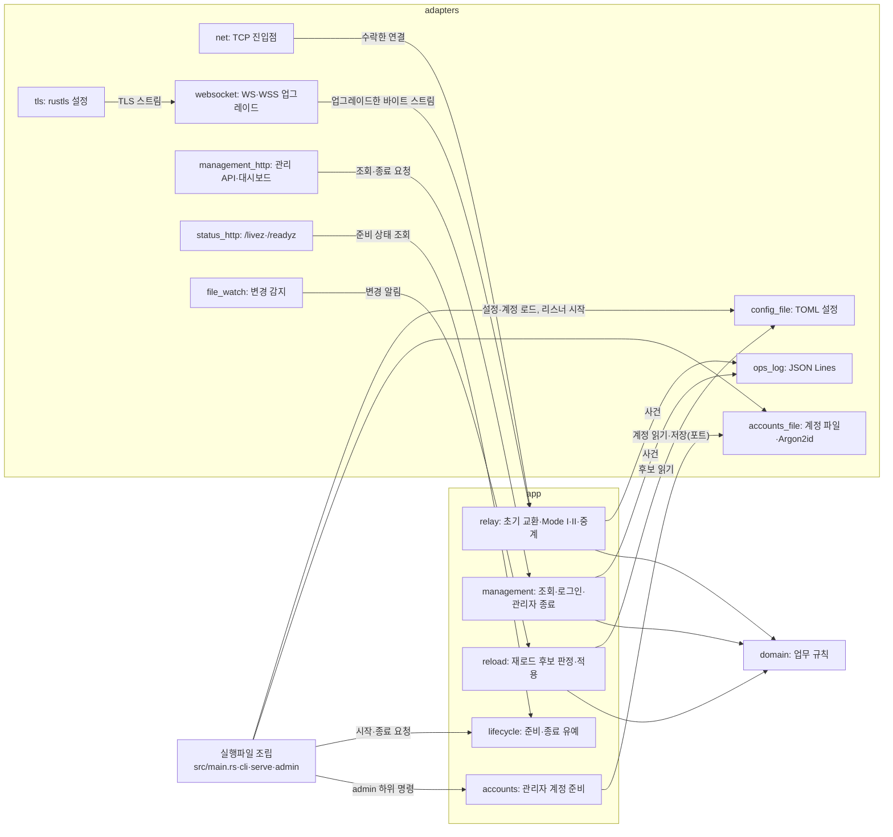
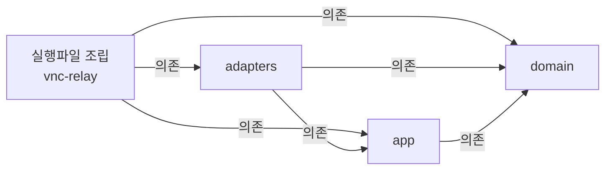

# VNC Relay 코드 지도

VNC Relay는 TCP·WS·WSS로 들어온 Viewer를 Mode I 대상이나 Mode II Server와 이어 중계 스트림을 전달하고, 관리 리스너에서 대시보드와 관리 API를 제공한다. 코드는 Cargo 작업 공간의 crate 네 개로 나눈다. 업무 규칙(domain), 사용 사례(app), 외부 연결 어댑터(adapters), 실행파일 조립(루트 crate `vnc-relay`)이다. 대표 흐름은 진입점이 접속을 수락하는 데서 시작해 초기 교환·매칭을 거쳐 활성 세션의 정리와 운영 로그 기록에서 끝난다.

| 항목 | 값 |
| --- | --- |
| 구조 시점 | Target |
| 문서 상태 | Draft |
| 구현 대조 | Verified(구현된 행만) — [대조 기록](#대조-기록) |
| 관련 PRD | [PRD](../requirements/PRD.md) [8절 유지보수성](../requirements/PRD.md#8-비기능-요구사항), [1절 구현 기술](../requirements/PRD.md#확정-기준) |
| 관련 ADR | [ADR-0001 내장 TLS](../decisions/ADR-0001-built-in-tls.md), [ADR-0003 단일 인스턴스·메모리 상태](../decisions/ADR-0003-single-instance-memory-state.md), [ADR-0004 tokio·rustls](../decisions/ADR-0004-tokio-rustls.md) |

현재 코드는 개발 도구 `xtask/`, 설정 로딩, `serve` 시작과 CLI 골격, 운영 로그, TCP 진입점, WS·WSS 진입점(101 응답까지), 연결 상한과 시간 제한, 상태 리스너와 준비 상태, 내장 TLS 파일 검사와 acceptor, 관리 리스너, 관리 로그인·세션, 관리자 계정 준비 CLI다. 설정 로딩은 `crates/domain`·`crates/app`·`crates/adapters`의 설정 모듈이다. `serve` 시작은 루트 crate의 `src/main.rs`·`src/cli.rs`·`src/serve.rs`와 계정 파일 읽기·리스너 바인드 모듈이다. 운영 로그는 사건 타입(`crates/app/src/events.rs`), 사건 기록 포트(`crates/app/src/ports.rs`), JSON Lines 출력(`crates/adapters/src/ops_log.rs`), `relay_id_ref` 계산(`crates/adapters/src/crypto.rs`), 상대 IP 값(`crates/domain/src/peer_ip.rs`)이다. TCP 진입점은 수락 반복(`crates/adapters/src/net.rs` `TcpEntryPoint`, 공유 수락 함수 `accept_connections`), 허용 판정(`crates/domain/src/allow_list.rs` `AllowList::permits`), 연결 식별자(`crates/domain/src/conn_id.rs`)다. WS·WSS 진입점(`crates/adapters/src/websocket.rs` `WsEntryPoint`)은 같은 수락 함수와 허용 판정·연결 식별자를 쓰고, 업그레이드 검사(`crates/adapters/src/upgrade.rs`)와 WSS 협상(`Wire::Tls`의 `TlsIo`)을 더한다. 연결 상한과 시간 제한은 연결 예산(`crates/domain/src/budget.rs` `ConnectionBudget`)과 TCP 진입점의 L·H·keepalive 처리(`crates/adapters/src/net.rs` `AcceptPolicy`, `hold`), WS·WSS 진입점의 L·U·H 처리(`crates/adapters/src/websocket.rs` `WsPolicy`)다. 상태 리스너와 준비 상태는 준비 상태(`crates/app/src/lifecycle.rs` `LifecycleService`)와 `/livez`·`/readyz` 응답·Lm 판정(`crates/adapters/src/status_http.rs` `StatusListener`)이다. 내장 TLS 파일 검사와 acceptor는 `crates/adapters/src/tls.rs`의 `load_acceptor`와 `crates/adapters/src/tls_listener.rs`의 `TlsListener`다([내장 TLS 모듈 설계](tls.md), 작업 3.1). 관리 리스너는 `crates/adapters/src/management_http.rs`의 `ManagementListener`와 `crates/adapters/src/admission.rs`의 `AdmittingListener`다([관리 리스너 모듈 설계](management-listener.md), 작업 4.2). 관리 로그인·세션은 `crates/app/src/management.rs`의 `AdminAuth`(로그인, 세션 검사, CSRF, 로그아웃), 도메인 `crates/domain/src/admin_session.rs`·`crates/domain/src/login_limit.rs`, 관리 API 세션 처리 `crates/adapters/src/management_http/session_api.rs`다([관리 로그인과 세션 설계](management-session.md), 작업 4.3). 관리자 계정 준비 CLI는 계정 규칙(`crates/domain/src/account.rs` `Password`), 절차와 `list`(`crates/app/src/accounts.rs` `AdminService`, `accounts::list`), 포트(`crates/app/src/ports.rs`), 계정 파일 저장과 해시(`crates/adapters/src/accounts_file/store.rs`, `crates/adapters/src/accounts_file/hasher.rs`), 숨김 입력(`crates/adapters/src/terminal.rs`), 설정의 `[admin]` 읽기(`crates/adapters/src/config_file.rs` `load_admin`), 명령 조립(`src/admin.rs`)이다. 여덟 부분 모두 구현과 대조했다([xtask 모듈 설계](xtask.md), [설정 로딩 모듈 설계](config-loading.md), [`serve` 시작 모듈 설계](serve-startup.md), [운영 로그 모듈 설계](ops-log.md), [TCP 진입점 모듈 설계](tcp-entry-point.md), [연결 상한과 시간 제한 모듈 설계](connection-limits.md), [상태 리스너와 준비 상태 모듈 설계](status-listener.md), [관리자 계정 준비 CLI 모듈 설계](admin-accounts.md), 모두 Current). WS·WSS 진입점은 [WebSocket 진입점 모듈 설계](websocket-entry-point.md)를 따른다. 위에 적지 않은 경로와 심볼은 모두 계획(Target)이다. 내장 TLS와 관리 리스너 모듈 설계의 나머지 부분(작업 4.4 이후의 관리 기능)과 WS·WSS 진입점의 101 뒤 중계(작업 2.7)도 계획(Target)이다. 레이어를 crate로 나누는 방식은 사용자가 2026-10-20에 골랐다. 각 crate의 나머지 모듈은 해당 구현 작업에서 만든다.

## 1. 전체 구조

그림은 실행 중 호출 관계다. 화살표 `A → B`는 "A가 B를 호출하거나 B에 값을 넘긴다"는 뜻이다. 레이어 의존 방향은 아래 [레이어와 의존 방향](#레이어와-의존-방향)이 정한다. 모듈 내부 함수, 오류 변환, 테스트 코드는 생략했다.

app이 adapters를 부르는 화살표(`RELAY → LOG`, `ADMIN → ACC` 등)는 app이 정의한 포트(trait)를 통한 호출이다. app 코드는 adapters 타입을 이름으로 알지 못한다. 실행파일 조립 코드가 adapters의 구현체를 포트 자리에 넣는다.

### 레이어와 의존 방향

레이어 규칙은 [아키텍처 문서 작성 규칙](../architectures/AGENTS.md#작성-규칙)을 따른다. 아래 화살표 `A → B`는 "A가 B에 의존한다"는 뜻이다.

| 레이어 | 코드 위치 | 책임 | 의존할 수 있는 레이어 | 의존 위반 확인 방법 |
| --- | --- | --- | --- | --- |
| domain | `crates/domain` (`vnc-relay-domain`) | 업무 규칙과 값. 초기 교환 해석, 중계 ID, 대기 연결 표, 활성 세션 상태와 종료 원인, 출발지 IP 허용 목록 판정, 대상 허용 정책, Origin 비교, 연결 예산, 계정 이름·비밀번호 규칙, 최근 종료 목록. 입출력·시계·난수를 직접 쓰지 않고 값으로 받는다. | 없음. 외부 crate도 쓰지 않는다. | Cargo가 선언하지 않은 crate의 `use`를 컴파일 오류로 막는다. 외부 의존 0개는 `cargo xtask layers`가 검사한다. |
| app | `crates/app` (`vnc-relay-app`) | 사용 사례. 접속 처리 순서, Mode I 대상 연결과 Mode II 매칭, 중계 스트림 전달과 정리, 관리 조회·로그인·관리자 종료, 재로드 판정·적용, 준비·종료 유예 관리, 관리자 계정 준비 절차. 외부 입출력은 포트(trait)로 정의한다. | domain. 외부 crate는 tokio의 동기화·시간·입출력 trait만 쓴다. | crate 의존은 컴파일과 `cargo xtask layers`가 검사한다. 소켓·파일·신호 같은 tokio·std 입출력 타입은 `crates/app/clippy.toml`의 `disallowed-types`·`disallowed-methods`로 막고 `cargo clippy`가 검사한다. |
| adapters | `crates/adapters` (`vnc-relay-adapters`) | 외부와 연결. TCP 리스너, TLS, WebSocket, 관리·상태 HTTP, 설정 파일, 계정 파일과 Argon2id, 운영 로그 출력, 파일 변경 감지, 터미널 숨김 입력, 난수·HMAC. app의 포트를 구현한다. | domain, app, [PRD "구현 기술" 행](../requirements/PRD.md#확정-기준)의 라이브러리 | `cargo xtask layers`가 외부 crate가 PRD 목록 안에 있는지 검사한다. 라이선스는 [의존성 라이선스 검사](../how-to/check-dependency-licenses.md)를 따른다. |
| 실행파일 조립 | 루트 crate `vnc-relay`의 `src/` | 명령행 해석과 종료 코드, 시작 순서, 비동기 런타임 생성과 종료 신호 받기, 포트에 구현체를 넣는 객체 연결. 업무 규칙을 두지 않는다. | domain, app, adapters, clap, tokio | 코드 리뷰. 이 crate에 업무 규칙 함수가 생기면 domain이나 app으로 옮긴다. |
| 개발 도구 | `xtask/` | 시나리오 커버리지 보고, 레이어 검사 같은 개발용 명령. 제품 실행파일에 들어가지 않는다. | 제품 crate에 의존하지 않는다. | `cargo xtask layers`가 검사한다. |
| 정적 대시보드 | `web/dashboard/` | 정적 HTML·CSS·JS. 내부 파일 구조는 [작업 0.9](../TODO.md)에서 정한다. | 관리 API만 HTTP로 부른다. JS 의존성이 없다. | 프런트엔드 컨벤션(작업 0.9)의 검증 방법 |

경계 규칙:

- 안쪽 레이어(domain, app)는 바깥 레이어의 타입·함수를 알지 못한다. app이 바깥 기능을 써야 하면 app에 포트(trait)를 두고 adapters가 구현한다.
- 레이어 사이에서는 domain·app의 타입으로 값을 넘긴다. 라이브러리 타입(axum 요청, tungstenite 메시지, toml 값)을 app으로 넘기지 않는다. 바이트 스트림은 tokio의 `AsyncRead`·`AsyncWrite` trait으로 넘긴다.
- 상태는 프로세스 메모리에만 둔다([ADR-0003](../decisions/ADR-0003-single-instance-memory-state.md)). 대기 연결 표, 활성 세션, 최근 종료 목록, 관리 세션은 app이 소유한다.
- 이 구조에서 벗어나려면 [ADR](../decisions/AGENTS.md)을 작성한다.

## 2. 코드 위치와 구성요소

구현된 경로는 설정 로딩, `serve` 시작, 운영 로그, TCP 진입점, WS·WSS 진입점(101 응답까지), 연결 상한과 시간 제한, 상태 리스너와 준비 상태, 관리자 계정 준비 CLI, `xtask/`, 내장 TLS 파일 검사와 acceptor, 관리 리스너, 관리 로그인·세션의 것이다. 나머지 경로는 모두 계획이다. 파일을 모듈 디렉터리로 나눌지는 구현할 때 모듈 설계에서 정한다.

| 코드 위치 | 구성요소 | 주된 책임 | 맡지 않는 책임 | 의존 대상 | 모듈 설계 |
| --- | --- | --- | --- | --- | --- |
| `crates/domain/src/handshake.rs` | 초기 교환 해석 | 받은 바이트로 Mode I 대상 주소 또는 중계 ID와 역할을 해석한다. 분할·병합 수신과 후속 데이터 보존을 다룬다. 형식은 [Repeater 초기 교환 계약](../contracts/repeater-handshake-v1.md)을 따른다. | 소켓 읽기, 제한 시간 | 없음 | 없음(작업 2.7에서 작성) |
| `crates/domain/src/relay_id.rs` | 중계 ID | 중계 ID 값과 비교 규칙 | `relay_id_ref` 계산(HMAC은 adapters) | 없음 | 없음 |
| `crates/domain/src/matching.rs` | 대기 연결 표 | Mode II 대기 등록, 짝 찾기, 중복 ID 판정, 대기 상한 Lw | 대기 시간 측정, 소켓 | `relay_id` | 없음(작업 2.9에서 작성) |
| `crates/domain/src/session.rs` | 활성 세션 상태 | 세션 상태 전이, 종료 원인(`close_cause`), 방향별 전송량 | 바이트 전달 | 없음 | 없음 |
| `crates/domain/src/entry_point.rs` | 진입점 | 진입점 네 종류의 이름(`tcp_viewer` 등)과 TCP 진입점 기본 포트, 연결의 역할(`Role`)과 진입점별 역할 | 리스너 열기 | 없음 | [설정 로딩 모듈 설계](config-loading.md), [TCP 진입점 모듈 설계](tcp-entry-point.md)(`Role`) |
| `crates/domain/src/allow_list.rs` | 출발지 IP 허용 목록 | 단일 IP·CIDR·범위 항목 해석과 허용 판정(`AllowList::permits`), 전체 허용 항목 판별 | 설정 파일 읽기 | `peer_ip` | [설정 로딩 모듈 설계](config-loading.md)(항목 해석), [TCP 진입점 모듈 설계](tcp-entry-point.md)(허용 판정) |
| `crates/domain/src/conn_id.rs` | 연결 식별자 | 프로세스 안에서 유일한 `conn_id`(`c1`, `c2`, …) 발급 | 사건 기록 | 없음 | [TCP 진입점 모듈 설계](tcp-entry-point.md) |
| `crates/domain/src/target_policy.rs` | 대상 허용 정책 | Mode I 대상 항목 해석, 최종 연결 IP·포트 허용 판정 | 주소 해석, 연결 | `allow_list` | [설정 로딩 모듈 설계](config-loading.md)(항목 해석). 허용 판정은 작업 2.8에서 더한다. |
| `crates/domain/src/origin.rs` | Origin 비교 | Origin 정규화와 정확 일치 비교([설정 계약 1.4절](../contracts/config-v1.md#14-origin-값-문법과-비교)) | HTTP 헤더 읽기 | 없음 | [설정 로딩 모듈 설계](config-loading.md) |
| `crates/domain/src/peer_ip.rs` | 상대 IP | 소켓 상대 IP 값. IPv4-mapped IPv6를 IPv4로 바꾸고, 포트·영역 식별자 없이 표기한다([운영 정보 계약 1.10절](../contracts/ops-info-v1.md#110-상대-주소-표기)). | 소켓 읽기, 허용 판정 | 없음 | [운영 로그 모듈 설계](ops-log.md) |
| `crates/domain/src/budget.rs` | 연결 예산 | 상한 하나 아래에서 자리를 잡고 돌려주는 `ConnectionBudget`·`BudgetPermit`. 중계 측 연결 L, 관리·상태 연결 Lm, 대기 Mode II 연결 Lw가 같은 타입을 쓴다. 지금은 TCP·WS·WSS 진입점이 L 하나를 같이 쓰고(작업 2.5, 3.2), 상태 리스너와 관리 리스너가 Lm 하나를 같이 쓴다(작업 2.6, 4.2). | 소켓 수락 | 없음 | [연결 상한과 시간 제한 모듈 설계](connection-limits.md) |
| `crates/domain/src/account.rs` | 관리자 계정 규칙 | 계정 이름 규칙과 비밀번호 규칙(`Password`), Argon2id 해시 문자열 형식과 승인 매개변수 범위([CLI 계약 1.2·1.4절](../contracts/cli-v1.md#12-계정-이름과-비밀번호-규칙)). | 해시 계산, 파일 | 없음 | [`serve` 시작 모듈 설계](serve-startup.md), [관리자 계정 준비 CLI 모듈 설계](admin-accounts.md)(`Password`) |
| `crates/domain/src/recent_closed.rs` | 최근 종료 목록 | 최대 R개 보관, 오래된 항목 제거 | 시각 읽기 | `session` | 없음 |
| `crates/domain/src/admin_session.rs` | 관리 세션 | 관리 세션 토큰(64자리 소문자 16진수)과 CSRF 토큰, 유휴·절대 만료, 세션 표(`AdminSessionTable`). 로그인 실패 제한은 `login_limit.rs`가 맡는다. | 시각을 값으로 받는다 | 없음 | [관리 로그인과 세션 설계](management-session.md) |
| `crates/domain/src/login_limit.rs` | 로그인 실패 제한 | 계정 이름과 원격 주소별 실패 횟수, 잠금 기간(`LoginLimiter`). 잠금 중 시도는 실패로 세지 않는다. | 시각을 값으로 받는다 | 없음 | [관리 로그인과 세션 설계](management-session.md) |
| `crates/app/src/ports.rs` | 포트 | 바깥 기능의 trait. 지금은 사건 기록(`EventSink`), 계정 저장소(`AccountStore`), 계정 입력(`AccountInput`, `InputError`), 비밀번호 해시(`PasswordHasher`, `HashError`), 로그인 검증(`PasswordVerifier`), 시계(`Clock`), 토큰 난수(`TokenSource`, `RandomError`)가 있다. 대상 연결은 쓰는 작업이 더한다. | 구현 | domain | [운영 로그 모듈 설계](ops-log.md)(`EventSink`), [관리자 계정 준비 CLI 모듈 설계](admin-accounts.md)(`AccountStore`·`AccountInput`·`PasswordHasher`), [관리 로그인과 세션 설계](management-session.md)(`PasswordVerifier`·`Clock`·`TokenSource`) |
| `crates/app/src/settings.rs` | 유효 설정 | 검증을 마친 설정 값의 타입, 설정 오류·경고 코드, 진단. 재로드 대상과 재시작 필요 값을 구분한다. 바인드할 리스너 계획(`Settings::status_listener`, `Settings::management_listener`, `Settings::other_listeners`)을 만든다. | TOML 해석 | domain | [설정 로딩 모듈 설계](config-loading.md), [`serve` 시작 모듈 설계](serve-startup.md)(리스너 계획) |
| `crates/app/src/events.rs` | 운영 로그 사건 | 사건 종류(`Event`)와 사건 이름·`level`, `phase`·`stage`·`reason`·`error_kind` 값, `relay_id_ref` 값 타입, `log_contract` 값([운영 정보 계약 1.3~1.7절](../contracts/ops-info-v1.md#15-사건-목록)). 기능 작업이 사건을 더한다. 지금은 시작·종료 사건, 설정 경고, 접속 수락·거절·중단(작업 2.4), 상한 거절과 H·상대 종료·연결 오류 중단(작업 2.5), `server_ready`와 Lm 거절(작업 2.6), TLS 버전 거절(`Stage::Tls`·`RejectReason::TlsVersionUnsupported`, 관리 리스너 작업 4.2·WSS 작업 3.2), WS·WSS 업그레이드 거절(`Event::UpgradeRejected`, 사건 이름 `connection_rejected`, `stage`는 항상 `upgrade`, 작업 3.2), 협상·업그레이드 제한 시간 중단(`AbortReason::TlsUpgradeTimeout`, 작업 3.2), 관리 로그인 성공·실패·제한 사건(`Event::AdminLoginSucceeded`·`AdminLoginFailed`·`AdminLoginLimited`, 작업 4.3)이 있다. | 줄 형식, 출력 | `settings`, domain | [운영 로그 모듈 설계](ops-log.md), [TCP 진입점 모듈 설계](tcp-entry-point.md)(접속 사건), [WebSocket 진입점 모듈 설계](websocket-entry-point.md)(업그레이드 거절), [연결 상한과 시간 제한 모듈 설계](connection-limits.md)(상한·시간 제한 원인), [상태 리스너와 준비 상태 모듈 설계](status-listener.md)(`server_ready`, `admin_connection_limit`), [관리 로그인과 세션 설계](management-session.md)(관리 로그인 사건) |
| `crates/app/src/relay/` | 중계 | 접속 처리 순서, 초기 교환 제한 시간 H, Mode I 대상 연결, Mode II 매칭과 대기 W, 중계 스트림 전달, 한쪽 종료와 정리 제한 시간 E, 끊긴 연결 처리 | 소켓 수락, TLS, WebSocket 프레임 | domain, `ports` | 없음(작업 2.7에서 작성) |
| `crates/app/src/management.rs`, `crates/app/src/management/` | 관리 | `AdminAuth`: 로그인(`login.rs`, 실패 제한·사건 포함)과 세션 검사·CSRF·로그아웃(`session.rs`). 서버 요약·대기 연결·활성 세션·최근 종료 조회와 관리자 종료는 작업 4.4·4.5가 더한다. | HTTP 해석, 쿠키 헤더 | domain, `ports` | [관리 로그인과 세션 설계](management-session.md) |
| `crates/app/src/reload/` | 재로드 | 재로드 후보를 실행 중 유효 설정과 비교하고 원자적으로 적용, 결과 사건 | 파일 감지, 파일 읽기 | domain, `settings`, `ports` | [파일 변경 감지 모듈 설계](file-watch.md) |
| `crates/app/src/lifecycle.rs` | 수명 | 준비 상태(`Readiness`, `LifecycleService`: 시작 중·준비됨·종료 중, 작업 2.6). 종료 유예 G, 두 번째 종료 요청 처리는 작업 5.3이 더한다. | 신호 수신 | std 원자 변수. G를 더할 때 domain, `ports` | [상태 리스너와 준비 상태 모듈 설계](status-listener.md) |
| `crates/app/src/accounts.rs` | 관리자 계정 | 계정 파일 오류·경고 코드와 진단, 계정 없음 거절(작업 2.2). `admin` 절차(`AdminService`)와 `list` 함수 | 숨김 입력, 파일 잠금·교체 | domain, `ports` | [`serve` 시작 모듈 설계](serve-startup.md)(오류 코드), [관리자 계정 준비 CLI 모듈 설계](admin-accounts.md)(절차) |
| `crates/adapters/src/net.rs`, `crates/adapters/src/net/` | TCP 리스너·진입점 | 리스너 바인드와 실패 수집(작업 2.2), 상태 리스너를 먼저 여는 계획 하나 바인드(`bind_one`, 작업 2.6), 수락 반복(`accept_connections`, TCP와 WS·WSS 진입점이 같이 쓴다), TCP 진입점의 수락 직후 출발지 IP 검사, 허용한 연결의 보류와 종료 때 정리(작업 2.4), L 판정·H·보류 중 상대 종료 감지·TCP keepalive 설정(작업 2.5) | 초기 교환 해석, 끊긴 연결 판정(작업 2.11) | app, domain, tokio, socket2 | [`serve` 시작 모듈 설계](serve-startup.md)(바인드), [TCP 진입점 모듈 설계](tcp-entry-point.md)(진입점), [연결 상한과 시간 제한 모듈 설계](connection-limits.md)(L·H·K) |
| `crates/adapters/src/tls.rs` | TLS | rustls 서버 설정, PEM 인증서·개인키 읽기와 오류 분류(작업 3.1), 인증서 교체(작업 5.x) | 리스너 | rustls, rustls-pki-types, tokio-rustls | [내장 TLS 모듈 설계](tls.md) |
| `crates/adapters/src/websocket.rs`, `crates/adapters/src/upgrade.rs` | WS·WSS 진입점 | `WsEntryPoint::run`: 공유 수락 함수로 연결을 받고 허용 판정과 L을 확인한다. WSS는 `Wire::Tls`(`TlsIo`)로 협상하며, 협상과 머리 읽기는 U 안에 끝나야 한다. 머리는 `upgrade.rs`의 `read_head`·`check`로 읽고 검사한다(Origin 포함). 검사 뒤 IP를 다시 확인하고, 101 응답 또는 거절 응답(`UpgradeRejected`)을 쓴다. 101 뒤에는 H 동안 프레임을 읽지 않고 보류한다(작업 2.7 전). 바이너리 메시지와 바이트 스트림 변환, ping은 작업 2.7·3.3이 더한다. | 중계 규칙 | app, domain, tokio, tokio-rustls, tokio-tungstenite | [WebSocket 진입점 모듈 설계](websocket-entry-point.md) |
| `crates/adapters/src/management_http.rs` | 관리 HTTP | `ManagementListener`: 관리 HTTPS 또는 루프백 평문 HTTP 접속을 받는다. `/api/v1/`은 `session_api::answer`로 넘기고, 정적 경로 303·405와 `/login/` 404·405는 그대로다. 오래된 세션 쿠키는 지운다. 조회·종료 경로는 작업 4.4·4.5가, 정적 파일은 작업 4.6이 더한다. | 관리 규칙 | app, domain, axum, tokio, tokio-rustls, 내부 `admission`·`tls_listener` | [관리 리스너 모듈 설계](management-listener.md) |
| `crates/adapters/src/management_http/session_api.rs` | 관리 API 세션 | `/api/v1/` 경로·메서드 나누기와 세션·CSRF 검사 순서(계약 1.3절), 로그인 본문 읽기(`application/json`, 16 KiB), GET·DELETE 본문 미디어 타입 검사(415), `spawn_blocking`으로 `AdminAuth::login` 호출, 세션 응답(GET에 `as_of`)과 쿠키 만들기 | 관리 API 규칙 | app, axum, serde_json | [관리 로그인과 세션 설계](management-session.md) |
| `crates/adapters/src/status_http.rs` | 상태 HTTP | `StatusListener`: 수락은 `admission.rs`의 `AdmittingListener`가 맡고, `/livez`·`/readyz` 응답과 404·405 오류 본문([운영 정보 계약 1.12·2절](../contracts/ops-info-v1.md#112-상태-리스너와-엔드포인트)) | 준비 판정 | app, domain, axum, serde_json, tokio | [상태 리스너와 준비 상태 모듈 설계](status-listener.md) |
| `crates/adapters/src/admission.rs` | 수락 Lm 판정 | `AdmittingListener`: 수락 직후 Lm 자리를 잡는다. 자리가 없으면 `connection_rejected`(`admin_connection_limit`)를 기록하고 닫는다. `Admitted`는 자리를 든 접속이며 끝나면 자리를 돌려준다. 상태·관리 리스너가 같이 쓴다. | HTTP 해석, TLS | app, domain, tokio | [관리 리스너 모듈 설계](management-listener.md), [상태 리스너와 준비 상태 모듈 설계](status-listener.md) |
| `crates/adapters/src/tls_listener.rs` | 접속별 TLS | `TlsListener`: `axum::serve::Listener`를 감싼다. 수락 때 핸드셰이크를 기다리지 않고, 접속 `Io`가 읽기·쓰기 때 핸드셰이크를 진행한다. TLS 1.2 미만 거절을 `connection_rejected`(`tls`·`tls_version_unsupported`)로 기록한다. 관리 HTTPS만 쓴다. WSS는 `TlsIo`를 접속마다 직접 쓴다(작업 3.2). | HTTP 해석, 인증서 읽기 | app, domain, tokio-rustls, rustls | [관리 리스너 모듈 설계](management-listener.md) |
| `crates/adapters/src/request_deadline.rs` | 관리 요청 시간 제한 | `DeadlineListener`: `axum::serve::Listener`를 감싼다. 접속마다 U 타이머를 든다. 첫 요청 머리가 끝나기 전에는 수락 때부터 잰 절대 기한이고, 끝난 뒤에는 읽기·쓰기가 있을 때마다 다시 잰다. 관리 HTTPS에서는 TLS 핸드셰이크도 이 기한 안에 든다(사용자 결정 Q12). 기한이 지나면 `TimedOut`을 돌려준다. | 접속 시간 규칙 | tokio, axum | [관리 리스너 모듈 설계](management-listener.md) |
| `crates/adapters/src/config_file.rs`, `crates/adapters/src/config_file/`, `crates/adapters/src/toml_text.rs` | 설정 파일 | TOML 해석과 검증, `config_*` 오류. `load_admin`은 `admin`이 쓰며 TOML 구문 전체와 `[admin]` 테이블만 검사한다. `toml_text.rs`는 TOML 구문 오류 위치를 계정 파일과 함께 쓴다. | 재로드 판정 | app, domain | [설정 로딩 모듈 설계](config-loading.md) |
| `crates/adapters/src/accounts_file.rs`, `crates/adapters/src/accounts_file/` | 계정 파일 | 계정 파일 읽기·검증(작업 2.2), 잠금·원자적 교체(`AccountsFile`), Argon2id 해시 생성(`Argon2Hasher`)과 검증(`Argon2Verifier`, 로그인) | 계정 규칙 | app, domain, toml, argon2 | [`serve` 시작 모듈 설계](serve-startup.md)(읽기), [관리자 계정 준비 CLI 모듈 설계](admin-accounts.md)(쓰기), [관리 로그인과 세션 설계](management-session.md)(검증) |
| `crates/adapters/src/ops_log.rs` | 운영 로그 | `EventSink` 구현. 사건을 JSON Lines로 표준 출력이나 파일에 쓴다. 줄 형식, 길이 제한, 로그 파일 열기 실패(`log_file_unavailable`), 쓰기 실패 처리([운영 정보 계약](../contracts/ops-info-v1.md) 1.1~1.4절) | 사건 내용 결정 | app, serde_json | [운영 로그 모듈 설계](ops-log.md) |
| `crates/adapters/src/file_watch.rs` | 파일 변경 감지 | OS 파일 알림과 주기 확인 | 후보 검증 | app, notify, tokio | [파일 변경 감지 모듈 설계](file-watch.md) |
| `crates/adapters/src/terminal.rs` | 터미널 입력 | 숨김 비밀번호 입력, 확인 입력 한 줄, Ctrl+C 감지기 | 비밀번호 규칙 | app, rpassword, tokio(signal) | [관리자 계정 준비 CLI 모듈 설계](admin-accounts.md) |
| `crates/adapters/src/terminal/windows_console.rs` | Windows 콘솔 입력 모드 | 숨김 입력 전에 콘솔 입력 모드를 저장하고 끝난 뒤 되돌린다(Windows 전용, `unsafe` 예외 파일) | 호출 순서는 `terminal.rs`가 정한다 | windows-sys(Windows 전용) | [관리자 계정 준비 CLI 모듈 설계](admin-accounts.md) |
| `crates/adapters/src/crypto.rs` | 난수·HMAC | `relay_id_ref` 키 생성과 HMAC-SHA-256(작업 2.3), 난수 바이트 채우기 `random_bytes`(Argon2id 솔트), 관리 세션·CSRF 토큰 난수(`SystemTokenSource`, 32바이트를 64자리 16진수로). `session_id` 난수는 작업 2.10이 더한다. | 사용처 규칙 | app, aws-lc-rs | [운영 로그 모듈 설계](ops-log.md)(`relay_id_ref`), [관리자 계정 준비 CLI 모듈 설계](admin-accounts.md)(`random_bytes`), [관리 로그인과 세션 설계](management-session.md)(`SystemTokenSource`) |
| `crates/adapters/src/clock.rs` | 시계 | `SystemClock`: 단조 시각(`Instant`)과 벽시계(`SystemTime`)를 응용 계층 `Clock` 포트로 준다. `timestamp`는 UTC ISO 8601 값(밀리초 3자리)을 만든다. | 시각 읽기 | app, std | [운영 로그 모듈 설계](ops-log.md)(`timestamp`), [관리 로그인과 세션 설계](management-session.md)(`Clock`) |
| `src/main.rs`, `src/cli.rs` | 명령행 | 하위 명령·옵션 해석, 사용법 오류, 진단 출력 형식, 종료 코드([CLI 계약](../contracts/cli-v1.md)) | 명령 실행 내용 | `serve`, `admin`, clap | [`serve` 시작 모듈 설계](serve-startup.md), [관리자 계정 준비 CLI 모듈 설계](admin-accounts.md)(admin 하위 명령) |
| `src/serve.rs` | 서버 조립 | 시작 순서([CLI 계약 1.8절](../contracts/cli-v1.md#18-수동-시작과-종료))대로 설정·로그 출력·계정·감지·리스너를 준비하고 포트에 구현체를 넣는다. 단계마다 운영 로그 사건을 기록한다. 비동기 런타임을 만들고 종료 신호를 수명 관리에 넘긴다. 지금은 상태 리스너를 먼저 열고, 관리 리스너를 그 다음에 바인드하고, 나머지 리스너를 바인드한 뒤 준비됨으로 바꾸고 `server_ready`를 기록한다. 준비됨 뒤 관리 리스너 작업을 띄운다. L 예산을 하나 만들어 TCP 진입점과 WS·WSS 진입점 작업에 `Arc`로 나눠 주고 시작하며, 종료 때 끝나기를 기다린다. 관리 HTTPS 수락기는 `management_tls`로 관리 리스너에 넘기고, WSS 수락기는 `wss_tls`에서 꺼내(`take`) WSS 진입점에만 넘긴다(작업 3.2). 계정 확인(`require_any`) 뒤에 `AdminAuth`를 만들고, 더미 해시 만들기가 실패하면 종료 코드 1로 끝난다(작업 4.3). | 업무 규칙 | adapters, app, domain, tokio | [`serve` 시작 모듈 설계](serve-startup.md), [TCP 진입점 모듈 설계](tcp-entry-point.md)(진입점 시작·정지), [WebSocket 진입점 모듈 설계](websocket-entry-point.md)(진입점 시작·정지), [연결 상한과 시간 제한 모듈 설계](connection-limits.md)(L 예산), [상태 리스너와 준비 상태 모듈 설계](status-listener.md)(상태 리스너·준비 상태), [관리 리스너 모듈 설계](management-listener.md)(관리 리스너 바인드·시작·정지), [관리 로그인과 세션 설계](management-session.md)(`AdminAuth` 준비) |
| `src/admin.rs` | 계정 명령 조립 | `admin` 하위 명령에 구현체를 넣고 app 절차를 실행한다. | 계정 규칙 | adapters, app | [관리자 계정 준비 CLI 모듈 설계](admin-accounts.md) |
| `xtask/` | 개발 도구 | `cargo xtask scenarios`(시나리오 커버리지 보고), `cargo xtask layers`(레이어 의존 검사) | 제품 기능 | serde_json. 제품 crate에 의존하지 않는다. | [xtask 모듈 설계](xtask.md) |
| `web/dashboard/` | 대시보드 | 정적 화면 | 서버 규칙 | 관리 API(HTTP) | 없음(작업 0.9에서 구조 결정) |

## 3. 진입점

| 진입점 종류 | 코드 위치(파일·심볼) | 시작 조건 | 다음으로 호출하는 곳 |
| --- | --- | --- | --- |
| CLI 명령 | `src/main.rs` `main` | 운영자가 `vnc-relay`를 실행 | `src/cli.rs` `parse` → `src/serve.rs` `run` 또는 `src/admin.rs` `run` |
| TCP 접속 | `crates/adapters/src/net.rs` `TcpEntryPoint::run` | TCP Viewer·TCP Server 진입점이 접속을 수락 | 지금은 출발지 IP와 L을 판정한 뒤 허용한 연결을 읽지 않고 H 만료, 상대 종료, 서버 종료 중 먼저 오는 때까지 보류한다([TCP 진입점 모듈 설계](tcp-entry-point.md), [연결 상한과 시간 제한 모듈 설계](connection-limits.md)). 작업 2.7에서 `crates/app/src/relay/` `RelayService::handle_connection`을 부른다. |
| WS·WSS 접속 | `crates/adapters/src/websocket.rs` `WsEntryPoint::run` | WS·WSS Viewer 진입점이 접속을 수락하고 업그레이드 | 작업 3.2는 101 응답까지만 한다(사용자 결정 Q16). 101 뒤에는 프레임을 읽지 않고 H가 지나거나 서버가 멈출 때까지 보류한다. 이 임시 동작은 사용자 결정 2026-10-22(Q21)로 작업 2.7까지 유지한다. H가 지나면 4009 닫기 코드로 닫는다. H는 101 응답 뒤부터 잰다(사용자 결정 2026-10-22(Q22)). 자세한 내용은 [WebSocket 진입점 모듈 설계](websocket-entry-point.md) 9절 항목 11. 작업 2.7에서 `crates/app/src/relay/` `RelayService::handle_connection`을 부른다. |
| 관리 HTTP 요청 | `crates/adapters/src/management_http.rs` `ManagementListener::run`, `answer`, `crates/adapters/src/management_http/session_api.rs` `answer` | 관리 리스너가 접속을 수락하고 요청을 받는다. `/api/v1/`은 `session_api`가 로그인·세션 검사·CSRF·로그아웃을 처리한다([관리 리스너 모듈 설계](management-listener.md), [관리 로그인과 세션 설계](management-session.md)) | 조회·종료 함수(`crates/app/src/management/`, 작업 4.4·4.5) |
| 상태 HTTP 요청 | `crates/adapters/src/status_http.rs` `StatusListener::run` | 상태 리스너가 연결을 수락하고 `/livez`·`/readyz` 요청을 받음 | `crates/app/src/lifecycle.rs` `LifecycleService::readiness`([상태 리스너와 준비 상태 모듈 설계](status-listener.md)) |
| 파일 변경 | `crates/adapters/src/file_watch.rs` `ReloadWatcher::run` | OS 파일 알림 또는 주기 확인이 변경을 찾음 | `crates/app/src/reload/` `ReloadService::on_change` ([파일 변경 감지 모듈 설계](file-watch.md)) |
| 종료 신호 | `src/serve.rs` `ShutdownSignal::wait` | Ctrl+C, SIGTERM(Ubuntu), Ctrl+Break(Windows) | 지금은 `LifecycleService::begin_shutdown`으로 종료 중이 되고, TCP 진입점과 WS·WSS 진입점 작업에 종료를 알리고, 보류 연결이 모두 정리된 뒤 관리 리스너 작업을 멈추고, 상태 리스너를 멈추고, 리스너를 닫고 종료 코드 0으로 끝난다. 작업 5.3에서 `crates/app/src/lifecycle.rs` `LifecycleService::request_shutdown`을 부른다. |
| 예약 작업 | `crates/app/src/relay/`, `crates/app/src/lifecycle.rs`의 타이머 | 대기 W, 초기 교환 H, 정리 E, 종료 유예 G 만료 | 각 사용 사례의 정리 함수 |

## 4. 핵심 흐름

대표 시나리오는 Mode II에서 Server가 먼저 접속하고 Viewer가 같은 중계 ID로 접속해 세션이 성립하는 경우다. 관련 스펙 시나리오: [중계 스펙](../specs/relay.md#7-수용-테스트) RLY-010. 초기 교환의 바이트 형식은 Draft 계약이 확정된 뒤 정한다(작업 1.5).

| 순서 | 코드 위치(파일·심볼) | 하는 일 | 넘기는 값·바뀌는 상태 |
| --- | --- | --- | --- |
| 1 | `crates/adapters/src/net/` `TcpEntryPoint::run` | TCP Server 진입점에서 접속을 수락한다. 데이터를 읽기 전에 출발지 IP를 허용 목록으로 판정하고 연결 예산 L을 확보한다. | `TcpStream`, `peer_ip`, 진입점 종류를 `RelayService::handle_connection`에 넘긴다. 허용이면 `connection_accepted`, 거절이면 `connection_rejected` 사건 |
| 2 | `crates/domain/src/allow_list.rs` `AllowList::permits`, `crates/domain/src/budget.rs` `ConnectionBudget::try_acquire` | 허용 여부와 예산을 판정한다. | 허용·거절 결과, 예산 사용량 증가 |
| 3 | `crates/app/src/relay/` `RelayService::handle_connection` | 제한 시간 H 안에 초기 교환을 읽는다. | 바이트를 `HandshakeParser`에 넣는다. |
| 4 | `crates/domain/src/handshake.rs` `HandshakeParser::feed` | 받은 바이트를 해석한다. | Mode II, 역할 Server, `RelayId`, 이미 받은 후속 바이트 |
| 5 | `crates/app/src/relay/` `RelayService::register_or_match`, `crates/domain/src/matching.rs` `WaitingTable::register` | 짝이 없으므로 대기 연결로 등록하고 대기 시간 W를 잰다. | 대기 연결 표에 등록, `waiting_registered` 사건 |
| 6 | 1~4와 같은 경로 | TCP Viewer 진입점에 같은 중계 ID의 Viewer가 접속한다. | Mode II, 역할 Viewer, 같은 `RelayId` |
| 7 | `crates/domain/src/matching.rs` `WaitingTable::take_peer` | 대기 중인 Server를 꺼내 한 번만 짝짓는다. | 대기 연결 표에서 제거, 짝이 된 두 연결 |
| 8 | `crates/app/src/relay/` `RelayService::run_session` | 활성 세션을 만들고 양방향으로 바이트를 전달한다. 후속 바이트를 먼저 보낸다. 쓰기 성공한 바이트를 센다. | `session_id` 발급, 활성 세션 목록에 등록, `session_started` 사건 |
| 9 | `crates/app/src/relay/` `RelayService::close_session` | 한쪽 EOF·오류·관리자 종료·끊긴 연결에서 정리한다. | 활성 세션에서 제거, 최근 종료 목록에 추가, 예산 반환, `session_closed` 사건 |
| 10 | `crates/adapters/src/ops_log.rs` `JsonLinesEventSink::record` | 사건을 한 줄 JSON으로 쓴다. | 표준 출력이나 로그 파일에 한 줄 |

사건 이름은 [운영 정보 계약 1.5절](../contracts/ops-info-v1.md#15-사건-목록)이 기준이다. 위 표의 사건 이름은 흐름 설명용이며 구현할 때 계약과 대조한다.

## 5. 시작과 연결

- 시작 순서: `src/serve.rs` `run`이 [CLI 계약 1.8절](../contracts/cli-v1.md#18-수동-시작과-종료)의 순서를 따른다. (1) 설정 읽기·검증과 로그 출력 열기, (2) 계정 파일 읽기·검증, (3) 파일 변경 감지 준비, (4) 비동기 런타임·종료 신호 처리기 준비, 인증서·개인키 검사 뒤 리스너 바인드. 리스너는 상태 리스너, 관리 리스너, 나머지 순서로 바인드한다. 상태 리스너는 바로 응답한다. 로그 출력을 열면 `server_starting`과 설정 경고를 기록한다. 모두 성공하면 수명 상태를 준비됨으로 바꾸고 `server_ready`를 기록한 뒤 리스너 작업을 시작한다. 실패하면 진단마다 `startup_failed`를 기록하고, 확보한 자원을 회수하고, 종료 코드를 돌려준다. 지금 구현은 (3)을 하지 않는다. 리스너 작업은 상태 리스너, 관리 리스너, TCP 진입점, WS·WSS 진입점이다([`serve` 시작 모듈 설계](serve-startup.md) 1절, [TCP 진입점 모듈 설계](tcp-entry-point.md), [WebSocket 진입점 모듈 설계](websocket-entry-point.md), [상태 리스너와 준비 상태 모듈 설계](status-listener.md), [관리 리스너 모듈 설계](management-listener.md)).
- 설정 위치: `crates/adapters/src/config_file/`가 `--config` 파일을 읽어 `crates/app/src/settings.rs`의 유효 설정을 만든다. 환경 변수는 읽지 않는다.
- 객체 연결 위치: `src/serve.rs`와 `src/admin.rs`. DI 프레임워크는 쓰지 않는다. 함수 인수와 `Arc`로 포트 구현체를 넘긴다.

## 6. 처음 읽을 코드

구현 뒤 경로다.

1. `src/serve.rs` — 시작 순서와 구성요소 연결을 한곳에서 볼 수 있다.
2. `crates/app/src/relay/` — 접속 처리 순서와 세션 수명이 모인 곳이다.
3. `crates/domain/src/matching.rs` — Mode II 매칭 규칙의 중심이다.

## 7. 확인하지 못한 부분

| 항목 | 확인하지 못한 이유 | 확인 방법 |
| --- | --- | --- |
| 위 구현 부분(설정 로딩, `serve` 시작, 운영 로그, TCP 진입점, WS·WSS 진입점(101 응답까지), 연결 상한과 시간 제한, 상태 리스너와 준비 상태, 관리자 계정 준비 CLI, `xtask/`, 내장 TLS 파일 검사와 acceptor, 관리 리스너, 관리 로그인·세션)을 뺀 나머지 경로·심볼 | 구현 전 계획이다. 내장 TLS와 관리 리스너 모듈 설계의 나머지 부분(작업 4.4 이후의 관리 기능)과 WS·WSS 진입점의 101 뒤 중계(작업 2.7)도 계획이다. | 각 구현 작업에서 모듈 설계를 쓰고, 작업 5.8에서 코드와 대조해 `Current`로 바꾼다. |
| 초기 교환 해석의 입력 단위 | Repeater 초기 교환 계약이 Draft다. | 작업 1.5에서 계약을 채택한 뒤 `handshake` 모듈 설계에 반영한다. |
| app의 tokio 입출력 금지 목록 | `crates/app/clippy.toml`은 std의 파일·소켓·프로세스·환경 변수·시각 읽기를 막는다(작업 2.1). app은 아직 tokio에 의존하지 않아 tokio 입출력 타입 목록은 정하지 않았다. | app에 tokio를 더하는 작업에서 같은 파일에 `tokio::net`·`tokio::fs`·`tokio::process`·`tokio::signal` 항목을 더하고 이 행을 지운다. |

## 대조 기록

대조 범위: §2 표와 §3 진입점 표의 구현된 행. §1 그림은 현재와 계획 노드가 섞여 있어 대조하지 않았다(구현 판단).

| 대조 커밋 | 작업 트리 | 환경 | 명령 | 결과 |
| --- | --- | --- | --- | --- |
| `c1c24d2` (코드는 HEAD `0f63227`과 같음) | 기록 없음 | WSL2 Ubuntu 24.04, Rust 1.99.1 | `wsl -d Ubuntu -- bash /mnt/d/vr-tools/vr-full.sh` | `시나리오 148건: 통과 9, 부분 22, 실패 0, 미실행 0, 미연결 117. 오류 0건.` ALL PASSED |
| `c1c24d2` (코드는 HEAD `0f63227`과 같음) | 기록 없음 | Windows 10.0.26200, Rust 1.99.1 | `powershell -NoProfile -ExecutionPolicy Bypass -File D:/vr-tools/vr-win.ps1 -Only all` | `통과 8, 부분 22, 실패 0, 미실행 1, 미연결 117` ALL PASSED |
| `e701997` (Main 보고, OPS-036 테스트 포함) | 기록 없음 | WSL2 Ubuntu 24.04 | `wsl -d Ubuntu -- bash /mnt/d/vr-tools/vr-full.sh` (이 작업에서 재실행하지 않음) | `시나리오 148건: 통과 11, 부분 20, 실패 0, 미실행 0, 미연결 117.` |
| `59f3f62` | 문서 변경만(코드 차이 없음) | WSL2 Ubuntu 24.04, Rust 1.99.1 | `wsl -d Ubuntu -- bash /mnt/d/vr-tools/vr-full.sh` | `시나리오 148건: 통과 11, 부분 27, 실패 0, 미실행 0, 미연결 110. 오류 0건.` ALL PASSED |
| `59f3f62` | 문서 변경만(코드 차이 없음) | Windows 10.0.26200, Rust 1.99.1 | `powershell -NoProfile -ExecutionPolicy Bypass -File D:/vr-tools/vr-win.ps1 -Only all` | `시나리오 148건: 통과 10, 부분 27, 실패 0, 미실행 1, 미연결 110. 오류 0건.` ALL PASSED (all) |
| `a143539`(작업 4.3 설계 수정 구현) | 커밋 내용과 같음(검증 뒤 코드 변경 없음) | WSL2 Ubuntu 24.04.4, Rust 1.99.1, `CARGO_TARGET_DIR=~/vnc-relay-target` | `wsl -d Ubuntu -- bash /mnt/d/vr-tools/vr-full.sh` | `시나리오 148건: 통과 11, 부분 27, 실패 0, 미실행 0, 미연결 110. 오류 0건.` ALL PASSED |
| `a143539` | 커밋 내용과 같음(검증 뒤 코드 변경 없음) | Windows 10.0.26200, Rust 1.99.1 | `powershell -NoProfile -ExecutionPolicy Bypass -File D:/vr-tools/vr-win.ps1 -Only all` | `시나리오 148건: 통과 10, 부분 27, 실패 0, 미실행 1, 미연결 110. 오류 0건.` ALL PASSED (all) |

`e701997`의 Windows 결과는 확인하지 못했다(미관찰).
