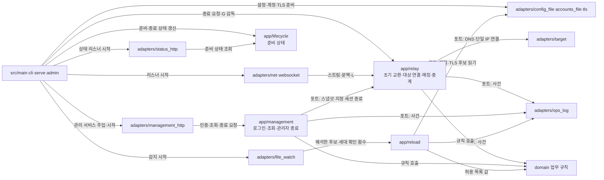
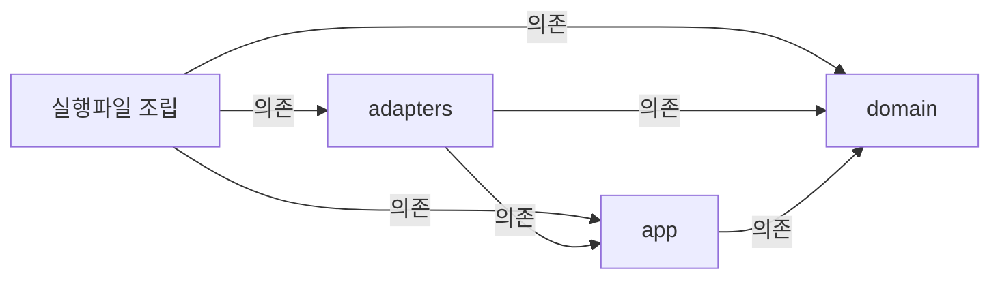

# VNC Relay 코드 지도

VNC Relay는 TCP·WS·WSS Viewer를 Mode I 대상이나 Mode II Server와 이어 바이트 스트림을 중계한다. 관리 리스너는 대시보드와 관리 API를 제공한다. 이 지도는 실제 코드의 위치와 책임을 설명한다. 대표 흐름은 접속 수락에서 초기 교환·대상 연결 또는 매칭을 거쳐 세션 정리와 운영 로그 기록으로 끝난다.

| 항목 | 값 |
| --- | --- |
| 구조 시점 | Current |
| 문서 상태 | Draft |
| 구현 대조 | Verified — [2026-11-04 대조 기록](#2026-11-04-구조-대조) |
| 관련 PRD | [PRD](../requirements/PRD.md), [유지보수성](../requirements/PRD.md#8-비기능-요구사항), [구현 기술](../requirements/PRD.md#확정-기준) |
| 관련 ADR | [ADR-0001 내장 TLS](../decisions/ADR-0001-built-in-tls.md), [ADR-0003 메모리 상태](../decisions/ADR-0003-single-instance-memory-state.md), [ADR-0004 tokio·rustls](../decisions/ADR-0004-tokio-rustls.md), [ADR-0005 WS 코덱](../decisions/ADR-0005-in-house-ws-streaming-frame-codec.md) |

제품은 domain·app·adapters·실행파일 조립의 네 crate로 나뉜다. 개발 도구는 별도 `xtask` crate다. 정적 대시보드는 `web/dashboard/`에 있다. 코드가 있다는 사실과 스펙 시나리오 전체가 검증되었다는 판단은 다르다. 시나리오별 실행 결과는 [테스트 컨벤션](../conventions/testing.md#7-테스트와-스펙-시나리오-연결)의 보고서가 맡는다.

## 1. 전체 구조

다음 그림은 현재 실행 경로다. 모든 실선 화살표는 호출 또는 값 전달이다. `포트` 표시가 있는 화살표는 app이 정의한 trait를 통한 호출이다. 조립 코드가 adapters 구현체를 주입하므로 app은 adapters 타입을 알지 못한다. 오류 변환과 모듈 안의 보조 함수는 생략했다.

### 레이어와 의존 방향

레이어 규칙은 [아키텍처 작성 규칙](AGENTS.md#작성-규칙)을 따른다. 아래 화살표 `A → B`는 컴파일 의존이다. 실행 중 포트 호출과 구분한다.

| 레이어 | 코드 위치 | 책임 | 의존할 수 있는 레이어 | 의존 위반 확인 방법 |
| --- | --- | --- | --- | --- |
| domain | `crates/domain` (`vnc-relay-domain`) | 초기 교환·매칭·세션·주소·예산·계정 규칙. 입출력·시계·난수 결과는 값으로 받는다. | 없음. 외부 crate도 쓰지 않는다. | 컴파일과 `cargo xtask layers` |
| app | `crates/app` (`vnc-relay-app`) | 중계·관리·재로드·준비 상태·계정 준비 사용 사례. 외부 기능은 포트로 정의한다. | domain. tokio의 동기화·시간·입출력 trait | 컴파일, `cargo xtask layers`, `crates/app/clippy.toml`의 입출력 금지 목록과 `cargo clippy` |
| adapters | `crates/adapters` (`vnc-relay-adapters`) | TCP·TLS·WS·HTTP·파일·운영 로그·난수·터미널. app 포트를 구현한다. | domain, app, [PRD 승인 라이브러리](../requirements/PRD.md#확정-기준) | `cargo xtask layers`, [라이선스 검사](../how-to/check-dependency-licenses.md) |
| 실행파일 조립 | 루트 crate `vnc-relay`의 `src/` | CLI·종료 코드·런타임·OS 신호·객체 연결. 업무 규칙은 두지 않는다. | domain, app, adapters, clap, tokio. rustls는 개발 의존성이다. serde_json·tokio-tungstenite는 실서버 대시보드 시험의 CDP 통신에 쓴다(Q112). windows-sys는 Windows 전용 개발 의존성이며 ConPTY 시험만 쓴다(Q103, [Rust 컨벤션 2절](../conventions/rust.md#2-규칙) "unsafe" 행). | 코드 리뷰, 컴파일, `cargo xtask layers` |
| 개발 도구 | `xtask/` | 시나리오 보고·레이어 검사·배포 고지 생성과 대조·토큰 생성과 대조·로컬 미리보기 | 제품 crate에 의존하지 않는다. | `cargo xtask layers` |
| 정적 대시보드 | `web/dashboard/` | HTML·CSS·JS 화면·공통 컴포넌트·생성 복사본·미리보기·브라우저 시험 페이지 | 관리 API만 HTTP로 호출한다. JS 외부 의존성이 없다. | [프런트엔드 컨벤션](../conventions/frontend.md), [대시보드 검증](../how-to/verify-dashboard-frontend.md), `cargo xtask tokens --check` |

- domain·app은 바깥 레이어 타입을 알지 못한다. 레이어 경계에서는 domain·app 값과 tokio 입출력 trait를 넘긴다.
- axum 요청·tungstenite 메시지·TOML 값은 app에 넘기지 않는다.
- 대기·활성·최근 종료·관리 세션 상태는 메모리에만 둔다([ADR-0003](../decisions/ADR-0003-single-instance-memory-state.md)).
- 이 구조에서 벗어나려면 [ADR](../decisions/AGENTS.md)을 작성한다.

## 2. 코드 위치와 구성요소

모든 행은 현재 파일이다. 작은 보조 모듈은 함께 묶었다. `코드 위치` 칸에서는 경로 뒤에 그 경로가 정의하는 심볼을 쓴다. `tests/code_map.rs`는 §2의 경로·심볼, §3의 모든 진입점 호출 체인, §4의 모든 인접 단계 사이에 있는 파일 단위 사용 근거를 검사한다. 주석·문자열과 정의 자체는 호출 근거가 아니다. 책임 문장의 의미와 실제 소유권은 사람이 대조한다. 이 표 구성과 검사 방법은 **이 문서의 판단, 사용자 결정 없음**이다.

### 2.1 domain

| 코드 위치 | 구성요소 | 주된 책임 | 맡지 않는 책임 | 의존 대상 | 모듈 설계 |
| --- | --- | --- | --- | --- | --- |
| `crates/domain/src/lib.rs` | 모듈 공개 | domain 모듈 경계를 공개한다. | 조립·입출력 | 하위 모듈 | 이 지도 |
| `crates/domain/src/handshake.rs` `HandshakeParser`; `crates/domain/src/relay_id.rs` `RelayId` | 초기 교환 | 250바이트 요청·모드·대상·정확한 ID를 해석한다. 후속 데이터는 소비하지 않는다. | 소켓·H·HMAC | 주소·대상 문법 | [초기 교환](initial-exchange.md) |
| `crates/domain/src/matching.rs` `WaitingTable` | Mode II 점유 | Waiting·Claimed·Active·Closing 전이와 중복·만료·식별자 일치를 판정한다. | 소켓·실제 permit | RelayId·ConnId·SessionId | [중계 수명](relay-session.md) |
| `crates/domain/src/session.rs` `SessionId` `Session` `Session::finish_after_owner_loss`; `crates/domain/src/recent_closed.rs` `RecentClosedList` | 세션·최근 종료 | 최초 종료 원인·부분 쓰기 카운터·EOF·E·소유자 유실의 최종 요약과 R 상한을 관리한다. | 바이트 전달·시각 읽기 | std 값 | [중계 수명](relay-session.md), [관리자 종료](management-terminate.md) |
| `crates/domain/src/target_policy.rs` `TargetPolicy::permits_name` `TargetPolicy::permits_ip` | 대상 정책 | 설정 항목을 해석하고 이름·포트와 최종 IP·포트를 각각 검사한다. | DNS·연결 | allow_list | [설정](config-loading.md), [중계 수명](relay-session.md) |
| `crates/domain/src/entry_point.rs` `EntryPoint` `Role`; `crates/domain/src/conn_id.rs` `ConnId` | 진입점·연결 ID | 진입점 역할과 프로세스 안 연결 식별자를 제공한다. | 리스너·로그 | std | [TCP 진입점](tcp-entry-point.md) |
| `crates/domain/src/allow_list.rs` `AllowList`; `crates/domain/src/origin.rs` `Origin`; `crates/domain/src/peer_ip.rs` `PeerIp` | 접근 값 | IP 항목 해석·허용 판정·Origin 정규화·상대 IP 표기 | HTTP·소켓 읽기 | std | [설정](config-loading.md), [WS 진입점](websocket-entry-point.md) |
| `crates/domain/src/budget.rs` `ConnectionBudget` `BudgetPermit` | 연결 예산 | L·Lm·Lw의 자리 확보·반환과 현재 사용량 | 연결 수락 | std 원자 값 | [연결 상한](connection-limits.md) |
| `crates/domain/src/account.rs` `Password`; `crates/domain/src/admin_session.rs` `AdminSessionTable`; `crates/domain/src/login_limit.rs` `LoginLimiter` | 관리 규칙 | 계정·비밀번호·해시 형식, 세션·CSRF 토큰·만료, 로그인 실패 제한 | 해시 계산·파일·시각 읽기 | std | [계정 준비](admin-accounts.md), [관리 세션](management-session.md) |

### 2.2 app

| 코드 위치 | 구성요소 | 주된 책임 | 맡지 않는 책임 | 의존 대상 | 모듈 설계 |
| --- | --- | --- | --- | --- | --- |
| `crates/app/src/lib.rs` | 모듈 공개 | 사용 사례 모듈을 공개한다. | 구현체 주입 | 하위 모듈 | 이 지도 |
| `crates/app/src/ports.rs` `TargetConnector` `RelayIdSource` `SessionIdSource` `RelayStream` `RelayStateSource` `RelaySessionControl` | 외부 기능 경계 | DNS·단일 IP 연결, ID 계산, 전송·종료·maintenance, 상태 조회·관리자 종료를 정의한다. 계정·입력·해시·시계·토큰·사건 포트도 정의한다. | 포트 구현·HTTP | domain·tokio trait | [중계 수명](relay-session.md), [관리 조회](management-query.md), [관리자 종료](management-terminate.md) |
| `crates/app/src/settings.rs` `Settings`; `crates/app/src/events.rs` `Event` `ShutdownTrigger` | 설정·사건 | 유효 설정·리스너 계획·진단과 중계·관리·재로드·종료 사건 값, 요청·치명 오류의 종료 원인을 정의한다. | TOML·JSON 출력 | domain | [설정](config-loading.md), [운영 로그](ops-log.md) |
| `crates/app/src/relay.rs` `RelayService::handle_connection` `RelayService::dispatch` `PreparedConnection` `RelayRuntime` `RelayState` `run_pair` | 중계 소유권 | 초기 교환을 준비하고 Mode I·II로 분기한다. 공유 상태·활성 등록·정리 guard·최종 사건을 소유한다. B·L은 복제하지 않고 이동한다. | 수락·DNS 구현·프레임 | domain·ports·tokio | [초기 교환](initial-exchange.md), [중계 수명](relay-session.md) |
| `crates/app/src/relay.rs` `RelayRuntime::snapshot` `RelaySnapshot` `ActivePeer` `HandshakingGuard` | 관리 상태·제어 | 상태 잠금 한 번으로 메타데이터를 복사한다. 실제 peer 주소·초기 교환 수를 보존한다. RelaySessionControl 구현은 세션 소유자에게 종료를 전달한다. | HTTP·스트림 읽기 | Clock·domain·제어 알림 | [관리 조회](management-query.md), [관리자 종료](management-terminate.md) |
| `crates/app/src/relay/handshake.rs` `exchange`; `crates/app/src/relay/target.rs` `dispatch`; `crates/app/src/relay/matching.rs` `dispatch`; `crates/app/src/relay/session.rs` `run_session_controlled` | 처리 단계 | 각각 시작 바이트·H, 정책·C·대상 L, 대기·W·Lw·원자적 매칭, 두 방향 중계·E·관리자 종료·Kw 진행을 맡는다. | OS 소켓·신호·작업 생성 | RelayRuntime·RelayStream·domain | [중계 수명](relay-session.md), [WS 스트림](websocket-stream.md) |
| `crates/app/src/relay.rs` `RelayService::request_shutdown` `RelayService::request_fatal_shutdown` `RelayService::drive_shutdown`; `crates/app/src/lifecycle.rs` `LifecycleService` `Readiness` | 수명 | RelayService는 최초 종료 원인을 유지하며 Running→Grace→Force와 G 감독을 맡는다. LifecycleService는 시작·준비·종료 중·필수 리스너 실패 상태를 제공한다. | OS 신호 수신·소켓 오류 분류 | 공유 상태·시계·watch | [중계 수명](relay-session.md), [상태 리스너](status-listener.md) |
| `crates/app/src/management.rs` `AdminAuth`; `crates/app/src/management/login.rs`; `crates/app/src/management/session.rs` | 관리 인증 | 로그인·실패 제한·세션 검사·CSRF·로그아웃·감사 사건 | HTTP·쿠키 형식 | domain·ports | [관리 세션](management-session.md) |
| `crates/app/src/management/query.rs` `ManagementQueryService`; `crates/app/src/management/terminate.rs` `ManagementTerminateService` | 관리 사용 사례 | 조회 뷰 조립과 활성 상세 검사. 지정 세션 종료 수락·완료 대기·합류 요청 감사 | HTTP·JSON·스트림 소유 | RelayStateSource·RelaySessionControl·Clock | [관리 조회](management-query.md), [관리자 종료](management-terminate.md) |
| `crates/app/src/reload.rs` `ChangeSource` `WatchFailure`; `crates/app/src/reload/ports.rs` `ReloadFileStore` `ReloadTlsStore` `ReloadClock` | 재로드 경계 | 변경 원인·실패 값과 파일·TLS 후보·대기 포트를 정의한다. | OS 알림 | domain·settings | [파일 감지](file-watch.md) |
| `crates/app/src/reload/service.rs` `ReloadService`; `crates/app/src/reload/snapshot.rs` `ReloadCell` `ReloadSnapshot` `RelayAllow` | 재로드 적용 | 후보 검증·재시작 필요 값 비교·세대 재확인 뒤 허용 목록과 TLS를 함께 교체한다. | 파일 감지·TLS 라이브러리 | 재로드 포트·EventSink | [파일 감지](file-watch.md) |
| `crates/app/src/accounts.rs` `AdminService` `list` | 계정 준비 | 계정 진단·변경 절차·목록 | 숨김 입력·잠금·파일 교체 | domain·ports | [계정 준비](admin-accounts.md) |

### 2.3 adapters와 실행파일 조립

| 코드 위치 | 구성요소 | 주된 책임 | 맡지 않는 책임 | 의존 대상 | 모듈 설계 |
| --- | --- | --- | --- | --- | --- |
| `crates/adapters/src/lib.rs` | 모듈 공개 | 외부 연결 구현을 공개하고 HTTP 보조 모듈은 비공개로 둔다. | 업무 규칙 | 하위 모듈 | 이 지도 |
| `crates/adapters/src/net.rs` `TcpEntryPoint` `TcpRelayStream` `accept_connections` `AllowSource`; `crates/adapters/src/target.rs` `TcpTargetConnector` | TCP | 바인드·공유 수락·IP·L·K, 공통 초기 교환→dispatch 호출, Linux 소켓 오류 분류, DNS와 단일 주소 연결 | 매칭·대상 정책 | app·domain·tokio·socket2 | [TCP 진입점](tcp-entry-point.md), [중계 수명](relay-session.md) |
| `crates/adapters/src/listener.rs` `Listener` `SupervisedListener` `ListenerFailure` `is_fatal_accept_error` | 리스너 감독 | 취소 가능한 수락 포트, OS별 복구 불가 오류 분류, 최초 장애의 감독 채널 전달 | 재시도 횟수·G·프로세스 종료 판정 | tokio·std 소켓 오류 | [상태 리스너](status-listener.md), [TCP 진입점](tcp-entry-point.md) |
| `crates/adapters/src/websocket.rs` `WsEntryPoint`; `crates/adapters/src/upgrade.rs` `read_head` | WS·WSS 진입점 | 공유 수락, WSS 협상, U·HTTP·Origin 검사, 101 전송·flush, suffix 보존 뒤 공통 서비스 인계 | Repeater 해석·중계 정책 | app·TLS·tokio-tungstenite 헤더 도구 | [WS 진입점](websocket-entry-point.md) |
| `crates/adapters/src/websocket_stream.rs` `WsRelayStream`; `crates/adapters/src/websocket_stream/frame.rs` `FrameDecoder`; `crates/adapters/src/websocket_stream/keepalive.rs` `Keepalive` | WS 스트림 | 페이로드 청크·마스크·분할·논리 M·같은 방향 B·제어 프레임·Close와 고정 Ping·Pong 기한 FIFO | H·C·W·E·G 판정·사건 | RelayStream·tokio·헤더 도구 | [WS 스트림](websocket-stream.md) |
| `crates/adapters/src/websocket_stream/tests.rs` | WS 내부 시험 | 메모리 스트림·부분 쓰기·M/B·제어·Close·Kw 회귀 시험 | 실제 외부 Viewer | 테스트 전용 tokio | [WS 스트림 7절](websocket-stream.md#7-테스트-계획) |
| `crates/adapters/src/tls.rs` `load_acceptor` `RustlsTlsStore` `TlsSource`; `crates/adapters/src/tls_listener.rs` `TlsListener` | TLS | 파일 검사·후보 acceptor·실행 중 스냅샷 선택·접속별 협상 | 관리 인증 | rustls·tokio-rustls·app | [TLS](tls.md), [관리 리스너](management-listener.md) |
| `crates/adapters/src/management_http.rs` `ManagementListener` `ManagementServices` `answer` `static_answer`; `crates/adapters/src/dashboard_assets.rs` `ASSETS` `find_asset` | 관리 HTTP·정적 파일 | 관리 리스너와 API 분기, 보호 경로 세션 검사, 정확한 내장 파일 표, 응답 보안 헤더 | 관리 업무 규칙 | app·axum·TLS | [관리 리스너](management-listener.md) |
| `crates/adapters/src/management_http/session_api.rs` `answer`; `crates/adapters/src/management_http/query_api.rs` `answer`; `crates/adapters/src/management_http/terminate_api.rs` `answer` | 관리 API 어댑터 | 인증→CSRF→경로·메서드·입력 검증, 서비스 호출, 계약 JSON·쿠키. 종료 수락 뒤 완료 대기에만 U를 멈춘다. | 상태·스트림 소유 | app 관리 서비스·axum·serde_json | [관리 세션](management-session.md), [조회](management-query.md), [종료](management-terminate.md) |
| `crates/adapters/src/status_http.rs` `StatusListener`; `crates/adapters/src/admission.rs` `AdmittingListener`; `crates/adapters/src/request_deadline.rs` `DeadlineListener` `IdleControl` | 상태·수락·기한 | /livez·/readyz, 공유 Lm 확보·반환, 관리 요청 U와 종료 대기 일시 정지 | 준비 상태 전이 | app·domain·axum·tokio | [상태 리스너](status-listener.md), [관리 리스너](management-listener.md) |
| `crates/adapters/src/config_file.rs` `load` `load_admin`; `crates/adapters/src/config_file/reader.rs`; `crates/adapters/src/config_file/listen.rs`; `crates/adapters/src/toml_text.rs` | 설정 읽기 | TOML 값·위치·기본값·진단·listen 해석. admin은 [admin]만 검증한다. | 재로드 판정 | app·domain·toml | [설정](config-loading.md) |
| `crates/adapters/src/accounts_file.rs` `load`; `crates/adapters/src/accounts_file/store.rs` `AccountsFile`; `crates/adapters/src/accounts_file/hasher.rs` `Argon2Hasher` `Argon2Verifier` | 계정 파일 | 읽기·검증·잠금·원자적 교체·Argon2id 생성과 검증 | 계정 규칙 | app 포트·toml·argon2 | [계정 준비](admin-accounts.md), [관리 세션](management-session.md) |
| `crates/adapters/src/file_watch.rs` `ReloadWatcher` `FsReloadFileStore` `SystemReloadClock`; `crates/adapters/src/file_watch/feed.rs` `ChangeQueue` `NotifyFeed` | 변경 감지 | OS 알림·유실 재검사·주기 확인·안정화·세대 관리·후보 읽기 | 후보 수용 판정 | notify·tokio·app 재로드 | [파일 감지](file-watch.md) |
| `crates/adapters/src/ops_log.rs` `JsonLinesEventSink` `format_line`; `crates/adapters/src/clock.rs` `SystemClock` `timestamp`; `crates/adapters/src/crypto.rs` `RelayIdKey` `SessionIdKey` `SystemTokenSource` | 운영 기반 | 사건 JSON Lines, UTC와 단조 시각, ID HMAC·세션 ID 순열·토큰 난수. 초기·대상·대기·최종 세션 사건을 모두 직렬화한다. | 사건 의미·매칭 정책 | app 포트·serde_json·aws-lc-rs | [운영 로그](ops-log.md), [중계 수명](relay-session.md) |
| `crates/adapters/src/terminal.rs`; `crates/adapters/src/terminal/windows_console.rs` | 터미널 | 숨김 입력·확인·Ctrl+C, Windows 콘솔 모드 저장·복구 | 비밀번호 규칙 | rpassword·tokio signal·windows-sys | [계정 준비](admin-accounts.md) |
| `src/main.rs` `main`; `src/cli.rs` `parse`; `src/admin.rs` `run` | CLI 조립 | 명령·옵션·진단·종료 코드, admin 포트 주입 | 계정 규칙 | clap·app·adapters | [시작](serve-startup.md), [계정 준비](admin-accounts.md) |
| `src/serve.rs` `run` `listen_until_shutdown` `generate_startup_keys` `ShutdownRequest` `wait_for_shutdown` `begin_process_shutdown` `begin_relay_shutdown` `finish_relay_shutdown` | 서버 조립 | 설정·로그·계정·키·TLS·감지·리스너 준비와 서비스 주입. 첫 OS 요청·리스너 장애의 원인을 선택하고 G·두 번째 신호·Windows 콘솔 닫기·작업 회수·종료 코드를 연결한다. | 매칭·바이트 전달·OS 오류 분류 | 제품 crate·tokio | [시작](serve-startup.md), [파일 감지](file-watch.md), [중계 수명](relay-session.md) |
| `crates/adapters/src/file_watch.rs` `reopen_log`; `crates/adapters/src/ops_log.rs` `JsonLinesEventSink::reopen` `file_path` | 로그 파일 교체 | 재로드와 분리한 로그 알림·Dp 재열기, 같은 줄 쓰기 잠금의 핸들 교체, 실패 연속 구간 첫 경고·사건 | 로그 보관·압축·삭제 | notify·tokio·app 사건 | [운영 로그](ops-log.md), [파일 감지](file-watch.md) |

### 2.4 개발 도구와 정적 대시보드

| 코드 위치 | 구성요소 | 주된 책임 | 맡지 않는 책임 | 의존 대상 | 모듈 설계 |
| --- | --- | --- | --- | --- | --- |
| `xtask/src/main.rs` `main`; `xtask/src/cargo.rs` `metadata`; `xtask/src/layers.rs` `check` | 도구 진입·의존 검사 | 하위 명령 선택, Cargo 메타데이터, 허용 crate·버전 요구 검사 | 제품 실행 | std·serde_json | [xtask](xtask.md) |
| `xtask/src/scenarios.rs` `run` `locate`; `xtask/src/scenarios/spec.rs` `parse`; `xtask/src/scenarios/markers.rs` `scan`; `xtask/src/scenarios/test_run.rs` `run`; `xtask/src/scenarios/report.rs` `Report` | 시나리오 보고 | 수용 표·표식·Cargo 테스트 결과 연결과 부분·미연결·실패 판정 | 책임 문장 의미 판정 | Cargo 출력·std | [xtask](xtask.md) |
| `xtask/src/tokens.rs` `run`; `xtask/src/tokens/front_matter.rs` `parse_document`; `xtask/src/tokens/screen_css.rs` `check`; `xtask/src/tokens/shared.rs` `write` `check`; `xtask/src/tokens/fonts.rs` `write` `check`; `xtask/src/dashboard_serve.rs` `run` | 대시보드 도구 | 토큰·`@font-face` 생성·CSS 검사·로그인 공통 복사본과 글꼴 복사본 대조·루프백 미리보기 | 제품 HTTP 제공 | std | [xtask](xtask.md) |
| `xtask/src/notices.rs` `run` `render` `collect_texts` | 배포 의존성 고지 | 두 대상의 일반·빌드 의존성 합집합과 고지 전문, 내장 글꼴 라이선스 전문 생성·대조 | 허용 라이선스 판정·프로젝트 MIT 고지 확정 | Cargo 출력·std·serde_json | [xtask](xtask.md), [라이선스 검사](../how-to/check-dependency-licenses.md) |
| `xtask/src/package.rs` `run` `check_version` `sha256` | 배포 묶음 | 실행한 OS의 release 빌드·고지 대조·묶음 압축·SHA-256 파일, 버전 형식 검사 | Release 게시(GitHub Actions `release` 작업) | Cargo·OS `tar`·std | [xtask](xtask.md), [릴리스 how-to](../how-to/release.md) |
| `web/dashboard/app/index.html`; `web/dashboard/app/main.js`; `web/dashboard/app/router.js`; `web/dashboard/app/shell.js`; `web/dashboard/app/operations.js`; `web/dashboard/app/session.js` | 화면·라우팅 | 부팅·셸·운영 현황·세션 상세·화면 전환 | 서버 규칙 | 공통 JS·관리 API | [대시보드 컴포넌트](dashboard-components.md) |
| `web/dashboard/app/api.js`; `web/dashboard/app/query.js`; `web/dashboard/app/model.js`; `web/dashboard/app/panels.js`; `web/dashboard/app/format.js`; `web/dashboard/app/copy.js`; `web/dashboard/app/language.js` | 화면 공통 상태 | API 통신·폴링·조회 모델·패널·목록별 성공 응답의 개수·표시·문구·언어 | 중계 상태 소유 | 관리 API·브라우저 | [대시보드 컴포넌트](dashboard-components.md), [운영 현황 앱](dashboard-operations-overview.md) |
| `web/dashboard/app/components/`; `web/dashboard/app/styles/`; `web/dashboard/app/app.css`; `web/dashboard/app/tokens.css`; `web/dashboard/app/fonts/` | 공통 표시 | 컴포넌트·공통 스타일·화면 스타일·생성 토큰·글꼴 복사본 | 서버 권한 | 브라우저 | [프런트엔드 컨벤션](../conventions/frontend.md) |
| `web/dashboard/login/index.html`; `web/dashboard/login/main.js`; `web/dashboard/login/login.js`; `web/dashboard/login/login.css`; `web/dashboard/login/components/`; `web/dashboard/login/styles/`; `web/dashboard/login/language.js`; `web/dashboard/login/tokens.css`; `web/dashboard/login/fonts/` | 로그인 | 세션 없는 로그인 화면과 tokens가 만드는 공통·글꼴 복사본 | 보호된 app 파일 직접 참조 | 관리 세션 API | [대시보드 컴포넌트](dashboard-components.md) |
| `web/dashboard/fonts/` | 글꼴 원본 | Pretendard woff2 원본과 OFL 전문. 제공하지 않는다 | 제공 경로 | 없음 | [프런트엔드 컨벤션 2.4절](../conventions/frontend.md#24-글꼴-파일) |
| `web/dashboard/preview/`; `web/dashboard/tests/` | 개발용 페이지 | 로컬 미리보기·컴포넌트·로그인·현황·세션·라우터 브라우저 시험 | 제품 번들 제공 | 브라우저·Rust 실행기 | [대시보드 검증](../how-to/verify-dashboard-frontend.md) |

### 2.5 통합·시스템 시험

아래 영역은 실제 `/// spec:` 표식에서 모았다. `부분` 여부와 이번 실행 결과는 이 목록에서 판정하지 않는다. domain·app·adapters의 단위 시험은 위 소스 파일 안에도 있다. 표식이 없는 시험은 내부 규칙을 확인한다.

| 코드 위치 | 표식의 스펙·시나리오 영역 |
| --- | --- |
| `tests/cli.rs`; `tests/dashboard_assets.rs`; `crates/adapters/tests/accounts_contract.rs` | 표식 없음. CLI·정적 파일 표·계정 계약 내부 검사 |
| `tests/code_map.rs` `code_map_paths_and_symbols_resolve_to_current_code` | operations.md: OPS-022. §2 경로·정의와 §3·§4 파일 단위 연결 근거 |
| `tests/dependency_notices.rs` `distribution_notices_match_locked_dependencies_and_license_texts` | operations.md: OPS-021 partial. 오프라인 고지 대조만 확인하며 프로젝트 LICENSE는 확인하지 않는다. |
| `tests/admin.rs` | operations.md: OPS-029·030 |
| `tests/serve.rs` | operations.md: 시작·종료·L/H·상태·관리 보안·IP·중복 시작. `initial_tls_and_upgrade_deadlines_have_distinct_causes_and_release_capacity`는 OPS-006 전체(H·TLS·업그레이드 U·원인·회수)를, `every_relay_entry_point_accepts_only_its_own_source_ip`는 OPS-037 전체(네 진입점과 네 출발지 IP의 16쌍)를 실제 실행파일로 확인한다. `management_legacy_tls_rejections_have_exact_json_fields_and_keep_tls12_available`은 OPS-036의 관리 HTTPS 부분과 거절 로그 줄 형식을 확인한다. relay.md: 초기 교환·Mode I/II·중계·half-close·IP. websocket.md: WS-024 |
| `tests/unix_shutdown.rs`; `tests/windows_console.rs`; `tests/common/shutdown.rs` `ServerProcess` | operations.md: OPS-007~010·042·043(양 OS), OPS-044(Windows). Windows는 MGT-027·OPS-029·OPS-030과 Ctrl+C·Ctrl+Break도 확인한다. OPS-030 시험은 ConPTY 출력에서 제어 순서를 뺀 화면 문자로 비교한다(`tests/common/log_reopen.rs` `plain`). 공통 본문에는 표식이 없다. |
| `tests/dashboard_browser.rs` | dashboard.md: 컴포넌트·목 응답을 쓰는 DASH-001~022·024~027 부분 증거 |
| `tests/dashboard_live.rs`; `tests/dashboard_live/login.rs`; `tests/dashboard_live/overview.rs`; `tests/dashboard_live/detail.rs`; `tests/dashboard_live/cross.rs` | dashboard.md: 실제 로그인·중계·관리 조회·상세·종료·언어·폴링·Si 만료의 DASH-001~014·016~022·024~027. 표식은 최상위 Rust 테스트 함수에만 둔다. |
| `tests/common/dashboard_live.rs` `Server` `Pair`; `tests/common/cdp.rs` `Browser`; `tests/common/dashboard_cdp.rs`; `tests/common/dashboard_proxy.rs` `Proxy` `Fault` `Traffic` | 실서버·중계 소켓·CDP 브라우저·전달 프록시의 시험 자원 소유자. `cdp.rs`는 브라우저 실행·CDP 명령·탐색·조건 대기만 맡고, `dashboard_cdp.rs`는 같은 `Browser`에 대시보드 입력·로그인 동작을 더한다. 일반 데이터는 실서버에서 받고, 프록시가 주입한 지연·실패·유실은 별도로 기록한다. 공통 모듈에는 표식이 없다. |
| `tests/websocket_browser.rs` `browser_websocket_relays_mode_i_and_ii_over_ws_and_wss_without_novnc_or_websockify` `novnc_repeater_id_completes_rfb_through_ws_and_wss_in_both_server_orders` | websocket.md: WS-020(Chromium 내장 WebSocket과 실제 실행파일의 WS·WSS Mode I·II), WS-025(고정 noVNC 1.7.0 `repeaterID`와 시험 쪽 최소 RFB 서버, `#[ignore]`). 시험 쪽 정적 HTTP 서버가 빈 페이지와 noVNC 파일을 제공한다. |
| `src/serve/listener_tests.rs` `listener_failures_retry_then_drive_fatal_grace_cleanup_and_preserve_requested_races`; `crates/adapters/src/listener.rs` | operations.md OPS-046: 실제 감독 함수·TCP 중계·상태 HTTP에 수락 포트를 연결한 시험, 일시 오류 재시도·치명 오류·최초 종료 원인·G 정리. 어댑터 내부 시험은 실제 OS 수락 오류와 분류를 확인한다. |
| `tests/management_query.rs` | management.md: MGT-001~007·013·015·016·021·023·024·026. operations.md: OPS-033 |
| `tests/management_session.rs` | management.md: MGT-017·020·027. operations.md: OPS-029, OPS-003 부분(계정 파일 내용 변경의 재시작 뒤 반영) |
| `tests/management_terminate.rs` | management.md: MGT-008~014·023. relay.md: RLY-020. operations.md: OPS-011 |
| `tests/relay_entry_scenarios.rs` | relay.md: RLY-001~005·022·023. operations.md: OPS-039 |
| `tests/relay_target_scenarios.rs` | relay.md: RLY-007~009. operations.md: OPS-023 |
| `tests/relay_matching_scenarios.rs` | relay.md: RLY-012~016. operations.md: OPS-005 |
| `tests/relay_log_scenarios.rs`; `tests/relay_dead_peer_linux.rs` | 로그: operations.md OPS-011·012, relay.md RLY-027. 단절: relay.md RLY-025·026 |
| `tests/reload.rs` | operations.md: OPS-003·024~026·035·038·040. websocket.md: WS-022 |
| `crates/adapters/tests/config_contract.rs` | operations.md: OPS-001·034·038·040 |
| `crates/adapters/tests/management.rs` | operations.md: OPS-006·029·033·034·036. management.md: MGT-012~014·017~020·022·025·027. dashboard.md: DASH-014 |
| `crates/adapters/tests/ops_info_contract.rs` | relay.md: 초기 교환·대상·대기·세션 사건. operations.md: 상한·정리·로그·상태·종료 원인. management.md: MGT-009·023. websocket.md: WS-008·010·019 |
| `crates/adapters/tests/relay_delayed_cleanup_scenarios.rs`; `crates/adapters/tests/relay_stream_scenarios.rs`; `crates/adapters/tests/tcp_target.rs` | 각각 relay.md RLY-016, RLY-017~019·021, RLY-009·019 |
| `crates/adapters/tests/tls.rs`; `crates/adapters/tests/websocket.rs` | TLS: operations.md OPS-036, websocket.md WS-013. WS 진입점: websocket.md 업그레이드·Origin·IP·TLS, operations.md U·종료·TLS·허용 목록, relay.md RLY-005 |
| `crates/adapters/tests/websocket_relay.rs`; `crates/adapters/tests/websocket_scenarios.rs` | websocket.md: 실제 중계·M/B·제어·Close·Kw·인증 경계. relay.md: 초기 교환·중계·half-close·E·모드. operations.md: OPS-006·023 |
| `tests/log_reopen.rs`; `tests/common/log_reopen.rs`; `tests/windows_console.rs`; `crates/adapters/src/file_watch/reopen_tests.rs` | operations.md OPS-045: 실제 바이너리의 회전 전후 줄 보존·첫 실패 진단·복구·정상 종료, 주입한 알림·시계의 Dp·실패 연속 구간 |
| `examples/relay.toml`; `tests/distribution.rs`; `tests/common/distribution.rs`; `tests/windows_console.rs` | operations.md OPS-019·OPS-031: 실제 설정 로더의 비밀 없는 예시, Linux PTY·Windows ConPTY의 계정 준비→시작→중계→재로드→종료 |
| `tests/performance.rs` | operations.md OPS-017·OPS-018(`#[ignore]`, 작업 5.4): 실제 실행파일의 TCP·WS·WSS 활성 100세션 측정, 느린 수신자 부하와 새 서버의 예열·접속·종료 수명 반복의 자원 판정. 기준은 운영 스펙 6절(Q98·Q118~Q127·Q148)이다. Windows 전용 `handle_snapshot` 모듈은 중계 프로세스의 핸들 목록에서 Event 핸들을 따로 센다(`unsafe` 예외, Q149). |

## 3. 진입점

| 진입점 종류 | 코드 위치(파일·심볼) | 시작 조건 | 다음으로 호출하는 곳 |
| --- | --- | --- | --- |
| CLI | `src/main.rs` `main` | 프로세스 실행 | `cli::parse` → `serve::run` 또는 `cli::parse` → `admin::run` |
| TCP | `crates/adapters/src/net.rs` `TcpEntryPoint::run` | Viewer·Server 수락 | `accept_connections` → `RelayService::handle_connection` → `RelayService::dispatch` |
| WS·WSS | `crates/adapters/src/websocket.rs` `WsEntryPoint::run` | 수락·TLS·HTTP 검사와 101 전송·flush 성공 | `WsRelayStream::new` → `RelayService::handle_connection` → `RelayService::dispatch` |
| 관리 HTTP | `crates/adapters/src/management_http.rs` `answer` | 관리 요청 | `session_api` → `query_api` 또는 `session_api` → `terminate_api` 또는 `static_answer` |
| 상태 HTTP | `crates/adapters/src/status_http.rs` `StatusListener::run` | 상태 요청 | `LifecycleService::readiness` |
| 파일 변경 | `crates/adapters/src/file_watch.rs` `ReloadWatcher::run` | OS 알림·주기 확인 | `ReloadService::handle_config` 또는 `ReloadService::handle_unreadable` |
| 종료 신호 | `src/serve.rs` `ShutdownSignal::wait` | Ctrl+C·SIGTERM(Ubuntu)·Ctrl+Break·콘솔 창 닫기(Windows) | `wait_for_shutdown` → `begin_process_shutdown` → `begin_relay_shutdown` → `finish_relay_shutdown` |
| 필수 리스너 장애 | `crates/adapters/src/listener.rs` `SupervisedListener`; `src/serve.rs` `wait_for_shutdown` | 복구 불가 `accept` 오류의 최초 보고 | `wait_for_shutdown` → `begin_process_shutdown` → `LifecycleService::listener_failed` 또는 `wait_for_shutdown` → `begin_process_shutdown` → `RelayService::request_fatal_shutdown` |
| H 기한 | `crates/app/src/relay.rs` `RelayService::handle_connection` | 초기 교환 | `exchange` |
| C 기한 | `crates/app/src/relay/target.rs` `dispatch` | Mode I 대상 연결 | `connect` |
| W 기한 | `crates/app/src/relay/matching.rs` `dispatch` | Mode II 대기 등록 | `wait` |
| E 기한 | `crates/app/src/relay.rs` `run_pair` | 활성 중계·정리 | `run_session_controlled` |
| G 기한 | `crates/app/src/relay.rs` `RelayService::drive_shutdown` | Grace 기한 만료 | `RelayRuntime::force_locked` |
| Ping·Pong 기한 | `crates/adapters/src/websocket_stream.rs` `poll_maintenance` | Kw 진행 | `poll_keepalive` → `Keepalive::poll` |

## 4. 핵심 흐름

다음은 현재 Mode II 흐름이다. Server가 `ID:0123`으로 먼저 기다리고 Viewer가 같은 ID로 접속한다([RLY-010](../specs/relay.md#7-수용-테스트)). 요청 형식은 [초기 교환 계약](../contracts/repeater-handshake-v1.md), 내부 처리는 [중계 수명 설계](relay-session.md)를 따른다.

| 순서 | 코드 위치(파일·심볼) | 하는 일 | 넘기는 값·바뀌는 상태 |
| --- | --- | --- | --- |
| 1 | `crates/adapters/src/net.rs` `accept_connections` | IP·L·K를 검사하고 수락 사건을 기록한다. | 스트림·ConnectionContext·L permit |
| 2 | `crates/app/src/relay.rs` `handle_connection`; `crates/app/src/relay/handshake.rs` `exchange` | 절대 H 안에서 250바이트를 모은다. Viewer에만 시작 바이트를 쓴다. | HandshakeParser의 요청 결과와 후속 데이터 |
| 3 | `crates/app/src/relay.rs` `dispatch`; `crates/app/src/relay/matching.rs` `dispatch` | Server의 Mode II 요청을 등록한다. | 같은 잠금 안에서 점유·스트림·Lw·W 기한을 연결한다. |
| 4 | `crates/app/src/relay/matching.rs` `dispatch`; `crates/domain/src/matching.rs` `WaitingTable` | 같은 ID Viewer가 도착하면 관찰된 EOF·오류·W 만료를 먼저 확인하고 Claim으로 옮긴다. | Lw 반환, L 두 자리 유지, 한 소유자에게 두 연결 이동 |
| 5 | `crates/app/src/relay.rs` `run_pair`; `crates/app/src/relay/session.rs` `run_session_controlled` | 활성 등록 뒤 후속 데이터를 먼저 전달한다. 두 방향 부분 쓰기를 각각 센다. | 새 session_id, session_started, 방향별 B와 성공 쓰기 카운터 |
| 6 | `crates/app/src/relay/session.rs`; `crates/domain/src/session.rs` `Session` | EOF·E·오류·관리자 종료·Force에 맞춰 한 세션을 정리한다. 최초 원인을 보존한다. | closing 동안 ID 점유. 스트림→L→최종 모델→활성·점유 제거·최근 종료 |
| 7 | `crates/adapters/src/ops_log.rs` `JsonLinesEventSink::record` | 최종 사건을 JSON Lines로 기록한다. | session_closed 한 번 |

Mode I는 3~4단계 대신 `relay/target.rs`가 이름 정책→DNS→최종 IP 정책→같은 L의 대상 자리→단일 주소 연결을 진행한다. 전체가 같은 C 안에 있다. 성공하면 같은 `run_pair`로 간다.

WS·WSS는 1단계에서 `websocket.rs`의 101 완료 후 `WsRelayStream`을 넘긴다. H는 `exchange_at`에서 시작한다. `frame.rs`는 바이너리 페이로드만 풀고 프레임·메시지 경계를 스트림 경계로 쓰지 않는다. Kw는 공통 소유 루프가 `poll_maintenance`로 진행한다.

### 관리 조회 흐름(Current)

`management_http::answer`는 API 요청을 `session_api::answer`로 보낸다. 로그인 외 요청은 경로 검사 전에 세션을 인증한다. `query_api::answer`는 메서드·폴링 헤더·본문을 검사한다. `ManagementQueryService`는 `RelayStateSource::snapshot`으로 메타데이터를 받고 조회 뷰를 만든다. HTTP 어댑터가 이를 계약 JSON으로 바꾼다([관리 조회 설계](management-query.md)).

`RelayRuntime::snapshot`은 상태 잠금 안에서 단조 시각을 읽고 대기·활성 경과 시간을 계산한다. 그 뒤 서비스가 `as_of`를 읽는다. L·Lm 예산은 상태 잠금 밖에서 각각 읽는다. 모든 값을 한 순간에 포착한 응답은 아니다. 조회는 스트림을 소비하지 않는다.

### 관리자 종료 흐름(Current)

`session_api`의 인증·CSRF 뒤 `terminate_api`가 경로·메서드·폴링 헤더·ID·실제 본문을 검사한다. `ManagementTerminateService::request_terminate`는 `RelaySessionControl`을 호출한다. `RelayRuntime`은 활성 표의 제어 핸들로 기존 소유자를 깨운다. 완료 대기 동안 해당 요청의 U만 멈춘다.

`run_session_controlled`는 같은 절대 E 또는 더 이른 Force까지 정리한다. `run_pair`가 스트림·L·점유를 회수하고 최종 요약과 감사를 남긴다. 서비스의 `complete` 뒤 HTTP가 결과를 직렬화한다. 합류 요청은 기존 정리를 다시 시작하지 않는다([관리자 종료 설계](management-terminate.md)).

## 5. 시작과 연결

- `src/serve.rs` `run`은 설정·로그·계정을 준비한다. 비동기 런타임과 종료 신호 처리기를 준비한 뒤 `listen_until_shutdown`이 두 시작 키·TLS·재로드 스냅샷·감지기를 준비한다. 감지 준비 실패는 리스너 바인드 전에 끝난다.
- 상태 리스너, 관리 리스너, 나머지 리스너 순서로 바인드한다. 상태 리스너는 시작 중에도 응답한다. 준비 완료 뒤 `server_ready`를 쓰고 관리·TCP·WS·WSS 작업을 실행한다.
- 같은 L을 수락과 Mode I 대상에 넣는다. 별도 Lw는 대기 등록에, Lm은 상태·관리에 공유한다. 같은 RelayRuntime을 관리 조회·관리자 종료 포트에 넣는다.
- 첫 종료 신호는 준비 상태를 종료 중으로 바꾸고 RelayService에 G를 넘긴다. 수락을 멈추고 초기 교환·대기·대상 연결을 정리한다. 기존 활성은 Grace 안에서 계속 진행한다. 감독 작업이 G를 진행하며 두 번째 신호는 Force를 요청한다.
- 필수 리스너의 `SupervisedListener`는 첫 복구 불가 수락 오류를 `ListenerFailure`로 알린다. `wait_for_shutdown`이 종료 신호와 이 사건을 함께 기다린다. `begin_process_shutdown`은 리스너 장애에 `LifecycleService::listener_failed`와 `RelayService::request_fatal_shutdown`을 적용한다. 같은 G·자원 정리 경로를 거친 뒤 종료 코드 1을 반환한다. 먼저 선택된 정상 종료 원인은 나중 리스너 오류로 바꾸지 않는다.
- `finish_relay_shutdown`은 모든 진입점 소유자가 끝날 때까지 감독 작업을 유지한다. 그 뒤 관리·상태·감지 작업을 거두고 `server_stopped`를 쓴다.
- 설정은 `config_file`이 읽는다. 객체 연결은 `src/serve.rs`와 `src/admin.rs`의 인수·Arc로 한다. DI 프레임워크는 없다.
- 파일 로그의 원래 경로는 재로드 후보와 분리해 감시한다. 생성·삭제·이름 변경 알림과 독립 Dp 작업이 `JsonLinesEventSink::reopen`으로 핸들을 교체한다. 같은 출력 잠금이 줄 경계를 보존한다. 실패하면 이전 핸들에 계속 쓰고 실패 연속 구간의 첫 실패만 알린다.

## 6. 처음 읽을 코드

1. `src/serve.rs` — 포트 구현체·예산·리스너·종료 감독의 연결을 본다.
2. `crates/app/src/relay.rs`와 `crates/app/src/relay/` — 준비된 연결이 대상·대기·활성으로 이동하는 순서를 본다.
3. `crates/domain/src/matching.rs`와 `crates/domain/src/session.rs` — 매칭 전이와 최초 종료 원인을 본다.
4. `crates/adapters/src/management_http/session_api.rs` — 인증 뒤 조회·종료로 나누는 경계를 본다.

## 7. 확인하지 못한 부분

| 항목 | 확인하지 못한 이유 | 확인 방법 |
| --- | --- | --- |
| 책임 문장의 의미 전체 | 파일 단위 식별자 사용은 호출 근거다. 다만 업무 책임·실행 순서·소유권의 의미를 완전히 판정하지는 못한다. | 자동 위치·연결 검사와 아래 수동 대조를 함께 유지한다. OPS-022는 비부분 표식이다. |
| 모듈 설계 본문의 남은 계획·이전 설명 | 이번 변경은 설계 머리말과 차이 절만 갱신한다. 초기 교환·중계 수명·WS 스트림 본문에 실제 API와 다른 설명이 남는다. | 각 문서의 현재 코드와의 차이 절을 따른다. Target을 유지하며 Current 지도와 구분한다. |
| 외부 VNC 상호운용·OS별 단절·전체 수용 완료 | 이번 구조 대조는 제품 동작 전체를 실행하지 않는다. | [테스트 컨벤션](../conventions/testing.md)과 [개발 환경 검증](../how-to/set-up-and-verify.md)의 별도 증거를 따른다. |

## 8. 계획과 문서 정리(Target)

이 절은 현재 구조 그림에 포함하지 않는다. [TODO 5.3](../TODO.md)의 완료 판정은 별도다. 현재 코드에는 이미 RelayService의 G·두 번째 종료 요청과 serve의 감독 조립이 있다. 이를 미구현 경로로 나열하지 않는다.

`LifecycleService::request_shutdown`이라는 API는 현재 없다. 준비 상태 전이는 `LifecycleService::begin_shutdown`이, 중계 수명 전이는 `RelayService::request_shutdown`이 맡는다. 이 이름을 전제로 한 설계·TODO 문구는 실제 책임 분리와 대조해야 한다. 이 지도는 향후 API 이동을 결정하지 않는다. **이 문서의 판단, 사용자 결정 없음**이다.

## 대조 기록

### 2026-11-05 리스너 감독과 실서버 대시보드 시험 대조

- 대상: `b5dc9b5`의 `Listener`·`SupervisedListener`와 serve 조립, `tests/dashboard_live.rs`·공통 CDP·전달 프록시·화면별 하위 본문이다. `9cdebc6`에서 Windows 수락 소켓의 차단 모드와 지연 요청 회귀 시험을 보강했다.
- §2의 새 코드 위치와 루트 개발 의존성, §3의 리스너 오류→종료 진입점, §4·§5의 감독·상태·중계 정리 연결을 실제 구현과 대조했다. 리스너 오류 분류와 최초 종료 원인의 보존은 Q114를 따른다. CDP와 시험용 장애 주입은 Q112·Q113을 따른다.
- `9cdebc6`의 Windows·WSL 전체 게이트에서 `tests/code_map.rs` 4건이 모두 통과했다. OPS-022·OPS-046과 실서버 대시보드 26건도 두 OS에서 통과했다. 전체 집계와 증거 범위는 [대시보드 검증 4.19절](../how-to/verify-dashboard-frontend.md#419-실서버-대시보드-시험과-수동-스모크-2026-11-05), [운영 정보 계약 실행 기록](../contracts/ops-info-v1.md#계약-테스트-실행-기록)에 있다.
- WSL 보고서는 `9cdebc6 + 미커밋 변경`으로 표시됐다. 게이트 실행 중 코드·문서를 수정하지 않았다. 이 실행에서 접미사 원인은 별도로 확인하지 않았다. 구조 대조는 외부 VNC 호환성과 사람의 화면 검토 완료를 뜻하지 않는다.
- 후속 Q115는 기존 `operations.js` → `panels.js` 경로에 목록별 성공 응답의 개수 갱신을 연결했다. 새 파일·공통 컴포넌트 API는 없다. `177040d`의 두 OS 전체 게이트에서 코드 지도 4건과 브라우저·실서버 시험이 통과했다([검증 4.20절](../how-to/verify-dashboard-frontend.md#420-목록-개수-배지-q115-2026-11-05)).

### 2026-11-04 구조 대조

| 항목 | 기록 |
| --- | --- |
| 날짜·대상 | 2026-11-04, HEAD `ad5cfb2`와 이 작업의 미커밋 변경. 지도 전체 정리와 `tests/code_map.rs` 추가, 모듈 설계의 머리말·차이 절 변경 |
| 방법 | §2의 경로·Rust 정의, §3 모든 진입점 체인, §4 모든 인접 단계의 파일 단위 사용 근거를 자동 검사한다. Type::method는 method 정의를 찾는다. `a → b`는 진입점 파일이나 a 정의 파일에 b의 사용 토큰이 있어야 한다. 첫 호출은 진입점 파일에 있어야 한다. 핵심 흐름의 다음 단계 심볼 중 하나는 이전 단계 파일이나 흐름 진입점 파일에 사용되어야 한다. 주석·문자열·정의 자체는 사용 근거에서 뺀다. 책임 문장의 의미와 소유권은 수동 리뷰한다. **이 문서의 판단, 사용자 결정 없음** |
| 수동 대조 | net·websocket → handle_connection → dispatch → target/matching → run_pair/session을 읽었다. WaitingTable은 메타데이터, RelayState는 스트림·permit·활성 제어를 소유한다. management의 인증→조회/종료→런타임 포트, serve의 실제 주입, file_watch→reload의 후보 적용, 첫 신호·G 감독·두 번째 신호 조립을 대조했다. |
| 결과 | 구조 대조 완료. stale Target 행과 혼합 그림을 현재 코드로 바꿨다. 빠졌던 모듈·테스트·개발 도구·대시보드 파일을 추가했다. 구조 Verified는 문서 채택이나 전체 동작 통과를 뜻하지 않는다. |
| 표식 연결 | `tests/code_map.rs`의 `/// spec: operations.md:OPS-022`. testing.md §7과 scenarios.rs는 루트 패키지 tests를 수집한다. xtask 자신은 기존 제외를 유지한다. |
| 검사 선택 | 루트 std-only 통합 시험으로 둔다. 기존 scenarios가 읽는 위치이므로 새 xtask 명령이나 예외는 없다. layers는 crate 의존, 이 시험은 문서 경로·정의·파일 단위 연결을 검사한다. 책임 문장의 의미는 사람이 확인한다. **이 문서의 판단, 사용자 결정 없음** |
| 실행 증거 | 아래 실행 기록에 기록한다. |
| 남은 차이 | 초기 교환·중계 수명·WS 스트림 본문의 옛 API·계획 표현. 경로·정의 존재 밖의 책임 의미와 전체 동작은 자동 검사 범위가 아니다. 5.3 완료 여부와 외부 상호운용은 이 기록으로 판정하지 않는다. |

### 실행 기록

대상은 위 HEAD와 미커밋 문서·`tests/code_map.rs` 변경이다. Windows는 `AWS_LC_SYS_PREBUILT_NASM=1`, `TEMP=TMP=D:/vr-tools/tmp`, `CARGO_TARGET_DIR=D:/Workspace/vnc-relay/target`을 썼다. WSL Ubuntu는 `CARGO_TARGET_DIR=$HOME/vnc-relay-target`을 썼다.

| 환경·방법 | 명령 또는 확인 | 결과 |
| --- | --- | --- |
| Windows | `rustfmt --edition 2024 --config skip_children=true tests/code_map.rs` | 통과. 수정한 Rust 파일만 포맷했다. |
| WSL Ubuntu | `cargo test -p xtask` | 통과. 12 passed, 0 failed |
| WSL Ubuntu, 연결 검사 확장 뒤 | `cargo test --test code_map` | 통과. 4 passed, 0 failed. 진입점 13행과 핵심 흐름 7단계의 정의·연결 및 검사기 회귀 시험을 확인했다. |
| WSL Ubuntu | `cargo clippy -p xtask --all-targets -- -D warnings`와 `cargo clippy -p vnc-relay --all-targets -- -D warnings` | 통과. 두 명령 모두 종료 코드 0, 경고 없음 |
| Windows PowerShell | `cargo test -p xtask`와 연결 확장 뒤 `cargo test --test code_map` | 통과. 각각 12 passed와 4 passed, 0 failed |
| 드리프트 주입·복구 | §2의 lib.rs 행에 없는 심볼 `NonexistentCodeMapProbe`를 임시 추가하고 WSL에서 해당 테스트만 실행했다. | 기대한 실패. 종료 코드 101. `line 92: crates/domain/src/lib.rs has no definition for NonexistentCodeMapProbe`를 보고했다. 원래 행 복구 뒤 code_map 시험 3개가 다시 통과했다. |
| Windows 문서 검사 | `python D:/vr-tools/tmp/doc_check.py` | `errors_total=4 known=4 other=0`. 기존 오류만 남았다: dashboard-operations-overview.md:73, tls.md:126, verify-dashboard-frontend.md:179·873. |
| 진입점·핵심 흐름 드리프트 주입·복구 | §3의 첫 호출을 `cli::nonexistent_entry_callee`로, §4 마지막 심볼을 `JsonLinesEventSink::nonexistent_flow_callee`로 임시 바꿨다. 같은 OPS-022 시험을 실행했다. | 기대한 실패, 종료 코드 101. `line 183: unresolved callee`, `line 183: missing entry link`, `line 209: unresolved flow symbol`, `line 208 → 209: missing flow link`를 모두 보고했다. 두 행 복구 뒤 WSL·Windows의 시험 4개가 통과했다. |
| 연결 검사 확장 뒤 lint | WSL `cargo clippy -p vnc-relay --all-targets -- -D warnings` | 통과. 종료 코드 0, 경고 없음 |

진입점 체인은 `또는`으로 대안을 나눈다. `→`와 `·`·쉼표는 순차 연결이다. 식별자가 아닌 설명은 건너뛴다. 각 식별자는 정의 파일이나 같은 이름의 모듈 파일로 해석한다. 파일 단위 사용 근거는 호출 위치의 존재를 확인하지만 함수 안의 실행 순서까지 증명하지는 않는다. 그 의미는 수동 리뷰에 남긴다. **이 문서의 판단, 사용자 결정 없음**이다.
