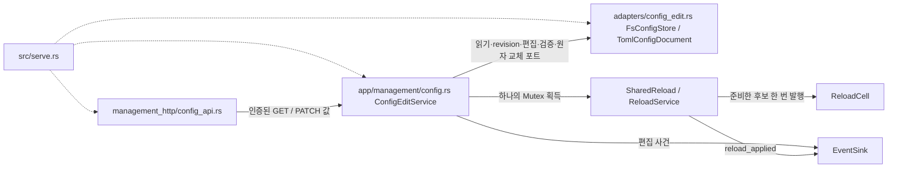

# 설정 보기·편집 모듈 설계

인증된 관리자가 실행 값을 보고, 같은 TOML 파일의 허용된 값만 고치도록 한다. 파일 저장과 실행 값 교체 사이에 다시 실패할 작업을 두지 않는다. 재로드의 공유 상태와 소비 시점은 [파일 감지 목표 설계](file-watch.md#10-target--설정-v3-실행-값과-공유-트랜잭션)가 맡고, 이 문서는 GET/PATCH의 사용 사례·파일 포트·HTTP 경계를 맡는다.

| 항목 | 값 |
| --- | --- |
| 구조 시점 | Target — 작업 6.3~6.5 및 6.6 서버 측 |
| 문서 상태 | Active — Q167~Q177, 2026-11-08 채택 범위의 목표 설계 |
| 구현 대조 | 미대조(구현 전). 아래 Current 증거는 소스 읽기이며 시험 결과가 아니다 |
| 코드 위치 | 계획: `crates/app/src/management/config.rs`, `crates/adapters/src/config_edit.rs`, `crates/adapters/src/management_http/config_api.rs` |
| 코드 지도 | [코드 지도](code-map.md) — 실제 구현과 함께 갱신 |
| 관련 스펙 | [관리 §3.3](../specs/management.md#33-설정-보기와-동적-설정-편집) MGT-R19~R27·MGT-028~045, [운영 §3.3](../specs/operations.md#33-파일-변경-자동-감지와-부분-재로드) OPS-059~064, [화면](../specs/dashboard.md#scr-004-설정-보기) DASH-028~053 |
| 관련 계약 | [설정 §1.8](../contracts/config-v3.md#18-재로드-구분)·[§1.10](../contracts/config-v3.md#110-관리-api-편집의-파일-쓰기), [관리 API §1.13](../contracts/management-api-v1.md#113-설정-보기-get-apiv1config)·[§1.14](../contracts/management-api-v1.md#114-동적-설정-편집-patch-apiv1config)·[§2.3](../contracts/management-api-v1.md#23-consumer의-판정-규칙), [운영 정보 §1.5](../contracts/ops-info-v1.md#15-사건-목록) |
| 관련 ADR | [ADR-0006](../decisions/ADR-0006-config-edit-through-file.md) |

## 1. 책임과 경계

- app의 `ConfigEditService<A>`는 GET/PATCH 순서·권한 이후 편집 허용·오류 분류·감사 사건을 맡는다. `A`는 app이 해석하지 않는 TLS 수락기다. HTTP·JSON·TOML·SHA 구현·OS 파일 호출은 adapters에 둔다. 이는 [코드 지도 레이어 규칙](code-map.md#레이어와-의존-방향)과 [ADR-0006](../decisions/ADR-0006-config-edit-through-file.md)의 같은 검증 경로를 따른다.
- `ConfigManagement`라는 app trait로 GET/PATCH 결과를 공개하고 관리 리스너는 `Arc<dyn ConfigManagement>`를 받는다. 실행파일만 `ConfigEditService<TlsAcceptor>`의 구체 타입을 조립한다. app은 rustls·axum·toml_edit·aws-lc-rs에 의존하지 않는다([레이어 규칙](code-map.md#레이어와-의존-방향)).
- 계정 인증·CSRF·유휴 만료는 기존 `AdminAuth`가 맡는다. 파일 감지 안정화·세대 검사·감시 경로 갱신은 `ReloadWatcher`가 맡는다. 이 서비스는 수동 재로드 API가 아니다([관리 API §1.3](../contracts/management-api-v1.md#13-요청-처리-순서), [운영 §3.3](../specs/operations.md#33-파일-변경-자동-감지와-부분-재로드)).

## 2. 내부 구조와 초기화

다음은 Target만 나타낸다. 실선은 실행 중 호출, 점선은 `serve`의 포트 주입이다. 컴파일 의존은 실행파일 → adapters → app → domain이다([레이어 규칙](code-map.md#레이어와-의존-방향)).

| 요소 | 소유자·수명 | 책임·근거 |
| --- | --- | --- |
| `SharedReload<A> = Arc<Mutex<ReloadService<A>>>` | `serve`에서 한 번 생성, watcher·편집 서비스가 공유 | read→revision→edit→validate→write→swap 직렬화. [API §1.14](../contracts/management-api-v1.md#114-동적-설정-편집-patch-apiv1config) |
| `ConfigEditService<A>` | `serve`, 관리 리스너 종료까지 | 설정 경로·base_dir·공유 재로드·파일/문서 포트·Clock·EventSink 보유. [API §1.13~14](../contracts/management-api-v1.md#113-설정-보기-get-apiv1config) |
| `FsConfigStore` | adapters, 프로세스 수명 | 원시 바이트 읽기, SHA-256, 같은 디렉터리 임시 파일과 교체. [설정 §1.10](../contracts/config-v3.md#110-관리-api-편집의-파일-쓰기) |
| `TomlConfigDocument` | adapters, 요청별 문서 | `toml_edit` 0.25로 값만 편집, 기존 `config_file::parse` 재사용. [ADR-0006](../decisions/ADR-0006-config-edit-through-file.md) |
| `ConfigView`·`ConfigPatch`·`ConfigEditResult` | app 값, 요청 수명 | 교환 필드의 정의는 [API §1.13~14](../contracts/management-api-v1.md#113-설정-보기-get-apiv1config). JSON Value를 app에 넘기지 않음 |

## 3. 데이터 모델과 GET

[API §1.13](../contracts/management-api-v1.md#113-설정-보기-get-apiv1config)을 다음 내부 자료로 만든다.

1. 공유 재로드 mutex를 잡는다. 현재 파일 바이트를 다시 읽고 revision을 계산한다. 실행 `Settings`·`last_reload`·파일 분류를 같은 잠금 구간에서 복사한 뒤 푼다. 파일 I/O 때문에 중계 상태 mutex를 잡지 않는다. GET은 어떤 재로드 결과 사건이나 `last_reload` 갱신도 만들지 않는다.
2. `ReloadService::classify_file`은 바이트 읽기 실패 또는 비UTF-8 → `unreadable`, 그 밖의 설정/TLS 후보 검증 실패 → `invalid`, 재시작 필요 차이 존재 → `restart_required`, 재로드 대상 차이만 존재 → `pending`, 차이 없음 → `in_effect` 순으로 분류한다. 비UTF-8에서도 읽은 바이트의 revision은 유지한다(작성자 판단 lead 2026-11-08). `restart_required`에는 재시작 키만, `pending`에는 동적 차이만 담는다. 진단은 `invalid`에만 담는다. 검증과 차이 비교는 쓰기 경로와 같은 함수를 쓰고 TLS 내용 변경도 준비 후보 차이에 포함한다([설정 §1.8 규칙 2~6](../contracts/config-v3.md#18-재로드-구분), [API §1.13](../contracts/management-api-v1.md#113-설정-보기-get-apiv1config)).
3. `items`는 파일 후보가 아니라 실행 중 유효 `Settings`를 [설정 키 표](../contracts/config-v3.md#12-키-표) 순서의 명시적 descriptor 목록에 투영한다. descriptor는 자료형·정수 정적 min/max·dynamic/restart·편집 조건을 함께 정의한다. Lw의 max는 L의 현재값이 아니라 65535다. 경로는 base_dir 기준으로 이미 푼 값이다. 기능 꺼짐과 무관하게 `editable`을 계산하고 `edit_enabled`는 별도로 보낸다. 꺼진 진입점의 생략 키는 `null`을 보존한다([API §1.13](../contracts/management-api-v1.md#113-설정-보기-get-apiv1config)).
4. 인증서·개인키·계정 파일은 경로만 투영한다. 내용을 직렬화하지 않는다. 후보의 미적용 값·원시 TOML·해시·비밀번호·토큰을 응답/진단/로그에 넣지 않는다. revision은 설정 파일 바이트만의 SHA-256(`sha256:`+소문자 hex 64자)이며 TLS 파일 해시와 별개다([API §1.1.1](../contracts/management-api-v1.md#111-운영-정보-노출-범위), [설정 §1.10](../contracts/config-v3.md#110-관리-api-편집의-파일-쓰기)).

`Settings`가 보존하지 않는 생략 여부는 loader가 만드는 보기용 presence 정보로 보완한다. 예를 들어 현재 `EntryPointSettings.allowed_origins`는 `Vec`라 생략/명시적 빈 배열을 구별하지 못한다(`crates/app/src/settings.rs:78-90`). 실행 스냅샷에는 후보를 적용할 때의 presence도 함께 보관한다. GET 때 현재 파일의 presence를 실행 값의 presence로 덮지 않는다([API §1.13](../contracts/management-api-v1.md#113-설정-보기-get-apiv1config)).

## 4. PATCH 처리 순서

[API §1.14의 10단계](../contracts/management-api-v1.md#114-동적-설정-편집-patch-apiv1config)를 그대로 경계로 삼는다. 실패 때 다음 단계를 실행하지 않는다.

| 단계 | 위치·동작 | 실패 또는 결과 |
| --- | --- | --- |
| 1 | HTTP에서 인증→CSRF→경로/메서드/헤더/JSON. app에서 빈 changes·23개 외 키·꺼진 진입점/Mode I·값 자료형 거절 | `400 invalid_request`; 매체 형식은 기존 `415`, 메서드는 `405 Allow: GET, PATCH`. 편집 사건 없음 |
| 2 | app에서 실행 중 `management.config_edit` 확인 | `403 config_edit_disabled` |
| 3 | 공유 mutex 아래 현재 파일 읽기 | `409 config_file_invalid`, 진단 `[]` |
| 4 | 현재 원시 바이트 revision과 요청 비교 | `409 config_conflict` |
| 5 | 원본 전체 parse/validate/TLS 검증. 실행값과 비대상 비교 | `409 config_file_invalid`+진단 또는 `409 config_restart_pending`+재시작 키 |
| 6 | 원본 문서 위에 요청 중 실제 파일값이 달라지는 키만 편집 | 기타 값·주석·공백·순서·LF/CRLF 유지 |
| 7 | 편집 결과를 같은 loader와 `prepare_candidate`로 전체 검증하고 수락기/해시/스냅샷 준비 | `400 config_invalid`+값 인용 없는 진단. 아직 원본·실행값 불변 |
| 8 | 출력 바이트와 읽은 원본 바이트 비교 | 같으면 쓰기/적용/성공 사건 없음. `200 applied: []`, 기존 revision |
| 9 | 같은 디렉터리에 create_new 임시 파일, 전부 쓰기·flush/sync·닫기, 교체 직전 파일을 다시 읽어 revision 비교, 원자 교체 | 사용자 결정 2026-11-08(Q178). 불일치/재읽기 실패면 임시 파일 삭제·`409 config_conflict`·이번 요청의 파일/실행값 변경 없음. 쓰기/교체 실패는 `500 config_write_failed` |
| 10 | 준비한 같은 후보를 `commit_prepared`로 무실패 발행. `reload_applied(config_edit)` 뒤 `config_edited` 기록 | 실행값 차이 전부를 `applied`로 응답, 새 파일 revision |

단계 3~10 전체와 단계 2의 실행값 읽기는 **동일한 공유 mutex 한 번**으로 묶는다. watcher도 최종 파일 읽기 전에 이 mutex를 잡고 세대 확인·검증·적용까지 유지한다. watcher가 안정화 전 읽은 바이트를 mutex 획득 뒤 그대로 적용하지 않는다([운영 §3.3](../specs/operations.md#33-파일-변경-자동-감지와-부분-재로드)). `prepare_candidate`는 파일 교체 전에 TLS 수락기·차이 키·경고·스냅샷을 준비한다. 단계 10에서 파일 재읽기·TLS 재검증·세대/종료 거절을 하지 않는다. 그래야 파일만 바뀌고 실행값은 거절되는 상태를 만들지 않는다([설정 §1.8 규칙 10](../contracts/config-v3.md#18-재로드-구분)).

작성자 판단(lead 2026-11-08): 단계 8은 편집 전후 **파일 텍스트/바이트**가 같은지를 판정한다. 파일에 pending 동적 변경이 있고 PATCH가 다른 키를 고치면 후보 전체를 적용한다. `reload_applied.applied`와 응답 `applied`에는 실행값이 바뀐 키 전부를 넣고, `config_edited.config_keys`에는 요청 `changes` 중 파일값이 바뀐 키만 넣는다. no-op이면 pending 변경은 watcher 몫으로 남긴다. 이 구분은 [API §1.14](../contracts/management-api-v1.md#114-동적-설정-편집-patch-apiv1config) 단계 6·8·10과 [운영 정보 config_edited](../contracts/ops-info-v1.md#관리자-로그인과-종료)의 명확화 대상이다.

## 5. 파일 포트와 OS 경계

포트는 app에 선언하고 adapters가 구현한다. 포트가 반환하는 진단은 `ConfigDiagnostic`, 값은 app 자료형이다([레이어 규칙](code-map.md#레이어와-의존-방향), [설정 §1.10](../contracts/config-v3.md#110-관리-api-편집의-파일-쓰기)).

- `ConfigFileStore::read(path) -> io::Result<Vec<u8>>`: 원시 바이트를 읽어 SHA-256을 계산한다. 작성자 판단(lead 2026-11-08): 비UTF-8이면 file.state=unreadable, diagnostics=[]이고 바이트를 읽었으므로 revision은 그 바이트의 SHA-256이다. null은 바이트 읽기 실패일 때만이다. PATCH는 비UTF-8도 3단계에서 `409 config_file_invalid`, 빈 진단으로 거절한다([API §1.13~14](../contracts/management-api-v1.md#113-설정-보기-get-apiv1config), [설정 §2.1](../contracts/config-v3.md#21-설정-오류와-준비-실패)).
- `ConfigFileStore::revision(bytes) -> String`: adapters에서 기존 aws-lc-rs SHA-256 사용. 프로세스 내부 TLS 변경 탐지용 `DefaultHasher`를 외부 revision에 재사용하지 않는다. 현재 후자는 `crates/app/src/reload/service.rs:456-473`에 있다.
- `ConfigDocument::parse(bytes, base_dir) -> Result<ConfigCandidate, Vec<ConfigDiagnostic>>`: UTF-8·기존 로더·필수키·unknown key·관계 검사를 재사용하고 실행값의 생략 여부를 보존한다. `ConfigDocument::edit(bytes, changes) -> Result<Vec<u8>, Vec<ConfigDiagnostic>>`: `toml_edit::DocumentMut`의 기존 item decor를 유지하고 바뀐 값만 교체한다. 없는 키는 기존 테이블에, 없는 테이블은 끝에 넣는다. 모든 문서를 정규화해 다시 직렬화하거나 CRLF 전체를 LF로 바꾸지 않는다. 배열 내부 주석도 보존 대상으로 시험한다([설정 §1.10](../contracts/config-v3.md#110-관리-api-편집의-파일-쓰기)).
- `ConfigFileStore::replace(path, expected_revision, next) -> Result<(), ConfigReplaceError>`: 같은 디렉터리의 고유 임시 파일을 create_new로 만들고 write_all·flush/sync_all·close 뒤, **원자 교체 바로 전에** 현재 파일을 다시 읽어 expected revision과 비교한다. 다르거나 재읽기에 실패하면 자기 임시 파일만 지우고 Conflict를 반환한다. 같으면 Linux의 같은 파일시스템 rename-over-existing, Windows의 replace-over-existing(`std::fs::rename`)으로 바꾼다. 원본 선삭제·copy+delete는 하지 않는다. Windows 공유 삭제 권한 없는 열린 핸들은 교체 실패로 남기고, Unix 교체 후 directory sync 실패를 원본 불변인 `config_write_failed`로 오인하지 않는다. 기존 계정 writer도 rename을 쓴다(`crates/adapters/src/accounts_file/store.rs:57-81`). 근거는 [설정 §1.10](../contracts/config-v3.md#110-관리-api-편집의-파일-쓰기), 사용자 결정 2026-11-08(Q178), 재읽기 실패 매핑의 작성자 판단(lead 2026-11-08)이다.

**사용자 결정 2026-11-08(Q178): 교체 직전 재확인 + 계약에 틈 명시.** 공유 mutex는 프로세스 안의 watcher/PATCH·PATCH/PATCH를 직렬화한다. 외부 편집은 단계 3 읽기와 교체 직전 재확인으로 검출한다. 마지막 재확인과 원자 교체 사이의 아주 짧은 틈은 계약의 보장 범위가 아니다. 운영 안내에는 “편집 기능을 켠 동안 외부 편집과 대시보드 편집을 동시에 하지 않는다”를 적는다([관리 MGT-033](../specs/management.md#7-수용-테스트)의 보장 범위 보완 대상). 충돌 사건은 `config_edit_rejected(reason=config_conflict)`이며 성공 사건은 없다.

고르지 않은 대안은 Linux `renameat2(RENAME_EXCHANGE)`·Windows `ReplaceFileW` 백업의 교체 뒤 원본 revision 검사/복구다. syscall/unsafe 승인·지원 파일시스템·복구 실패 처리가 필요하며 열린 구 inode/handle의 제자리 쓰기와 복구 중 외부 저장은 여전히 막지 못한다. Linux에 임의 편집기를 강제하는 일반 강제 잠금은 없다. 이 대안을 완전 보장으로 표현하거나 구현하지 않는다. 최종 선택은 Q178의 단순 재확인이다.

작성자 판단(lead 2026-11-08): 새 줄은 파일에서 처음 나오는 줄바꿈 방식으로 넣고, 기존 줄바꿈이 없으면 LF를 쓴다. 고치지 않은 바이트의 줄바꿈은 정규화하지 않는다([설정 §1.10](../contracts/config-v3.md#110-관리-api-편집의-파일-쓰기)의 명확화).

## 6. HTTP·시간 제한·종료 유예

- `session_api::answer`의 상태 변경 메서드에 PATCH를 더한 뒤 `config_api::answer`로 분기한다. 현재 CSRF 조건은 POST/DELETE뿐이다(`crates/adapters/src/management_http/session_api.rs:44-66`). 인증 실패는 경로·진단·편집 enabled 상태보다 먼저다. GET은 CSRF 불필요, PATCH는 필수다. 성공한 사용자 행동만 `AdminAuth::touch`로 연장한다. PATCH의 `X-Relay-Poll`은 값과 무관하게 거절한다([API §1.3](../contracts/management-api-v1.md#13-요청-처리-순서)·[§1.4](../contracts/management-api-v1.md#14-관리-세션)·[§1.14](../contracts/management-api-v1.md#114-동적-설정-편집-patch-apiv1config)).
- 작성자 판단(lead 2026-11-08): 설정 파일 크기 상한이 [설정 §1.1](../contracts/config-v3.md#11-파일-규칙)에 없으므로 PATCH 본문 상한은 64 KiB(65536바이트)로 둔다. `axum::body::to_bytes`에 명시적으로 넘기며 초과는 `400 invalid_request`다. 413을 추가하지 않는다. 로그인은 기존 16 KiB 그대로다(`crates/adapters/src/management_http/session_api.rs:25-26,71-84`). 이 한도는 계약 보완 목록에 등록한다.
- GET/PATCH의 Consumer 대기 한도는 `dashboard.query_timeout_secs`다. 서버 전체 트랜잭션에 이 값의 취소 타이머를 씌우지 않는다. 파일 read/parse/TLS 준비/replace를 포함한 동기 작업은 `spawn_blocking`에서 끝까지 실행한다. 클라이언트 timeout·응답 연결 종료로 await가 없어져도 이미 시작한 blocking 작업을 취소하지 않는다. 특히 rename 성공 뒤에는 commit·감사 기록까지 이어 간다. Consumer는 결과 불명으로 GET을 다시 하며 자동 PATCH 재전송하지 않는다([API §2.3](../contracts/management-api-v1.md#23-consumer의-판정-규칙), MGT-R27).
- U는 해당 관리 연결 수락 때 고정한 값이다. PATCH를 위해 U를 특별히 멈추지 않는다. 기존 terminate 전용 예외를 넓히지 않는다. U로 응답 연결이 닫혀도 트랜잭션은 계속되고 결과 불명 복구를 쓴다([설정 §1.8](../contracts/config-v3.md#18-재로드-구분), [API §1.9](../contracts/management-api-v1.md#19-관리자-종료-post-apiv1sessionssession_idterminate)·[§2.3](../contracts/management-api-v1.md#23-consumer의-판정-규칙)).
- `DashboardHints`는 P·query timeout만 시작값으로 보유하고 login/GET session 응답 때 현재 E를 읽어 terminate timeout을 E+5로 만든다. 현재는 생성자에서 E를 고정한다(`crates/adapters/src/management_http.rs:152-168`, `session_api.rs:115,145-188`). 기존 종료 교환 기한은 별개로 유지한다([API §1.12](../contracts/management-api-v1.md#112-폴링-주기와-조회-제한-시간의-전달)).
- `serve`는 공유 mutex/파일 포트를 만든 뒤 watcher와 관리 서비스에 같은 인스턴스를 주입한다. 정상 종료 시작 시 watcher 적용만 중지한다. 관리 서비스는 유예 동안 살아 있어 GET/PATCH를 허용한다. G는 종료 시작 때 한 번 읽고 deadline으로 고정하므로 유예 중 G 편집은 기존 deadline을 바꾸지 않는다. 편집이 lifecycle을 Running으로 되돌리거나 신규 중계 수락을 열지 않는다([운영 §3.3 규칙 7](../specs/operations.md#33-파일-변경-자동-감지와-부분-재로드), [API §1.14](../contracts/management-api-v1.md#114-동적-설정-편집-patch-apiv1config)).

## 7. 사건·오류와 남는 상태

[운영 정보 §1.5](../contracts/ops-info-v1.md#15-사건-목록)·[§1.8](../contracts/ops-info-v1.md#18-관리자-계정명-기록-규칙)의 필드만 쓴다.

| 사건 | 작성 위치와 필드 출처 | 순서·금지 |
| --- | --- | --- |
| `reload_applied` | R의 commit, `trigger=config_edit`, 실행값/경로/내용이 달라진 27개 중 키 | 같은 편집의 `config_edited`보다 먼저. 값 없음 |
| `config_edited` | E의 app 서비스, `admin_account`는 AuthorizedAdmin의 계정, `peer_ip`는 실제 소켓의 정규화 PeerIp, `config_keys`는 요청 중 파일값 변경 키, `revision`은 저장한 바이트 SHA-256 | 파일 변경 있는 성공만 한 번. 헤더 전달 IP·설정값·후보 텍스트 없음 |
| `config_edit_rejected` | E의 app 서비스, 인증/CSRF 뒤의 6개 편집 오류와 기타 처리 거절; `reason`은 API 오류 code, account/peer는 위와 같음, 선택 `config_keys`는 요청 키 | invalid_request·인증·CSRF 실패에는 없음. 성공 사건 없음 |
| `allow_all_target`·`allow_all_source` | R이 실제 바뀐 정책의 후보 경고를 선별, `phase=reload` | [설정 §1.8 규칙 5~6](../contracts/config-v3.md#18-재로드-구분), OPS-058. 기존 허용 목록 경고와 같은 적용 경로 |

6개 업무 오류의 상태·diagnostics/config_keys는 §4 표대로 매핑한다. 조회 자체 내부 실패는 `500 internal`, 파일 읽기/검증 실패 GET은 `200`이다. 진단은 code/key만 안정된 값으로 사용하며 message는 값을 인용하지 않는다([API §2.1](../contracts/management-api-v1.md#21-오류-본문과-상태-코드)).

## 8. Current 증거와 구현 전환

| 현재 확인한 코드 | 차이와 Target 전환 | 근거 |
| --- | --- | --- |
| `crates/app/src/reload/snapshot.rs:20-26,43-65`: IP·TLS 셋만, RwLock 아래 Arc 교체 | 실행 유효 Settings·presence와 TLS를 같은 발행 단위에 포함. 공유 mutex 및 prepare/commit 분리는 [파일 감지 Target](file-watch.md#10-target--설정-v3-실행-값과-공유-트랜잭션) | 설정 §1.8, MGT-R19·25 |
| `crates/app/src/reload/service.rs:53-69,124-164,168-262`: watcher 전용 running·검증·교체, last_reload 없음 | SharedReload, 외부 호출 가능한 무변경 prepare 및 무실패 commit, 파일 분류·결과 이력 | API §1.13~14 |
| `crates/adapters/src/config_file.rs:29-34,86-98`; `settings.rs:144-151`: 로더와 Settings에 config_edit 없음 | 동일 로더에 기본 false 키 추가, 보기 presence와 descriptor 추가 | 설정 §1.2·§3.2 |
| `crates/adapters/src/management_http.rs:55-70,103-109`; `session_api.rs:44-66` | ConfigManagement 주입·config route·PATCH CSRF, 기존 동작을 유지 | API §1.3·§1.13~14 |
| `src/serve.rs:224-240,344-360,465-472`: reload service를 watcher에 넘기고 관리 서비스는 auth/query/terminate뿐, G는 시작값 | 한 공유 서비스 두 호출자, 동적 reader 주입, 종료 시 G 읽기 | 운영 §3.3·3.4 |

구현자는 실제 경로·심볼·호출을 대조한 뒤 관련 Target을 Current로 바꾸고 코드 지도 및 계약 테스트 기록을 갱신한다. 구현 전 이 문서에 Verified나 시험 통과를 붙이지 않는다([아키텍처 규칙](AGENTS.md#작성-규칙), [검증 기록](../AGENTS.md#검증-기록)).

## 9. 미결정·계약 보완 경계

- PATCH 64 KiB·pending/edited 키 구분·비UTF-8/줄바꿈/재확인 읽기 실패 매핑은 작성자 판단(lead 2026-11-08)이다. 외부 편집 경쟁은 사용자 결정 2026-11-08(Q178)의 교체 직전 재확인·보장 범위 명시로 확정했다. 필요한 문안은 구현 인계의 계약 보완 목록으로 넘기며 이 작업에서 계약을 직접 바꾸지 않는다.
- 작성자 판단(lead 2026-11-08): `last_reload`는 실제 재로드 시도만 기록한다. watcher의 applied/rejected/restart_required 및 파일 교체·실행 교체를 마친 PATCH(applied)만 갱신한다. PATCH의 인증·본문·꺼짐·충돌·파일 상태·후보 검증·쓰기 실패·no-op과 GET은 갱신하지 않는다. watcher의 동일 후보도 갱신하지 않는다. 스키마상 config_edit+rejected/restart_required는 허용되지만 현재 설계에서는 발생하지 않는다. 거절 PATCH는 정해진 `config_edit_rejected`만 남긴다([API §1.13~14](../contracts/management-api-v1.md#113-설정-보기-get-apiv1config), [운영 §3.3](../specs/operations.md#33-파일-변경-자동-감지와-부분-재로드)).
- disabled 생략 null과 배열 내부 주석 보존은 구현 인계의 시험 항목이다. 비UTF-8·혼합 줄바꿈의 경계는 위 lead 판단으로 확정했다. 비밀/설정값을 진단에 인용하지 않는다([API §1.13](../contracts/management-api-v1.md#113-설정-보기-get-apiv1config), [설정 §1.10](../contracts/config-v3.md#110-관리-api-편집의-파일-쓰기)).
