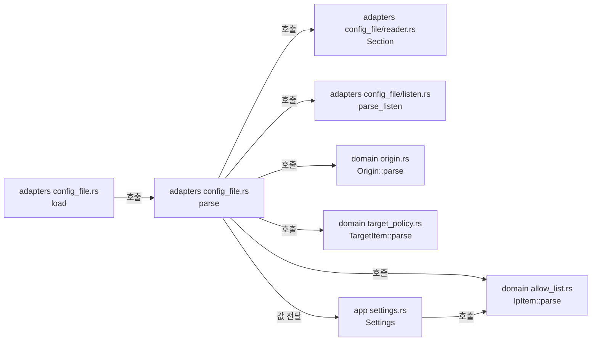

# 설정 로딩 모듈 설계

## 설정 v4 실행값과 보기용 생략 정보 (Current / Active)

`ManagementSettings.config_edit: bool`은 `read_management`가 기본 `false`로 읽는다. 이 키의 변경은 `reload::service::restart_required_keys`에서 재시작 필요로 분류한다. `config_file::parse_candidate(bytes, base_dir)`는 `parse`와 공통인 `settings_from_table`로 전체 검증한 뒤 명시된 leaf 키를 `ConfigPresence.keys`에 담아 `ConfigCandidate { settings, presence }`를 반환한다. 배열 원소는 별도 키로 넣지 않는다. 꺼진 WSS의 인증서/개인키 경로가 한쪽만 명시되어 `TlsFiles`에 담기지 않는 경우 `presence.inactive_paths`에 base_dir 기준 경로를 보관한다. GET·PATCH·watcher는 이 후보를 사용하며 실행 스냅샷에 presence를 함께 보관한다. 꺼진 기능에서 생략한 `null`과 명시한 `[]`·단독 경로를 구별하기 위해서다. 원시 TOML이나 비밀 파일 내용은 presence에 담지 않는다([설정 계약 §3.2](../contracts/config-v4.md#32-v2-파일을-v3로-옮기기), [설정 보기·편집](config-edit.md#3-데이터-모델과-get)).

설정 로딩은 TOML 설정 파일 하나를 읽어 [설정 계약](../contracts/config-v4.md)의 모든 검사를 한 번에 수행한다. 결과는 둘 중 하나다. 검증을 마친 유효 설정 `Settings`이거나, 발견한 모든 진단(`code`·`key`·`message`) 목록이다. TOML 해석과 키 검사는 adapters가, 항목 문법(IP 항목·Origin·Mode I 대상)은 domain이, 유효 설정 타입과 오류·경고 코드는 app이 맡는다. 시작(작업 2.2)과 재로드(작업 5.2)가 같은 함수를 부른다.

| 항목 | 값 |
| --- | --- |
| 구조 시점 | Current |
| 문서 상태 | Draft |
| 구현 대조 | 2026-11-08 작업 트리의 `read_management`·`parse_candidate`·`collect_presence`를 소스 읽기로 대조. 새 동작 시험은 커밋 `eae442f`의 두 OS 게이트에서 통과([작업 6.9 판정표](../how-to/set-up-and-verify.md#42-작업-69-판정표)). 이전 범위의 기록은 [대조 기록](#대조-기록). 설정 v4 로딩·검증 범위의 구현은 커밋 `3df0693`이다. 시험은 커밋 `51bd747`의 두 OS 게이트에서 통과했다([WSS Server·프록시·최근 로그 판정표](../how-to/set-up-and-verify.md#43-wss-server프록시-tls-종료최근-로그-판정표)). |
| 코드 위치 | `crates/domain/src/{allow_list,entry_point,origin,target_policy}.rs`, `crates/app/src/settings.rs`, `crates/adapters/src/config_file.rs`, `crates/adapters/src/config_file/` |
| 코드 지도 | [코드 지도 2절](code-map.md#2-코드-위치와-구성요소) |
| 관련 스펙 | [운영 스펙 3.1절](../specs/operations.md#31-설정-검증과-시작), OPS-001(일부), OPS-038(일부), OPS-040(일부) |
| 관련 계약 | [설정 계약](../contracts/config-v4.md) 1·2절, [운영 정보 계약 1.5절](../contracts/ops-info-v2.md#15-사건-목록)(경고 사건 필드) |
| 관련 ADR | [ADR-0002 출발지 IP 허용 목록](../decisions/ADR-0002-source-ip-allowlist.md) |
| 관련 문서 | [접속 ticket 모듈 설계](relay-access-ticket.md) |

후속: R1은 [설정 v4](../contracts/config-v4.md)의 리스너·역할 모델과 모든 새 키의 해석·검증을 반영한다(사용자 결정 2026-11-08(Q181·Q184·Q185·Q188)). 이전 대조 기록은 v3 범위의 증거다. R1의 빌드·시험·포매터는 이 문서 작업에서 실행하지 않았다. `trusted_proxies`의 전달 헤더 판정과 `trust_all_proxies` 경고는 R2, 최근 로그 보관·조회는 R3 범위다. 후속: 구현은 커밋 `3df0693`이며, 시험은 커밋 `51bd747`의 두 OS 게이트에서 통과했다([WSS Server·프록시·최근 로그 판정표](../how-to/set-up-and-verify.md#43-wss-server프록시-tls-종료최근-로그-판정표)).

## 1. 책임과 경계

- 맡는 책임:
  - 파일 읽기, UTF-8 확인, TOML 구문 해석
  - 키 표(1.2절)의 자료형·기본값·유효 범위 검사, 알 수 없는 키 검사
  - `listen` 주소 형식과 기본 포트(1.1·1.2절)
  - IP 항목·Origin·Mode I 대상 항목의 문법(1.3~1.5절)
  - 값 관계 검사(1.6절)와 필수 키 검사(1.7절)
  - 상대 경로를 설정 파일 디렉터리 기준으로 풀기(1.1절)
  - 경고 대상 계산(2.2절)
  - 모든 진단을 모아 한 번에 돌려주기(2.1절)
- 맡지 않는 책임:
  - 인증서·개인키 파일 내용 검사(`tls_file_invalid`). TLS 작업(3.1)이 맡는다.
  - 접속 ticket 공개 키 파일 내용 검사(`ticket_keys_invalid`). 시작·재로드의 `reload::ticket_keys::load`와 `TicketJwksStore`가 맡는다([접속 ticket 모듈 설계](relay-access-ticket.md#41-시작)).
  - 경고·진단의 출력. 진단 출력 형식은 `serve` 골격(작업 2.2), 경고 사건 기록은 운영 로그(작업 2.3)가 맡는다.
  - 상대 IP의 허용 판정(`AllowList::permits`), Mode I 최종 IP 판정(`TargetPolicy::permits_ip`), 요청 Origin 비교의 사용. 각각 작업 2.4·2.8·3.2에서 구현했다. domain의 `allow_list`·`target_policy`·`origin` 모듈을 쓴다.
  - 재로드 대상과 재시작 필요 값의 비교. 재로드 작업(5.2)이 `Settings`의 값 비교로 한다(`crates/app/src/reload/service.rs` `restart_required_keys`).
- 다른 모듈에 공개하는 기능:
  - `vnc_relay_adapters::config_file::load(path) -> Result<Settings, Vec<ConfigDiagnostic>>`
  - `vnc_relay_adapters::config_file::parse(text, base_dir) -> Result<Settings, Vec<ConfigDiagnostic>>`
  - `vnc_relay_adapters::config_file::parse_candidate(bytes, base_dir) -> Result<ConfigCandidate, Vec<ConfigDiagnostic>>`
  - `vnc_relay_adapters::config_file::load_candidate(path) -> Result<ConfigCandidate, Vec<ConfigDiagnostic>>` — 시작 시 한 번 읽은 파일에서 Settings와 presence를 함께 만든다.
  - `vnc_relay_app::settings::{Settings, ConfigError, ConfigDiagnostic, ConfigWarning}`와 `Settings::warnings`
  - `vnc_relay_domain::{allow_list::{IpItem, AllowList}, origin::Origin, target_policy::{TargetItem, TargetPolicy}, entry_point::{EntryPoint, Listener}}`

## 2. 내부 구조

화살표는 실행 중 호출이다. crate 의존 방향은 [코드 지도 레이어 표](code-map.md#레이어와-의존-방향)를 따른다(adapters → app → domain).

| 요소(파일·심볼) | 역할 | 만들어지는 시점과 소유자 | 의존 대상 |
| --- | --- | --- | --- |
| `crates/domain/src/entry_point.rs` `EntryPoint` | 진입점 네 종류, 설정·사건 이름(`tcp_viewer` 등), 기본 포트(5901·5500) | 값 타입 | 없음 |
| `crates/domain/src/allow_list.rs` `IpItem`, `IpItemError`, `AllowList` | IP 항목 해석(단일·CIDR·범위), 오류 3종 구분, 한 체계 전체를 덮는 항목 판정, 표준 표기 출력 | 설정을 읽을 때 만들고 `Settings`가 소유 | 없음 |
| `crates/domain/src/origin.rs` `Origin`, `OriginError` | Origin 해석과 정규화. 같은 함수가 설정 값과 요청 헤더를 읽는다. 같음 비교가 1.4절의 일치 규칙이다. | 설정을 읽을 때 | 없음 |
| `crates/domain/src/target_policy.rs` `TargetItem`, `TargetItemError`, `TargetPolicy` | Mode I 대상 항목 해석(1.5절 구분 순서), 세부 원인 구분, 전체 덮는 IP 항목 판정 | 설정을 읽을 때 | `allow_list`, `origin::is_dns_name` |
| `crates/app/src/settings.rs` `Settings`와 하위 `*Settings` | 검증을 마친 유효 설정. 시간은 `Duration`, 주소는 `SocketAddr`, 경로는 설정 파일 디렉터리 기준으로 푼 `PathBuf`(`load`가 주는 기준 디렉터리는 절대 경로), 항목은 domain 타입 | `parse`가 만들고 호출한 쪽이 소유 | domain |
| `crates/app/src/settings.rs` `ConfigError` | 설정 오류 코드 enum. `code()`가 계약 문자열(`config_unknown_key` 등)을 준다. | 값 타입 | 없음 |
| `crates/app/src/settings.rs` `ConfigDiagnostic` | 진단 한 건: `error`, `key`(전체 경로, 배열은 `[i]`), `message`(한국어 문장, 비밀·파일 내용 없음) | `parse`가 만든다 | `ConfigError` |
| `crates/app/src/settings.rs` `ConfigWarning`, `Settings::warnings` | 설정 경고와 사건 필드 값(진입점, 역할, 항목 표준 표기, 주소). ticket 경고도 계산한다. | 호출할 때 계산 | domain |
| `crates/adapters/src/config_file.rs` `load`, `parse` | 파일 읽기, TOML 해석, 테이블별 키 읽기, 관계·필수 키 검사, `Settings` 조립. `[admin.argon2]` 범위는 `vnc_relay_domain::account::Argon2Params`의 승인 범위 상수다. 구문 오류 위치는 `crates/adapters/src/toml_text.rs` `error_position`이 계정 파일 읽기와 같은 방식으로 계산한다. | 호출마다 | `reader`, `listen`, `toml_text`, domain, app, toml |
| `crates/adapters/src/config_file.rs` `load_candidate`, `parse_candidate`, `settings_from_table`, `collect_presence` | 시작·조회·편집·watcher가 같은 전체 검증을 쓴다. 명시 leaf 키와 꺼진 WSS의 단독 경로를 presence로 보관한다. | 파일/바이트 후보 읽기마다 | `reader`, app `ConfigCandidate`·`ConfigPresence` |
| `crates/adapters/src/config_file/reader.rs` `Section`, `Field`, `Diagnostics` | 한 TOML 테이블의 키를 읽고 읽은 키를 기록한다. 끝에서 읽지 않은 키를 `config_unknown_key`로 보고한다. 자료형·범위 오류를 진단으로 남긴다. `Field`는 키 상태(생략·무효·값)다. | 테이블마다 | toml, app |
| `crates/adapters/src/config_file/listen.rs` `parse_listen` | `"IP:포트"`, `"[IPv6]:포트"`, 기본 포트가 있을 때 주소만 쓴 형식. 호스트 이름·영역 ID·포트 0을 거절한다. | 호출마다 | 호출한 쪽이 `Listener::default_port()`를 넘긴다. |

v4의 `config_file.rs`는 `read_tcp_listener(Listener)`와 `read_websocket_listener(Listener)`를 나눈다. 뒤 함수는 부모 listen·trusted_proxies·TLS를 읽고 `read_websocket_role`로 Viewer·Server 자식을 읽는다. `read_allow_list`가 allow와 trusted_proxies의 IP 항목 검증을 공유한다. `read_recent_logs`는 max_entries를 읽는다. 주소 충돌은 `check_listen_conflicts`가 `Listener::ALL`을 한 번 순회하므로 공유 리스너를 역할 수만큼 중복 검사하지 않는다.

`read_relay`는 `[relay.ticket.viewer]`·`[relay.ticket.server]`도 읽는다. 각 역할의 `enabled`는 기본 `false`다. `issuer`·`relay_host`는 1~256바이트 문자열이다. `max_lifetime_secs`는 10~600초이며 기본 60초다. `enabled = true`이면 `issuer`·`relay_host`·`public_keys_file`이 필수다. 빠진 값은 `config_missing_key`다. 공개 키 경로는 설정 파일 디렉터리 기준으로 푼다. 꺼진 역할도 명시한 값의 자료형·범위를 검사한다. 로더는 키 파일을 읽지 않는다([접속 ticket 모듈 설계](relay-access-ticket.md#41-시작)).

## 3. 데이터 모델

설정 파일의 형식은 [설정 계약 1절](../contracts/config-v4.md#1-형식과-의미)이 기준이다. 여기서는 메모리 타입만 정한다.

| 이름 | 필드·형태 | 저장 위치 | 제약과 항상 지켜야 할 조건 |
| --- | --- | --- | --- |
| `Settings` | `admin`, `relay`, `mode1`, `mode2`, `limits`, `timeouts`, `keepalive`, `management`, `dashboard`, `recent_closed`, `recent_logs`, `status`, `log`, `reload` | 메모리 | 전체 검사를 통과한 값만 담는다. 생략한 키는 기본값으로 채운다. `PartialEq`는 표기·주석·키 순서가 아니라 실행 의미를 비교한다. |
| `RelaySettings` | `tcp_viewer`, `tcp_server`: `EntryPointSettings`; `ws`, `wss`: `WsListenerSettings`; `ticket: TicketSettings` | `Settings.relay` | TCP 두 리스너와 공유 WS·WSS 두 리스너를 구분한다. `enabled(EntryPoint)`는 역할, `listener_enabled(Listener)`는 바인드 여부를 조회한다. ticket 정책은 역할별로 WS·WSS가 공유한다. |
| `EntryPointSettings` | `enabled`, `listen: Option<SocketAddr>`, `allow: Option<AllowList>` | TCP 두 칸 | 켜진 TCP 진입점의 `listen`·`allow`는 필수다. |
| `WsListenerSettings` | `listen`, `trusted_proxies: AllowList`, `tls: Option<TlsFiles>`, `viewer`, `server`: `WsRoleSettings` | WS·WSS 두 칸 | `enabled()`는 두 역할의 OR다. 어느 역할이든 켜면 부모의 `listen`이 필수다. WSS는 부모 TLS 두 경로도 필수다. WS에는 TLS 키를 받지 않는다. |
| `WsRoleSettings` | `enabled`, `allow: Option<AllowList>`, `allowed_origins: Vec<Origin>` | 공유 리스너 아래 역할 두 칸 | 켜진 역할의 `allow`만 필수다. 꺼진 역할도 명시한 값의 형식·범위를 검사한다. |
| `TicketSettings`·`TicketRoleSettings` | Viewer·Server별 `enabled`, `issuer`, `relay_host`, `public_keys_file`, `max_lifetime`, `keys` | `Settings.relay.ticket` | 로더는 빈 키 목록을 만든다. 시작·재로드가 파일을 검사해 실행 스냅샷의 키 목록을 채운다. |
| `RecentLogsSettings` | `max_entries: u32` | `Settings.recent_logs` | 기본 1000, 범위 0~10000. 변경은 재시작 필요다. R1은 값을 읽고 검증하며 버퍼를 만들지 않는다. |
| `Mode1Settings` | `enabled`, `allow_targets: Option<TargetPolicy>` | `Settings.mode1` | `enabled = true`이면 `allow_targets`가 있다. |
| `LimitSettings` 등 수치 | `u32`(개수·바이트), `Duration`(초 단위 키) | 각 하위 설정 | 1.2절 범위 안. Lw ≤ L, Si ≤ Sa |
| `ManagementSettings` | `listen`, `tls: Option<TlsFiles>`, `config_edit: bool`, `login_limit`, `session` | `Settings.management` | `config_edit` 기본값은 false이고 재시작 필요다. `tls`가 없으면 `listen`이 루프백(127.0.0.0/8, ::1)이다. |
| `LogOutput` | `Stdout` 또는 `File(PathBuf)` | `Settings.log` | 값 `"stdout"`만 표준 출력이다. |
| `ConfigDiagnostic` | `error: ConfigError`, `key: String`, `message: String` | 반환 값 | 파일 단위 오류(`config_file_unreadable`, `config_syntax_error`)의 `key`는 빈 문자열이다. |
| `ConfigCandidate`·`ConfigPresence` | 검증된 `settings: Settings`, `presence.keys: BTreeSet<String>`, `presence.inactive_paths: BTreeMap<String, PathBuf>` | app `reload` 후보·실행 스냅샷 | 생략 정보와 꺼진 WSS 단독 경로는 실행 세대와 함께 보관한다. GET이 미적용 파일 presence로 실행 표시를 덮지 않는다. |

v3의 `[relay.ws_viewer]`·`[relay.wss_viewer]`는 `config_unknown_key`다. 자동 호환 별칭은 없다. 이전 파일은 [v3→v4 이동 표](../contracts/config-v4.md#33-v3-파일을-v4로-옮기기)에 따라 부모의 listen/TLS와 자식의 enabled/allow/Origin을 나누어 옮긴다. 모든 역할이 꺼진 WSS는 단독 TLS 경로를 `ConfigPresence.inactive_paths`에 보존하고 파일 내용은 읽지 않는다.

## 4. 처리 순서

대표 시나리오는 OPS-001(잘못된 설정의 시작 실패)이다.

| 순서 | 코드 위치(파일·심볼) | 조건·계산 | 바뀌는 상태 | 결과를 쓰는 곳 |
| --- | --- | --- | --- | --- |
| 1 | `config_file.rs` `load` | 파일을 바이트로 읽고 UTF-8로 바꾼다. 실패하면 `config_file_unreadable` 하나로 끝낸다. | 텍스트 | 2단계 |
| 2 | `config_file.rs` `parse` | TOML을 `toml::Table`로 해석한다. 구문 오류·중복 키는 `config_syntax_error` 하나로 끝낸다. 메시지에는 줄·열만 쓰고 파일 내용은 쓰지 않는다. | 키 트리 | 3단계 |
| 3 | `reader.rs` `Section`, `config_file.rs`의 `read_admin`~`read_reload` | 최상위부터 테이블마다 키를 읽는다. 자료형이 다르면 `config_type_mismatch`, 범위 밖이면 `config_value_out_of_range`를 남기고 그 값은 "무효"로 둔다. 테이블을 다 읽으면 읽지 않은 키를 `config_unknown_key`로 남긴다. | 진단 목록, 키별 값(유효·무효·생략) | 4단계 |
| 4 | `listen.rs` `parse_listen`, domain 각 `parse` | 주소·항목 문자열을 해석한다. 배열 원소 오류는 `key[i]`에 남긴다. | 진단 목록 | 5단계 |
| 5 | `config_file.rs` `required`, `read_limits`, `read_management`, `check_listen_conflicts` | 필수 키(1.7절)는 각 테이블을 읽으면서 `required`로, 값 관계(1.6절)는 해당 테이블 함수에서 검사한다. 리스너 주소 중복은 모든 테이블을 읽은 뒤 검사한다. 관계에 쓰는 값 중 하나라도 무효면 그 관계는 검사하지 않는다(같은 원인을 두 번 보고하지 않기 위해서). | 진단 목록 | 6단계 |
| 6 | `config_file.rs` `parse` | 진단이 하나라도 있으면 전체 목록을 `Err`로 돌려준다. 없으면 `Settings`를 조립해 `Ok`로 돌려준다. | 없음 | 호출한 쪽(작업 2.2 `serve`, 재로드) |

경고는 7단계로 호출한 쪽이 `Settings::warnings`를 불러 얻는다. 시작과 재로드가 같은 함수를 쓰고 사건의 `phase`는 호출한 쪽이 정한다.

ticket을 켠 역할에 TCP 진입점도 켜져 있으면 `ticket_tcp_bypass` 경고를 낸다. 그 역할의 평문 WS가 켜져 있으면 `ticket_plaintext_ws` 경고를 낸다. 시작은 `phase=startup`이다. 재로드는 실제 바뀐 ticket `enabled` 키에 대해서만 경고를 다시 쓴다([접속 ticket 모듈 설계](relay-access-ticket.md#44-재로드와-편집)).

보기·편집·watcher는 바이트를 이미 읽었으면 `parse_candidate`로 이 경로에 진입한다. 비UTF-8은 `ConfigError::FileUnreadable` 진단이며, GET의 파일 상태 분류가 이를 `unreadable`·빈 진단으로 바꾼다. 파일 revision 계산과 API 오류 상태 매핑은 이 로더가 아니라 [설정 보기·편집 서비스](config-edit.md)가 맡는다.

## 5. 상태와 초기화

- 초기화·로딩 시점: `load`를 부를 때마다 처음부터 읽는다. 캐시와 전역 상태가 없다.
- 상태 소유자와 제거 시점: `Settings`는 호출한 쪽이 소유한다. 진단 목록은 반환 뒤 호출한 쪽이 출력하고 버린다.
- 동시 실행과 순서: 함수는 공유 상태가 없어 동시에 불러도 된다. 진단 순서는 테이블을 읽는 고정 순서와 TOML 키 정렬 순서를 따른다.

## 6. 오류 처리

| 실패 지점 | 처리 방법 | 남는 상태 | 관련 스펙 시나리오 |
| --- | --- | --- | --- |
| `config_file.rs` `load` 파일 읽기 | `config_file_unreadable`(키 없음) 하나를 돌려준다. | 없음 | OPS-001 |
| `config_file.rs` `parse` TOML 해석 | `config_syntax_error`(키 없음, 줄·열) 하나를 돌려준다. | 없음 | OPS-001 |
| 키·값 검사 | 진단을 모두 모은 뒤 함께 돌려준다. 첫 오류에서 멈추지 않는다. | 없음 | OPS-001, OPS-038, OPS-040 |

## 7. 설계 선택

| 선택 | 이유 | 검토한 다른 방법 | 근거 |
| --- | --- | --- | --- |
| `toml::Table`을 직접 따라가며 키를 읽는다. serde derive를 쓰지 않는다. | 2.1절이 "가능한 모든 설정 오류를 모아 보고"를 요구한다. derive 방식은 첫 오류에서 멈추고, 알 수 없는 키와 자료형 오류를 키 경로와 함께 모으기 어렵다. | serde derive와 `deny_unknown_fields`. 첫 오류만 보고한다. | [설정 계약 2.1절](../contracts/config-v4.md#21-설정-오류와-준비-실패) |
| 오류·경고 코드 enum과 `Settings`를 app에 둔다. | 시작(실행파일 조립)과 재로드(app)가 adapters 타입을 몰라도 진단과 설정을 다룰 수 있다. | adapters에 둔다. app의 재로드가 adapters에 의존하게 되어 레이어 규칙을 어긴다. | [코드 지도 레이어 표](code-map.md#레이어와-의존-방향) |
| 경고 사건의 `item`은 항목의 표준 표기(`IpItem`·`TargetItem`의 `Display`)로 쓴다. | 쓴 표기를 보관하면 같은 값을 다르게 쓴 파일을 다른 설정으로 보게 된다(1.8절 규칙 2). 표준 표기는 같은 값에 같은 문자열을 준다. | 원문 문자열을 함께 보관. 비교에서 빼는 별도 처리가 필요하다. | [운영 정보 계약 1.5절](../contracts/ops-info-v2.md#15-사건-목록) |
| `allow_all_source`·`allow_all_target`은 진입점·모드가 꺼져 있어도 값이 있으면 계산한다. | 2.2절 조건은 "`allow`에 전체 항목이 있다"이며 켜짐 여부를 조건으로 두지 않는다. | 켠 진입점만. 계약 문장보다 좁다. | [설정 계약 2.2절](../contracts/config-v4.md#22-경고) |
| 빈 경로 문자열은 `config_value_out_of_range`로 보고한다. | 1.1절은 빈 경로를 받지 않는다고만 하고 코드를 정하지 않았다. 자료형(문자열)은 맞고 값이 허용 범위 밖이므로 이 코드가 가장 가깝다. | `config_type_mismatch`. 자료형은 맞아 뜻이 어긋난다. | [설정 계약 1.1절](../contracts/config-v4.md#11-파일-규칙) |
| `[admin.argon2]`·`[management.login_limit]` 같은 하위 테이블 자리에 표가 아닌 값이 오면 `config_type_mismatch`다. | 키가 표에 있으므로 알 수 없는 키가 아니라 자료형 오류다. | `config_unknown_key`. 키 이름은 맞다. | [설정 계약 1.1절](../contracts/config-v4.md#11-파일-규칙) |
| 리스너 주소 중복은 뒤에 읽은 키에 보고하고 메시지에 앞 키를 적는다. | 진단의 `key`는 하나다. 읽는 순서가 고정되어 결과가 안정적이다. | 두 키에 모두 보고. 같은 원인이 두 번 나온다. | [설정 계약 1.6절](../contracts/config-v4.md#16-값-관계-검사) |

## 8. 현재 코드와의 차이

없다. 2·4절의 파일·심볼이 현재 코드와 같다.

## 대조 기록

| 대조 범위 | 환경 | 확인 방법 | 결과 |
| --- | --- | --- | --- |
| 작업 2.1 변경(기준 커밋 `80267b2` + `crates/` 추가) | Ubuntu 24.04.4(WSL2), Rust 1.99.1 | 2·4절의 파일·심볼과 실제 코드를 대조했다. 처리 순서는 [설정 계약의 계약 테스트 실행 기록](../contracts/config-v4.md#계약-테스트-실행-기록)으로 확인했다. app의 입출력 금지는 `SystemTime::now` 호출을 임시로 넣어 `cargo clippy -p vnc-relay-app`가 `disallowed method` 오류를 내는 것을 확인하고 되돌렸다. | 통과 |
| Windows 실행(기준 커밋 `e1cfc4f` + Windows 경고 수정) | Windows 11 Pro 10.0.26200, Rust 1.99.1(`x86_64-pc-windows-msvc`) | `cargo xtask scenarios`에서 `config_contract` 21건이 통과했다. 테스트의 Windows 절대 경로 분기(`C:\relay`, `D:\logs\relay.log`)와 상대 경로 풀이를 실행했다([설정 계약의 계약 테스트 실행 기록](../contracts/config-v4.md#계약-테스트-실행-기록)). | 통과 |
| 작업 1.5 변경(기준 커밋 `553b549` + 작업 트리. `limits.initial_message_bytes`와 관계 I ≤ B 제거) | Ubuntu 24.04.4(WSL2)·Windows 11 Pro 10.0.26200, Rust 1.99.1 | `read_limits`·`LimitSettings`·재로드의 재시작 필요 키 목록에서 I가 빠졌는지 코드와 대조했다. 두 OS 전체 완료 검증에서 `config_contract` 21건이 통과했다([설정 계약의 계약 테스트 실행 기록](../contracts/config-v4.md#계약-테스트-실행-기록)). | 통과 |

## 9. 미결정 사항

| 항목 | 영향 | 확정 위치 |
| --- | --- | --- |
| 재로드 때 `tls_file_invalid` 검사 위치 | 시작 때 내용 검사는 작업 3.1에서 TLS 어댑터(`tls::load_acceptor`)가 한다([`serve` 시작 모듈 설계 4절](serve-startup.md)). 재로드 후보는 `RustlsTlsStore`가 `acceptor_from_pem`으로 검사한다. 실패하면 `reload_rejected`(`tls_file_invalid`)로 거절한다. 구현 판단(사용자 결정 없음). | 작업 5.2에서 구현했다 |
