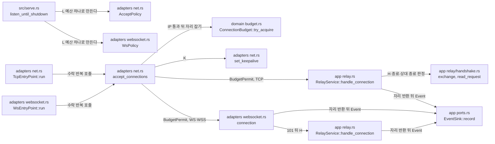

# 연결 상한과 시간 제한 모듈 설계

중계 측 연결 상한 L, 관리·상태 연결 상한 Lm, 대기 상한 Lw를 세는 연결 예산과, TCP 진입점이 수락한 연결에 적용하는 초기 교환 시간 H·TCP keepalive(K)를 다룬다. WS·WSS 진입점의 업그레이드 시간 U와 WS·WSS 연결의 H(101 뒤)도 다룬다. 연결 예산은 L·Lm·Lw가 같은 타입을 쓴다. L은 TCP·WS·WSS 진입점이, Lm은 상태 리스너와 관리 리스너가 쓴다([상태 리스너와 준비 상태 모듈 설계](status-listener.md), [관리 리스너 모듈 설계](management-listener.md)). Mode II 대기 등록(작업 2.9)이 Lw를 연결한다(사용자 결정 2026-10-20). 진입점의 수락 순서는 [TCP 진입점 모듈 설계](tcp-entry-point.md)가 다룬다.

| 항목 | 값 |
| --- | --- |
| 구조 시점 | Current |
| 문서 상태 | Draft |
| 구현 대조 | Verified — [대조 기록](#대조-기록) |
| 코드 위치 | `crates/domain/src/budget.rs`, `crates/app/src/events.rs`(`RejectReason::RelayConnectionLimit`, `AbortReason`, `ConnectionErrorKind`), `crates/adapters/src/net.rs`(`AcceptPolicy`, `accept_connections`, `set_keepalive`, `TcpRelayStream`), `crates/app/src/relay.rs`(`RelayService::handle_connection`), `crates/app/src/relay/handshake.rs`(`exchange`, `read_request`), `crates/adapters/src/websocket.rs`(`WsPolicy`, `connection`), `crates/adapters/src/request_deadline.rs`(관리 U), `src/serve.rs`(L 예산 만들기) |
| 코드 지도 | [코드 지도 2절](code-map.md#2-코드-위치와-구성요소) |
| 관련 스펙 | [운영 스펙 2절](../specs/operations.md#2-상태와-검증-매개변수)의 L·Lm·Lw·H·K·U, [4.1절](../specs/operations.md#41-판정-가능한-규칙)의 OPS-R03·OPS-R20, OPS-004(일부), OPS-006(일부), OPS-033(일부), [중계 스펙](../specs/relay.md#7-수용-테스트) RLY-005(일부) |
| 관련 계약 | [설정 계약 1.2절](../contracts/config-v2.md#12-키-표)(`[limits]`·`[timeouts]`·`[keepalive]`), [운영 정보 계약 1.6절](../contracts/ops-info-v1.md#16-원인-코드)(`relay_connection_limit`, `handshake_timeout`, `peer_eof`, `connection_error`)·[1.7절](../contracts/ops-info-v1.md#17-error_kind-값)(`io_error`) |
| 관련 ADR | [ADR-0004 tokio·rustls](../decisions/ADR-0004-tokio-rustls.md) |

## 1. 책임과 경계

- 맡는 책임:
  - 연결 예산: 상한 하나 아래에서 자리를 잡고 돌려준다. 동시에 잡아도 상한을 넘지 않는다. 예산마다 따로 세므로 한 예산이 고갈돼도 다른 예산은 영향을 받지 않는다(OPS-R20).
  - L: 모든 중계 진입점(TCP·WS·WSS)이 L 예산 하나를 함께 쓴다. TCP·WS·WSS 진입점은 출발지 IP 검사를 통과한 연결에서 자리를 잡는다. 자리가 없으면 `connection_rejected`(`stage` = `accept`, `reason` = `relay_connection_limit`, `limit`)를 기록하고 닫는다. 연결이 끝나면 자리를 돌려준다.
  - H: TCP 연결은 수락하자마자 초기 교환 상태에 들어간다. H가 지나면 닫고 `connection_aborted`(`handshake_timeout`)를 기록한다. WS·WSS의 H는 101 응답 뒤부터 잰다(사용자 결정 2026-10-22(Q22)). 그 H가 지나면 4009 닫기 코드로 닫고 `connection_aborted`(`handshake_timeout`)를 기록한다.
  - U: WS·WSS와 관리 리스너 연결의 요청 시간 제한. `[timeouts] tls_upgrade_secs`를 쓰고 수락부터 잰다. WS·WSS는 TLS 핸드셰이크(WSS)와 업그레이드 요청을 끝내야 한다. 관리 리스너는 TLS 핸드셰이크와 첫 요청 머리를 끝내야 한다(사용자 결정 Q12). 관리 리스너는 첫 요청 머리 뒤 읽기·쓰기마다 U를 다시 잰다(사용자 결정 2026-10-22(Q25), [관리 리스너 모듈 설계](management-listener.md) 9절 11번). 기한이 지나면 WS·WSS는 `connection_aborted`(`tls_upgrade_timeout`)를 기록하고 닫는다. 관리 리스너는 평문 응답 없이 닫고 기록하지 않는다. 예외: 검증·수락된 관리자 종료 요청의 정리 완료 대기 중에만 U를 멈추고 응답 쓰기부터 다시 잰다(사용자 결정 2026-11-02(Q92), [관리 리스너 모듈 설계](management-listener.md)의 Q25 예외).
  - 초기 교환 중 상대 종료 감지: 상대가 바이트를 보내기 전에 닫으면 `peer_eof`, 연결이 재설정되면 `connection_error`(`error_kind` = `io_error`)로 정리한다. 초기 교환 읽기(`crates/app/src/relay/handshake.rs` `read_request`)가 이 구분을 한다(사용자 결정 2026-10-20).
  - K: 수락한 중계 소켓마다 TCP keepalive의 유휴 시간·탐색 간격·탐색 횟수를 설정한다. Linux 소켓 I/O의 `ETIMEDOUT`(`io::ErrorKind::TimedOut`)과 앞선 ICMP 도달 불능에 따른 포기 오류 `EHOSTUNREACH`(`io::ErrorKind::HostUnreachable`)·`ENETUNREACH`(`io::ErrorKind::NetworkUnreachable`)는 keepalive 또는 재전송 포기로 판정한 응답 없는 상대다. `net::classify_socket_error`는 이를 `RelayStreamError::DeadConnection`으로 바꾼다. ICMP 사례는 Linux 커널 소스 분석에 근거하며 실행으로 직접 관찰한 것은 아니다. 이는 이 문서의 구현 판단이며 사용자 결정은 아니다. `TcpRelayStream`은 수락·Mode I 대상 소켓에, `WsRelayStream`은 WS·WSS의 하부 전송 I/O에 같은 판정을 쓴다. app의 H·C·W 타이머에는 적용하지 않는다. Windows 오류 코드는 관찰하지 않았으므로 추정해 추가하지 않는다.
- 맡지 않는 책임:
  - Lm의 판정과 거절 기록. 수락 판정은 `admission.rs`의 `AdmittingListener`가 맡고, 상태·관리 리스너가 쓴다([상태 리스너와 준비 상태 모듈 설계](status-listener.md), [관리 리스너 모듈 설계](management-listener.md)). 관리 리스너는 작업 4.2에서 같은 Lm 예산을 쓴다.
  - Lw의 사용처. 작업 2.9에서 대기 등록에 연결했다. `crates/app/src/relay/matching.rs`가 `runtime.waiting_budget.try_acquire()`로 같은 `ConnectionBudget`의 자리를 잡는다.
  - Mode I 대상 소켓의 L 집계. 작업 2.8이 대상 연결 전에 같은 L 예산에서 자리를 잡는다(OPS-023).
  - 끊긴 연결의 판정과 회수(`dead_connection`). keepalive가 끊긴 연결을 운영체제 오류로 알리면 그 연결을 다루는 단계가 처리한다. 대기·활성 연결의 처리와 RLY-025~027은 작업 2.11에서 구현·검증했다. OS별 증거 범위는 [작업 5.9 판정표](../how-to/set-up-and-verify.md#41-작업-59-판정표)를 따른다.
  - 바이트를 보낸 뒤 닫은 연결의 판정과 초기 교환 읽기·해석. `RelayService::handle_connection`(app)이 맡는다. 이 문서는 그 단계의 H 시간과 자리 반환 규칙만 정한다.
- 다른 모듈에 공개하는 기능:
  - `vnc_relay_domain::budget::{ConnectionBudget, BudgetPermit}`
  - `vnc_relay_app::events::{RejectReason::RelayConnectionLimit, AbortReason, ConnectionErrorKind}`
  - `vnc_relay_adapters::net::AcceptPolicy`
  - `vnc_relay_adapters::websocket::WsPolicy`

## 2. 내부 구조

화살표는 실행 중 호출이다. crate 의존 방향은 [코드 지도 레이어 표](code-map.md#레이어와-의존-방향)를 따른다.

| 요소(파일·심볼) | 역할 | 만들어지는 시점과 소유자 | 의존 대상 |
| --- | --- | --- | --- |
| `crates/domain/src/budget.rs` `ConnectionBudget` | 상한(`limit`)과 사용 중인 자리 수. `try_acquire`가 원자적 비교·교환으로 상한 안에서만 자리를 잡는다. | `serve`가 시작 때 하나 만들고 `Arc`로 진입점에 나눈다 | 없음(std 원자 변수) |
| `crates/domain/src/budget.rs` `BudgetPermit` | 잡은 자리 하나. 버리면(`Drop`) 자리를 돌려준다. 연결을 다루는 작업이 연결과 함께 소유한다. | `try_acquire`가 성공할 때 | `ConnectionBudget` |
| `crates/app/src/events.rs` `RejectReason::RelayConnectionLimit { limit }` | `relay_connection_limit`과 `limit` 값. 상한 거절만 `limit`을 가진다. | 거절할 때 | 없음 |
| `crates/app/src/events.rs` `AbortReason`, `ConnectionErrorKind` | `handshake_timeout`·`peer_eof`·`connection_error`·`server_shutdown`과 `level`. `connection_error`만 `error_kind`를 가진다. | 연결이 끝날 때 | 없음 |
| `crates/adapters/src/net.rs` `AcceptPolicy` | 진입점이 수락한 연결에 적용할 값: 허용 목록, L 예산, H, K | `serve`가 진입점마다 만든다 | domain, app |
| `crates/adapters/src/net.rs` `set_keepalive` | socket2 `SockRef`로 `SO_KEEPALIVE`와 유휴 시간·탐색 간격·탐색 횟수를 설정한다. 이어서 `TCP_NODELAY`를 켠다. 중계는 읽은 바이트를 바로 쓰므로, Nagle이 켜져 있으면 작은 쓰기 뒤의 다음 쓰기가 상대의 지연 ACK를 기다릴 수 있다. 작업 5.4 측정 스모크(2026-11-06, WSL2, 20초, 판정 불가 길이)에서 WS·WSS의 늘어난 지연 p99가 약 34 ms였고, `TCP_NODELAY` 뒤 0.69 ms·0.34 ms였다. `TCP_NODELAY` 선택은 **이 문서의 판단, 사용자 결정 없음**이다. | 자리를 잡은 연결마다, Mode I 대상 연결마다(`TcpRelayStream::with_keepalive`) | socket2, tokio |
| `crates/app/src/relay.rs` `RelayService::handle_connection`, `crates/app/src/relay/handshake.rs` `exchange`, `read_request` | 허용한 TCP 연결의 초기 교환을 H 안에 읽는다. H 만료, 상대 종료, 서버 종료, 연결 재설정 중 먼저 오는 것으로 끝낸다. 실패하면 `RelayCloseAction`을 정해 소켓을 닫고, 자리를 버린 뒤 사건을 기록한다. | 허용한 TCP 연결마다, `TcpEntryPoint::run`의 serve 작업이 부른다 | tokio, app, domain |
| `crates/adapters/src/net.rs` `accept_connections` | TCP·WS·WSS가 함께 쓰는 수락 반복. IP 검사 뒤 L 자리를 잡는다. 자리가 없으면 `connection_rejected`(`relay_connection_limit`)를 기록하고 닫는다. 있으면 K를 설정하고 `BudgetPermit`을 연결 작업에 넘긴다. | 진입점 `run`마다 하나 | tokio, socket2, app, domain |
| `crates/adapters/src/websocket.rs` `WsPolicy` | WS·WSS 진입점에 적용할 값: `accept`(`AcceptPolicy`. H는 101 뒤부터 잰다), `upgrade`(U, `[timeouts] tls_upgrade_secs`), `origins`. | `serve`가 WS·WSS 진입점마다 만든다 | adapters |
| `crates/adapters/src/websocket.rs` `connection` | `connection`은 U 안에서 WSS의 TLS 핸드셰이크와 업그레이드 요청을 끝낸다. 101 뒤 `WsRelayStream`을 만들어 `RelayService::handle_connection`에 넘기고, H는 `handle_connection`이 `exchange_at`부터 잰다. 자리는 연결 작업이 받아 `handle_connection`에 넘기고, 연결을 끝낸 뒤 돌려준다. | 허용한 WS·WSS 연결마다 | tokio, tokio-rustls, tokio-tungstenite, app, domain |

## 3. 데이터 모델

| 이름 | 필드·형태 | 저장 위치 | 제약과 항상 지켜야 할 조건 |
| --- | --- | --- | --- |
| `ConnectionBudget` | `limit: u32`, `used: AtomicU32` | `Arc`로 공유하는 메모리 | `used ≤ limit`. 자리를 잡을 때만 늘고 `BudgetPermit`이 버려질 때만 준다. |
| `BudgetPermit` | `budget: Arc<ConnectionBudget>` | 연결 작업 | 연결 하나에 하나. 소켓을 닫은 뒤 버린다. |
| `AcceptPolicy` | `allow: AllowList`, `relay_budget: Arc<ConnectionBudget>`, `handshake: Duration`(H), `keepalive: KeepaliveSettings`(K) | `TcpEntryPoint`, `WsPolicy.accept` | 모든 진입점의 `relay_budget`은 같은 예산이다. 값은 시작할 때 정하고 바꾸지 않는다(설정 계약에서 모두 재시작 필요). |
| `WsPolicy` | `accept: AcceptPolicy`, `upgrade: Duration`(U), `origins`(허용 Origin 목록) | `WsEntryPoint` | `accept.handshake`(H)는 101 뒤부터 잰다(사용자 결정 2026-10-22(Q22)). `upgrade`(U)는 수락부터 잰다. 값은 시작할 때 정한다. |

`connection_rejected`와 `connection_aborted`의 줄 필드는 [TCP 진입점 모듈 설계 3절](tcp-entry-point.md#3-데이터-모델)과 같다. `limit`은 `peer_ip` 다음, `error_kind`는 `elapsed_ms` 다음에 쓴다.

## 4. 처리 순서

대표 시나리오는 OPS-004다. L = 2에서 세 번째 접속이 오고, 기존 연결 하나가 끝난 뒤 다시 접속한다.

| 순서 | 코드 위치(파일·심볼) | 조건·계산 | 바뀌는 상태 | 결과를 쓰는 곳 |
| --- | --- | --- | --- | --- |
| 1 | `src/serve.rs` `listen_until_shutdown` | `ConnectionBudget::new(limits.relay_connections)`를 하나 만들고 TCP·WS·WSS 진입점마다 `AcceptPolicy` 또는 `WsPolicy`에 넣는다. | L 예산 | 2단계 |
| 2 | `accept_connections`, `AllowList::permits` | 출발지 IP를 먼저 판정한다. 목록에 없으면 `ip_not_allowed`로 거절하고 자리를 잡지 않는다. | 없음 | 3단계 |
| 3 | `ConnectionBudget::try_acquire` | 두 연결이 자리를 잡았으므로 세 번째는 `None`이다. `connection_rejected`(`relay_connection_limit`, `limit` = 2)를 기록하고 소켓을 닫는다. | 없음 | 운영 로그 |
| 4 | `set_keepalive`, `TcpRelayStream`, `RelayService::handle_connection` | 자리를 잡은 연결은 `connection_accepted`를 먼저 기록한 뒤 K를 설정한다(사용자 결정 2026-11-02(Q85), 커밋 `5a38bfc`). 성공하면 소켓을 `TcpRelayStream`으로 감싸 `handle_connection`에 넘긴다. 실패하면 6절의 중단 기록과 자원 반환을 따른다. | 성공: 초기 교환 중인 연결. 실패: 반환 | 성공: 5단계 |
| 5 | `handshake::exchange`, `read_request` | 상대가 아무 바이트도 보내지 않고 닫으면 읽기가 0바이트를 준다(`PeerEof`). | 없음 | 6단계 |
| 6 | `RelayService::prepare` | 소켓을 닫고 `BudgetPermit`을 버린 뒤 `connection_aborted`(`peer_eof`)를 기록한다. 줄을 본 클라이언트가 바로 다시 접속해도 자리가 있다. | 자리 하나 반환 | 운영 로그 |
| 7 | 2~4와 같은 경로 | 다음 접속이 자리를 잡고 수락된다. | 초기 교환 중인 연결 | 운영 로그 |

H가 먼저 지나면 5~6단계 대신 `handshake_timeout`(`warn`)으로, 서버가 종료하면 `server_shutdown`(`info`)으로 같은 정리를 한다.

WS·WSS는 자리를 잡은 뒤 U 안에서 TLS 핸드셰이크(WSS)와 업그레이드 요청을 끝낸다. 끝내지 못하면 `connection_aborted`(`tls_upgrade_timeout`, `warn`)를 기록하고 닫는다. 101 응답 뒤에는 H를 잰다(사용자 결정 2026-10-22(Q22)). H가 지나면 4009 닫기 코드로 닫고 `connection_aborted`(`handshake_timeout`)를 기록한다.

## 5. 상태와 초기화

- 초기화 시점: L 예산은 모든 바인드가 성공한 뒤, 진입점 작업을 띄우기 전에 만든다.
- 상태 소유자와 제거 시점: 예산은 `Arc`로 진입점 작업과 연결 작업이 함께 소유한다. 마지막 연결 작업이 끝나면 사라진다. 자리는 연결 작업이 소켓과 함께 소유하고 연결이 끝날 때 돌려준다.
- 동시 실행과 순서: 두 진입점의 수락 작업이 동시에 자리를 잡을 수 있다. `try_update`의 비교·교환이 상한을 지킨다. 자리 반환은 소켓을 닫은 뒤, 사건을 기록하기 전이다.

## 6. 오류 처리

| 실패 지점 | 처리 방법 | 남는 상태 | 관련 스펙 시나리오 |
| --- | --- | --- | --- |
| L 고갈 | `relay_connection_limit`으로 거절하고 닫는다. 기존 연결은 그대로다. | 없음 | OPS-004 |
| H 만료 | 닫고 `handshake_timeout`(`warn`)을 기록한다. | 자리 반환 | OPS-006, RLY-005 |
| 바이트 전 상대 종료 | `peer_eof`(`info`)를 기록한다. | 자리 반환 | RLY-005 |
| `peek` 오류(연결 재설정 등) | `connection_error`(`warn`, `error_kind` = `io_error`)를 기록한다. | 자리 반환 | 없음 |
| keepalive 설정 실패 | `connection_accepted` 기록 → `set_keepalive` 실패 → `connection_aborted(reason=connection_error, error_kind=io_error)` 기록 → 소켓 drop → L permit drop. `stage`는 TCP `initial_exchange`, WS `upgrade`, WSS `tls`다(사용자 결정 2026-11-02(Q85), [운영 정보 계약 1.6·1.7절](../contracts/ops-info-v1.md#16-원인-코드)). 같은 함수의 `TCP_NODELAY` 설정 실패도 이 경로를 따른다(2026-11-06, 이 문서의 판단). 커밋 `5a38bfc`가 `crates/adapters/src/net.rs`의 공유 accept 루프(`accept_connections_with_keepalive`)에 구현했다. 단위 시험 `net::accept_tests::keepalive_failure_aborts_accepted_connections_and_releases_l`이 네 진입점의 사건 순서·필드, 소켓 닫힘, 다음 연결 수락, L 반환을 확인한다. 실패는 소켓 옵션 함수를 매개변수로 받아 주입한다. | 소켓 닫힘, 자리 반환 | RLY-R18, TODO 2.11 |
| Linux 중계 소켓의 `ETIMEDOUT`·`EHOSTUNREACH`·`ENETUNREACH` | keepalive 또는 재전송 포기는 응답 없는 상대이므로 `dead_connection`으로 분류한다(앞선 ICMP 도달 불능에 따른 포기 오류 포함, 커널 소스 분석 근거, 실행 관찰 아님, 이 문서의 구현 판단). 대기는 `waiting_removed.reason`, 활성 세션은 `session_closed.close_cause`와 응답 없는 `side`로 기록한다. 다른 소켓 I/O 오류는 기존 `connection_error`·`io_error`를 유지한다. WS·WSS도 `WsRelayStream`의 하부 전송 오류에 같은 함수를 쓴다. H·C·W의 app 타이머는 이 경로를 지나지 않는다. | 소켓·등록 제거, L 반환 | RLY-025·026 |
| WS·WSS U 만료 | 닫고 `connection_aborted`(`tls_upgrade_timeout`, `warn`)를 기록한다. `stage`는 TLS 핸드셰이크 중이면 `tls`, 아니면 `upgrade`다. | 자리 반환 | 없음 |
| 관리 리스너 U 만료 | 평문 응답 없이 닫는다. 기록하지 않는다(구현 판단, [관리 리스너 모듈 설계](management-listener.md) 6절). | 접속 없음, 자리 반환 | OPS-006(일부), OPS-033(일부) |
| WS·WSS 업그레이드 거절(101 전) | `connection_rejected`(`stage` = `upgrade`, `reason` = `ip_not_allowed`·`invalid_upgrade`·`origin_not_allowed`·`subprotocol_not_supported` 중 하나)를 기록하고 응답한 뒤 닫는다. | 자리 반환 | 없음 |
| 101 뒤 H 만료(WS·WSS) | 4009 닫기 코드로 닫고 `connection_aborted`(`handshake_timeout`, `stage` = `initial_exchange`)를 기록한다. | 자리 반환 | 없음 |

## 7. 설계 선택

| 선택 | 이유 | 검토한 다른 방법 | 근거 |
| --- | --- | --- | --- |
| 출발지 IP를 L보다 먼저 판정한다. | 목록 밖 출발지는 자리를 쓰지 않고, L이 찼는지도 알 수 없다. 코드 지도 4절 1단계의 순서와 같다. | L을 먼저 확인. 목록 밖 출발지가 상한 상태를 알게 된다. | [운영 정보 계약 1.5절](../contracts/ops-info-v1.md#15-사건-목록) `connection_accepted` 조건 |
| L·Lm·Lw를 같은 `ConnectionBudget` 타입으로 센다. 예산은 사용처가 생길 때 만든다(L은 2.5, WS·WSS의 L 사용은 3.2, Lm은 2.6, 관리 리스너의 Lm 사용은 4.2). | 세 상한의 규칙(상한까지 잡고, 끝나면 반환하고, 서로 독립)이 같다. 사용처가 없는 예산을 미리 만들지 않는다. | 상한마다 다른 타입, 2.5에서 Lm·Lw 예산까지 만들기 | 사용자 결정 2026-10-20 |
| 자리 수는 `AtomicU32`의 비교·교환으로 센다. | 잠금 없이 상한을 지킨다. domain은 외부 crate를 쓰지 않는다. | `tokio::sync::Semaphore`. domain이 tokio에 의존하게 된다. | [코드 지도 레이어 표](code-map.md#레이어와-의존-방향) |
| 초기 교환 중인 TCP 연결에도 H를 적용한다. | TCP 연결은 수락 직후 초기 교환 상태다. 시간 제한이 없으면 서버 종료 전까지 L 자리가 돌아오지 않는다. | 서버 종료까지 시간 제한 없이 두기(작업 2.4의 방식) | 사용자 결정 2026-10-20 |
| 초기 교환 중 상대 종료는 읽기 결과로 확인한다. | 읽기가 0바이트를 주면 상대가 닫은 것이다. 확인 작업을 따로 두지 않는다. | `peek`로 따로 확인하기(확인 코드와 읽기 코드를 둘 다 두게 된다), H 만료까지 기다리기(떠난 클라이언트의 자리가 H 동안 남는다) | `crates/app/src/relay/handshake.rs` `read_request` |
| keepalive 매개변수는 socket2로 설정한다. | tokio·std에는 유휴 시간·탐색 간격·탐색 횟수를 정하는 API가 없다. `unsafe`는 금지다. socket2는 tokio가 이미 쓰는 crate다(MIT OR Apache-2.0). | keepalive를 작업 2.11로 미루기 | 사용자 결정 2026-10-20, [PRD "구현 기술" 행](../requirements/PRD.md#확정-기준) |
| 자리를 돌려준 뒤 사건을 기록한다. | 줄을 본 클라이언트가 바로 다시 접속할 때 자리가 있어야 한다. 시스템 테스트가 이 순서에 기댄다. | 기록 뒤 반환 | 없음 |
| WS·WSS의 H는 101 응답 뒤부터 잰다. | U가 101 전 시간을 맡는다. 수락부터 H를 재면 U와 같은 구간을 두 번 잰다. | 수락부터 H 재기(U와 겹침) | 사용자 결정 2026-10-22(Q22) |
| U는 수락부터 잰다. WS·WSS는 TLS 핸드셰이크와 업그레이드 요청을, 관리 리스너는 TLS 핸드셰이크와 첫 요청 머리를 한 기한으로 덮는다. | 자리가 정해진 시간 안에 돌아오게 한다. | 단계마다 따로 시간 재기 | 사용자 결정 2026-10-21 Q12(관리), websocket-relay-v1 §1.1(WS) |
| 관리 리스너는 첫 요청 머리 뒤 읽기·쓰기마다 U를 다시 잰다. | 요청 사이에 머무는 연결이 자리를 무기한 잡지 않는다. 첫 요청 뒤 U는 유휴 제한만이며 요청마다 절대 기한은 없다. | 첫 요청 뒤에도 수락부터 절대 기한 하나 | 사용자 결정 2026-10-22(Q25). [관리 리스너 모듈 설계](management-listener.md) 9절 11번 |

## 8. 현재 코드와의 차이

TCP 경로는 2~4절과 같다. WS·WSS 행은 [WebSocket 진입점 모듈 설계](websocket-entry-point.md)의 상태를 따른다.

## 대조 기록

| 대조 범위 | 환경 | 확인 방법 | 결과 |
| --- | --- | --- | --- |
| 작업 2.5 변경(기준 커밋 `c89beb4` + 작업 트리) | Ubuntu 24.04.4(WSL2), Rust 1.99.1 | 1~4절의 파일·심볼과 실제 코드를 대조했다. 예산은 `crates/domain/src/budget.rs` 단위 테스트 3건, keepalive 값은 `crates/adapters/src/net.rs` 단위 테스트, 줄 필드는 `crates/adapters/tests/ops_info_contract.rs`, L·H·상대 종료 처리는 `tests/serve.rs`의 `refuses_relay_connections_beyond_l_and_accepts_again_after_a_release`·`tells_a_peer_close_from_an_initial_exchange_that_outlives_h`로 확인했다([운영 정보 계약의 계약 테스트 실행 기록](../contracts/ops-info-v1.md#계약-테스트-실행-기록)). | 통과 |
| Windows 실행(기준 커밋 `e1cfc4f` + Windows 경고 수정) | Windows 11 Pro 10.0.26200, Rust 1.99.1(`x86_64-pc-windows-msvc`) | `tests/serve.rs`의 `refuses_relay_connections_beyond_l_and_accepts_again_after_a_release`·`tells_a_peer_close_from_an_initial_exchange_that_outlives_h`, `budget` 단위 테스트 3건이 통과했다. keepalive 설정 호출은 오류 없이 끝났다. 설정한 값을 읽어 확인하는 단위 테스트는 Linux 전용이라 실행하지 않았다. | 통과 |
| 작업 4.2 변경(기준 커밋 `ead7be0` + 작업 트리): 관리 리스너의 Lm 사용 | Ubuntu 24.04.4(WSL2)·Windows 11 Pro 10.0.26200, Rust 1.99.1 | 2·4절과 `crates/domain/src/budget.rs` 사용처를 대조했다. `tests/serve.rs`의 `refuses_management_connections_beyond_lm_and_keeps_lm_and_l_apart`가 두 환경에서 통과했다. | 통과 |
| 작업 3.2 변경(기준 커밋 `c1c24d2`, 코드 = HEAD `0f63227`): WS·WSS의 L·U·H(101 뒤), 관리 U | Ubuntu 24.04(WSL2), Rust 1.99.1 | 1~4절과 `crates/adapters/src/net.rs`·`websocket.rs`·`request_deadline.rs`를 대조했다. 전체 검증 기록(Main 전달, 재실행 안 함): `vr-full.sh`, `시나리오 148건: 통과 9, 부분 22, 실패 0, 미실행 0, 미연결 117. 오류 0건.`, 마지막 줄 `ALL PASSED`. | 통과 |
| Windows 실행(기준 커밋 `c1c24d2`, 코드 = HEAD `0f63227`) | Windows 10.0.26200, Rust 1.99.1 | 전체 검증 기록(Main 전달, 재실행 안 함): `vr-win.ps1 -Only all`, `통과 8, 부분 22, 실패 0, 미실행 1, 미연결 117`, 마지막 줄 `ALL PASSED`. 미실행 1건은 [TCP 진입점 모듈 설계](tcp-entry-point.md) §9의 종료 정리 테스트로 보인다([INFERENCE]). | 통과 |
| 작업 2.11 변경(커밋 `59fc535`): Linux 소켓 단절 오류의 `dead_connection` 분류, 수락 소켓 keepalive 설정 실패(Q85) | Windows 11 Pro 10.0.26200 x64·Ubuntu 24.04 LTS(WSL2), Rust 1.99.1 | 1·6절과 `crates/adapters/src/net.rs`의 `classify_socket_error`·`accept_connections_with_keepalive`, `websocket_stream.rs`의 하부 소켓 호출을 대조했다. 전체 게이트: Windows `ALL PASSED (all)`(통과 77, 부분 61, 미연결 12). WSL `FAILED: scenarios`(통과 81, 부분 55, 실패 2, 미연결 12). 실패 2건은 `nft`가 없어 실패한 RLY-025·026 netns 시험이다(사용자 결정 2026-11-02(Q93)). 분류 단위 시험 2건과 Q85의 `keepalive_failure_aborts_accepted_connections_and_releases_l`은 두 OS에서 통과했다. 분류 단위 시험은 Linux 전용이라 Windows에서는 0건이다. | 부분(실제 DROP 시험 미통과) |
| 작업 2.11 시험 수정(커밋 `bf27d30`): netns 시험의 L 최솟값, 단조 시계 시간 판정. 제품 코드 변경 없음 | Windows 11 Pro 10.0.26200 x64·Ubuntu 24.04 LTS(WSL2), Rust 1.99.1, WSL `nftables v1.0.9` | 전체 게이트: Windows `ALL PASSED (all)`(통과 77, 부분 61, 미연결 12, 보고 2026-11-02T15:30:51Z). WSL `ALL PASSED`(통과 83, 부분 55, 미연결 12, 보고 2026-11-02T07:42:23Z). RLY-025·026의 실제 DROP 시험이 WSL에서 통과했다. 같은 조건에서 커널은 DROP 뒤 11.0~11.2초에 연결 시간 초과를 알렸다(K=11초). Windows는 Linux 전용 시험이 빠져 부분이다(사용자 결정 2026-11-02(Q86)). | 통과(Windows는 부분) |

## 9. 미결정 사항

| 항목 | 영향 | 확정 위치 |
| --- | --- | --- |
| Windows의 keepalive 값과 단절 오류 | 설정한 유휴 시간·탐색 간격·탐색 횟수를 Windows에서 읽어 확인하지 않았다. socket2가 그 값을 읽는 함수를 Linux에서만 준다. RLY-027은 K 최솟값으로 두 OS에서 유휴 세션이 유지됨을 확인했다(`1a6f93e`). Windows의 실제 keepalive 실패 오류 코드는 아직 관찰하지 않았다. Linux의 `ETIMEDOUT` 분류를 Windows 오류로 추정해 넓히지 않는다. | 사용자 결정 2026-11-02(Q86): Linux netns DROP 시험, Windows 기존 부분 시험 유지 |
| WS H 시작점(101 뒤) (해결) | 101 뒤부터 H를 잰다. 수락부터 재면 U와 기한이 겹친다. | 사용자 결정 2026-10-22(Q22) |
