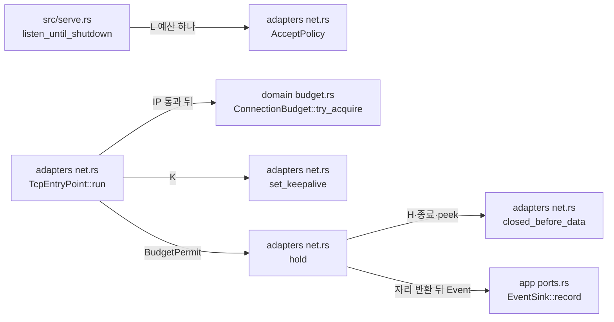

# 연결 상한과 시간 제한 모듈 설계

중계 측 연결 상한 L, 관리·상태 연결 상한 Lm, 대기 상한 Lw를 세는 연결 예산과, TCP 진입점이 수락한 연결에 적용하는 초기 교환 시간 H·TCP keepalive(K)를 다룬다. 연결 예산은 L·Lm·Lw가 같은 타입을 쓴다. L은 TCP 진입점, Lm은 상태 리스너가 쓴다([상태 리스너와 준비 상태 모듈 설계](status-listener.md)). 관리 리스너(작업 4.2)가 같은 Lm을, Mode II 대기 등록(작업 2.9)이 Lw를 연결한다(사용자 결정 2026-10-20). 진입점의 수락 순서는 [TCP 진입점 모듈 설계](tcp-entry-point.md)가 다룬다.

| 항목 | 값 |
| --- | --- |
| 구조 시점 | Current |
| 문서 상태 | Draft |
| 구현 대조 | Verified — [대조 기록](#대조-기록) |
| 코드 위치 | `crates/domain/src/budget.rs`, `crates/app/src/events.rs`(`RejectReason::RelayConnectionLimit`, `AbortReason`, `ConnectionErrorKind`), `crates/adapters/src/net.rs`(`AcceptPolicy`, `set_keepalive`, `hold`, `closed_before_data`), `src/serve.rs`(L 예산 만들기) |
| 코드 지도 | [코드 지도 2절](code-map.md#2-코드-위치와-구성요소) |
| 관련 스펙 | [운영 스펙 2절](../specs/operations.md#2-상태와-검증-매개변수)의 L·Lm·Lw·H·K, [4.1절](../specs/operations.md#41-판정-가능한-규칙)의 OPS-R03·OPS-R20, OPS-004(일부), OPS-006(일부), OPS-033(일부), [중계 스펙](../specs/relay.md#7-수용-테스트) RLY-005(일부) |
| 관련 계약 | [설정 계약 1.2절](../contracts/config-v1.md#12-키-표)(`[limits]`·`[timeouts]`·`[keepalive]`), [운영 정보 계약 1.6절](../contracts/ops-info-v1.md#16-원인-코드)(`relay_connection_limit`, `handshake_timeout`, `peer_eof`, `connection_error`)·[1.7절](../contracts/ops-info-v1.md#17-error_kind-값)(`io_error`) |
| 관련 ADR | [ADR-0004 tokio·rustls](../decisions/ADR-0004-tokio-rustls.md) |

## 1. 책임과 경계

- 맡는 책임:
  - 연결 예산: 상한 하나 아래에서 자리를 잡고 돌려준다. 동시에 잡아도 상한을 넘지 않는다. 예산마다 따로 세므로 한 예산이 고갈돼도 다른 예산은 영향을 받지 않는다(OPS-R20).
  - L: 모든 중계 진입점이 L 예산 하나를 함께 쓴다. TCP 진입점은 출발지 IP 검사를 통과한 연결에서 자리를 잡는다. 자리가 없으면 `connection_rejected`(`stage` = `accept`, `reason` = `relay_connection_limit`, `limit`)를 기록하고 닫는다. 연결이 끝나면 자리를 돌려준다.
  - H: TCP 연결은 수락하자마자 초기 교환 상태에 들어간다. H가 지나면 닫고 `connection_aborted`(`handshake_timeout`)를 기록한다.
  - 보류 중 상대 종료 감지: 상대가 바이트를 보내기 전에 닫으면 `peer_eof`, 연결이 재설정되면 `connection_error`(`error_kind` = `io_error`)로 정리한다. 바이트를 소비하지 않는 `peek`로 확인한다(사용자 결정 2026-10-20).
  - K: 수락한 중계 소켓마다 TCP keepalive의 유휴 시간·탐색 간격·탐색 횟수를 설정한다.
- 맡지 않는 책임:
  - Lm의 판정과 거절 기록. [상태 리스너와 준비 상태 모듈 설계](status-listener.md)가 맡는다. 관리 리스너(작업 4.2)도 같은 Lm 예산을 쓴다.
  - Lw의 사용처. 작업 2.9(대기 등록)가 같은 `ConnectionBudget`으로 연결한다. 그 전까지 Lw 예산을 만들지 않는다.
  - Mode I 대상 소켓의 L 집계. 작업 2.8이 대상 연결 전에 같은 L 예산에서 자리를 잡는다(OPS-023).
  - WS·WSS 진입점의 L 집계와 U. 작업 3.2가 맡는다.
  - 끊긴 연결의 판정과 회수(`dead_connection`). keepalive가 끊긴 연결을 운영체제 오류로 알리면 그 연결을 다루는 단계가 처리한다. 대기·활성 연결의 처리와 RLY-025~027 확인은 작업 2.11이 맡는다.
  - 바이트를 보낸 뒤 닫은 연결의 즉시 감지. 작업 2.7 전에는 바이트를 읽지 않으므로 H가 지날 때 `handshake_timeout`으로 정리한다. 작업 2.7이 초기 교환을 읽으면서 `peer_eof`로 구분한다.
- 다른 모듈에 공개하는 기능:
  - `vnc_relay_domain::budget::{ConnectionBudget, BudgetPermit}`
  - `vnc_relay_app::events::{RejectReason::RelayConnectionLimit, AbortReason, ConnectionErrorKind}`
  - `vnc_relay_adapters::net::AcceptPolicy`

## 2. 내부 구조

화살표는 실행 중 호출이다. crate 의존 방향은 [코드 지도 레이어 표](code-map.md#레이어와-의존-방향)를 따른다.

| 요소(파일·심볼) | 역할 | 만들어지는 시점과 소유자 | 의존 대상 |
| --- | --- | --- | --- |
| `crates/domain/src/budget.rs` `ConnectionBudget` | 상한(`limit`)과 사용 중인 자리 수. `try_acquire`가 원자적 비교·교환으로 상한 안에서만 자리를 잡는다. | `serve`가 시작 때 하나 만들고 `Arc`로 진입점에 나눈다 | 없음(std 원자 변수) |
| `crates/domain/src/budget.rs` `BudgetPermit` | 잡은 자리 하나. 버리면(`Drop`) 자리를 돌려준다. 연결을 다루는 작업이 연결과 함께 소유한다. | `try_acquire`가 성공할 때 | `ConnectionBudget` |
| `crates/app/src/events.rs` `RejectReason::RelayConnectionLimit { limit }` | `relay_connection_limit`과 `limit` 값. 상한 거절만 `limit`을 가진다. | 거절할 때 | 없음 |
| `crates/app/src/events.rs` `AbortReason`, `ConnectionErrorKind` | `handshake_timeout`·`peer_eof`·`connection_error`·`server_shutdown`과 `level`. `connection_error`만 `error_kind`를 가진다. | 연결이 끝날 때 | 없음 |
| `crates/adapters/src/net.rs` `AcceptPolicy` | 진입점이 수락한 연결에 적용할 값: 허용 목록, L 예산, H, K | `serve`가 진입점마다 만든다 | domain, app |
| `crates/adapters/src/net.rs` `set_keepalive` | socket2 `SockRef`로 `SO_KEEPALIVE`와 유휴 시간·탐색 간격·탐색 횟수를 설정한다. | 자리를 잡은 연결마다 | socket2 |
| `crates/adapters/src/net.rs` `hold`, `closed_before_data` | 종료 알림, H 만료, 상대 종료 중 먼저 오는 것으로 연결을 끝낸다. 소켓을 닫고 자리를 돌려준 뒤 `connection_aborted`를 기록한다. | 허용한 연결마다 | tokio, app, domain |

## 3. 데이터 모델

| 이름 | 필드·형태 | 저장 위치 | 제약과 항상 지켜야 할 조건 |
| --- | --- | --- | --- |
| `ConnectionBudget` | `limit: u32`, `used: AtomicU32` | `Arc`로 공유하는 메모리 | `used ≤ limit`. 자리를 잡을 때만 늘고 `BudgetPermit`이 버려질 때만 준다. |
| `BudgetPermit` | `budget: Arc<ConnectionBudget>` | 연결 작업 | 연결 하나에 하나. 소켓을 닫은 뒤 버린다. |
| `AcceptPolicy` | `allow: AllowList`, `relay_budget: Arc<ConnectionBudget>`, `handshake: Duration`(H), `keepalive: KeepaliveSettings`(K) | `TcpEntryPoint` | 모든 진입점의 `relay_budget`은 같은 예산이다. 값은 시작할 때 정하고 바꾸지 않는다(설정 계약에서 모두 재시작 필요). |

`connection_rejected`와 `connection_aborted`의 줄 필드는 [TCP 진입점 모듈 설계 3절](tcp-entry-point.md#3-데이터-모델)과 같다. `limit`은 `peer_ip` 다음, `error_kind`는 `elapsed_ms` 다음에 쓴다.

## 4. 처리 순서

대표 시나리오는 OPS-004다. L = 2에서 세 번째 접속이 오고, 기존 연결 하나가 끝난 뒤 다시 접속한다.

| 순서 | 코드 위치(파일·심볼) | 조건·계산 | 바뀌는 상태 | 결과를 쓰는 곳 |
| --- | --- | --- | --- | --- |
| 1 | `src/serve.rs` `listen_until_shutdown` | `ConnectionBudget::new(limits.relay_connections)`를 하나 만들고 TCP 진입점마다 `AcceptPolicy`에 넣는다. | L 예산 | 2단계 |
| 2 | `TcpEntryPoint::run`, `AllowList::permits` | 출발지 IP를 먼저 판정한다. 목록에 없으면 `ip_not_allowed`로 거절하고 자리를 잡지 않는다. | 없음 | 3단계 |
| 3 | `ConnectionBudget::try_acquire` | 두 연결이 자리를 잡았으므로 세 번째는 `None`이다. `connection_rejected`(`relay_connection_limit`, `limit` = 2)를 기록하고 소켓을 닫는다. | 없음 | 운영 로그 |
| 4 | `set_keepalive`, `hold` | 자리를 잡은 연결은 K를 설정하고 `connection_accepted`를 기록한 뒤 보류한다. | 보류 연결 | 5단계 |
| 5 | `closed_before_data` | 상대가 아무것도 보내지 않고 닫으면 `peek`가 0을 준다. | 없음 | 6단계 |
| 6 | `hold` | 소켓을 닫고 `BudgetPermit`을 버린 뒤 `connection_aborted`(`peer_eof`)를 기록한다. 줄을 본 클라이언트가 바로 다시 접속해도 자리가 있다. | 자리 하나 반환 | 운영 로그 |
| 7 | 2~4와 같은 경로 | 다음 접속이 자리를 잡고 수락된다. | 보류 연결 | 운영 로그 |

H가 먼저 지나면 5~6단계 대신 `handshake_timeout`(`warn`)으로, 서버가 종료하면 `server_shutdown`(`info`)으로 같은 정리를 한다.

## 5. 상태와 초기화

- 초기화 시점: L 예산은 모든 바인드가 성공한 뒤, 진입점 작업을 띄우기 전에 만든다.
- 상태 소유자와 제거 시점: 예산은 `Arc`로 진입점 작업과 연결 작업이 함께 소유한다. 마지막 연결 작업이 끝나면 사라진다. 자리는 연결 작업이 소켓과 함께 소유하고 연결이 끝날 때 돌려준다.
- 동시 실행과 순서: 두 진입점의 수락 작업이 동시에 자리를 잡을 수 있다. `try_update`의 비교·교환이 상한을 지킨다. 자리 반환은 소켓을 닫은 뒤, 사건을 기록하기 전이다.

## 6. 오류 처리

| 실패 지점 | 처리 방법 | 남는 상태 | 관련 스펙 시나리오 |
| --- | --- | --- | --- |
| L 고갈 | `relay_connection_limit`으로 거절하고 닫는다. 기존 연결은 그대로다. | 없음 | OPS-004 |
| H 만료 | 닫고 `handshake_timeout`(`warn`)을 기록한다. | 자리 반환 | OPS-006, RLY-005 |
| 바이트 전 상대 종료 | `peer_eof`(`info`)를 기록한다. | 자리 반환 | RLY-005 |
| `peek` 오류(연결 재설정 등) | `connection_error`(`warn`, `error_kind` = `io_error`)를 기록한다. | 자리 반환 | 없음 |
| keepalive 설정 실패 | 기록하지 않고 연결을 계속 보류한다. 운영 정보 계약에 이 경우의 사건이 없다. 이미 연결된 소켓에서 설정이 실패하면 소켓이 깨진 경우이고, 그때는 `peek`가 오류를 알려 `connection_error`로 정리된다고 판단했다(관찰하지 않음). | 보류 | 없음 |

## 7. 설계 선택

| 선택 | 이유 | 검토한 다른 방법 | 근거 |
| --- | --- | --- | --- |
| 출발지 IP를 L보다 먼저 판정한다. | 목록 밖 출발지는 자리를 쓰지 않고, L이 찼는지도 알 수 없다. 코드 지도 4절 1단계의 순서와 같다. | L을 먼저 확인. 목록 밖 출발지가 상한 상태를 알게 된다. | [운영 정보 계약 1.5절](../contracts/ops-info-v1.md#15-사건-목록) `connection_accepted` 조건 |
| L·Lm·Lw를 같은 `ConnectionBudget` 타입으로 센다. 예산은 사용처가 생길 때 만든다(L은 2.5, Lm은 2.6). | 세 상한의 규칙(상한까지 잡고, 끝나면 반환하고, 서로 독립)이 같다. 사용처가 없는 예산을 미리 만들지 않는다. | 상한마다 다른 타입, 2.5에서 Lm·Lw 예산까지 만들기 | 사용자 결정 2026-10-20 |
| 자리 수는 `AtomicU32`의 비교·교환으로 센다. | 잠금 없이 상한을 지킨다. domain은 외부 crate를 쓰지 않는다. | `tokio::sync::Semaphore`. domain이 tokio에 의존하게 된다. | [코드 지도 레이어 표](code-map.md#레이어와-의존-방향) |
| 작업 2.7 전의 보류 연결에도 H를 적용한다. | TCP 연결은 수락 직후 초기 교환 상태다. 보류를 서버 종료까지 두면 L 자리가 돌아오지 않는다. | 서버 종료까지 보류(작업 2.4의 방식) | 사용자 결정 2026-10-20 |
| 보류 중 상대 종료는 `peek`로 확인한다. | 바이트를 소비하지 않아 작업 2.7의 초기 교환이 같은 바이트를 읽을 수 있다. 바이트가 오면 확인을 멈추므로 바쁜 반복이 없다. | H 만료까지 기다리기. 떠난 클라이언트의 자리가 H 동안 남는다. | 사용자 결정 2026-10-20 |
| keepalive 매개변수는 socket2로 설정한다. | tokio·std에는 유휴 시간·탐색 간격·탐색 횟수를 정하는 API가 없다. `unsafe`는 금지다. socket2는 tokio가 이미 쓰는 crate다(MIT OR Apache-2.0). | keepalive를 작업 2.11로 미루기 | 사용자 결정 2026-10-20, [PRD "구현 기술" 행](../requirements/PRD.md#확정-기준) |
| 자리를 돌려준 뒤 사건을 기록한다. | 줄을 본 클라이언트가 바로 다시 접속할 때 자리가 있어야 한다. 시스템 테스트가 이 순서에 기댄다. | 기록 뒤 반환 | 없음 |

## 8. 현재 코드와의 차이

없다. 2~4절의 파일·심볼이 현재 코드와 같다.

## 대조 기록

| 대조 범위 | 환경 | 확인 방법 | 결과 |
| --- | --- | --- | --- |
| 작업 2.5 변경(기준 커밋 `c89beb4` + 작업 트리) | Ubuntu 24.04.4(WSL2), Rust 1.99.1 | 1~4절의 파일·심볼과 실제 코드를 대조했다. 예산은 `crates/domain/src/budget.rs` 단위 테스트 3건, keepalive 값은 `crates/adapters/src/net.rs` 단위 테스트, 줄 필드는 `crates/adapters/tests/ops_info_contract.rs`, L·H·상대 종료 처리는 `tests/serve.rs`의 `refuses_relay_connections_beyond_l_and_accepts_again_after_a_release`·`tells_a_peer_close_from_an_initial_exchange_that_outlives_h`로 확인했다([운영 정보 계약의 계약 테스트 실행 기록](../contracts/ops-info-v1.md#계약-테스트-실행-기록)). | 통과 |
| Windows 실행(기준 커밋 `e1cfc4f` + Windows 경고 수정) | Windows 11 Pro 10.0.26200, Rust 1.99.1(`x86_64-pc-windows-msvc`) | `tests/serve.rs`의 `refuses_relay_connections_beyond_l_and_accepts_again_after_a_release`·`tells_a_peer_close_from_an_initial_exchange_that_outlives_h`, `budget` 단위 테스트 3건이 통과했다. keepalive 설정 호출은 오류 없이 끝났다. 설정한 값을 읽어 확인하는 단위 테스트는 Linux 전용이라 실행하지 않았다. | 통과 |

## 9. 미결정 사항

| 항목 | 영향 | 확정 위치 |
| --- | --- | --- |
| Windows의 keepalive 값 | 설정한 유휴 시간·탐색 간격·탐색 횟수를 Windows에서 읽어 확인하지 않았다. socket2가 그 값을 읽는 함수를 Linux에서만 준다. | 작업 2.11(끊긴 연결 감지)에서 동작으로 확인 |
