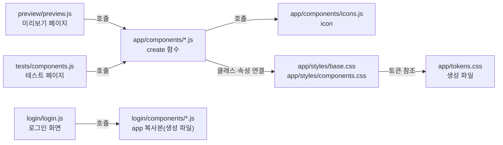

# 대시보드 공통 컴포넌트 모듈 설계

대시보드 화면이 함께 쓰는 공통 조각(버튼, 입력, 배지, 경고, 카드, 지표, 게이지, 상단 메뉴, 언어 선택, 데이터 표, 링크, 대화상자)과 아이콘을 만든다. 각 조각은 DOM 요소를 돌려주는 ES 모듈 함수다. 상태 표현은 속성과 클래스로 하고, 색·크기·간격은 토큰 CSS의 `var(--…)`로 그린다. 이 모듈은 관리 API를 부르지 않고 상태를 저장하지 않는다.

| 항목 | 값 |
| --- | --- |
| 구조 시점 | Current |
| 문서 상태 | Draft |
| 구현 대조 | 대조함, [대조 기록](#대조-기록). 최근 로그 화면의 공통 컴포넌트 범위의 구현은 커밋 `3df0693`이다. 시험은 커밋 `51bd747`의 두 OS 게이트에서 통과했다([WSS Server·프록시·최근 로그 판정표](../how-to/set-up-and-verify.md#43-wss-server프록시-tls-종료최근-로그-판정표)). |
| 코드 위치 | `web/dashboard/app/components/`, `web/dashboard/app/styles/`, `web/dashboard/preview/`, `web/dashboard/tests/` |
| 코드 지도 | [코드 지도 2절](code-map.md#2-코드-위치와-구성요소) |
| 관련 스펙 | [대시보드 화면 스펙](../specs/dashboard.md)의 화면 상태 표. 이 모듈은 화면이 아니라서 시나리오 ID를 가지지 않는다. |
| 관련 계약 | 없음 |
| 관련 ADR | 없음 |

## 1. 책임과 경계

- 맡는 책임:
  - 공통 조각을 만든다: 버튼, 텍스트 입력, 배지, 경고, 카드, 지표, 게이지, 상단 메뉴, 언어 선택, 데이터 표, 링크, 대화상자.
  - 아이콘 SVG를 만든다([프런트엔드 컨벤션 5절](../conventions/frontend.md)의 아이콘 규칙).
  - 상태를 속성(`disabled`, `aria-*`, `data-tone`)과 클래스(`is-hover`, `is-focus`)로 나타낸다.
  - 미리보기와 테스트 페이지가 같은 조각을 쓴다(복제하지 않는다).
- 맡지 않는 책임:
  - 관리 API 호출, 폴링, 세션 상태, 오류 분류: 화면 모듈(작업 4.10·4.11)이 맡는다.
  - 로그인 화면 조립: 작업 4.9가 맡았다. 조립은 `web/dashboard/login/`에 있고, 구성 요소는 `cargo xtask tokens`가 만든 복사본(`login/components/`, `login/styles/`)을 가져온다. 복사본은 직접 고치지 않는다(`login/`과 `app/`은 파일을 공유하지 않는다, 프런트엔드 컨벤션 1.1절).
  - 토큰 값 정의: [DESIGN.md](../design/DESIGN.md) YAML과 `cargo xtask tokens`가 맡는다.
  - 정적 파일 제공: 작업 4.6이 맡는다. `cargo xtask dashboard-serve`는 로컬 미리보기 전용이다.
  - 언어 선택 저장과 문구 번역: 화면 모듈이 맡는다.
- 다른 모듈에 공개하는 기능: `web/dashboard/app/components/` 아래 모듈의 함수. 아래 2절 표.

## 2. 내부 구조

화살표의 의미: 실행 중 호출(`import`와 함수 호출), 클래스·속성 연결(요소가 CSS 선택자와 맞는다), 토큰 참조(CSS가 `var(--…)`를 쓴다).

| 요소(파일·심볼) | 역할 | 의존 대상 |
| --- | --- | --- |
| `app/components/icons.js` `icon` | 이름으로 아이콘 SVG 하나를 만든다. 정적 SVG 문자열을 모듈 안 `<template>`에 한 번 넣고 `cloneNode`로 복제한다. | 없음 |
| `app/components/button.js` `createButton` | 버튼 요소를 만든다. | `icons.js` |
| `app/components/text-field.js` `createTextField`, `setTextFieldError` | 레이블, 입력, 오류 문구를 묶은 `div`를 만든다. `setTextFieldError`는 만든 필드의 오류 문구를 바꾼다. 오류 아이콘은 `icons.js`로 만든다. | `icons.js` |
| `app/components/badge.js` `createBadge` | 상태 배지를 만든다. | `icons.js` |
| `app/components/alert.js` `createAlert` | 상태 안내 상자를 만든다. | `icons.js` |
| `app/components/card.js` `createCard` | 제목이 있는 카드 `section`을 만든다. 선택 설명은 카드 머리의 제목 아래에 둔다. `count`를 주면 배지로 보인다. | `badge.js` |
| `app/components/stat.js` `createStat` | 값 하나와 이름을 묶은 지표를 만든다. 기본 값은 `metric` 글꼴을 쓴다. `badge`가 참이면 공통 배지로 만든다. | `badge.js` |
| `app/components/gauge.js` `createGauge` | 원형 게이지를 `progressbar` 역할로 만든다. 값을 모르면 가운데에 공통 배지를 둔다. | `badge.js` |
| `app/components/navbar.js` `createNavbar` | 상단 막대와 호출자가 준 레이블의 `nav`를 만든다. | `link.js`, `icons.js` |
| `app/components/language-select.js` `createLanguageSelect` | 레이블이 있는 네이티브 `select`를 만든다. 지구본과 화살표 아이콘을 붙인다. | `icons.js` |
| `app/components/data-table.js` `createDataTable` | 명시적 표 역할을 가진 네이티브 표를 만든다. `mobileHead`로 모바일 첫 줄을 지정한다. 나머지 셀은 `data-label`을 레이블로 쓴다. | 없음 |
| `app/components/link.js` `createLink` | 링크 `a`를 만든다. | `icons.js` |
| `app/components/dialog.js` `createDialog` | 네이티브 `dialog`로 확인 대화상자를 만든다. | `button.js` |
| `app/styles/base.css` | `color-scheme`, 본문 글꼴, 포커스 링, 화면 밖 글 클래스 | `tokens.css` |
| `app/styles/components.css` | 조각별 클래스와 상태 선택자. 화면 배치 클래스(`.grid`, `.span-3`·`.span-4`·`.span-6`·`.span-8`·`.span-12`, `.fact-list`·`.fact`, `.page-actions`)와 단일 중단점 `max-width: 1023.98px` 블록. `app.css`에는 `@media`가 없다 | `tokens.css` |
| `app/query.js` `newQuery`, `clearTimer`, `viewOf`, `contentKey` | 조회 상태(진행 중, 세대, 데이터, 오류)와 갱신 타이머를 DOM 없이 다룬다. 운영 현황과 세션 상세가 같이 쓴다. | 없음 |
| `app/shell.js` `buildNavbar`, `signOutUrl`, `defaultStorage`, `LOGIN_URL` | 모든 보호 화면의 운영 현황·로그·설정 상단 막대와 로그아웃 결과 판정을 만든다. `active`로 현재 항목을 고른다. 모바일에서도 세 항목을 숨기지 않는다. | `components/navbar.js`, `components/language-select.js`, `components/button.js`, `api.js`, `model.js`, `copy.js`, `language.js` |
| `app/session.js` `mountSession` | SCR-002를 조립한다. 양쪽 전송 경로와 값이 있는 전달 주소, 세션 필터 로그 링크를 표시한다. 세션 확인·상세 조회·종료 확인·결과 분류·대상 소멸을 맡는다. | `components/alert.js`, `button.js`, `dialog.js`, `link.js`, `stat.js`, `api.js`, `copy.js`, `format.js`, `language.js`, `model.js`, `panels.js`, `query.js`, `shell.js` |
| `app/router.js` `mountRouter`, `routeOf` | `#/sessions/{id}`는 SCR-002, `#/settings`·`#/settings/edit`는 SCR-004·005, `#/logs`와 선택 `session_id`는 SCR-006, 그 밖은 SCR-001로 보낸다. 이전 화면을 `dispose`한다. 저장 적용 개수는 한 번 쓰는 메모리 값으로 전달한다. | `operations.js`, `session.js`, `settings.js`, `logs.js` |
| `app/settings.js` `mountSettings` | SCR-004·005를 조립한다. 진입·명시적 GET, 편집 가능 상태, 입력 보존, 변경 확인, PATCH 결과·복구, 언어·로그아웃을 맡는다. 폴링하지 않는다. | 공통 컴포넌트, `api.js`, `settings-model.js`, `copy.js`, `format.js`, `language.js`, `model.js`, `panels.js`, `shell.js` |
| `app/settings-model.js` `parseConfig`, `canEdit`, `editableItems`, `initialInputs`, `inspectInputs`, `mapDiagnostics` | v4 설정 응답과 29개 편집 입력을 다룬다. `editableItems`가 다섯 구역과 구역 안 순서를 정한다. 렌더·검사·진단 초점 순서는 같은 목록을 쓴다. | `format.js` |
| `app/logs.js` `mountLogs` | SCR-006의 필터·증분 폴링·이전 페이지·행 상세·JSON Lines 수집과 세션 종료 시 정리를 맡는다. 현재 필터의 첫 스냅숏 성공 전에는 증분 병합을 막는다. 자동 복구도 폴링으로 표시한다. 렌더는 조작 요소 ID·상세 행 ID·링크 목적지로 초점을 복원한다. [최근 로그 데이터 흐름](dashboard-operations-overview.md#16-최근-로그-scr-006)을 따른다. | 공통 컴포넌트, `api.js`, `model.js`, `shell.js`, `copy.js`, `format.js`, `language.js`, `panels.js` |

## 3. 데이터 모델

모듈은 전역 상태가 없다. 입력은 옵션 객체, 출력은 DOM 요소다.

| 이름 | 값 | 제약 |
| --- | --- | --- |
| `tone` | `success`, `info`, `warning`, `destructive`, `neutral` | 다른 값이면 `TypeError`. 요소에 `data-tone`으로 쓴다. |
| `variant`(버튼) | `primary`, `outline`, `ghost`, `destructive`, `navbar` | 다른 값이면 `TypeError`. `navbar`는 상단 막대의 항목형(로그아웃) 버튼이다. |
| `variant`(언어 선택) | `navbar`, `form` | 다른 값이면 `TypeError` |
| 아이콘 이름 | `check`, `clock`, `warning`, `alert`, `refresh`, `logout`, `back`, `chevron-right`, `chevron-down`, `chevron-up`, `cancel`, `globe`, `grid`, `settings`, `brand`, `log`, `search`, `download`, `close`, `pause`, `arrow-right` | 다른 값이면 `TypeError`. 로그인 복사본은 `cargo xtask tokens`로 생성한다. |
| 아이콘 크기 | `md`(`--space-icon-size`), `sm`(`--space-icon-size-sm`) | 기본값 `md` |
| 상태 클래스 | `is-hover`, `is-focus` | 미리보기가 상태를 고정할 때만 붙인다. 화면 코드는 붙이지 않는다. |
| 상태 속성 | `disabled`, `aria-busy`, `aria-invalid`, `aria-current`, `aria-describedby` | 상태 표현은 이 속성으로 한다. |

### 3.1 공개 함수

| 함수 | 옵션 | 반환 |
| --- | --- | --- |
| `icon(name, {size})` | 아이콘 이름, 크기 | `SVGSVGElement`. `aria-hidden="true"`, `focusable="false"`. |
| `createButton({variant, label, icon, disabled, busy, type})` | `variant` 기본 `primary`. `navbar`는 상단 막대 항목형 버튼이다(DESIGN.md 버튼 변형). `icon`은 아이콘 이름. `busy`는 진행 중 상태다. | `HTMLButtonElement`. `busy`이면 `disabled`와 `aria-busy="true"`를 붙인다. 문구는 호출자가 바꾼다. |
| `createTextField({id, label, type, value, required, autocomplete, helpText, error})` | `type`은 `text` 또는 `password`. `error`가 있으면 오류 상태다. 비활성 옵션은 없다(DESIGN.md 입력 상태는 기본·포커스·오류). 포커스는 CSS의 `:focus-visible`과 미리보기 클래스 `is-focus`로 나타난다. | `HTMLDivElement`. 오류가 있으면 `aria-invalid="true"`, `aria-describedby`에 오류 문구 id를 쓴다. |
| `setTextFieldError(field, error)` | `field`는 `createTextField`가 만든 `div`다. `error`가 있으면 오류 문구를 붙이고 `aria-invalid="true"`, `aria-describedby`를 오류 문구 id로 바꾼다. `error`가 빈 값이면 오류 문구를 지우고 `aria-invalid="false"`로 바꾼다. 도움말이 있으면 `aria-describedby`를 도움말 id로 되돌리고, 없으면 지운다. 로그인 화면이 필드를 다시 만들지 않고 오류만 바꾸려고 추가했다(4.9 재작업). | `undefined`. 요소를 새로 만들지 않고 같은 요소를 바꾼다. |
| `createBadge({tone, label, icon})` | `icon` 기본값은 `tone`별 아이콘(`neutral`은 없음). `icon: false`로 끈다. | `HTMLSpanElement` |
| `createAlert({tone, title, message})` | `warning`·`destructive`는 `role="alert"`, 나머지는 `role="status"` | `HTMLDivElement` |
| `createCard({title, headingLevel, description, count, actions, body, footer})` | `title` 필수. `headingLevel` 기본 2(1~6의 정수). `description`은 선택 문자열이다. 카드 머리(`.card-head`)의 제목 아래 `p.card-description`에 넣는다(DESIGN 527·638행). `count`는 `createBadge`로 붙인다. SCR-001 개수 문구는 CPY-084·085(Q115)를 따르며 목록별 성공 데이터와 함께 갱신한다. | `HTMLElement`(`section`). `aria-labelledby`로 제목과 묶는다. |
| `createStat({label, value, unit, tone, badge})` | `label` 필수. 값은 문자열 또는 숫자다. `badge` 기본값은 `false`이며, 기본 값은 `metric` 글꼴과 `tnum`을 쓴다. `badge: true`이면 `createBadge`에 값과 `tone`을 넘긴다. 실행 상태와 확인 불가·조회 중 값에 쓴다(DESIGN.md Stat). | `HTMLDivElement` |
| `createGauge({label, value, max, valueText, limitText, unknownText, unknownTone})` | `value`는 `0`~`max`. `label`과 `limitText`는 필수다. 알려진 값은 가운데에 `valueText`(없으면 값)를 크게 보이고, 아래 줄에 `limitText`(상한 줄)를 보인다. `value`가 `null`이면 알 수 없음이며 링을 그리지 않고 `unknownText`(필수)를 `createBadge`의 배지로 쓴다. `unknownTone`은 그 배지의 톤이며 기본값은 `neutral`(확인 불가)이다. 첫 조회 전에는 호출자가 `info`(조회 중)를 넘긴다(DESIGN 상태 색). `value`가 `null`일 때 톤이 잘못되면 `TypeError`다. 알려진 값에서는 배지를 만들지 않으므로 `unknownTone`을 쓰지 않는다. 채움 길이는 `style.setProperty`로 쓴다. | `HTMLDivElement`. `role="progressbar"`, `aria-label`, `aria-valuemin`, `aria-valuemax`, `aria-valuenow`, `aria-valuetext`. 알려진 값의 `aria-valuetext`는 `valueText, limitText`다. |
| `createNavbar({brand, items, language, action, label})` | `label`은 필수다(기본값 없음, 호출자가 준다). `items`는 `{label, href, current, icon}`. 화면이 활성 항목을 고르며 모든 항목은 모바일에서도 보인다. | `HTMLElement`(`header`). 안에 `nav`를 둔다. 현재 항목은 `aria-current="page"`. |
| `createLanguageSelect({id, label, value, options, variant})` | `id`, `label`, `options`(`{value, label}` 배열, 빈 배열이면 `TypeError`)는 필수. `variant` 기본 `form`(`navbar`·`form`). | `HTMLDivElement`. 안에 `label`과 `select`. |
| `createDataTable({caption, columns, rows, emptyText, numericColumns})` | `columns`는 `{key, label, mobileHead?}` 배열이다. `key`·`label`은 문자열이다. 배열이 아니거나 비었거나 열 값이 잘못되면 `TypeError`다. `mobileHead`는 생략 또는 `'primary'`·`'secondary'`만 허용한다. 다른 값이면 `TypeError`다. 생략한 열은 모바일에서 일반 레이블·값 쌍이다. `rows`는 값 배열의 배열이다. 셀 값이 `Node`면 그대로 넣고, 그 밖의 값은 문자열로 쓴다. `emptyText`는 문자열 또는 `Node`다. 조회 중 행은 호출자가 정보 배지를 넘긴다. `numericColumns`의 각 항목은 `columns`의 `key`여야 한다(아니면 `TypeError`). | `HTMLTableElement`. 열 머리글은 `scope="col"`이고, 숫자 열은 `data-table-num` 클래스를 쓴다. 행이 없으면 `emptyText`를 한 행으로 쓴다. 아래 표 역할과 모바일 첫 줄 규칙을 따른다. |
| `createLink({href, label, icon})` | `icon`은 아이콘 이름 | `HTMLAnchorElement` |
| `createDialog({title, description, confirmLabel, cancelLabel, destructive, onConfirm, onCancel, returnFocus})` | `title`, `confirmLabel`, `cancelLabel`은 필수. 확인 버튼은 `destructive`면 위험 스타일. `returnFocus`는 대화상자를 여는 요소이며 선택 옵션이다. 닫힌 대화상자는 CSS가 숨긴다(`display`는 `.dialog[open]`에만 준다). 미리보기는 열린 견본을 비모달 `open` 속성으로 프레임 안에 둔다(미리보기 전용). | `{element, show(), hide()}`. `show`는 `showModal()`을 부른다. 취소 단추는 `close()` 직후 `returnFocus`로 포커스를 옮긴다. Escape는 브라우저가 닫으므로 `close` 이벤트에서 옮긴다. 요소가 문서에 없거나 비활성이면 옮기지 않는다. 확인과 `hide()`는 포커스를 호출한 쪽에 맡긴다. Tab과 Shift+Tab은 두 단추 사이에서 돌도록 keydown으로 처리한다(DASH-015, 7절). |

모든 함수는 API 값을 `textContent`나 속성 값으로만 넣는다. `innerHTML`에는 정적 문자열만 넣는다.

`createDataTable`의 표 의미와 모바일 첫 줄은 다음과 같이 연결한다([DESIGN 표의 카드 변환 규칙](../design/DESIGN.md#중단점과-모바일-배치), 554~566행).

- 네이티브 `table`에는 `role="table"`, `thead`·`tbody`에는 `role="rowgroup"`을 붙인다. 머리글·본문·빈 행의 `tr`에는 `role="row"`, `th`에는 `role="columnheader"`, 일반·빈 셀의 `td`에는 `role="cell"`을 붙인다. CSS가 `display`를 바꿔도 역할을 생략하지 않는다.
- `mobileHead: 'primary'` 셀에는 `.data-table-head-primary`, `'secondary'` 셀에는 `.data-table-head-secondary`를 붙인다. 두 셀은 모바일 격자의 첫 행(`grid-row: 1`)을 공유한다. 첫 줄 셀은 `::before` 레이블 없이 값만 보인다.
- 일반 셀은 `data-label`과 CSS 가상 요소로 열 이름을 보인다. 가상 요소의 대체 텍스트는 비워 중복 읽기를 막는다(DESIGN 566행). 열 머리글은 화면에서만 숨기고 접근성 트리에는 남긴다.

4.12 API 반영의 실행 검증과 캡처 결과는 별도 검증 기록에서 관리한다. 아래 날짜가 있는 대조 기록은 당시 결과다.

## 4. 처리 순서

1. 호출자가 함수를 `import`하고 옵션 객체를 넘긴다.
2. 함수가 옵션을 검사한다. 허용하지 않는 `tone`·`variant`·아이콘 이름·열의 `mobileHead`, 빠진 필수 `label`이면 `TypeError`를 던진다. 이 오류는 개발 중 실수를 알리며 화면 오류로 바꾸지 않는다.
3. 함수가 요소를 만든다. 아이콘은 `icon`의 캐시 템플릿에서 복제한다.
4. 상태 속성과 클래스를 붙인다. 호출자는 반환된 요소를 DOM에 넣는다.
5. 상태가 바뀌면 호출자가 같은 요소의 속성을 바꾼다. 모듈은 다시 만들지 않는다. 대화상자는 `show()`와 `hide()`로 열고 닫는다.

## 5. 상태와 초기화

- 전역 상태: 아이콘 템플릿 캐시(`Map`, 처음 쓸 때 채운다)만 있다.
- 상태 표현: 호버와 포커스는 CSS 가상 클래스(`:hover`, `:focus-visible`)와 미리보기 클래스(`is-hover`, `is-focus`)를 함께 쓴다. 비활성은 `disabled`, 진행 중은 `aria-busy`, 오류는 `aria-invalid`다.
- 테마: 밝은 테마만 있다. `base.css`가 `color-scheme: light`를 준다.
- 움직임: 없다. 애니메이션, 전환 효과, 스피너를 쓰지 않는다([DESIGN.md 모션 절](../design/DESIGN.md#components)).

## 6. 오류 처리

- 개발 실수(허용하지 않는 옵션, 빠진 필수 값): `TypeError`를 던진다. 호출한 모듈이 처리하지 않는다. 테스트 페이지(`tests/components.js`)가 `navbar`의 빠진 `label`로 이 경로를 확인한다.
- API 값과 긴 값: 텍스트로만 넣는다. 한글은 `word-break: keep-all`, 긴 영어와 숫자는 `overflow-wrap: anywhere`로 줄인다.
- 네트워크 오류, 권한 오류는 이 모듈에 없다. 화면 모듈이 `createAlert`로 표시한다.

## 7. 설계 선택

| 선택 | 채택 | 이유 | 채택하지 않은 선택지 |
| --- | --- | --- | --- |
| 조각의 형태 | 요소를 돌려주는 함수 | 빌드와 프레임워크가 없다. 요소를 직접 검사하기 쉽다. | 사용자 정의 요소(`customElements`). 생명주기와 공개 표면이 늘어난다. |
| 스타일 위치 | `app/styles/` CSS 파일에 클래스로 둔다 | 미리보기와 화면이 같은 CSS를 직접 가져온다. | 조각마다 스타일 문자열을 넣는다. CSP가 막는다. |
| 화면 배치 규칙 위치 | 배치 클래스와 중단점 블록을 `app/styles/components.css`에 같이 둔다. 중단점은 `max-width: 1023.98px` 하나다 | `app.css`는 `components.css` 뒤에 로드되므로(`app/index.html`) 배치 기본 규칙을 거기 두면 중단점 블록을 덮는다. 같은 파일에 두면 소스 순서로 재정의가 지켜진다. | `app.css`에 배치 규칙을 두는 것. 767px 별도 블록을 두는 것(중단점이 둘이 된다). |
| 미리보기 배치 | 구현 판단(사용자 결정 없음). `preview.js`의 `renderGroup`은 공유 `.grid`와 견본의 `.span-12`·`.span-6`·`.span-4`를 쓴다. 견본 1개는 전체 폭, 2개는 2열, 3개 이상은 3열로 둔다. 5개 견본은 3개와 2개로 나눈다. `preview.css`에는 미디어 쿼리가 없고 본문 여백은 모든 폭에서 `spacing.lg`다 | DESIGN.md의 단일 중단점을 공유한다. 12열 격자에서 같은 폭의 5열은 만들 수 없으므로 견본을 빠뜨리지 않고 다음 줄로 보낸다. 공유 컴포넌트 CSS에 페이지 본문 여백 클래스는 없다. | 미리보기 전용 중단점·5열 스타일을 유지하거나 제품 CSS에 미리보기 전용 규칙을 더하는 것. |
| 상태 미리보기 | `is-hover`·`is-focus` 클래스 | 호버와 포커스를 재현할 수 있고 복제 CSS가 없다. | 미리보기 전용 CSS 복사본. 두 곳을 맞춰야 한다. |
| 좁은 폭의 표 | CSS로 카드처럼 배치하고 표 역할은 유지 | 역할과 읽기 순서를 그대로 쓴다. | 폭마다 다른 마크업. |
| 대화상자 | 네이티브 `dialog`와 `showModal()`. Tab 순환과 취소 뒤 포커스 복귀만 직접 만든다 | 열기와 Escape 닫기를 브라우저가 한다. 탐침에서 Tab이 `body`로 빠져서 `dialog.js`의 keydown이 두 단추 사이를 돈다(DASH-015, 검증 기록 4.7절). 브라우저는 닫을 때 열 당시 포커스가 있던 요소로 돌린다. WebKit은 마우스로 누른 단추에 포커스를 주지 않아 그 요소가 `body`일 수 있다. 그래서 취소·Escape 뒤에는 `returnFocus`로 직접 돌린다. 취소 단추는 `close` 이벤트를 기다리지 않는다. 가상 시간으로 실행한 Chromium 시험에서 이 이벤트가 시험의 100ms 대기 안에 오지 않았기 때문이다(DASH-009, 검증 기록 4.21절). | 포커스 가두기 전부를 직접 만드는 것. |
| 언어 선택 | 네이티브 `select` | 키보드 동작과 스크린 리더 이름을 브라우저가 맡는다. | 직접 만든 목록 상자. |
| 아이콘 | 인라인 SVG와 `<template>` 복제 | 외부 파일 요청이 없고 CSP를 지킨다. | 외부 스프라이트 `<use href>`. 외부 파일 요청이 생긴다. |
| 설정 입력과 진단 | 기존 `text-field-input`·Card·Alert·Dialog를 조립한다. 목록은 `textarea`, 정수는 단위가 있는 텍스트 입력과 숫자 키보드다. 입력 문법은 서버에 보내기 전에 검사한다 | 기존 단일 줄 `createTextField`는 로그인에 맞춘 API다. 설정의 여러 줄·단위·원래 줄 선택·여러 진단을 별도 화면 조립으로 추가하되 기존 시각 토큰과 오류 의미를 공유한다. 새 시각 토큰은 없다. | 로그인 필드 API에 설정 전용 자료형·상태를 넣는 것. |
| 설정 생명주기 | `settings.js`는 epoch와 `AbortController`로 이탈·인증 만료 때 요청·값·입력을 제거한다. PATCH 자동 재전송은 없다. 충돌은 명시적 GET으로 입력과 revision을 함께 교체한다 | 기존 운영 현황·세션의 늦은 응답 무시 패턴을 재사용하고, 비폴링 설정 화면에 요청 중단을 더한다. 쓰기 실패는 입력 유지, 응답 유실은 결과 불명으로 구분한다. | 폴링 모듈을 설정에도 적용하는 것. |

### 설정 화면 조립과 스타일

`mountSettings(root, deps, {edit, applied})`는 기존 화면과 같은 `request`·`storage`·`preferredLanguages`·`navigate` 의존성을 받는다. `edit`는 두 설정 화면을 고르고, `applied`는 성공 안내에만 쓴다. PATCH는 `api.js`의 `patchConfig`를 통해 `{revision, changes}`와 CSRF를 보낸다. 오류의 `details`는 키별 진단과 재시작 필요 키를 보존한다. 제한 시간은 `parseSession`이 읽은 `query_timeout_secs`다.

`app.css`의 `.config-*`는 키·값 3열 목록, 다섯 입력 구역, 변경 목록과 스크롤 가능한 확인 대화상자를 그린다. `styles/components.css`의 기존 단일 중단점은 이 목록과 입력 격자를 한 열로 바꾼다. 목록 입력은 `typography.input-data`, 숫자 입력은 `typography.input`을 쓴다. 두 입력 모두 16px 이상이다. 키·문자열 보기 값은 기존 `typography.data`를 유지한다.

`tests/settings.html`·`settings-scenarios.js`는 기존 `operations`·`session` 시험 페이지와 같은 가짜 API 패턴이다. 읽기 행과 입력에는 `data-config-key`를 두어 같은 키의 값·진단·배지와 연결한다. 실서버에 대한 파일 기록·기존 연결 유지 증거는 이 시험의 범위가 아니다. 그 증거는 `tests/dashboard_live/settings_view.rs`·`settings_edit.rs`·`settings_recovery.rs`가 실제 설정 파일·파일 변경 감지·`/api/v1/config`로 확인한다. 시험 쪽 주입 범위는 [프런트엔드 컨벤션 검증 표](../conventions/frontend.md)의 사용자 결정 2026-11-05(Q113)·2026-11-08(Q180)을 따른다.

## 8. 미결정 사항

- (해결) 브라우저 시험(`tests/dashboard_browser.rs`)은 4.8에 넣었다. Windows와 WSL Ubuntu 모두에서 실행한다. Ubuntu에는 Google Chrome 안정판 .deb를 설치한다(사용자 결정 2026-10-22(Q41)). 브라우저가 없으면 시험은 실패한다(건너뛰지 않는다, 사용자 결정 2026-10-22(Q35)). 설치와 실행 기록은 [개발 환경 how-to](../how-to/set-up-and-verify.md#4-검증) 실행 기록 4에 있다.
- (해결) 성능 예산(FE-TBD-016)은 두지 않는다. Q39로 화면이 생긴 뒤까지 보류했다가 사용자 결정 2026-11-07(Q159)로 지표 없이 닫았다.
- 로그인(4.9)은 구성 요소의 생성 복사본을 가져온다. 로그인이 쓰려고 `setTextFieldError`를 추가했고 §3.1 표에 적었다. 운영 화면(4.10·4.11)이 조각을 더 요구하면 이 문서에 API를 추가한다.
- (해결) 로그인 화면은 새로고침 후 계정명을 복원하지 않는다. 로그인 요청 제한 시간은 10초로 유지한다(사용자 결정 2026-11-07(Q158), [화면 스펙 9.5절](../specs/dashboard.md#95-결정-기록) 13항). 시안과의 차이 가운데 안내 제목과 빈 입력 문구는 사용자 결정 2026-10-23(Q56)로 정했다. 짧은 제목 없이 화면 스펙 9절의 승인 문구 한 문장을 쓴다(같은 절 10항).

## 대조 기록

대조일 2026-10-22, 환경 Windows 10.0.26200. 경로, 함수 이름, 상태 속성은 소스와 일치한다. 아래 표의 "차이"는 설계 문서를 코드에 맞춘 것이다.

| 대상 | 확인 방법 | 결과 |
| --- | --- | --- |
| 파일 경로(2절 표) | 13개 조각 파일, `app/styles/base.css`·`components.css`, `preview/`, `tests/components.js` 존재 확인 | 통과 |
| 공개 함수 이름과 옵션(3.1 표) | 각 `export function`의 옵션 구조 분해와 `TypeError` 검사를 대조 | 차이 7건을 고쳤다: card(`badge.js` 의존, 개수 배지), stat(`label` 필수), gauge(`limitText`·`unknownText` 추가), navbar(`label` 필수, "주 메뉴" 기본값 없음, `desktopOnly`), language-select(`icons.js` 의존, `variant` 기본 `form`), text-field(`icons.js` 의존, 2절 표), dialog(`title`·`confirmLabel`·`cancelLabel` 필수) |
| 아이콘 이름 13개와 크기 md·sm | `PATHS` 키, `SIZE_CLASS`, CSS `.icon-md`·`.icon-sm` | 통과 |
| 상태 속성 | `aria-busy`, `aria-current`, `aria-invalid`, `aria-describedby`, `aria-labelledby`, `role`(alert·status·progressbar) 검색 | 통과 |
| 상태 클래스 | `is-hover`·`is-focus`를 미리보기 `preview.js`만 붙이고 `app/components/`는 붙이지 않는지 검색 | 통과 |
| 색과 움직임 | `color-scheme: light`(base.css), 전환·애니메이션 검색 | 통과. 전환과 애니메이션은 없다 |
| 줄바꿈 | `word-break: keep-all`(base.css), `overflow-wrap: anywhere`(components.css) | 통과 |
| 미리보기와 테스트 호출 | `preview.js`와 `tests/components.js`가 `app/components/`의 함수를 import한다 | 통과 |
| 토큰 CSS 연결 | `cargo xtask tokens --check` | 통과(종료 코드 0) |
| 브라우저 시험 | `cargo test --test dashboard_browser` | 통과(시험 21개 ok). 미리보기와 테스트 페이지를 6폭 × ko/en 12회 열어 `data-result=pass`, CSP 위반 0, 가로 스크롤 0 |
| 리뷰 수정 A–D(Q42, 2026-10-22) | 3.1 표와 CSS를 다시 대조: 게이지 `aria-valuetext`(gauge.js L71), 버튼 `navbar` 변형(button.js), 입력 상태(옵션 없음), 대화상자 `display`(components.css `.dialog[open]`) | 차이 4건을 고쳤다. A 게이지: 가운데에 현재 값, 아래 "상한" 줄. DESIGN.md 게이지 절을 따랐고 리뷰의 "비율" 표기는 쓰지 않았다(결정 요청 참고). B 상단 막대 로그아웃: `navbar` 변형, 항목 1개(`bc6248e`, `fc7c325`). C 입력: 비활성 견본을 포커스 견본으로 바꿈(`e1ba857`). D 대화상자: 닫힌 상태는 숨기고, 열린 견본은 프레임 안에 둠(`0741c3c`, 시험 `4e65789`). |
| 로그인 복사본(4.9 재작업) | `cargo xtask tokens --check`, 복사본 변조·원본 변조·복사 목록 밖 파일 시험 | 통과. 깨끗한 상태는 통과. 복사본 변조, 원본 변조, 복사 목록 밖 파일 각각 `생성 결과와 다르다` 또는 `복사 목록에 없는 파일이다`로 실패하고 종료 코드 1이었다. 되돌린 뒤 다시 통과했다. |
| 대화상자 Tab 순환(4.11, DASH-015) | 탐침: 열린 대화상자에서 `종료 확인`의 Tab이 어디로 가는지 확인. `session-scenarios.js`의 `DASH-015` 시험 두 건 | 차이 1건을 고쳤다. 네이티브 `showModal()`에서 Tab이 `body`로 빠졌다. `dialog.js` keydown으로 두 단추 사이를 돌게 했다. 시험은 합성 keydown이라 핸들러만 확인한다. 검증 기록 4.7절 |
| SCR-001 표·카드 대조(4.12, 2026-10-23) | `mobileHead` 옵션·잘못된 값의 `TypeError`, 빈 행까지 명시한 표 역할, `description` 옵션을 구현·브라우저 DOM과 대조했다 | DESIGN 554~566·638행 반영. Chrome ko 1280·1023·390·320, en 1280·320에서 첫 줄 배치·설명 위치·넘침을 확인했다. 시험·명령 결과와 미실행 항목은 검증 기록 4.15절에 있다 |

3.1 표에 없는 문자열 필수 옵션(`button`의 `label`, `badge`의 `label`, `link`의 `href`·`label`, `text-field`의 `id`·`label`, `alert`의 `title`)도 빈 값이면 `TypeError`를 던진다.
