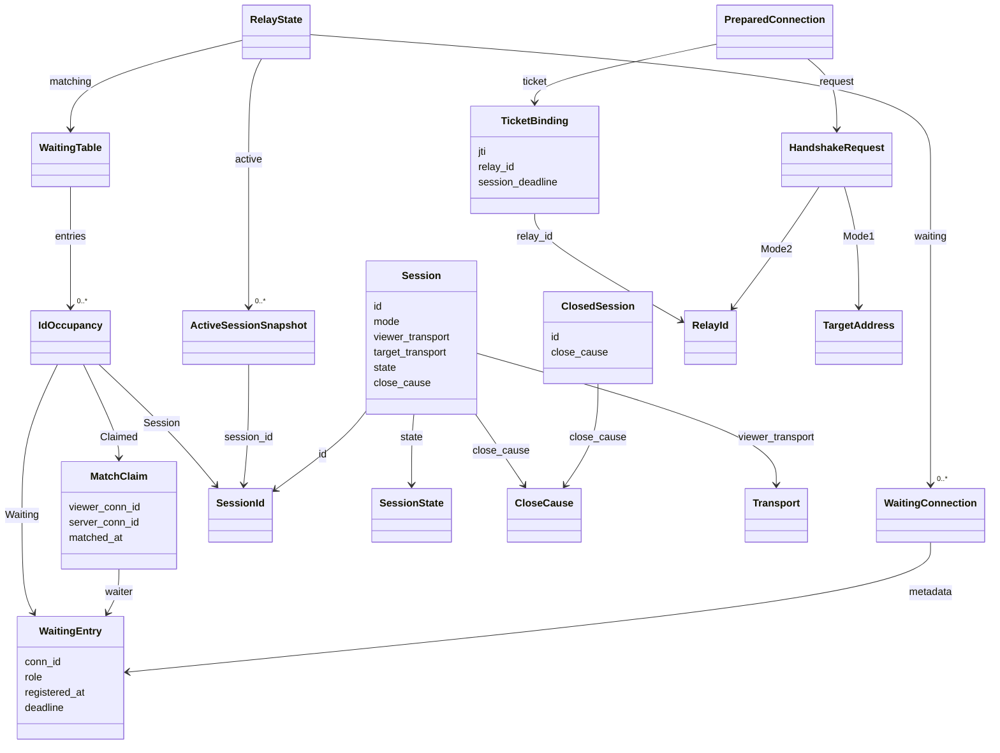

# VNC Relay 도메인 모델

이 문서는 용어집의 중계 용어(대기 연결, 활성 세션, 접속 ticket, 종료 원인 등)가 코드의 어떤 타입으로 표현되는지 정한다. 이번 범위는 중계 핵심이다. 중심 타입은 대기와 짝 맞춤을 판정하는 `WaitingTable`, 세션의 수명을 판정하는 `Session`, 연결에 붙는 접속 ticket 값인 `TicketBinding`이다. 위치는 `crates/domain/src/`와 `crates/app/src/relay.rs`다.

| 항목 | 값 |
| --- | --- |
| 구조 시점 | Current |
| 문서 상태 | Draft |
| 구현 대조 | Partial — [대조 기록](#대조-기록) |
| 용어집 | [VNC Relay 용어집](../../GLOSSARY.md) |
| 코드 위치 | `crates/domain/src/`, `crates/app/src/{ports,relay}.rs`와 `relay/matching.rs`, `crates/adapters/src/{net,websocket_stream}.rs` |
| 코드 지도 | [코드 지도](code-map.md#2-코드-위치와-구성요소) |
| 관련 스펙 | [중계](../specs/relay.md), [WS·WSS 전송](../specs/websocket.md), [관리 조회와 세션 종료](../specs/management.md) |

작성 규칙은 [도메인 모델 규칙](AGENTS.md#도메인-모델)을 따른다.

이 문서에 쓴 이름은 모두 현재 코드에 있다. 그래서 `(계획)` 표시가 없다.

범위에 넣은 용어는 용어집의 「중계 방식과 세션」 가운데 역할·Mode·대상·대기 연결·활성 세션·중계 스트림, 「접근 경계」의 접속 ticket과 그 관련 용어, 「세션 종료와 기록」의 종료 원인이다. 중계 ID·초기 교환·세션 식별자·연결 식별자·전송 경로는 위 용어의 관계를 설명하는 데 필요해 함께 넣었다. 접근 경계(출발지 IP 목록·신뢰 프록시·연결 상한), 관리 기능, 최근 종료 목록과 그 보관, 설정과 수명, 메트릭·접속 출처, Windows 운영의 용어는 이번 범위가 아니다. 사용자 결정(2026-11-23)으로 첫 초안을 중계 핵심으로 한정했고, 나머지는 다음 단계로 둔다.

## 1. 모델 지도

그림에는 이번 범위의 타입과 코드에서 확인한 필드 관계만 넣었다. 생략한 타입은 `TicketKey`·`TicketPolicy` 같은 ticket 판정 값, `ConnectionContext`·`BudgetPermit` 같은 연결 부속 값, 관리 조회용 뷰다. `RelayState`는 `crates/app/src/relay.rs`의 비공개 구조체이며 실행 중 상태를 한곳에 모은다.

상자 이름과 화살표 이름은 코드 심볼이다. 화살표 `A --> B`는 A가 필드로 B를 가리킨다는 뜻이다. 화살표 이름은 그 필드 이름이다. `IdOccupancy`의 화살표 이름은 열거형 값 이름이다.

## 2. 용어와 코드의 대응

종류 열은 코드에서 열거형이 업무 상태를 나타내는 경우만 `상태 값`으로 적었다. 코드나 채택된 설계에서 다른 종류(엔티티·값 객체 등)를 확인하지 못해 나머지는 `구분 없음`으로 적었다.

| 용어 | 종류 | 코드 심볼 | 파일 | 다른 레이어의 표현 |
| --- | --- | --- | --- | --- |
| [Viewer·Server·역할(role)](../../GLOSSARY.md) | 구분 없음 | `Role::Viewer` `Role::Server` | `crates/domain/src/entry_point.rs` | 운영 로그 `role` 값([운영 정보 계약](../contracts/ops-info-v2.md)) |
| [Mode I(mode1)·Mode II(mode2)](../../GLOSSARY.md) | 구분 없음 | `Mode::Mode1` `Mode::Mode2`, 초기 요청 `HandshakeRequest::Mode1(TargetAddress)` `HandshakeRequest::Mode2(RelayId)` | `crates/domain/src/handshake.rs` | 문자열 `mode1`·`mode2`(`Mode::as_str`) |
| [역접속](../../GLOSSARY.md) | 구분 없음 | 전용 타입 없음. `Role::Server` 연결이 `HandshakeRequest::Mode2`를 보내는 경우다([5절](#5-용어집스펙과-코드의-차이)) | `crates/domain/src/{entry_point,handshake}.rs` | 없음 |
| [Mode I 대상(target)](../../GLOSSARY.md) | 구분 없음 | `TargetAddress`(필드 `host: TargetHost`, `port`). 연결한 뒤의 상대는 `ActivePeer::Target(SocketAddr)` | `crates/domain/src/handshake.rs`, `crates/app/src/relay.rs` | 관리 조회 `target_address`(`ActiveSessionItemView`, `crates/app/src/management/query.rs`) |
| [중계 ID(relay_id)](../../GLOSSARY.md) | 구분 없음 | `RelayId`. 로그용 참조는 `RelayIdRef`, 참조 계산 키는 `RelayIdKey` | `crates/domain/src/relay_id.rs`, `crates/app/src/events.rs`, `crates/adapters/src/crypto.rs` | 운영 로그 `relay_id_ref`(원문이 아니다). 관리 조회 대기 항목 `relay_id`(`WaitingItemView`) |
| [초기 교환(handshake)](../../GLOSSARY.md) | 구분 없음 | `HandshakeParser` `HandshakeRequest` `HandshakeError`. 초기 교환을 마친 연결은 `PreparedConnection<S>` | `crates/domain/src/handshake.rs`, `crates/app/src/relay.rs` | [Repeater 초기 교환 계약](../contracts/repeater-handshake-v1.md) |
| [대기 연결(waiting)](../../GLOSSARY.md) | 구분 없음 | `WaitingEntry`(필드 `conn_id` `role` `registered_at` `deadline`). 소켓을 가진 쪽은 `WaitingConnection`. 매칭 점유는 `IdOccupancy::Waiting` | `crates/domain/src/matching.rs`, `crates/app/src/relay/matching.rs` | 관리 조회 `WaitingItemView`(`crates/app/src/management/query.rs`), 스냅숏 `WaitingSnapshot` |
| [활성 세션(session)](../../GLOSSARY.md) | 구분 없음 | `Session`. 실행 중 요약은 `ActiveSessionSnapshot`. 매칭 점유는 `IdOccupancy::Session` | `crates/domain/src/{session,matching}.rs`, `crates/app/src/relay.rs` | 관리 조회 `ActiveSessionItemView`(`crates/app/src/management/query.rs`) |
| 활성 세션의 단계 | 상태 값 | `SessionState::Active` `SessionState::Closing` `SessionState::Finished` | `crates/domain/src/session.rs` | 관리 조회 `state` 문자열 |
| [세션 식별자(session_id)](../../GLOSSARY.md) | 구분 없음 | `SessionId`(`ses_`와 소문자 base32 26자). 값을 만드는 포트는 `SessionIdSource`, 키는 `SessionIdKey` | `crates/domain/src/session.rs`, `crates/app/src/ports.rs`, `crates/adapters/src/crypto.rs` | 관리 조회 `session_id` |
| [연결 식별자(conn_id)](../../GLOSSARY.md) | 구분 없음 | `ConnId` | `crates/domain/src/conn_id.rs` | 운영 로그 사건의 `conn_id`([관리 스펙 MGT-047](../specs/management.md)) |
| [중계 스트림(relay_stream)](../../GLOSSARY.md) | 구분 없음 | 트레이트 `RelayStream`. 구현은 `TcpRelayStream`과 `WsRelayStream` | `crates/app/src/ports.rs`, `crates/adapters/src/net.rs`, `crates/adapters/src/websocket_stream.rs` | 없음 |
| [Viewer 전송 경로(viewer_transport)](../../GLOSSARY.md) | 구분 없음 | `Transport::Tcp` `Transport::Ws` `Transport::Wss`. `Session`의 필드 `viewer_transport`가 Viewer 쪽, `target_transport`가 상대 쪽을 담는다 | `crates/domain/src/session.rs` | 관리 조회 `viewer_transport` 문자열 |
| [접속 ticket(ticket)](../../GLOSSARY.md) | 구분 없음 | 클레임 `TicketClaims`(필드 `iss` `aud` `rh` `rid` `jti` `iat` `exp` `sx` `sub`), 판정 `TicketPolicy`, 키 `TicketKey` `TicketKeyList`. 연결에 붙은 값은 `TicketBinding` | `crates/domain/src/ticket.rs`, `crates/app/src/relay.rs` | [WebSocket 계약 1.9절](../contracts/websocket-relay-v2.md#19-접속-ticket), 설정 `relay.ticket.viewer`·`relay.ticket.server` |
| [발급 쪽(issuer)](../../GLOSSARY.md) | 구분 없음 | 전용 타입 없음. 클레임 `TicketClaims.iss`와 설정 `TicketRoleSettings.issuer`가 이름을 담는다 | `crates/domain/src/ticket.rs`, `crates/app/src/settings.rs` | 설정 `issuer` |
| [사용 기록](../../GLOSSARY.md) | 구분 없음 | `TicketUseTable`(역할별 `jti` 집합) | `crates/domain/src/ticket.rs` | 없음 |
| [세션 만료 시각(sx)](../../GLOSSARY.md) | 구분 없음 | 클레임 `TicketClaims.sx`(Unix 초)와 연결에 붙은 `TicketBinding.session_deadline`(서비스 시계의 단조 시각) | `crates/domain/src/ticket.rs`, `crates/app/src/relay.rs` | 없음 |
| [종료 원인(close_cause)](../../GLOSSARY.md) | 구분 없음 | `CloseCause`(값 9개: `PeerEof` `ConnectionError` `AdminTerminated` `DeadConnection` `CloseTimeout` `ServerShutdown` `InternalError` `SessionExpired` `IpDenied`). 정리가 끝난 세션의 최종 값은 `ClosedSession`(필드 `close_cause`)이 담는다 | `crates/domain/src/session.rs` | 문자열 `peer_eof` `connection_error` `admin_terminated` `dead_connection` `close_timeout` `server_shutdown` `internal_error` `session_expired` `ip_denied`([관리 스펙 2.3절](../specs/management.md#23-최근-종료-목록)) |

## 3. 관계

관계의 뜻은 스펙이 정한다. 이 표는 그 관계를 코드가 어떻게 연결하는지 적는다. 개수는 코드의 필드 형태(맵·집합·`Option`)에서 읽은 값이며, 근거 스펙 칸의 규칙이 같은 내용을 정한다.

| 관계 | 개수 | 코드에서 연결하는 방식 | 연결하는 코드(파일·심볼) | 근거 스펙 |
| --- | --- | --- | --- | --- |
| `RelayId` → 점유(대기·짝 맞춤·세션) | 0..1 | 맵. 한 중계 ID에 점유 하나 | `crates/domain/src/matching.rs` `WaitingTable.entries: HashMap<RelayId, IdOccupancy>` | [중계 3.3절 4](../specs/relay.md#33-mode-ii)(중복 정책), RLY-R10·RLY-R20 |
| `RelayId` → `WaitingConnection` | 0..1 | 맵 | `crates/app/src/relay.rs` `RelayState.waiting` | 같은 규칙 |
| `IdOccupancy::Session` → 두 연결 | 2 (Viewer 1, Server 1) | 연결 식별자 필드 둘 | `crates/domain/src/matching.rs` `IdOccupancy::Session { viewer_conn_id, server_conn_id }` | [중계 3.3절 3](../specs/relay.md#33-mode-ii), RLY-R08 |
| `SessionId` → 실행 중 세션 요약 | 1:1 | 맵 | `crates/app/src/relay.rs` `RelayState.active: HashMap<SessionId, ActiveSessionSnapshot>` | [관리 스펙](../specs/management.md) 활성 세션 조회 |
| `Session` → `CloseCause` | 0..1 (정리 전), 1 (정리 뒤) | `Session.close_cause`는 `Option`, `ClosedSession.close_cause`는 값 하나 | `crates/domain/src/session.rs` `Session` `ClosedSession` | [관리 API 계약 1.10절](../contracts/management-api-v1.md) |
| `PreparedConnection` → `TicketBinding` | 0..1 | `Option` | `crates/app/src/relay.rs` `PreparedConnection.ticket` | [WS·WSS 스펙](../specs/websocket.md) WS-R20 |
| `TicketBinding` → `RelayId` | 1 | 필드 `relay_id`(ticket의 `rid`) | `crates/app/src/relay.rs` `TicketBinding.relay_id` | RLY-R21 |
| `TicketUseTable` → `jti` | 역할마다 0..N | 역할별 집합 `viewer`, `server` | `crates/domain/src/ticket.rs` `TicketUseTable` | WS-R21 |

도메인 `Session`은 중계 ID와 연결 식별자를 가지지 않는다. 이 둘은 `IdOccupancy::Session`(Mode II)이 가진다. `Session`은 `crates/app/src/relay.rs`에서 `Session::new`로 만든다.

## 4. 코드가 지키는 조건

조건의 업무 의미는 PRD·스펙이 정한다. 이 표는 조건을 지키는 코드 위치를 연결한다.

| 조건 | 지키는 코드(파일·심볼) | 근거 |
| --- | --- | --- |
| Mode II는 같은 중계 ID의 반대 역할만 짝으로 맞춘다. | `crates/domain/src/matching.rs` `WaitingTable::arrive`: 같은 역할이면 `DuplicateId`로 거절하고 반대 역할이면 `ArrivalOutcome::Claimed`를 낸다. | RLY-R07, RLY-010·RLY-011 |
| 대기 중이거나 세션이 쓰는 중계 ID에는 새 연결을 받지 않고, 기존 연결과 세션을 유지한다. | `WaitingTable::arrive`: 점유가 `Waiting`이 아니면 `Rejected(DuplicateId)`다. | RLY-R10·RLY-R20, RLY-028 |
| 한 연결은 한 번에 한 점유에만 속한다. | `WaitingTable.connections`와 `WaitingTable::arrive`의 `ConnectionOccupied` | RLY-R08, RLY-013 |
| 연결의 역할은 요청 내용이 아니라 진입점이 정한다. | `HandshakeRequest`에는 역할이 없다. `WaitingEntry.role`이 진입점의 역할을 받는다. | RLY-R01 |
| 대기 시간이 끝난 대기 연결은 짝이 되지 않는다. | `WaitingTable::arrive`: 기존 대기가 `deadline`에 도달했으면 항목을 지우고 `Expired`를 낸다. | RLY-R09, RLY-014 |
| 접속 ticket의 `aud`는 확인하는 역할의 값과 같아야 한다. | `crates/domain/src/ticket.rs` `TicketPolicy`의 확인에서 `claims.aud`와 `audience(role)`을 비교한다. | WS-R20, WS-045 |
| 접속 ticket은 한 번만 받아들인다. | `crates/domain/src/ticket.rs` `TicketUseTable::try_record`가 이미 있는 `jti`를 거절한다. | WS-R21, WS-042 |
| 101 뒤 초기 요청의 중계 ID는 ticket의 `rid`와 같아야 한다. 다르면 close 4012로 닫는다. | `crates/app/src/relay.rs`: `Mode2`의 ID가 `TicketBinding.relay_id`와 다르면 `RelayCloseAction::TicketRelayMismatch`. ticket 연결의 Mode I 요청도 불일치로 본다. | RLY-R21, RLY-029·RLY-030·RLY-032 |
| `sx`에 도달한 연결은 끝나고 종료 원인은 `session_expired`다. | `crates/app/src/relay/session.rs`가 `session_deadline`에서 종료를 시작한다. 활성 세션이면 `CloseCause::SessionExpired`를 쓴다. | RLY-031, MGT-R28 |
| 세션의 종료 원인은 정리를 시작하게 한 첫 원인이다. | `crates/domain/src/session.rs`의 원인 선택이 이미 원인이 있으면 바꾸지 않는다. | [관리 API 계약 1.10절](../contracts/management-api-v1.md) |

## 5. 용어집·스펙과 코드의 차이

이 절은 차이를 기록만 한다. 사용자 결정(2026-11-23)에 따라 코드 이름을 바꾸지 않는다.

| 항목 | 기준(용어집·스펙) | 코드 | 처리 계획 |
| --- | --- | --- | --- |
| 종료 원인의 값 수 | 용어집은 8개를 든다. [관리 스펙 2.3절](../specs/management.md#23-최근-종료-목록)과 [관리 API 계약](../contracts/management-api-v1.md)은 `ip_denied`를 더해 9개를 쓴다. | `CloseCause`가 9개(`IpDenied` 포함)다. | 기준 문서 수정: 용어집의 값 목록에 `ip_denied`를 더한다. 아직 수정하지 않았다([6절](#6-미결정-사항)). |
| 세션 만료의 이름 | 용어집은 하나의 용어 `session_expired`를 정의한다. | 단계마다 다른 타입의 같은 이름이 있다. `CloseCause::SessionExpired`, `RelayCloseAction::SessionExpired`, `AbortReason::SessionExpired`, `WaitingRemovalReason::SessionExpired`다. | 유지. 각각 세션 종료 원인, WebSocket close 코드 4013을 고르는 동작, 초기 교환 중 연결 중단 사건(`connection_aborted`)의 원인, 대기 제거 사건의 원인이다. |
| 역접속 | 용어집이 정의한다. | 전용 타입이 없다. `Role::Server`와 `HandshakeRequest::Mode2`의 조합이다. | 유지. 타입을 새로 만들지 않는다. |
| 대기 연결 | 용어집의 용어는 하나다. | `WaitingEntry`(domain, 메타데이터만 가짐)와 `WaitingConnection`(app, 소켓을 가짐)으로 나뉜다. | 유지. domain이 소켓을 맡지 않는 구조([코드 지도](code-map.md#21-domain))에 따른다. |
| 사용 기록 | 용어집은 같은 ticket의 두 번째 사용을 거절하는 목록이라 정의한다. | `TicketUseTable`이 역할별로 `jti` 집합을 따로 둔다. | 유지. 이름만 다르다. |
| 발급 쪽 | 용어집이 정의한다. | 전용 타입이 없다. 이름 문자열만 `TicketClaims.iss`와 `TicketRoleSettings.issuer`에 있다. | 유지. |
| 대상 주소의 `TargetHost` | 용어집에 대응하는 두 번째 개념이 없다. | `TargetHost`가 둘이다. `crates/domain/src/handshake.rs`는 초기 요청의 대상 주소(IP 또는 이름)이고, `crates/domain/src/target_policy.rs`는 대상 허용 정책 항목의 대상 부분(IP 항목 또는 이름)이다. | 유지. 이름 정리는 정하지 않았다([6절](#6-미결정-사항)). |
| `TerminationTicket` | 용어집의 접속 ticket과 관계가 없다. | `crates/app/src/management/terminate.rs`의 `TerminationTicket`은 관리자 종료 접수 뒤 완료를 기다리는 값이다. | 유지. 독자가 접속 ticket과 혼동하지 않도록 적는다. |
| 용어집에 없는 모델 | 용어집에 없다. | `MatchClaim`과 `IdOccupancy::Claimed`는 짝은 정해졌고 세션은 시작하기 전인 쌍이다. | 기준 문서 수정 여부를 정하지 않았다([6절](#6-미결정-사항)). |

## 6. 미결정 사항

| 항목 | 영향 | 확정 위치 |
| --- | --- | --- |
| 용어집의 종료 원인 목록에 `ip_denied`를 더할지 | 용어집이 스펙·계약·코드보다 값이 하나 적다. | 용어집 |
| 업무 관계를 스펙의 「용어·관계·상태」 절의 표로 정할지 | 3절의 개수는 코드 필드 형태와 스펙 규칙에서 읽었다. 스펙에 관계 표는 없다. | [중계](../specs/relay.md)·[WS·WSS](../specs/websocket.md)·[관리](../specs/management.md) 스펙 |
| 두 `TargetHost`의 이름을 정리할지 | 읽는 사람이 두 타입을 혼동할 수 있다. | 컨벤션 또는 별도 작업 |
| `MatchClaim`(짝이 정해지고 세션이 시작되기 전의 쌍)을 용어집 용어로 올릴지 | 스펙의 상태 표에는 이 단계가 따로 없다. | 용어집, [중계 스펙 2절](../specs/relay.md#2-상태와-경계) |
| 이번 범위 밖 용어(접근 경계, 관리 기능, 최근 종료 목록과 그 보관, 설정과 수명, 메트릭·접속 출처, Windows 운영)의 도메인 모델 | 이 문서는 중계 핵심만 다룬다. | 이 문서의 확장 |

## 대조 기록

| 항목 | 값 |
| --- | --- |
| 대조일 | 2026-11-23 |
| 방법 | 이 문서의 코드 심볼과 파일이 현재 코드에 있는지 검색으로 확인했다. 중심 구조체와 열거형(`WaitingEntry` `MatchClaim` `IdOccupancy` `Session` `ClosedSession` `CloseCause` `TicketClaims` `TicketBinding` `ActiveSessionSnapshot` `WaitingConnection` 등)은 정의를 읽어 필드를 확인했다. |
| 결과 | 문서의 심볼이 모두 존재한다. 1절의 필드 관계와 3절의 필드 형태는 위 정의에서 확인했다. |
| 확인하지 못한 범위 | 일부 필드 이름(`RelayState`의 필드 전부, `TicketPolicy`의 비교 함수 이름)은 정의 확인이 부분적이다. 4절의 조건은 위치를 읽었지만 관련 시험을 실행하지 않았다. 용어집 용어 전체 가운데 이번 범위 밖은 대조하지 않았다. |
