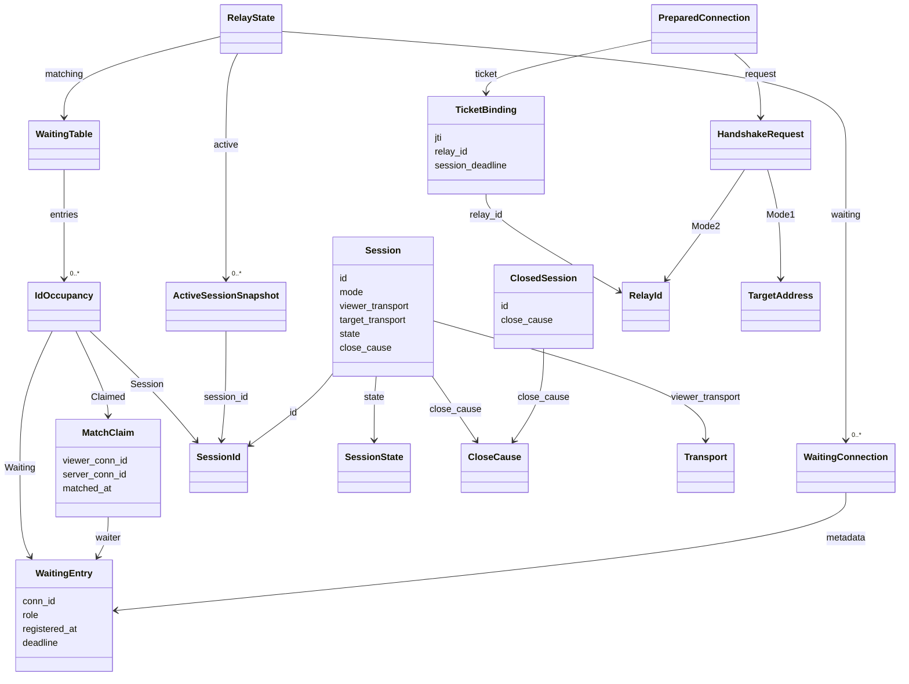
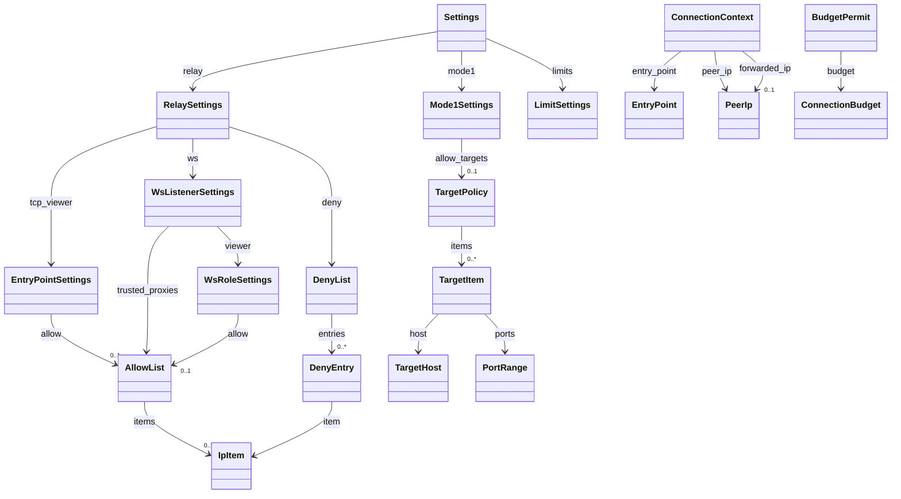
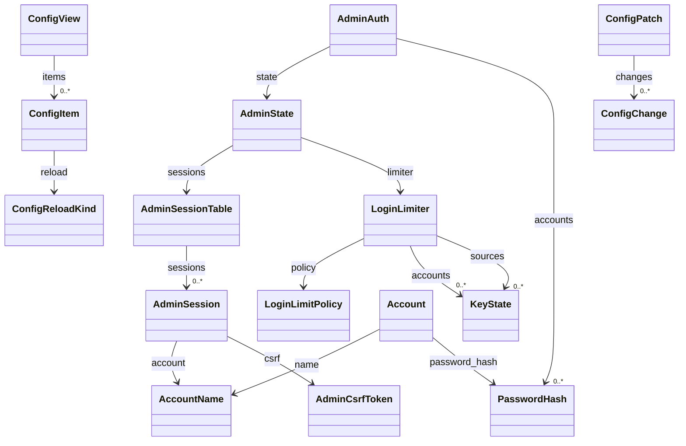
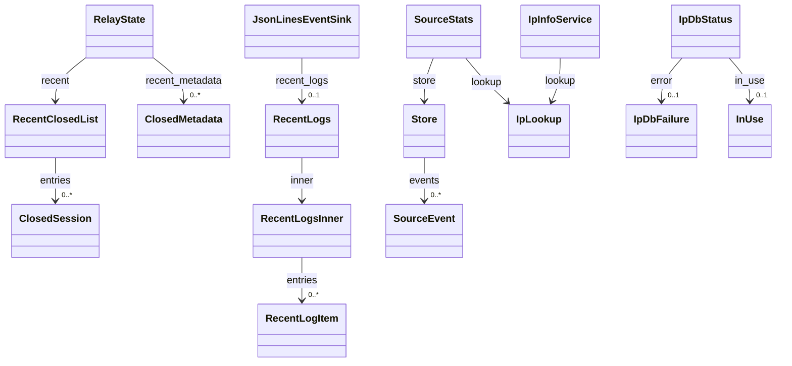
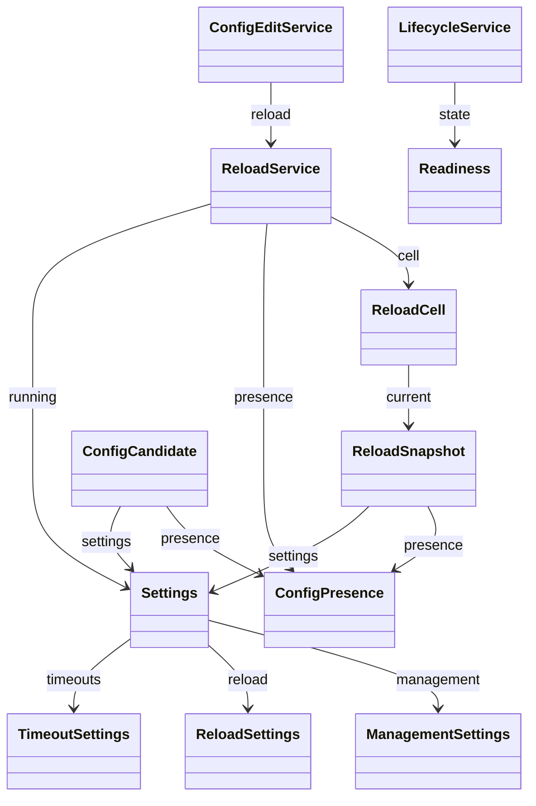
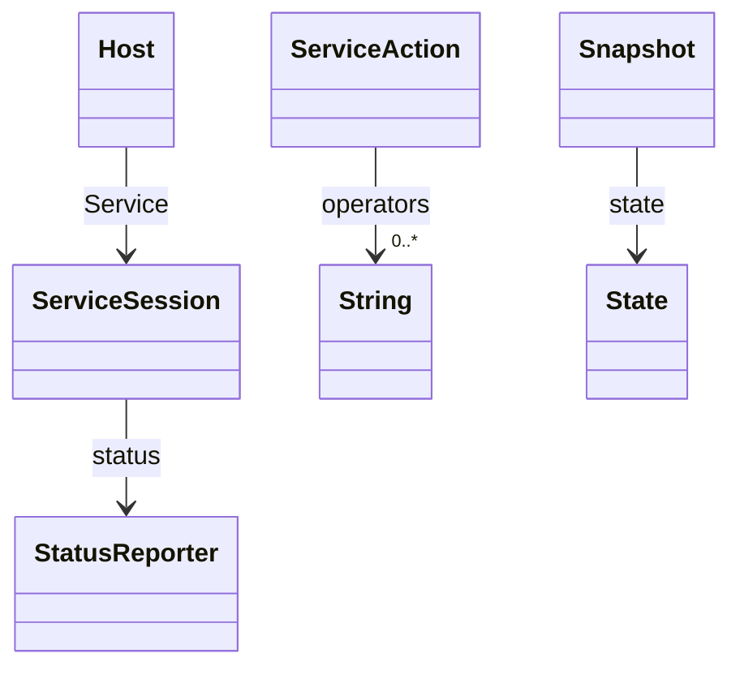

# VNC Relay 도메인 모델

이 문서는 용어집의 업무 용어가 코드의 어떤 타입으로 표현되는지 정한다. 범위는 용어집 전체다. 중계 핵심의 중심 타입은 대기와 짝 맞춤을 판정하는 `WaitingTable`, 세션의 수명을 판정하는 `Session`, 연결에 붙는 접속 ticket 값인 `TicketBinding`이다. 접근 경계는 `AllowList`·`DenyList`·`ConnectionBudget`, 관리 기능은 `AdminSession`·`LoginLimiter`·`ConfigEditService`, 기록과 통계는 `RecentClosedList`·`RecentLogs`·`SourceStats`, 설정과 수명은 `ReloadService`·`LifecycleService`, Windows 운영은 `crates/tray`와 서비스 어댑터가 중심이다.

| 항목 | 값 |
| --- | --- |
| 구조 시점 | Current |
| 문서 상태 | Draft |
| 구현 대조 | Partial — [대조 기록](#대조-기록) |
| 용어집 | [VNC Relay 용어집](../../GLOSSARY.md) |
| 코드 위치 | `crates/domain/src/`, `crates/app/src/{ports,relay,settings,management,accounts,reload,lifecycle,metrics,sources,ip_info,events}*`, `crates/adapters/src/{net,websocket_stream,management_http,status_http,ops_log,ip_db,accounts_file,windows_service,config_edit,admission}*`, `crates/tray/src/`, `src/{serve,service,cli}.rs` |
| 코드 지도 | [코드 지도](code-map.md#2-코드-위치와-구성요소) |
| 관련 스펙 | [중계](../specs/relay.md), [WS·WSS 전송](../specs/websocket.md), [관리 조회와 세션 종료](../specs/management.md), [운영](../specs/operations.md), [대시보드](../specs/dashboard.md), [Windows 트레이](../specs/windows-tray.md) |

작성 규칙은 [도메인 모델 규칙](AGENTS.md#도메인-모델)을 따른다.

이 문서에 쓴 이름은 모두 현재 코드에 있다. 그래서 `(계획)` 표시가 없다.

범위는 용어집의 「중계 방식과 세션」·「접근 경계」·「관리 기능」·「세션 종료와 기록」·「설정과 수명」·「Windows 운영」 전체다. 각 절은 이 순서의 소절로 나눈다(중계 핵심, 접근 경계, 관리 기능, 기록과 통계, 설정과 수명, Windows 운영). 사용자 결정(2026-11-23)으로 첫 초안은 중계 핵심으로 한정했고, 같은 날 결정으로 나머지 영역을 이어 썼다. 용어집 용어마다 코드 대응을 적었다. 전용 타입이 없는 용어는 그 사실과 개념이 있는 곳(설정 키·함수·상수)을 적었다. 중계 ID·초기 교환·세션 식별자·연결 식별자·전송 경로는 다른 용어의 관계를 설명하는 데 필요해 중계 핵심에 함께 넣었다.

## 1. 모델 지도

그림은 영역마다 하나씩 모두 6개다. 각 그림에는 그 영역의 중심 타입과 코드에서 확인한 필드 관계만 넣었다. 상자 이름과 화살표 이름은 코드 심볼이다. 화살표 `A --> B`는 A가 필드로 B를 가리킨다는 뜻이다. 화살표 이름은 그 필드 이름이다. 영역을 넘는 참조는 참조하는 쪽 그림에 적었다.

### 1.1 중계 핵심

생략한 타입은 `TicketKey`·`TicketPolicy` 같은 ticket 판정 값, `BudgetPermit` 같은 연결 부속 값, 관리 조회용 뷰다. `RelayState`는 `crates/app/src/relay.rs`의 비공개 구조체이며 실행 중 상태를 한곳에 모은다. `IdOccupancy`의 화살표 이름은 열거형 값 이름이다.

### 1.2 접근 경계

설정 값(`Settings`)이 허용·차단 목록과 대상 정책을 가지고, 연결 처리가 `ConnectionContext`의 주소로 판정한다. TCP 진입점은 `EntryPointSettings`, WS·WSS는 `WsListenerSettings`를 쓴다. 그림에는 `tcp_viewer`와 `ws`만 그렸고 `tcp_server`와 `wss`는 같은 모양이다.

### 1.3 관리 기능

`AdminAuth`가 관리자 로그인·세션·로그인 제한을 한 프로세스에 하나 가진다. 설정 보기와 편집은 `ConfigView`와 `ConfigPatch`가 값을 나른다. 편집을 적용하는 `ConfigEditService`는 재로드 서비스를 부르며, 그 관계는 [1.5절](#15-설정과-수명)에 있다.

### 1.4 기록과 통계

최근 종료 목록은 `RelayState`가, 최근 로그는 로그 출력기가, 접속 출처 통계는 `SourceStats`가 가진다. IP 정보 DB는 `IpLookup`이 국가·ASN 두 칸으로 들고, 접속 출처 통계와 `IpInfoService`가 같은 `IpLookup`을 공유한다.

### 1.5 설정과 수명

실행 중 설정은 `ReloadService`가 `Settings`로 들고, 적용한 값은 `ReloadCell`이 `ReloadSnapshot`으로 바꿔 끼운다. 준비 상태는 `LifecycleService`가 `Readiness` 값으로 저장한다. 종료 유예 상태 `RelayLifecycle`은 `crates/app/src/ports.rs`에 있고, 이 그림에는 넣지 않았다(필드 관계를 확인하지 않았다).

### 1.6 Windows 운영

이 영역의 용어는 운영체제 기능(서비스 제어, 서비스 접근 권한)과 트레이 화면을 가리킨다. 도메인 타입은 없다. 그림에는 코드에서 확인한 필드 관계만 넣었다. `ServiceSession`이 중지 요청을 받는 채널 `controls`(`mpsc::UnboundedReceiver<StopControl>`)는 필드 관계가 아니라 채널이라 그리지 않았다.

## 2. 용어와 코드의 대응

### 2.1 중계 핵심

종류 열은 코드에서 열거형이 업무 상태를 나타내는 경우만 `상태 값`으로 적었다. 코드나 채택된 설계에서 다른 종류(엔티티·값 객체 등)를 확인하지 못해 나머지는 `구분 없음`으로 적었다.

| 용어 | 종류 | 코드 심볼 | 파일 | 다른 레이어의 표현 |
| --- | --- | --- | --- | --- |
| [Viewer·Server·역할(role)](../../GLOSSARY.md) | 구분 없음 | `Role::Viewer` `Role::Server` | `crates/domain/src/entry_point.rs` | 운영 로그 `role` 값([운영 정보 계약](../contracts/ops-info-v2.md)) |
| [Mode I(mode1)·Mode II(mode2)](../../GLOSSARY.md) | 구분 없음 | `Mode::Mode1` `Mode::Mode2`, 초기 요청 `HandshakeRequest::Mode1(TargetAddress)` `HandshakeRequest::Mode2(RelayId)` | `crates/domain/src/handshake.rs` | 문자열 `mode1`·`mode2`(`Mode::as_str`) |
| [역접속](../../GLOSSARY.md) | 구분 없음 | 전용 타입 없음. `Role::Server` 연결이 `HandshakeRequest::Mode2`를 보내는 경우다([5절](#5-용어집스펙과-코드의-차이)) | `crates/domain/src/{entry_point,handshake}.rs` | 없음 |
| [Mode I 대상(target)](../../GLOSSARY.md) | 구분 없음 | `TargetAddress`(필드 `host: TargetHost`, `port`). 연결한 뒤의 상대는 `ActivePeer::Target(SocketAddr)` | `crates/domain/src/handshake.rs`, `crates/app/src/relay.rs` | 관리 조회 `target_address`(`ActiveSessionItemView`, `crates/app/src/management/query.rs`) |
| [중계 ID(relay_id)](../../GLOSSARY.md) | 구분 없음 | `RelayId`. 로그용 참조는 `RelayIdRef`, 참조 계산 키는 `RelayIdKey` | `crates/domain/src/relay_id.rs`, `crates/app/src/events.rs`, `crates/adapters/src/crypto.rs` | 운영 로그 `relay_id_ref`(원문이 아니다). 관리 조회 대기 항목 `relay_id`(`WaitingItemView`) |
| [초기 교환(handshake)](../../GLOSSARY.md) | 구분 없음 | `HandshakeParser` `HandshakeRequest` `HandshakeError`. 초기 교환을 마친 연결은 `PreparedConnection<S>` | `crates/domain/src/handshake.rs`, `crates/app/src/relay.rs` | [Repeater 초기 교환 계약](../contracts/repeater-handshake-v1.md) |
| [대기 연결(waiting)](../../GLOSSARY.md) | 구분 없음 | `WaitingEntry`(필드 `conn_id` `role` `registered_at` `deadline`). 소켓을 가진 쪽은 `WaitingConnection`. 매칭 점유는 `IdOccupancy::Waiting` | `crates/domain/src/matching.rs`, `crates/app/src/relay/matching.rs` | 관리 조회 `WaitingItemView`(`crates/app/src/management/query.rs`), 스냅숏 `WaitingSnapshot` |
| [활성 세션(session)](../../GLOSSARY.md) | 구분 없음 | `Session`. 실행 중 요약은 `ActiveSessionSnapshot`. 매칭 점유는 `IdOccupancy::Session` | `crates/domain/src/{session,matching}.rs`, `crates/app/src/relay.rs` | 관리 조회 `ActiveSessionItemView`(`crates/app/src/management/query.rs`) |
| 활성 세션의 단계 | 상태 값 | `SessionState::Active` `SessionState::Closing` `SessionState::Finished` | `crates/domain/src/session.rs` | 관리 조회 `state` 문자열 |
| [세션 식별자(session_id)](../../GLOSSARY.md) | 구분 없음 | `SessionId`(`ses_`와 소문자 base32 26자). 값을 만드는 포트는 `SessionIdSource`, 키는 `SessionIdKey` | `crates/domain/src/session.rs`, `crates/app/src/ports.rs`, `crates/adapters/src/crypto.rs` | 관리 조회 `session_id` |
| [연결 식별자(conn_id)](../../GLOSSARY.md) | 구분 없음 | `ConnId` | `crates/domain/src/conn_id.rs` | 운영 로그 사건의 `conn_id`([관리 스펙 MGT-047](../specs/management.md)) |
| [중계 스트림(relay_stream)](../../GLOSSARY.md) | 구분 없음 | 트레이트 `RelayStream`. 구현은 `TcpRelayStream`과 `WsRelayStream` | `crates/app/src/ports.rs`, `crates/adapters/src/net.rs`, `crates/adapters/src/websocket_stream.rs` | 없음 |
| [Viewer 전송 경로(viewer_transport)](../../GLOSSARY.md) | 구분 없음 | `Transport::Tcp` `Transport::Ws` `Transport::Wss`. `Session`의 필드 `viewer_transport`가 Viewer 쪽, `target_transport`가 상대 쪽을 담는다 | `crates/domain/src/session.rs` | 관리 조회 `viewer_transport` 문자열 |
| [접속 ticket(ticket)](../../GLOSSARY.md) | 구분 없음 | 클레임 `TicketClaims`(필드 `iss` `aud` `rh` `rid` `jti` `iat` `exp` `sx` `sub`), 판정 `TicketPolicy`, 키 `TicketKey` `TicketKeyList`. 연결에 붙은 값은 `TicketBinding` | `crates/domain/src/ticket.rs`, `crates/app/src/relay.rs` | [WebSocket 계약 1.9절](../contracts/websocket-relay-v2.md#19-접속-ticket), 설정 `relay.ticket.viewer`·`relay.ticket.server` |
| [발급 쪽(issuer)](../../GLOSSARY.md) | 구분 없음 | 전용 타입 없음. 클레임 `TicketClaims.iss`와 설정 `TicketRoleSettings.issuer`가 이름을 담는다 | `crates/domain/src/ticket.rs`, `crates/app/src/settings.rs` | 설정 `issuer` |
| [사용 기록](../../GLOSSARY.md) | 구분 없음 | `TicketUseTable`(역할별 `jti` 집합) | `crates/domain/src/ticket.rs` | 없음 |
| [세션 만료 시각(sx)](../../GLOSSARY.md) | 구분 없음 | 클레임 `TicketClaims.sx`(Unix 초)와 연결에 붙은 `TicketBinding.session_deadline`(서비스 시계의 단조 시각) | `crates/domain/src/ticket.rs`, `crates/app/src/relay.rs` | 없음 |
| [종료 원인(close_cause)](../../GLOSSARY.md) | 구분 없음 | `CloseCause`(값 9개: `PeerEof` `ConnectionError` `AdminTerminated` `DeadConnection` `CloseTimeout` `ServerShutdown` `InternalError` `SessionExpired` `IpDenied`). 정리가 끝난 세션의 최종 값은 `ClosedSession`(필드 `close_cause`)이 담는다 | `crates/domain/src/session.rs` | 문자열 `peer_eof` `connection_error` `admin_terminated` `dead_connection` `close_timeout` `server_shutdown` `internal_error` `session_expired` `ip_denied`([관리 스펙 2.3절](../specs/management.md#23-최근-종료-목록)) |

### 2.2 접근 경계

| 용어 | 종류 | 코드 심볼 | 파일 | 다른 레이어의 표현 |
| --- | --- | --- | --- | --- |
| [리스너(listener)](../../GLOSSARY.md) | 구분 없음 | `Listener`(`TcpViewer` `TcpServer` `Ws` `Wss`). 관리·상태 리스너는 이 열거형에 없다([5절](#5-용어집스펙과-코드의-차이)) | `crates/domain/src/entry_point.rs` | 운영 로그 `listener` 값 `tcp_viewer` `tcp_server` `ws` `wss` |
| [진입점(entry_point)](../../GLOSSARY.md) | 구분 없음 | `EntryPoint`(`TcpViewer` `TcpServer` `WsViewer` `WsServer` `WssViewer` `WssServer`). 메서드 `listener()` `role()` `config_table()` | `crates/domain/src/entry_point.rs` | 설정 표 `relay.tcp_viewer` `relay.ws.viewer` `relay.wss.server` 등 |
| [출발지 IP(peer_ip)](../../GLOSSARY.md) | 구분 없음 | `PeerIp`. `PeerIp::new`가 IPv4-mapped 주소를 IPv4로 바꾼다 | `crates/domain/src/peer_ip.rs` | `ConnectionContext.peer_ip`, 운영 로그 `peer_ip` |
| [신뢰 프록시(trusted_proxy)](../../GLOSSARY.md) | 구분 없음 | 전용 타입 없음. `WsListenerSettings.trusted_proxies`(`AllowList`)가 리스너마다 하나다 | `crates/app/src/settings.rs` | 설정 `relay.ws.trusted_proxies` `relay.wss.trusted_proxies` |
| [전달 주소(forwarded_ip)](../../GLOSSARY.md) | 구분 없음 | `ConnectionContext.forwarded_ip`(`Option<PeerIp>`). 값은 `forwarded_for::client_ip`가 계산한다 | `crates/app/src/relay.rs`, `crates/domain/src/forwarded_for.rs` | 운영 로그·관리 조회 `forwarded_ip` |
| [클라이언트 주소(client_address)](../../GLOSSARY.md) | 구분 없음 | 전용 타입 없음. `ConnectionContext::client_ip()`가 `forwarded_ip`가 있으면 그 값을, 없으면 `peer_ip`를 돌려준다 | `crates/app/src/relay.rs` | 이 값을 담은 별도 필드를 확인하지 않았다 |
| [출발지 IP 허용 목록(allow)](../../GLOSSARY.md) | 구분 없음 | `AllowList`(`items: Vec<IpItem>`). 항목은 `IpItem::Single` `IpItem::Cidr` `IpItem::Range` | `crates/domain/src/allow_list.rs` | 설정 `allow`(진입점별 `EntryPointSettings.allow`, 역할별 `WsRoleSettings.allow`) |
| [차단 목록(deny)](../../GLOSSARY.md) | 구분 없음 | `DenyList`(`entries: Vec<DenyEntry>`), `DenyEntry`(`text` 원문, `item`) | `crates/domain/src/deny_list.rs` | 설정 `relay.deny.sources`, 관리 조회 `/api/v1/sources`의 차단 항목 |
| [전체 허용 항목(allow_all)](../../GLOSSARY.md) | 구분 없음 | 전용 타입 없음. `IpItem::covers_whole_family()`와 `AllowList::whole_family_items()`가 판정하고, 경고는 `ConfigWarning::AllowAllSource`다 | `crates/domain/src/allow_list.rs`, `crates/app/src/settings.rs` | 경고 코드 `allow_all_source` |
| [대상 허용 정책(allow_targets)](../../GLOSSARY.md) | 구분 없음 | `TargetPolicy`(`items: Vec<TargetItem>`), `TargetItem`(`host: TargetHost`, `ports: PortRange`). 설정에서는 `Mode1Settings.allow_targets` | `crates/domain/src/target_policy.rs`, `crates/app/src/settings.rs` | 설정 `mode1.allow_targets` |
| [중계 측 연결(relay_connections)](../../GLOSSARY.md) | 구분 없음 | 용량 카운터 `ConnectionBudget`과 자리 하나를 나타내는 `BudgetPermit`. 상한 값은 `LimitSettings.relay_connections` | `crates/domain/src/budget.rs`, `crates/app/src/settings.rs`, `crates/app/src/relay.rs` | 설정 `limits.relay_connections`, 관리 조회 `UsageView.relay_connections` |
| [중계 연결 상한 거절(relay_connection_limit)](../../GLOSSARY.md) | 구분 없음 | `RejectReason::RelayConnectionLimit { limit }`. Mode I 대상 연결의 상한 조치는 `RelayCloseAction::TargetConnectionLimit` | `crates/app/src/events.rs`, `crates/app/src/ports.rs`, `crates/app/src/relay/target.rs` | 운영 로그 `relay_connection_limit`, WS close 코드 4011(Mode I 대상 연결 쪽) |
| [관리·상태 연결(admin_connections)](../../GLOSSARY.md) | 구분 없음 | 용량 카운터 `ConnectionBudget`을 수락 직후 얻는 `AdmittingListener`. 상한 값은 `LimitSettings.admin_connections` | `crates/adapters/src/admission.rs`, `crates/app/src/settings.rs` | 설정 `limits.admin_connections`, 관리 조회 `UsageView.admin_connections` |

### 2.3 관리 기능

| 용어 | 종류 | 코드 심볼 | 파일 | 다른 레이어의 표현 |
| --- | --- | --- | --- | --- |
| [관리 리스너(management)](../../GLOSSARY.md) | 구분 없음 | `ManagementListener`, `ManagementServices`, 이름 상수 `LISTENER = "management"` | `crates/adapters/src/management_http.rs` | 설정 `[management] listen`, 운영 로그 `listener = "management"` |
| [상태 리스너(status)](../../GLOSSARY.md) | 구분 없음 | 전용 타입을 확인하지 않았다. 어댑터 모듈 `status_http`가 `/livez` `/readyz` `/metrics`를 응답한다 | `crates/adapters/src/status_http.rs` | 설정 `[status] listen` |
| [대시보드(dashboard)](../../GLOSSARY.md) | 구분 없음 | 전용 도메인 타입 없음. 정적 파일은 `Asset`·`find_asset`, 응답 힌트는 `DashboardHints` | `crates/adapters/src/dashboard_assets.rs`, `crates/adapters/src/management_http.rs` | 설정 `dashboard`, 세션 응답의 `dashboard` 객체 |
| [관리 API(management_api)](../../GLOSSARY.md) | 구분 없음 | 전용 타입 없음. 경로별 모듈 `session_api` `config_api` `query_api` `terminate_api` `logs_api` `metrics_api` `sources_api`가 요청을 받는다 | `crates/adapters/src/management_http/` | HTTP `/api/v1/` 경로([관리 API 계약](../contracts/management-api-v1.md)) |
| [설정 보기](../../GLOSSARY.md) | 구분 없음 | `ConfigView`(`items: Vec<ConfigItem>`), `ConfigItem`, `ConfigReloadKind`. 조회는 `ConfigService::get` | `crates/app/src/management/config.rs`, `crates/app/src/management/config/items.rs` | `GET /api/v1/config`. 응답 필드 `revision` `edit_enabled` `items` 등 |
| [동적 설정 편집](../../GLOSSARY.md) | 구분 없음 | `ConfigPatch`(`changes: Vec<ConfigChange>`), `ConfigChange`, `ConfigValue`, `ConfigActor`, 적용은 `ConfigEditService::patch`, 오류는 `ConfigEditError` | `crates/app/src/management/config.rs` | `PATCH /api/v1/config`, 사건 `config_edited` `config_edit_rejected` |
| [관리자 계정(admin_account)](../../GLOSSARY.md) | 구분 없음 | `Account`(`name: AccountName`, `password_hash: PasswordHash`) | `crates/domain/src/account.rs` | 로그인 응답의 `account`, 사건 필드 `admin_account` |
| [관리자 계정 준비(admin)](../../GLOSSARY.md) | 구분 없음 | 전용 타입 없음(절차). `AdminService`의 `add` `passwd` `remove` `list`와 `AdminFailure`가 수행한다 | `crates/app/src/accounts.rs` | 명령 `vnc-relay admin`([CLI 계약](../contracts/cli-v1.md)) |
| [관리자 계정 파일(accounts_file)](../../GLOSSARY.md) | 구분 없음 | 앱 쪽 `LoadedAccounts`, `AccountsError`, `AccountsWarning`. 어댑터 쪽 파일 저장소 `AccountsFile` | `crates/app/src/accounts.rs`, `crates/adapters/src/accounts_file.rs` | 설정 `admin.accounts_file` |
| [관리 세션(admin_session)](../../GLOSSARY.md) | 구분 없음 | `AdminSession`, `AdminSessionTable`, 정책 `AdminSessionPolicy`. 앱 쪽 `AdminAuth`, `AuthorizedAdmin`, `LoggedIn` | `crates/domain/src/admin_session.rs`, `crates/app/src/management.rs`, `crates/app/src/management/{login,session}.rs` | `GET·POST·DELETE /api/v1/session`, 응답 필드 `csrf_token` `idle_expires_at` `absolute_expires_at` |
| [관리 세션 쿠키(relay_admin_session)](../../GLOSSARY.md) | 구분 없음 | 쿠키 이름은 상수 `SESSION_COOKIE`다. 쿠키 값은 `AdminSessionToken`(64자)이다 | `crates/adapters/src/management_http.rs`, `crates/domain/src/admin_session.rs` | 헤더 `Set-Cookie: relay_admin_session=…; HttpOnly; SameSite=Strict`, HTTPS일 때 `Secure` |
| [로그인 제한(login_limit)](../../GLOSSARY.md) | 구분 없음 | `LoginLimiter`, `LoginLimitPolicy`, `LimitScope`(`Account` `Source`) | `crates/domain/src/login_limit.rs` | 설정 `[management.login_limit]`, 사건 `admin_login_limited` |
| [CSRF 토큰(csrf_token)](../../GLOSSARY.md) | 구분 없음 | `AdminCsrfToken`(`AdminSession.csrf`), 검사는 `AdminAuth::check_csrf`, 오류는 `AuthError::CsrfInvalid` | `crates/domain/src/admin_session.rs`, `crates/app/src/management/session.rs` | 요청 헤더 `X-CSRF-Token`, 오류 `403 csrf_invalid` |

### 2.4 기록과 통계

| 용어 | 종류 | 코드 심볼 | 파일 | 다른 레이어의 표현 |
| --- | --- | --- | --- | --- |
| [관리자 종료·세션 만료·서버 종료](../../GLOSSARY.md) | 구분 없음 | `CloseCause::AdminTerminated` `CloseCause::SessionExpired` `CloseCause::ServerShutdown`. [2.1절](#21-중계-핵심)의 종료 원인 행과 같다 | `crates/domain/src/session.rs` | 문자열 `admin_terminated` `session_expired` `server_shutdown` |
| [최근 종료 목록(recent_closed)](../../GLOSSARY.md) | 구분 없음 | `RecentClosedList`(`entries`, 최대 개수 `max_entries`), `ClosedSession`. 응답용 요약은 `ClosedSessionSnapshot`, 끝점 주소는 `ClosedMetadata`가 따로 보관한다 | `crates/domain/src/recent_closed.rs`, `crates/domain/src/session.rs`, `crates/app/src/relay.rs` | 설정 `[recent_closed] max_entries`, 관리 조회 [관리 API 계약 1.10절](../contracts/management-api-v1.md) |
| [운영 로그(log)](../../GLOSSARY.md) | 구분 없음 | 전용 도메인 타입 없음(출력 형식). `JsonLinesEventSink`, `LogEntry`, `format_line`이 한 줄 JSON을 만든다 | `crates/adapters/src/ops_log.rs` | JSON Lines 필드 `ts` `level` `event`, 계약 [운영 정보 계약](../contracts/ops-info-v2.md) |
| [최근 로그(recent_logs)](../../GLOSSARY.md) | 구분 없음 | `RecentLogs`, `RecentLogItem`(`seq`, `entry`), 조회 `LogsFilter` `LogsResponse`. 앱 계층이 아니라 어댑터에 있다 | `crates/adapters/src/ops_log.rs` | 설정 `[recent_logs] max_entries`, `GET /api/v1/logs` |
| [사건(event)](../../GLOSSARY.md) | 구분 없음 | `Event`(`name()` `level()`), `Level`, `Phase`, `Stage`, `RejectReason`, `ShutdownTrigger` | `crates/app/src/events.rs` | 로그 필드 `event`. 예: `connection_accepted` `session_closed` |
| [메트릭(metrics)](../../GLOSSARY.md) | 구분 없음 | `Metrics`, `MetricsSink`, `MetricsService`, `MetricsSnapshot` | `crates/app/src/metrics.rs`, `crates/app/src/metrics/` | `GET /metrics`(`[metrics] enabled`가 켜졌을 때만), 이름 예 `vnc_relay.connection.accepted` |
| [추이(history)](../../GLOSSARY.md) | 구분 없음 | `History`(기간별 `hour`·`day` 두 링), `HistoryPoint`(`seq` `at` `values`), `HistoryView`, 키 목록 `HISTORY_KEYS` | `crates/app/src/metrics/history.rs` | 관리 조회 쿼리 `history_after` |
| [추이 기간(history window)](../../GLOSSARY.md) | 상태 값 | `HistoryWindow::Hour` `HistoryWindow::Day`. `interval()`은 10초·60초, `capacity()`는 360·1440 | `crates/app/src/metrics/history.rs`, `crates/adapters/src/management_http/metrics_api.rs` | 쿼리 `history_window`(`1h` `24h`) |
| [접속 출처(sources)](../../GLOSSARY.md) | 구분 없음 | `SourceStats`(`store`, `lookup`), `SourceEvent`, `SourcesReport`, `SourcesService` | `crates/app/src/sources.rs`, `crates/app/src/sources/report.rs` | `GET /api/v1/sources` |
| [연결 시도(attempts)](../../GLOSSARY.md) | 구분 없음 | 전용 타입 없음. 집계 값 `Counts.attempts`이고, 사건 종류는 비공개 `Kind::Attempt`다 | `crates/app/src/sources.rs`, `crates/app/src/sources/report.rs` | 관리 조회 응답 키 `attempts` |
| [집계 기간(window)](../../GLOSSARY.md) | 상태 값 | `SourceWindow::Hour` `SourceWindow::Day` | `crates/app/src/sources/report.rs` | 쿼리 `window`(`1h` `24h`) |
| [IP 정보 DB(ip_info)](../../GLOSSARY.md) | 구분 없음 | `IpInfoService`, `IpLookup`(국가·ASN 두 칸), `IpDbStatus`, `IpDbKey`, `IpDbFailure`. 파일을 읽는 쪽은 어댑터 `MmdbFileGateway`다 | `crates/app/src/ip_info.rs`, `crates/adapters/src/ip_db.rs` | 설정 `ip_info.country_db` `ip_info.asn_db` |
| [ASN(asn)](../../GLOSSARY.md) | 구분 없음 | `Asn`(`NonZeroU32` 감싸개) | `crates/domain/src/ip_info.rs` | 화면과 JSON의 `asn` |
| [로컬 주소(local)](../../GLOSSARY.md) | 구분 없음 | 전용 타입 없음. 함수 `is_local(ip)`가 판정한다 | `crates/domain/src/ip_info.rs` | 접속 출처 항목 필드 `local` |

### 2.5 설정과 수명

| 용어 | 종류 | 코드 심볼 | 파일 | 다른 레이어의 표현 |
| --- | --- | --- | --- | --- |
| [부분 재로드(reload)](../../GLOSSARY.md) | 구분 없음 | 전용 타입 없음(동작 이름). `ReloadService::commit_prepared`가 적용하고, `ReloadCell`이 값을 바꿔 끼운다. 결과는 `ReloadOutcome`·`ReloadResult` | `crates/app/src/reload/service.rs`, `crates/app/src/reload/snapshot.rs`, `crates/app/src/reload.rs` | 사건 `reload_applied`, 원인 `ReloadTrigger::FileWatch` `ReloadTrigger::ConfigEdit` |
| [재로드 대상(dynamic)](../../GLOSSARY.md) | 구분 없음 | 상수 `DYNAMIC_KEYS`(44개), `dynamic_changed_keys()`, `ConfigReloadKind::Dynamic` | `crates/app/src/reload/service.rs`, `crates/app/src/management/config/items.rs` | 관리 조회 설정 항목의 `reload` 값 |
| [편집 대상](../../GLOSSARY.md) | 구분 없음 | `ConfigItem.editable`, 판정 함수 `accepts_change()`와 `ticket_role_editable()` | `crates/app/src/management/config/items.rs` | 관리 조회 설정 항목의 편집 가능 여부 |
| [편집 기능 켜기(config_edit)](../../GLOSSARY.md) | 구분 없음 | `ManagementSettings.config_edit`(`bool`), 꺼져 있으면 `ConfigEditError::EditDisabled` | `crates/app/src/settings.rs`, `crates/app/src/management/config.rs` | 설정 `management.config_edit`(기본 `false`) |
| [재로드 후보(reload_candidate)](../../GLOSSARY.md) | 구분 없음 | `ConfigCandidate`(`settings`, `presence`), `PreparedReload`, `ChangeSource` | `crates/app/src/reload.rs`, `crates/app/src/reload/service.rs` | 없음 |
| [재시작 필요(reload_restart_required)](../../GLOSSARY.md) | 구분 없음 | `ReloadResult::RestartRequired`, `ReloadOutcome::RestartRequired`, `PrepareReloadError::RestartRequired`, `ConfigEditError::RestartPending`, `ConfigReloadKind::Restart`([5절](#5-용어집스펙과-코드의-차이)) | `crates/app/src/reload.rs`, `crates/app/src/management/config.rs`, `crates/app/src/management/config/items.rs` | 사건 `reload_restart_required`, 편집 오류 `config_restart_pending` |
| [정상 종료(shutdown)](../../GLOSSARY.md) | 상태 값 | `RelayLifecycle::Running` `RelayLifecycle::Grace` `RelayLifecycle::Force`, 요청은 `ShutdownRequest`, 원인은 `ShutdownTrigger` | `crates/app/src/ports.rs`, `crates/app/src/events.rs`, `src/serve.rs` | 사건 `shutdown_started` `shutdown_forced`, 원인 `requested` `fatal_error` |
| [종료 유예(shutdown_grace)](../../GLOSSARY.md) | 구분 없음 | 설정 값 `TimeoutSettings.shutdown_grace`(G). 시작은 `RelayService::begin_shutdown`, 만료 처리는 `RelayService::drive_shutdown` | `crates/app/src/settings.rs`, `crates/app/src/relay.rs` | 설정 `timeouts.shutdown_grace_secs`(기본 30, 0~600) |
| [시작 실패(startup_failed)](../../GLOSSARY.md) | 구분 없음 | 전용 타입 없음(결과 조건). 사건 `Event::StartupFailed`, 종료 코드 `EXIT_CONFIG`(설정 단계)·`EXIT_LISTENER`(바인드 단계). 준비 상태는 `Readiness`(`Starting` `Ready` `ShuttingDown` `ListenerFailed`) | `crates/app/src/events.rs`, `crates/app/src/lifecycle.rs`, `src/serve.rs` | 사건 `startup_failed`, `/readyz`의 `starting` `shutting_down` `listener_failed` |

### 2.6 Windows 운영

| 용어 | 종류 | 코드 심볼 | 파일 | 다른 레이어의 표현 |
| --- | --- | --- | --- | --- |
| [서비스 운영자(service_operator)](../../GLOSSARY.md) | 구분 없음 | 전용 도메인 타입 없음. 어댑터의 `Operator`(`sid`, `kind`)와 함수 `lookup`·`grant`, 상수 `OPERATOR_RIGHTS`가 서비스 접근 권한 항목을 만든다. 설치 명령은 `ServiceAction::Install`의 `operators` | `crates/adapters/src/windows_service/security.rs`, `src/cli.rs`, `src/service.rs` | 옵션 `--operator <이름>`(반복 가능), 서비스 접근 권한 항목, 오류 `service_operator_unknown` |
| [트레이 앱(tray)](../../GLOSSARY.md) | 구분 없음 | 전용 도메인 타입 없음. 실행 단위는 크레이트 `crates/tray`(실행파일 `vnc-relay-tray`). 표시 상태는 `State`, 상태 묶음은 `Snapshot`, 요청은 `Action` | `crates/tray/src/{main,ui,rules,worker}.rs` | 실행파일 `vnc-relay-tray.exe`, 단일 실행 잠금 파일, 로그인 시 시작 레지스트리 값 `vnc-relay-tray` |

## 3. 관계

관계와 개수는 스펙의 업무 관계 표([중계 2.2절](../specs/relay.md#22-업무-관계), [WS·WSS 2.1절](../specs/websocket.md#21-업무-관계), [관리 2.7절](../specs/management.md#27-업무-관계))가 정한다. 이 표는 그 관계를 코드가 어떻게 연결하는지 적는다. 개수 칸은 스펙의 값을 코드의 필드 형태(맵·집합·`Option`)로 옮긴 것이다.

### 3.1 중계 핵심

| 관계 | 개수 | 코드에서 연결하는 방식 | 연결하는 코드(파일·심볼) | 근거 스펙 |
| --- | --- | --- | --- | --- |
| `RelayId` → 점유(대기·짝 맞춤·세션) | 0..1 | 맵. 한 중계 ID에 점유 하나 | `crates/domain/src/matching.rs` `WaitingTable.entries: HashMap<RelayId, IdOccupancy>` | [중계 2.2절](../specs/relay.md#22-업무-관계)의 중계 ID 두 관계, RLY-R10·RLY-R20 |
| `RelayId` → `WaitingConnection` | 0..1 | 맵 | `crates/app/src/relay.rs` `RelayState.waiting` | 같은 표의 중계 ID → 대기 연결 |
| `IdOccupancy::Session` → 두 연결 | 2 (Viewer 1, Server 1) | 연결 식별자 필드 둘 | `crates/domain/src/matching.rs` `IdOccupancy::Session { viewer_conn_id, server_conn_id }` | [중계 2.2절](../specs/relay.md#22-업무-관계)의 활성 세션 → 연결과 연결 → 활성 세션, RLY-R08 |
| `SessionId` → 실행 중 세션 요약 | 1:1 | 맵 | `crates/app/src/relay.rs` `RelayState.active: HashMap<SessionId, ActiveSessionSnapshot>` | [중계 2.2절](../specs/relay.md#22-업무-관계)의 활성 세션 → 세션 식별자, RLY-R11 |
| `Session` → `CloseCause` | 0..1 (정리 전), 1 (정리 뒤) | `Session.close_cause`는 `Option`, `ClosedSession.close_cause`는 값 하나 | `crates/domain/src/session.rs` `Session` `ClosedSession` | [관리 2.7절](../specs/management.md#27-업무-관계)의 활성 세션 → 종료 원인, MGT-R39 |
| `PreparedConnection` → `TicketBinding` | 0..1 | `Option` | `crates/app/src/relay.rs` `PreparedConnection.ticket` | [WS·WSS 2.1절](../specs/websocket.md#21-업무-관계)의 역할 → ticket 설정, WS-R20 |
| `TicketBinding` → `RelayId` | 1 | 필드 `relay_id`(ticket의 `rid`) | `crates/app/src/relay.rs` `TicketBinding.relay_id` | [WS·WSS 2.1절](../specs/websocket.md#21-업무-관계)의 ticket → 중계 ID, RLY-R21 |
| `TicketUseTable` → `jti` | 역할마다 0..N | 역할별 집합 `viewer`, `server` | `crates/domain/src/ticket.rs` `TicketUseTable` | [WS·WSS 2.1절](../specs/websocket.md#21-업무-관계)의 ticket → 업그레이드 연결, WS-R21 |

도메인 `Session`은 중계 ID와 연결 식별자를 가지지 않는다. 이 둘은 `IdOccupancy::Session`(Mode II)이 가진다. `Session`은 `crates/app/src/relay.rs`에서 `Session::new`로 만든다.

### 3.2 접근 경계

| 관계 | 개수 | 코드에서 연결하는 방식 | 연결하는 코드(파일·심볼) | 근거 스펙 |
| --- | --- | --- | --- | --- |
| `RelaySettings` → `DenyList` | 1 (빈 목록 가능) | 필드 | `crates/app/src/settings.rs` `RelaySettings.deny` | OPS-R55 |
| `DenyList` → `DenyEntry` | 0..N | 벡터 | `crates/domain/src/deny_list.rs` `DenyList.entries` | OPS-R55 |
| `EntryPointSettings` → `AllowList` | 0..1 | `Option` | `crates/app/src/settings.rs` `EntryPointSettings.allow` | RLY-R16 |
| `WsRoleSettings` → `AllowList` | 0..1 | `Option` | `crates/app/src/settings.rs` `WsRoleSettings.allow` | WS-R10 |
| `WsListenerSettings` → `AllowList` | 1 (빈 목록 가능) | 필드 `trusted_proxies` | `crates/app/src/settings.rs` `WsListenerSettings.trusted_proxies` | WS-R15 |
| `AllowList` → `IpItem` | 0..N | 벡터 | `crates/domain/src/allow_list.rs` `AllowList.items` | RLY-R16 |
| `Mode1Settings` → `TargetPolicy` | 0..1 (Mode I를 켜면 있다) | `Option` | `crates/app/src/settings.rs` `Mode1Settings.allow_targets` | [운영 스펙 3.3절](../specs/operations.md)의 재로드 대상 표 |
| `ConnectionContext` → `PeerIp` | `peer_ip` 1, `forwarded_ip` 0..1 | 필드와 `Option` | `crates/app/src/relay.rs` `ConnectionContext` | WS-R15 |
| `BudgetPermit` → `ConnectionBudget` | 1 | 공유 참조 | `crates/domain/src/budget.rs` `BudgetPermit.budget` | OPS-R03 |

### 3.3 관리 기능

| 관계 | 개수 | 코드에서 연결하는 방식 | 연결하는 코드(파일·심볼) | 근거 스펙 |
| --- | --- | --- | --- | --- |
| `AdminAuth` → 계정 | 0..N (이름마다 비밀번호 해시 하나) | 맵 | `crates/app/src/management.rs` `AdminAuth.accounts: HashMap<AccountName, PasswordHash>` | MGT-R12 |
| `AdminSessionTable` → `AdminSession` | 0..N | 토큰을 키로 둔 맵 | `crates/domain/src/admin_session.rs` `AdminSessionTable.sessions` | MGT-R13 |
| `AdminSession` → `AccountName` | 1 | 필드 | `crates/domain/src/admin_session.rs` `AdminSession.account` | MGT-R12 |
| `LoginLimiter` → `KeyState` | 계정마다 0..1, 출발지마다 0..1 | 맵 둘 | `crates/domain/src/login_limit.rs` `LoginLimiter.accounts` `LoginLimiter.sources` | MGT-R14 |
| `ConfigView` → `ConfigItem` | 0..N | 벡터 | `crates/app/src/management/config.rs` `ConfigView.items` | MGT-R19 |
| `ConfigPatch` → `ConfigChange` | 0..N | 벡터 | `crates/app/src/management/config.rs` `ConfigPatch.changes` | MGT-R21 |
| `ConfigEditService` → 편집 행위자 | 1 (호출마다) | 인자 `ConfigActor`(`admin_account`, `peer_ip`) | `crates/app/src/management/config.rs` `ConfigEditService::patch` | MGT-R26 |

### 3.4 기록과 통계

| 관계 | 개수 | 코드에서 연결하는 방식 | 연결하는 코드(파일·심볼) | 근거 스펙 |
| --- | --- | --- | --- | --- |
| `RecentClosedList` → `ClosedSession` | 0..R | 이중 끝 큐 | `crates/domain/src/recent_closed.rs` `RecentClosedList.entries` | MGT-R15, MGT-024 |
| `RelayState` → `ClosedMetadata` | 종료된 세션마다 0..1 | `SessionId`를 키로 둔 맵 | `crates/app/src/relay.rs` `RelayState.recent_metadata` | MGT-R15 |
| `JsonLinesEventSink` → `RecentLogs` | 0..1 | `Option` | `crates/adapters/src/ops_log.rs` `JsonLinesEventSink.recent_logs` | OPS-068 |
| `RecentLogs` → `RecentLogItem` | 0..N (최대 `max_entries`) | 내부 구조체의 이중 끝 큐 | `crates/adapters/src/ops_log.rs` `RecentLogsInner.entries` | OPS-068 |
| `SourceStats` → `SourceEvent` | 0..`CAPACITY` | 저장소의 이중 끝 큐 | `crates/app/src/sources.rs` `Store.events` | [운영 스펙 3.9절](../specs/operations.md), OPS-R53 |
| `SourceStats` → `IpLookup` | 1 | 공유 참조 | `crates/app/src/sources.rs` `SourceStats.lookup` | OPS-R54 |
| `IpInfoService` → `IpLookup` | 1 | 공유 참조(같은 인스턴스를 공유한다) | `crates/app/src/ip_info.rs` `IpInfoService.lookup` | OPS-R52 |
| `IpDbStatus` → `IpDbFailure` | 0..1 | `Option` | `crates/app/src/ip_info.rs` `IpDbStatus.error` | MGT-R36 |

### 3.5 설정과 수명

| 관계 | 개수 | 코드에서 연결하는 방식 | 연결하는 코드(파일·심볼) | 근거 스펙 |
| --- | --- | --- | --- | --- |
| `ConfigEditService` → `ReloadService` | 1 | 공유 참조 | `crates/app/src/management/config.rs` `ConfigEditService.reload` | OPS-R34 |
| `ReloadService` → `Settings` | 1 (실행 중 값) | 공유 참조 | `crates/app/src/reload/service.rs` `ReloadService.running` | OPS-R22 |
| `ReloadCell` → `ReloadSnapshot` | 1 (현재 값) | 읽기·쓰기 잠금으로 보호한 공유 참조 | `crates/app/src/reload/snapshot.rs` `ReloadCell.current` | OPS-R13 |
| `ReloadSnapshot` → `Settings` | 1 | 공유 참조 | `crates/app/src/reload/snapshot.rs` `ReloadSnapshot.settings` | OPS-R13 |
| `ConfigCandidate` → `Settings` | 1 | 필드 | `crates/app/src/reload.rs` `ConfigCandidate.settings` | OPS-R22 |
| `PrepareReloadError` → 설정 키 | 0..N | `RestartRequired(Vec<String>)` | `crates/app/src/reload.rs` | OPS-R22 |
| `LifecycleService` → `Readiness` | 1 | 원자적 정수에 `Readiness` 값을 저장 | `crates/app/src/lifecycle.rs` `LifecycleService.state` | OPS-R08 |

### 3.6 Windows 운영

| 관계 | 개수 | 코드에서 연결하는 방식 | 연결하는 코드(파일·심볼) | 근거 스펙 |
| --- | --- | --- | --- | --- |
| 설치 명령 → 서비스 운영자 이름 | 0..N | 벡터 | `src/cli.rs` `ServiceAction::Install.operators` | OPS-R42, OPS-079 |
| 서비스 운영자 → 서비스 접근 권한 항목 | 운영자마다 1 | `grant`가 운영자마다 항목을 만든다 | `crates/adapters/src/windows_service/security.rs` `grant` | OPS-R42 |
| `Host` → `ServiceSession` | 서비스로 실행할 때만 1 | 열거형 값 `Host::Service` | `src/serve.rs` `Host` | OPS-R43 |
| `ServiceSession` → 상태 보고 | 1 | 필드 `status` | `crates/adapters/src/windows_service.rs` `ServiceSession.status` | OPS-R43 |
| 트레이 `Snapshot` → `State` | 1 | 필드 | `crates/tray/src/worker.rs` `Snapshot.state` | [트레이 스펙](../specs/windows-tray.md) |

## 4. 코드가 지키는 조건

조건의 업무 의미는 PRD·스펙이 정한다. 이 표는 조건을 지키는 코드 위치를 연결한다.

### 4.1 중계 핵심

| 조건 | 지키는 코드(파일·심볼) | 근거 |
| --- | --- | --- |
| Mode II는 같은 중계 ID의 반대 역할만 짝으로 맞춘다. | `crates/domain/src/matching.rs` `WaitingTable::arrive`: 같은 역할이면 `DuplicateId`로 거절하고 반대 역할이면 `ArrivalOutcome::Claimed`를 낸다. | RLY-R07, RLY-010·RLY-011 |
| 대기 중이거나 세션이 쓰는 중계 ID에는 새 연결을 받지 않고, 기존 연결과 세션을 유지한다. | `WaitingTable::arrive`: 점유가 `Waiting`이 아니면 `Rejected(DuplicateId)`다. | RLY-R10·RLY-R20, RLY-028 |
| 한 연결은 한 번에 한 점유에만 속한다. | `WaitingTable.connections`와 `WaitingTable::arrive`의 `ConnectionOccupied` | RLY-R08, RLY-013 |
| 연결의 역할은 요청 내용이 아니라 진입점이 정한다. | `HandshakeRequest`에는 역할이 없다. `WaitingEntry.role`이 진입점의 역할을 받는다. | RLY-R01 |
| 대기 시간이 끝난 대기 연결은 짝이 되지 않는다. | `WaitingTable::arrive`: 기존 대기가 `deadline`에 도달했으면 항목을 지우고 `Expired`를 낸다. | RLY-R09, RLY-014 |
| 접속 ticket의 `aud`는 확인하는 역할의 값과 같아야 한다. | `crates/domain/src/ticket.rs` `TicketPolicy`의 확인에서 `claims.aud`와 `audience(role)`을 비교한다. | WS-R20, WS-045 |
| 접속 ticket은 한 번만 받아들인다. | `crates/domain/src/ticket.rs` `TicketUseTable::try_record`가 이미 있는 `jti`를 거절한다. | WS-R21, WS-042 |
| 101 뒤 초기 요청의 중계 ID는 ticket의 `rid`와 같아야 한다. 다르면 close 4012로 닫는다. | `crates/app/src/relay.rs`: `Mode2`의 ID가 `TicketBinding.relay_id`와 다르면 `RelayCloseAction::TicketRelayMismatch`. ticket 연결의 Mode I 요청도 불일치로 본다. | RLY-R21, RLY-029·RLY-030·RLY-032 |
| `sx`에 도달한 연결은 끝나고 종료 원인은 `session_expired`다. | `crates/app/src/relay/session.rs`가 `session_deadline`에서 종료를 시작한다. 활성 세션이면 `CloseCause::SessionExpired`를 쓴다. | RLY-031, MGT-R28 |
| 세션의 종료 원인은 정리를 시작하게 한 첫 원인이다. 정리 제한 시간 E를 넘기면 관리자 종료와 EOF 정리 중인 세션만 `close_timeout`으로 바뀐다. | `crates/domain/src/session.rs`의 `select_cause`가 이미 원인이 있으면 바꾸지 않는다. `Session::expire_close`가 원인이 없거나 `AdminTerminated`일 때만 `CloseTimeout`으로 바꾼다. | MGT-R39, MGT-067(관리자 종료의 `close_timeout`), RLY-019(EOF 정리 중의 `close_timeout`) |

### 4.2 접근 경계

| 조건 | 지키는 코드(파일·심볼) | 근거 |
| --- | --- | --- |
| 빈 허용 목록은 모든 주소를 거절한다. | `crates/domain/src/allow_list.rs` `AllowList::permits` | RLY-R16 |
| 빈 차단 목록은 아무 주소도 막지 않는다. | `crates/domain/src/deny_list.rs` `DenyList::denies` | OPS-100 |
| 차단 판정은 허용 판정보다 먼저 한다. 차단이면 `IpDenied`, 그다음 허용이 아니면 `IpNotAllowed`로 거절한다. | `crates/adapters/src/net.rs` `admit` | RLY-R23, WS-R24, RLY-033 |
| 신뢰 프록시가 보낸 연결은 accept 단계의 차단 검사를 건너뛴다. | `crates/adapters/src/net.rs` `AllowSource::denies_in` | WS-R24, WS-047 |
| WS·WSS의 accept 허용은 켠 역할의 `allow` 합집합 또는 신뢰 프록시에 소켓 상대 IP가 있을 때다. | `crates/adapters/src/net.rs` `AllowSource::permits_in` | WS-R10 |
| 신뢰 프록시가 아닌 상대의 `X-Forwarded-For`는 읽지 않는다. | `crates/adapters/src/upgrade.rs` `check` | WS-R15, WS-034 |
| 전달 주소는 가장 오른쪽의 신뢰하지 않는 주소다. 전부 신뢰 주소이거나 값이 잘못되면 오류(`forwarded_for_invalid`)다. | `crates/domain/src/forwarded_for.rs` `client_ip` | WS-032, WS-036 |
| 전달 주소는 소켓 IP를 바꾸지 않는다. | `crates/app/src/relay.rs` `ConnectionContext.forwarded_ip`(필드 설명) | WS-032 |
| 세션과 대상 연결 단계의 차단 판정은 `client_ip()`(전달 주소 우선)로 한다. 대상 연결 직전에도 다시 검사한다. | `crates/app/src/relay.rs` `close_if_denied`, `crates/app/src/relay/target.rs` `dispatch` | WS-047, RLY-034 |
| 차단 목록이 바뀌면 열린 세션과 대기 연결을 닫는다. 닫는 코드는 4014 `ip_denied`다. | `crates/app/src/reload/service.rs`의 차단 목록 변경 비교, `crates/app/src/relay.rs`의 `RelayDenyControl` 구현, `RelayCloseAction::IpDenied` | RLY-033, RLY-034, WS-048 |
| 차단 항목이 신뢰 프록시 항목과 겹치면 설정 오류다. | `crates/adapters/src/config_file.rs`의 `read_deny`, `IpItem::overlaps` | OPS-100 |
| IPv4-mapped IPv6 항목은 허용 목록 항목으로 받지 않는다. | `crates/domain/src/allow_list.rs` `IpItem::parse` | 스펙의 규칙 ID를 찾지 못했다 |
| 중계 측 연결이 L에 닿으면 새 연결을 받지 않는다. | `crates/adapters/src/net.rs` `admit`(진입점 수락 단계), Mode I 대상 연결은 `crates/app/src/relay/target.rs` `connect` | OPS-R03 |
| 관리·상태 연결은 L과 따로 센다. | `crates/adapters/src/admission.rs` `AdmittingListener`, 별도 카운터 `admin_budget` | OPS-R03 |

### 4.3 관리 기능

| 조건 | 지키는 코드(파일·심볼) | 근거 |
| --- | --- | --- |
| 계정이 있고 비밀번호 검증이 모두 성공할 때만 관리 세션을 만든다. | `crates/app/src/management/login.rs` `AdminAuth::login` | MGT-R12 |
| 로그인 실패가 F를 넘으면 제한 시간 동안 로그인을 거절한다. 제한 중에는 올바른 비밀번호도 거절한다. | `crates/app/src/management/login.rs`, `crates/domain/src/login_limit.rs` `LoginLimiter::check` | MGT-R14 |
| 없는 계정도 비밀번호 검사를 한 번 수행한다. | `crates/app/src/management/login.rs` `AdminAuth::login`이 없는 계정에 더미 해시(`AdminAuth.dummy`, 생성 함수 `dummy_hash`)를 쓴다. | MGT-R14 |
| 로그인에 성공하면 같은 쿠키로 온 이전 세션을 지운다. | `crates/app/src/management/login.rs` | 스펙의 규칙 ID를 찾지 못했다 |
| 유휴 기한이나 절대 기한이 지난 관리 세션은 무효다. | `crates/domain/src/admin_session.rs` `AdminSession::is_live` | MGT-R13, MGT-R16 |
| 유휴 기한 연장은 절대 기한을 넘지 않는다. 자동 갱신(`X-Relay-Poll: 1`)은 유휴 기한을 연장하지 않는다. | `crates/domain/src/admin_session.rs` `AdminSession::extend_idle`, `crates/adapters/src/management_http/session_api.rs` `get_session` | MGT-R16 |
| 상태를 바꾸는 요청은 `X-CSRF-Token`이 세션의 값과 같아야 한다. | `crates/adapters/src/management_http/session_api.rs` `csrf_header`, `crates/app/src/management/session.rs` `AdminAuth::check_csrf` | MGT-R09 |
| 유효한 관리 세션 없이 `/api/v1/`(로그인 제외)에 접근할 수 없다. | `crates/adapters/src/management_http/session_api.rs` `answer` | MGT-R11 |
| 로그아웃은 요청한 세션 하나만 지운다. | `crates/app/src/management/session.rs` `AdminAuth::logout` | MGT-R06 |
| 관리 세션은 메모리에만 있다. 재시작하면 이전 세션은 없다. | `crates/app/src/management.rs` `AdminAuth::new`(빈 `AdminSessionTable`) | MGT-R18 |
| 계정명은 1~32자 `a-z0-9._-`, 비밀번호는 12~128자다. | `crates/domain/src/account.rs` `AccountName::parse` `Password::parse` | 스펙의 규칙 ID를 찾지 못했다 |
| 계정 파일에 계정이 없으면 `serve`는 시작하지 않는다. | `crates/app/src/accounts.rs` `require_any` | OPS-R01 |
| 편집 기능이 꺼져 있으면 편집을 거절한다. | `crates/app/src/management/config.rs` `ConfigEditService::patch`(`ConfigEditError::EditDisabled`) | MGT-R20 |
| 편집 대상이 아니거나 해당 기능이 꺼진 키의 변경은 거절한다. | `crates/app/src/management/config/items.rs` `accepts_change` | MGT-R21 |
| 요청 리비전이 현재 파일의 리비전과 다르면 충돌로 거절한다. | `crates/app/src/management/config.rs` `ConfigEditService::patch`(`ConfigEditError::Conflict`) | MGT-R22 |
| 편집의 성공·거절은 값을 기록하지 않는 사건으로 남긴다. | `crates/app/src/management/config.rs` `ConfigEditService::patch`(`ConfigEdited` `ConfigEditRejected`) | MGT-R26 |

### 4.4 기록과 통계

| 조건 | 지키는 코드(파일·심볼) | 근거 |
| --- | --- | --- |
| 최근 종료 목록은 정리가 끝난 세션만 담는다. | `crates/domain/src/session.rs` `ClosedSession`(`Session::finish`로만 만든다) | MGT-R15 |
| 최근 종료 목록은 R개를 넘지 않는다. 넘치면 종료 시각이 가장 오래된 항목부터 지우고 최신이 앞에 온다. | `crates/domain/src/recent_closed.rs` `RecentClosedList::push` | MGT-R15, MGT-024 |
| 최근 로그는 `max_entries`가 0이면 기록하지 않는다. `seq`는 1부터 늘고 가장 오래된 항목부터 지운다. | `crates/adapters/src/ops_log.rs` `RecentLogs::record` | OPS-068 |
| 접속 출처 사건은 `CAPACITY`(100,000)를 넘으면 가장 오래된 사건부터 지우고 `dropped_before`를 기록한다. | `crates/app/src/sources.rs` `Store::insert` | [운영 스펙 3.9절](../specs/operations.md) |
| 로컬 주소는 IP 정보 DB에서 찾지 않는다(국가·ASN이 없다). | `crates/app/src/ip_info.rs` `IpLookup::find`, `crates/domain/src/ip_info.rs` `is_local` | OPS-R54 |
| IP 정보 DB 파일을 읽지 못하면 이전 DB를 유지하고 경고만 남긴다. | `crates/app/src/ip_info.rs` `IpInfoService` | OPS-R52 |
| IP 정보를 찾으려고 외부에 요청하지 않는다. | `crates/app/src/ip_info.rs`(DB는 파일에서만 읽는다) | OPS-R54 |
| 추이 기간은 `1h`(10초 간격 360점)와 `24h`(60초 간격 1440점)뿐이다. | `crates/app/src/metrics/history.rs` `HistoryWindow::interval` `HistoryWindow::capacity`, `crates/adapters/src/management_http/metrics_api.rs` | MGT-R32 |
| 접속 출처 집계 기간은 `1h`와 `24h`뿐이다. | `crates/app/src/sources/report.rs` `SourceWindow`, `crates/adapters/src/management_http/sources_api.rs` | MGT-R34 |
| `/metrics`는 기본으로 꺼져 있고 켰을 때만 응답한다. | `crates/adapters/src/status_http.rs` | OPS-R47, OPS-082 |

### 4.5 설정과 수명

| 조건 | 지키는 코드(파일·심볼) | 근거 |
| --- | --- | --- |
| 재로드 대상이 아닌 값이 실행 중 값과 다르면 후보 전체를 재시작 필요로 거절한다. | `crates/app/src/reload/service.rs` `prepare_candidate`, `restart_required_keys` | OPS-R22 |
| 재로드 대상의 변경은 한 번에 교체한다. 일부만 반영하지 않는다. | `crates/app/src/reload/service.rs` `commit_prepared`, `crates/app/src/reload/snapshot.rs` `ReloadCell::publish` | OPS-R13 |
| 재로드 대상은 44개이고 목록에 없는 키는 재시작 필요다. | `crates/app/src/reload/service.rs` `DYNAMIC_KEYS` | OPS-R30 |
| 편집은 같은 후보를 한 번만 적용한다. 파일 쓰기·교체가 실패하면 파일과 실행 값을 바꾸지 않는다. | `crates/app/src/management/config.rs` `ConfigEditService::patch`, `crates/adapters/src/config_edit.rs` | OPS-R34, OPS-R35 |
| 정상 종료는 `Running`에서만 시작하고 유예는 한 번만 시작한다. | `crates/app/src/relay.rs` `RelayService::begin_shutdown` | OPS-R04 |
| 유예 중 두 번째 종료 요청은 남은 유예를 건너뛰고 강제 정리한다. | `crates/app/src/relay.rs` `RelayService::request_shutdown`, `RelayRuntime::force_locked` | OPS-R26 |
| G가 지나면 남은 세션을 회수한다. | `crates/app/src/relay.rs` `RelayService::drive_shutdown` | OPS-R05 |
| Windows 콘솔 닫기는 G를 기다리지 않고 강제 정리한다. | `src/serve.rs`의 `ShutdownRequest::CloseNow` | OPS-R28 |
| 준비 상태는 `Starting`에서만 `Ready`로 바뀐다. 종료나 리스너 실패 뒤에는 `Ready`로 돌아가지 않는다. | `crates/app/src/lifecycle.rs` `mark_ready` `begin_stop` `listener_failed` | OPS-R08 |
| 설정 오류는 리스너를 열기 전에 시작 실패로 끝난다. 바인드 실패는 준비 상태가 되기 전에 `EXIT_LISTENER`로 끝난다. | `src/serve.rs` `start`(`load_candidate`), `listen_until_shutdown` | OPS-R01, OPS-R02, OPS-R23 |

### 4.6 Windows 운영

| 조건 | 지키는 코드(파일·심볼) | 근거 |
| --- | --- | --- |
| 설정 검사가 실패하면 서비스를 등록하지 않는다. 등록 뒤 단계가 실패하면 등록을 지운다. | `src/service.rs` `install_with` | OPS-R41, OPS-075 |
| 서비스로 실행할 때 `log.output = stdout`이면 시작을 거절한다. | `src/serve.rs`(`Host::Service`와 `LogOutput::Stdout` 검사) | OPS-R41, OPS-077 |
| 서비스 이름은 `vnc-relay` 하나이고 실행 계정은 가상 계정 `NT SERVICE\vnc-relay`다. | `crates/adapters/src/windows_service.rs` `SERVICE_NAME` `ACCOUNT` | OPS-R42 |
| 서비스 운영자에게는 시작·중지·상태 조회·구성 조회 권한만 더한다. 기존 접근 권한 항목은 바꾸지 않는다. | `crates/adapters/src/windows_service/security.rs` `OPERATOR_RIGHTS` `grant` | OPS-R42, OPS-079 |
| 서비스 운영자 이름이 사용자·그룹·별칭·잘 알려진 그룹이 아니면 거절한다. | `crates/adapters/src/windows_service/security.rs` `lookup` | OPS-075 |
| 서비스 중지 요청은 G를 적용하는 정상 종료로, 시스템 종료 알림은 G 없이 강제 정리로 처리한다. | `src/serve.rs`(`StopControl::Stop`은 `ShutdownRequest::Requested`, `SystemShutdown`은 `CloseNow`) | OPS-R44, OPS-R45 |
| 서비스는 준비 상태가 된 뒤에만 실행 중으로 보고한다. | `src/serve.rs`의 `status.running()` 호출 | OPS-R43 |
| 중지된 서비스만 해제한다. 실행 중이면 `UninstallError::Running`이다. | `crates/adapters/src/windows_service.rs` `UninstallError` | OPS-R46, OPS-080 |

## 5. 용어집·스펙과 코드의 차이

이 절은 차이를 기록만 한다. 사용자 결정(2026-11-23)에 따라 코드 이름을 바꾸지 않는다.

| 항목 | 기준(용어집·스펙) | 코드 | 처리 계획 |
| --- | --- | --- | --- |
| 세션 만료의 이름 | 용어집은 하나의 용어 `session_expired`를 정의한다. | 단계마다 다른 타입의 같은 이름이 있다. `CloseCause::SessionExpired`, `RelayCloseAction::SessionExpired`, `AbortReason::SessionExpired`, `WaitingRemovalReason::SessionExpired`다. | 유지. 각각 세션 종료 원인, WebSocket close 코드 4013을 고르는 동작, 초기 교환 중 연결 중단 사건(`connection_aborted`)의 원인, 대기 제거 사건의 원인이다. |
| 역접속 | 용어집이 정의한다. | 전용 타입이 없다. `Role::Server`와 `HandshakeRequest::Mode2`의 조합이다. | 유지. 타입을 새로 만들지 않는다. |
| 대기 연결 | 용어집의 용어는 하나다. | `WaitingEntry`(domain, 메타데이터만 가짐)와 `WaitingConnection`(app, 소켓을 가짐)으로 나뉜다. | 유지. domain이 소켓을 맡지 않는 구조([코드 지도](code-map.md#21-domain))에 따른다. |
| 사용 기록 | 용어집은 같은 ticket의 두 번째 사용을 거절하는 목록이라 정의한다. | `TicketUseTable`이 역할별로 `jti` 집합을 따로 둔다. | 유지. 이름만 다르다. |
| 발급 쪽 | 용어집이 정의한다. | 전용 타입이 없다. 이름 문자열만 `TicketClaims.iss`와 `TicketRoleSettings.issuer`에 있다. | 유지. |
| 대상 주소의 `TargetHost` | 용어집에 대응하는 두 번째 개념이 없다. | `TargetHost`가 둘이다. `crates/domain/src/handshake.rs`는 초기 요청의 대상 주소(IP 또는 이름)이고, `crates/domain/src/target_policy.rs`는 대상 허용 정책 항목의 대상 부분(IP 항목 또는 이름)이다. | 유지. 사용자 결정(2026-11-23)에 따라 이름을 바꾸지 않는다. 읽는 사람이 구분하도록 이 표에 기록한다. |
| `TerminationTicket` | 용어집의 접속 ticket과 관계가 없다. | `crates/app/src/management/terminate.rs`의 `TerminationTicket`은 관리자 종료 접수 뒤 완료를 기다리는 값이다. | 유지. 독자가 접속 ticket과 혼동하지 않도록 적는다. |
| 용어집에 없는 모델(`MatchClaim`) | 용어집에 없다. | `MatchClaim`과 `IdOccupancy::Claimed`는 짝은 정해졌고 세션은 시작하기 전인 쌍이다. | 유지. 사용자 결정(2026-11-23)에 따라 코드 내부 개념으로 두고 용어집·스펙 상태 표에 올리지 않는다. |
| 관리 리스너·상태 리스너 | 용어집에 용어 「관리 리스너」와 「상태 리스너」가 따로 있다. | `Listener` 열거형에는 `TcpViewer` `TcpServer` `Ws` `Wss`만 있다. 관리·상태 리스너는 어댑터의 이름 상수(`"management"` `"status"`)와 `AdmittingListener`로 구분한다. | 유지. `Listener`는 중계 진입점의 리스너만 가리킨다. |
| 전체 허용 항목 | 용어집이 용어 `allow_all`을 정의한다. | 전용 이름이 없다. `IpItem::covers_whole_family()`가 접두사 0인 CIDR과 한 체계 전체를 덮는 `Range`를 모두 전체로 본다. | 유지. |
| 중계 연결 상한 거절의 범위 | 용어집은 Mode I에서 대상 호스트에 연결하려 할 때 L에 닿아 거절하는 일로 정의한다. | 같은 이름의 거절 사유 `RejectReason::RelayConnectionLimit`이 진입점 수락 단계(`admit`)에도 쓰인다. Mode I 대상 연결의 거절 조치는 `RelayCloseAction::TargetConnectionLimit`이다. WS 응답을 4011로 바꾸는 것은 대상 연결 쪽만 확인했다. | 유지. 사용자 결정(2026-11-23)에 따라 용어집 정의를 넓히지 않는다. 수락 단계의 거절은 [운영 스펙 OPS-R03](../specs/operations.md)이 정한 동작이며, 이 차이를 계속 기록한다. |
| 로그인 제한의 이름 | 용어집은 `잠금`을 쓰지 않는 말로 정한다. | 설정 키와 필드에 `lockout`이 있다(`LoginLimitPolicy.lockout`, 설정 `lockout_secs`). | 유지. 설정 계약이 정한 이름이다. |
| 사건의 타입 이름 | 용어집은 「사건」을 쓰고 「이벤트」를 쓰지 않는다. | 타입 이름이 `Event`다(`crates/app/src/events.rs`). | 유지. |
| 최근 종료 목록의 타입 | 용어집의 용어는 하나다. | `RecentClosedList`·`ClosedSession`(domain), `ClosedSessionSnapshot`·`ClosedMetadata`(app)로 나뉜다. 끝점 주소는 `ClosedMetadata`가 따로 보관한다. | 유지. domain이 주소 정보를 맡지 않는 구조에 따른다. |
| 종료 유예의 상태 | 용어집·스펙은 실행 상태 `shutdown_grace` 하나를 정의한다. | `RelayLifecycle`에 `Grace`와 `Force`가 있고, 관리 요약은 둘 다 `shutdown_grace`로 보인다(`crates/app/src/management/query.rs`). | 유지. |
| 재시작 필요의 이름 | 용어집의 용어는 하나다. | 위치마다 이름이 다르다. `ReloadResult::RestartRequired`, `ConfigEditError::RestartPending`, `ConfigReloadKind::Restart`다. | 유지. |
| 용어집에 없는 모델(기록·설정·Windows) | 용어집에 없다. | 서비스 제어 타입 `Scm` `Installed` `ServiceSession` `StatusReporter` `StopControl`, 트레이 상태 `State`(7개), 재로드 결과 `ReloadOutcome::Unchanged` `ReloadOutcome::Discarded`, 접속 출처 사건 종류 `Kind`(비공개), `ClosedMetadata`. | 유지. `MatchClaim`과 같이 코드 내부 개념으로 둔다. 트레이 상태 7개는 [트레이 스펙 2절](../specs/windows-tray.md)이 정한다. |

## 6. 미결정 사항

남은 미결정 사항은 없다. 이전 초안의 미결정 4건과 이어서 드러난 2건을 사용자가 모두 정했다(2026-11-23). 용어집의 종료 원인에 `ip_denied`를 더했고, 「트레이 앱」 정의에 로그·설정 위치 열기와 로그인 시 시작을 더했다. 두 `TargetHost`, `MatchClaim`, 중계 연결 상한 거절의 정의는 그대로 둔다. 범위 밖 용어는 이 문서에 모두 이어 썼다.

## 대조 기록

| 항목 | 값 |
| --- | --- |
| 대조일 | 2026-11-23 |
| 방법 | 이 문서의 코드 심볼과 파일이 현재 코드에 있는지 검색으로 확인했다. 중심 구조체와 열거형(`WaitingEntry` `MatchClaim` `IdOccupancy` `Session` `ClosedSession` `CloseCause` `TicketClaims` `TicketBinding` `ActiveSessionSnapshot` `WaitingConnection` 등)은 정의를 읽어 필드를 확인했다. 새로 넣은 영역의 그림에 쓴 필드(`Settings` `RelaySettings` `EntryPointSettings` `WsListenerSettings` `WsRoleSettings` `AdminAuth` `AdminState` `AdminSession` `LoginLimiter` `RecentLogs` `SourceStats` `Store` `IpLookup` `IpDbStatus` `ReloadService` `ReloadCell` `ReloadSnapshot` `LifecycleService` `ServiceSession` `Snapshot` 등)도 정의를 읽어 확인했다. 새 영역의 용어와 조건은 읽기 전용 조사로 모았고, 인용한 스펙 규칙 ID는 스펙 표에서 내용을 확인했다. |
| 결과 | 검색 검사 두 가지를 했다. 첫째, 백틱 이름 687개 가운데 파일·디렉터리 경로는 모두 있다. 이름은 조각마다 코드나 계약 문서 어딘가에 나오는지만 검색했고, 없는 이름은 없었다. 이 검사는 오탈자를 거르는 용도이며 이름이 설명한 위치의 정의라는 증거는 아니다. 둘째, `타입::값`·`타입.필드` 쌍은 그 타입의 정의 또는 구현 안에 값·필드·함수가 있는지 확인했다. 이 검사에서 소유 타입이 틀린 두 곳(`begin_shutdown`·`drive_shutdown`)을 찾아 `RelayService`로 고쳤고, 고친 뒤 없는 쌍은 없었다. 그림의 필드 관계는 위 정의를 읽어 확인했다. |
| 확인하지 못한 범위 | 일부 필드 이름(`RelayState`의 필드 전부, `TicketPolicy`의 비교 함수 이름)은 정의 확인이 부분적이다. 4절의 조건은 위치를 읽었지만 관련 시험을 실행하지 않았다. 새 영역에서는 편집 대상 키가 44개 가운데 38개인지, `accepts_change`의 분기 내용, `serve.rs`의 준비 판정 코드 위치, 접속 출처 `plan()`의 일부 규칙, 메트릭 이름 전체 목록, 상태 리스너의 경로 정의를 읽지 않았다. 4절의 새 조건 가운데 `상태 리스너`·`/metrics` 행은 어댑터 파일을 열어 확인하지 않았다. |
