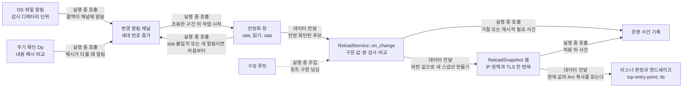

# 파일 변경 감지 모듈 설계

이 모듈은 설정 파일과 인증서·개인키 파일의 변경을 감지한다. 변경이 멈춘 뒤 파일 내용을 재로드 후보 하나로 읽는다. 후보는 작업 하나가 순서대로 처리하며, 가장 최신 후보만 적용한다. 적용할 때는 IP 허용 목록과 TLS 설정을 한 스냅샷으로 한 번에 바꾼다. 이 문서는 구현 전 Target 초안이며 검토 뒤에 확정한다. 운영 스펙 OPS-TBD-007은 아직 열려 있다.

| 항목 | 값 |
| --- | --- |
| 구조 시점 | Target |
| 문서 상태 | Draft |
| 구현 대조 | 미대조 |
| 코드 위치 | 목표 위치, 현재 파일 없음: `crates/adapters/src/file_watch.rs` `ReloadWatcher::run`, `crates/app/src/reload/` `ReloadService::on_change` |
| 코드 지도 | [코드 지도](code-map.md) |
| 관련 스펙 | [운영 스펙 2절](../specs/operations.md#2-상태와-검증-매개변수)(D, Dp), [3.3절](../specs/operations.md#33-파일-변경-자동-감지와-부분-재로드), [7절](../specs/operations.md#7-수용-테스트)의 OPS-003, OPS-024~028, OPS-035, OPS-038, OPS-040, OPS-041, [8절](../specs/operations.md#8-미결정-사항)의 OPS-TBD-007 |
| 관련 계약 | [설정 계약 1.2절](../contracts/config-v1.md#12-키-표), [1.8절](../contracts/config-v1.md#18-재로드-구분), [2.1절](../contracts/config-v1.md#21-설정-오류와-준비-실패), [운영 정보 계약 자동 재로드](../contracts/ops-info-v1.md#자동-재로드), [CLI·계정 파일 계약 1.8절](../contracts/cli-v1.md#18-수동-시작과-종료) |
| 관련 ADR | 없음 |

## 1. 책임과 경계

- 맡는 책임:
  - 설정 파일과 `cert_file`·`key_file`이 가리키는 파일의 변경을 OS 파일 알림과 주기 확인으로 감지한다.
  - 변경이 멈춘 뒤 설정 파일과 참조 파일을 재로드 후보 하나로 읽는다.
  - 재로드 후보를 순서대로 처리하고, 최신 후보만 적용한다.
  - 감시 시작 실패, 실행 중 감시 장애, 재로드 결과를 운영 사건으로 알린다.
  - 적용할 때 허용 목록과 TLS 설정을 한 스냅샷으로 교체한다.
- 맡지 않는 책임:
  - 설정 구문과 값 검증: [설정 읽기 설계](config-loading.md)의 `parse`를 쓴다.
  - TLS 쌍 검사와 수락기(acceptor) 만들기: [TLS 모듈 설계](tls.md).
  - 출발지 IP 판정: [TCP 진입점 설계](tcp-entry-point.md).
  - 계정 파일 감시: 하지 않는다. [CLI·계정 파일 계약 1.7절](../contracts/cli-v1.md#17-서버-실행-중-계정-파일-변경).
  - 수동 재로드 API와 CLI: 추가하지 않는다. [운영 스펙 3.3절](../specs/operations.md#33-파일-변경-자동-감지와-부분-재로드).
  - 정상 종료 순서: [서버 시작 설계](serve-startup.md).
- 다른 모듈에 공개하는 기능:
  - `ReloadWatcher::run` (adapters): 시작 단계 (3)에서 감시를 시작하고 재로드 후보를 만든다.
  - `ReloadService::on_change` (app): 재로드 후보 하나를 검증·비교하고 결과를 기록한다.
  - `ReloadSnapshot` 읽기 (app): 리스너가 IP 판정이나 TLS 핸드셰이크 때 현재 값을 읽는다.

## 2. 내부 구조

화살표 의미는 다음 네 가지다. 모든 화살표는 Target 설계이며 현재 코드에는 없다.

- 실행 중 호출: 콜백이나 채널 신호로 다른 작업을 깨운다. 호출하는 쪽은 결과를 기다리지 않는다.
- 데이터 전달: 재로드 후보나 값을 복사해 넘긴다. 넘긴 뒤 원본을 바꾸지 않는다.
- 실행 중 주입: 구성 루트가 시작 때 포트의 구현을 넘긴다.
- 컴파일 시 의존: 크레이트 의존 방향이다. adapters가 app을 참조한다. app은 adapters를 참조하지 않는다.

| 요소(파일·심볼) | 역할 | 만들어지는 시점과 소유자 | 의존 대상 |
| --- | --- | --- | --- |
| `crates/adapters/src/file_watch.rs` `ReloadWatcher::run` | OS 알림 등록, 주기 확인, 안정화 창, 재로드 후보 만들기, 후보 작업 실행 | 시작 단계 (3)에서 만들고 프로세스 수명 동안 유지한다. 소유자는 `ReloadWatcher`다. | notify 크레이트, tokio, app의 `ReloadService` 포트 |
| `crates/adapters/src/file_watch.rs` 내부 `WatchSet`·`ProcessedState` | 감시 경로 목록과 처리한 마지막 내용 해시 | `ReloadWatcher`가 소유한다. 시작 때 실행 중 유효 설정으로 채운다. | 실행 중 유효 설정의 경로 값 |
| `crates/app/src/reload/` `ReloadService::on_change` | 파싱, 검증, 재시작 필요 비교, 교체, 사건 기록 | 시작 단계 (3)에서 만든다. 실행 중 `Settings`와 `ReloadSnapshot` 셀을 든다. | 설정 파싱 포트, TLS 수락기 포트, 사건 기록 포트 |
| `ReloadSnapshot` 셀 (app `reload/` 안, 위치는 구현 때 정한다) | 허용 목록 네 개와 TLS 수락기 값을 담은 공유 상태 | `ReloadService`가 쓰고, 리스너가 읽는다. | 없음 |

## 3. 데이터 모델

모듈 밖과 주고받는 형식은 계약에 두고 여기에서는 링크한다. 아래는 내부 자료다.

| 이름 | 필드·형태 | 저장 위치 | 제약과 항상 지켜야 할 조건 |
| --- | --- | --- | --- |
| `WatchSet` | 감시 항목 목록. 각 항목은 경로, 역할(설정·인증서·개인키), 감시 디렉터리 | 메모리 | 설정 파일과 실행 중 유효 설정의 `cert_file`·`key_file` 값에서 만든다. 계정 파일은 넣지 않는다. 같은 디렉터리는 한 번만 등록한다. |
| `ProcessedState` | 경로별 마지막 처리 내용 해시(`u64`), 설정 파일 해시. 파일이 없었으면 "없음" 값 | 메모리 | 재로드 후보 결과(적용, 거절, 재시작 필요, 교체 생략)가 나온 뒤에만 갱신한다. 읽기만 한 값으로 갱신하지 않는다. 해시 알고리즘은 §9 항목 3. |
| `ChangeEpisode` | 세대 번호(`u64`), 열린 묶음 여부, 출처(`os_notify` 또는 `poll`), 마지막 변경 시각 | 메모리 | 알림이나 해시 차이가 올 때마다 세대 번호를 올린다. 묶음이 열려 있으면 `reload_change_detected`를 다시 쓰지 않는다. |
| `FileStamp` | 크기(바이트), 수정 시각 | 메모리(안정화 창 안에서만) | 여러 번 기록해 같은지 본다. 기록 시점은 §4의 (b), (d), (f) 단계다. |
| `ReloadCandidate` | 세대 번호, 설정 파일 내용(UTF-8 텍스트), 참조 파일 내용(바이트) | 메모리 | 검증한 바이트를 그대로 교체에 쓴다. 파일을 다시 열지 않는다. 결과가 나오면 버린다. |
| `ReloadOutcome` | 적용(`applied` 키 목록), 거절(`reason`, `config_key?`, `detail?`), 재시작 필요(`config_keys`), 감시 장애(`reason`, `detail?`) | 사건 기록으로만 넘긴다 | 필드 이름과 값은 [운영 정보 계약 자동 재로드](../contracts/ops-info-v1.md#자동-재로드)가 정한다. |
| `ReloadSnapshot` | 허용 목록 네 개(`relay.tcp_viewer.allow`, `relay.tcp_server.allow`, `relay.ws_viewer.allow`, `relay.wss_viewer.allow`)와 TLS 수락기 값(WSS 뷰어, HTTPS 관리 리스너) | 공유 셀 하나. 타입은 `std::sync::RwLock<Arc<ReloadSnapshot>>` 설계 | 읽는 쪽은 `Arc`를 복사해 쓴다. 쓰는 쪽은 새 값을 다 만든 뒤 한 번만 바꾼다. 잠금이 중독되면 `PoisonError::into_inner`로 값을 꺼낸다. 새 크레이트를 쓰지 않는다. |

## 4. 처리 순서

대표 시나리오: 운영자가 편집기로 설정 파일을 저장한다. 편집기는 임시 파일을 쓴 뒤 원래 이름으로 바꾼다. 이 저장으로 허용 목록만 바뀌었다고 가정한다.

| 순서 | 코드 위치(파일·심볼) | 조건·계산 | 바뀌는 상태 | 결과를 쓰는 곳 |
| --- | --- | --- | --- | --- |
| 1 | `file_watch.rs` `ReloadWatcher::run`의 알림 콜백 | 이벤트 경로 가운데 하나라도 감시 항목의 파일 이름과 같으면 변경으로 본다. 임시 파일 이름은 무시한다. 이름 바꾸기 이벤트는 바뀐 쪽 이름도 본다. | 세대 번호 증가. 묶음이 닫혀 있었으면 묶음을 열고 출처를 `os_notify`로 둔다. | 사건 `reload_change_detected`(묶음당 한 번). 진행 중인 안정화 확인은 재시작 요청으로 끝낸다. |
| 2 | `file_watch.rs` `ReloadWatcher::run`의 주기 확인(Dp 타이머) | 감시 파일 전부를 읽어 내용 해시를 구한다. 해시가 `ProcessedState`와 다르면 변경으로 본다. 파일이 없으면 "없음" 값으로 비교한다. 그 밖의 입출력 오류는 장애다. | 해시가 다르면 세대 번호 증가, 출처 `poll` | 사건 `reload_change_detected`(`poll`). 입출력 오류는 `reload_watch_failed`(`poll_error`). |
| 3 | `file_watch.rs` `ReloadWatcher::run`의 안정화 창 | (a) 조용한 구간 Q 동안 새 알림이 없을 때까지 기다린다. (b) 감시 파일 전부의 `FileStamp`를 기록한다. (c) 간격 G만큼 기다린다. (d) 다시 기록한다. 같으면 (e) 설정 파일과 참조 파일을 읽는다. (f) 다시 기록하고 (b)와 같으면 후보로 확정한다. 다르거나 알림이 오면 (a)부터 다시 한다. 파일이 없으면 후보를 거절한다. | 임시 값만 바뀐다. 확정되면 `ReloadCandidate`가 생긴다. | 후보를 `ReloadService::on_change`로 넘긴다. |
| 4 | `file_watch.rs` `ReloadWatcher::run`의 세대 확인 | 후보의 세대 번호가 현재 세대 번호와 같은지 본다. | 다르면 후보를 버린다. | 결과 사건을 쓰지 않는다(§9 항목 10). |
| 5 | `crates/app/src/reload/` `ReloadService::on_change`의 파싱 | 설정 내용을 설정 파싱 포트로 읽어 기본값을 채운다. | 성공하면 후보 설정을 가진다. | 실패하면 `reload_rejected`(`reason`은 설정 오류 코드). `ProcessedState`를 갱신한다. |
| 6 | `crates/app/src/reload/` `ReloadService::on_change`의 검증 | 설정 계약 1.1~1.7절의 검사를 모두 한다. 켜진 TLS 리스너에 대해 참조 파일의 바이트로 수락기를 만든다. 쌍이 맞지 않거나 키 형식이 틀리면 거절한다(§9 항목 12). | 실패하면 교체하지 않는다. | `reload_rejected`(`tls_file_invalid` 등). `ProcessedState`를 갱신한다. |
| 7 | `crates/app/src/reload/` `ReloadService::on_change`의 비교 | 재로드 대상 값을 뺀 `Settings`를 실행 중 값과 `PartialEq`로 비교한다. 경로 값은 뺀다. 경로가 있는지 없는지는 비교한다. 그래서 HTTP와 HTTPS 전환과 WSS 켜기·끄기는 재시작 필요다. | 차이가 있으면 교체하지 않는다. | `reload_restart_required`(`config_keys`). `ProcessedState`를 갱신한다. |
| 8 | `crates/app/src/reload/` `ReloadService::on_change`의 최종 확인 | 세대 번호가 같고, 정상 종료가 시작되지 않았는지 본다. | 아니면 후보를 버린다. | 결과 사건을 쓰지 않는다(§9 항목 10). |
| 9 | `ReloadService::on_change`의 교체 | 바뀐 값만 담은 새 `ReloadSnapshot`을 만든다. 완성한 뒤 셀에 한 번 쓴다. 전체 허용 항목이 적용되면 경고를 쓴다. | 새 접속과 새 TLS 핸드셰이크부터 새 값을 쓴다. 기존 연결은 옛 값을 유지한다. | `reload_applied`(`applied`에 실제로 바뀐 키만). 경고 `allow_all_source`. |
| 10 | `ReloadWatcher::run` | 결과가 나온 후보의 내용 해시를 `ProcessedState`에 넣는다. 감시 집합을 다시 계산한다(§9 항목 9). 묶음을 닫는다. | 다음 변경을 기다린다. | 없음 |

### 4.1 시간 기준

- 알림으로 잡은 변경: 감지부터 안정화, 검증, 교체, 결과 기록까지 D 안에 끝나야 한다. D는 마지막 변경을 감지한 뒤부터 잰다. 이 기준은 [설정 계약 1.2절](../contracts/config-v1.md#12-키-표)의 D 행에 있다(§9 항목 2).
- 놓친 변경: 주기 확인이 Dp 안에 감지한다. 그 뒤 D 안에 결과가 나온다. 최대 지연은 Dp + D다([운영 스펙 3.3절](../specs/operations.md#33-파일-변경-자동-감지와-부분-재로드)).
- 연속 변경: 변경마다 D를 새로 잰다. 파일이 계속 바뀌면 결과가 나오지 않는다(§9 항목 15).
- 조용한 구간 Q, 간격 G, 읽기, 검증, 교체의 합은 D보다 충분히 짧아야 한다. D의 최소값은 1초다. Q와 G의 구체 값은 §9 항목 1에서 정한다.

### 4.2 사건 순서

한 묶음에서 나오는 사건은 다음 순서를 따른다.

1. `reload_change_detected`를 한 번 쓴다. 출처는 처음 감지한 쪽이다(`os_notify` 또는 `poll`).
2. 결과 사건 하나를 쓴다: `reload_applied`, `reload_rejected`, `reload_restart_required` 중 하나다. 한 묶음에 결과는 하나만 나온다.

규칙:

- `reload_rejected`와 `reload_restart_required`는 서로 다른 사건이다. 재시작 필요는 검증 실패로 세지 않는다([운영 정보 계약 자동 재로드](../contracts/ops-info-v1.md#자동-재로드)).
- 자동 재로드가 교체에 성공하지 않았으면 `reload_applied`를 쓰지 않는다.
- `reload_watch_failed`는 묶음 없이 단독으로 쓴다.
- 시작 때 감시 등록에 실패하면 `startup_failed`(`watch_unavailable`)를 쓴다. `reload_watch_failed`가 아니다.

### 4.3 검증 순서 확인점

- 알림 차단(OPS-041): 테스트 훅으로 알림 전달을 막는다. 변경은 Dp 안에 주기 확인으로 잡혀야 한다. 적용은 감지 뒤 안정되면 D 안에 끝나야 한다(최대 Dp + D).
- 검증 지연(OPS-027): 검증 전에 멈추는 테스트 훅을 둔다. 훅이 멈춘 동안 새 변경을 넣는다. 이전 후보는 적용되지 않아야 하고, 최신 후보만 적용되어야 한다.
- 한쪽만 교체(OPS-026): 인증서만 바꾼 후보나 개인키만 바꾼 후보는 쌍 검사에서 `tls_file_invalid`로 거절되어야 한다. 두 파일이 함께 바뀐 새 후보는 적용되어야 한다.
- 순서는 훅과 채널 신호로 맞춘다. `sleep`으로 순서를 맞추지 않는다. 시간은 §9 항목 13의 방식으로 제어한다.
- 테스트 함수 위에 표식을 쓴다. 예: `/// spec: operations.md:OPS-041`. 시나리오 일부만 다루면 ` partial`을 붙인다. 새 시나리오 ID는 만들지 않는다.
- 테스트 위치와 실행은 구현 작업에서 정한다. 이 문서는 검증 결과를 주장하지 않는다.

## 5. 상태와 초기화

- 초기화·로딩 시점: 시작 단계 (3)이다. [CLI·계정 파일 계약 1.8절](../contracts/cli-v1.md#18-수동-시작과-종료)의 순서를 따른다. 계정 파일 읽기(2) 뒤, 리스너·TLS 준비(4) 앞이다. 순서는 감시 등록, 기준 내용 해시 읽기, 실행 중 값 설정이다(§9 항목 11). 단계 (4)가 실패하면 감시 자원을 푼다.
- 상태 소유자와 제거 시점: `ReloadWatcher`가 OS 감시 핸들, `WatchSet`, `ProcessedState`를 든다. `ReloadService`가 실행 중 `Settings`와 `ReloadSnapshot` 셀을 든다. 둘 다 프로세스 수명과 같다. 정상 종료가 시작되면 새 후보를 받지 않고, 감시 핸들을 해제한다.
- 동시 실행과 순서: 재로드 후보 처리는 작업 하나가 맡는다. OS 알림 콜백과 Dp 타이머는 세대 번호만 올리고 신호를 보낸다. 작업은 한 번에 후보 하나만 다룬다. 교체 직전에 세대와 종료 상태를 다시 확인한다. 알림 채널이 가득 차서 알림을 넣지 못하면 "전체 재확인 필요" 표시를 세운다. 이 표시는 놓친 알림으로 보고 처리한다(§6).
- 종료 신호는 기존 `tokio::sync::watch` 채널을 쓴다. [TCP 진입점 설계](tcp-entry-point.md)의 동시성 절과 같은 방식이다.

## 6. 오류 처리

| 실패 지점 | 처리 방법 | 남는 상태 | 관련 스펙 시나리오 |
| --- | --- | --- | --- |
| 시작 때 감시 등록 실패 (`file_watch.rs` `ReloadWatcher::run`) | 시작을 멈춘다. 종료 코드 1, `watch_unavailable`을 낸다. 로그에 `startup_failed`를 쓴다. 얻은 자원을 푼다. [CLI·계정 파일 계약 2.2절](../contracts/cli-v1.md#22-오류-코드). | 없음 | OPS-028 |
| 실행 중 OS 알림 장애 (`ReloadWatcher::run`) | `reload_watch_failed`(`notify_error`)를 쓴다. 이전 유효 설정을 유지한다. 주기 확인은 계속한다. 이것은 §9 항목 4의 권장안 (a)다. | 알림 감시 장애 표시 | OPS-028 |
| 실행 중 주기 확인 입출력 오류 (`ReloadWatcher::run`) | `reload_watch_failed`(`poll_error`)를 쓴다. 이전 유효 설정을 유지한다. 둘 다 실패하면 자동 적용을 멈춘다(§9 항목 4). | 주기 확인 장애 표시 | OPS-028 |
| 알림 채널 넘침, OS 알림 큐 넘침 | 놓친 알림으로 본다. 전체 재확인을 즉시 한다. 사건은 쓰지 않는다. 장애로 볼지는 §9 항목 4와 함께 정한다(설계 제안). | 전체 재확인 대기 | OPS-041(알림 없이 감지되는 경로) |
| 설정 구문·값 오류, IP 항목 오류 (`ReloadService::on_change`) | `reload_rejected`를 쓴다. `reason`, `config_key?`, `detail?`를 싣는다. 기존 설정과 연결을 유지한다. | 처리 내용 해시 갱신. 다음 변경에서 다시 검증한다. | OPS-026, OPS-040 |
| 인증서·개인키 쌍 불일치, 키 형식 오류, 파일 없음·읽기 불가 (`ReloadService::on_change`) | `reload_rejected`를 쓴다. `reason`은 `tls_file_invalid`다. 기존 인증서를 유지한다. | 처리 내용 해시 갱신. 파일이 생기면 새 알림으로 새 후보가 온다. | OPS-026 |
| 설정 파일 일시 소멸 (`ReloadWatcher::run` 안정화 창) | 후보를 거절한다. 코드는 `config_file_unreadable`이다([설정 계약 2.1절](../contracts/config-v1.md#21-설정-오류와-준비-실패): "일시 소멸 포함, 후보 거절"). | 처리 내용 해시 갱신. 파일이 다시 생기면 새 알림으로 새 후보가 온다. | OPS-026 |
| 재시작 필요 차이 (`ReloadService::on_change`) | 교체하지 않는다. `reload_restart_required`를 쓴다. | 실행 중 값 유지. 차이가 파일에 남으면 이후 후보도 같은 결과를 낸다. | OPS-003, OPS-035 |
| 교체 직전 세대가 낡았거나 종료가 시작됨 (`ReloadService::on_change`) | 후보를 버린다. 적용하지 않고, 결과 사건을 쓰지 않는다(§9 항목 10). | 처리 내용 해시를 갱신하지 않는다. 다음 변경 알림이 새 후보를 만든다. | OPS-027, OPS-028 |
| 교체 뒤 경고 기록 (`ReloadService::on_change`) | 전체 허용 항목이 적용된 경우에만 `allow_all_source`를 쓴다. 거절된 후보에는 쓰지 않는다. | 없음 | OPS-038, [운영 스펙 3.3절](../specs/operations.md#33-파일-변경-자동-감지와-부분-재로드) 규칙 4 |
| 운영 사건 기록 실패 | [운영 정보 계약](../contracts/ops-info-v1.md)의 로그 쓰기 실패 규칙을 따른다. 재로드 처리는 계속한다. | 로그 쓰기 실패 상태 | 운영 정보 계약의 로그 규칙 |

## 7. 설계 선택

| 선택 | 이유 | 검토한 다른 방법 | 근거 |
| --- | --- | --- | --- |
| 파일이 아니라 설정 파일과 인증서·개인키가 있는 디렉터리를 감시한다. 이름이 맞는 이벤트는 모두 받는다. | 임시 파일을 쓴 뒤 이름을 바꾸는 저장은 파일 대상을 바꾼다. 파일 단위 감시는 옛 대상을 따라갈 수 있다. 플랫폼별 동작은 미대조다. | 파일 단위 감시, 생성 이벤트만 받기 | 사용자 결정 2026-10-21(Q8). 편집기마다 저장 방식이 달라 이름 기준 필터는 설계 제안이다. |
| 변경이 멈춘 상태는 조용한 구간 뒤 `FileStamp`가 두 번 같은 것으로 본다. | 사용자가 정한 안정 기준이다. | 파일 크기만 보기, 고정 시간만 기다리기 | 사용자 결정 2026-10-21(Q8). |
| 읽기 전후에 `FileStamp`를 한 번 더 기록한다((f) 단계). | 운영 스펙 3.3절 규칙 2는 임시 저장과 한쪽 파일만 바뀐 상태를 유효한 새 구성으로 보지 않는다. 읽는 중 바뀐 내용도 같은 이유로 막는다. | (f) 없이 두 기록만 쓰기 | 설계 제안이다. 사용자 결정이 아니다. §9 항목 1과 함께 검토한다. |
| 주기 확인은 내용 해시를 비교한다. 해시는 다시 읽을 트리거일 뿐이다. 적용 판단은 실행 중 값과 비교한다. | 사용자가 정한 방향이다. 해시만으로 적용하면 같은 내용의 재적용이 생긴다. | 파일 내용 전체를 저장해 비교 | 사용자 결정 2026-10-21(Q8). 해시 종류는 §9 항목 3. |
| 재로드 후보 처리는 작업 하나가 맡고, 세대 번호로 최신 후보만 적용한다. | 늦게 끝난 검증이 새 후보를 덮어쓰면 안 된다. 작업 하나면 적용 순서가 정해진다. | 후보마다 작업을 만들기 | 사용자 결정 2026-10-21(Q8). 운영 스펙 3.3절 규칙 5. |
| 검증한 바이트를 그대로 교체에 쓴다. 교체 때 파일을 다시 열지 않는다. | 다시 열면 검증하지 않은 내용이 들어갈 수 있다. 현재 [TLS 모듈 설계](tls.md)는 경로로 수락기를 만들므로 바이트 입력 함수가 필요하다(§8). | 교체 때 경로로 다시 열기 | 운영 스펙 3.3절 규칙 2와 4. |
| IP 정책과 TLS 값을 한 스냅샷으로 한 번에 바꾼다. | 두 값을 따로 바꾸면 사이에 새 허용 목록과 옛 인증서가 함께 보일 수 있다. | 두 셀을 따로 바꾸기 | 사용자 결정 2026-10-21(Q8). 운영 스펙 3.3절 규칙 4. 설정 계약 1.8절 규칙 5. |
| 재시작 필요 판정은 매번 실행 중 값과 비교한다. 고정 플래그를 두지 않는다. | 파일에 차이가 남아 있으면 비교 결과가 매번 같다. 그래서 거절이 차이가 남은 동안 계속된다. | 한 번 거절되면 플래그로 막기. 플래그는 해제 조건을 따로 정해야 한다. | 운영 스펙 3.3절 규칙 3. 설정 계약 1.8절 규칙 4. 운영 정보 계약 자동 재로드의 `reload_restart_required` 행. |
| 스냅샷 셀은 표준 라이브러리의 `RwLock<Arc<T>>`로 만든다. | 새 크레이트 없이 교체를 한 번에 한다. 읽기는 `Arc` 복사만 한다. | `arc-swap` 크레이트 | 설계 제안. 새 크레이트를 추가하지 않는다. |
| 파일 알림은 notify 크레이트를 쓴다. | PRD 1절 구현 기술 표에 "파일 감지 notify"가 있다. 2026-10-20 라이선스 검토 뒤 승인되었다. | 플랫폼 API를 직접 호출 | [PRD 1절](../requirements/PRD.md). |
| 한 변경 묶음에 `reload_change_detected`를 한 번만 쓴다. | 운영 정보 계약은 변경을 "처음 감지했을 때" 기록한다고 쓴다. 연속 저장에서 같은 사건이 반복되지 않게 한다. | 알림마다 쓰기 | 운영 정보 계약 자동 재로드 행. 묶음 단위 해석은 설계 제안이다. |

## 8. 현재 코드와의 차이

| 항목 | 현재 코드(파일·심볼) | 목표 설계 | 전환 계획 |
| --- | --- | --- | --- |
| 파일 변경 감지 | 없음. `crates/adapters/src/file_watch.rs` 파일이 없다. | §2, §4의 `ReloadWatcher::run` | 작업 5.1·5.2 |
| 시작 단계 (3) 파일 변경 감지 준비 | 없음. [서버 시작 설계](serve-startup.md)는 이 단계를 작업 5.1·5.2 몫으로 적는다. | §5 | 작업 5.1·5.2(2026-10-20 사용자 결정) |
| 재로드 판정과 적용 | 없음. `crates/app/src/reload/` 디렉터리가 없다. | §4의 `ReloadService::on_change` | 작업 5.x |
| 허용 목록 스냅샷 | 재로드 적용 경로가 없다. 시작 때 읽은 목록을 쓴다([TCP 진입점 설계](tcp-entry-point.md) 1절). | §3의 `ReloadSnapshot` | 작업 5.2 |
| TLS 교체 | 재로드 교체가 없다([TLS 모듈 설계](tls.md) 8절). 현재는 경로로 수락기를 만든다(5절). | 검증한 바이트로 수락기를 만드는 함수와 스냅샷 값 | 작업 5.x. 이 함수를 추가하면 [TLS 모듈 설계](tls.md)도 고친다. 이 문서 범위 밖이다. |
| 설정 파싱 재사용 | 재로드 호출자가 없다([설정 읽기 설계](config-loading.md) 1절). | `parse`를 재로드 후보에도 쓴다 | 작업 5.x |
| 재로드 사건 | 없음. 운영 정보 계약의 테스트 표에서 미생성으로 되어 있다. | §4.2, §6의 사건 | 작업 5.x |
| 정상 종료 중 새 후보 중지 | 없음. | §5 | 작업 5.3 |

## 9. 미결정 사항

| 항목 | 영향 | 확정 위치 |
| --- | --- | --- |
| 1. 조용한 구간 Q와 간격 G의 값 | D 안에 끝나는지, 저장 중간 상태를 피하는지 | 운영 스펙 8절(OPS-TBD-007)과 사용자 승인. 키를 추가하면 설정 계약 1.2절. |
| 2. D의 시작점 | 최대 지연 식, 설정 계약과 운영 스펙의 문구 | 설정 계약 1.2절과 운영 스펙 2절·3.3절 |
| 3. 내용 해시 알고리즘 | 놓친 변경 검출의 정확도, 새 의존성 여부 | 사용자 승인. 직접 의존성을 추가하면 승인 필요. |
| 4. 한쪽 감시만 실패했을 때 동작 | 자동 적용 계속 여부 | 운영 스펙 3.3절 규칙 6과 설정 계약 1.8절 규칙 7 |
| 5. 실패한 감시를 다시 세우는 방식 | 복구 시점, 복구 사건 | 설정 계약 1.8절(재시도 규정 없음). 복구 사건은 운영 정보 계약에 정의되어 있지 않다. 추가하면 호환 변경이다. |
| 6. 심볼릭 링크 감시 | 링크 경로와 실제 경로의 변경 감지 | 운영 스펙 8절 또는 설계 문서 한계 기록 |
| 7. 내용이 같은 후보(주석만 바뀜) | 사건 기록 수 | 운영 정보 계약 자동 재로드 행 |
| 8. 같은 원인의 사건이 반복될 때 | 로그 양 | 운영 정보 계약. 중복 억제는 계약 변경이 필요하다. |
| 9. 감시 집합의 갱신 시점 | 새 경로 감지, 거절된 후보의 경로 | 이 문서의 결정 후 설계 갱신 |
| 10. 버린 후보의 사건 | 세대 교체와 종료 중 버린 후보의 기록 | 운영 정보 계약. 새 사건이면 계약 변경. |
| 11. 시작 때 감시 등록과 기준 해시의 순서 | 등록과 읽기 사이의 변경 처리 | 이 문서에서 확정. 필요하면 CLI 계약 1.8절 주석 |
| 12. 꺼진 WSS 진입점과 평문 관리 리스너의 파일 | 감시 범위와 검사 범위 | 설정 계약 1.7절과 진입점 키 규칙, TLS 모듈 설계 |
| 13. 테스트 시계 | 시간 제어 방식, 기능 설정 | 구현 작업 |
| 14. Windows 디렉터리 핸들과 편집기 핸들 | 저장 실패 가능성, 안정 판정 | Windows 검증 뒤 확정. 현재 미대조. |
| 15. 연속 변경 상한 | D가 끝나지 않는 경우 | 운영 스펙 8절. 상한을 두면 설정 계약 변경. |

### 9.1 항목별 선택지와 권장

1. **Q와 G.** 선택지는 다음과 같다. (a) 구현 상수로 두고 검토 때 승인한다. (b) D에서 비율로 유도한다. (c) 새 선택 키를 추가한다. (c)는 설정 계약 3절의 호환 변경이며 계약 수정이 필요하다. G를 Q와 같은 값으로 둘지 따로 둘지도 정한다. 권장: (a). 어느 방식이든 Q + G + 읽기 + 검증 + 교체의 합은 D보다 짧아야 한다.
2. **D의 시작점.** 설정 계약 1.2절 표는 D를 "마지막 변경을 감지한 뒤"부터 잰다고 쓴다. 같은 절 아래 문장은 안정화 대기를 D 안에서 구현이 정한다고 한다. 운영 스펙 2절의 D 행은 감지 뒤 파일이 안정되면 D 안에 결과를 확인한다고 쓴다. 운영 스펙 3.3절 규칙 5도 안정된 최신 상태 뒤의 D를 말한다. 선택지: (a) 마지막 감지 시점부터 잰다. 최대 지연은 Dp + D로 유지된다. 스펙의 문구를 맞춘다. (b) 안정된 시점부터 잰다. 최대 지연은 Dp + Q + G + D 식이 되며 운영 스펙 3.3절의 시간 기준 문장을 고쳐야 한다. 권장: (a). 스펙 문구 수정은 사용자 승인이 필요하다.
3. **내용 해시.** 선택지: (a) 표준 라이브러리의 `DefaultHasher`(64비트). 새 크레이트가 없고 같은 프로세스 안에서만 비교한다. 충돌로 놓칠 가능성은 낮지만 0은 아니다. (b) 암호 해시(SHA-256 계열). 이미 트리에 있는 aws-lc-rs를 직접 의존성으로 추가해야 한다. 승인이 필요하다. (c) 해시를 쓰지 않고 바이트를 저장해 비교한다. 사용자 방향과 다르다. 권장: (a). 사용자 확인을 받는다.
4. **한쪽 감시만 실패했을 때.** 선택지: (a) 한쪽이 실패하면 다른 쪽으로 계속한다. 둘 다 실패하면 자동 적용을 멈춘다. (b) 어떤 장애든 자동 적용을 멈춘다. 운영 스펙 3.3절 규칙 6과 설정 계약 1.8절 규칙 7의 "이전 유효 설정"은 두 해석이 가능하다. 권장: (a). 사용자 확인을 받는다. 이 방식이면 주기 확인만으로 적용될 때 최대 지연이 Dp + D가 된다.
5. **감시 다시 세우기.** 재시도 규정이 없다. 선택지: (a) 주기 확인 때마다 등록을 다시 시도한다. (b) 별도 간격으로 다시 시도한다. 권장: (a). 복구 사건은 운영 정보 계약에 없다. 복구 사건을 추가하는 것은 호환 변경이다.
6. **심볼릭 링크.** 선택지: (a) 링크 디렉터리와 실제 대상 디렉터리를 모두 등록한다. 등록할 때 경로를 해석한다. (b) 해석된 대상만 등록한다. (c) 한계로 기록한다. 권장: (a). 확인이 더 필요하다.
7. **내용이 같은 후보.** 설정 계약 1.8절 규칙 2에 따라 값이 같으면 차이가 없다. 선택지: (a) 사건을 쓰지 않는다. (b) `reload_change_detected`만 쓴다. 권장: (b). 결과 사건은 쓰지 않는다.
8. **반복 사건.** 부분 쓰기로 거절이 연속될 때 사건이 여러 번 나온다. 운영 정보 계약은 재시작 필요를 "차이가 남은 동안 이후 변경에도 기록한다"고 한다. 선택지: (a) 모두 기록한다. (b) 같은 내용은 한 번만 쓴다. (b)는 계약 변경이 필요하다. 권장: (a). 조용한 구간으로 부분 쓰기 후보 수를 줄인다.
9. **감시 집합 갱신.** 경로 값이 바뀌면 새 디렉터리를 등록해야 한다. 후보가 가리키는 새 경로가 없을 때도 그 파일이 생기는 것을 알아야 한다. 선택지: (a) 실행 중 값의 경로만 감시한다. (b) 실행 중 경로와 마지막 후보의 경로를 함께 감시한다. 결과가 나오면 다시 계산한다. 권장: (b).
10. **버린 후보의 사건.** 세대가 바뀌거나 종료가 시작되어 버린 후보는 결과를 쓰지 않는다. 다음 변경 알림이 새 후보를 만든다. 선택지: (a) 사건을 쓰지 않는다. (b) 새 사건을 쓴다. (b)는 운영 정보 계약 변경이 필요하다. 권장: (a).
11. **시작 순서.** 선택지: (a) 감시를 먼저 등록하고 기준 해시를 읽는다. (b) 기준 해시를 먼저 읽는다. 권장: (a). 등록과 읽기 사이의 변경은 알림이나 주기 확인으로 잡힌다. 적용 판단은 실행 중 값과 비교하므로 같은 내용이 두 번 적용되지 않는다.
12. **꺼진 WSS와 평문 관리 리스너.** 설정 계약 1.7절에 따르면 WSS 인증서·개인키는 WSS가 켜졌을 때만 필수다. 1.7절 표에는 관리 TLS 파일의 필수 조건이 없다. 선택지: (a) 실행 중 설정에 있는 경로를 모두 감시하고, 켜진 항목만 검사한다. (b) 켜진 항목의 경로만 감시한다. 권장: (b). 설정 계약은 꺼진 진입점의 키도 형식과 범위 검사를 받는다고 쓴다. 꺼진 항목의 파일 내용을 검사하는지는 [TLS 모듈 설계](tls.md)에서 먼저 확인한다.
13. **테스트 시계.** 선택지: (a) 시계를 주입한다. (b) `tokio`의 일시 정지 시계를 쓴다. (b)는 `tokio`의 테스트 기능 설정이 필요하다. 이 설정이 이미 있는지는 확인하지 않았다. 권장: (a). 새 크레이트는 추가하지 않는다.
14. **Windows 핸들.** 디렉터리 핸들이 감시 중 디렉터리의 이름 바꾸기나 삭제를 막을 수 있다. 편집기가 연 파일 핸들이 `FileStamp` 읽기를 막는지도 확인해야 한다. 이 내용은 Windows 검증 뒤 확정한다. 현재 미대조다.
15. **연속 변경 상한.** 계약에 상한이 없다. 파일이 계속 바뀌면 결과가 없다. 선택지: (a) 상한을 두지 않는다. 기록만 한다. (b) 상한이 지나면 거절한다. (b)는 설정 계약 변경과 새 코드가 필요하다. 권장: (a). 위험으로 기록한다.

### 9.2 남은 위험

- 수정 시각 해상도: 파일 시스템에 따라 수정 시각 단위가 1~2초일 수 있다. 같은 크기로 같은 단위 안에 바뀐 파일은 `FileStamp`로 보지 못한다. 주기 확인의 내용 해시가 잡는다. 이때 지연은 최대 Dp + D다.
- Windows: 디렉터리 핸들이 감시 중 디렉터리의 이름 바꾸기와 삭제를 막을 수 있다. 감시 디렉터리를 옮기는 운영 작업이 막힐 수 있다. 미대조다.
- Linux: inotify 큐 넘침과 감시 개수 한도가 있다. 넘침은 놓친 알림으로 보고 전체 재확인을 한다. 감시 등록 실패는 장애다. 미대조다.
- 부분 쓰기: 쓰는 도중 읽은 TOML이나 PEM은 거절된다. 쓰기가 끝나면 새 알림으로 새 후보가 온다. 거절 사건이 여러 번 나올 수 있다.
- 종료 경쟁: 교체 직전에 종료 상태를 확인해야 한다. 종료가 시작된 뒤에는 교체하지 않는다.
- 주기 확인 비용: 감시 파일 수만큼 읽는다. 파일 수가 적어 부담은 작을 것으로 본다. [INFERENCE] 측정하지 않았다.
- 플랫폼 주장: Ubuntu와 Windows의 알림 동작은 모두 미대조다. 이 문서의 플랫폼 설명은 검증한 사실이 아니다.
