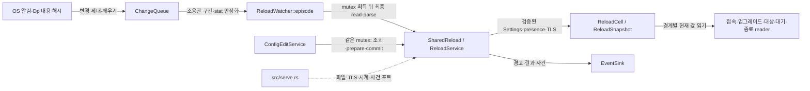

# 파일 변경 감지 모듈 설계

이 모듈은 설정 파일, 켜진 TLS 리스너의 인증서·개인키, ticket을 켠 역할의 공개 키 파일 변경을 감지한다. 안정화 뒤 후보를 읽고 검증해 43개 동적 설정과 TLS 수락기를 한 snapshot으로 발행한다. 공개 키 목록도 Settings에 포함한다. watcher와 설정 편집 서비스는 같은 잠금으로 파일 읽기부터 적용까지 직렬화한다. GET/PATCH의 업무 경계는 [설정 보기·편집 모듈](config-edit.md)이 맡는다. ticket 연결은 [접속 ticket 모듈 설계](relay-access-ticket.md#44-재로드와-편집)를 따른다.

| 항목 | 값 |
| --- | --- |
| 구조 시점 | Current |
| 문서 상태 | Draft |
| 구현 대조 | 2026-11-08 작업 트리의 소스 대조. 이번 변경의 시험은 커밋 `eae442f`의 두 OS 게이트에서 통과했다([작업 6.9 판정표](../how-to/set-up-and-verify.md#42-작업-69-판정표)). 이전 실행 증거는 [대조 기록](#대조-기록)에 보존한다. 설정 v4·신뢰 프록시 재로드 범위의 구현은 커밋 `3df0693`이다. 시험은 커밋 `51bd747`의 두 OS 게이트에서 통과했다([WSS Server·프록시·최근 로그 판정표](../how-to/set-up-and-verify.md#43-wss-server프록시-tls-종료최근-로그-판정표)). |
| 코드 위치 | `crates/adapters/src/file_watch.rs` `ReloadWatcher::run`·`attach`·`episode`·`apply`, `crates/adapters/src/file_watch/feed.rs`, `crates/app/src/reload.rs` `SharedReload`·`ConfigCandidate`·`ConfigPresence`, `crates/app/src/reload/service.rs` `ReloadService`·`PreparedReload`, `crates/app/src/reload/snapshot.rs` `ReloadSnapshot`·`ReloadCell` |
| 코드 지도 | [코드 지도](code-map.md) |
| 관련 스펙 | [운영 §3.3](../specs/operations.md#33-파일-변경-자동-감지와-부분-재로드), OPS-003·024~028·035·038·040·041·047~064 |
| 관련 계약 | [설정 §1.8](../contracts/config-v4.md#18-재로드-구분), [설정 오류](../contracts/config-v4.md#21-설정-오류와-준비-실패), [관리 API §1.13~14](../contracts/management-api-v1.md#113-설정-보기-get-apiv1config), [운영 정보 자동 재로드](../contracts/ops-info-v2.md#자동-재로드) |
| 관련 ADR | [ADR-0006](../decisions/ADR-0006-config-edit-through-file.md) |
| 관련 문서 | [접속 ticket 모듈 설계](relay-access-ticket.md) |

현재는 [설정 v4](../contracts/config-v4.md#18-재로드-구분)의 ticket 10개를 포함한 43개 키를 비교·발행한다. WS·WSS 부모 `trusted_proxies`, 네 역할의 `allow`·`allowed_origins`, 부모 `relay.wss.cert_file`·`key_file`을 각각 비교한다. 부모 `listen`·WS·WSS 역할 `enabled`·`recent_logs.max_entries`의 차이는 후보 전체를 재시작 필요로 거절한다. ticket의 역할 `enabled`는 동적 키다. 모든 WSS 역할이 꺼졌으면 TLS 내용을 읽거나 감시하지 않는다. 어느 한 역할이라도 켜졌으면 부모 TLS 한 쌍만 감시한다.

R1은 `trusted_proxies` 값을 교체하지만 허용 판정에 사용하지 않는다. 전달 주소와 경고는 R2 범위다. `recent_logs.max_entries`는 검증만 하며 보관·API는 R3 범위다. 이전 실행 기록은 R1의 증거가 아니며 이번 문서 작업에서는 빌드·시험·포매터를 실행하지 않았다. 후속: 구현은 커밋 `3df0693`이며, 시험은 커밋 `51bd747`의 두 OS 게이트에서 통과했다([WSS Server·프록시·최근 로그 판정표](../how-to/set-up-and-verify.md#43-wss-server프록시-tls-종료최근-로그-판정표)).

## 1. 책임과 경계

- 설정 파일과 켜진 WSS·관리 TLS의 참조 파일, ticket을 켠 역할의 공개 키 파일을 OS 알림과 Dp 주기 확인으로 감지한다. 계정 파일은 감시하지 않는다.
- 안정화 대기는 잠금 밖에서 한다. 최종 파일 read 전에 `SharedReload<A>` mutex를 잡는다. read·parse·prepare·세대/종료 확인·commit과 결과 기록은 같은 잠금 구간이다.
- `config_file::parse_candidate`가 구문·설정 값·명시 키를 만든다. `ReloadService`가 TLS·ticket 키 후보 검증, 재시작 차이 비교, snapshot 발행과 마지막 재로드 결과를 맡는다.
- 파일 감시·로그 재열기는 adapters, 실행 값·정책·후보 수용은 app이다. app은 notify·TOML·rustls 타입을 알지 못한다.
- 수동 재로드 API·CLI는 없다. PATCH는 설정 파일을 먼저 교체한 뒤 같은 준비 후보를 commit한다.
- 로그 경로는 재로드 해시·세대와 분리한다. 생성·삭제·이름 변경과 독립 Dp 작업이 로그 핸들을 다시 연다.

## 2. 내부 구조

실선은 호출 또는 데이터 전달, 점선은 시작 때 구현체 주입이다. 현재 구조만 표시한다.

| 요소(파일·심볼) | 역할 | 소유·수명 |
| --- | --- | --- |
| `file_watch.rs` `ReloadWatcher` | watched 경로·processed 해시·알림 feed·안정화·후보 최종 read | serve가 만들고 종료 시 join한다. |
| `file_watch/feed.rs` `ChangeQueue`·`NotifyFeed` | 파일 이름별 OS 알림 필터, 세대·유실 재확인·로그 신호 | watcher와 OS 콜백이 공유한다. |
| `reload/service.rs` `ReloadService`·`PreparedReload` | 실행 Settings/presence·TLS 기준 해시·마지막 결과, 부작용 없는 준비와 commit | watcher와 ConfigEditService가 같은 `SharedReload`로 공유한다. |
| `reload/snapshot.rs` `ReloadCell`·`ReloadSnapshot` | Settings·presence·TLS를 한 번 발행한다. | 서비스가 쓰고 runtime reader가 읽는다. |
| `reload/ports.rs` `RuntimeSettingsSource` | TLS 타입을 노출하지 않는 현재 Settings callback | 같은 snapshot read lock을 callback 끝까지 유지한다. |
| `file_watch.rs` `reopen_log` | 알림·Dp에서 로그를 다시 연다. 안정화 대기와 독립이다. | watcher run과 함께 끝난다. |

## 3. 데이터 모델

| 이름 | 실제 형태·제약 |
| --- | --- |
| `ReloadWatcher.watched` | 설정 파일, 실행 중과 마지막 파싱 성공 후보의 TLS 경로·ticket을 켠 역할의 공개 키 경로를 합친 `Vec<PathBuf>`. 같은 경로는 한 번만 넣는다. |
| `ReloadWatcher.processed` | 경로별 `Option<u64>` 내용 해시. 읽은 파일은 DefaultHasher 64비트, 없으면 None. 프로세스 안 감지용이며 API revision SHA-256과 다르다. |
| `ChangeQueue` | 변경 세대와 유실·실패·로그 신호. 한 episode에 `reload_change_detected`를 한 번 기록한다. |
| `FileStamp` | 크기와 수정 시각. 안정화 read 전후를 비교한다. |
| watcher 내부 `Candidate` | 설정 원시 바이트 `Option<Vec<u8>>`와 읽은 경로별 해시. |
| app `ConfigCandidate` | 검증된 `Settings`와 `ConfigPresence`. 바이트·TOML 타입을 담지 않는다. |
| `ConfigPresence` | 명시 leaf 키 `BTreeSet<String>`과 비활성 경로 fallback `BTreeMap<String, PathBuf>`. 의미 차이 비교에는 쓰지 않는다. |
| `PreparedReload<A>` | 검증·생성이 끝난 snapshot·TLS 해시·적용 키·사건/이력 키·경고. 같은 mutex 안에서 준비하고 바로 소비한다. |
| `ReloadSnapshot<A>` | `Arc<Settings>`·`Arc<ConfigPresence>`·`wss_tls`·`management_tls`. IP 정책 중복 저장은 없다. |
| `ReloadCell<A>` | `RwLock<Arc<ReloadSnapshot<A>>>`. `current`는 Arc를 복사한다. `with_current`는 read lock을 callback 끝까지 유지한다. 중독된 snapshot lock은 `PoisonError::into_inner`로 읽는다. |
| `ReloadOutcome` | Applied·Rejected·RestartRequired·Unchanged·Discarded. 마지막 둘은 결과 사건·이력을 만들지 않는다. |
| `LastReload` | 확정 시각·결과·trigger·키. 프로세스 메모리에만 두고 시작은 None이다. |

## 4. 처리 순서

대표 입력은 편집기의 설정 파일 저장이다. 임시 파일의 이름은 무시하고 원래 파일 이름의 알림이나 Dp 내용 해시 차이로 시작한다.

| 순서 | 코드 위치(파일·심볼) | 처리와 상태 |
| --- | --- | --- |
| 1 | `file_watch/feed.rs` `ChangeQueue` | 알림·유실 재확인으로 세대를 올리고 watcher를 깨운다. `read_poll`의 해시 차이도 episode를 연다. |
| 2 | `file_watch.rs` `episode`·`wait_quiet` | `reload_change_detected`를 한 번 기록한다. Q 300ms 뒤 stat, G 100ms 뒤 다시 stat을 비교한다. 새 세대나 stop이면 재시작/중지한다. 여기서는 공유 서비스 잠금을 잡지 않는다. |
| 3 | `file_watch.rs` `apply`·`read_candidate` | SharedReload 잠금을 잡은 뒤 설정·감시 파일을 최종 읽는다. read 뒤 stat과 세대를 다시 확인한다. 불일치면 잠금을 놓고 안정화부터 반복한다. |
| 4 | `config_file.rs` `parse_candidate`; `reload/service.rs` `handle_config`·`handle_unreadable` | 같은 guard 안에서 바이트를 파싱한다. 읽기 실패·비UTF-8이면 unreadable 경로다. `is_current`는 세대와 stop을 준비 전후에 검사한다. |
| 5 | `reload/service.rs` `prepare_candidate` | 켜진 TLS 내용을 검사하고 필요하면 acceptor를 만든다. 이어 `ticket_keys::load`로 후보의 공개 키 목록을 채운다. 키 오류는 `ticket_keys_invalid`로 후보 전체를 거절한다. 잘못된 후보는 Invalid, 유효하지만 비대상 차이가 있으면 RestartRequired다. 43개 동적 값/경로 차이와 TLS·공개 키 내용 차이를 합쳐 계약 순서로 정렬한다. 아직 발행·사건·이력은 없다. |
| 6 | `reload/service.rs` `handle_config` | 낡은 후보·종료 중 후보는 Discarded다. 거절·재시작 필요는 사건과 FileWatch 이력을 기록한다. 적용 키가 없으면 Unchanged다. presence만 다르면 아래 판단에 따라 표시 정보만 갱신한다. |
| 7 | `reload/service.rs` `commit_prepared` | 준비 snapshot을 한 번 발행하고 running/presence/TLS 기준 해시를 바꾼다. 적용한 정책의 Reload 경고→`ReloadApplied { trigger, applied }`→이력 순서다. commit은 재검증·파일 재읽기·실패 반환·종료 veto가 없다. |
| 8 | `file_watch.rs` `refresh_watch_set` | service guard를 놓은 뒤, Discarded가 아니면 처리 해시와 감시 경로를 다시 계산하고 알림 등록을 맞춘다. 다음 변경을 기다린다. |

공개 키 경로가 같고 실행 중·후보 모두 그 역할의 ticket을 켰으면 키 목록의 의미를 비교한다. 내용 교체로 목록이 바뀌면 `relay.ticket.<role>.public_keys_file`을 `applied`에 더한다. 실패한 후보는 기존 설정·키를 유지한다. `watched_paths`는 후보에서 ticket을 켠 역할의 키 경로도 돌려준다. 사용 기록과 기존 연결의 기한은 재로드로 바꾸지 않는다([접속 ticket 모듈 설계](relay-access-ticket.md#44-재로드와-편집)).

**작성자 판단(lead 2026-11-08): presence-only 갱신.** 명시 키 유무는 `dynamic_changed_keys`·`restart_required_keys`의 의미 차이가 아니다. watcher 후보의 실행 값·TLS가 같고 presence만 다르면 `handle_config`는 `running_presence`와 snapshot presence만 갱신한다. snapshot의 Settings는 기존 running Arc를 그대로 쓴다. 결과는 Unchanged이며 `reload_applied`·경고·last_reload는 바뀌지 않는다. 이 갱신은 꺼진 기능의 표시에서 생략과 명시를 구분하기 위한 것이다. `inactive_paths`는 꺼진 WSS에 TLS 경로 하나만 있어 `Settings.tls=None`인 경우 그 경로를 표시하는 fallback으로만 쓴다. 해당 파일을 읽거나 감시하지 않는다.

로그 알림은 위 순서에 들어가지 않는다. `reopen_log`는 내용 해시와 무관하게 Dp마다 항상 다시 연다. 로그의 일반 쓰기 알림은 재열기·재로드 세대를 만들지 않는다.

### 4.1 시간 기준

- 알림 감지 뒤 안정화·검증·결과까지의 기준은 D다. 마지막 변경 감지부터 잰다.
- 놓친 변경은 Dp 안에 주기 확인으로 잡고 그 뒤 D 안에 결과가 나온다. 최대 기준은 Dp + D다.
- 연속 변경마다 안정화와 D를 다시 시작한다. 계속 바뀌는 파일에는 상한을 두지 않는다.
- Q/G는 구현 상수다. 공유 mutex 대기와 파일/TLS 읽기도 실제 지연에 포함된다. 이번 문서 개정에서 시간을 측정하지 않았다.

### 4.2 사건 순서

- watcher episode는 `reload_change_detected` 한 번 뒤 최대 한 결과 사건을 기록한다. Unchanged·Discarded는 결과 사건이 없다.
- `reload_rejected`와 `reload_restart_required`는 서로 다르다. 둘 다 기존 실행 값·연결을 유지한다.
- 적용 사건에는 실제 적용 키와 `FileWatch` 또는 `ConfigEdit` trigger가 있다. PATCH의 성공 감사는 commit 뒤 별도 `ConfigEdited`다.
- `reload_watch_failed`는 episode 없이 기록할 수 있다. 시작의 설정/TLS/ticket 공개 키 감시 등록 실패는 `startup_failed(watch_unavailable)`·종료 코드 1이다.
- 로그 디렉터리 알림 등록만 실패하면 시작을 계속한다. Dp의 로그 재열기와 알림 재등록을 유지한다.

### 4.3 검증 순서 확인점

소스에는 `ReloadService::arm_before_validation` 동기 일회 훅과 주입한 ReloadClock·ChangeFeed가 있다. 알림 차단, 검증 중 새 세대, TLS 한쪽 교체를 재현하는 경계다. 표식과 실행 범위는 [테스트 컨벤션](../conventions/testing.md#7-테스트와-스펙-시나리오-연결)을 따른다. 이번 개정은 이 시험을 실행하지 않았다. 후속: 커밋 `eae442f`의 두 OS 게이트에서 이 시험들이 통과했다([작업 6.9 판정표](../how-to/set-up-and-verify.md#42-작업-69-판정표)).

## 5. 상태와 초기화

`serve`는 `load_candidate`로 같은 시작 바이트의 Settings와 presence를 준비한다. 계정·런타임·시작 키·TLS·ticket 공개 키 준비 뒤 `ReloadCell`과 `SharedReload`를 만들고 watcher·ConfigEditService에 같은 Arc를 주입한다. `file_watch::start`는 리스너 바인드 전에 감시를 등록하고 기준 해시를 읽는다. `ReloadWatcher::run`은 그 뒤 spawn한다.

후보 처리는 watcher 작업 하나가 맡지만 PATCH·GET과도 같은 mutex로 직렬화한다. snapshot read callback에는 await·파일/네트워크 I/O를 넣지 않는다. 새 수락의 현재 상한 읽기와 permit CAS는 callback 안에서 끝나므로 교체와 수락 판단이 섞이지 않는다.

정상 종료 시 watcher stop과 새 중계 수락 stop을 보낸다. watcher의 `is_current` veto만 막히며, 유예 중 관리 GET/PATCH의 prepare/commit은 계속 허용한다. 이미 시작한 G deadline은 바뀌지 않는다.

## 6. 오류 처리

| 실패 지점 | 처리와 남는 상태 |
| --- | --- |
| 시작 설정/TLS/ticket 공개 키 감시 등록 | `startup_failed(watch_unavailable)`, 종료 코드 1. 리스너를 바인드하지 않는다. |
| 실행 중 OS 알림 등록·수신 | `reload_watch_failed(notify_error)`. Dp마다 재등록하며 주기 확인은 계속한다. |
| 주기 확인 I/O | `reload_watch_failed(poll_error)`. 실행 값은 유지한다. OS 알림이 살아 있으면 그 경로는 계속한다. |
| 알림 유실·넘침 | 전체 재확인을 요청한다. 새로운 재로드 세대로 처리한다. |
| 설정 구문·값·TLS·ticket 키 오류 | `reload_rejected`, FileWatch rejected 이력. 실행 값·인증서·공개 키·기존 연결은 유지한다. ticket 키 오류 사유는 `ticket_keys_invalid`다. 설정 파일 소멸·비UTF-8은 `config_file_unreadable`이다. |
| 유효한 비대상 차이 | `reload_restart_required`와 해당 키의 이력. 동적 변경도 함께 거절한다. |
| 세대 교체·watcher stop | Discarded. snapshot·처리 해시·결과 사건·이력을 바꾸지 않는다. |
| 정책 전체 허용 경고 | 실제 변경된 source/target 정책의 적용 뒤에만 Reload 경고를 쓴다. 거절 후보에는 쓰지 않는다. |
| 운영 로그 쓰기 | 운영 정보 계약의 로그 오류 규칙을 따른다. 재로드를 되돌리지 않는다. |

## 7. 설계 선택

- 디렉터리 감시와 파일 이름 필터는 임시 파일 rename 저장도 잡기 위한 것이다. 링크는 링크/해석 대상 디렉터리를 등록한다.
- 내용 해시는 변경을 다시 읽을 계기다. 적용 여부는 실행 Settings·TLS 내용과 비교한다. API revision은 별도 SHA-256이다.
- 최종 read 전 같은 mutex를 잡아 PATCH 뒤 오래된 watcher 후보가 적용되는 일을 막는다. 안정화 대기는 밖에 둔다.
- 검증된 TLS 바이트로 acceptor를 준비한다. commit은 파일을 다시 읽지 않는다.
- Settings·presence·TLS를 한 snapshot으로 발행한다. reader는 각 적용 경계에서 이전/새 한 세대만 읽는다.
- 재시작 차이는 매번 running과 비교한다. 영구 차단 플래그가 없다.
- 로그 알림·타이머는 재로드 세대·해시와 분리한다. 긴 안정화가 로그 재열기를 막지 않는다.

## 8. 현재 코드와의 차이

위 본문과 §10은 현재 구조다. `ReloadService::on_change`, 별도 허용 목록 snapshot, watcher 단독 service 소유 구조는 사용하지 않는다. 현재 공개 함수는 `prepare_candidate`·`classify_file`·`commit_prepared`, watcher 전용 `handle_config`·`handle_unreadable`이다.

2026-11-08 작업 트리의 reload·watcher·serve와 소비자 경계를 소스로 대조했다. 테스트·빌드·포매터는 실행하지 않았다. 아래 과거 기록의 통과는 이번 실행 값·편집 변경의 실행 검증을 뜻하지 않는다. 후속: 이번 실행 값·편집 변경의 시험은 커밋 `eae442f`의 두 OS 게이트에서 통과했다([작업 6.9 판정표](../how-to/set-up-and-verify.md#42-작업-69-판정표)).

## 9. 결정 기록과 미결정 사항

| 항목 | 영향 | 결정 상태와 위치 |
| --- | --- | --- |
| 1. 조용한 구간 Q와 간격 G의 값 | D 안에 끝나는지, 저장 중간 상태를 피하는지 | 결정: (a) 구현 상수. 사용자 결정 2026-10-22(Q50). 이 문서와 설정 계약은 수치를 정하지 않는다. 구현에서 정한다. 키로 바꾸면 설정 계약 1.2절의 호환 변경이다. 현재 값: Q 300ms, G 100ms(`crates/adapters/src/file_watch.rs`). |
| 2. D의 시작점 | 최대 지연 식, 설정 계약과 운영 스펙의 문구 | 결정: (a) 마지막 변경을 감지한 뒤부터 잰다. 최대 지연은 Dp + D다. 사용자 결정 2026-10-22(Q50). 운영 스펙 2절·3.3절과 설정 계약 1.2절이 이 뜻이다. |
| 3. 내용 해시 알고리즘 | 놓친 변경 검출의 정확도, 새 의존성 여부 | 결정: (a) 표준 라이브러리 `DefaultHasher`(64비트). 새 크레이트를 쓰지 않는다. 같은 프로세스 안에서만 비교한다. 사용자 결정 2026-10-22(Q50). |
| 4. 한쪽 감시만 실패했을 때 동작 | 자동 적용 계속 여부 | 결정: (a) 한쪽이 실패하면 다른 쪽으로 계속한다. 둘 다 실패하면 자동 적용을 멈춘다. 사용자 결정 2026-10-22(Q50). 운영 스펙 3.3절 규칙 6과 설정 계약 1.8절 규칙 7의 "이전 유효 설정"은 이 뜻으로 읽는다. |
| 5. 실패한 감시를 다시 세우는 방식 | 복구 시점, 복구 사건 | 결정: (a) 주기 확인(Dp)마다 등록을 다시 시도한다. 복구 사건은 추가하지 않는다. 사용자 결정 2026-10-22(Q50). 운영 정보 계약에 복구 사건이 없다. |
| 6. 심볼릭 링크 감시 | 링크 경로와 실제 경로의 변경 감지 | 결정: (a) 링크 디렉터리와 등록 때 해석한 대상 디렉터리를 모두 등록한다. 사용자 결정 2026-10-22(Q50). 등록 뒤 링크 대상이 바뀌는 경우는 §9.2에 적는다. |
| 7. 내용이 같은 후보(주석만 바뀜) | 사건 기록 수 | 결정: (b) `reload_change_detected`만 쓴다. 결과 사건은 쓰지 않는다. 사용자 결정 2026-10-22(Q50). 계약 변경 없음. |
| 8. 같은 원인의 사건이 반복될 때 | 로그 양 | 결정: (a) 반복마다 모두 기록한다. 사용자 결정 2026-10-22(Q50). 계약 변경 없음. 로그 양은 §9.2에 적는다. |
| 9. 감시 집합의 갱신 시점 | 새 경로 감지, 거절된 후보의 경로 | 결정: (b) 실행 중 경로와 마지막으로 파싱에 성공한 후보의 경로를 함께 감시한다. 결과가 나오면 다시 계산한다. 사용자 결정 2026-10-22(Q50). 파싱에 실패한 후보의 경로는 쓰지 않는다. 구현 판단(사용자 결정 없음). |
| 10. 버린 후보의 사건 | 세대 교체와 종료 중 버린 후보의 기록 | 결정: (a) 사건을 쓰지 않는다. 사용자 결정 2026-10-22(Q50). 계약 변경 없음. |
| 11. 시작 때 감시 등록과 기준 해시의 순서 | 등록과 읽기 사이의 변경 처리 | 결정: (a) 감시를 먼저 등록하고 기준 해시를 나중에 읽는다. 사용자 결정 2026-10-22(Q50). |
| 12. 꺼진 WSS 진입점과 평문 관리 리스너의 파일 | 감시 범위와 검사 범위 | 결정: (b) 켜진 항목의 경로만 감시한다. 사용자 결정 2026-10-22(Q50). 꺼진 항목의 파일은 감시도 검사도 하지 않는다. 항목을 켜는 변경은 재시작이 필요하다. 확인: [TLS 모듈 설계](tls.md)의 내부 구조 표 1행. |
| 13. 테스트 시계 | 시간 제어 방식, 기능 설정 | 결정: (a) 시계를 주입한다. 사용자 결정 2026-10-22(Q50). 새 크레이트는 추가하지 않는다. |
| 14. Windows 디렉터리 핸들과 편집기 핸들 | 저장 실패 가능성, 안정 판정 | 결정: 한계로 문서화한다. 코드는 바꾸지 않는다. 사용자 결정 2026-10-23(Q57). 관찰한 동작과 시험하지 않은 경우는 §9.1 항목 14와 §9.2에 있다. |
| 15. 연속 변경 상한 | D가 끝나지 않는 경우 | 결정: (a) 상한을 두지 않는다. 기록만 한다(§9.2). 사용자 결정 2026-10-22(Q50). 계약 변경 없음. |

### 9.1 항목별 결정

1. **Q와 G.** 결정: (a) 구현 상수로 둔다. 사용자 결정 2026-10-22(Q50). 이 문서와 설정 계약은 수치를 정하지 않는다. G를 Q와 같은 값으로 둘 필요는 없다. 키로 바꾸면 설정 계약 1.2절의 호환 변경이다. 어떤 값을 쓰든 Q + G + 읽기 + 검증 + 교체의 합은 D보다 짧아야 한다. 현재 값: Q 300ms, G 100ms(`crates/adapters/src/file_watch.rs`).
2. **D의 시작점.** 결정: (a) 마지막 변경을 감지한 뒤부터 잰다. 사용자 결정 2026-10-22(Q50). 최대 지연은 Dp + D다. 운영 스펙 2절·3.3절과 설정 계약 1.2절이 이 뜻이다.
3. **내용 해시.** 결정: (a) 표준 라이브러리 `DefaultHasher`(64비트). 사용자 결정 2026-10-22(Q50). 새 크레이트가 없고 같은 프로세스 안에서만 비교한다. 충돌로 놓칠 가능성은 낮지만 0은 아니다.
4. **한쪽 감시만 실패했을 때.** 결정: (a) 한쪽이 실패하면 다른 쪽으로 계속한다. 둘 다 실패하면 자동 적용을 멈춘다. 사용자 결정 2026-10-22(Q50). 운영 스펙 3.3절 규칙 6과 설정 계약 1.8절 규칙 7의 "이전 유효 설정"은 이 뜻으로 읽는다. 주기 확인만으로 적용될 때 최대 지연은 Dp + D다.
5. **감시 다시 세우기.** 결정: (a) 주기 확인(Dp)마다 등록을 다시 시도한다. 사용자 결정 2026-10-22(Q50). 복구 사건은 추가하지 않는다. 운영 정보 계약에 복구 사건이 없다.
6. **심볼릭 링크.** 결정: (a) 링크 디렉터리와 등록 때 해석한 대상 디렉터리를 모두 등록한다. 사용자 결정 2026-10-22(Q50). 등록 뒤 링크 대상이 바뀌는 경우는 §9.2에 적는다.
7. **내용이 같은 후보.** 결정: (b) `reload_change_detected`만 쓴다. 사용자 결정 2026-10-22(Q50). 설정 계약 1.8절 규칙 2에 따라 값이 같으면 차이가 없다. 교체하지 않으며 결과 사건을 쓰지 않는다. 계약 변경은 없다.
8. **반복 사건.** 결정: (a) 반복마다 모두 기록한다. 사용자 결정 2026-10-22(Q50). 계약 변경은 없다. 로그 양은 §9.2에 적는다.
9. **감시 집합 갱신.** 결정: (b) 실행 중 경로와 마지막으로 파싱에 성공한 후보의 경로를 함께 감시한다. 결과가 나오면 다시 계산한다. 사용자 결정 2026-10-22(Q50). 파싱에 실패한 후보의 경로는 쓰지 않는다. 구현 판단(사용자 결정 없음).
10. **버린 후보의 사건.** 결정: (a) 사건을 쓰지 않는다. 사용자 결정 2026-10-22(Q50). 다음 변경 알림이 새 후보를 만든다. 계약 변경은 없다.
11. **시작 순서.** 결정: (a) 감시를 먼저 등록하고 기준 해시를 나중에 읽는다. 사용자 결정 2026-10-22(Q50). 등록과 읽기 사이의 변경은 알림이나 주기 확인으로 잡힌다. 적용 판단은 실행 중 값과 비교하므로 같은 내용이 두 번 적용되지 않는다.
12. **꺼진 WSS와 평문 관리 리스너.** 결정: (b) 켜진 항목의 경로만 감시한다. 사용자 결정 2026-10-22(Q50). 꺼진 항목의 인증서·개인키 파일이 바뀌어도 감지와 검사가 없다. 항목을 켜는 변경은 재시작이 필요하며, 시작할 때 그 파일을 읽는다(운영 스펙 3.3절 표). 확인: [TLS 모듈 설계](tls.md)의 내부 구조 표 1행은 WSS 파일을 `relay.wss_viewer.enabled`가 참일 때만, 관리 리스너의 TLS 파일을 관리 리스너의 TLS 설정이 있을 때만 검사한다.

후속: R1에서는 위 `relay.wss_viewer.enabled`를 WSS 부모 아래 `viewer.enabled || server.enabled`로 읽는다. 감시 경로는 `relay.wss.cert_file`·`key_file` 한 쌍이다. 결정 당시 문구와 실행 기록은 그대로 보존한다.

13. **테스트 시계.** 결정: (a) 시계를 주입한다. 사용자 결정 2026-10-22(Q50). 새 크레이트는 추가하지 않는다.
14. **Windows 핸들.** 결정: 한계로 문서화하고 코드는 바꾸지 않는다. 사용자 결정 2026-10-23(Q57). 작업 5.2 Windows 스모크에서 관찰한 동작은 다음과 같다. 감시 중 디렉터리의 이름 바꾸기는 `EPERM`으로 실패하고 릴레이는 계속 실행된다. 파일을 공유 없이 배타 잠금으로 열면, 잠금 동안 주기 확인(Dp)마다 `reload_watch_failed`(`poll_error`)를 쓰고 복구 사건은 쓰지 않는다. 잠금을 푼 뒤 바꾼 내용은 적용된다. 편집기의 공유 모드와 디렉터리 삭제는 시험하지 않았다(§9.2).
15. **연속 변경 상한.** 결정: (a) 상한을 두지 않고 기록만 한다. 사용자 결정 2026-10-22(Q50). 파일이 계속 바뀌면 결과가 나오지 않는다(§9.2). 계약 변경은 없다.

### 9.2 남은 위험

- 수정 시각 해상도: 파일 시스템에 따라 수정 시각 단위가 1~2초일 수 있다. 같은 크기로 같은 단위 안에 바뀐 파일은 `FileStamp`로 보지 못한다. 주기 확인의 내용 해시가 잡는다. 이때 지연은 최대 Dp + D다.
- Windows: 디렉터리 핸들이 감시 중 디렉터리의 이름 바꾸기를 막는다(작업 5.2 스모크: `EPERM`, 릴레이는 계속 실행되었다). 삭제는 시험하지 않았다. 파일을 공유 없이 배타 잠금으로 열면 잠금 동안 주기 확인(Dp)마다 `reload_watch_failed`(`poll_error`)를 쓰고, 복구 사건은 없다. 잠금을 풀고 나서 바꾼 파일은 적용되었다(잠금 약 7.6초). 이 동작은 한계로 받아들였다(사용자 결정 2026-10-23(Q57)). 편집기의 공유 모드와 디렉터리 삭제는 미대조다.
- Linux: inotify 큐 넘침과 감시 개수 한도가 있다. 넘침은 놓친 알림으로 보고 전체 재확인을 한다. 감시 등록 실패는 장애다. 미대조다.
- 부분 쓰기: 쓰는 도중 읽은 TOML이나 PEM은 거절된다. 쓰기가 끝나면 새 알림으로 새 후보가 온다. 거절 사건이 여러 번 나올 수 있다.
- 종료 경쟁: watcher는 준비 전후 세대·종료 상태를 확인한다. PATCH의 commit에는 이 veto를 넣지 않는다. 유예 중 PATCH도 파일 교체 뒤 반드시 같은 준비 후보를 commit한다.
- 주기 확인 비용: 감시 파일 수만큼 읽는다. 파일 수가 적어 부담은 작을 것으로 본다. [INFERENCE] 측정하지 않았다.
- 플랫폼 주장: Windows의 감시 동작은 작업 5.2 수동 스모크(실제 바이너리)에서 관찰했다. 자동 시험은 없다. Ubuntu의 알림 동작은 미대조다. 이 문서의 플랫폼 설명 가운데 관찰하지 않은 부분은 검증한 사실이 아니다.
- 연속 변경 상한: 상한이 없다. 계속 바뀌는 파일은 결과가 나오지 않는다(사용자 결정 2026-10-22(Q50), §9 항목 15).
- 감시 장애 사건: 감시 장애가 이어지면 사건이 주기 확인마다 쌓여 로그 양이 커질 수 있다. [INFERENCE] 측정하지 않았다.
- 심볼릭 링크 대상 변경: 등록 뒤 링크 대상이 바뀌면 새 대상은 감시되지 않을 수 있다. 구현 판단(사용자 결정 없음). 확인이 필요하다.
- Q·G 값: 구현 상수 Q 300ms, G 100ms다(`crates/adapters/src/file_watch.rs`). Windows 스모크(D 1s)에서 적용·거절·재시작 필요 7건의 감지에서 결과까지 414~434ms였다. Ubuntu는 측정하지 않았다.
- 검증 지연 훅(§4.3, OPS-027): 멈추는 훅 대신 테스트 전용 동기 일회 훅 `ReloadService::arm_before_validation`을 쓴다. 채널로 멈추면 단일 태스크 `join!`에서 교착한다. 바이너리 시험은 없다. 구현 편차다.
- 알림 차단(§4.3, OPS-041): 어댑터 시험 `allow_change_is_applied_by_poll_when_the_notify_is_blocked`(`SwitchFeed`, `run` 기반, 주입한 시계)가 주기 확인 감지(`poll`)와 적용을 확인한다. 읽기·검증·교체 시간은 주입하지 않는다. D 상한은 Q+G < 1초로만 확인한다. 실제 바이너리 시험은 없다(바이너리에는 알림 차단 훅이 없다).

## 대조 기록

### 작업 5.2

- 범위: §4의 감지·판정·교체 순서, §5의 시작 감시 등록, §6의 실패 처리. 시나리오 OPS-003·027·028·038·041이 부분에서 통과로 바뀌었다(OPS-024는 원래 통과).
- 방법: 자동 시험(`file_watch.rs`, `reload/service.rs`, `src/serve.rs`, `tests/reload.rs`, `tests/config_contract.rs`)과 실제 바이너리 수동 스모크(Windows).
- 결과: 아래 표. 남은 부분은 OPS-025·026·040과 WS-022다(작업 2.7·2.9·2.10·5.3 뒤에 검증한다).
- 환경: 기준 커밋 `c4c6cf6`(코드). Ubuntu 24.04.4(WSL2), Windows 11 Pro 10.0.26200, Rust 1.99.1.

| 확인 | 명령·방법 | 결과 |
| --- | --- | --- |
| 자동 시험 Ubuntu | `wsl -d Ubuntu -- bash /mnt/d/vr-tools/vr-full.sh` | `ALL PASSED`. 시나리오 150건: 통과 23, 부분 30, 실패 0, 미실행 0, 미연결 97. 오류 0건 |
| 자동 시험 Windows | `powershell -NoProfile -ExecutionPolicy Bypass -File D:/vr-tools/vr-win.ps1 -Only all` | `ALL PASSED (all)`. 시나리오 150건: 통과 22, 부분 30, 실패 0, 미실행 1(OPS-007, Unix 전용), 미연결 97. 오류 0건 |
| 수동 스모크 S1–S8 (Windows, 실제 바이너리) | 설정·인증서 변경, 감시 디렉터리 이름 바꾸기, 배타 잠금(약 7.6초) | 감지에서 결과까지 414~434ms(7건). 잠금 동안 5초 주기 확인마다 `reload_watch_failed`(`poll_error`) 2건, 복구 사건 없음, 잠금 해제 뒤 변경 적용. 디렉터리 이름 바꾸기는 `EPERM`이고 릴레이는 계속 실행. 산출물 `target/smoke-reload/`(커밋하지 않음) |

판정: 통과. 항목 14(Windows 디렉터리·편집기 핸들)는 사용자 결정 전이다.

### 작업 5.2 정정

- 정정 이유: 기준 커밋 `c4c6cf6`에서 OPS-041 비부분 표식이 붙은 시험 `allow_change_is_applied_by_poll_when_the_notify_is_blocked`는 Dp 감지 시각을 확인하지 않았다. 부분 시험이므로 OPS-041은 통과가 아니다. 그 결과 위 표의 통과 수 23(Ubuntu)·22(Windows)는 1씩 많았다. 기준 커밋 `834769d`에서 표식을 고쳤다. 코드 동작은 바뀌지 않았다.
- 범위: OPS-003·027·028·038·041의 표식과 시험 구성.
- 결과: 아래 표. 위 기록의 표는 고치지 않았다(기록 보존).

| 확인 | 명령·방법 | 결과 |
| --- | --- | --- |
| 자동 시험 Ubuntu | `wsl -d Ubuntu -- bash /mnt/d/vr-tools/vr-full.sh` | `ALL PASSED`. 시나리오 150건: 통과 22, 부분 31, 실패 0, 미실행 0, 미연결 97. 오류 0건 |
| 자동 시험 Windows | `powershell -NoProfile -ExecutionPolicy Bypass -File D:/vr-tools/vr-win.ps1 -Only all` | `ALL PASSED (all)`. 시나리오 150건: 통과 21, 부분 31, 실패 0, 미실행 1(OPS-007, Unix 전용), 미연결 97. 오류 0건 |

판정: 자동 시험 게이트 통과. 정정으로 OPS-041은 통과에서 부분으로 바뀌었다. 위 기록의 "통과로 바뀌었다" 목록에서 041을 뺀다. OPS-003·027·028·038은 비부분 시험이 확인한다. OPS-038은 `tests/reload.rs`의 `allow_list_modes_hold_at_start_and_at_reload`가 완전히 확인하며, OPS-025는 같은 시험에서 부분이다. 정정 뒤 부분은 OPS-025·026·040·041과 WS-022의 나머지 조항이다. 항목 14(Windows 디렉터리·편집기 핸들)는 사용자 결정 전이다.

### 작업 5.2 정정 2

- 정정 이유: 위 정정 블록은 OPS-041을 부분으로 내렸다. 이유는 `allow_change_is_applied_by_poll_when_the_notify_is_blocked`가 Dp 감지 시각을 확인하지 않았다는 것이었다. 이 시험을 `ReloadWatcher::run`으로 다시 썼다. 주입한 시계로 주기 확인을 실행하고, 알림 없이 바뀐 파일이 주기 확인 감지(`poll`)와 적용(`reload_applied`)으로 나오는지 확인한다. 그래서 OPS-041은 완전이다.
- 범위: OPS-041 표식과 시험 구성, OPS-028 조합 시험의 확인 보강(`crates/adapters/src/file_watch.rs`). 운영 코드는 바꾸지 않았다(시험 코드만).
- OPS-028 시작 조건: 어댑터 오류와 `watch_unavailable` 함수는 따로 시험한다. `src/serve.rs`의 `match` 분기 자체는 시험하지 않는다. `watch_registration_refused_at_start_is_a_startup_failure`(`src/serve.rs`)는 부분이며, `run`을 거치는 주입 지점이 없다.
- 한계: 읽기·검증·교체 시간은 주입한 시계로 제어하지 않는다. D 상한은 Q+G < 1초로만 확인한다. 바이너리 시험은 없다.
- 기준: 코드 커밋 `6c7a551`(시험)·`72db643`(헤더). 이 문서 커밋은 코드를 바꾸지 않는다.
- 결과: 아래 표. 위 정정 블록의 수치(통과 22·21)는 기록으로 남긴다.

| 확인 | 명령·방법 | 결과 |
| --- | --- | --- |
| 자동 시험 Ubuntu | `wsl -d Ubuntu -- bash /mnt/d/vr-tools/vr-full.sh` | `ALL PASSED`. 시나리오 150건: 통과 23, 부분 30, 실패 0, 미실행 0, 미연결 97. 오류 0건 |
| 자동 시험 Windows | `powershell -NoProfile -ExecutionPolicy Bypass -File D:/vr-tools/vr-win.ps1 -Only all` | `ALL PASSED (all)`. 시나리오 150건: 통과 22, 부분 30, 실패 0, 미실행 1(OPS-007, Unix 전용), 미연결 97. 오류 0건 |

판정: 자동 시험 게이트 통과. OPS-041은 완전이다. 위 정정 블록의 OPS-041 부분 판정은 이 정정으로 대체된다.

#### 남은 조건 (정정 2 기준)

| 시나리오 | 지금 시험하는 것 | 남은 조건 | 남은 작업 |
| --- | --- | --- | --- |
| OPS-025 (부분) | `tests/reload.rs` `allow_change_keeps_waiting_connections_and_applies_to_new_decisions`(OPS-040과 같은 시험). 대기 중 TCP 연결 유지. 새 TCP 허용·거절 확인. 새 WS·WSS는 거절만 확인 | 초기 교환을 마친 연결 유지, Mode II 대기 등록 매칭 유지, 활성 중계(TCP·WS·WSS) 유지. 허용 출발지의 새 WS·WSS 수락은 5.2에서 쓸 수 있으나 아직 쓰지 않았다 | 2.7·2.9·2.10 |
| OPS-026 (부분) | `tests/reload.rs` `rejected_allow_candidates_keep_the_old_list`(OPS-040과 같은 시험), `tls_candidates_that_do_not_match_are_rejected_and_the_old_certificate_stays`. 허용 목록 후보 거절, 쌍이 맞지 않는 TLS 후보 거절 | 설정 파일 일시 소멸·읽기 불가와 TLS 파일 일시 소멸 뒤 기존 설정·인증서 유지의 바이너리 시험 없음. 기존 읽기 불가 시험은 모두 시작 실패다 | 작업 번호 없음. 시험 미작성. Windows 삭제 동작은 9절 항목 14에 따른다 |
| OPS-040 (부분) | `tests/reload.rs` `rejected_allow_candidates_keep_the_old_list`(OPS-026과 같은 시험), `allow_change_keeps_waiting_connections_and_applies_to_new_decisions`(OPS-025와 같은 시험), `tests/serve.rs` `applies_item_boundaries_and_an_empty_list_at_accept`(OPS-038과 같은 시험), `tests/config_contract.rs` 허용 항목 시험, `allow_list.rs` 경계 단위 시험 | 바이너리 시험의 허용 항목은 IPv4 127.0.0.x뿐이다. IPv6 허용 항목과 범위 경계의 바이너리 accept 시험이 없다. 시작 실패는 설정 로더 시험과 허용 목록 단위 시험으로만 확인한다(프로세스 수준 없음) | 작업 번호 없음. 시험 미작성 |
| OPS-041 (완전) | `crates/adapters/src/file_watch.rs` `allow_change_is_applied_by_poll_when_the_notify_is_blocked`(`run` 기반) | 없음. 한계: 읽기·검증·교체 시간은 주입하지 않고, D 상한은 Q+G < 1초로만 확인한다. 바이너리 시험 없음 | 없음 |
| WS-022 (부분) | `tests/reload.rs` `removed_source_is_refused_at_upgrade_on_connections_opened_before_the_removal`. 업그레이드된 WS는 열린 채 남는다. 업그레이드 전에 열어 둔 HTTP·WSS는 `upgrade` 단계에서 403 `ip_not_allowed`. 새 접속은 거절 | 기존 중계가 제거 뒤에도 데이터를 계속 전달하는지 확인(Mode II 대기 등록과 양방향 중계가 필요하다) | 2.9·2.10 |

§9 항목 14(Windows 디렉터리·편집기 핸들)는 사용자 결정 전이다.

### 작업 5.2 정정 3

- 정정 이유: 정정 2의 남은 조건 표는 OPS-026의 설정·TLS 파일 일시 소멸 바이너리 시험 부재와 OPS-040의 IPv6·범위 경계 바이너리 시험 부재를 적었다. 이 두 조건의 시험을 추가했다.
- 범위: 시험 코드만 바꿨다(`tests/reload.rs`, `tests/serve.rs`). 운영 코드는 바꾸지 않았다. `tests/reload.rs`의 `rejected_allow_candidates_keep_the_old_list`와 `tls_candidates_that_do_not_match_are_rejected_and_the_old_certificate_stays`는 새 시험으로 대체하며 삭제했다. 정정 2의 해당 행은 기록으로 남긴다.
- 기준: 시험 커밋 `dcebd1e`(OPS-026 비부분 시험과 OPS-040 IP 항목 시험), `3eea38f`(IPv6 `::/128` 바깥 경계). 이 문서 커밋은 코드를 바꾸지 않는다.
- 판정: OPS-026은 비부분 시험이 확인하므로 완전이다. OPS-040은 IPv6 출발지 조건이 환경 한계로 남아 부분이다. OPS-025·WS-022의 남은 조건과 남은 작업은 정정 2와 같다.

#### 남은 조건 (정정 3 기준)

| 시나리오 | 지금 시험하는 것 | 남은 조건 | 남은 작업 |
| --- | --- | --- | --- |
| OPS-026 (완전) | `tests/reload.rs` `rejected_candidates_keep_the_old_settings_certificate_and_connections`(비부분). 구문 오류(`config_syntax_error`), 잘못된 IP 항목(`config_ip_item_invalid`), 한쪽 파일 교체로 쌍이 맞지 않는 인증서와 키(`tls_file_invalid`, `pair mismatch`), 설정 파일 삭제(`config_file_unreadable`), 키 불일치 설정 뒤 키 파일 삭제(`tls_file_invalid`, `file unreadable`)를 확인한다. `reload_applied`가 없고, 대기 TCP·열린 TLS 연결이 남고, 원래 인증서가 유지되고, 허용 목록은 이전 값 그대로다 | 없음 | 없음 |
| OPS-040 (부분) | IPv4: `tests/serve.rs` `applies_item_boundaries_and_an_empty_list_at_accept`, `tests/reload.rs` `allow_change_keeps_waiting_connections_and_applies_to_new_decisions`(정정 2와 같다). 역순·혼합·잘못된 표기: `tests/reload.rs` `ip_item_candidates_with_reversed_mixed_or_bad_prefix_are_rejected`(재로드 거절), `tests/serve.rs` `rejects_reversed_mixed_and_bad_prefix_items_at_start_with_exit_code_3`(시작 실패, 종료 코드 3). `127.0.0.3-127.0.0.2`는 `config_ip_range_reversed`, `127.0.0.2-::1`은 `config_ip_range_family_mixed`, `127.0.0.1/33`은 `config_ip_item_invalid`. IPv6: `tests/reload.rs` `ipv6_items_decide_the_loopback_source_at_their_boundaries`가 `::1`을 출발지로 확인한다. 수락 `::1`, `::/127`, `::1-::ff`; 거절 `::2`, `::2-::ff`, `::2/127`, `::/128` | 환경 한계. 이 머신의 루프백 IPv6 주소는 `::1`뿐이라 `::1` 이외의 출발지로는 범위 안쪽·바깥쪽 경계를 확인할 수 없다(예: `::ff` 안쪽 수락, `::100` 바깥 거절). | 없음. 루프백 IPv6 주소가 여럿인 환경이면 `ipv6_items_decide_the_loopback_source_at_their_boundaries`를 확장한다 |

단위 시험(OPS-040 판정 함수 `AllowList::permits`, `crates/domain/src/allow_list.rs`): `accepts_single_cidr_and_range_in_both_families`, `rejects_reversed_and_mixed_ranges`, `permits_the_boundaries_of_each_item_and_nothing_just_outside`. 설정 파싱(`crates/adapters/tests/config_contract.rs`): `accepts_single_cidr_and_range_items_of_both_families`, `rejects_bad_ip_items_with_their_own_codes`.

### 작업 5.2 게이트 실행 기록

- 기준: 코드 `3eea38f`(시험 커밋 `dcebd1e`·`3eea38f` 포함) 위의 문서 커밋 `307cfd8`. 이 문서 커밋은 코드를 바꾸지 않았다. 게이트 실행 때 추적 파일 변경은 없었다. 미추적 파일 `docs/architectures/dashboard-operations-overview.md`(다른 작업 소유)가 작업 트리에 있었다.
- Ubuntu: 24.04.4(WSL2), Rust 1.99.1, `wsl -d Ubuntu -- bash /mnt/d/vr-tools/vr-full.sh`. 결과 `ALL PASSED`(통과). 시나리오 150건: 통과 24, 부분 29, 실패 0, 미실행 0, 미연결 97, 오류 0.
- Windows: 11 Pro 10.0.26200 x64, Rust 1.99.1(`x86_64-pc-windows-msvc`), `powershell -NoProfile -ExecutionPolicy Bypass -File D:/vr-tools/vr-win.ps1 -Only all`. 결과 `ALL PASSED (all)`(통과). 시나리오 150건: 통과 23, 부분 29, 실패 0, 미실행 1, 미연결 97, 오류 0. 미실행 1건은 OPS-007(Unix 전용 `closes_and_logs_every_held_connection_when_stopping`)이다.
- 판정(정정 3 기준): OPS-026 완전. OPS-040 부분(IPv6 출발지 환경 한계). OPS-025·WS-022는 정정 2와 같다.
- OPS-040 IPv6 근거: 경계 판정은 단위 시험 `permits_the_boundaries_of_each_item_and_nothing_just_outside`(`crates/domain/src/allow_list.rs`, `AllowList::permits`)가 확인한다. 실제 접속 시험은 출발지 `::1`만 확인한다.
- 실행 기록 표: [운영 정보 계약 실행 기록](../contracts/ops-info-v2.md#계약-테스트-실행-기록), [설정 계약 실행 기록](../contracts/config-v4.md#계약-테스트-실행-기록).

### 사용자 결정 반영 (2026-10-23)

- 기준: 문서만 바꿨다. 코드와 시험은 바꾸지 않았다. 이 문서가 다루는 코드의 게이트 기록은 위 `작업 5.2 게이트 실행 기록`이다.
- §9 항목 14: 사용자 결정 2026-10-23(Q57)로 Windows 디렉터리·편집기 핸들의 동작을 한계로 문서화했다. 코드는 바꾸지 않는다. 바꾼 곳은 머리말, §9 표 항목 14, §9.1 항목 14, §9.2 Windows 항목이다. 편집기 공유 모드와 디렉터리 삭제는 시험하지 않았고 미대조로 남는다.
- OPS-040의 IPv6 경계: 사용자 결정 2026-10-23(Q58)로 단위 시험 `permits_the_boundaries_of_each_item_and_nothing_just_outside`(`crates/domain/src/allow_list.rs`)를 IPv6 경계 조건의 증거로 받아들였다. 이 시험은 IPv6 단일 IP·CIDR·범위의 시작·끝 주소를 허용하고 바로 바깥 주소를 거절하는지 확인한다. 실제 접속 시험(`tests/reload.rs` `ipv6_items_decide_the_loopback_source_at_their_boundaries`)은 출발지 `::1`만 확인한다. 정정 3 표의 "환경 한계" 조건은 이 결정으로 남은 조건이 아니다.
- OPS-040의 판정: 시나리오의 모든 조건(시작 실패, 재로드 거절, IPv4·IPv6 경계)을 혼자 실행하는 비부분 시험은 없다. 그래서 표식은 ` partial`로 두고 시나리오 보고서는 `부분`으로 남는다([테스트 컨벤션 7절](../conventions/testing.md#7-테스트와-스펙-시나리오-연결)). 작업 5.2 완료 판단에서는 OPS-040에 남은 조건이 없다. 작업 5.2의 남은 조건은 OPS-025·WS-022(작업 2.7·2.9·2.10)다(해소: 아래 '작업 5.2 남은 조건 해소' 기록).

### 작업 5.2 남은 조건 해소 (OPS-025·WS-022)

- 이유: 정정 3 뒤 남은 조건은 OPS-025·WS-022의 중계 쪽 시험이었다. 대기 연결 유지, 활성 중계 유지, 제거 뒤 기존 중계의 데이터 전달을 확인해야 했다. 이 확인은 작업 2.7·2.9·2.10의 중계 구현이 있어야 실행할 수 있었다.
- 시험: `tests/reload.rs`의 `allow_change_keeps_waiting_connections_and_applies_to_new_decisions`(OPS-025 전체 표식을 붙였다. OPS-040 표식은 같은 시험에서 그대로 부분이다)와 `removed_source_is_refused_at_upgrade_on_connections_opened_before_the_removal`(WS-022 전체 표식을 붙였다).
  - OPS-025: 제거 전에 출발지 127.0.0.1로 초기 교환 중간(250바이트 중 50바이트), Mode II 대기 Server, 활성 TCP·WS·WSS 중계를 만든다. `reload_applied` 뒤 활성 중계는 양방향으로 정확한 바이트를 전달한다. 대기 Server는 유지되는 출발지 127.0.0.2의 상대와 매칭한다. 초기 교환 중이던 연결은 끝까지 등록·매칭·중계된다. 127.0.0.1과 127.0.0.4의 새 접속은 네 진입점 모두에서 거절하고, 127.0.0.2와 새로 추가한 127.0.0.3은 네 진입점 모두에서 수락한다.
  - WS-022: 제거된 출발지의 활성 WS 중계는 제거 뒤에도 양방향 전달을 계속한다. 업그레이드 전에 열어 둔 HTTP·TLS 연결은 `upgrade` 단계에서 403 `ip_not_allowed`를 받는다. 새 접속은 `accept`에서 거절된다.
- 범위: 시험 코드만 바꿨다(`tests/reload.rs`). 운영 코드는 바꾸지 않았다.
- 게이트: 커밋 `1a6f93e`, 작업 트리 깨끗함. 두 OS의 전체 게이트를 통과했다.
  - Windows 11 Pro 10.0.26200 x64, `powershell -NoProfile -ExecutionPolicy Bypass -File D:/vr-tools/vr-win.ps1 -Only all`: `ALL PASSED (all)`. 시나리오 보고 2026-11-01T16:31:19Z: 통과 63, 부분 60, 실패 0, 미실행 0, 미연결 27, 오류 0, 판정 통과.
  - Ubuntu 24.04 WSL2, `wsl -d Ubuntu -- bash /mnt/d/vr-tools/vr-full.sh`: `ALL PASSED`. 시나리오 보고 16:36:35Z: 통과 66, 부분 57, 실패 0, 미실행 0, 미연결 27, 오류 0, 판정 통과. `+ 미커밋 변경`은 CRLF 때문에 나타난다.
  - websocket.md: 통과 24, 부분 0, 미연결 3(WS-020·WS-025·WS-026).
- 판정: OPS-025·WS-022는 완전이다. 작업 5.2의 완료 조건을 모두 충족했다. OPS-040은 남은 조건이 없지만 보고서에서는 설계상 부분으로 남는다(사용자 결정 2026-10-23(Q58)).

### OPS-024 시험의 시간 측정 수정

- 이유: WSL 전체 게이트(2026-11-01T18:25:46Z, 커밋 `ec05fd1`)에서 OPS-024 시험이 한 번 실패했다. 감지 뒤 `reload_applied`까지 3357ms로, D = 1000ms를 넘었다([관리 API 계약 5절](../contracts/management-api-v1.md#5-예제와-계약-테스트)). 시험은 두 사건 줄의 로그 `ts` 차이로 D를 쟀는데, `ts`는 벽시계 시각이다. WSL2는 실행 중에 벽시계를 몇 초씩 앞으로 보정한다. 검증 환경에서는 40초 동안 +2.933초 보정이 한 번 일어났다. 감지부터 결과까지는 보통 414~434ms다(§9.2의 Windows 스모크). 3357ms는 이 시간에 약 2.9초 보정을 더한 값과 맞다. 실패한 실행에서 시계 보정을 직접 관찰하지는 않았다([INFERENCE]).
- 변경: 시험 코드만 바꿨다(`tests/reload.rs`, 커밋 `fd8c097`). 운영 코드는 바꾸지 않았다.
  - `new_tls_pair_is_used_by_new_handshakes_and_keeps_open_connections`는 시험 쪽 단조 시계(`Instant`)로 D를 잰다.
  - 시작점은 `reload_change_detected` 줄이 아직 없던 마지막 로그 읽기의 시작 시각이다. 끝점은 `reload_applied` 줄을 읽은 뒤의 시각이다.
  - 운영 로그는 줄마다 버퍼 없는 쓰기 한 번으로 기록한다(`crates/adapters/src/ops_log.rs`). 그래서 이 간격은 기록된 감지→결과 간격보다 짧지 않다. 더 길어지는 차이는 로그 확인 주기(20ms) 정도다.
  - 로그 `ts` 차이를 계산하던 `millis_between`은 지웠다. 이 측정 방식은 이 문서의 판단이며 사용자 결정은 없다.
- 확인: WSL에서 이 시험을 단독으로 5회 실행해 모두 통과했다. 그 뒤 clippy 지적으로 클로저 표기만 고쳤고, `tests/reload.rs` 전체 10건이 WSL과 Windows에서 각각 통과했다.
- 게이트: 커밋 `fd8c097`.
  - Windows 11 Pro 10.0.26200 x64, `powershell -NoProfile -ExecutionPolicy Bypass -File D:/vr-tools/vr-win.ps1 -Only all`: `ALL PASSED (all)`. 시나리오 보고 2026-11-02T15:50:17Z(대상 커밋 `fd8c097`, 미커밋 변경 없음): 통과 77, 부분 61, 실패 0, 미실행 0, 미연결 12, 오류 0.
  - Ubuntu 24.04 WSL2, `wsl -d Ubuntu -- bash /mnt/d/vr-tools/vr-full.sh`: `ALL PASSED`. 시나리오 보고 2026-11-02T15:43:31Z: 통과 83, 부분 55, 실패 0, 미실행 0, 미연결 12, 오류 0. `+ 미커밋 변경`은 CRLF 때문에 나타난다.
- 판정: OPS-024는 두 OS에서 통과다. 바뀐 것은 시험의 측정 방법뿐이다. 판정 기준(D = 1초)은 그대로다.

## 10. Current — 설정 v4 실행 값과 공유 트랜잭션

이 절은 [설정 §1.8](../contracts/config-v4.md#18-재로드-구분)의 43개 동적 키와 [ADR-0006](../decisions/ADR-0006-config-edit-through-file.md)의 공유 적용 경계를 설명한다. 기존 링크를 위해 이전 §10 anchor를 보존했다. 구조는 소스로 대조했으며 이번 개정에서 실행 검증은 하지 않았다. 후속: 커밋 `eae442f`의 두 OS 게이트에서 당시 v3 범위의 시험이 통과했다([작업 6.9 판정표](../how-to/set-up-and-verify.md#42-작업-69-판정표)).

현재 대상 43개에는 ticket 10개가 포함된다. `eae442f`의 통과는 v3 당시 기록이다. R1의 구현은 커밋 `3df0693`이며, 그 범위의 시험은 커밋 `51bd747`의 두 OS 게이트에서 통과했다([WSS Server·프록시·최근 로그 판정표](../how-to/set-up-and-verify.md#43-wss-server프록시-tls-종료최근-로그-판정표)). ticket 흐름은 [접속 ticket 모듈 설계](relay-access-ticket.md#44-재로드와-편집)를 따른다.

### 10.1 발행 단위와 reader

`ReloadSnapshot<A>`는 Settings 전체·ConfigPresence·WSS/관리 TLS acceptor를 담는다. 비대상 값은 후보 검증에서 기존과 같아야 하므로 전체 Settings 발행이 비대상 변경을 허용하지 않는다. `RuntimeSettingsSource::with_current`는 TLS 타입 없이 같은 snapshot read lock 아래 현재 Settings를 읽게 한다. callback은 짧고 동기적이며 I/O·await를 하지 않는다.

| 키·묶음 | 현재 읽는 위치와 경계 | 기존 상태 |
| --- | --- | --- |
| 6개 source allow | TCP는 해당 목록, WS·WSS 수락은 켜진 역할 합집합, `check_upgrade`는 선택한 역할 목록을 현재 snapshot에서 검사 | 성립한 연결을 끊지 않는다. |
| 4개 TLS 경로·내용 | `tls.rs` `TlsSource`와 `tls_listener.rs`의 새 협상 | 기존 TLS 세션 유지 |
| 4개 allowed_origins | `websocket.rs` `check_upgrade`가 선택한 역할의 Origin·IP·M/Kw를 같은 callback에서 읽음 | 이미 업그레이드한 연결 유지 |
| ticket 10개 값·공개 키 목록 | `websocket.rs` `check_upgrade`가 Origin·ticket·두 번째 IP를 같은 callback에서 검사 | 기존 연결의 `TicketBinding`·사용 기록 유지 |
| 2개 trusted_proxies | snapshot 교체와 설정 조회·편집까지 R1에 반영. 수락 우회·전달 주소 판정의 소비는 R2 | R1의 허용 판정에는 사용하지 않음 |
| mode1.allow_targets·C | `relay/target.rs` `dispatch`에서 시도 시작 때 정책·C 읽기, 같은 정책으로 DNS 이름/IP 전체 판정 | 성립한 세션·시작한 C 유지 |
| L | `net.rs` 수락과 `relay/target.rs` 대상 자리 확보 때 현재 상한 읽기와 CAS를 같은 callback에서 완료 | 기존 permit 유지 |
| Lm | `admission.rs` `AdmittingListener`의 새 수락 때 현재 상한·CAS. 관리/상태가 같은 예산 사용 | 기존 permit 유지 |
| Lw·W | `relay/matching.rs` `dispatch`에서 같은 callback 안에 RegistrationPolicy·table 전이·permit 확보 | 기존 대기 deadline·매칭 자격 유지 |
| B | `net.rs` 수락 때 AcceptedSettings→ConnectionContext로 보존 | 각 endpoint의 B로 방향별 버퍼 생성 |
| M·WS ping/pong | `websocket.rs` `check_upgrade`→WsRelayStream 생성 | 기존 메시지 한도·timer 유지 |
| H | TCP는 수락 때, WS/WSS는 101 flush 뒤 `exchange_handshake`에서 읽음 | 시작한 절대 H 유지 |
| U | WS/WSS와 관리 TCP 수락 때 고정. `AdmittedAddr`가 관리 수락 U를 TLS/DeadlineListener로 전달 | 기존 keep-alive도 기존 U, 상태에는 U 없음 |
| E | `relay/session.rs` 첫 종료 전이, `relay.rs` 단일 스트림 종료·관리 종료 수락 때 읽음. `DashboardHints::terminate_timeout_secs`도 응답 때 읽음 | 시작한 종료 deadline 유지 |
| G | `serve.rs` 최초 종료 원인 선택 뒤 snapshot에서 한 번 읽음 | 유예 중 PATCH가 deadline을 바꾸지 않음 |
| TCP keepalive 3개 | `net.rs` 수락 때 한 묶음, `target.rs` `TcpTargetConnector::connect`는 새 대상 소켓마다 읽음 | 기존 소켓 옵션 유지 |

원자 교체는 각 경계가 이전/새 한 세대만 읽는다는 뜻이다. 수락과 업그레이드처럼 서로 다른 경계가 서로 다른 세대를 읽는 것은 의도한 동작이다.

### 10.2 후보 비교와 공개 서비스

- `prepare_candidate`는 TLS 검증/생성 뒤 ticket 공개 키를 적재한다. 동적 차이·경고·snapshot·사건/이력 키도 준비한다. Invalid가 RestartRequired보다 우선한다. 발행·사건·이력 부작용은 없다.
- `dynamic_changed_keys`는 43개 값/경로 차이를 계산하고 prepare가 TLS·ticket 공개 키 내용 차이를 합친다. 같은 경로의 공개 키 목록이 바뀌면 `public_keys_file`도 적용 키에 넣는다. presence 차이는 동적/재시작 차이에 넣지 않는다.
- `restart_required_keys`는 TCP enabled/listen, WS·WSS 부모 listen·역할 enabled, mode enabled, admin, management.config_edit·TLS 존재 여부, dashboard/recent_closed/recent_logs/status/log/reload 등 비대상 차이를 유지한다. 관리 HTTP/HTTPS 전환은 계속 재시작이 필요하다.
- `classify_file`은 read 실패 또는 FileUnreadable(비UTF-8 포함)을 Unreadable/diagnostics=[]로, 나머지 검증 실패를 Invalid로, 비대상 차이를 RestartRequired로, 동적 차이를 Pending으로, 없으면 InEffect로 분류한다. GET이 이 함수를 호출해도 실행 값·이력은 바뀌지 않는다.
- `commit_prepared`는 같은 guard 안에서 준비 직후 소비한다. 파일 읽기·TLS 생성·종료 veto·실패 반환이 없다. 적용 키가 비면 발행·사건·이력을 바꾸지 않는다. watcher의 presence-only 표시는 §4의 별도 Unchanged 경로다.

### 10.3 마지막 결과·중복 알림·종료

`LastReload`는 Applied·Rejected·RestartRequired와 FileWatch·ConfigEdit trigger를 저장한다. applied 키는 실제 실행 차이, restart_required 키는 비대상 차이, rejected 키는 빈 배열이다. PATCH commit 시각은 Clock.wall, watcher 결과 시각은 최종 처리의 SystemTime이다. 재시작에 복원하지 않는다.

작성자 판단(lead 2026-11-08): watcher의 세 결과와 성공한 변경 PATCH의 commit만 이력을 갱신한다. GET, Unchanged/Discarded watcher, PATCH 사전 거절·쓰기 실패·바이트 no-op은 갱신하지 않는다. ConfigEdit+Rejected/RestartRequired는 스키마에 있지만 현재 생성하지 않는다. PATCH 거절 감사는 별도 ConfigEditRejected다.

PATCH는 같은 running Settings·TLS 기준 해시를 갱신한다. 뒤 watcher가 같은 후보를 읽으면 적용 키가 비어 Unchanged다. `reload_change_detected`는 가능하지만 추가 `reload_applied`·`config_edited`·last_reload는 없다. processed 해시·감시 경로는 정상 갱신한다.

정상 종료는 watcher의 새 적용만 막는다. GET/PATCH는 같은 mutex로 유예 동안 계속 처리하며 lifecycle·수락 stop을 되돌리지 않는다. commit이 watcher의 `is_current`를 공유하지 않으므로 파일 교체 뒤 종료 veto로 실행 적용이 빠지지 않는다.

