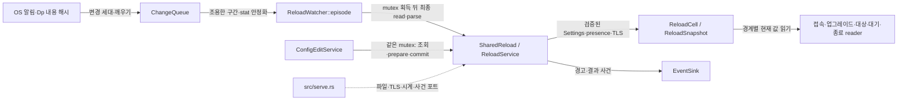

# 파일 변경 감지 모듈 설계

이 모듈은 설정 파일, 켜진 TLS 리스너의 인증서·개인키, ticket을 켠 역할의 공개 키 파일 변경을 감지한다. 안정화 뒤 후보를 읽고 검증해 44개 동적 설정과 TLS 수락기를 한 snapshot으로 발행한다. 공개 키 목록도 Settings에 포함한다. watcher와 설정 편집 서비스는 같은 잠금으로 파일 읽기부터 적용까지 직렬화한다. GET/PATCH의 업무 경계는 [설정 보기·편집 모듈](config-edit.md)이 맡는다. ticket 연결은 [접속 ticket 모듈 설계](relay-access-ticket.md#44-재로드와-편집)를 따른다. `[ip_info]`의 IP 정보 DB 파일도 같은 에피소드로 감지하지만 snapshot에 넣지 않고, 설정 후보를 처리한 뒤 [접속 출처 모듈](source-stats.md#44-다시-읽기)에 다시 읽기를 맡긴다.

| 항목 | 값 |
| --- | --- |
| 구조 시점 | Current |
| 문서 상태 | Draft |
| 구현 대조 | 소스 대조 범위와 수동 관찰은 [대조 기록](#대조-기록)을 따른다. |
| 코드 위치 | `crates/adapters/src/file_watch.rs` `ReloadWatcher::run`·`attach`·`attach_ip_info`·`episode`·`apply`·`refresh_ip_db`, `crates/adapters/src/file_watch/feed.rs`, `crates/app/src/reload.rs` `SharedReload`·`ConfigCandidate`·`ConfigPresence`, `crates/app/src/reload/service.rs` `ReloadService`·`PreparedReload`, `crates/app/src/reload/snapshot.rs` `ReloadSnapshot`·`ReloadCell` |
| 코드 지도 | [코드 지도](code-map.md) |
| 관련 스펙 | [운영 §3.3](../specs/operations.md#33-파일-변경-자동-감지와-부분-재로드), OPS-003·024~028·035·038·040·041·047~064 |
| 관련 계약 | [설정 §1.8](../contracts/config-v4.md#18-재로드-구분), [설정 오류](../contracts/config-v4.md#21-설정-오류와-준비-실패), [관리 API §1.13~14](../contracts/management-api-v1.md#113-설정-보기-get-apiv1config), [운영 정보 자동 재로드](../contracts/ops-info-v2.md#자동-재로드) |
| 관련 ADR | [ADR-0006](../decisions/ADR-0006-config-edit-through-file.md), [ADR-0013](../decisions/ADR-0013-relay-source-deny-list.md). 동적 키는 `relay.deny.sources`를 더해 44개다. 차단 목록 값이 바뀐 commit만 `reload_applied` 뒤 `RelayDenyControl::close_denied`를 부른다(`ReloadService::attach_deny_control`). |
| 관련 문서 | [접속 ticket 모듈 설계](relay-access-ticket.md) |

현재는 [설정 v4](../contracts/config-v4.md#18-재로드-구분)의 ticket 10개와 차단 목록 `relay.deny.sources`를 포함한 44개 키를 비교·발행한다. WS·WSS 부모 `trusted_proxies`, 네 역할의 `allow`·`allowed_origins`, 부모 `relay.wss.cert_file`·`key_file`을 각각 비교한다. 부모 `listen`·WS·WSS 역할 `enabled`·`recent_logs.max_entries`의 차이는 후보 전체를 재시작 필요로 거절한다. ticket의 역할 `enabled`는 동적 키다. 모든 WSS 역할이 꺼졌으면 TLS 내용을 읽거나 감시하지 않는다. 어느 한 역할이라도 켜졌으면 부모 TLS 한 쌍만 감시한다.

## 1. 책임과 경계

- 설정 파일과 켜진 WSS·관리 TLS의 참조 파일, ticket을 켠 역할의 공개 키 파일을 OS 알림과 Dp 주기 확인으로 감지한다. 계정 파일은 감시하지 않는다.
- 안정화 대기는 잠금 밖에서 한다. 최종 파일 read 전에 `SharedReload<A>` mutex를 잡는다. read·parse·prepare·세대/종료 확인·commit과 결과 기록은 같은 잠금 구간이다.
- `config_file::parse_candidate`가 구문·설정 값·명시 키를 만든다. `ReloadService`가 TLS·ticket 키 후보 검증, 재시작 차이 비교, snapshot 발행과 마지막 재로드 결과를 맡는다.
- 파일 감시·로그 재열기는 adapters, 실행 값·정책·후보 수용은 app이다. app은 notify·TOML·rustls 타입을 알지 못한다.
- 수동 재로드 API·CLI는 없다. PATCH는 설정 파일을 먼저 교체한 뒤 같은 준비 후보를 commit한다.
- 로그 경로는 재로드 해시·세대와 분리한다. 생성·삭제·이름 변경과 독립 Dp 작업이 로그 핸들을 다시 연다.
- IP 정보 DB 파일은 내용 해시로만 비교한다. 바뀌면 에피소드를 열고, 설정 후보 처리 뒤 바뀐 경로로 `IpInfoService::refresh`를 부른다. DB 결과는 `reload_applied`·재로드 이력·설정 거절에 들어가지 않는다. DB 파일만을 위한 디렉터리의 알림 등록은 실패해도 경고하지 않는 선택 등록이고, 알림 오류 문장에서 DB 경로를 뺀다(설정 v4 1.12절 규칙 2·6).

## 2. 내부 구조

실선은 호출 또는 데이터 전달, 점선은 시작 때 구현체 주입이다. 현재 구조만 표시한다.

| 요소(파일·심볼) | 역할 | 소유·수명 |
| --- | --- | --- |
| `file_watch.rs` `ReloadWatcher` | watched 경로·processed 해시·알림 feed·안정화·후보 최종 read | serve가 만들고 종료 시 join한다. |
| `file_watch/feed.rs` `ChangeQueue`·`NotifyFeed` | 파일 이름별 OS 알림 필터, 세대·유실 재확인·로그 신호 | watcher와 OS 콜백이 공유한다. |
| `reload/service.rs` `ReloadService`·`PreparedReload` | 실행 Settings/presence·TLS 기준 해시·마지막 결과, 부작용 없는 준비와 commit | watcher와 ConfigEditService가 같은 `SharedReload`로 공유한다. |
| `reload/snapshot.rs` `ReloadCell`·`ReloadSnapshot` | Settings·presence·TLS를 한 번 발행한다. | 서비스가 쓰고 runtime reader가 읽는다. |
| `reload/ports.rs` `RuntimeSettingsSource` | TLS 타입을 노출하지 않는 현재 Settings callback | 같은 snapshot read lock을 callback 끝까지 유지한다. |
| `file_watch.rs` `reopen_log` | 알림·Dp에서 로그를 다시 연다. 안정화 대기와 독립이다. | watcher run과 함께 끝난다. |
| `file_watch.rs` `attach_ip_info`·`IpDbWatch`·`db_hashes`·`ip_db_changed`·`refresh_ip_db` | DB 경로 목록과 경로별 마지막 처리 해시를 둔다. 해시는 `stream_hashes`가 64 KiB씩 읽어 `spawn_blocking`에서 계산한다. 두 async 함수는 `&mut self`를 받는다. `ChangeFeed`가 `Sync`가 아니어서 `&self`를 await 너머로 들고 가면 `run`의 future가 `Send`가 아니게 되기 때문이다 | serve가 `file_watch::start` 직후, DB 첫 읽기 전에 붙인다. 경로는 프로세스 동안 고정이다. |
| `file_watch/feed.rs` `ChangeFeed::watch_dirs(required, optional)`·`ChangeQueue::set_hidden`·`offer_error` | 필수 디렉터리 등록 실패는 오류다. 선택 디렉터리 등록 실패는 건너뛰고 `false`를 돌려주며 watcher는 다음 Dp에 다시 시도한다. 알림 오류는 숨길 경로(DB 파일·해석한 대상·선택 디렉터리)를 뺀 뒤 기록하고, 숨길 경로만 있던 오류는 버린다 | watcher와 OS 콜백이 공유한다. |

## 3. 데이터 모델

| 이름 | 실제 형태·제약 |
| --- | --- |
| `ReloadWatcher.watched` | 설정 파일, 실행 중과 마지막 파싱 성공 후보의 TLS 경로·ticket을 켠 역할의 공개 키 경로를 합친 `Vec<PathBuf>`. 같은 경로는 한 번만 넣는다. |
| `ReloadWatcher.processed` | 경로별 `Option<u64>` 내용 해시. 읽은 파일은 DefaultHasher 64비트, 없으면 None. 프로세스 안 감지용이며 API revision SHA-256과 다르다. |
| `ChangeQueue` | 변경 세대와 유실·실패·로그 신호. 한 episode에 `reload_change_detected`를 한 번 기록한다. |
| `FileStamp` | 크기와 수정 시각. 안정화 read 전후를 비교한다. |
| watcher 내부 `Candidate` | 설정 원시 바이트 `Option<Vec<u8>>`와 읽은 경로별 해시. |
| app `ConfigCandidate` | 검증된 `Settings`와 `ConfigPresence`. 바이트·TOML 타입을 담지 않는다. |
| `ConfigPresence` | 명시 leaf 키 `BTreeSet<String>`과 비활성 경로 fallback `BTreeMap<String, PathBuf>`. 의미 차이 비교에는 쓰지 않는다. |
| `PreparedReload<A>` | 검증·생성이 끝난 snapshot·TLS 해시·적용 키·사건/이력 키·경고. 같은 mutex 안에서 준비하고 바로 소비한다. |
| `ReloadSnapshot<A>` | `Arc<Settings>`·`Arc<ConfigPresence>`·`wss_tls`·`management_tls`. IP 정책 중복 저장은 없다. |
| `ReloadCell<A>` | `RwLock<Arc<ReloadSnapshot<A>>>`. `current`는 Arc를 복사한다. `with_current`는 read lock을 callback 끝까지 유지한다. 중독된 snapshot lock은 `PoisonError::into_inner`로 읽는다. |
| `ReloadOutcome` | Applied·Rejected·RestartRequired·Unchanged·Discarded. 마지막 둘은 결과 사건·이력을 만들지 않는다. |
| `IpDbWatch` | `Arc<IpInfoService>`, 설정한 DB 경로 `Vec<PathBuf>`, 경로별 마지막 처리 해시 `BTreeMap<PathBuf, Option<u64>>`. `None`은 없거나 읽지 못한 파일이다. 설정 `processed`와 따로 둔다. |
| `LastReload` | 확정 시각·결과·trigger·키. 프로세스 메모리에만 두고 시작은 None이다. |

## 4. 처리 순서

대표 입력은 편집기의 설정 파일 저장이다. 임시 파일의 이름은 무시하고 원래 파일 이름의 알림이나 Dp 내용 해시 차이로 시작한다.

| 순서 | 코드 위치(파일·심볼) | 처리와 상태 |
| --- | --- | --- |
| 1 | `file_watch/feed.rs` `ChangeQueue` | 알림·유실 재확인으로 세대를 올리고 watcher를 깨운다. `read_poll`의 해시 차이도 episode를 연다. |
| 2 | `file_watch.rs` `episode`·`wait_quiet` | `reload_change_detected`를 한 번 기록한다. Q 300ms 뒤 stat, G 100ms 뒤 다시 stat을 비교한다. 새 세대나 stop이면 재시작/중지한다. 여기서는 공유 서비스 잠금을 잡지 않는다. |
| 3 | `file_watch.rs` `apply`·`read_candidate` | SharedReload 잠금을 잡은 뒤 설정·감시 파일을 최종 읽는다. read 뒤 stat과 세대를 다시 확인한다. 불일치면 잠금을 놓고 안정화부터 반복한다. |
| 4 | `config_file.rs` `parse_candidate`; `reload/service.rs` `handle_config`·`handle_unreadable` | 같은 guard 안에서 바이트를 파싱한다. 읽기 실패·비UTF-8이면 unreadable 경로다. `is_current`는 세대와 stop을 준비 전후에 검사한다. |
| 5 | `reload/service.rs` `prepare_candidate` | 켜진 TLS 내용을 검사하고 필요하면 acceptor를 만든다. 이어 `ticket_keys::load`로 후보의 공개 키 목록을 채운다. 키 오류는 `ticket_keys_invalid`로 후보 전체를 거절한다. 잘못된 후보는 Invalid, 유효하지만 비대상 차이가 있으면 RestartRequired다. 44개 동적 값/경로 차이와 TLS·공개 키 내용 차이를 합쳐 계약 순서로 정렬한다. 아직 발행·사건·이력은 없다. |
| 6 | `reload/service.rs` `handle_config` | 낡은 후보·종료 중 후보는 Discarded다. 거절·재시작 필요는 사건과 FileWatch 이력을 기록한다. 적용 키가 없으면 Unchanged다. presence만 다르면 아래 판단에 따라 표시 정보만 갱신한다. |
| 7 | `reload/service.rs` `commit_prepared` | 준비 snapshot을 한 번 발행하고 running/presence/TLS 기준 해시를 바꾼다. 적용한 정책의 Reload 경고→`ReloadApplied { trigger, applied }`→이력 순서다. commit은 재검증·파일 재읽기·실패 반환·종료 veto가 없다. |
| 8 | `file_watch.rs` `refresh_watch_set` | service guard를 놓은 뒤, Discarded가 아니면 처리 해시와 감시 경로를 다시 계산하고 알림 등록을 맞춘다. 다음 변경을 기다린다. |

공개 키 경로가 같고 실행 중·후보 모두 그 역할의 ticket을 켰으면 키 목록의 의미를 비교한다. 내용 교체로 목록이 바뀌면 `relay.ticket.<role>.public_keys_file`을 `applied`에 더한다. 실패한 후보는 기존 설정·키를 유지한다. `watched_paths`는 후보에서 ticket을 켠 역할의 키 경로도 돌려준다. 사용 기록과 기존 연결의 기한은 재로드로 바꾸지 않는다([접속 ticket 모듈 설계](relay-access-ticket.md#44-재로드와-편집)).

**presence-only 갱신.** 명시 키 유무는 `dynamic_changed_keys`·`restart_required_keys`의 의미 차이가 아니다. watcher 후보의 실행 값·TLS가 같고 presence만 다르면 `handle_config`는 `running_presence`와 snapshot presence만 갱신한다. snapshot의 Settings는 기존 running Arc를 그대로 쓴다. 결과는 Unchanged이며 `reload_applied`·경고·last_reload는 바뀌지 않는다. 이 갱신은 꺼진 기능의 표시에서 생략과 명시를 구분하기 위한 것이다. `inactive_paths`는 꺼진 WSS에 TLS 경로 하나만 있어 `Settings.tls=None`인 경우 그 경로를 표시하는 fallback으로만 쓴다. 해당 파일을 읽거나 감시하지 않는다.

로그 알림은 위 순서에 들어가지 않는다. `reopen_log`는 내용 해시와 무관하게 Dp마다 항상 다시 연다. 로그의 일반 쓰기 알림은 재열기·재로드 세대를 만들지 않는다.

IP 정보 DB 파일은 위 순서에 끼어든다. 1단계의 주기 확인(`poll_check`)은 설정 해시와 함께 DB 해시를 비교해, DB만 바뀌어도 `poll` 에피소드를 연다. 설정 파일을 읽지 못해 `reload_watch_failed(poll_error)`를 쓴 틱에도 DB가 바뀌었으면 에피소드를 연다. 8단계 뒤 결과가 Discarded가 아니면 `refresh_ip_db`가 DB 해시를 다시 계산하고, 처리 해시와 다른 경로를 모아 처리 해시를 바꾼다. 바뀐 경로가 있고 종료 중이 아니면 `IpInfoService::refresh`를 `spawn_blocking`으로 부르고 끝날 때까지 기다린다. 이 단계는 `SharedReload` 잠금 밖이다. 설정 내용이 같으면 결과는 Unchanged이므로 `reload_change_detected` 뒤에 `ip_db_loaded` 또는 `ip_db_unavailable`만 남는다.

### 4.1 시간 기준

- 알림 감지 뒤 안정화·검증·결과까지의 기준은 D다. 마지막 변경 감지부터 잰다.
- 놓친 변경은 Dp 안에 주기 확인으로 잡고 그 뒤 D 안에 결과가 나온다. 최대 기준은 Dp + D다.
- 연속 변경마다 안정화와 D를 다시 시작한다. 계속 바뀌는 파일에는 상한을 두지 않는다.
- Q/G는 구현 상수다. 공유 mutex 대기와 파일/TLS 읽기도 실제 지연에 포함된다. Q + G + 읽기 + 검증 + 교체의 합은 D보다 짧아야 한다.

### 4.2 사건 순서

- watcher episode는 `reload_change_detected` 한 번 뒤 최대 한 결과 사건을 기록한다. Unchanged·Discarded는 결과 사건이 없다.
- `reload_rejected`와 `reload_restart_required`는 서로 다르다. 둘 다 기존 실행 값·연결을 유지한다.
- 적용 사건에는 실제 적용 키와 `FileWatch` 또는 `ConfigEdit` trigger가 있다. PATCH의 성공 감사는 commit 뒤 별도 `ConfigEdited`다.
- `reload_watch_failed`는 episode 없이 기록할 수 있다. 시작의 설정/TLS/ticket 공개 키 감시 등록 실패는 `startup_failed(watch_unavailable)`·종료 코드 1이다.
- 로그 디렉터리 알림 등록만 실패하면 시작을 계속한다. Dp의 로그 재열기와 알림 재등록을 유지한다.

### 4.3 검증 순서 확인점

소스에는 `ReloadService::arm_before_validation` 동기 일회 훅과 주입한 ReloadClock·ChangeFeed가 있다. 알림 차단, 검증 중 새 세대, TLS 한쪽 교체를 재현하는 경계다. 표식과 실행 범위는 [테스트 컨벤션](../conventions/testing.md#7-테스트와-스펙-시나리오-연결)을 따른다.

- OPS-027의 검증 지연 경계는 대기하는 채널이 아니라 테스트 전용 동기 일회 훅이다. 단일 태스크의 `join!` 안에서 채널로 멈추면 교착한다. 실제 바이너리의 검증 지연 시험은 없다.
- OPS-041의 `allow_change_is_applied_by_poll_when_the_notify_is_blocked`는 `SwitchFeed`·`ReloadWatcher::run`·주입한 시계로 주기 확인 감지(`poll`)와 적용을 확인한다. 읽기·검증·교체 시간은 주입하지 않는다. 이 시험의 D 상한 확인은 Q+G < 1초까지다. 바이너리에는 알림 차단 훅이 없다.

## 5. 상태와 초기화

`serve`는 `load_candidate`로 같은 시작 바이트의 Settings와 presence를 준비한다. 계정·런타임·시작 키·TLS·ticket 공개 키 준비 뒤 `ReloadCell`과 `SharedReload`를 만들고 watcher·ConfigEditService에 같은 Arc를 주입한다. `file_watch::start`는 리스너 바인드 전에 감시를 등록하고 기준 해시를 읽는다. `ReloadWatcher::run`은 그 뒤 spawn한다.

후보 처리는 watcher 작업 하나가 맡지만 PATCH·GET과도 같은 mutex로 직렬화한다. snapshot read callback에는 await·파일/네트워크 I/O를 넣지 않는다. 새 수락의 현재 상한 읽기와 permit CAS는 callback 안에서 끝나므로 교체와 수락 판단이 섞이지 않는다.

정상 종료 시 watcher stop과 새 중계 수락 stop을 보낸다. watcher의 `is_current` veto만 막히며, 유예 중 관리 GET/PATCH의 prepare/commit은 계속 허용한다. 이미 시작한 G deadline은 바뀌지 않는다.

## 6. 오류 처리

| 실패 지점 | 처리와 남는 상태 |
| --- | --- |
| 시작 설정/TLS/ticket 공개 키 감시 등록 | `startup_failed(watch_unavailable)`, 종료 코드 1. 리스너를 바인드하지 않는다. |
| 실행 중 OS 알림 등록·수신 | `reload_watch_failed(notify_error)`. Dp마다 재등록하며 주기 확인은 계속한다. |
| DB 파일만을 위한 디렉터리의 알림 등록 | 경고하지 않는다. 주기 확인으로 감지하고 Dp마다 등록을 다시 시도한다. |
| 알림 오류가 DB 경로를 가리킴 | 그 경로를 `detail`에서 뺀다. 남는 경로가 없으면 `reload_watch_failed`를 쓰지 않는다. |
| DB 파일 없음·읽기 실패 | 감시 실패가 아니다. 해시를 "읽지 못함"으로 비교하고, 다시 읽기가 `ip_db_unavailable(file_unreadable)`을 쓴다. |
| 주기 확인 I/O | `reload_watch_failed(poll_error)`. 실행 값은 유지한다. OS 알림이 살아 있으면 그 경로는 계속한다. | 한쪽 감시만 실패하면 다른 쪽으로 계속한다. 둘 다 실패하면 자동 적용을 멈추고 이전 유효 설정을 유지한다.
| 알림 유실·넘침 | 전체 재확인을 요청한다. 새로운 재로드 세대로 처리한다. |
| 설정 구문·값·TLS·ticket 키 오류 | `reload_rejected`, FileWatch rejected 이력. 실행 값·인증서·공개 키·기존 연결은 유지한다. ticket 키 오류 사유는 `ticket_keys_invalid`다. 설정 파일 소멸·비UTF-8은 `config_file_unreadable`이다. |
| 유효한 비대상 차이 | `reload_restart_required`와 해당 키의 이력. 동적 변경도 함께 거절한다. |
| 세대 교체·watcher stop | Discarded. snapshot·처리 해시·결과 사건·이력을 바꾸지 않는다. |
| 정책 전체 허용 경고 | 실제 변경된 source/target 정책의 적용 뒤에만 Reload 경고를 쓴다. 거절 후보에는 쓰지 않는다. |
| 운영 로그 쓰기 | 운영 정보 계약의 로그 오류 규칙을 따른다. 재로드를 되돌리지 않는다. |

## 7. 설계 선택

- 디렉터리 감시와 파일 이름 필터는 임시 파일 rename 저장도 잡기 위한 것이다. 심볼릭 링크는 링크 디렉터리와 등록 때 해석한 대상 디렉터리를 함께 감시한다.
- 내용 해시는 변경을 다시 읽을 계기다. 적용 여부는 실행 Settings·TLS 내용과 비교한다. API revision은 별도 SHA-256이다.
- 최종 read 전 같은 mutex를 잡아 PATCH 뒤 오래된 watcher 후보가 적용되는 일을 막는다. 안정화 대기는 밖에 둔다.
- 검증된 TLS 바이트로 acceptor를 준비한다. commit은 파일을 다시 읽지 않는다.
- Settings·presence·TLS를 한 snapshot으로 발행한다. reader는 각 적용 경계에서 이전/새 한 세대만 읽는다.
- 재시작 차이는 매번 running과 비교한다. 영구 차단 플래그가 없다.
- 로그 알림·타이머는 재로드 세대·해시와 분리한다. 긴 안정화가 로그 재열기를 막지 않는다.
- 파싱에 실패한 후보의 경로는 감시 집합에 넣지 않는다.
- 같은 원인의 사건도 반복마다 기록한다. 복구 사건은 없다.
- 내용 해시는 같은 프로세스 안에서만 비교한다. 64비트 해시 충돌 가능성은 0이 아니다. Q/G를 설정 키로 제공하면 설정 계약의 호환 변경 규칙을 따른다.
- 파일 시스템의 수정 시각 해상도는 1~2초일 수 있다. 같은 크기로 같은 시간 단위 안에 바뀐 파일은 `FileStamp`가 놓칠 수 있다. 주기 확인의 내용 해시가 잡으며 최대 지연은 Dp + D다.
- 쓰는 중에 읽은 잘못된 TOML·PEM 후보는 거절한다. 쓰기가 끝난 뒤의 새 알림은 새 후보를 만든다. 거절 사건이 여러 번 나올 수 있다.

## 8. 현재 코드와의 차이

현재 공개 함수는 `prepare_candidate`·`classify_file`·`commit_prepared`, watcher 전용 `handle_config`·`handle_unreadable`이다. §10은 실행 값의 발행·소비 경계를 설명한다.

시나리오별 현재 결과는 `cargo xtask scenarios`가 만드는 `scenario-report.md`와 CI에서 확인한다([테스트 컨벤션](../conventions/testing.md#7-테스트와-스펙-시나리오-연결)).

## 9. 미결정 사항

| 열린 항목 | 영향 | 책임자·확정 위치 |
| --- | --- | --- |
| Windows 편집기 공유 모드·감시 디렉터리 삭제 | 배타 잠금과 이름 변경 외 동작은 미대조다. | 검증 담당자, 이 절과 수동 관찰 기록 |
| Linux inotify 큐 넘침·감시 개수 한도와 알림 동작 | 넘침은 전체 재확인, 등록 실패는 장애로 처리한다. OS 관찰은 미대조다. | 검증 담당자, 이 절 |
| 주기 확인 비용·감시 장애 로그 양 | 감시 파일 수만큼 읽으며 장애가 이어지면 Dp마다 사건이 쌓일 수 있다. 측정값은 없다. | 성능 검증 담당자, 이 절 |
| 등록 뒤 심볼릭 링크 대상 변경 | 새 대상은 감시되지 않을 수 있다. 확인이 필요하다. | 파일 감지 구현·검증 담당자, 이 절 |

## 10. Current — 설정 v4 실행 값과 공유 트랜잭션

이 절은 [설정 §1.8](../contracts/config-v4.md#18-재로드-구분)의 44개 동적 키와 [ADR-0006](../decisions/ADR-0006-config-edit-through-file.md)의 공유 적용 경계를 설명한다.

대상 44개에는 ticket 10개와 차단 목록 1개가 포함된다. ticket 흐름은 [접속 ticket 모듈 설계](relay-access-ticket.md#44-재로드와-편집)를, 차단 목록 흐름은 [ADR-0013](../decisions/ADR-0013-relay-source-deny-list.md)을 따른다.

### 10.1 발행 단위와 reader

`ReloadSnapshot<A>`는 Settings 전체·ConfigPresence·WSS/관리 TLS acceptor를 담는다. 비대상 값은 후보 검증에서 기존과 같아야 하므로 전체 Settings 발행이 비대상 변경을 허용하지 않는다. `RuntimeSettingsSource::with_current`는 TLS 타입 없이 같은 snapshot read lock 아래 현재 Settings를 읽게 한다. callback은 짧고 동기적이며 I/O·await를 하지 않는다.

| 키·묶음 | 현재 읽는 위치와 경계 | 기존 상태 |
| --- | --- | --- |
| 6개 source allow | TCP는 해당 목록, WS·WSS 수락은 켜진 역할 합집합, `check_upgrade`는 선택한 역할 목록을 현재 snapshot에서 검사 | 성립한 연결을 끊지 않는다. |
| 4개 TLS 경로·내용 | `tls.rs` `TlsSource`와 `tls_listener.rs`의 새 협상 | 기존 TLS 세션 유지 |
| 4개 allowed_origins | `websocket.rs` `check_upgrade`가 선택한 역할의 Origin·IP·M/Kw를 같은 callback에서 읽음 | 이미 업그레이드한 연결 유지 |
| ticket 10개 값·공개 키 목록 | `websocket.rs` `check_upgrade`가 Origin·ticket·두 번째 IP를 같은 callback에서 검사 | 기존 연결의 `TicketBinding`·사용 기록 유지 |
| 2개 trusted_proxies | `net.rs` 수락에서 신뢰 프록시는 역할 allow 합집합 검사를 우회한다. `websocket.rs` 업그레이드에서 전달 주소를 도출하고 역할별 allow와 비교한다. | 성립한 연결의 주소·권한은 바꾸지 않음 |
| mode1.allow_targets·C | `relay/target.rs` `dispatch`에서 시도 시작 때 정책·C 읽기, 같은 정책으로 DNS 이름/IP 전체 판정 | 성립한 세션·시작한 C 유지 |
| L | `net.rs` 수락과 `relay/target.rs` 대상 자리 확보 때 현재 상한 읽기와 CAS를 같은 callback에서 완료 | 기존 permit 유지 |
| Lm | `admission.rs` `AdmittingListener`의 새 수락 때 현재 상한·CAS. 관리/상태가 같은 예산 사용 | 기존 permit 유지 |
| Lw·W | `relay/matching.rs` `dispatch`에서 같은 callback 안에 RegistrationPolicy·table 전이·permit 확보 | 기존 대기 deadline·매칭 자격 유지 |
| B | `net.rs` 수락 때 AcceptedSettings→ConnectionContext로 보존 | 각 endpoint의 B로 방향별 버퍼 생성 |
| M·WS ping/pong | `websocket.rs` `check_upgrade`→WsRelayStream 생성 | 기존 메시지 한도·timer 유지 |
| H | TCP는 수락 때, WS/WSS는 101 flush 뒤 `exchange_handshake`에서 읽음 | 시작한 절대 H 유지 |
| U | WS/WSS와 관리 TCP 수락 때 고정. `AdmittedAddr`가 관리 수락 U를 TLS/DeadlineListener로 전달 | 기존 keep-alive도 기존 U, 상태에는 U 없음 |
| E | `relay/session.rs` 첫 종료 전이, `relay.rs` 단일 스트림 종료·관리 종료 수락 때 읽음. `DashboardHints::terminate_timeout_secs`도 응답 때 읽음 | 시작한 종료 deadline 유지 |
| G | `serve.rs` 최초 종료 원인 선택 뒤 snapshot에서 한 번 읽음 | 유예 중 PATCH가 deadline을 바꾸지 않음 |
| TCP keepalive 3개 | `net.rs` 수락 때 한 묶음, `target.rs` `TcpTargetConnector::connect`는 새 대상 소켓마다 읽음 | 기존 소켓 옵션 유지 |

원자 교체는 각 경계가 이전/새 한 세대만 읽는다는 뜻이다. 수락과 업그레이드처럼 서로 다른 경계가 서로 다른 세대를 읽는 것은 의도한 동작이다.

### 10.2 후보 비교와 공개 서비스

- `prepare_candidate`는 TLS 검증/생성 뒤 ticket 공개 키를 적재한다. 동적 차이·경고·snapshot·사건/이력 키도 준비한다. Invalid가 RestartRequired보다 우선한다. 발행·사건·이력 부작용은 없다.
- `dynamic_changed_keys`는 44개 값/경로 차이를 계산하고 prepare가 TLS·ticket 공개 키 내용 차이를 합친다. 같은 경로의 공개 키 목록이 바뀌면 `public_keys_file`도 적용 키에 넣는다. presence 차이는 동적/재시작 차이에 넣지 않는다.
- `restart_required_keys`는 TCP enabled/listen, WS·WSS 부모 listen·역할 enabled, mode enabled, admin, management.config_edit·TLS 존재 여부, dashboard/recent_closed/recent_logs/status/log/reload 등 비대상 차이를 유지한다. 관리 HTTP/HTTPS 전환은 계속 재시작이 필요하다.
- `classify_file`은 read 실패 또는 FileUnreadable(비UTF-8 포함)을 Unreadable/diagnostics=[]로, 나머지 검증 실패를 Invalid로, 비대상 차이를 RestartRequired로, 동적 차이를 Pending으로, 없으면 InEffect로 분류한다. GET이 이 함수를 호출해도 실행 값·이력은 바뀌지 않는다.
- `commit_prepared`는 같은 guard 안에서 준비 직후 소비한다. 파일 읽기·TLS 생성·종료 veto·실패 반환이 없다. 적용 키가 비면 발행·사건·이력을 바꾸지 않는다. watcher의 presence-only 표시는 §4의 별도 Unchanged 경로다.

### 10.3 마지막 결과·중복 알림·종료

`LastReload`는 Applied·Rejected·RestartRequired와 FileWatch·ConfigEdit trigger를 저장한다. applied 키는 실제 실행 차이, restart_required 키는 비대상 차이, rejected 키는 빈 배열이다. PATCH commit 시각은 Clock.wall, watcher 결과 시각은 최종 처리의 SystemTime이다. 재시작에 복원하지 않는다.

watcher의 세 결과와 성공한 변경 PATCH의 commit만 이력을 갱신한다. GET, Unchanged/Discarded watcher, PATCH 사전 거절·쓰기 실패·바이트 no-op은 갱신하지 않는다. ConfigEdit+Rejected/RestartRequired는 스키마에 있지만 현재 생성하지 않는다. PATCH 거절 감사는 별도 ConfigEditRejected다.

PATCH는 같은 running Settings·TLS 기준 해시를 갱신한다. 뒤 watcher가 같은 후보를 읽으면 적용 키가 비어 Unchanged다. `reload_change_detected`는 가능하지만 추가 `reload_applied`·`config_edited`·last_reload는 없다. processed 해시·감시 경로는 정상 갱신한다.

정상 종료는 watcher의 새 적용만 막는다. GET/PATCH는 같은 mutex로 유예 동안 계속 처리하며 lifecycle·수락 stop을 되돌리지 않는다. commit이 watcher의 `is_current`를 공유하지 않으므로 파일 교체 뒤 종료 veto로 실행 적용이 빠지지 않는다.

## 대조 기록

### 구조 대조

- 날짜·대상: 2026-11-08 작업 트리의 reload·watcher·serve와 소비자 경계.
- 환경·방법: 저장소 소스를 읽고 공유 mutex, snapshot 발행과 reader 경계를 본문과 대조했다. 실행 환경의 동작 검증은 포함하지 않는다.
- 결과: 본문은 대조한 구조를 설명한다. 실행 결과는 시나리오 보고서와 CI에서 확인한다.

### IP 정보 DB 감시 대조

- 날짜·대상: 2026-11-20 작업 트리의 `attach_ip_info`·`poll_check`·`refresh_ip_db`·`feed.rs`의 선택 등록과 오류 경로 제거.
- 환경·방법: 본문 1·2·3·4·6절의 DB 항목을 소스와 대조했다. Windows 11 x64에서 `file_watch.rs`의 DB 감시 단위 시험과 실행파일 시험 `tests/sources.rs`를 실행했다.
- 결과: 본문과 일치한다. Linux inotify에서 DB 디렉터리 선택 등록이 실패하는 경우는 관찰하지 않았다.

### Windows 파일 감시 수동 관찰

- 대상: 커밋 `c4c6cf6`의 실제 실행파일. 관찰 날짜는 원기록에 없다.
- 환경: Windows 11 Pro 10.0.26200, Rust 1.99.1.
- 방법: 수동 스모크 S1–S8에서 설정·인증서 변경, 감시 디렉터리 이름 변경, 약 7.6초 배타 잠금을 확인했다. D=1초, Dp=5초다.
- 결과: 적용·거절·재시작 필요 7건의 감지→결과는 414~434ms였다. 잠금 중 `reload_watch_failed(poll_error)` 2건, 복구 사건 없음, 잠금 해제 뒤 변경 적용을 확인했다. 디렉터리 이름 변경은 `EPERM`이고 릴레이는 계속 실행했다.
- 한계: 편집기 공유 모드와 디렉터리 삭제는 확인하지 않았다. 산출물은 `target/smoke-reload/`이며 저장소에 넣지 않았다.
