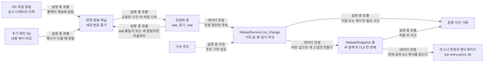

# 파일 변경 감지 모듈 설계

이 모듈은 설정 파일과 인증서·개인키 파일의 변경을 감지한다. 변경이 멈춘 뒤 파일 내용을 재로드 후보 하나로 읽는다. 후보는 작업 하나가 순서대로 처리하며, 가장 최신 후보만 적용한다. 적용할 때는 IP 허용 목록과 TLS 설정을 한 스냅샷으로 한 번에 바꾼다. 이 문서는 구조 시점 Current이며 문서 상태는 Draft다. 작업 5.2에서 구현했고 [대조 기록](#대조-기록)에 대조 결과를 적었다. 사용자 결정 2026-10-22(Q50)으로 §9 항목 1~13과 15를 정했다. 항목 14(Windows 디렉터리·편집기 핸들)는 사용자 결정 2026-10-23(Q57)로 한계로 문서화했다.

| 항목 | 값 |
| --- | --- |
| 구조 시점 | Current |
| 문서 상태 | Draft |
| 구현 대조 | Verified — [대조 기록](#대조-기록) (§9 항목 14의 편집기 공유 모드·디렉터리 삭제와 §9.2의 Ubuntu 알림 항목 제외) |
| 코드 위치 | `crates/adapters/src/file_watch.rs` `ReloadWatcher::run`·`attach`·`episode`, `crates/adapters/src/file_watch/feed.rs`, `crates/app/src/reload/service.rs` `ReloadService::handle_config`·`handle_unreadable`, `crates/app/src/reload/snapshot.rs` `ReloadSnapshot`·`ReloadCell` |
| 코드 지도 | [코드 지도](code-map.md) |
| 관련 스펙 | [운영 스펙 2절](../specs/operations.md#2-상태와-검증-매개변수)(D, Dp), [3.3절](../specs/operations.md#33-파일-변경-자동-감지와-부분-재로드), [7절](../specs/operations.md#7-수용-테스트)의 OPS-003, OPS-024~028, OPS-035, OPS-038, OPS-040, OPS-041 |
| 관련 계약 | [설정 계약 1.2절](../contracts/config-v3.md#12-키-표), [1.8절](../contracts/config-v3.md#18-재로드-구분), [2.1절](../contracts/config-v3.md#21-설정-오류와-준비-실패), [운영 정보 계약 자동 재로드](../contracts/ops-info-v1.md#자동-재로드), [CLI·계정 파일 계약 1.8절](../contracts/cli-v1.md#18-수동-시작과-종료) |
| 관련 ADR | 없음 |

작업 6.2~6.5의 **Target / Active**는 [§10](#10-target--설정-v3-실행-값과-공유-트랜잭션)이다. 위 Current/Verified와 기존 본문은 구현된 8개 키 범위만의 설명이며, 27개 키·편집·공유 잠금이 이미 구현됐다는 뜻이 아니다. GET/PATCH의 경계는 [설정 보기·편집 모듈](config-edit.md)이 맡는다.

## 1. 책임과 경계

- 맡는 책임:
  - 설정 파일과 `cert_file`·`key_file`이 가리키는 파일의 변경을 OS 파일 알림과 주기 확인으로 감지한다.
  - 변경이 멈춘 뒤 설정 파일과 참조 파일을 재로드 후보 하나로 읽는다.
  - 재로드 후보를 순서대로 처리하고, 최신 후보만 적용한다.
  - 감시 시작 실패, 실행 중 감시 장애, 재로드 결과를 운영 사건으로 알린다.
  - 적용할 때 허용 목록과 TLS 설정을 한 스냅샷으로 교체한다.
  - 파일 로그의 이름 변경·삭제·생성 알림과 Dp마다 같은 로그 경로를 다시 열게 한다. 로그 경로는 재로드 후보나 내용 해시에 넣지 않는다(사용자 결정 2026-11-04(Q104·Q109·Q110)).
- 맡지 않는 책임:
  - 설정 구문과 값 검증: [설정 읽기 설계](config-loading.md)의 `parse`를 쓴다.
  - TLS 쌍 검사와 수락기(acceptor) 만들기: [TLS 모듈 설계](tls.md).
  - 출발지 IP 판정: [TCP 진입점 설계](tcp-entry-point.md).
  - 계정 파일 감시: 하지 않는다. [CLI·계정 파일 계약 1.7절](../contracts/cli-v1.md#17-서버-실행-중-계정-파일-변경).
  - 수동 재로드 API와 CLI: 추가하지 않는다. [운영 스펙 3.3절](../specs/operations.md#33-파일-변경-자동-감지와-부분-재로드).
  - 정상 종료 순서: [서버 시작 설계](serve-startup.md).
- 다른 모듈에 공개하는 기능:
  - `ReloadWatcher::run` (adapters): 시작 단계 (3)에서 감시를 시작하고 재로드 후보를 만든다.
  - `ReloadService::on_change` (app): 재로드 후보 하나를 검증·비교하고 결과를 기록한다.
  - `ReloadSnapshot` 읽기 (app): 리스너가 IP 판정이나 TLS 핸드셰이크 때 현재 값을 읽는다.

## 2. 내부 구조

화살표 의미는 다음 네 가지다. 그림은 Target 설계다. 구현과 다른 점은 §8에 적는다.

- 실행 중 호출: 콜백이나 채널 신호로 다른 작업을 깨운다. 호출하는 쪽은 결과를 기다리지 않는다.
- 데이터 전달: 재로드 후보나 값을 복사해 넘긴다. 넘긴 뒤 원본을 바꾸지 않는다.
- 실행 중 주입: 구성 루트가 시작 때 포트의 구현을 넘긴다.
- 컴파일 시 의존: 크레이트 의존 방향이다. adapters가 app을 참조한다. app은 adapters를 참조하지 않는다.

| 요소(파일·심볼) | 역할 | 만들어지는 시점과 소유자 | 의존 대상 |
| --- | --- | --- | --- |
| `crates/adapters/src/file_watch.rs` `ReloadWatcher::run` | OS 알림 등록, 주기 확인, 안정화 창, 재로드 후보 만들기, 후보 작업 실행 | 시작 단계 (3)에서 만들고 프로세스 수명 동안 유지한다. 소유자는 `ReloadWatcher`다. | notify 크레이트, tokio, app의 `ReloadService` 포트 |
| `crates/adapters/src/file_watch.rs` 내부 `WatchSet`·`ProcessedState` | 감시 경로 목록과 처리한 마지막 내용 해시 | `ReloadWatcher`가 소유한다. 시작 때 실행 중 유효 설정으로 채운다. | 실행 중 유효 설정의 경로 값 |
| `crates/app/src/reload/` `ReloadService::on_change` | 파싱, 검증, 재시작 필요 비교, 교체, 사건 기록 | 시작 단계 (3)에서 만든다. 실행 중 `Settings`와 `ReloadSnapshot` 셀을 든다. | 설정 파싱 포트, TLS 수락기 포트, 사건 기록 포트 |
| `ReloadSnapshot` 셀 (app `reload/` 안, 위치는 구현 때 정한다) | 허용 목록 네 개와 TLS 수락기 값을 담은 공유 상태 | `ReloadService`가 쓰고, 리스너가 읽는다. | 없음 |
| `ChangeQueue::set_log_targets`, `log_changed` | 로그 경로 알림을 재로드 세대와 분리한다. 생성·삭제·이름 변경만 별도 `Notify`로 알린다. | `ReloadWatcher`와 OS 콜백이 공유한다 | tokio |
| `file_watch.rs` `reopen_log` | 로그 알림과 독립 Dp 타이머에서 `JsonLinesEventSink::reopen`을 부른다. 재로드 안정화 중에도 계속 진행한다. | `ReloadWatcher::run`이 함께 실행한다. 종료 때 함께 끝난다. | 운영 로그 싱크, 주입한 시계 |

## 3. 데이터 모델

모듈 밖과 주고받는 형식은 계약에 두고 여기에서는 링크한다. 아래는 내부 자료다.

| 이름 | 필드·형태 | 저장 위치 | 제약과 항상 지켜야 할 조건 |
| --- | --- | --- | --- |
| `WatchSet` | 감시 항목 목록. 각 항목은 경로, 역할(설정·인증서·개인키), 감시 디렉터리 | 메모리 | 설정 파일 경로와, 켜진 `relay.wss_viewer`와 관리 리스너의 `cert_file`·`key_file` 값(쓸 때)에서 만든다(사용자 결정 2026-10-22(Q50), §9 항목 12). 실행 중 유효 설정의 경로와 마지막으로 파싱에 성공한 후보의 경로를 함께 담고, 결과가 나온 뒤 다시 계산한다(§9 항목 9). 파싱에 실패한 후보의 경로는 쓰지 않는다(구현 판단(사용자 결정 없음)). 심볼릭 링크는 링크 디렉터리와 등록 때 해석한 대상 디렉터리를 모두 넣는다(§9 항목 6). 계정 파일은 넣지 않는다. 같은 디렉터리는 한 번만 등록한다. |
| `ProcessedState` | 경로별 마지막 처리 내용 해시(`u64`), 설정 파일 해시. 파일이 없었으면 "없음" 값 | 메모리 | 재로드 후보 결과(적용, 거절, 재시작 필요, 교체 생략)가 나온 뒤에만 갱신한다. 읽기만 한 값으로 갱신하지 않는다. 내용 해시는 표준 라이브러리 `DefaultHasher`의 64비트 값이다. 같은 프로세스 안에서만 비교한다(사용자 결정 2026-10-22(Q50), §9 항목 3). |
| `ChangeEpisode` | 세대 번호(`u64`), 열린 묶음 여부, 출처(`os_notify` 또는 `poll`), 마지막 변경 시각 | 메모리 | 알림이나 해시 차이가 올 때마다 세대 번호를 올린다. 묶음이 열려 있으면 `reload_change_detected`를 다시 쓰지 않는다. |
| `FileStamp` | 크기(바이트), 수정 시각 | 메모리(안정화 창 안에서만) | 여러 번 기록해 같은지 본다. 기록 시점은 §4의 (b), (d), (f) 단계다. |
| `ReloadCandidate` | 세대 번호, 설정 파일 내용(UTF-8 텍스트), 참조 파일 내용(바이트) | 메모리 | 검증한 바이트를 그대로 교체에 쓴다. 파일을 다시 열지 않는다. 결과가 나오면 버린다. |
| `ReloadOutcome` | 적용(`applied` 키 목록), 거절(`reason`, `config_key?`, `detail?`), 재시작 필요(`config_keys`), 감시 장애(`reason`, `detail?`) | 사건 기록으로만 넘긴다 | 필드 이름과 값은 [운영 정보 계약 자동 재로드](../contracts/ops-info-v1.md#자동-재로드)가 정한다. |
| `ReloadSnapshot` | 허용 목록 네 개(`relay.tcp_viewer.allow`, `relay.tcp_server.allow`, `relay.ws_viewer.allow`, `relay.wss_viewer.allow`)와 TLS 수락기 값(WSS 뷰어, HTTPS 관리 리스너) | 공유 셀 하나. 타입은 `std::sync::RwLock<Arc<ReloadSnapshot>>` 설계 | 읽는 쪽은 `Arc`를 복사해 쓴다. 쓰는 쪽은 새 값을 다 만든 뒤 한 번만 바꾼다. 잠금이 중독되면 `PoisonError::into_inner`로 값을 꺼낸다. 새 크레이트를 쓰지 않는다. |
| 로그 감시 대상 | 원래 로그 경로의 `WatchTarget`과 별도 `Notify` | `ChangeQueue` | 로그 디렉터리가 설정 디렉터리와 같아도 등록은 한 번이다. 다른 디렉터리면 함께 등록한다. 내용 수정·쓰기 종료·읽기 알림은 무시한다. 로그 자체의 쓰기가 재열기나 재로드를 반복시키지 않게 한다. 로그 신호는 `generation`·`processed`를 바꾸지 않는다. |

## 4. 처리 순서

대표 시나리오: 운영자가 편집기로 설정 파일을 저장한다. 편집기는 임시 파일을 쓴 뒤 원래 이름으로 바꾼다. 이 저장으로 허용 목록만 바뀌었다고 가정한다.

| 순서 | 코드 위치(파일·심볼) | 조건·계산 | 바뀌는 상태 | 결과를 쓰는 곳 |
| --- | --- | --- | --- | --- |
| 1 | `file_watch.rs` `ReloadWatcher::run`의 알림 콜백 | 이벤트 경로 가운데 하나라도 감시 항목의 파일 이름과 같으면 변경으로 본다. 임시 파일 이름은 무시한다. 이름 바꾸기 이벤트는 바뀐 쪽 이름도 본다. | 세대 번호 증가. 묶음이 닫혀 있었으면 묶음을 열고 출처를 `os_notify`로 둔다. | 사건 `reload_change_detected`(묶음당 한 번). 진행 중인 안정화 확인은 재시작 요청으로 끝낸다. |
| 2 | `file_watch.rs` `ReloadWatcher::run`의 주기 확인(Dp 타이머) | 감시 파일 전부를 읽어 내용 해시를 구한다. 해시가 `ProcessedState`와 다르면 변경으로 본다. 파일이 없으면 "없음" 값으로 비교한다. 그 밖의 입출력 오류는 장애다. | 해시가 다르면 세대 번호 증가, 출처 `poll` | 사건 `reload_change_detected`(`poll`). 입출력 오류는 `reload_watch_failed`(`poll_error`). |
| 3 | `file_watch.rs` `ReloadWatcher::run`의 안정화 창 | (a) 조용한 구간 Q 동안 새 알림이 없을 때까지 기다린다. (b) 감시 파일 전부의 `FileStamp`를 기록한다. (c) 간격 G만큼 기다린다. (d) 다시 기록한다. 같으면 (e) 설정 파일과 참조 파일을 읽는다. (f) 다시 기록하고 (b)와 같으면 후보로 확정한다. 다르거나 알림이 오면 (a)부터 다시 한다. 파일이 없으면 후보를 거절한다. | 임시 값만 바뀐다. 확정되면 `ReloadCandidate`가 생긴다. | 후보를 `ReloadService::on_change`로 넘긴다. |
| 4 | `file_watch.rs` `ReloadWatcher::run`의 세대 확인 | 후보의 세대 번호가 현재 세대 번호와 같은지 본다. | 다르면 후보를 버린다. | 결과 사건을 쓰지 않는다(§9 항목 10). |
| 5 | `crates/app/src/reload/` `ReloadService::on_change`의 파싱 | 설정 내용을 설정 파싱 포트로 읽어 기본값을 채운다. | 성공하면 후보 설정을 가진다. | 실패하면 `reload_rejected`(`reason`은 설정 오류 코드). `ProcessedState`를 갱신한다. |
| 6 | `crates/app/src/reload/` `ReloadService::on_change`의 검증 | 설정 계약 1.1~1.7절의 검사를 모두 한다. 켜진 TLS 리스너에 대해 참조 파일의 바이트로 수락기를 만든다. 쌍이 맞지 않거나 키 형식이 틀리면 거절한다(§9 항목 12). | 실패하면 교체하지 않는다. | `reload_rejected`(`tls_file_invalid` 등). `ProcessedState`를 갱신한다. |
| 7 | `crates/app/src/reload/` `ReloadService::on_change`의 비교 | 재로드 대상 값을 뺀 `Settings`를 실행 중 값과 `PartialEq`로 비교한다. 경로 값은 뺀다. 경로가 있는지 없는지는 비교한다. 그래서 HTTP와 HTTPS 전환과 WSS 켜기·끄기는 재시작 필요다. | 차이가 있으면 교체하지 않는다. | `reload_restart_required`(`config_keys`). `ProcessedState`를 갱신한다. |
| 8 | `crates/app/src/reload/` `ReloadService::on_change`의 최종 확인 | 세대 번호가 같고, 정상 종료가 시작되지 않았는지 본다. | 아니면 후보를 버린다. | 결과 사건을 쓰지 않는다(§9 항목 10). |
| 9 | `ReloadService::on_change`의 교체 | 바뀐 값만 담은 새 `ReloadSnapshot`을 만든다. 완성한 뒤 셀에 한 번 쓴다. 전체 허용 항목이 적용되면 경고를 쓴다. 재로드 대상 값이 바뀌지 않았으면 교체하지 않는다(사용자 결정 2026-10-22(Q50), §9 항목 7). | 새 접속과 새 TLS 핸드셰이크부터 새 값을 쓴다. 기존 연결은 옛 값을 유지한다. | `reload_applied`(`applied`에 실제로 바뀐 키만). 경고 `allow_all_source`. 교체하지 않으면 결과 사건을 쓰지 않는다. |
| 10 | `ReloadWatcher::run` | 결과가 나온 후보의 내용 해시를 `ProcessedState`에 넣는다. 감시 집합을 다시 계산한다(§9 항목 9). 묶음을 닫는다. | 다음 변경을 기다린다. | 없음 |

로그 경로의 알림은 위 재로드 순서에 들어가지 않는다. 콜백은 생성·삭제·이름 변경만 `log_changed`에 알린다. 별도 `reopen_log` 작업이 알림과 Dp를 기다린다. 알림을 놓쳐도 내용 해시와 무관하게 Dp마다 항상 다시 연다. 알림을 모으는 `Notify`는 동시에 쌓인 알림을 합친다. 다시 열 때 생기는 파일 생성 알림은 한 번 더 시도할 수 있지만, 이어 쓰기 열기는 기존 파일에 생성 알림을 만들지 않으므로 반복되지 않는다.

### 4.1 시간 기준

- 알림으로 잡은 변경: 감지부터 안정화, 검증, 교체, 결과 기록까지 D 안에 끝나야 한다. D는 마지막 변경을 감지한 뒤부터 잰다. 이 기준은 [설정 계약 1.2절](../contracts/config-v3.md#12-키-표)의 D 행과 같다(사용자 결정 2026-10-22(Q50), §9 항목 2).
- 놓친 변경: 주기 확인이 Dp 안에 감지한다. 그 뒤 D 안에 결과가 나온다. 최대 지연은 Dp + D다([운영 스펙 3.3절](../specs/operations.md#33-파일-변경-자동-감지와-부분-재로드)).
- 연속 변경: 변경마다 D를 새로 잰다. 파일이 계속 바뀌면 결과가 나오지 않는다. 상한은 두지 않는다(사용자 결정 2026-10-22(Q50), §9 항목 15). 위험은 §9.2에 적는다.
- 조용한 구간 Q, 간격 G, 읽기, 검증, 교체의 합은 D보다 충분히 짧아야 한다. D의 최소값은 1초다. Q와 G는 구현 상수다. 구체 값은 이 문서에 없고 구현에서 정한다(사용자 결정 2026-10-22(Q50), §9 항목 1).

### 4.2 사건 순서

한 묶음에서 나오는 사건은 다음 순서를 따른다.

1. `reload_change_detected`를 한 번 쓴다. 출처는 처음 감지한 쪽이다(`os_notify` 또는 `poll`).
2. 결과 사건은 최대 하나다: `reload_applied`, `reload_rejected`, `reload_restart_required` 중 하나다. 재로드 대상 값이 바뀌지 않아 교체를 생략한 묶음은 결과 사건을 쓰지 않는다(§9 항목 7). 버린 후보도 결과 사건을 쓰지 않는다(§9 항목 10).

규칙:

- `reload_rejected`와 `reload_restart_required`는 서로 다른 사건이다. 재시작 필요는 검증 실패로 세지 않는다([운영 정보 계약 자동 재로드](../contracts/ops-info-v1.md#자동-재로드)).
- 자동 재로드가 교체에 성공하지 않았으면 `reload_applied`를 쓰지 않는다.
- `reload_watch_failed`는 묶음 없이 단독으로 쓴다.
- 시작 때 감시 등록에 실패하면 `startup_failed`(`watch_unavailable`)를 쓰고 종료 코드 1로 끝낸다. `reload_watch_failed`가 아니다. 시험은 `src/serve.rs` 단위 시험 `watch_registration_refused_at_start_is_a_startup_failure`다.
- 로그 파일은 열 수 있지만 로그 디렉터리 알림 등록만 실패하면 `reload_watch_failed`(`notify_error`)를 쓰고 시작을 계속한다. 설정·TLS 등록 성공 뒤 로그 디렉터리를 추가하므로 두 실패를 구분한다. Dp마다 로그 다시 열기와 알림 등록을 시도한다(사용자 결정 2026-11-04(Q111)).
- 같은 원인의 사건이 여러 번 나오면 반복마다 기록한다(사용자 결정 2026-10-22(Q50), §9 항목 8). 묶음 안의 `reload_change_detected`는 한 번만 쓴다.

### 4.3 검증 순서 확인점

- 알림 차단(OPS-041): 테스트 훅으로 알림 전달을 막는다. 변경은 Dp 안에 주기 확인으로 잡혀야 한다. 적용 또는 실패 결과는 마지막 변경을 감지한 뒤 D 안에 나와야 한다(최대 Dp + D).
- 검증 지연(OPS-027): 검증 직전에 실행하는 테스트 훅을 둔다. 훅은 `ReloadService::arm_before_validation`으로 등록하는 동기 일회 훅이다. 훅이 도는 동안 새 변경을 넣는다. 이전 후보는 적용되지 않아야 하고, 최신 후보만 적용되어야 한다.
- 한쪽만 교체(OPS-026): 인증서만 바꾼 후보나 개인키만 바꾼 후보는 쌍 검사에서 `tls_file_invalid`로 거절되어야 한다. 두 파일이 함께 바뀐 새 후보는 적용되어야 한다.
- 순서는 훅과 채널 신호로 맞춘다. `sleep`으로 순서를 맞추지 않는다. 시간은 주입한 시계로 제어한다(사용자 결정 2026-10-22(Q50), §9 항목 13).
- 테스트 함수 위에 표식을 쓴다. 예: `/// spec: operations.md:OPS-041`. 시나리오 일부만 다루면 ` partial`을 붙인다. 새 시나리오 ID는 만들지 않는다.
- 테스트 위치와 실행은 구현 작업에서 정한다. 이 문서는 검증 결과를 주장하지 않는다.

## 5. 상태와 초기화

- 초기화·로딩 시점: 시작 단계 (3)이다. [CLI·계정 파일 계약 1.8절](../contracts/cli-v1.md#18-수동-시작과-종료)의 순서를 따른다. 계정 파일 읽기(2) 뒤, 리스너·TLS 준비(4) 앞이다. 순서는 감시 등록, 기준 내용 해시 읽기, 실행 중 값 설정이다(사용자 결정 2026-10-22(Q50), §9 항목 11). 단계 (4)가 실패하면 감시 자원을 푼다.
- 상태 소유자와 제거 시점: `ReloadWatcher`가 OS 감시 핸들, `WatchSet`, `ProcessedState`를 든다. `ReloadService`가 실행 중 `Settings`와 `ReloadSnapshot` 셀을 든다. 둘 다 프로세스 수명과 같다. 정상 종료가 시작되면 새 후보를 받지 않고, 감시 핸들을 해제한다.
- 동시 실행과 순서: 재로드 후보 처리는 작업 하나가 맡는다. OS 알림 콜백과 Dp 타이머는 세대 번호만 올리고 신호를 보낸다. 작업은 한 번에 후보 하나만 다룬다. 교체 직전에 세대와 종료 상태를 다시 확인한다. 알림 채널이 가득 차서 알림을 넣지 못하면 "전체 재확인 필요" 표시를 세운다. 이 표시는 놓친 알림으로 보고 처리한다(§6).
- 종료 신호는 기존 `tokio::sync::watch` 채널을 쓴다. [TCP 진입점 설계](tcp-entry-point.md)의 동시성 절과 같은 방식이다.

## 6. 오류 처리

| 실패 지점 | 처리 방법 | 남는 상태 | 관련 스펙 시나리오 |
| --- | --- | --- | --- |
| 시작 때 감시 등록 실패 (`file_watch.rs` `ReloadWatcher::run`) | 시작을 멈춘다. 종료 코드 1, `watch_unavailable`을 낸다. 로그에 `startup_failed`를 쓴다. 얻은 자원을 푼다. [CLI·계정 파일 계약 2.2절](../contracts/cli-v1.md#22-오류-코드). | 없음 | OPS-028 |
| 실행 중 OS 알림 장애 (`ReloadWatcher::run`) | `reload_watch_failed`(`notify_error`)를 쓴다. 실행 중 유효 설정은 그대로 둔다. 주기 확인이 계속 감지하므로 자동 재로드도 계속된다. 이것은 §9 항목 4의 결정이다(사용자 결정 2026-10-22(Q50)). 주기 확인 때마다 알림 등록을 다시 시도한다. 복구 사건은 쓰지 않는다(§9 항목 5). | 알림 감시 장애 표시 | OPS-028 |
| 실행 중 주기 확인 입출력 오류 (`ReloadWatcher::run`) | `reload_watch_failed`(`poll_error`)를 쓴다. 실행 중 유효 설정은 그대로 둔다. 알림 감시가 살아 있으면 자동 재로드는 계속된다. 둘 다 실패하면 자동 적용을 멈춘다(§9 항목 4). 오류가 이어지면 주기 확인마다 기록한다(§9 항목 8). | 주기 확인 장애 표시 | OPS-028 |
| 시작 때 로그 디렉터리의 알림 등록만 실패 | `reload_watch_failed`(`notify_error`)를 쓰고 시작을 계속한다. 설정·TLS 감시 등록 실패와 구분한다. Dp마다 알림 등록과 로그 다시 열기를 시도한다(사용자 결정 2026-11-04(Q111)). | 로그 알림 장애 표시, 이전 핸들 | OPS-045 |
| 알림 채널 넘침, OS 알림 큐 넘침 | 놓친 알림으로 본다. 전체 재확인을 즉시 한다. 사건은 쓰지 않는다(설계 제안). 장애로 볼지는 사용자 결정이 없다. 구현 때 정한다(구현 판단(사용자 결정 없음)). | 전체 재확인 대기 | OPS-041(알림 없이 감지되는 경로) |
| 설정 구문·값 오류, IP 항목 오류 (`ReloadService::on_change`) | `reload_rejected`를 쓴다. `reason`, `config_key?`, `detail?`를 싣는다. 기존 설정과 연결을 유지한다. | 처리 내용 해시 갱신. 다음 변경에서 다시 검증한다. | OPS-026, OPS-040 |
| 인증서·개인키 쌍 불일치, 키 형식 오류, 파일 없음·읽기 불가 (`ReloadService::on_change`) | `reload_rejected`를 쓴다. `reason`은 `tls_file_invalid`다. 기존 인증서를 유지한다. | 처리 내용 해시 갱신. 파일이 생기면 새 알림으로 새 후보가 온다. | OPS-026 |
| 설정 파일 일시 소멸 (`ReloadWatcher::run` 안정화 창) | 후보를 거절한다. 코드는 `config_file_unreadable`이다([설정 계약 2.1절](../contracts/config-v3.md#21-설정-오류와-준비-실패): "일시 소멸 포함, 후보 거절"). | 처리 내용 해시 갱신. 파일이 다시 생기면 새 알림으로 새 후보가 온다. | OPS-026 |
| 재시작 필요 차이 (`ReloadService::on_change`) | 교체하지 않는다. `reload_restart_required`를 쓴다. | 실행 중 값 유지. 차이가 파일에 남으면 이후 후보도 같은 결과를 낸다. | OPS-003, OPS-035 |
| 교체 직전 세대가 낡았거나 종료가 시작됨 (`ReloadService::on_change`) | 후보를 버린다. 적용하지 않고, 결과 사건을 쓰지 않는다(§9 항목 10, 사용자 결정 2026-10-22(Q50)). | 처리 내용 해시를 갱신하지 않는다. 다음 변경 알림이 새 후보를 만든다. | OPS-027, OPS-028 |
| 교체 뒤 경고 기록 (`ReloadService::on_change`) | 전체 허용 항목이 적용된 경우에만 `allow_all_source`를 쓴다. 거절된 후보에는 쓰지 않는다. | 없음 | OPS-038, [운영 스펙 3.3절](../specs/operations.md#33-파일-변경-자동-감지와-부분-재로드) 규칙 4 |
| 운영 사건 기록 실패 | [운영 정보 계약](../contracts/ops-info-v1.md)의 로그 쓰기 실패 규칙을 따른다. 재로드 처리는 계속한다. | 로그 쓰기 실패 상태 | 운영 정보 계약의 로그 규칙 |

## 7. 설계 선택

| 선택 | 이유 | 검토한 다른 방법 | 근거 |
| --- | --- | --- | --- |
| 파일이 아니라 설정 파일과 인증서·개인키가 있는 디렉터리를 감시한다. 이름이 맞는 이벤트는 모두 받는다. | 임시 파일을 쓴 뒤 이름을 바꾸는 저장은 파일 대상을 바꾼다. 파일 단위 감시는 옛 대상을 따라갈 수 있다. 플랫폼별 동작은 미대조다. | 파일 단위 감시, 생성 이벤트만 받기 | 사용자 결정 2026-10-21(Q8). 편집기마다 저장 방식이 달라 이름 기준 필터는 설계 제안이다. |
| 변경이 멈춘 상태는 조용한 구간 뒤 `FileStamp`가 두 번 같은 것으로 본다. | 사용자가 정한 안정 기준이다. | 파일 크기만 보기, 고정 시간만 기다리기 | 사용자 결정 2026-10-21(Q8). |
| 읽기 전후에 `FileStamp`를 한 번 더 기록한다((f) 단계). | 운영 스펙 3.3절 규칙 2는 임시 저장과 한쪽 파일만 바뀐 상태를 유효한 새 구성으로 보지 않는다. 읽는 중 바뀐 내용도 같은 이유로 막는다. | (f) 없이 두 기록만 쓰기 | 설계 제안이다. 사용자 결정이 아니다. 구현에서 Q·G 값과 함께 검토한다. |
| 주기 확인은 내용 해시를 비교한다. 해시는 다시 읽을 트리거일 뿐이다. 적용 판단은 실행 중 값과 비교한다. | 사용자가 정한 방향이다. 해시만으로 적용하면 같은 내용의 재적용이 생긴다. | 파일 내용 전체를 저장해 비교 | 사용자 결정 2026-10-21(Q8). 해시 종류는 §9 항목 3(DefaultHasher 64비트). |
| 재로드 후보 처리는 작업 하나가 맡고, 세대 번호로 최신 후보만 적용한다. | 늦게 끝난 검증이 새 후보를 덮어쓰면 안 된다. 작업 하나면 적용 순서가 정해진다. | 후보마다 작업을 만들기 | 사용자 결정 2026-10-21(Q8). 운영 스펙 3.3절 규칙 5. |
| 검증한 바이트를 그대로 교체에 쓴다. 교체 때 파일을 다시 열지 않는다. | 다시 열면 검증하지 않은 내용이 들어갈 수 있다. 현재 [TLS 모듈 설계](tls.md)는 경로로 수락기를 만들므로 바이트 입력 함수가 필요하다(§8). | 교체 때 경로로 다시 열기 | 운영 스펙 3.3절 규칙 2와 4. |
| IP 정책과 TLS 값을 한 스냅샷으로 한 번에 바꾼다. | 두 값을 따로 바꾸면 사이에 새 허용 목록과 옛 인증서가 함께 보일 수 있다. | 두 셀을 따로 바꾸기 | 사용자 결정 2026-10-21(Q8). 운영 스펙 3.3절 규칙 4. 설정 계약 1.8절 규칙 5. |
| 재시작 필요 판정은 매번 실행 중 값과 비교한다. 고정 플래그를 두지 않는다. | 파일에 차이가 남아 있으면 비교 결과가 매번 같다. 그래서 거절이 차이가 남은 동안 계속된다. | 한 번 거절되면 플래그로 막기. 플래그는 해제 조건을 따로 정해야 한다. | 운영 스펙 3.3절 규칙 3. 설정 계약 1.8절 규칙 4. 운영 정보 계약 자동 재로드의 `reload_restart_required` 행. |
| 스냅샷 셀은 표준 라이브러리의 `RwLock<Arc<T>>`로 만든다. | 새 크레이트 없이 교체를 한 번에 한다. 읽기는 `Arc` 복사만 한다. | `arc-swap` 크레이트 | 설계 제안. 새 크레이트를 추가하지 않는다. |
| 파일 알림은 notify 크레이트를 쓴다. | PRD 1절 구현 기술 표에 "파일 감지 notify"가 있다. 2026-10-20 라이선스 검토 뒤 승인되었다. | 플랫폼 API를 직접 호출 | [PRD 1절](../requirements/PRD.md). |
| 한 변경 묶음에 `reload_change_detected`를 한 번만 쓴다. | 운영 정보 계약은 변경을 "처음 감지했을 때" 기록한다고 쓴다. 연속 저장에서 같은 사건이 반복되지 않게 한다. | 알림마다 쓰기 | 운영 정보 계약 자동 재로드 행. 묶음 단위 해석은 설계 제안이다. |
| 시간 기준(D, Dp, Q, G)을 재는 시계를 주입한다. 테스트는 주입한 시계로 시간을 바꾼다. | 실제 시간에 기대면 테스트가 느리고 흔들린다. sleep으로 순서를 맞추지 않는다(§4.3). | `tokio` 일시 정지 시계(테스트 기능 설정이 필요하며 이미 있는지 확인하지 않았다) | 사용자 결정 2026-10-22(Q50), §9 항목 13. |
| 로그 알림 신호와 Dp 작업을 재로드와 분리한다. 생성·삭제·이름 변경만 받는다. | 로그 쓰기 알림으로 재로드 묶음이나 재열기 반복이 생기지 않아야 한다. 긴 안정화도 로그 Dp를 막지 않아야 한다. | 로그를 내용 해시 집합에 넣는 방법 | 이 문서의 판단, 사용자 결정 없음 |

## 8. 현재 코드와의 차이

| 항목 | 현재 코드(파일·심볼) | 목표 설계 | 전환 계획 |
| --- | --- | --- | --- |
| 파일 변경 감지 | `crates/adapters/src/file_watch.rs` `ReloadWatcher::run`, `attach`, `episode`. 알림 수신은 `file_watch/feed.rs`. | §2, §4의 `ReloadWatcher::run` | 작업 5.2에서 구현했다 |
| 시작 단계 (3) 파일 변경 감지 준비 | `src/serve.rs`의 감시 시작. 실패하면 `watch_unavailable`을 쓴다. | §5 | 작업 5.2에서 준비를, 작업 5.3에서 정상 종료 중 중지를 구현했다. |
| 재로드 판정과 적용 | `crates/app/src/reload/service.rs` `ReloadService::handle_config`(설정 파일 후보), `handle_unreadable`(읽을 수 없음·UTF-8 아님). 재시작 필요 비교는 `restart_required_keys`. | §4의 `ReloadService::on_change`(구현에서 두 함수로 나눔) | 작업 5.2에서 구현했다 |
| 허용 목록 스냅샷 | `crates/app/src/reload/snapshot.rs` `ReloadSnapshot`, `ReloadCell`(`RwLock<Arc<…>>`). `crates/adapters/src/net.rs` `AllowSource`가 판정 때마다 셀에서 현재 값을 읽는다. | §3의 `ReloadSnapshot` | 작업 5.2에서 구현했다 |
| TLS 교체 | `crates/adapters/src/tls.rs` `acceptor_from_pem`(검증한 바이트로 수락기 생성), `RustlsTlsStore`(후보 검사). 교체는 `ReloadCell`이 한다. | 검증한 바이트로 수락기를 만드는 함수와 스냅샷 값 | 작업 5.2에서 구현했다. [TLS 모듈 설계](tls.md) 8·9절을 갱신했다 |
| 설정 파싱 재사용 | 재로드 후보 파싱에 `config_file::parse`를 쓴다(`file_watch.rs`). | `parse`를 재로드 후보에도 쓴다 | 작업 5.2에서 구현했다 |
| 재로드 사건 | `crates/app/src/events.rs` `ReloadChangeDetected`·`ReloadApplied`·`ReloadRejected`·`ReloadRestartRequired`·`ReloadWatchFailed`. 줄 형식은 `crates/adapters/src/ops_log.rs`. | §4.2, §6의 사건 | 작업 5.2에서 구현했다. `reload_watch_failed`의 자동 바이너리 시험은 없다(수동 스모크에서 관찰) |
| 정상 종료 중 새 후보 중지 | `is_current`(`file_watch.rs`)가 교체 직전에 중지 신호와 세대를 본다. `src/serve.rs`의 `listen_until_shutdown`은 종료 상태 전이 뒤 중지 신호를 보내고, 중계 정리 뒤 감시 작업을 join한다. | §5 | 작업 5.3에서 구현했다. |

## 9. 결정 기록과 미결정 사항

| 항목 | 영향 | 결정 상태와 위치 |
| --- | --- | --- |
| 1. 조용한 구간 Q와 간격 G의 값 | D 안에 끝나는지, 저장 중간 상태를 피하는지 | 결정: (a) 구현 상수. 사용자 결정 2026-10-22(Q50). 이 문서와 설정 계약은 수치를 정하지 않는다. 구현에서 정한다. 키로 바꾸면 설정 계약 1.2절의 호환 변경이다. 현재 값: Q 300ms, G 100ms(`crates/adapters/src/file_watch.rs`). |
| 2. D의 시작점 | 최대 지연 식, 설정 계약과 운영 스펙의 문구 | 결정: (a) 마지막 변경을 감지한 뒤부터 잰다. 최대 지연은 Dp + D다. 사용자 결정 2026-10-22(Q50). 운영 스펙 2절·3.3절과 설정 계약 1.2절이 이 뜻이다. |
| 3. 내용 해시 알고리즘 | 놓친 변경 검출의 정확도, 새 의존성 여부 | 결정: (a) 표준 라이브러리 `DefaultHasher`(64비트). 새 크레이트를 쓰지 않는다. 같은 프로세스 안에서만 비교한다. 사용자 결정 2026-10-22(Q50). |
| 4. 한쪽 감시만 실패했을 때 동작 | 자동 적용 계속 여부 | 결정: (a) 한쪽이 실패하면 다른 쪽으로 계속한다. 둘 다 실패하면 자동 적용을 멈춘다. 사용자 결정 2026-10-22(Q50). 운영 스펙 3.3절 규칙 6과 설정 계약 1.8절 규칙 7의 "이전 유효 설정"은 이 뜻으로 읽는다. |
| 5. 실패한 감시를 다시 세우는 방식 | 복구 시점, 복구 사건 | 결정: (a) 주기 확인(Dp)마다 등록을 다시 시도한다. 복구 사건은 추가하지 않는다. 사용자 결정 2026-10-22(Q50). 운영 정보 계약에 복구 사건이 없다. |
| 6. 심볼릭 링크 감시 | 링크 경로와 실제 경로의 변경 감지 | 결정: (a) 링크 디렉터리와 등록 때 해석한 대상 디렉터리를 모두 등록한다. 사용자 결정 2026-10-22(Q50). 등록 뒤 링크 대상이 바뀌는 경우는 §9.2에 적는다. |
| 7. 내용이 같은 후보(주석만 바뀜) | 사건 기록 수 | 결정: (b) `reload_change_detected`만 쓴다. 결과 사건은 쓰지 않는다. 사용자 결정 2026-10-22(Q50). 계약 변경 없음. |
| 8. 같은 원인의 사건이 반복될 때 | 로그 양 | 결정: (a) 반복마다 모두 기록한다. 사용자 결정 2026-10-22(Q50). 계약 변경 없음. 로그 양은 §9.2에 적는다. |
| 9. 감시 집합의 갱신 시점 | 새 경로 감지, 거절된 후보의 경로 | 결정: (b) 실행 중 경로와 마지막으로 파싱에 성공한 후보의 경로를 함께 감시한다. 결과가 나오면 다시 계산한다. 사용자 결정 2026-10-22(Q50). 파싱에 실패한 후보의 경로는 쓰지 않는다. 구현 판단(사용자 결정 없음). |
| 10. 버린 후보의 사건 | 세대 교체와 종료 중 버린 후보의 기록 | 결정: (a) 사건을 쓰지 않는다. 사용자 결정 2026-10-22(Q50). 계약 변경 없음. |
| 11. 시작 때 감시 등록과 기준 해시의 순서 | 등록과 읽기 사이의 변경 처리 | 결정: (a) 감시를 먼저 등록하고 기준 해시를 나중에 읽는다. 사용자 결정 2026-10-22(Q50). |
| 12. 꺼진 WSS 진입점과 평문 관리 리스너의 파일 | 감시 범위와 검사 범위 | 결정: (b) 켜진 항목의 경로만 감시한다. 사용자 결정 2026-10-22(Q50). 꺼진 항목의 파일은 감시도 검사도 하지 않는다. 항목을 켜는 변경은 재시작이 필요하다. 확인: [TLS 모듈 설계](tls.md)의 내부 구조 표 1행. |
| 13. 테스트 시계 | 시간 제어 방식, 기능 설정 | 결정: (a) 시계를 주입한다. 사용자 결정 2026-10-22(Q50). 새 크레이트는 추가하지 않는다. |
| 14. Windows 디렉터리 핸들과 편집기 핸들 | 저장 실패 가능성, 안정 판정 | 결정: 한계로 문서화한다. 코드는 바꾸지 않는다. 사용자 결정 2026-10-23(Q57). 관찰한 동작과 시험하지 않은 경우는 §9.1 항목 14와 §9.2에 있다. |
| 15. 연속 변경 상한 | D가 끝나지 않는 경우 | 결정: (a) 상한을 두지 않는다. 기록만 한다(§9.2). 사용자 결정 2026-10-22(Q50). 계약 변경 없음. |

### 9.1 항목별 결정

1. **Q와 G.** 결정: (a) 구현 상수로 둔다. 사용자 결정 2026-10-22(Q50). 이 문서와 설정 계약은 수치를 정하지 않는다. G를 Q와 같은 값으로 둘 필요는 없다. 키로 바꾸면 설정 계약 1.2절의 호환 변경이다. 어떤 값을 쓰든 Q + G + 읽기 + 검증 + 교체의 합은 D보다 짧아야 한다. 현재 값: Q 300ms, G 100ms(`crates/adapters/src/file_watch.rs`).
2. **D의 시작점.** 결정: (a) 마지막 변경을 감지한 뒤부터 잰다. 사용자 결정 2026-10-22(Q50). 최대 지연은 Dp + D다. 운영 스펙 2절·3.3절과 설정 계약 1.2절이 이 뜻이다.
3. **내용 해시.** 결정: (a) 표준 라이브러리 `DefaultHasher`(64비트). 사용자 결정 2026-10-22(Q50). 새 크레이트가 없고 같은 프로세스 안에서만 비교한다. 충돌로 놓칠 가능성은 낮지만 0은 아니다.
4. **한쪽 감시만 실패했을 때.** 결정: (a) 한쪽이 실패하면 다른 쪽으로 계속한다. 둘 다 실패하면 자동 적용을 멈춘다. 사용자 결정 2026-10-22(Q50). 운영 스펙 3.3절 규칙 6과 설정 계약 1.8절 규칙 7의 "이전 유효 설정"은 이 뜻으로 읽는다. 주기 확인만으로 적용될 때 최대 지연은 Dp + D다.
5. **감시 다시 세우기.** 결정: (a) 주기 확인(Dp)마다 등록을 다시 시도한다. 사용자 결정 2026-10-22(Q50). 복구 사건은 추가하지 않는다. 운영 정보 계약에 복구 사건이 없다.
6. **심볼릭 링크.** 결정: (a) 링크 디렉터리와 등록 때 해석한 대상 디렉터리를 모두 등록한다. 사용자 결정 2026-10-22(Q50). 등록 뒤 링크 대상이 바뀌는 경우는 §9.2에 적는다.
7. **내용이 같은 후보.** 결정: (b) `reload_change_detected`만 쓴다. 사용자 결정 2026-10-22(Q50). 설정 계약 1.8절 규칙 2에 따라 값이 같으면 차이가 없다. 교체하지 않으며 결과 사건을 쓰지 않는다. 계약 변경은 없다.
8. **반복 사건.** 결정: (a) 반복마다 모두 기록한다. 사용자 결정 2026-10-22(Q50). 계약 변경은 없다. 로그 양은 §9.2에 적는다.
9. **감시 집합 갱신.** 결정: (b) 실행 중 경로와 마지막으로 파싱에 성공한 후보의 경로를 함께 감시한다. 결과가 나오면 다시 계산한다. 사용자 결정 2026-10-22(Q50). 파싱에 실패한 후보의 경로는 쓰지 않는다. 구현 판단(사용자 결정 없음).
10. **버린 후보의 사건.** 결정: (a) 사건을 쓰지 않는다. 사용자 결정 2026-10-22(Q50). 다음 변경 알림이 새 후보를 만든다. 계약 변경은 없다.
11. **시작 순서.** 결정: (a) 감시를 먼저 등록하고 기준 해시를 나중에 읽는다. 사용자 결정 2026-10-22(Q50). 등록과 읽기 사이의 변경은 알림이나 주기 확인으로 잡힌다. 적용 판단은 실행 중 값과 비교하므로 같은 내용이 두 번 적용되지 않는다.
12. **꺼진 WSS와 평문 관리 리스너.** 결정: (b) 켜진 항목의 경로만 감시한다. 사용자 결정 2026-10-22(Q50). 꺼진 항목의 인증서·개인키 파일이 바뀌어도 감지와 검사가 없다. 항목을 켜는 변경은 재시작이 필요하며, 시작할 때 그 파일을 읽는다(운영 스펙 3.3절 표). 확인: [TLS 모듈 설계](tls.md)의 내부 구조 표 1행은 WSS 파일을 `relay.wss_viewer.enabled`가 참일 때만, 관리 리스너의 TLS 파일을 관리 리스너의 TLS 설정이 있을 때만 검사한다.
13. **테스트 시계.** 결정: (a) 시계를 주입한다. 사용자 결정 2026-10-22(Q50). 새 크레이트는 추가하지 않는다.
14. **Windows 핸들.** 결정: 한계로 문서화하고 코드는 바꾸지 않는다. 사용자 결정 2026-10-23(Q57). 작업 5.2 Windows 스모크에서 관찰한 동작은 다음과 같다. 감시 중 디렉터리의 이름 바꾸기는 `EPERM`으로 실패하고 릴레이는 계속 실행된다. 파일을 공유 없이 배타 잠금으로 열면, 잠금 동안 주기 확인(Dp)마다 `reload_watch_failed`(`poll_error`)를 쓰고 복구 사건은 쓰지 않는다. 잠금을 푼 뒤 바꾼 내용은 적용된다. 편집기의 공유 모드와 디렉터리 삭제는 시험하지 않았다(§9.2).
15. **연속 변경 상한.** 결정: (a) 상한을 두지 않고 기록만 한다. 사용자 결정 2026-10-22(Q50). 파일이 계속 바뀌면 결과가 나오지 않는다(§9.2). 계약 변경은 없다.

### 9.2 남은 위험

- 수정 시각 해상도: 파일 시스템에 따라 수정 시각 단위가 1~2초일 수 있다. 같은 크기로 같은 단위 안에 바뀐 파일은 `FileStamp`로 보지 못한다. 주기 확인의 내용 해시가 잡는다. 이때 지연은 최대 Dp + D다.
- Windows: 디렉터리 핸들이 감시 중 디렉터리의 이름 바꾸기를 막는다(작업 5.2 스모크: `EPERM`, 릴레이는 계속 실행되었다). 삭제는 시험하지 않았다. 파일을 공유 없이 배타 잠금으로 열면 잠금 동안 주기 확인(Dp)마다 `reload_watch_failed`(`poll_error`)를 쓰고, 복구 사건은 없다. 잠금을 풀고 나서 바꾼 파일은 적용되었다(잠금 약 7.6초). 이 동작은 한계로 받아들였다(사용자 결정 2026-10-23(Q57)). 편집기의 공유 모드와 디렉터리 삭제는 미대조다.
- Linux: inotify 큐 넘침과 감시 개수 한도가 있다. 넘침은 놓친 알림으로 보고 전체 재확인을 한다. 감시 등록 실패는 장애다. 미대조다.
- 부분 쓰기: 쓰는 도중 읽은 TOML이나 PEM은 거절된다. 쓰기가 끝나면 새 알림으로 새 후보가 온다. 거절 사건이 여러 번 나올 수 있다.
- 종료 경쟁: 교체 직전에 종료 상태를 확인해야 한다. 종료가 시작된 뒤에는 교체하지 않는다.
- 주기 확인 비용: 감시 파일 수만큼 읽는다. 파일 수가 적어 부담은 작을 것으로 본다. [INFERENCE] 측정하지 않았다.
- 플랫폼 주장: Windows의 감시 동작은 작업 5.2 수동 스모크(실제 바이너리)에서 관찰했다. 자동 시험은 없다. Ubuntu의 알림 동작은 미대조다. 이 문서의 플랫폼 설명 가운데 관찰하지 않은 부분은 검증한 사실이 아니다.
- 연속 변경 상한: 상한이 없다. 계속 바뀌는 파일은 결과가 나오지 않는다(사용자 결정 2026-10-22(Q50), §9 항목 15).
- 감시 장애 사건: 감시 장애가 이어지면 사건이 주기 확인마다 쌓여 로그 양이 커질 수 있다. [INFERENCE] 측정하지 않았다.
- 심볼릭 링크 대상 변경: 등록 뒤 링크 대상이 바뀌면 새 대상은 감시되지 않을 수 있다. 구현 판단(사용자 결정 없음). 확인이 필요하다.
- Q·G 값: 구현 상수 Q 300ms, G 100ms다(`crates/adapters/src/file_watch.rs`). Windows 스모크(D 1s)에서 적용·거절·재시작 필요 7건의 감지에서 결과까지 414~434ms였다. Ubuntu는 측정하지 않았다.
- 검증 지연 훅(§4.3, OPS-027): 멈추는 훅 대신 테스트 전용 동기 일회 훅 `ReloadService::arm_before_validation`을 쓴다. 채널로 멈추면 단일 태스크 `join!`에서 교착한다. 바이너리 시험은 없다. 구현 편차다.
- 알림 차단(§4.3, OPS-041): 어댑터 시험 `allow_change_is_applied_by_poll_when_the_notify_is_blocked`(`SwitchFeed`, `run` 기반, 주입한 시계)가 주기 확인 감지(`poll`)와 적용을 확인한다. 읽기·검증·교체 시간은 주입하지 않는다. D 상한은 Q+G < 1초로만 확인한다. 실제 바이너리 시험은 없다(바이너리에는 알림 차단 훅이 없다).

## 대조 기록

### 작업 5.2

- 범위: §4의 감지·판정·교체 순서, §5의 시작 감시 등록, §6의 실패 처리. 시나리오 OPS-003·027·028·038·041이 부분에서 통과로 바뀌었다(OPS-024는 원래 통과).
- 방법: 자동 시험(`file_watch.rs`, `reload/service.rs`, `src/serve.rs`, `tests/reload.rs`, `tests/config_contract.rs`)과 실제 바이너리 수동 스모크(Windows).
- 결과: 아래 표. 남은 부분은 OPS-025·026·040과 WS-022다(작업 2.7·2.9·2.10·5.3 뒤에 검증한다).
- 환경: 기준 커밋 `c4c6cf6`(코드). Ubuntu 24.04.4(WSL2), Windows 11 Pro 10.0.26200, Rust 1.99.1.

| 확인 | 명령·방법 | 결과 |
| --- | --- | --- |
| 자동 시험 Ubuntu | `wsl -d Ubuntu -- bash /mnt/d/vr-tools/vr-full.sh` | `ALL PASSED`. 시나리오 150건: 통과 23, 부분 30, 실패 0, 미실행 0, 미연결 97. 오류 0건 |
| 자동 시험 Windows | `powershell -NoProfile -ExecutionPolicy Bypass -File D:/vr-tools/vr-win.ps1 -Only all` | `ALL PASSED (all)`. 시나리오 150건: 통과 22, 부분 30, 실패 0, 미실행 1(OPS-007, Unix 전용), 미연결 97. 오류 0건 |
| 수동 스모크 S1–S8 (Windows, 실제 바이너리) | 설정·인증서 변경, 감시 디렉터리 이름 바꾸기, 배타 잠금(약 7.6초) | 감지에서 결과까지 414~434ms(7건). 잠금 동안 5초 주기 확인마다 `reload_watch_failed`(`poll_error`) 2건, 복구 사건 없음, 잠금 해제 뒤 변경 적용. 디렉터리 이름 바꾸기는 `EPERM`이고 릴레이는 계속 실행. 산출물 `target/smoke-reload/`(커밋하지 않음) |

판정: 통과. 항목 14(Windows 디렉터리·편집기 핸들)는 사용자 결정 전이다.

### 작업 5.2 정정

- 정정 이유: 기준 커밋 `c4c6cf6`에서 OPS-041 비부분 표식이 붙은 시험 `allow_change_is_applied_by_poll_when_the_notify_is_blocked`는 Dp 감지 시각을 확인하지 않았다. 부분 시험이므로 OPS-041은 통과가 아니다. 그 결과 위 표의 통과 수 23(Ubuntu)·22(Windows)는 1씩 많았다. 기준 커밋 `834769d`에서 표식을 고쳤다. 코드 동작은 바뀌지 않았다.
- 범위: OPS-003·027·028·038·041의 표식과 시험 구성.
- 결과: 아래 표. 위 기록의 표는 고치지 않았다(기록 보존).

| 확인 | 명령·방법 | 결과 |
| --- | --- | --- |
| 자동 시험 Ubuntu | `wsl -d Ubuntu -- bash /mnt/d/vr-tools/vr-full.sh` | `ALL PASSED`. 시나리오 150건: 통과 22, 부분 31, 실패 0, 미실행 0, 미연결 97. 오류 0건 |
| 자동 시험 Windows | `powershell -NoProfile -ExecutionPolicy Bypass -File D:/vr-tools/vr-win.ps1 -Only all` | `ALL PASSED (all)`. 시나리오 150건: 통과 21, 부분 31, 실패 0, 미실행 1(OPS-007, Unix 전용), 미연결 97. 오류 0건 |

판정: 자동 시험 게이트 통과. 정정으로 OPS-041은 통과에서 부분으로 바뀌었다. 위 기록의 "통과로 바뀌었다" 목록에서 041을 뺀다. OPS-003·027·028·038은 비부분 시험이 확인한다. OPS-038은 `tests/reload.rs`의 `allow_list_modes_hold_at_start_and_at_reload`가 완전히 확인하며, OPS-025는 같은 시험에서 부분이다. 정정 뒤 부분은 OPS-025·026·040·041과 WS-022의 나머지 조항이다. 항목 14(Windows 디렉터리·편집기 핸들)는 사용자 결정 전이다.

### 작업 5.2 정정 2

- 정정 이유: 위 정정 블록은 OPS-041을 부분으로 내렸다. 이유는 `allow_change_is_applied_by_poll_when_the_notify_is_blocked`가 Dp 감지 시각을 확인하지 않았다는 것이었다. 이 시험을 `ReloadWatcher::run`으로 다시 썼다. 주입한 시계로 주기 확인을 실행하고, 알림 없이 바뀐 파일이 주기 확인 감지(`poll`)와 적용(`reload_applied`)으로 나오는지 확인한다. 그래서 OPS-041은 완전이다.
- 범위: OPS-041 표식과 시험 구성, OPS-028 조합 시험의 확인 보강(`crates/adapters/src/file_watch.rs`). 운영 코드는 바꾸지 않았다(시험 코드만).
- OPS-028 시작 조건: 어댑터 오류와 `watch_unavailable` 함수는 따로 시험한다. `src/serve.rs`의 `match` 분기 자체는 시험하지 않는다. `watch_registration_refused_at_start_is_a_startup_failure`(`src/serve.rs`)는 부분이며, `run`을 거치는 주입 지점이 없다.
- 한계: 읽기·검증·교체 시간은 주입한 시계로 제어하지 않는다. D 상한은 Q+G < 1초로만 확인한다. 바이너리 시험은 없다.
- 기준: 코드 커밋 `6c7a551`(시험)·`72db643`(헤더). 이 문서 커밋은 코드를 바꾸지 않는다.
- 결과: 아래 표. 위 정정 블록의 수치(통과 22·21)는 기록으로 남긴다.

| 확인 | 명령·방법 | 결과 |
| --- | --- | --- |
| 자동 시험 Ubuntu | `wsl -d Ubuntu -- bash /mnt/d/vr-tools/vr-full.sh` | `ALL PASSED`. 시나리오 150건: 통과 23, 부분 30, 실패 0, 미실행 0, 미연결 97. 오류 0건 |
| 자동 시험 Windows | `powershell -NoProfile -ExecutionPolicy Bypass -File D:/vr-tools/vr-win.ps1 -Only all` | `ALL PASSED (all)`. 시나리오 150건: 통과 22, 부분 30, 실패 0, 미실행 1(OPS-007, Unix 전용), 미연결 97. 오류 0건 |

판정: 자동 시험 게이트 통과. OPS-041은 완전이다. 위 정정 블록의 OPS-041 부분 판정은 이 정정으로 대체된다.

#### 남은 조건 (정정 2 기준)

| 시나리오 | 지금 시험하는 것 | 남은 조건 | 남은 작업 |
| --- | --- | --- | --- |
| OPS-025 (부분) | `tests/reload.rs` `allow_change_keeps_waiting_connections_and_applies_to_new_decisions`(OPS-040과 같은 시험). 대기 중 TCP 연결 유지. 새 TCP 허용·거절 확인. 새 WS·WSS는 거절만 확인 | 초기 교환을 마친 연결 유지, Mode II 대기 등록 매칭 유지, 활성 중계(TCP·WS·WSS) 유지. 허용 출발지의 새 WS·WSS 수락은 5.2에서 쓸 수 있으나 아직 쓰지 않았다 | 2.7·2.9·2.10 |
| OPS-026 (부분) | `tests/reload.rs` `rejected_allow_candidates_keep_the_old_list`(OPS-040과 같은 시험), `tls_candidates_that_do_not_match_are_rejected_and_the_old_certificate_stays`. 허용 목록 후보 거절, 쌍이 맞지 않는 TLS 후보 거절 | 설정 파일 일시 소멸·읽기 불가와 TLS 파일 일시 소멸 뒤 기존 설정·인증서 유지의 바이너리 시험 없음. 기존 읽기 불가 시험은 모두 시작 실패다 | 작업 번호 없음. 시험 미작성. Windows 삭제 동작은 9절 항목 14에 따른다 |
| OPS-040 (부분) | `tests/reload.rs` `rejected_allow_candidates_keep_the_old_list`(OPS-026과 같은 시험), `allow_change_keeps_waiting_connections_and_applies_to_new_decisions`(OPS-025와 같은 시험), `tests/serve.rs` `applies_item_boundaries_and_an_empty_list_at_accept`(OPS-038과 같은 시험), `tests/config_contract.rs` 허용 항목 시험, `allow_list.rs` 경계 단위 시험 | 바이너리 시험의 허용 항목은 IPv4 127.0.0.x뿐이다. IPv6 허용 항목과 범위 경계의 바이너리 accept 시험이 없다. 시작 실패는 설정 로더 시험과 허용 목록 단위 시험으로만 확인한다(프로세스 수준 없음) | 작업 번호 없음. 시험 미작성 |
| OPS-041 (완전) | `crates/adapters/src/file_watch.rs` `allow_change_is_applied_by_poll_when_the_notify_is_blocked`(`run` 기반) | 없음. 한계: 읽기·검증·교체 시간은 주입하지 않고, D 상한은 Q+G < 1초로만 확인한다. 바이너리 시험 없음 | 없음 |
| WS-022 (부분) | `tests/reload.rs` `removed_source_is_refused_at_upgrade_on_connections_opened_before_the_removal`. 업그레이드된 WS는 열린 채 남는다. 업그레이드 전에 열어 둔 HTTP·WSS는 `upgrade` 단계에서 403 `ip_not_allowed`. 새 접속은 거절 | 기존 중계가 제거 뒤에도 데이터를 계속 전달하는지 확인(Mode II 대기 등록과 양방향 중계가 필요하다) | 2.9·2.10 |

§9 항목 14(Windows 디렉터리·편집기 핸들)는 사용자 결정 전이다.

### 작업 5.2 정정 3

- 정정 이유: 정정 2의 남은 조건 표는 OPS-026의 설정·TLS 파일 일시 소멸 바이너리 시험 부재와 OPS-040의 IPv6·범위 경계 바이너리 시험 부재를 적었다. 이 두 조건의 시험을 추가했다.
- 범위: 시험 코드만 바꿨다(`tests/reload.rs`, `tests/serve.rs`). 운영 코드는 바꾸지 않았다. `tests/reload.rs`의 `rejected_allow_candidates_keep_the_old_list`와 `tls_candidates_that_do_not_match_are_rejected_and_the_old_certificate_stays`는 새 시험으로 대체하며 삭제했다. 정정 2의 해당 행은 기록으로 남긴다.
- 기준: 시험 커밋 `dcebd1e`(OPS-026 비부분 시험과 OPS-040 IP 항목 시험), `3eea38f`(IPv6 `::/128` 바깥 경계). 이 문서 커밋은 코드를 바꾸지 않는다.
- 판정: OPS-026은 비부분 시험이 확인하므로 완전이다. OPS-040은 IPv6 출발지 조건이 환경 한계로 남아 부분이다. OPS-025·WS-022의 남은 조건과 남은 작업은 정정 2와 같다.

#### 남은 조건 (정정 3 기준)

| 시나리오 | 지금 시험하는 것 | 남은 조건 | 남은 작업 |
| --- | --- | --- | --- |
| OPS-026 (완전) | `tests/reload.rs` `rejected_candidates_keep_the_old_settings_certificate_and_connections`(비부분). 구문 오류(`config_syntax_error`), 잘못된 IP 항목(`config_ip_item_invalid`), 한쪽 파일 교체로 쌍이 맞지 않는 인증서와 키(`tls_file_invalid`, `pair mismatch`), 설정 파일 삭제(`config_file_unreadable`), 키 불일치 설정 뒤 키 파일 삭제(`tls_file_invalid`, `file unreadable`)를 확인한다. `reload_applied`가 없고, 대기 TCP·열린 TLS 연결이 남고, 원래 인증서가 유지되고, 허용 목록은 이전 값 그대로다 | 없음 | 없음 |
| OPS-040 (부분) | IPv4: `tests/serve.rs` `applies_item_boundaries_and_an_empty_list_at_accept`, `tests/reload.rs` `allow_change_keeps_waiting_connections_and_applies_to_new_decisions`(정정 2와 같다). 역순·혼합·잘못된 표기: `tests/reload.rs` `ip_item_candidates_with_reversed_mixed_or_bad_prefix_are_rejected`(재로드 거절), `tests/serve.rs` `rejects_reversed_mixed_and_bad_prefix_items_at_start_with_exit_code_3`(시작 실패, 종료 코드 3). `127.0.0.3-127.0.0.2`는 `config_ip_range_reversed`, `127.0.0.2-::1`은 `config_ip_range_family_mixed`, `127.0.0.1/33`은 `config_ip_item_invalid`. IPv6: `tests/reload.rs` `ipv6_items_decide_the_loopback_source_at_their_boundaries`가 `::1`을 출발지로 확인한다. 수락 `::1`, `::/127`, `::1-::ff`; 거절 `::2`, `::2-::ff`, `::2/127`, `::/128` | 환경 한계. 이 머신의 루프백 IPv6 주소는 `::1`뿐이라 `::1` 이외의 출발지로는 범위 안쪽·바깥쪽 경계를 확인할 수 없다(예: `::ff` 안쪽 수락, `::100` 바깥 거절). | 없음. 루프백 IPv6 주소가 여럿인 환경이면 `ipv6_items_decide_the_loopback_source_at_their_boundaries`를 확장한다 |

단위 시험(OPS-040 판정 함수 `AllowList::permits`, `crates/domain/src/allow_list.rs`): `accepts_single_cidr_and_range_in_both_families`, `rejects_reversed_and_mixed_ranges`, `permits_the_boundaries_of_each_item_and_nothing_just_outside`. 설정 파싱(`crates/adapters/tests/config_contract.rs`): `accepts_single_cidr_and_range_items_of_both_families`, `rejects_bad_ip_items_with_their_own_codes`.

### 작업 5.2 게이트 실행 기록

- 기준: 코드 `3eea38f`(시험 커밋 `dcebd1e`·`3eea38f` 포함) 위의 문서 커밋 `307cfd8`. 이 문서 커밋은 코드를 바꾸지 않았다. 게이트 실행 때 추적 파일 변경은 없었다. 미추적 파일 `docs/architectures/dashboard-operations-overview.md`(다른 작업 소유)가 작업 트리에 있었다.
- Ubuntu: 24.04.4(WSL2), Rust 1.99.1, `wsl -d Ubuntu -- bash /mnt/d/vr-tools/vr-full.sh`. 결과 `ALL PASSED`(통과). 시나리오 150건: 통과 24, 부분 29, 실패 0, 미실행 0, 미연결 97, 오류 0.
- Windows: 11 Pro 10.0.26200 x64, Rust 1.99.1(`x86_64-pc-windows-msvc`), `powershell -NoProfile -ExecutionPolicy Bypass -File D:/vr-tools/vr-win.ps1 -Only all`. 결과 `ALL PASSED (all)`(통과). 시나리오 150건: 통과 23, 부분 29, 실패 0, 미실행 1, 미연결 97, 오류 0. 미실행 1건은 OPS-007(Unix 전용 `closes_and_logs_every_held_connection_when_stopping`)이다.
- 판정(정정 3 기준): OPS-026 완전. OPS-040 부분(IPv6 출발지 환경 한계). OPS-025·WS-022는 정정 2와 같다.
- OPS-040 IPv6 근거: 경계 판정은 단위 시험 `permits_the_boundaries_of_each_item_and_nothing_just_outside`(`crates/domain/src/allow_list.rs`, `AllowList::permits`)가 확인한다. 실제 접속 시험은 출발지 `::1`만 확인한다.
- 실행 기록 표: [운영 정보 계약 실행 기록](../contracts/ops-info-v1.md#계약-테스트-실행-기록), [설정 계약 실행 기록](../contracts/config-v3.md#계약-테스트-실행-기록).

### 사용자 결정 반영 (2026-10-23)

- 기준: 문서만 바꿨다. 코드와 시험은 바꾸지 않았다. 이 문서가 다루는 코드의 게이트 기록은 위 `작업 5.2 게이트 실행 기록`이다.
- §9 항목 14: 사용자 결정 2026-10-23(Q57)로 Windows 디렉터리·편집기 핸들의 동작을 한계로 문서화했다. 코드는 바꾸지 않는다. 바꾼 곳은 머리말, §9 표 항목 14, §9.1 항목 14, §9.2 Windows 항목이다. 편집기 공유 모드와 디렉터리 삭제는 시험하지 않았고 미대조로 남는다.
- OPS-040의 IPv6 경계: 사용자 결정 2026-10-23(Q58)로 단위 시험 `permits_the_boundaries_of_each_item_and_nothing_just_outside`(`crates/domain/src/allow_list.rs`)를 IPv6 경계 조건의 증거로 받아들였다. 이 시험은 IPv6 단일 IP·CIDR·범위의 시작·끝 주소를 허용하고 바로 바깥 주소를 거절하는지 확인한다. 실제 접속 시험(`tests/reload.rs` `ipv6_items_decide_the_loopback_source_at_their_boundaries`)은 출발지 `::1`만 확인한다. 정정 3 표의 "환경 한계" 조건은 이 결정으로 남은 조건이 아니다.
- OPS-040의 판정: 시나리오의 모든 조건(시작 실패, 재로드 거절, IPv4·IPv6 경계)을 혼자 실행하는 비부분 시험은 없다. 그래서 표식은 ` partial`로 두고 시나리오 보고서는 `부분`으로 남는다([테스트 컨벤션 7절](../conventions/testing.md#7-테스트와-스펙-시나리오-연결)). 작업 5.2 완료 판단에서는 OPS-040에 남은 조건이 없다. 작업 5.2의 남은 조건은 OPS-025·WS-022(작업 2.7·2.9·2.10)다(해소: 아래 '작업 5.2 남은 조건 해소' 기록).

### 작업 5.2 남은 조건 해소 (OPS-025·WS-022)

- 이유: 정정 3 뒤 남은 조건은 OPS-025·WS-022의 중계 쪽 시험이었다. 대기 연결 유지, 활성 중계 유지, 제거 뒤 기존 중계의 데이터 전달을 확인해야 했다. 이 확인은 작업 2.7·2.9·2.10의 중계 구현이 있어야 실행할 수 있었다.
- 시험: `tests/reload.rs`의 `allow_change_keeps_waiting_connections_and_applies_to_new_decisions`(OPS-025 전체 표식을 붙였다. OPS-040 표식은 같은 시험에서 그대로 부분이다)와 `removed_source_is_refused_at_upgrade_on_connections_opened_before_the_removal`(WS-022 전체 표식을 붙였다).
  - OPS-025: 제거 전에 출발지 127.0.0.1로 초기 교환 중간(250바이트 중 50바이트), Mode II 대기 Server, 활성 TCP·WS·WSS 중계를 만든다. `reload_applied` 뒤 활성 중계는 양방향으로 정확한 바이트를 전달한다. 대기 Server는 유지되는 출발지 127.0.0.2의 상대와 매칭한다. 초기 교환 중이던 연결은 끝까지 등록·매칭·중계된다. 127.0.0.1과 127.0.0.4의 새 접속은 네 진입점 모두에서 거절하고, 127.0.0.2와 새로 추가한 127.0.0.3은 네 진입점 모두에서 수락한다.
  - WS-022: 제거된 출발지의 활성 WS 중계는 제거 뒤에도 양방향 전달을 계속한다. 업그레이드 전에 열어 둔 HTTP·TLS 연결은 `upgrade` 단계에서 403 `ip_not_allowed`를 받는다. 새 접속은 `accept`에서 거절된다.
- 범위: 시험 코드만 바꿨다(`tests/reload.rs`). 운영 코드는 바꾸지 않았다.
- 게이트: 커밋 `1a6f93e`, 작업 트리 깨끗함. 두 OS의 전체 게이트를 통과했다.
  - Windows 11 Pro 10.0.26200 x64, `powershell -NoProfile -ExecutionPolicy Bypass -File D:/vr-tools/vr-win.ps1 -Only all`: `ALL PASSED (all)`. 시나리오 보고 2026-11-01T16:31:19Z: 통과 63, 부분 60, 실패 0, 미실행 0, 미연결 27, 오류 0, 판정 통과.
  - Ubuntu 24.04 WSL2, `wsl -d Ubuntu -- bash /mnt/d/vr-tools/vr-full.sh`: `ALL PASSED`. 시나리오 보고 16:36:35Z: 통과 66, 부분 57, 실패 0, 미실행 0, 미연결 27, 오류 0, 판정 통과. `+ 미커밋 변경`은 CRLF 때문에 나타난다.
  - websocket.md: 통과 24, 부분 0, 미연결 3(WS-020·WS-025·WS-026).
- 판정: OPS-025·WS-022는 완전이다. 작업 5.2의 완료 조건을 모두 충족했다. OPS-040은 남은 조건이 없지만 보고서에서는 설계상 부분으로 남는다(사용자 결정 2026-10-23(Q58)).

### OPS-024 시험의 시간 측정 수정

- 이유: WSL 전체 게이트(2026-11-01T18:25:46Z, 커밋 `ec05fd1`)에서 OPS-024 시험이 한 번 실패했다. 감지 뒤 `reload_applied`까지 3357ms로, D = 1000ms를 넘었다([관리 API 계약 5절](../contracts/management-api-v1.md#5-예제와-계약-테스트)). 시험은 두 사건 줄의 로그 `ts` 차이로 D를 쟀는데, `ts`는 벽시계 시각이다. WSL2는 실행 중에 벽시계를 몇 초씩 앞으로 보정한다. 검증 환경에서는 40초 동안 +2.933초 보정이 한 번 일어났다. 감지부터 결과까지는 보통 414~434ms다(§9.2의 Windows 스모크). 3357ms는 이 시간에 약 2.9초 보정을 더한 값과 맞다. 실패한 실행에서 시계 보정을 직접 관찰하지는 않았다([INFERENCE]).
- 변경: 시험 코드만 바꿨다(`tests/reload.rs`, 커밋 `fd8c097`). 운영 코드는 바꾸지 않았다.
  - `new_tls_pair_is_used_by_new_handshakes_and_keeps_open_connections`는 시험 쪽 단조 시계(`Instant`)로 D를 잰다.
  - 시작점은 `reload_change_detected` 줄이 아직 없던 마지막 로그 읽기의 시작 시각이다. 끝점은 `reload_applied` 줄을 읽은 뒤의 시각이다.
  - 운영 로그는 줄마다 버퍼 없는 쓰기 한 번으로 기록한다(`crates/adapters/src/ops_log.rs`). 그래서 이 간격은 기록된 감지→결과 간격보다 짧지 않다. 더 길어지는 차이는 로그 확인 주기(20ms) 정도다.
  - 로그 `ts` 차이를 계산하던 `millis_between`은 지웠다. 이 측정 방식은 이 문서의 판단이며 사용자 결정은 없다.
- 확인: WSL에서 이 시험을 단독으로 5회 실행해 모두 통과했다. 그 뒤 clippy 지적으로 클로저 표기만 고쳤고, `tests/reload.rs` 전체 10건이 WSL과 Windows에서 각각 통과했다.
- 게이트: 커밋 `fd8c097`.
  - Windows 11 Pro 10.0.26200 x64, `powershell -NoProfile -ExecutionPolicy Bypass -File D:/vr-tools/vr-win.ps1 -Only all`: `ALL PASSED (all)`. 시나리오 보고 2026-11-02T15:50:17Z(대상 커밋 `fd8c097`, 미커밋 변경 없음): 통과 77, 부분 61, 실패 0, 미실행 0, 미연결 12, 오류 0.
  - Ubuntu 24.04 WSL2, `wsl -d Ubuntu -- bash /mnt/d/vr-tools/vr-full.sh`: `ALL PASSED`. 시나리오 보고 2026-11-02T15:43:31Z: 통과 83, 부분 55, 실패 0, 미실행 0, 미연결 12, 오류 0. `+ 미커밋 변경`은 CRLF 때문에 나타난다.
- 판정: OPS-024는 두 OS에서 통과다. 바뀐 것은 시험의 측정 방법뿐이다. 판정 기준(D = 1초)은 그대로다.

## 10. Target — 설정 v3 실행 값과 공유 트랜잭션

| 항목 | 값 |
| --- | --- |
| 구조 시점·상태 | Target / Active — 2026-11-08 Q167~Q177, 구현 전·미대조 |
| 근거 | [설정 §1.8 규칙 1~10](../contracts/config-v3.md#18-재로드-구분), [운영 §3.3](../specs/operations.md#33-파일-변경-자동-감지와-부분-재로드) OPS-R30~R36·OPS-047~064, [관리 API §1.13~14](../contracts/management-api-v1.md#113-설정-보기-get-apiv1config), [ADR-0006](../decisions/ADR-0006-config-edit-through-file.md) |

### 10.1 발행 단위와 reader

현재 `ReloadSnapshot<A>`에는 `relay_allow`·`wss_tls`·`management_tls`만 있다(`crates/app/src/reload/snapshot.rs:20-26`). `ReloadCell::replace`가 RwLock 아래 Arc를 한 번 바꾼다(`snapshot.rs:43-65`). Target은 이 발행 단위를 유지하고, **유효 Settings 전체·실행 후보의 명시 키 집합(ConfigPresence)·TLS 수락기**를 한 `ReloadSnapshot<A>`에 둔다. IP는 Settings에서 읽도록 모든 호출자를 옮기고 중복 relay_allow 저장을 없앤다. 비대상 값은 후보 검증에서 반드시 기존과 같으므로 전체 Settings 발행이 비대상 변경을 허용하지 않는다([설정 §1.8 규칙 2·4·5](../contracts/config-v3.md#18-재로드-구분)).

`ReloadCell`은 runtime에 TLS 타입을 노출하지 않는 app `RuntimeSettingsSource` 포트도 구현한다. reader는 필요한 경계에서 짧은 read callback으로 현재 Settings를 읽는다. 같은 판단에 필요한 값은 같은 callback에서 꺼낸다. callback 안에는 await·파일 I/O·네트워크 I/O를 넣지 않는다. 한 번 정해진 연결값·deadline은 그 연결/교환의 소유자가 보관한다. 대상 연결·종료 같은 **나중 단계**에서 다시 읽어야 할 값까지 수락 시점에 고정하지 않는다([설정 §1.8 적용 시점 표](../contracts/config-v3.md#18-재로드-구분), OPS-050).

다음 표는 19개 새 키 전부의 Target 읽기 지점이다. 기호별 정확한 수치는 [설정 키 표](../contracts/config-v3.md#12-키-표)가 소유한다.

| 키·묶음 | 읽는 위치(계획)와 경계 | 이전 상태 유지 |
| --- | --- | --- |
| WS·WSS `allowed_origins` (2개) | `adapters/websocket.rs::upgrade`가 Origin 검사 직전 현재 스냅샷 읽기. 업그레이드 전 IP 재검사도 같은 스냅샷 | 이미 업그레이드한 연결에 정책 재검사 없음 |
| `mode1.allow_targets` (1개) | `app/relay/target.rs`가 Mode I 대상 연결 작업 시작의 허용 판정 때 읽고, 그 작업의 DNS 이름/IP 후보 검증에 같은 정책 사용 | 이미 성립한 세션 유지 |
| L·Lm (2개) | `net::accept_connections`, `admission::AdmittingListener`의 새 수락 판정에서 현재 상한+permit 판정을 같은 read callback에서 수행. Mode I 대상의 L 자리도 대상 소켓 생성 판정 때 현재 L 사용 | 사용 중 permit은 취소/회수하지 않음. 요약 상한은 현재 snapshot |
| Lw (1개) | `app/relay/matching.rs`의 새 대기 등록 때 현재 Lw 사용. 같은 판단에서 table과 Lw permit 일치 | 기존 대기·매칭 자격 유지 |
| B (1개) | TCP/WS/WSS 수락 직후 연결 문맥에 고정해 initial exchange·waiting·relay·WS stream으로 전달 | 기존 연결의 버퍼 한도 유지. Mode II 서로 다른 세대의 두 endpoint는 각자의 B로 방향 버퍼 생성 |
| M (1개) | WS/WSS 업그레이드 성공을 정할 때 읽어 WsRelayStream에 고정 | 기존 논리 메시지 한도 유지 |
| H (1개) | TCP는 초기 교환 시작(수락 직후), WS/WSS는 101 flush 뒤 초기 교환 시작에 읽고 absolute deadline 생성 | 이미 시작한 H 불변. WS 수락 때 H를 미리 고정하지 않음 |
| U (1개) | WS/WSS/관리 TCP 수락 때 읽고 TLS+업그레이드 또는 관리 요청 제한 객체에 고정 | 기존 관리 keep-alive 연결도 기존 U 사용. 상태 리스너에는 U를 더하지 않음 |
| W (1개) | 대기 등록 때 Lw와 같은 callback에서 읽어 metadata.deadline 생성 | 기존 WaitingEntry.deadline 불변 |
| C (1개) | Mode I 대상 연결 시도 시작 때 읽어 DNS와 IP 후보 전체를 묶는 기존 absolute C deadline 생성 | 진행 중 시도의 deadline 불변 |
| E (1개) | `app/relay/session.rs`의 첫 EOF/admin close/error 종료 교환 시작과 단일 스트림 오류 종료 시작에서 읽어 그 교환에 고정. 응답 때 DashboardHints도 새 E 읽기 | 활성 세션 생성 때 E를 고정하지 않음. 이미 시작한 종료 deadline 불변 |
| G (1개) | `src/serve.rs`가 정상 종료 시작 때 읽어 lifecycle grace deadline으로 전달 | 유예 중 G 편집도 기존 grace deadline 불변 |
| TCP keepalive (3개) | `net::accept_connections`에서 수락한 TCP 소켓에 한 묶음으로 읽고 설정; `TcpTargetConnector::connect`는 새 대상 소켓을 연결할 때 다시 읽음 | 이미 설정한 소켓 옵션 불변. 수락값을 WS upgrade 때 다시 TCP에 설정하지 않음 |
| WS ping/pong (2개) | WS/WSS 업그레이드 때 M과 같은 세대에서 읽어 stream의 ping/pong timer policy에 고정 | 기존 업그레이드 연결 timer policy 불변 |

기존 8개도 같은 발행을 쓴다. TCP allow는 새 접속, WS/WSS allow는 수락 직후와 업그레이드 직전, TLS 수락기는 새 핸드셰이크에 읽는다. 기존 TLS 연결은 기존 수락기로 만든 세션을 유지한다([설정 §1.8](../contracts/config-v3.md#18-재로드-구분)). 원자적 교체는 **각 경계에서 이전/새 한 세대만 읽는다**는 뜻이며, 수락과 업그레이드처럼 서로 다른 경계가 서로 다른 세대를 쓰는 것은 의도한 동작이다.

### 10.2 후보 비교와 공개 서비스

- `SharedReload<A> = Arc<Mutex<ReloadService<A>>>`를 watcher와 ConfigEditService가 공유한다. 기존 watcher가 서비스를 단독 소유한다(`crates/adapters/src/file_watch.rs:144-164`); 현재 최종 후보 처리도 watcher 안에서 parse 후 `handle_config`를 부른다(`file_watch.rs:384-399`). Target은 안정화 대기 동안 mutex를 잡지 않고, **최종 read 전에** 잡아 read→검증→세대 확인→commit/결과 기록→watch path 추출까지 유지한다. 이미 읽은 stale 후보를 뒤늦게 적용하지 않는다([운영 §3.3 규칙 5·7](../specs/operations.md#33-파일-변경-자동-감지와-부분-재로드)).
- `prepare_candidate`는 Settings·presence 및 TLS 파일 내용 검증, TLS 수락기 생성, 차이 키/경고/해시 계산까지 하되 발행·사건·이력 변경은 하지 않는다. `PreparedReload<A>`를 같은 mutex 구간에서만 소비한다. `commit_prepared`는 준비된 snapshot 한 번 교체, running/해시 갱신, 경고와 `reload_applied(trigger)` 기록을 한다. PATCH는 파일 교체 뒤 추가 실패 가능 검증을 하지 않는다([설정 §1.8 규칙 10](../contracts/config-v3.md#18-재로드-구분), [API §1.14 단계 7~10](../contracts/management-api-v1.md#114-동적-설정-편집-patch-apiv1config)).
- `restart_required_keys`에서 새 19개를 뺀다. 진입점 enabled/listen, mode enabled, admin, management의 TLS 경로 외 키(config_edit 포함), dashboard/recent_closed/status/log/reload는 남긴다. management TLS 존재 여부 변화는 HTTP/HTTPS 전환이므로 계속 재시작 필요다. TCP의 지원되지 않는 allowed_origins 같은 비대상 키를 무조건 비교에서 지우지 않는다. 현재 비교 위치는 `crates/app/src/reload/service.rs:524-741`, 새 대상이 아직 포함된 곳은 `540-556,585-666`이다([설정 §1.8](../contracts/config-v3.md#18-재로드-구분), OPS-063~064).
- GET이 쓰는 `classify_file`은 무변경 준비/비교의 결과를 in_effect/pending/restart_required/invalid/unreadable로 투영한다. 원본 byte revision과 실행 Settings의 의미 차이를 혼동하지 않는다. 주석만 다른 파일은 revision은 달라도 in_effect다([API §1.13](../contracts/management-api-v1.md#113-설정-보기-get-apiv1config)).

### 10.3 마지막 결과·중복 알림·종료

`ReloadService`는 `LastReload { at: SystemTime, result: Applied|Rejected|RestartRequired, trigger: FileWatch|ConfigEdit, config_keys: Vec<String> }`를 프로세스 메모리에 둔다. 시작은 None이고 재시작에 복원하지 않는다. 시각은 주입 Clock.wall이며 결과를 확정할 때 기록한다. rejected 키는 빈 배열, applied는 실제 적용 키, restart_required는 비대상 차이 키다([API §1.13](../contracts/management-api-v1.md#113-설정-보기-get-apiv1config)).

작성자 판단(lead 2026-11-08): 실제 재로드 시도인 watcher의 세 결과와 파일·실행 교체가 끝난 PATCH만 이력을 갱신한다. GET, discarded/unchanged watcher, PATCH 사전 거절·쓰기 실패·no-op은 갱신하지 않는다. config_edit+rejected/restart_required 조합은 스키마에 있지만 현재 생성하지 않는다. PATCH 거절은 config_edit_rejected만 기록한다([관리 API §1.13~14](../contracts/management-api-v1.md#113-설정-보기-get-apiv1config), [설정 보기·편집 §9](config-edit.md#9-미결정계약-보완-경계)).

PATCH commit은 running Settings·TLS 해시를 같은 후보로 갱신한다. 뒤 watcher가 동일 후보를 읽으면 prepare 결과의 적용 키가 비므로 swap·reload_applied·config_edited·last_reload 갱신이 없다. OS 알림 episode의 `reload_change_detected`는 나올 수 있고 watcher의 processed 해시·경로는 정상 갱신한다. 다른 TLS 내용/파일 변경이 정말 있으면 동일 후보가 아니므로 정상 처리한다([설정 §1.8 규칙 10](../contracts/config-v3.md#18-재로드-구분), OPS-059~060).

정상 종료는 watcher의 새 적용만 막는다. PATCH는 종료 유예 중에도 같은 mutex와 commit을 쓰되 lifecycle을 바꾸지 않는다. 이미 시작한 G는 snapshot 교체와 무관하다. stale watcher 판단과 PATCH 허용을 같은 is_current 조건으로 묶지 않는다([운영 §3.3 규칙 7](../specs/operations.md#33-파일-변경-자동-감지와-부분-재로드), [API §1.14](../contracts/management-api-v1.md#114-동적-설정-편집-patch-apiv1config)).

### 10.4 Current에서 바꿀 소비자 증거

| 확인한 소스 | Target 차이 |
| --- | --- |
| `src/serve.rs:314-329,364-371,389-397,422-435,465-470` | 생성자에 복사한 19개 값을 위 표의 경계 읽기로 교체 |
| `crates/app/src/relay.rs:165-192,221-240,377-394,537-540,1255-1257` | 고정 H/B/E·runtime W/C/E/target 및 WaitingTable 시작값 제거. B는 endpoint 문맥, E는 종료 시작 때 읽기 |
| `crates/app/src/relay/target.rs:43-44,227-255`; `crates/adapters/src/target.rs:15-23,36-45` | 대상 시도 정책·C 및 대상 소켓 K를 경계에서 읽기 |
| `crates/adapters/src/websocket.rs:34-50,256-268,309-319` | 수락 B/U/TCP K와 업그레이드 Origin/M/WS K, 뒤 초기 교환 H의 읽기 분리 |
| `crates/app/src/relay/session.rs:35-36,72-78,100-103` | 세션 시작 때 넘긴 E 대신 첫 종료 때 한 번 읽고 저장 |
| `crates/adapters/src/management_http.rs:64-70,118-124,152-168` | 수락 U 고정과 응답 E 재계산 분리 |
| `crates/adapters/src/status_http.rs:26-54` | Lm만 동적으로 읽음. U reader를 새로 넣지 않음 |

위 표는 소스 읽기 증거이며 실행 검증이 아니다. 구현 뒤 코드 지도·각 소비 모듈의 Current 본문과 시험 기록을 함께 맞춘다([아키텍처 규칙](AGENTS.md#작성-규칙)).
