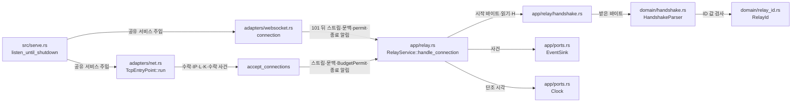

# 초기 교환 처리 모듈 설계

이 문서는 초기 요청을 모으고 해석한 뒤 다음 중계 단계에 넘기는 현재 구조를 설명한다. 예를 들어 Viewer가 `ID:0123`을 보내면 Mode II 요청과 중계 ID `0123`을 얻는다. 요청 뒤의 바이트는 상대에게 보낼 데이터로 남긴다. TCP·WS·WSS 진입점은 공통 `handle_connection`을 호출한 뒤 유효 요청을 `dispatch`에 넘긴다.

| 항목 | 값 |
| --- | --- |
| 구조 시점 | Current |
| 문서 상태 | Draft |
| 구현 대조 | Verified — [대조 기록](#대조-기록) |
| 코드 위치 | `crates/domain/src/handshake.rs`, `crates/domain/src/relay_id.rs`, `crates/app/src/relay.rs`, `crates/app/src/relay/handshake.rs`, `crates/app/src/events.rs`, `crates/adapters/src/ops_log.rs`, `crates/adapters/src/net.rs`, `crates/adapters/src/websocket.rs` |
| 코드 지도 | [코드 지도](code-map.md#2-코드-위치와-구성요소) |
| 관련 스펙 | [중계 스펙 2~4절·7절](../specs/relay.md#2-상태와-경계): RLY-001~005, RLY-022. [운영 스펙 2절·OPS-006](../specs/operations.md#2-상태와-검증-매개변수): TCP H 부분 |
| 관련 계약 | [Repeater 초기 교환 1~3절](../contracts/repeater-handshake-v1.md#1-형식과-의미), [운영 정보 1.5~1.7절](../contracts/ops-info-v2.md#15-사건-목록), [설정 1.2~1.5절](../contracts/config-v4.md#12-키-표), [WebSocket 1.4~1.5절](../contracts/websocket-relay-v2.md#14-데이터-메시지와-제어-프레임) |
| 관련 ADR | [ADR-0002 출발지 IP 허용 목록](../decisions/ADR-0002-source-ip-allowlist.md), [ADR-0003 단일 인스턴스·메모리 상태](../decisions/ADR-0003-single-instance-memory-state.md), [ADR-0004 tokio·rustls](../decisions/ADR-0004-tokio-rustls.md) |
| 관련 문서 | [접속 ticket 모듈 설계](relay-access-ticket.md) |

## 1. 책임과 경계

- domain은 초기 요청의 길이·값·모드·대상 문법·중계 ID를 판정한다. 소켓과 시계를 알지 못한다.
- app의 `RelayService::handle_connection`은 Viewer 시작 바이트, 요청 읽기, H, 종료 알림, 오류 기록, 소유권 이전을 다룬다.
- adapters는 TCP 수락, 출발지 IP 검사, L 확보, TCP keepalive를 유지한다. 허용 판정 전에 시작 바이트를 보내거나 요청을 읽지 않는다.
- Mode I 주소 해석·정책·대상 연결은 `relay/target.rs`가 맡는다. Mode II 등록·매칭·W·Lw는 `relay/matching.rs`가 맡는다. 양방향 중계·EOF 뒤 E·전송량은 `relay/session.rs`가 맡는다.
- 초기 교환은 대상 연결이나 대기 등록을 만들지 않는다. TCP·WS·WSS 연결 작업이 반환값을 `RelayService::dispatch`에 넘긴다. 후속 단계의 책임과 연결 순서는 [대상 연결·매칭·중계 수명 설계 8절](relay-session.md#8-현재-코드와의-차이와-연결-순서)을 따른다.
- domain 파서는 여섯 `EntryPoint`의 `role()`만 사용한다. TCP는 리스너, WS·WSS는 101 전 경로 검사에서 역할을 정한다. `/relay/server`는 Server로서 시작 바이트 없이 `ID:` 요청만 보낸다. WS·WSS Server의 Mode I 요청도 TCP Server와 같이 `handshake_invalid`다. 요청 250바이트의 형식은 [Repeater 계약](../contracts/repeater-handshake-v1.md)을 따른다.
- 초기 교환 사건은 `EntryPoint`의 `listener()`·`role()`을 사용한다. 전송은 양쪽 역할에 공통인 `session::Transport`로 나타낸다.
- 업무 용어는 [용어집](../../GLOSSARY.md#중계-방식과-세션)을 따른다. 새 업무 용어를 정하지 않는다.

## 2. 내부 구조

아래 그림은 현재 초기 교환 경로다. 화살표는 실행 중 호출 또는 값 전달이다. 컴파일 의존은 `src` → adapters → app → domain이다. `EventSink`·`Clock` 구현은 `src/serve.rs`가 app에 넣는다.

| 파일·심볼 | 책임 | 생성·소유 |
| --- | --- | --- |
| `crates/domain/src/handshake.rs` `HandshakeParser` | 250바이트 누적과 완료 판정. 완료 전에는 의미를 해석하지 않는다. | 연결마다 하나. app의 요청 읽기 작업이 소유한다. |
| 같은 파일의 `HandshakeRequest`, `HandshakeError`, `Mode`, `TargetAddress`, `TargetHost` | 해석 결과와 형식 오류. `TargetHost`는 `handshake` 모듈 안의 이름이다. `target_policy::TargetHost`와는 다른 타입이다. | 요청 완료 때 하나. 다음 단계로 이동한다. |
| `crates/domain/src/relay_id.rs` `RelayId`, `RelayIdError` | 유효한 ASCII 숫자열과 정확 일치 비교 | Mode II 요청이 소유한다. |
| `crates/app/src/relay.rs` `RelayService`, `ConnectionContext`, `PreparedConnection<S>` | 연결 사용 사례 입구와 다음 단계에 넘길 연결 | 서비스는 시작 때 만든다. 연결 값은 연결 작업 하나가 소유한다. |
| `crates/app/src/relay/handshake.rs` | 시작 바이트 쓰기, 제한된 읽기, 기한·단절 구분 | `handle_connection`이 호출한다. |
| `crates/app/src/events.rs`, `crates/adapters/src/ops_log.rs` | 초기 교환 거절 사건 타입과 JSON Lines 필드 | 사건 값과 formatter가 필드를 전달한다. |
| `crates/adapters/src/net.rs` `TcpEntryPoint::run` | 허용 연결마다 `TcpRelayStream`으로 감싼 소켓을 `handle_connection`에 넘기고, 유효 요청은 `dispatch`로 잇는다. | 기존 `accept_connections`의 `JoinSet`이 연결 작업을 관리한다. |
| `src/serve.rs` `listen_until_shutdown` | 시작 모드·`RuntimeSettingsSource`·`EventSink`·`Clock`으로 서비스를 조립하고 진입점에 공유 | 프로세스 실행마다 하나 |

`crates/app/src/relay.rs`와 `relay/`를 함께 쓴다. `relay/mod.rs`는 없다. app은 tokio의 시간·동기화·공통 입출력 trait만 쓴다. 소켓 타입은 adapters에 남긴다. 형식·레이어·이름은 [Rust 컨벤션](../conventions/rust.md#2-규칙)을 따른다.

`crates/app/clippy.toml`은 `tokio::net`·`tokio::fs`·`tokio::process`·`tokio::signal`의 입출력 타입·함수를 금지한다.

tokio 금지 항목에는 `allow-invalid = true`를 둔다. 플랫폼 전용 경로와 꺼진 기능의 경로는 현재 빌드에서 존재하지 않을 수 있기 때문이다. 해당 경로가 빌드에 나타나면 금지는 그대로 적용된다. 금지 목록 검사를 위해 app에 OS 입출력 기능을 켜지는 않는다.

## 3. domain API와 데이터 모델

domain API는 다음과 같다. 공개 상수는 `HANDSHAKE_REQUEST_LEN = 250`과 `VIEWER_GREETING: &[u8; 12]`다. app 서비스는 Viewer 스트림에 시작 바이트를 쓰고 flush한다. TCP·WS·WSS 진입점 모두 이 서비스를 호출한다.

| API | 입력·출력 | 보장 |
| --- | --- | --- |
| `HandshakeParser::new()` | 빈 해석기 | 내부 공간은 `[u8; 250]`과 채운 길이다. 입력마다 동적 할당하지 않는다. |
| `HandshakeParser::feed(&mut self, input: &[u8]) -> usize` | 이번 입력에서 초기 요청으로 소비한 길이 | 남은 요청 길이까지만 복사한다. 반환 길이 뒤의 바이트는 소비하지 않는다. 완료 뒤 호출하면 0이다. |
| `HandshakeParser::is_complete(&self) -> bool` | 250바이트 수신 여부 | 249바이트 이하에서는 항상 `false`다. NUL을 받았어도 조기 완료하지 않는다. |
| `HandshakeParser::finish(self, entry_point, modes) -> Result<HandshakeRequest, HandshakeError>` | 진입점과 Mode I·II 활성 값 | 완성된 버퍼만 해석한다. 미완성 해석기에는 `Incomplete`를 반환한다. 이 API 오류 자체가 상대 단절을 뜻하지는 않는다. |
| `RelayId::parse(text: &str) -> Result<RelayId, RelayIdError>` | ID 본문 | ASCII 숫자 1~247자를 검증한다. 숫자로 변환하지 않는다. |
| `RelayId::as_str(&self) -> &str` | 보관한 ID | 앞자리 0을 포함한 원문이다. `Eq`·`Hash`는 같은 바이트열만 같게 본다. |

`HandshakeRequest`는 `Mode1(TargetAddress)` 또는 `Mode2(RelayId)`다. 역할은 별도 요청 필드로 중복 저장하지 않는다. `ConnectionContext.entry_point.role()`로 얻는다. `Mode`는 사건의 `mode1`·`mode2` 표기에 쓴다.

`modes`는 domain의 `HandshakePolicy { mode1_enabled: bool, mode2_enabled: bool }`다. app은 시작 설정의 두 활성 값을 이 타입에 담는다. domain이 app의 설정 타입을 참조하지 않는다.

`TargetAddress`는 단일 `IpAddr` 또는 정규화한 DNS 이름과 `u16` 포트다. DNS 이름만 소문자화하고 끝의 점을 지운다. ID에는 이 처리를 하지 않는다. `RelayId`는 검증된 `String`을 소유한다. 요청 읽기 버퍼가 사라진 뒤에도 ID가 살아야 하므로 이 소유용 복사는 필요하다. 요청 전체나 채움 바이트는 결과에 복제하지 않는다. ID와 초기 요청의 `Debug` 출력에는 원문을 넣지 않는다.

`HandshakeError`는 `Incomplete`, `Invalid`, `ModeDisabled(Mode)`를 구분한다. 계약 코드 함수는 각각 `handshake_incomplete`, `handshake_invalid`, `mode_disabled`를 준다. H·I/O·서버 종료는 app의 결과다. domain 오류에 시계나 소켓 오류를 넣지 않는다. 오류의 `Display`는 초기 요청이나 ID를 포함하지 않는다.

### 기존 파서 재사용

| 문법 | 재사용 코드 | 현재 적용 |
| --- | --- | --- |
| 단일 IPv4 | `allow_list::parse_address`의 `Ipv4Addr` 해석 | 숫자와 점만 있는 호스트는 이 함수로 해석한다. 실패를 DNS 이름으로 되돌리지 않는다. 앞자리 0을 받지 않는다. |
| DNS 이름 | `origin::is_dns_name`, `target_policy::TargetItem::parse`의 끝 점 제거·소문자화 | 같은 검증 함수를 부른다. 끝 점 제거와 소문자화도 기존 방식대로 한다. 라벨과 전체 길이 규칙을 다시 작성하지 않는다. |
| 대괄호 IPv6 | `allow_list::parse_address`, `origin::is_valid_host`의 `Ipv6Addr` 해석 | 대괄호를 제거한 뒤 같은 표준 `Ipv6Addr` 파서를 쓴다. `%`는 거절한다. 단일 주소만 받는다. |
| IPv4-mapped IPv6 | `PeerIp::new`가 쓰는 `IpAddr::to_canonical` | 대상 주소에도 같은 표준 변환을 쓴다. `PeerIp` 타입을 대상 값으로 쓰지는 않는다. |
| 요청 포트 | `target_policy::parse_port`는 설정용이다. 앞자리 0도 받는다. | 요청은 십진수·범위를 검사하며 앞자리 0을 거절한다. 설정 포트 문법은 바꾸지 않는다. |

`IpItem::parse`나 `TargetItem::parse`를 요청 전체에 적용하지 않는다. 그 함수들은 CIDR·주소 범위·포트 범위를 받는다. 요청은 단일 호스트와 단일 포트만 받는다. `target_policy::TargetHost::Ip(IpItem)`도 요청 결과에 재사용하지 않는다.

`allow_list::parse_address`는 IPv6의 점 표기 IPv4 꼬리를 거절한다. 이는 [설정 계약 1.3절](../contracts/config-v4.md#13-ip-항목-문법)의 제약이다. 반면 요청 계약은 RFC 4291 표기와 IPv4-mapped 변환을 정한다. 따라서 `[::ffff:192.0.2.30]`은 표준 `Ipv6Addr` 파서로 읽고 IPv4로 바꾼다. 설정용 금지 규칙을 요청에 복사하지 않는다. IPv6 문법 자체의 별도 파서는 만들지 않는다.

숫자·점·하이픈만 있는 호스트는 IP 경로로 보낸다(구현 판단). [설정 계약 1.5절 규칙 3](../contracts/config-v4.md#15-mode-i-대상-허용-항목-문법)의 분류를 재사용한다. `1-2` 같은 문자열은 대상 허용 정책의 이름 항목으로 만들 수 없다. DNS 이름으로 먼저 받더라도 최종 정책에서 허용되지 않는다. 이 분류가 바꾸는 것은 허용 결과가 아니라 오류 코드다. 단위 시험에 `1-2`와 `1-2:5900`을 포함한다.

### 해석 순서

1. 250바이트가 모였는지 확인한다.
2. 첫 NUL 앞의 값을 선택한다. NUL이 없으면 전체를 값으로 쓴다. NUL 뒤는 검사하지 않는다.
3. Viewer는 빈 값도 모드부터 판정한다. TCP·WS·WSS Server는 `ID:` 접두어를 먼저 검사한다. 빈 값·비접두어는 `handshake_invalid`다. 아래 4~6단계는 이 순서를 따른다.
4. Viewer는 대문자 `ID:`로 시작하면 Mode II다. 그 밖은 Mode I이다. Server는 `ID:`가 아니면 `handshake_invalid`다.
5. 판정한 모드가 꺼져 있으면 `mode_disabled`다. 그 모드의 ID·대상 문법은 더 검사하지 않는다. 예를 들어 Mode II가 꺼졌으면 `ID:abc`도 `mode_disabled`다.
6. 켜진 모드는 ID 또는 Mode I 대상을 검사한다. 기본 포트는 5900이다. 공백·와일드카드·CIDR·주소 범위·포트 범위·대괄호 없는 IPv6를 거절한다.

Viewer의 빈 요청은 Mode I이 꺼졌으면 `mode_disabled`, 켜졌으면 `handshake_invalid`다. Server의 빈 값·비접두어는 항상 `handshake_invalid`다. `ID:`만 있는 값은 Mode II가 꺼졌으면 `mode_disabled`, 켜졌으면 빈 ID라 `handshake_invalid`다.

## 4. app 처리 순서와 H

`ConnectionContext.buffer_bytes`는 수락 때의 B이고 `handshake`는 초기 교환 시작 때의 H다. TCP는 수락 직후, WS·WSS는 101 flush 뒤에 H를 읽는다. `RelayService::prepare`는 이 H와 `exchange_at`으로 절대 기한을 한 번 만든다. 실패 종료 E는 `RelayService::close_timeout`이 종료 시작 때 실행 설정에서 읽는다. 서비스 생성 때 H/B/E를 고정하지 않는다. `PreparedConnection`의 문맥은 B를 대기·대상·세션의 각 방향 버퍼로 이어 준다([소비 경계](file-watch.md#101-발행-단위와-reader), [설정 §1.8](../contracts/config-v4.md#18-재로드-구분), OPS-050).

| 순서 | 코드 위치·처리 | 전달 값·결과 |
| --- | --- | --- |
| 1 | `src/serve.rs`가 `RelayService`를 조립한다. | 시작 모드, 실행 설정 소스, 공유 `EventSink`·`Clock` |
| 2 | `net.rs`의 `accept_connections`가 IP → L → `conn_id` → `connection_accepted` → K 순서를 유지한다. | 수락 B/H/U/K, 소켓과 기존 `BudgetPermit` 하나 |
| 3 | TCP·WS·WSS 연결 작업이 `ConnectionContext`와 스트림을 `handle_connection`에 넘긴다. | 실제 상대 주소·수락 시각·초기 교환 진입 시각·수락 B·시작 H와 종료 알림. ticket 업그레이드는 별도 `Option<TicketBinding>`도 넘긴다. TCP는 `None`이다. |
| 4 | app이 H의 절대 기한을 만든다. ticket에 `sx`가 있으면 단조 세션 만료 기한과 비교한다. Viewer면 즉시 `RFB 000.000\n`을 한 번 쓰고 flush한다. Server에는 쓰지 않는다. | 쓰기·flush와 읽기는 더 이른 기한을 따른다. 두 기한이 같으면 H가 우선한다(구현 판단). 이후 H를 다시 시작하지 않는다. |
| 5 | 요청을 읽어 `feed`에 넣는다. 매번 소비 길이와 완료 여부를 확인한다. | 250바이트 미만이면 같은 기한으로 계속 읽는다. |
| 6 | 250바이트가 H 안에 모였으면 `finish`를 부른다. | 잘못된 값·꺼진 모드는 6절로 간다. 유효 요청이면 H 감시를 끝낸다. |
| 7 | 결과·스트림·후속 데이터·문맥·`BudgetPermit`을 `PreparedConnection<S>`로 묶는다. | `handle_connection`은 유효 요청을 호출자에게 반환한다. 임시 보류·닫기·가짜 인계를 하지 않는다. TCP·WS·WSS 호출자가 `dispatch`를 실행한다([연결 순서](relay-session.md#8-현재-코드와의-차이와-연결-순서)). |

`dispatch`는 기존 초기 요청 검사 뒤, 모드 분기 전에 ticket의 `rid`를 대조한다. ticket 연결의 Mode I 요청과 `rid`가 바이트 단위로 다른 Mode II 요청은 Close 4012 `ticket_relay_mismatch`로 거절한다. 꺼진 Mode I의 기존 1008은 먼저 적용한다. `connection_rejected(stage=initial_exchange, reason=ticket_relay_mismatch)`는 `warn`이며 `mode`·`ticket_jti`를 쓴다. Mode II이면 `relay_id_ref`도 쓴다. 같은 ID로 대기 중인 상대는 유지한다([접속 ticket 모듈 설계](relay-access-ticket.md#43-101-뒤)).

`ConnectionContext`의 단조 시각은 공유 `Clock::monotonic()`이 주는 `Duration`이다. 수락 시각은 adapters가 수락 처리에서 잡는다. TCP의 초기 교환 진입 시각은 IP·L 검사 통과 직후다. `Accepted.at`은 이 위치에서 `Instant::now()`로 채운다. WS·WSS의 초기 교환 시각은 101 응답 완료 직후다. `elapsed_ms`는 H의 시작점이 아니라 수락 시각부터 계산한다.

app은 기존 `Clock` 포트를 재사용한다. `tokio::time::sleep`에는 남은 시간을 넘긴다. 읽기나 쓰기가 깨어난 직후에도 단조 시각을 확인한다. 타이머 분기만 믿고 H가 지난 요청을 수락하지 않는다. 청크마다 기한을 늘리지 않는다. `now >= deadline`이면 만료다(구현 판단). H 전에 관찰한 EOF는 `peer_eof`다. H 만료를 먼저 관찰했다면 `handshake_timeout`이다.

수락 시각과 WS·WSS의 U·H 계산은 공통 단조 시계 기준으로 연결된다. U의 시작·범위는 바꾸지 않는다. app 단위 시험은 제어 가능한 `Clock`과 tokio 정지 시각을 함께 쓴다. 실제 소켓과 대기는 adapters·시스템 시험에 둔다.

`handle_connection(stream, context, ticket, permit, shutdown)`은 `Result<PreparedConnection<S>, RelayError>`를 내는 future를 반환한다. `ticket`은 `Option<TicketBinding>`이다. `S: RelayStream`이다. 종료 입력은 `watch::Receiver<RelayLifecycle>`이다. `ConnectionContext`는 `conn_id`, `entry_point`, `peer_ip`, `forwarded_ip`, `peer_addr`, `accepted_wall`, `accepted_at`, `exchange_at`, `buffer_bytes`, `handshake`를 가진다. `accepted_wall`은 표시용 벽시계다. 나머지 두 시각은 공유 `Clock`의 단조 시각이다. `RelayService::new(modes, settings, clock, events)`에서 settings는 `Arc<dyn RuntimeSettingsSource>`다. 실패하면 종료 시작에 읽은 E 안에서 close action을 진행하고 stream → permit → 사건 순서로 정리한다. 유효 요청은 ticket 바인딩과 함께 소유권을 호출자에게 돌려준다. TCP·WS·WSS는 같은 연결 작업에서 `dispatch(prepared, &runtime)`을 실행한다.

## 5. 후속 바이트와 B

`feed`가 소비한 길이까지만 초기 요청이다. 입력의 나머지는 다음 스트림의 앞부분이다. 초기 요청 250바이트는 상대에게 보내지 않는다. 시작 바이트 12바이트도 상대 Server에 전달하지 않는다.

- 읽기는 고정 크기 작업 공간을 쓴다. 읽을 수 있는 길이는 남은 요청 길이와 B를 더한 값 이하다. 한 번에 더 읽었어도 초기 요청 뒤의 보존 데이터가 B를 넘지 않는다. 같은 쓰기에 붙었지만 읽지 않은 바이트는 스트림에 남는다.
- `feed`가 소비하지 않은 슬라이스는 후속 데이터로 보관한다. `PreparedConnection`은 이 데이터와 B를 함께 소유한다. 후속 데이터 조회, 보관한 길이, 남은 B, 연결 요소를 이동하는 API를 제공한다. 호출자가 보관 데이터를 직접 늘리지 못하게 한다.
- 후속 데이터 버퍼와 다음 단계의 읽기 대기 데이터는 같은 연결의 B를 나눠 쓴다. 후속 데이터가 `n`바이트면 새로 읽을 수 있는 양은 최대 `B - n`바이트다. B가 차면 상대에게 보낼 때까지 읽기를 멈춘다.
- 새 단계는 버퍼를 복제하지 않고 이동받는다. 저장한 후속 데이터를 먼저 소진한다. 그 뒤에만 소켓에서 읽은 데이터를 전달한다. 소진한 길이를 갱신해 같은 데이터를 다시 보내지 않는다.
- 초기 요청 고정 공간은 프로토콜 해석용이다. B는 초기 요청 뒤의 중계 데이터에 적용한다. 아직 읽지 않은 OS 소켓 버퍼를 app 버퍼로 미리 복사하지 않는다.
- 후속 데이터의 실제 전달은 `tests/relay_entry_scenarios.rs`와 `crates/adapters/tests/websocket_relay.rs`가 확인한다. 내부 보존 시험과 종단 간 전달 시험을 구분한다.

WS·WSS는 바이너리 메시지 안의 250바이트 경계를 나누고 메시지의 나머지도 B에 포함한다. `WsRelayStream`은 프레임을 호출자의 남은 버퍼 길이까지만 읽는다. M>B여도 메시지 전체를 먼저 할당하지 않는다. [WS 스트림 설계](websocket-stream.md)가 프레임·메시지·B의 관계를 설명한다.

app의 일반 tokio 기능은 `time`, `sync`, `io-util`뿐이다. `macros`, `rt`, `test-util`은 개발 의존에서만 켠다. `test-util`은 정지 시각 시험에 필요하다([Tokio 1.54.0 시간 문서](https://docs.rs/tokio/1.54.0/tokio/time/fn.pause.html)). 제품 코드에서는 `tokio::select!`를 쓰지 않는다. `std::future::poll_fn`으로 종료 알림·H·입출력 순서를 기다린다. 완료 직전에도 종료·H를 다시 확인한다. 이 구조는 구현 판단이다. app의 clippy 금지 목록은 tokio의 소켓·파일·프로세스·신호 타입과 함수도 막는다.

## 6. 사건·오류·자원 회수

| 조건 | 사건·필드 | 외부 종료 |
| --- | --- | --- |
| 출발지 IP·L 거절 | 기존 `connection_rejected`, `stage = accept` | 초기 요청을 읽거나 시작 바이트를 보내지 않는다. |
| 형식 오류 | `connection_rejected`, `stage = initial_exchange`, `reason = handshake_invalid`, `conn_id`, `listener`, `peer_ip`. 역할은 진입점에서 얻는다. | TCP FIN. 오류 바이트 없음 |
| 모드 비활성 | 위와 같은 거절 사건, `reason = mode_disabled`, 판정한 `mode` 필수 | TCP FIN. 오류 바이트 없음 |
| 250바이트 전 정상 EOF | `connection_aborted`, `stage = initial_exchange`, `reason = peer_eof`, `elapsed_ms`, `info` | 상대가 이미 닫았다. 계약의 `handshake_incomplete`에 대응한다. |
| H 만료 | 같은 중단 사건, `reason = handshake_timeout`, `warn` | TCP FIN |
| H보다 이른 세션 만료 기한 도달 | `connection_aborted`, `stage = initial_exchange`, `reason = session_expired`, `info` | WS·WSS Close 4013 `session_expired`. H와 기한이 같으면 기존 H 만료다. |
| 시작 바이트 쓰기·flush·요청 읽기 오류 | 같은 중단 사건. typed 오류는 `connection_error`와 원래 `error_kind`를 보존한다. 응답 없는 연결은 `dead_connection`이다. | 해당 연결만 정리 |
| 서버 종료 알림 | 같은 중단 사건, `reason = server_shutdown`, `info` | 미완성 연결 정리 |
| 유효 요청 | 새 성공 사건을 만들지 않는다. | 다음 단계의 등록·연결·세션 사건은 각 작업이 만든다. |

기존 `Event::ConnectionRejected`에는 `conn_id`·`mode`가 없다. 수락 뒤 거절을 나타내는 `Event::HandshakeRejected`를 별도로 쓴다. 이 사건은 `conn_id`, `entry_point`, `peer_ip`, `reason`, `mode: Option<Mode>`를 받는다. JSON 사건 이름은 `connection_rejected`이고 `stage`는 항상 `initial_exchange`다. `RejectReason::HandshakeInvalid`·`ModeDisabled`를 쓴다. `ModeDisabled`일 때 `Some(Mode)`를 주는 책임은 호출자에게 있다. 모드를 확정하지 못했으면 생략한다. `AbortReason::PeerEof`와 `HandshakeTimeout`은 그대로 쓴다. `handshake_incomplete`라는 로그 사유는 쓰지 않는다. 실제 연결에서는 `relay.rs`의 `handle_connection` 실패 경로가 이 사건을 쓴다.

초기 요청·채움·후속 데이터·ID 원문은 기록하지 않는다. 일반 초기 교환은 `relay_id_ref`를 계산하지 않는다. ticket의 Mode II `rid` 대조 실패는 `dispatch`가 ref를 계산해 거절 사건에 넣는다. `src/serve.rs`가 시작 키를 만들고 `RelayRuntime`에 주입한다. 일반 ref 계산은 Mode II 등록 단계의 책임이다.

거절·중단은 E 안에서 close action을 진행한다. 절대 E·Grace의 G·Force 중 먼저 온 경계에서 기다림을 끝낸다. 이후 스트림과 후속 데이터를 버리고 L 자리를 돌려준 뒤 사건 하나를 쓴다(구현 판단). E는 H와 별도다. 닫기를 기다리면서 H를 다시 시작하지 않는다. 읽지 않은 수신 데이터 때문에 OS가 RST를 보낼 수 있다는 계약의 주의도 유지한다.

`PreparedConnection<S>`는 스트림과 `BudgetPermit`을 함께 소유한다. 단계가 바뀌어도 L을 다시 잡거나 일찍 돌려주지 않는다. 실패·취소 때는 스트림을 먼저 버리고 그 뒤 permit을 버린다. 수락 반복은 종료 알림을 보낸 뒤 연결 작업을 거둔다. `server_stopped`는 그 뒤에 기록한다. 초기 교환은 Lw·대기·활성 등록을 소유하지 않는다.

서비스 호출 시 스트림과 permit을 비공개 자원 묶음으로 옮긴다. 반환된 future가 아직 실행되지 않았거나 도중에 버려져도 스트림을 먼저 버린다. 이를 위해 `handle_connection`은 future를 반환하는 일반 함수로 쓴다. 호출자는 기존 비동기 함수처럼 `.await`한다. 자원 묶음에는 별도 할당이 없다.

WS·WSS의 형식 오류는 Close 4008(`handshake_invalid`), H는 4009(`handshake_timeout`), 비활성 모드는 1008(`mode_disabled`)다. 시작 바이트는 101 뒤 첫 바이너리 메시지 하나다. Close 전송 실패가 L 반환을 막지 않는다. Close 정리의 E는 [WebSocket 계약 1.6절](../contracts/websocket-relay-v2.md#16-종료-의미)을 따른다.

## 7. 현재 시험

아래 표는 현재 시험 소스와 표식이다. 실행 결과는 `cargo xtask scenarios`의 보고서와 CI에서 확인한다. `partial`은 [테스트 컨벤션](../conventions/testing.md#2-규칙)의 실제 표식 접미사다.

| 범위 | 현재 시험 파일·함수 | 표식·확인 범위 |
| --- | --- | --- |
| 역할·분할·후속 데이터 | `tests/relay_entry_scenarios.rs` `accepts_both_tcp_roles_and_preserves_split_and_merged_requests_with_prefixes_once` | RLY-001·002·003 전체 표식. 실제 TCP 양 역할의 요청과 후속 데이터가 상대에게 한 번 도착함을 확인 |
| 잘못된 요청 | 같은 파일의 `rejects_every_malformed_initial_value_without_registration_or_target_socket` | RLY-004 전체 표식. 종료·사건·L 반환과 등록·대상 연결 없음 |
| EOF와 H | 같은 파일의 `incomplete_disconnect_and_h_timeout_have_distinct_causes_and_return_l_for_each_role` | RLY-005 전체 표식. 양 역할의 미완성 EOF와 H를 구분 |
| 꺼진 모드 | 같은 파일의 `disabled_modes_reject_before_waiting_registration_or_target_connect` | RLY-022 전체 표식. 모드 비활성은 등록·대상 연결 전에 거절 |
| domain 값 | `crates/domain/src/handshake.rs`, `crates/domain/src/relay_id.rs` | RLY-001~004·022의 부분 표식. 모든 분할 위치, NUL·채움, 대상 문법, 정확 ID와 앞자리 0 |
| H·소유권·실패 종료 | `crates/app/src/relay/handshake.rs` | RLY-001~005·022, OPS-006 등의 부분 표식. 절대 H, typed 오류, E 뒤 회수와 stream → permit → 사건 순서 |
| WS·WSS 실제 인계 | `crates/adapters/tests/websocket_relay.rs` `ws_and_wss_forward_initial_trailing_data_once` | WS-018·003~006 전체 표식, RLY-003 부분 표식. 양 접속 순서와 후속 데이터 전달 |
| WS·WSS 초기 실패 | 같은 파일의 `invalid_initial_requests_close_4008_and_log_the_rejection`, `incomplete_initial_exchange_closes_4009_and_logs_h_timeout`, `disabled_modes_close_1008_before_registration_or_target_connect` | RLY-004·005·022와 OPS-006 부분 표식. Close·사건·예산 회수 |
| 사건 계약 | `crates/adapters/tests/ops_info_contract.rs` `writes_initial_exchange_rejections_with_conn_id_and_disabled_mode` | 필드·이름·level·원문 비노출. 실제 진입점 수명 시험을 대신하지 않음 |

`does_not_restart_h_on_partial_reads_or_greeting_writes`는 느린 쓰기·읽기에도 H가 연장되지 않음을 확인한다. `drops_the_stream_before_l_when_preparation_is_cancelled`는 future를 첫 실행 전이나 읽기 대기 중에 버려도 스트림을 먼저 회수하는지 확인한다. 둘 다 `crates/app/src/relay/handshake.rs`의 내부 회귀 시험이다.

U는 별도 시험 범위다. `crates/adapters/tests/websocket.rs`의 HTTP·TLS 지연 시험과 `crates/adapters/tests/management.rs`의 TLS·유휴 시험이 맡는다. H 시험의 존재만으로 OPS-006 전체를 확인했다고 보지 않는다.

## 대조 기록

- 날짜·대상: 2026-11-19, 커밋 `c0fa253`과 이 문서의 현재 상태 정리 작업 트리다. 제품 코드는 변경하지 않았다.
- 환경: Windows 10.0.26200 x64의 저장소 소스다.
- 방법: domain 해석기와 `relay/handshake.rs`의 `exchange`·`read_request`, `relay.rs`의 `ConnectionContext`·생성자·`handle_connection`, TCP 수락과 WS·WSS 101 뒤 호출 경계를 읽었다. 문서의 API·기한·버퍼·인계 순서와 대조했다.
- 결과: H는 초기 교환 시작값이고 B는 수락값이다. TCP·WS·WSS는 유효 요청을 `PreparedConnection`으로 받아 같은 `dispatch`에 넘긴다. 구조 대조는 동작 시험의 통과를 뜻하지 않는다.

현재 시나리오 결과는 [테스트 컨벤션](../conventions/testing.md#7-테스트와-스펙-시나리오-연결)에 따라 `cargo xtask scenarios`로 생성하는 `scenario-report.md`와 CI에서 확인한다.

