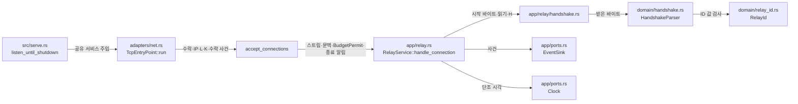

# 초기 교환 처리 모듈 설계

이 문서는 초기 요청을 모으고 해석한 뒤 다음 중계 단계에 넘기는 구조를 설명한다. 예를 들어 Viewer가 `ID:0123`을 보내면 Mode II 요청과 중계 ID `0123`을 얻는다. 요청 뒤의 바이트는 상대에게 보낼 데이터로 남긴다. 작업 2.7의 공통 app·domain 처리는 구현했다. TCP·WS·WSS 진입점이 이 처리를 `handle_connection`으로 호출한다(`638cf09`).

| 항목 | 값 |
| --- | --- |
| 구조 시점 | Target |
| 문서 상태 | Draft |
| 구현 대조 | 부분 대조 — [2026-11-04 코드 차이](#8-현재-코드와-목표의-차이), [실행 기록](#실행-기록). 본문의 이전 API 설명 때문에 Target을 유지한다. |
| 코드 위치 | `crates/domain/src/handshake.rs`, `crates/domain/src/relay_id.rs`, `crates/app/src/relay.rs`, `crates/app/src/relay/handshake.rs`, `crates/app/src/events.rs`, `crates/adapters/src/ops_log.rs`, `crates/adapters/src/net.rs`, `crates/adapters/src/websocket.rs` |
| 코드 지도 | [코드 지도](code-map.md#2-코드-위치와-구성요소) |
| 관련 스펙 | [중계 스펙 2~4절·7절](../specs/relay.md#2-상태와-경계): RLY-001~005, RLY-022. [운영 스펙 2절·OPS-006](../specs/operations.md#2-상태와-검증-매개변수): TCP H 부분 |
| 관련 계약 | [Repeater 초기 교환 1~3절](../contracts/repeater-handshake-v1.md#1-형식과-의미), [운영 정보 1.5~1.7절](../contracts/ops-info-v1.md#15-사건-목록), [설정 1.2~1.5절](../contracts/config-v2.md#12-키-표), [WebSocket 1.4~1.5절](../contracts/websocket-relay-v1.md#14-데이터-메시지와-제어-프레임) |
| 관련 ADR | [ADR-0002 출발지 IP 허용 목록](../decisions/ADR-0002-source-ip-allowlist.md), [ADR-0003 단일 인스턴스·메모리 상태](../decisions/ADR-0003-single-instance-memory-state.md), [ADR-0004 tokio·rustls](../decisions/ADR-0004-tokio-rustls.md) |

채택된 계약의 형식과 오류 이름은 바꾸지 않는다. 아래의 내부 API와 자료 배치는 이 문서의 판단이며 사용자 결정은 없다. 9절의 세 항목은 모두 해결했다. 1번은 D, 2번은 A를 적용한다. 두 선택도 이 문서의 판단이며 사용자 결정은 없다.

현재 구현은 3절의 domain API, 4~6절의 공통 app 처리와 초기 교환 거절 사건·JSON 출력이다. 유효 요청은 `PreparedConnection`으로 반환한다. TCP 진입점은 `TcpEntryPoint::run`(`crates/adapters/src/net.rs`)에서, WS·WSS 진입점은 `connection`(`crates/adapters/src/websocket.rs`)에서 `handle_connection`을 부르고, 유효 요청을 `dispatch`에 넘긴다. WS·WSS 실제 중계 검증(WS-018 `partial` 등)이 끝나기 전에는 TODO 2.7을 완료로 바꾸지 않는다.

## 1. 책임과 경계

- domain은 초기 요청의 길이·값·모드·대상 문법·중계 ID를 판정한다. 소켓과 시계를 알지 못한다.
- app의 `RelayService::handle_connection`은 Viewer 시작 바이트, 요청 읽기, H, 종료 알림, 오류 기록, 소유권 이전을 다룬다.
- adapters는 TCP 수락, 출발지 IP 검사, L 확보, TCP keepalive를 유지한다. 허용 판정 전에 시작 바이트를 보내거나 요청을 읽지 않는다.
- Mode I 주소 해석·정책·대상 연결은 작업 2.8이다. Mode II 등록·매칭·W·Lw는 작업 2.9다. 양방향 중계·EOF 뒤 E·전송량은 작업 2.10이다.
- 2.7은 대상 연결 포트나 대기 연결 표를 미리 만들지 않는다. TCP·WS·WSS 연결 작업은 `handle_connection`의 반환값을 `RelayService::dispatch`에 넘긴다(`crates/adapters/src/net.rs` `TcpEntryPoint::run`, `crates/adapters/src/websocket.rs` `connection`). 연결 순서는 [대상 연결·매칭·중계 수명 설계 8절](relay-session.md#8-현재-코드와의-차이와-연결-순서)을 따른다.
- WS·WSS는 Q16을 유지하며 101 뒤 중계를 `WsRelayStream`으로 `handle_connection`·`dispatch`에 연결했다(`638cf09`). Q21의 101 뒤 보류는 제거했다. 바이너리 메시지와 스트림 사이의 변환, B 계산에 필요한 3.3 범위를 앞당겼다. domain API는 전송 방식과 무관하게 네 진입점의 역할을 받는다.
- 업무 용어는 [용어집](../../GLOSSARY.md#중계-방식과-세션)을 따른다. 새 업무 용어를 정하지 않는다.

## 2. 내부 구조

아래 그림은 목표 구조만 보인다. 화살표는 실행 중 호출 또는 값 전달이다. 컴파일 의존은 `src` → adapters → app → domain이다. `EventSink`·`Clock` 구현은 `src/serve.rs`가 app에 넣는다.

| 계획 파일·심볼 | 책임 | 생성·소유 |
| --- | --- | --- |
| `crates/domain/src/handshake.rs` `HandshakeParser` | 250바이트 누적과 완료 판정. 완료 전에는 의미를 해석하지 않는다. | 연결마다 하나. app의 요청 읽기 작업이 소유한다. |
| 같은 파일의 `HandshakeRequest`, `HandshakeError`, `Mode`, `TargetAddress`, `TargetHost` | 해석 결과와 형식 오류. `TargetHost`는 `handshake` 모듈 안의 이름이다. `target_policy::TargetHost`와는 다른 타입이다. | 요청 완료 때 하나. 다음 단계로 이동한다. |
| `crates/domain/src/relay_id.rs` `RelayId`, `RelayIdError` | 유효한 ASCII 숫자열과 정확 일치 비교 | Mode II 요청이 소유한다. |
| `crates/app/src/relay.rs` `RelayService`, `ConnectionContext`, `PreparedConnection<S>` | 연결 사용 사례 입구와 다음 단계에 넘길 연결 | 서비스는 시작 때 만든다. 연결 값은 연결 작업 하나가 소유한다. |
| `crates/app/src/relay/handshake.rs` | 시작 바이트 쓰기, 제한된 읽기, 기한·단절 구분 | `handle_connection`이 호출한다. |
| `crates/app/src/events.rs`, `crates/adapters/src/ops_log.rs` | 초기 교환 거절 사건 타입과 JSON Lines 필드 | 기존 사건 처리 방식을 확장한다. |
| `crates/adapters/src/net.rs` `TcpEntryPoint::run` | 허용 연결마다 `TcpRelayStream`으로 감싼 소켓을 `handle_connection`에 넘기고, 유효 요청은 `dispatch`로 잇는다. | 기존 `accept_connections`의 `JoinSet`이 연결 작업을 관리한다. |
| `src/serve.rs` `listen_until_shutdown` | 모드 설정·H·B·`EventSink`·`Clock`으로 서비스를 조립하고 진입점에 공유 | 프로세스 실행마다 하나 |

`crates/app/src/relay.rs`와 `relay/`를 함께 쓴다. `relay/mod.rs`는 만들지 않는다. app은 tokio의 시간·동기화·입출력 trait만 쓴다. app의 `Cargo.toml`에는 필요한 tokio 기능만 추가한다. 소켓 타입은 adapters에 남긴다. 형식·레이어·이름은 [Rust 컨벤션](../conventions/rust.md#2-규칙)을 따른다.

app은 tokio의 시간·동기화·공통 입출력 trait만 쓴다. `crates/app/clippy.toml`은 `tokio::net`·`tokio::fs`·`tokio::process`·`tokio::signal`의 입출력 타입·함수를 금지한다. 이 금지 목록을 추가했으므로 [코드 지도 7절](code-map.md#7-확인하지-못한-부분)의 “app의 tokio 입출력 금지 목록” 행을 지웠다.

tokio 금지 항목에는 `allow-invalid = true`를 둔다. 플랫폼 전용 경로와 꺼진 기능의 경로는 현재 빌드에서 존재하지 않을 수 있기 때문이다. 해당 경로가 빌드에 나타나면 금지는 그대로 적용된다. 금지 목록 검사를 위해 app에 OS 입출력 기능을 켜지는 않는다.

## 3. domain API와 데이터 모델

아래 domain API를 구현했다. 공개 상수는 `HANDSHAKE_REQUEST_LEN = 250`과 `VIEWER_GREETING: &[u8; 12]`다. app 서비스는 Viewer 스트림에 시작 바이트를 보낸다. TCP 진입점은 서비스를 호출한다. WS·WSS 진입점에서는 아직 서비스를 호출하지 않는다.

| API | 입력·출력 | 보장 |
| --- | --- | --- |
| `HandshakeParser::new()` | 빈 해석기 | 내부 공간은 `[u8; 250]`과 채운 길이다. 입력마다 동적 할당하지 않는다. |
| `HandshakeParser::feed(&mut self, input: &[u8]) -> usize` | 이번 입력에서 초기 요청으로 소비한 길이 | 남은 요청 길이까지만 복사한다. 반환 길이 뒤의 바이트는 소비하지 않는다. 완료 뒤 호출하면 0이다. |
| `HandshakeParser::is_complete(&self) -> bool` | 250바이트 수신 여부 | 249바이트 이하에서는 항상 `false`다. NUL을 받았어도 조기 완료하지 않는다. |
| `HandshakeParser::finish(self, entry_point, modes) -> Result<HandshakeRequest, HandshakeError>` | 진입점과 Mode I·II 활성 값 | 완성된 버퍼만 해석한다. 미완성 해석기에는 `Incomplete`를 반환한다. 이 API 오류 자체가 상대 단절을 뜻하지는 않는다. |
| `RelayId::parse(text: &str) -> Result<RelayId, RelayIdError>` | ID 본문 | ASCII 숫자 1~247자를 검증한다. 숫자로 변환하지 않는다. |
| `RelayId::as_str(&self) -> &str` | 보관한 ID | 앞자리 0을 포함한 원문이다. `Eq`·`Hash`는 같은 바이트열만 같게 본다. |

`HandshakeRequest`는 `Mode1(TargetAddress)` 또는 `Mode2(RelayId)`다. 역할은 별도 요청 필드로 중복 저장하지 않는다. `ConnectionContext.entry_point.role()`로 얻는다. `Mode`는 사건의 `mode1`·`mode2` 표기에 쓴다.

`modes`는 domain의 `HandshakePolicy { mode1_enabled: bool, mode2_enabled: bool }`다. app은 시작 설정의 두 활성 값을 이 타입에 담는다. domain이 app의 설정 타입을 참조하지 않는다.

`TargetAddress`는 단일 `IpAddr` 또는 정규화한 DNS 이름과 `u16` 포트다. DNS 이름만 소문자화하고 끝의 점을 지운다. ID에는 이 처리를 하지 않는다. `RelayId`는 검증된 `String`을 소유한다. 요청 읽기 버퍼가 사라진 뒤에도 ID가 살아야 하므로 이 소유용 복사는 필요하다. 요청 전체나 채움 바이트는 결과에 복제하지 않는다. ID와 초기 요청의 `Debug` 출력에는 원문을 넣지 않는다.

`HandshakeError`는 `Incomplete`, `Invalid`, `ModeDisabled(Mode)`를 구분한다. 계약 코드 함수는 각각 `handshake_incomplete`, `handshake_invalid`, `mode_disabled`를 준다. H·I/O·서버 종료는 app의 결과다. domain 오류에 시계나 소켓 오류를 넣지 않는다. 오류의 `Display`는 초기 요청이나 ID를 포함하지 않는다.

### 기존 파서 재사용

| 문법 | 현재 코드 | 제안 |
| --- | --- | --- |
| 단일 IPv4 | `allow_list::parse_address`의 `Ipv4Addr` 해석 | 숫자와 점만 있는 호스트는 이 함수로 해석한다. 실패를 DNS 이름으로 되돌리지 않는다. 앞자리 0을 받지 않는다. |
| DNS 이름 | `origin::is_dns_name`, `target_policy::TargetItem::parse`의 끝 점 제거·소문자화 | 같은 검증 함수를 부른다. 끝 점 제거와 소문자화도 기존 방식대로 한다. 라벨과 전체 길이 규칙을 다시 작성하지 않는다. |
| 대괄호 IPv6 | `allow_list::parse_address`, `origin::is_valid_host`의 `Ipv6Addr` 해석 | 대괄호를 제거한 뒤 같은 표준 `Ipv6Addr` 파서를 쓴다. `%`는 거절한다. 단일 주소만 받는다. |
| IPv4-mapped IPv6 | `PeerIp::new`가 쓰는 `IpAddr::to_canonical` | 대상 주소에도 같은 표준 변환을 쓴다. `PeerIp` 타입을 대상 값으로 쓰지는 않는다. |
| 요청 포트 | `target_policy::parse_port`는 설정용이다. 앞자리 0도 받는다. | 십진수·범위 판정은 기존 방식을 따른다. 요청에서는 그 앞에 앞자리 0 거절을 추가한다. 설정 포트 문법은 바꾸지 않는다. |

`IpItem::parse`나 `TargetItem::parse`를 요청 전체에 적용하지 않는다. 그 함수들은 CIDR·주소 범위·포트 범위를 받는다. 요청은 단일 호스트와 단일 포트만 받는다. `target_policy::TargetHost::Ip(IpItem)`도 요청 결과에 재사용하지 않는다.

`allow_list::parse_address`는 IPv6의 점 표기 IPv4 꼬리를 거절한다. 이는 [설정 계약 1.3절](../contracts/config-v2.md#13-ip-항목-문법)의 제약이다. 반면 요청 계약은 RFC 4291 표기와 IPv4-mapped 변환을 정한다. 따라서 `[::ffff:192.0.2.30]`은 표준 `Ipv6Addr` 파서로 읽고 IPv4로 바꾼다. 설정용 금지 규칙을 요청에 복사하지 않는다. IPv6 문법 자체의 별도 파서는 만들지 않는다.

숫자·점·하이픈만 있는 호스트는 IP 경로로 보낸다(이 문서의 판단, 사용자 결정 없음). [설정 계약 1.5절 규칙 3](../contracts/config-v2.md#15-mode-i-대상-허용-항목-문법)의 분류를 재사용한다. `1-2` 같은 문자열은 대상 허용 정책의 이름 항목으로 만들 수 없다. DNS 이름으로 먼저 받더라도 최종 정책에서 허용되지 않는다. 이 분류가 바꾸는 것은 허용 결과가 아니라 오류 코드다. 단위 시험에 `1-2`와 `1-2:5900`을 포함한다.

### 해석 순서

1. 250바이트가 모였는지 확인한다.
2. 첫 NUL 앞의 값을 선택한다. NUL이 없으면 전체를 값으로 쓴다. NUL 뒤는 검사하지 않는다.
3. Viewer는 빈 값도 모드부터 판정한다. TCP Server는 `ID:` 접두어를 먼저 검사한다. 빈 값·비접두어는 `handshake_invalid`다. 아래 4~6단계는 이 순서를 따른다(이 문서의 판단, 사용자 결정 없음. 9절 3번 해결).
4. Viewer는 대문자 `ID:`로 시작하면 Mode II다. 그 밖은 Mode I이다. Server는 `ID:`가 아니면 `handshake_invalid`다.
5. 판정한 모드가 꺼져 있으면 `mode_disabled`다. 그 모드의 ID·대상 문법은 더 검사하지 않는다. 예를 들어 Mode II가 꺼졌으면 `ID:abc`도 `mode_disabled`다.
6. 켜진 모드는 ID 또는 Mode I 대상을 검사한다. 기본 포트는 5900이다. 공백·와일드카드·CIDR·주소 범위·포트 범위·대괄호 없는 IPv6를 거절한다.

## 4. app 처리 순서와 H

| 순서 | 코드 위치·처리 | 전달 값·결과 |
| --- | --- | --- |
| 1 | `src/serve.rs`가 `RelayService`를 조립한다. | `mode1.enabled`, `mode2.enabled`, `timeouts.handshake`, `limits.buffer_bytes`, 공유 `EventSink`·`Clock` |
| 2 | `net.rs`의 `accept_connections`가 IP → L → K → `conn_id` → `connection_accepted` 순서를 유지한다. | 소켓과 기존 `BudgetPermit` 하나 |
| 3 | TCP 연결 작업이 `ConnectionContext`와 스트림을 `handle_connection`에 넘긴다. | `conn_id`, `entry_point`, `peer_ip`, 수락 시각, 초기 교환 진입 시각, 종료 알림 |
| 4 | app이 H의 절대 기한을 만든다. Viewer면 즉시 `RFB 000.000\n`을 한 번 쓴다. Server에는 쓰지 않는다. | 시작 바이트 쓰기도 같은 H 안에 둔다. 쓰기가 끝난 뒤 H를 다시 시작하지 않는다. |
| 5 | 요청을 읽어 `feed`에 넣는다. 매번 소비 길이와 완료 여부를 확인한다. | 250바이트 미만이면 같은 기한으로 계속 읽는다. |
| 6 | 250바이트가 H 안에 모였으면 `finish`를 부른다. | 잘못된 값·꺼진 모드는 6절로 간다. 유효 요청이면 H 감시를 끝낸다. |
| 7 | 결과·스트림·후속 데이터·문맥·`BudgetPermit`을 `PreparedConnection<S>`로 묶는다. | `handle_connection`은 유효 요청을 호출자에게 반환한다. 임시 보류·닫기·가짜 인계를 하지 않는다. TCP·WS·WSS 호출자가 `dispatch`를 실행한다([연결 순서](relay-session.md#8-현재-코드와의-차이와-연결-순서)). |

`ConnectionContext`의 시각은 공유 `Clock::monotonic()`이 주는 `Duration`이다. 수락 시각은 adapters가 수락 처리에서 잡는다. TCP의 초기 교환 진입 시각은 IP·L 검사 통과 직후다. 현재 `Accepted.at`은 이 위치에서 `Instant::now()`로 채운다. 이 의미를 유지한다. WS·WSS의 초기 교환 시각은 101 응답 완료 직후로 잡는다. `elapsed_ms`는 H의 시작점이 아니라 수락 시각부터 계산한다.

app은 기존 `Clock` 포트를 재사용한다. `tokio::time::sleep`에는 남은 시간을 넘긴다. 읽기나 쓰기가 깨어난 직후에도 단조 시각을 확인한다. 타이머 분기만 믿고 H가 지난 요청을 수락하지 않는다. 청크마다 기한을 늘리지 않는다. 정확히 기한에 이르렀으면 만료로 처리하는 안을 제안한다(이 문서의 판단, 사용자 결정 없음). H 전에 관찰한 EOF는 `peer_eof`다. H 만료를 먼저 관찰했다면 `handshake_timeout`이다.

이 구조를 구현할 때 `Accepted`의 시각과 WS·WSS의 U 계산도 같은 기준으로 연결해야 한다. U의 시작·범위는 바꾸지 않는다. `Clock`과 tokio 타이머는 같은 시간 흐름으로 시험한다. app 단위 시험에는 제어 가능한 `Clock`과 tokio의 정지 시각 기능을 함께 쓴다. 실제 소켓과 대기는 adapters·시스템 시험에만 둔다.

`handle_connection(stream, context, permit, shutdown)`은 `Result<PreparedConnection<S>, RelayError>`를 내는 future를 반환한다. `S`는 `AsyncRead + AsyncWrite + Unpin + Send`다. `ConnectionContext`는 `conn_id`, `entry_point`, `peer_ip`, `accepted_at`, `exchange_at`을 가진다. 시각은 공유 `Clock`의 단조 시각이다. 현재 `RelayService::new`는 `HandshakePolicy`, H, B, `Arc<dyn Clock>`, `Arc<dyn EventSink>`를 받는다. `RelayError`는 거절과 중단을 구분한다. 실패하면 스트림과 permit을 버린 뒤 한 사건만 기록한다. 유효 요청에서는 사건을 추가하지 않고 소유권을 호출자에게 돌려준다. TCP는 [세션 수명 설계 8절](relay-session.md#8-현재-코드와의-차이와-연결-순서)의 순서대로 `handle_connection` → `dispatch`로 연결했다. WS·WSS도 `638cf09`에서 같은 순서로 연결했다. `hold`와 `closed_before_data`는 제거했다.

## 5. 후속 바이트와 B

`feed`가 소비한 길이까지만 초기 요청이다. 입력의 나머지는 다음 스트림의 앞부분이다. 초기 요청 250바이트는 상대에게 보내지 않는다. 시작 바이트 12바이트도 상대 Server에 전달하지 않는다.

- 읽기는 고정 크기 작업 공간을 쓴다. 읽을 수 있는 길이는 남은 요청 길이와 B를 더한 값 이하다. 한 번에 더 읽었어도 초기 요청 뒤의 보존 데이터가 B를 넘지 않는다. 같은 쓰기에 붙었지만 읽지 않은 바이트는 스트림에 남는다.
- `feed`가 소비하지 않은 슬라이스는 후속 데이터로 보관한다. `PreparedConnection`은 이 데이터와 B를 함께 소유한다. 후속 데이터 조회, 보관한 길이, 남은 B, 연결 요소를 이동하는 API를 제공한다. 호출자가 보관 데이터를 직접 늘리지 못하게 한다.
- 후속 데이터 버퍼와 다음 단계의 읽기 대기 데이터는 같은 연결의 B를 나눠 쓴다. 후속 데이터가 `n`바이트면 새로 읽을 수 있는 양은 최대 `B - n`바이트다. B가 차면 상대에게 보낼 때까지 읽기를 멈춘다.
- 새 단계는 버퍼를 복제하지 않고 이동받는다. 저장한 후속 데이터를 먼저 소진한다. 그 뒤에만 소켓에서 읽은 데이터를 전달한다. 소진한 길이를 갱신해 같은 데이터를 다시 보내지 않는다.
- 초기 요청 고정 공간은 프로토콜 해석용이다. B는 초기 요청 뒤의 중계 데이터에 적용한다. 아직 읽지 않은 OS 소켓 버퍼를 app 버퍼로 미리 복사하지 않는다.
- 2.7은 후속 데이터가 실제 상대에게 도착했다고 주장하지 않는다. 내부 보존은 시험할 수 있다. 실제 첫 바이트·한 번 전달은 2.8·2.9·2.10이 이어진 뒤 시험한다.

WS·WSS를 연결하는 선택은 추가 조건을 가진다. 바이너리 메시지 안에서 250바이트 경계를 나눠야 한다. 메시지의 나머지도 B에 포함한다. 메시지 전체를 먼저 할당하는 방식은 M이 B보다 클 때 B를 지킬 수 없다. 이 문제는 [TODO 3.3](../TODO.md#3-wswss-진입점)과 WS-TBD-004의 범위다. 2.7에서 WS를 연결한다면 이를 우회하는 임시 해석기를 만들지 않는다.

app의 일반 tokio 기능은 `time`, `sync`, `io-util`뿐이다. `macros`, `rt`, `test-util`은 개발 의존에서만 켠다. `test-util`은 정지 시각 시험에 필요하다([Tokio 1.54.0 시간 문서](https://docs.rs/tokio/1.54.0/tokio/time/fn.pause.html)). 제품 코드에서는 `tokio::select!`를 쓰지 않는다. `std::future::poll_fn`으로 종료 알림·H·입출력 순서를 기다린다. 완료 직전에도 종료·H를 다시 확인한다. 이 구조는 이 문서의 판단이며 사용자 결정은 없다. app의 clippy 금지 목록은 tokio의 소켓·파일·프로세스·신호 타입과 함수도 막는다.

## 6. 사건·오류·자원 회수

| 조건 | 사건·필드 | 외부 종료 |
| --- | --- | --- |
| 출발지 IP·L 거절 | 기존 `connection_rejected`, `stage = accept` | 초기 요청을 읽거나 시작 바이트를 보내지 않는다. |
| 형식 오류 | `connection_rejected`, `stage = initial_exchange`, `reason = handshake_invalid`, `conn_id`, `listener`, `peer_ip`. 역할은 진입점에서 얻는다. | TCP FIN. 오류 바이트 없음 |
| 모드 비활성 | 위와 같은 거절 사건, `reason = mode_disabled`, 판정한 `mode` 필수 | TCP FIN. 오류 바이트 없음 |
| 250바이트 전 정상 EOF | `connection_aborted`, `stage = initial_exchange`, `reason = peer_eof`, `elapsed_ms`, `info` | 상대가 이미 닫았다. 계약의 `handshake_incomplete`에 대응한다. |
| H 만료 | 같은 중단 사건, `reason = handshake_timeout`, `warn` | TCP FIN |
| 시작 바이트 쓰기·요청 읽기 오류 | 같은 중단 사건, `reason = connection_error`, `error_kind = io_error`, `warn` | 해당 연결만 정리 |
| 서버 종료 알림 | 같은 중단 사건, `reason = server_shutdown`, `info` | 미완성 연결 정리 |
| 유효 요청 | 새 성공 사건을 만들지 않는다. | 다음 단계의 등록·연결·세션 사건은 각 작업이 만든다. |

기존 `Event::ConnectionRejected`에는 `conn_id`·`mode`가 없다. 수락 뒤 거절을 나타내는 `Event::HandshakeRejected`를 별도로 구현했다. 이 사건은 `conn_id`, `entry_point`, `peer_ip`, `reason`, `mode: Option<Mode>`를 받는다. JSON 사건 이름은 `connection_rejected`이고 `stage`는 항상 `initial_exchange`다. `RejectReason::HandshakeInvalid`·`ModeDisabled`를 추가했다. `ModeDisabled`일 때 `Some(Mode)`를 주는 책임은 호출자에게 있다. 모드를 확정하지 못했으면 생략한다. `AbortReason::PeerEof`와 `HandshakeTimeout`은 그대로 쓴다. `handshake_incomplete`라는 새 로그 사유는 만들지 않았다. 실제 연결에서는 `relay.rs`의 `handle_connection` 실패 경로가 이 사건을 쓴다.

초기 요청·채움·후속 데이터·ID 원문은 기록하지 않는다. 2.7은 `relay_id_ref` 키를 만들지 않는다. 그 시작 순서와 생성 실패는 [TODO 2.9](../TODO.md#2-b-중계-기능)가 맡는다.

거절·중단은 스트림과 후속 데이터를 버리고 L 자리를 돌려준 뒤 사건을 쓴다(이 문서의 판단, 사용자 결정 없음). 사건 처리기가 자원 해제보다 먼저 실행되지 않게 한다. 연결 하나에 거절·중단을 중복 기록하지 않는다. `AsyncWrite::shutdown`을 기다리지 않으므로 닫기 대기가 H를 넘지 않는다. 읽지 않은 수신 데이터 때문에 OS가 RST를 보낼 수 있다는 계약의 주의도 유지한다.

`PreparedConnection<S>`는 스트림과 `BudgetPermit`을 함께 소유한다. 단계가 바뀌어도 L을 다시 잡거나 일찍 돌려주지 않는다. 실패·취소 때는 스트림을 먼저 닫고 그 뒤 permit을 버린다. 수락 반복은 종료 알림을 보낸 뒤 모든 연결 작업을 거둔다. `server_stopped`는 그 뒤에 기록한다. 2.7은 Lw·대기 등록·활성 등록을 만들지 않으므로 이들의 해제 경로도 만들지 않는다.

서비스 호출 시 스트림과 permit을 비공개 자원 묶음으로 옮긴다. 반환된 future가 아직 실행되지 않았거나 도중에 버려져도 스트림을 먼저 버린다. 이를 위해 `handle_connection`은 future를 반환하는 일반 함수로 쓴다. 호출자는 기존 비동기 함수처럼 `.await`한다. 자원 묶음에는 별도 할당이 없다.

WS·WSS를 연결한다면 형식 오류는 close 4008(`handshake_invalid`), H는 4009(`handshake_timeout`), 비활성 모드는 1008(`mode_disabled`)다. 시작 바이트는 101 뒤 첫 바이너리 메시지 하나다. Close 전송 실패가 L 반환을 막아서는 안 된다. Close 정리의 E는 [WebSocket 계약 1.6절](../contracts/websocket-relay-v1.md#16-종료-의미)을 따른다. 이 문장은 2.7 연결 여부의 결정을 대신하지 않는다.

## 7. 테스트 계획

domain 단위 시험 10개, app 단위 시험 8개와 운영 로그 계약 시험 1개를 구현했다. adapters·시스템 시험의 미구현 행은 아래 계획으로 남는다. `partial`은 [테스트 컨벤션](../conventions/testing.md#2-규칙)의 실제 표식 접미사다. 내부 값·로그만 확인하는 시험을 시스템 시나리오 전체로 표시하지 않는다. 실행 결과는 [8절](#실행-기록)에 적는다.

| 시나리오 | 계획 테스트 파일·함수 | 표식·확인 범위 | 남은 범위 |
| --- | --- | --- | --- |
| RLY-001 | `crates/adapters/tests/handshake.rs` `accepts_viewer_and_server_requests_with_the_entry_point_role` | `/// spec: relay.md:RLY-001`. 두 진입점의 실제 연결과 app 인계를 확인한다. Viewer의 시작 바이트 1회와 Server의 시작 바이트 없음도 확인한다. | 2.8~2.10 구현 뒤 실제 TCP `handle_connection` → `dispatch` 인계 필요([8절 연결 순서](relay-session.md#8-현재-코드와의-차이와-연결-순서)) |
| RLY-001 | `crates/app/src/relay/handshake.rs` `sends_the_viewer_greeting_once_and_sends_none_to_the_server` | `/// spec: relay.md:RLY-001 partial`. 메모리 스트림에서 역할별 시작 바이트와 유효 요청 반환을 확인한다. | 실제 TCP 수락·인계는 위 행 |
| RLY-002 | `crates/domain/src/handshake.rs` `parses_the_same_request_at_every_split_boundary` | `/// spec: relay.md:RLY-002 partial`. 0~250의 모든 분할 지점, 1바이트씩 수신, 한 번에 수신을 같은 요청과 비교한다. | 실제 TCP 읽기 경로는 다음 행 |
| RLY-002 | `crates/adapters/tests/handshake.rs` `parses_split_and_coalesced_tcp_requests_identically` | `/// spec: relay.md:RLY-002`. 실제 TCP와 app 인계 결과를 비교한다. 테스트 생성기의 쓰기 경계를 읽기 경계로 가정하지 않는다. | D에 따른 실제 TCP 인계 뒤 실행 |
| RLY-002 | `crates/app/src/relay/handshake.rs` `parses_split_and_coalesced_requests_identically` | `/// spec: relay.md:RLY-002 partial`. 메모리 스트림의 여러 분할과 모아 보낸 입력을 비교한다. | 실제 TCP 읽기 경로는 위 행 |
| RLY-003 | `crates/app/src/relay/handshake.rs` `preserves_trailing_bytes_and_counts_them_against_b` | `/// spec: relay.md:RLY-003 partial`. 요청 뒤 바이트의 순서·중복 없음·B 잔여량·단계 간 이동을 확인한다. | 상대 스트림의 첫 바이트로 실제 도착하는 결과는 2.8 또는 2.9와 2.10 필요 |
| RLY-003 | `tests/relay.rs` `delivers_coalesced_trailing_bytes_once_before_later_stream_bytes` | 2.10에서 추가할 완전 시험. `/// spec: relay.md:RLY-003`. 후속 데이터와 나중 데이터가 실제 상대에 한 번씩 도착함을 비교한다. | 2.7에 미리 성공 시험이나 가짜 중계를 만들지 않음 |
| RLY-004 | `crates/domain/src/handshake.rs` `rejects_empty_values_invalid_ids_and_invalid_targets` | `/// spec: relay.md:RLY-004 partial`. 빈 값·비숫자 ID·빈 ID·Server의 비접두어·대상 문법 오류를 코드로 비교한다. | 종료와 사건은 다음 행 |
| RLY-004 | `crates/adapters/tests/handshake.rs` `rejects_invalid_requests_without_registration_and_logs_the_reason` | `/// spec: relay.md:RLY-004`. 연결 종료·초기 교환 거절 사건·L 반환을 확인한다. 대상 연결이나 대기 인계를 하지 않았음도 확인한다. | D에 따른 실제 TCP 인계 필요. 2.7에 등록·연결 기능이 없다는 사실만으로 시험을 통과시키지 않음 |
| RLY-004·RLY-022 | `crates/app/src/relay/handshake.rs` `rejects_invalid_and_disabled_requests_without_preparing_a_connection` | 두 시나리오의 `partial` 표식. 거절 결과·단일 사건·종료·L 회수를 확인한다. | 실제 진입점 인계와 이후 단계 없음은 adapters 시험에서 확인 |
| RLY-005 | `tests/serve.rs` `tells_a_peer_close_from_an_initial_exchange_that_outlives_h` | 기존 표식은 `partial`이다. 2.7에서 0바이트·1바이트·249바이트 뒤 EOF, 멈춘 입력의 H, 재접속으로 L 회수를 확인하도록 확장한다. RLY-005 기대를 모두 확인한 뒤에만 `partial`을 뺀다. | 기존 시험은 바이트 전 EOF와 H만 확인함 |
| RLY-022 | `crates/domain/src/handshake.rs` `rejects_disabled_modes_before_validating_their_payloads` | `/// spec: relay.md:RLY-022 partial`. 두 모드·역할, 활성 값 조합, 비활성 모드의 틀린 본문도 확인한다. | 실제 종료·등록 전 거절은 다음 행 |
| RLY-022 | `crates/adapters/tests/handshake.rs` `refuses_disabled_modes_before_any_target_or_waiting_handoff` | `/// spec: relay.md:RLY-022`. 유효한 Mode I·II 요청의 종료, `mode_disabled`와 `mode`, 인계 없음, L 반환을 확인한다. | D에 따른 실제 TCP 인계 뒤 실행 |
| OPS-006 일부 | `tests/serve.rs` `tells_a_peer_close_from_an_initial_exchange_that_outlives_h` | `/// spec: operations.md:OPS-006 partial` 유지. TCP H 원인·자원 회수를 확인한다. | U는 기존 별도 시험 범위다. WS H는 A에 따라 `638cf09`에서 연결했다. 별도 검증은 남아 있다 |
| RLY-005·OPS-006 일부 | `crates/app/src/relay/handshake.rs` `distinguishes_peer_eof_from_the_absolute_h_timeout` | 두 시나리오의 `partial` 표식. 0·1·249바이트 뒤 EOF와 입력 정지 H를 구분한다. | 실제 TCP 진입점과 종료 작업 회수는 시스템 시험에서 확인 |

기존 시스템 시험을 확장할 때는 TCP Viewer의 12바이트 시작 바이트를 먼저 읽는다. 그 바이트를 읽지 않은 채 기존 `closed_within` 판정을 재사용하면 데이터 도착과 연결 종료를 혼동할 수 있다. 기존 `tests/serve.rs`의 RLY-005 `partial` 시험은 이번 변경에서 고치지 않았다. 신규 domain·로그 시험도 진입점에서의 수명 검증을 대신하지 않는다.

등록·대상 연결 전 인계 여부는 `handle_connection`의 해석 결과와 인계 경계를 관찰한다. 시험에서 실제 기능 대신 성공을 반환하는 중계 구현을 제품 코드에 넣지 않는다.

추가 단위·계약 시험은 다음과 같다.

- `crates/domain/src/relay_id.rs` `keeps_leading_zeroes_and_accepts_one_to_247_digits`: 1·247자리, `0123`과 `123`, 248자리 직접 생성 거절, 비ASCII·공백·기호를 확인한다.
- `crates/domain/src/handshake.rs` `ignores_padding_after_the_first_nul_and_accepts_no_nul_requests`: 임의 채움과 NUL 없는 250바이트를 확인한다. 최대 길이 `ID:` + 247자리도 포함한다.
- 같은 파일의 `parses_targets_with_the_existing_address_and_name_rules`: IPv4·대문자 DNS·끝 점·대괄호 IPv6·mapped IPv6·포트 생략·1·65535와 잘못된 0·65536·앞자리 0을 확인한다.
- `crates/app/src/relay/handshake.rs` `does_not_restart_h_on_partial_reads_or_greeting_writes`: 느린 쓰기·읽기에도 기한이 연장되지 않음을 확인한다. H 직전·정확히 H·H 뒤에 준비된 마지막 바이트를 포함한다.
- 같은 파일의 `releases_the_stream_and_permit_before_logging_an_abort`: EOF·시간 초과·I/O 오류·서버 종료의 단일 기록과 L 회수를 확인한다.
- 같은 파일의 `drops_the_stream_before_l_when_preparation_is_cancelled`: future를 첫 실행 전과 읽기 대기 중에 버린다. 두 경우 모두 스트림을 먼저 버리고 L을 돌려주는지 확인한다.
- `crates/adapters/tests/repeater_handshake_contract.rs` `follows_the_adopted_request_and_greeting_examples`: 계약 5절 예제와 250바이트·ID·대상 문법을 확인한다. 구현 때 계약 5절의 미생성 행을 실제 파일·함수와 실행 기록으로 바꾼다.
- `crates/adapters/tests/ops_info_contract.rs` `writes_initial_exchange_rejections_with_conn_id_and_disabled_mode`: 필드·이름·`level`·원문 비노출을 확인한다.

기존 OPS-006 시험은 그대로 추적한다. `crates/adapters/tests/websocket.rs`의 `stalled_upgrade_request_is_closed_at_u_without_a_reply`, `stalled_tls_handshake_on_wss_is_closed_at_u_without_a_reply`, `head_completed_after_u_gets_no_answer`는 U 시험이다. `crates/adapters/tests/management.rs`의 `stalled_tls_handshake_is_closed_after_u_without_an_answer`, `idle_connection_after_a_reply_is_closed_after_u`도 U 시험이다. 이들의 `partial`을 2.7 완료만으로 지우지 않는다.

WS·WSS는 A에 따라 `638cf09`에서 연결했다. `crates/adapters/tests/websocket.rs`에 `sends_the_greeting_as_the_first_binary_message_after_101`, `times_out_an_incomplete_request_from_the_101_deadline`, `preserves_a_request_split_across_binary_messages`를 추가한다. 마지막 시험은 `/// spec: websocket.md:WS-018 partial`이다. 필요한 바이너리 스트림 변환과 B 계산은 3.3에서 앞당긴다. 실제 중계 도착 결과까지 확인하기 전에는 WS-018의 `partial`을 빼지 않는다.

## 8. 현재 코드와 목표의 차이

| 항목 | 읽어서 확인한 현재 코드 | 목표 변경 |
| --- | --- | --- |
| TCP 초기 교환 | `net.rs`의 `TcpEntryPoint::run`은 `handle_connection` → `dispatch`를 부른다. `hold`와 `closed_before_data`는 없다. | TCP는 연결 상태를 유지한다. WS·WSS도 `638cf09`에서 같은 순서로 연결했다. |
| 소스 위치 | TCP 구현은 `crates/adapters/src/net.rs`에 있다. `crates/adapters/src/net/` 디렉터리는 없다. | 이 작업만을 위해 디렉터리로 나누지 않는다. |
| app·domain | domain 해석기와 ID, app의 `RelayService`·`PreparedConnection`과 단위 시험을 구현했다. tokio 의존과 OS 입출력 금지 목록도 추가했다. | TCP 인계는 `TcpEntryPoint::run`에 연결했다. WS·WSS 인계는 `connection`에 연결했다(`638cf09`). |
| 시작 바이트 | app 서비스는 Viewer에 한 번 쓴다. Server에는 쓰지 않는다. TCP 진입점은 서비스를 호출하므로 실제 TCP 연결에 보낸다. | TCP는 시스템 시험으로 확인한다. WS·WSS도 101 뒤 첫 바이너리 메시지를 시스템 시험으로 확인한다(검증 남음). |
| 거절 사건 | `HandshakeRejected`, 두 `RejectReason` 값, JSON 출력과 계약 시험을 구현했다. app의 실패 경로는 자원을 회수한 뒤 사건 하나를 쓴다. | TCP·WS·WSS 진입점의 초기 교환 호출은 연결했다(`638cf09`). 전체 수명 검증은 남아 있다. |
| WS 101 뒤 | 이전에는 `hold_upgraded`가 프레임을 읽지 않고 H 뒤 close 4009를 보냈다. 이 보류는 제거했다. 현재는 `WsRelayStream`을 `handle_connection`·`dispatch`에 넘긴다(`638cf09`). | 완료(`638cf09`). 바이너리 스트림 변환과 B 계산이 선행 조건이었다. |
| 업그레이드 잔여 바이트 | `upgrade.rs`의 `read_head`는 `HeadRead::Complete`에 머리 뒤 바이트(`suffix`)를 담아 돌려준다. | 구현 완료(`638cf09`). 잔여 바이트는 `WsRelayStream`이 WebSocket 해석기에 넘긴다. HTTP 바이트를 초기 요청으로 직접 넘기지 않는다. |
| 2026-11-04 API 대조 | HEAD `ad5cfb2`: `handle_connection`의 S는 `RelayStream`이고 종료 입력은 `watch::Receiver<RelayLifecycle>`이다. `RelayService::new`는 E도 받는다. `ConnectionContext`는 `peer_addr`·`accepted_wall`도 보존한다. 실패 때는 E 안의 close action 뒤 stream → permit → 사건 순서다. | 본문의 단순 AsyncRead/AsyncWrite 경계·생성자 인수·비동기 종료를 기다리지 않는다는 설명을 실제 API에 맞춰야 한다. |
| 2026-11-04 인계·시험 대조 | TCP와 WS·WSS가 모두 공통 서비스와 dispatch를 호출한다. `tests/relay_entry_scenarios.rs`와 `crates/adapters/tests/websocket_relay.rs`에 실제 인계 시험이 있다. | §3의 WS 미호출 문장과 §7의 미생성 handshake.rs·relay.rs 계획을 정리해야 한다. 이 변경은 본문을 다시 쓰지 않으므로 Current로 바꾸지 않는다. **이 문서의 판단, 사용자 결정 없음** |

이번 작업 트리의 domain·공통 app 처리·사건·JSON을 구현했다. TCP 진입점은 `handle_connection` → `dispatch`에 연결돼 있고, WS·WSS 인계는 `638cf09`에서 연결했다. 새 시나리오 표식은 모두 `partial`이다. 9절 1·2번은 해결했고, RLY-003의 실제 도착 결과와 WS 검증은 남아 있다. TODO 2.7 전체 완료를 뜻하지 않는다. 임시 보류·닫기·가짜 인계 정책은 추가하지 않았다.

### 실행 기록

대상은 2026-11-01의 미커밋 작업 트리다. 범위는 위 domain 두 모듈, 모듈 공개·포트 파서 가시성, 거절 사건·JSON·계약 시험과 관련 문서다. Windows 호스트의 PowerShell에서 실행했다. 각 명령 전에 `$env:Path = "$env:USERPROFILE\.cargo\bin;$env:Path"`와 `$env:AWS_LC_SYS_PREBUILT_NASM = "1"`을 적용했다.

| 명령 | 결과 |
| --- | --- |
| `cargo test -p vnc-relay-domain` | 통과. 단위 시험 47개, 실패 0개. 새 초기 교환·ID 시험 10개 포함. 문서 시험 0개. |
| `cargo test -p vnc-relay-adapters --test ops_info_contract` | 통과. 계약 시험 14개, 실패 0개. 새 거절 사건 시험 포함. |
| `cargo clippy -p vnc-relay-domain -p vnc-relay-app -p vnc-relay-adapters --all-targets -- -D warnings` | 통과. 종료 코드 0, 경고 없음. |
| 전체 게이트·Ubuntu 검증 | 미실행. 이번 지시에 따라 전체 검증과 커밋을 하지 않았다. 시나리오 보고서도 생성하지 않았다. |

공통 app 처리의 추가 검증 대상은 기준 커밋 `4478c9744e96e631e2224b6efe5ef7af4b4ccc37` 위의 미커밋 작업 트리다. 변경 범위는 `crates/app/src/relay.rs`·`relay/handshake.rs`, app 모듈 공개·tokio 의존·Clippy 금지 목록, `Cargo.lock`, domain의 `1-2`·`1-2:5900` 시험 입력과 관련 설계 문서다. 위와 같은 Windows PowerShell 환경을 썼다. `net.rs`·`websocket.rs`·`serve.rs`·`tests/serve.rs`는 고치지 않았다.

| 명령 | 결과 |
| --- | --- |
| `cargo test -p vnc-relay-app` | 통과. 중간 구현의 app 단위 시험 37개, 실패 0개. 문서 시험 0개. |
| `cargo test -p vnc-relay-domain -p vnc-relay-app` | 통과. 최종 구현의 domain 47개·app 38개, 실패 0개. app 신규 시험 8개 포함. 두 크레이트의 문서 시험은 각 0개. |
| `cargo clippy -p vnc-relay-domain -p vnc-relay-app -p vnc-relay-adapters --all-targets -- -D warnings` | 1차 종료 코드 0. 꺼진 기능·다른 플랫폼의 경로가 없다는 설정 경고 46개를 출력했다. `allow-invalid = true`를 추가한 2차 실행은 통과. 종료 코드 0, 경고 없음. |
| `cargo xtask layers` | 통과. 패키지 5개. |
| `git rev-parse HEAD` | 기준 커밋은 위 값이다. 실행 결과의 대상 구분에만 썼다. |
| 전체 게이트·Ubuntu 검증·서식 검사 | 미실행. 지시한 대상 시험·Clippy·계층 검사만 실행했다. 커밋하지 않았다. 시나리오 보고서도 생성하지 않았다. |

이번 문서 정리의 검사 대상은 기준 커밋 `4478c9744e96e631e2224b6efe5ef7af4b4ccc37` 위의 미커밋 문서 네 개다. `initial-exchange.md`, 아키텍처 `README.md`, `code-map.md`, `docs/TODO.md`를 고쳤다. Windows에서 Python inline 검사(`functions.eval`, `pathlib`·정규식)를 실행했다. `relay-session.md`의 제목 집합 25개가 유지되는지 확인한 뒤 저장소의 Markdown 89개를 검사했다. 상대 링크 2425개, 앵커 1572개, 표 544개에서 새 오류는 0개다. 고지된 기존 링크 오류 2개와 표 오류 2개는 제외했다. 고지된 `DESIGN.md:698`은 fenced code 안이므로 표 검사에서 제외됐다. 코드 구간의 역슬래시를 잘못 센 검사기 오탐 두 건은 검사기를 고쳐 제거했다. 외부 URL의 네트워크 응답, Rust·Cargo·전체 게이트는 검사하지 않았다. 이 문서 변경으로 구현 완료나 시나리오 통과를 추가로 주장하지 않는다.

### 전체 게이트 실행 기록 (커밋 0cf18b6)

작업 2.7~2.10 구현과 독립 리뷰 반영 후 커밋 `0cf18b6`에서 두 OS의 전체 게이트를 실행했다.

| 환경 | 명령 | 결과 |
| --- | --- | --- |
| Windows 11 Pro 10.0.26200 x64, Rust 1.99.1 | `powershell -NoProfile -ExecutionPolicy Bypass -File D:/vr-tools/vr-win.ps1 -Only all` | 통과(`ALL PASSED (all)`). 시나리오 150건: 통과 23, 부분 87, 실패 0, 미실행 0, 미연결 40. 판정 통과. |
| Ubuntu 24.04.4(WSL2), Rust 1.99.1 | `wsl -d Ubuntu -- bash /mnt/d/vr-tools/vr-full.sh` | 통과(`ALL PASSED`). 시나리오 150건: 통과 24, 부분 86, 실패 0, 미실행 0, 미연결 40. 판정 통과. |

### 전체 게이트 실행 기록 (커밋 4e4a271)

커밋 `4e4a271`(2026-11-02)에서 [개발 환경 how-to](../how-to/set-up-and-verify.md) §3.4의 여섯 명령을 실행했다. 이 기록은 RLY-001~005·RLY-022와 WS 초기 교환 시험을 포함한다.

| 환경 | 명령 | 결과 | 비고 |
| --- | --- | --- | --- |
| Windows 11 x64 | `powershell -NoProfile -ExecutionPolicy Bypass -File D:/vr-tools/vr-win.ps1 -Only all` | 통과(`ALL PASSED (all)`). 시나리오 150건: 통과 60, 부분 62, 실패 0, 미실행 0, 미연결 28, 오류 0. 판정 통과. | RLY-001~005·RLY-022는 비부분으로 통과했다. |
| Ubuntu 24.04 LTS x64, WSL2 | `wsl -d Ubuntu -- bash /mnt/d/vr-tools/vr-full.sh` | 통과(`ALL PASSED`). 시나리오 150건: 통과 63, 부분 59, 실패 0, 미실행 0, 미연결 28, 오류 0. 판정 통과. | 같은 시나리오가 비부분으로 통과했다. WS 초기 교환의 H 시험(`initial_exchange_timeout_sends_4009_after_the_binary_greeting_on_ws_and_wss`)과 종료 시험(`shutdown_during_initial_exchange_sends_1001_on_ws_and_wss`)은 `crates/adapters/tests/websocket.rs`에 있고 게이트에 포함됐다. |

## 9. 미결정 사항

아래 세 항목은 모두 해결했다. 1·2번의 선택과 내부 연결 순서는 이 문서의 판단이며 사용자 결정은 없다. 3번은 사용자 결정 2026-11-01(Q80)이다. 표는 검토한 대안을 남긴다. 계약이 정하지 않은 임시 제품 동작은 추가하지 않는다.

### 1. (해결) 유효한 TCP 요청 뒤의 임시 수명

옵션 D로 정했다(이 문서의 판단, 사용자 결정 없음). `handle_connection`은 유효 요청을 `PreparedConnection`으로 반환한다. 2.8·2.9·2.10이 모두 존재한 뒤 TCP 진입점을 `handle_connection` → `RelayService::dispatch`에 연결한다. 정확한 순서는 [세션 수명 설계 8절](relay-session.md#8-현재-코드와의-차이와-연결-순서)을 따른다. 아래 표는 검토한 대안이다.

| 선택지 | 장점 | 단점·영향 |
| --- | --- | --- |
| A. 해석 결과와 연결을 보류한다. H는 끝낸다. B까지 받은 뒤 읽기를 멈춘다. 상대 EOF·오류 또는 서버 종료 때 회수한다. | 유효 요청을 형식·시간 오류로 바꾸지 않는다. 후속 데이터를 다음 단계에 넘길 수 있다. | 임시 연결이 L을 오래 점유한다. B가 찬 뒤 수신 데이터 뒤의 EOF는 즉시 관찰하지 못할 수 있다. 실제 대기 등록은 아니므로 W·Lw를 적용하지 않는다. |
| B. 기존 절대 H가 끝날 때까지 보류한 뒤 `handshake_timeout`으로 닫는다. | 점유 시간이 제한된다. 기존 WS 보류와 비슷하다. | 250바이트가 H 안에 온 유효 요청도 시간 오류가 된다. 계약의 H 의미와 다르므로 명시적인 임시 예외가 필요하다. |
| C. 유효 요청도 즉시 닫는다. | 보류 자원이 없다. | 최종 흐름과 다르다. 올바른 거절·중단 원인이 계약에 없으므로 새 임시 정책이 필요하다. |
| D. 2.8·2.9·2.10을 모두 구현한 뒤 TCP 진입점을 연결하고 2.7을 완료한다. | 계약에 없는 임시 동작을 만들지 않는다. | app 초기 교환을 먼저 구현해도 2.7 전체 완료는 후속 세 작업과 실제 인계까지 기다려야 한다. |

**적용: D.** TCP 진입점은 `hold`를 제거하고 `handle_connection` → `dispatch`로 바꿨다. 유효 요청을 해석한 뒤의 임시 보류·닫기·가짜 인계는 만들지 않는다. WS·WSS의 실제 연결·검증 전에는 TODO 2.7을 완료로 바꾸지 않는다.

다른 선택은 계약에 없는 제품 동작을 만든다. A는 W 없는 무기한 보류다. B는 이미 유효한 요청에 `handshake_timeout`을 붙인다. C는 정의되지 않은 닫기 원인을 요구한다. 이를 피하려고 실제 대상 연결·매칭·중계가 모두 준비된 뒤 연결한다. `waiting_registered`·`session_started`를 가짜로 기록하지 않는다.

근거: [중계 스펙 2절·3.1~3.3절](../specs/relay.md#2-상태와-경계), [Repeater 계약 1.2절 H·2절 오류](../contracts/repeater-handshake-v1.md#12-초기-요청-250바이트), [TODO 2.8·2.9](../TODO.md#2-b-중계-기능). 아래 내용은 저장소에 남은 결정 요약이다. Q16·Q21·Q22의 질의·답변 원문은 확인하지 못했다. Q16 요약은 3.2를 101까지만 구현하고 이후 중계를 2.7 뒤에 연결한다고 적는다([WebSocket 진입점 7절](websocket-entry-point.md#7-설계-선택), [TODO 3.2의 현재](../TODO.md#3-wswss-진입점)). Q21 요약은 2.7 전까지 프레임·Close를 읽지 않고 H 뒤 close 4009로 끝내는 방식을 적는다([9절 항목 11](websocket-entry-point.md#9-미결정-사항)). Q22 요약은 H를 101 응답부터 잰다고 적는다(같은 절 항목 10). 이 요약들은 유효한 250바이트 요청을 해석한 뒤의 수명을 정하지 않는다.

### 2. (해결) WS·WSS를 2.7에서 연결할지

옵션 A로 정했다(이 문서의 판단, 사용자 결정 없음). Q16·Q21은 바꾸지 않는다. WS·WSS를 공통 초기 교환에 연결한 뒤에만 TODO 2.7을 완료로 바꾼다. 아래 표는 검토한 대안이다.

| 선택지 | 장점 | 단점·영향 |
| --- | --- | --- |
| A. 2.7에서 WS·WSS도 공통 초기 교환에 연결한다. | Q16·Q21의 임시 동작 종료 시점과 기존 코드 지도를 따른다. 101 직후 시작 바이트를 적용한다. | 바이너리 스트림 변환이 필요하다. 분할·제어 프레임·M·B가 연관되므로 3.3의 책임 일부가 앞당겨진다. |
| B. 2.7은 TCP만 연결한다. WS·WSS는 3.3에서 연결한다. | 바이너리 스트림·M·B를 한 작업에서 다룬다. 불완전한 변환기를 만들지 않는다. | Q16·Q21과 TODO 3.2의 현재 계획을 바꾸는 승인이 필요하다. 그때까지 101 뒤 시작 바이트와 유효 요청 처리는 계약과 다르다. |

**적용: A.** Q21의 101 뒤 보류는 `638cf09`에서 제거했다(해결). 연결에는 바이너리 메시지 ↔ 스트림 어댑터와 같은 B 안의 페이로드 계산이 필요하다. 필요한 3.3 범위를 앞당겼다. M > B의 WS-TBD-004와 스트리밍 프레임 코덱은 사용자 결정 2026-11-01(Q77, Q78)로 해소되어 차단이 풀렸다. 단일 메시지만 읽는 임시 해석기는 만들지 않는다. TODO 3.2의 “현재:”와 WebSocket 진입점의 Q21 문구는 그대로 둔다. WS-018은 실제 중계 도착 결과까지 확인하기 전에는 `partial`이다.

근거: [TODO 3.2의 현재·3.3 완료 조건 WS-018](../TODO.md#3-wswss-진입점), [WebSocket 진입점 9절 항목 1·5·11](websocket-entry-point.md#9-미결정-사항), [코드 지도 3절 WS·WSS 행](code-map.md#3-진입점), [WebSocket 계약 1.4절](../contracts/websocket-relay-v1.md#14-데이터-메시지와-제어-프레임), [Repeater 계약 1.4절](../contracts/repeater-handshake-v1.md#14-형식과-무관한-제품-제약).

### 3. (해결) 빈 값 검사와 모드 판정의 순서

사용자 결정 2026-11-01(Q80)로 옵션 B를 확정했다. [Repeater 계약 1.2절](../contracts/repeater-handshake-v1.md#12-초기-요청-250바이트)에 검사 순서를 명확히 적었다. 아래 표는 검토한 대안을 남긴다.

| 선택지 | 장점 | 단점·영향 |
| --- | --- | --- |
| A. 빈 값을 먼저 거절한다. 그 뒤 모드를 판정한다. | 빈 값은 진입점·모드 설정과 무관하게 항상 `handshake_invalid`다. 공통 메시지 규칙과 본문 규칙이 분리된다. | “꺼진 모드는 더 검사하지 않는다”의 적용 시작점이 모드 판정 뒤라는 명확화가 필요하다. |
| B. Viewer는 모드부터 판정한다. 꺼졌으면 `mode_disabled`다. 켜졌으면 빈 값을 검사한다. Server는 비접두어·빈 값을 먼저 거절한다. | “값을 더 검사하지 않고”라는 명시 문장을 그대로 적용한다. Server의 접두어 필수 규칙도 유지한다. | Viewer의 빈 요청은 Mode I 활성 값에 따라 다른 사유가 된다. 공통 빈 값 규칙의 적용 범위를 명확히 해야 한다. |

**적용: B.** Viewer의 빈 값은 `ID:`로 시작하지 않으므로 Mode I이다. Mode I이 꺼졌으면 `mode_disabled`이고, 켜졌으면 `handshake_invalid`다. Server의 빈 값·비접두어 값은 항상 `handshake_invalid`다. `ID:`만 있는 값은 Mode II가 꺼졌으면 `mode_disabled`이고, 켜졌으면 빈 ID라 `handshake_invalid`다. “값을 더 검사하지 않고”와 Server의 접두어 필수 규칙을 함께 적용했다. 사용자 결정 2026-11-01(Q80)로 이 순서를 확정했다.

근거: [Repeater 계약 1.2절](../contracts/repeater-handshake-v1.md#12-초기-요청-250바이트), [2절 오류](../contracts/repeater-handshake-v1.md#2-오류), [RLY-004·RLY-022](../specs/relay.md#7-수용-테스트). 9절 1·2번도 위와 같이 해결했다. 실제 진입점 인계는 [세션 수명 설계 8절](relay-session.md#8-현재-코드와의-차이와-연결-순서)과 2번의 WS 선행 조건을 따른다.
