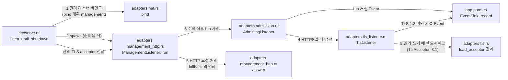

# 관리 리스너 모듈 설계

관리 리스너(`[management] listen`)가 접속을 받고, 관리 HTTPS(내장 TLS)와 루프백 평문 HTTP를 처리하는 구조를 다룬다. 접속은 상태 리스너와 같은 관리·상태 연결 상한 Lm을 쓴다. 관리 리스너의 접속은 L을 쓰지 않는다. 이 문서는 작업 4.2 범위다. 로그인과 세션 검사(4.3)·조회(4.4)·종료(4.5)·정적 파일(4.6)은 맡지 않는다.

| 항목 | 값 |
| --- | --- |
| 구조 시점 | Current |
| 문서 상태 | Draft |
| 구현 대조 | Verified — [대조 기록](#대조-기록) |
| 코드 위치 | `crates/adapters/src/admission.rs`(`AdmittingListener`, `Admitted`), `crates/adapters/src/tls_listener.rs`(`TlsListener`, `TlsIo`, `Handshake`, `Recorded`, `offers_no_tls12`), `crates/adapters/src/management_http.rs`(`ManagementListener`, `answer`), `crates/adapters/src/status_http.rs`(`StatusListener`), `crates/adapters/src/config_file.rs`(`read_management`), `crates/app/src/events.rs`(`Stage::Tls`, `RejectReason::TlsVersionUnsupported`), `crates/app/src/settings.rs`(`Settings::management_listener`, `Settings::other_listeners`), `src/serve.rs`(`listen_until_shutdown`, `stop_task`) |
| 코드 지도 | [코드 지도 2절](code-map.md#2-코드-위치와-구성요소), [3절](code-map.md#3-진입점) |
| 관련 스펙 | [운영 스펙 2절](../specs/operations.md#2-상태와-검증-매개변수)의 OPS-014, OPS-034, OPS-033(일부: 관리 연결), OPS-004(일부: 관리 연결을 L에 세지 않음), OPS-036, OPS-006(관리 연결의 U 적용 여부는 열린 질문 3), [관리 스펙 7절](../specs/management.md#7-수용-테스트)의 MGT-015(미연결, 열린 질문 8) |
| 관련 계약 | [관리 API 계약 1.1·1.3·1.4.1·1.11절](../contracts/management-api-v1.md#11-공통-규칙)(라우팅 순서, 쿠키, 정적 경로), [2.1·2.2절](../contracts/management-api-v1.md#21-오류-본문과-상태-코드)(401 본문과 헤더), [운영 정보 계약 1.5·1.6절](../contracts/ops-info-v1.md#15-사건-목록)(`connection_rejected`, `tls_version_unsupported`), [설정 계약 1.2절](../contracts/config-v1.md#12-키-표)(`management.listen`, `management.cert_file`·`key_file`) |
| 관련 ADR | [ADR-0001 내장 TLS](../decisions/ADR-0001-built-in-tls.md), [ADR-0004 tokio·rustls](../decisions/ADR-0004-tokio-rustls.md) |

## 1. 책임과 경계

- 맡는 책임:
  - 접속 수락: 관리 리스너는 바인드한 뒤 접속을 받는다. 수락 직후 Lm 예산의 자리를 잡는다. 자리가 없으면 `connection_rejected`(`listener` = `management`, `stage` = `accept`, `reason` = `admin_connection_limit`, `limit`)를 기록하고 HTTP 응답 없이 닫는다.
  - 관리 HTTPS: `[management] cert_file`·`key_file`이 있으면 수락한 접속마다 내장 TLS 핸드셰이크를 한다(`TlsAcceptor`, 작업 3.1). TLS 1.2 미만만 제안한 클라이언트는 `connection_rejected`(`listener` = `management`, `stage` = `tls`, `reason` = `tls_version_unsupported`)를 기록하고 평문 응답 없이 닫는다(OPS-036).
  - 평문 HTTP: 두 파일이 모두 없으면 평문 HTTP를 쓴다. 설정 검사가 주소를 루프백으로 제한한다(`config_file.rs` `read_management`, 설정 계약 1.2절). 관리 리스너는 이 제한을 다시 검사하지 않는다.
  - 요청 처리 순서(3·4절): `/api/v1/` 요청은 관리 세션을 먼저 본다. 세션이 없으면 경로·메서드와 관계없이 401을 준다(관리 API 계약 1.3절 2단계). 정적 경로는 1.11절 표를 따른다.
  - 응답 헤더: 모든 관리 응답에 `Cache-Control: no-store`를 붙인다(1.1절). 모든 401에 `WWW-Authenticate: Session realm="vnc-relay"`를 붙인다(2.1절). 쿠키가 있었던 401은 `relay_admin_session` 쿠키를 지운다(1.4.1절). HTTPS 리스너가 보낸 지우기 쿠키에는 `Secure`를 붙인다.
  - 상대 주소: 관리 응답에 들어가는 주소는 소켓의 실제 상대 주소다. 전달 헤더(`Forwarded`·`X-Forwarded-For`)는 읽지 않는다(1.1절, 관리 스펙 MGT-015).
- 맡지 않는 책임:
  - 로그인 처리와 관리 세션 발급(작업 4.3). 4.2에는 유효한 관리 세션이 없다.
  - 관리 세션 검사·CSRF 검사·유휴 만료(작업 4.3). 4.2에서 쿠키는 항상 무효다.
  - 조회 API 처리(작업 4.4), 종료 API 처리(작업 4.5), 정적 파일 제공(작업 4.6).
  - 관리 리스너의 연결 기록 `connection_accepted`. ops-info-v1 §1.5가 관리 리스너에 이 사건을 정하지 않는다.
  - TLS 핸드셰이크 실패 가운데 버전 거절이 아닌 것(인증서 오류, 클라이언트 중단). 열린 질문 6.
- 다른 모듈에 공개하는 기능:
  - `vnc_relay_adapters::management_http::ManagementListener`
  - `vnc_relay_adapters::tls_listener::TlsListener`(WSS 진입점 작업 3.2가 같은 방식으로 쓴다)
  - `vnc_relay_adapters::admission::AdmittingListener`(상태·관리 리스너가 같이 쓴다)

## 2. 내부 구조

화살표는 실행 중 호출이다. 현재 코드와 목표 구조를 한 그림에 섞지 않는다. 이 그림은 현재 구조다.

| 요소(파일·심볼) | 역할 | 만들어지는 시점과 소유자 | 의존 대상 |
| --- | --- | --- | --- |
| `crates/adapters/src/admission.rs` `AdmittingListener` | 수락 직후 Lm 자리를 잡는다. 자리가 없으면 거절 Event를 기록하고 닫는다. 리스너 이름(`management`·`status`)을 받는다. | 관리·상태 리스너의 `run` 안에서 만든다 | tokio, app, domain |
| `crates/adapters/src/admission.rs` `Admitted` | Lm 자리를 든 접속. 자리는 접속이 끝나면 돌아간다. TCP 스트림만 감싼다. | `AdmittingListener::accept`가 만든다 | tokio, domain |
| `crates/adapters/src/tls_listener.rs` `TlsListener` | `axum::serve::Listener`를 감싼다. 수락 때는 핸드셰이크를 기다리지 않는다. 접속의 `Io`가 읽기·쓰기 때 핸드셰이크를 진행한다. | HTTPS 관리 리스너가 `run` 안에서 만든다 | tokio-rustls, app, domain |
| `crates/adapters/src/management_http.rs` `ManagementListener` | 관리 리스너 하나. 관리 HTTPS 또는 루프백 평문 HTTP를 처리한다. | `serve`가 관리 리스너를 바인드한 뒤 띄운다. 종료 때 `serve`가 멈춘다. | axum, tokio, tokio-rustls, adapters 내부 모듈 |
| `crates/adapters/src/management_http.rs` `answer` | fallback 라우터. 3·4절 순서로 응답을 고른다. | `ManagementListener::run`이 만든다 | axum, serde_json |
| `crates/adapters/src/status_http.rs` `StatusListener` | 상태 리스너. 이 문서가 옮긴 `AdmittingListener`를 `status` 이름으로 쓴다. | `serve`가 상태 리스너를 바인드한 직후 띄운다. | `admission` 모듈 |
| `crates/app/src/events.rs` `Stage::Tls`, `RejectReason::TlsVersionUnsupported` | `connection_rejected`의 `stage` 값 `tls`와 `reason` 값 `tls_version_unsupported` | 사건이 생길 때 | 없음 |
| `crates/adapters/src/config_file.rs` `read_management` | 평문 HTTP 주소가 루프백이 아니면 `config_plaintext_management_not_loopback` 설정 오류를 낸다. 관리 리스너는 이 검사를 다시 하지 않는다. | 설정 읽기 때 | 없음 |
| `crates/app/src/settings.rs` `Settings::management_listener`, `Settings::other_listeners` | `management_listener`는 관리 리스너 바인드 계획(이름 `management`, 키 `management.listen`)을 만든다. `other_listeners`는 관리 리스너를 넣지 않는다. | `serve`가 바인드 전에 부른다 | 없음 |
| `src/serve.rs` `listen_until_shutdown` | 관리 리스너를 바인드하고, 준비됨 뒤 띄우고, 종료 때 진입점 정리 뒤에 멈춘다. 관리 TLS acceptor를 관리 리스너에 넘긴다. WSS acceptor는 3.2까지 보관만 한다. | `serve` 실행마다 | adapters, app, domain, tokio |

## 3. 데이터 모델

| 이름 | 필드·형태 | 저장 위치 | 제약과 항상 지켜야 할 조건 |
| --- | --- | --- | --- |
| `ManagementListener` | `listener: TcpListener`, `tls: Option<TlsAcceptor>`, `admin_budget: Arc<ConnectionBudget>` | 메모리, `run`이 소비 | `tls`가 `Some`이면 HTTPS, `None`이면 평문. 두 값 중 하나만 쓴다. |
| `TlsListener<L>` | `inner: L`, `acceptor: TlsAcceptor`, `log: Arc<dyn EventSink>`, `name: &'static str` | 메모리 | `L::Addr`는 `SocketAddr`여야 한다. 거절 기록에 상대 IP를 쓴다. |
| `TlsIo<IO>` | `Handshaking(Handshake<IO>)`, `Established(TlsStream<Recorded<IO>>)`, `Failed` | 접속 하나의 `Io`값 | 상태는 앞으로만 간다: `Handshaking` → `Established` 또는 `Failed`. `Failed`에서는 되돌아가지 않는다. |
| `Handshake<IO>` | `accept: Accept<Recorded<IO>>`, `capture: Capture`, `peer: PeerIp`, `log: Arc<dyn EventSink>`, `name: &'static str` | `TlsIo::Handshaking` 안 | 핸드셰이크가 끝나면 `Accept`를 버린다. 버전 거절을 기록할 때 `peer`를 쓴다. |
| `Recorded<IO>` | `io: IO`, `capture: Capture`(`Arc<Mutex<Option<Vec<u8>>>>`) | 접속 하나. `Accept`가 읽는 `Io`를 감싼다 | 핸드셰이크 동안 읽은 바이트를 `capture`에 복사한다(최대 `CAPTURE_LIMIT` = 5 + 16 384 바이트). 핸드셰이크가 끝나면 `capture`를 `None`으로 바꾼다. |
| `Admitted` | `stream: TcpStream`, `_permit: BudgetPermit` | 접속 하나 | `_permit`은 `Admitted`가 사라질 때 Lm으로 돌아간다. 핸드셰이크 중에도 자리를 든다. |
| 관리 응답 본문 | `{"error":{"code":"unauthenticated","message":…}}`, `{"error":{"code":"not_found","message":…}}` | HTTP 응답 | 2.1절 형식만 쓴다. `message`는 요청 입력값을 담지 않는다. |
| 지우기 쿠키 | `relay_admin_session=; Path=/; Max-Age=0; HttpOnly; SameSite=Strict` (HTTPS면 `; Secure` 추가) | `Set-Cookie` 헤더 | 1.4.1절 속성과 맞춘다. 값은 비운다. |

## 4. 처리 순서

| 순서 | 코드 위치 | 조건·계산 | 바뀌는 상태 | 결과를 쓰는 곳 |
| --- | --- | --- | --- | --- |
| 1 | `admission.rs` `AdmittingListener::accept` | TCP 수락 뒤 Lm 자리를 잡는다. 수락 오류는 `ACCEPT_RETRY_DELAY` 뒤 다시 수락한다. | Lm 사용량 +1 | 자리 없음: `connection_rejected`(`stage` = `accept`, `admin_connection_limit`), 연결 닫음 |
| 2 | `tls_listener.rs` `TlsListener::accept` | 평문이면 이 단계를 건너뛴다(`tls` = `None`일 때 `serve`가 `TlsListener`를 만들지 않는다). HTTPS면 `TlsIo::Handshaking`을 만든다. 핸드셰이크는 하지 않는다. | `TlsIo` 상태 `Handshaking` | 없음 |
| 3 | `tls_listener.rs` `TlsIo::poll_handshake` | `poll_read`·`poll_write`·`poll_flush`가 먼저 부른다. 핸드셰이크를 진행한다. 성공하면 `Established`로 바꾸고 캡처를 `None`으로 바꾼다. 실패하면 캡처한 ClientHello 바이트(레코드 한 개 분)로 버전을 판정한다. `supported_versions`가 있으면 그 목록에 TLS 1.2 이상이 없을 때, 없으면 `legacy_version`이 TLS 1.2 미만일 때 버전 거절이다. 버전 거절이면 기록을 먼저 쓴다. 그다음 `Failed`로 바꾸고 `io::Error`를 돌려준다. | `TlsIo` 상태 `Established` 또는 `Failed` | 버전 거절: `connection_rejected`(`listener` = `management`, `stage` = `tls`, `reason` = `tls_version_unsupported`). 그 밖의 실패: 기록 없음(열린 질문 6). |
| 4 | axum·hyper (`axum::serve`) | 요청 줄과 헤더를 읽는다. 읽기 제한 시간이 없다(열린 질문 3). | 없음 | 4·5단계 입력 |
| 5 | `management_http.rs` `answer` 1단계 | 경로가 `/api/v1/`로 시작하면 세션이 없으므로 `401`. 요청에 `relay_admin_session` 쿠키가 있으면 지우기 `Set-Cookie`를 붙인다. 메서드는 보지 않는다. | 없음 | 401 응답(`WWW-Authenticate`, `Cache-Control: no-store`) |
| 6 | `management_http.rs` `answer` 2단계 | 경로가 `/`이거나 `/app/`로 시작하면 메서드가 `GET`·`HEAD`가 아닐 때 `405`(`Allow: GET, HEAD`, `invalid_request` 본문). 그 밖에는 `303`, `Location: /login/`, 본문 없음. | 없음 | 응답 |
| 7 | `management_http.rs` `answer` 3단계 | 경로가 `/login/`로 시작하면 메서드가 `GET`·`HEAD`가 아닐 때 `405`(`Allow: GET, HEAD`, `invalid_request` 본문). 그 밖에는 `404` `not_found` 본문(열린 질문 2). | 없음 | 응답 |
| 8 | `management_http.rs` `answer` 4단계 | 나머지 경로는 메서드와 관계없이 `303`, `Location: /login/`. | 없음 | 응답 |

관리 응답은 모두 `Cache-Control: no-store`를 가진다. 정적 보안 헤더(`X-Content-Type-Options`·`Referrer-Policy`·`Content-Security-Policy`, 1.11절 권장)는 정적 파일 응답에만 붙이며 4.2에는 정적 파일 응답이 없다.

## 5. 상태와 초기화

- 관리 리스너는 바인드 뒤 `serve`가 준비됨 전환과 `server_ready` 기록을 마친 뒤 접속을 받는다. 상태 리스너처럼 준비 전 응답은 없다.
- Lm 사용량은 접속마다 하나씩 늘고 접속이 끝나면 줄어든다. 관리 연결과 상태 연결이 같은 예산을 쓴다.
- 관리 TLS acceptor는 `serve` 시작 단계에서 검사하고 만든다(`tls.md` 7절). 핸드셰이크 중 인증서를 다시 읽지 않는다. 설정 변경은 재시작으로 반영한다(설정 계약 1.2절).
- 종료 요청을 받으면 `serve`가 진입점 연결을 정리한 뒤 관리 리스너 작업을 멈춘다. 종료 유예 G와 `shutdown_started`는 작업 5.3이 맡는다.

## 6. 오류 처리

| 실패 지점 | 처리 방법 | 남는 상태 | 관련 스펙 시나리오 |
| --- | --- | --- | --- |
| Lm 자리 없음 | `connection_rejected`(`stage` = `accept`, `admin_connection_limit`, `limit`). HTTP 응답 없이 닫는다. | 접속 없음. L은 바뀌지 않는다. | OPS-033(일부), OPS-004(일부) |
| TLS 1.2 미만만 제안 | 평문 응답 없이 닫는다. 같은 접속에서 평문으로 바꾸지 않는다. `connection_rejected`(`stage` = `tls`, `tls_version_unsupported`). 버전 판정은 접속의 첫 TLS 레코드(5 + 16384 = 16389바이트)만 본다. ClientHello가 그 레코드를 넘으면 판정하지 못해 기록하지 않는다. rustls는 그래도 접속을 거절한다(열린 질문 10). | 접속 없음 | OPS-036(일부) |
| 그 밖의 TLS 핸드셰이크 실패(인증서 오류, 클라이언트가 중간에 끊음) | 평문 응답 없이 닫는다. 기록하지 않는다(열린 질문 6). | 접속 없음. 자리는 돌아간다. | OPS-036(일부) |
| 핸드셰이크가 끝나지 않음 | 제한 시간이 없다(열린 질문 3). 자리를 든 채 기다린다. | Lm 자리 하나가 묶인다. | OPS-033(열린 질문 3) |
| 수락 오류 | `ACCEPT_RETRY_DELAY` 뒤 다시 수락한다. 기록하지 않는다(ops-info-v1은 수락 실패 사건이 없다). | 없음 | 없음 |
| 관리 요청의 읽기 오류 | axum이 접속을 닫는다. 기록하지 않는다(`connection_aborted`는 `conn_id`가 필요하다). | 접속 없음 | 열린 질문 6 |

## 7. 설계 선택

| 선택 | 이유 | 검토한 다른 방법 | 근거 |
| --- | --- | --- | --- |
| TLS 핸드셰이크를 `TlsIo`의 읽기·쓰기 때 진행한다 | 한 클라이언트가 핸드셰이크를 멈춰도 다른 접속의 수락이 막히지 않는다. axum이 접속마다 작업을 만든다. | 수락 루프에서 `TlsAcceptor::accept`를 기다린다(수락이 한 접속에 묶임). 수락마다 백그라운드 작업과 채널을 만든다(구조가 커짐). | ADR-0004 tokio·rustls. 설계의 같은 접속 수락 원칙(tcp-entry-point 설계). |
| Lm 자리를 TLS 핸드셰이크 전에 잡는다 | 핸드셰이크 작업도 Lm 안에 들어가 자원을 제한한다. 관리 TLS는 Lm을 넘지 않는다. | 핸드셰이크 뒤에 자리를 잡는다(핸드셰이크 작업이 Lm 밖에서 늘어남). | OPS-033(Lm은 관리·상태 연결 상한). |
| `TlsListener<L>`을 일반 `Listener`로 만든다 | 작업 3.2 WSS 진입점도 같은 wrapper를 쓴다. | 관리 리스너 안에 TLS 코드를 넣는다(WSS 중복). | tls.md 1절(연결 수락은 진입점 모듈) |
| `Admitted`는 `TcpStream`만 감싼다 | 관리·상태 리스너 모두 평문 TCP 위에 Lm을 세운다. TLS는 그 위에 쌓는다. | `Admitted<S>`로 일반화한다(사용처가 없다). | 이 문서 2절 |
| 관리 라우팅은 fallback 한 곳에서 한다 | 1.3절 순서(세션 확인이 경로·메서드 판정보다 먼저)를 한 함수에 둔다. 상태 리스너와 같은 방식이다. | 경로마다 axum 라우트를 둔다(순서가 흩어지고 HEAD·405 기본 응답이 계약과 다르다). | 관리 API 계약 1.3절, `status_http.rs` 주석 |
| 지우기 쿠키의 `Secure`는 리스너 종류로 정한다 | 1.4.1절 표가 HTTPS 리스너에만 `Secure`를 정한다. | 요청 헤더로 판정한다(전달 헤더를 쓰지 않는다는 1.1절과 충돌). | 관리 API 계약 1.4.1절, MGT-017 |
| 관리 요청에 읽기 제한 시간을 두지 않는다 | 계약이 서버 내부 처리 제한을 정하지 않는다(1.12절 336행). 상태 리스너와 같다. | 설정 키를 새로 만든다(계약 변경). `[timeouts] tls_upgrade_secs`를 쓴다(열린 질문 3). | 관리 API 계약 1.12절 |
| ALPN을 쓰지 않는다 | `tls.rs`가 ALPN을 설정하지 않는다. 관리 API는 HTTP/1.1만 쓴다. | `http/1.1`을 광고한다(열린 질문 4). | tls.md 7절, 9절 |
| 버전 거절은 ClientHello 바이트로 판정한다(RFC 8446 4.2.1). | rustls는 버전을 보기 전에 `signature_algorithms` 확장을 검사한다(`server/hs.rs` `process_client_hello`). rustls 오류 변형으로 판정하면 TLS 1.0·1.1 클라이언트를 버전 거절로 못 보고, `signature_algorithms`가 없는 TLS 1.2 클라이언트를 잘못 거절한다. | rustls 오류 변형으로 판정(기각). | rustls 0.23.46 `server/hs.rs`, RFC 8446 4.2.1 |

## 8. 현재 코드와의 차이

- 차이는 없다. 2절부터 4절까지의 파일·심볼과 처리 순서가 현재 코드와 같다. 대조 방법은 아래 대조 기록에 적었다.

## 대조 기록

- 대조 범위: HEAD `de25cde`(작업 4.2) + 작업 트리 변경(`tests/serve.rs` 서버 수준 테스트 2건, 문서). 커밋 `test(management): check plaintext management start failure`에 들어간다.
- 대조 방법: 2절 요소 표의 파일·심볼을 grep으로 찾았다. `management_http.rs` `answer`(3·4절 순서), `tls_listener.rs` `TlsIo::poll_handshake`·`offers_no_tls12`(버전 판정), `src/serve.rs` `listen_until_shutdown`·`stop_task`(바인드·준비됨·종료 순서)를 읽어 4절 표와 맞췄다.
- 환경: Windows 11 Pro 10.0.26200 x64, WSL2 Ubuntu 24.04.4, Rust 1.99.1, tokio-rustls 0.26.6, rustls 0.23.46, axum 0.8.9.

| 명령 | 환경 | 결과 |
| --- | --- | --- |
| `wsl -d Ubuntu -- bash /mnt/d/vr-tools/vr-full.sh` | WSL2 Ubuntu 24.04.4 | 통과(`ALL PASSED`). 시나리오 148건: 통과 4, 부분 19, 실패 0, 미실행 0, 미연결 125. |
| `powershell -NoProfile -ExecutionPolicy Bypass -File D:/vr-tools/vr-win.ps1 -Only all` | Windows 11 Pro 10.0.26200 x64 | 통과(`ALL PASSED (all)`). 시나리오 148건: 통과 3, 부분 19, 실패 0, 미실행 1(OPS-007, `#[cfg(unix)]`), 미연결 125. |

- 대상 시나리오 상태(두 환경 같음): OPS-014 부분, OPS-033 부분, OPS-034 부분(운영 조회 API 작업 4.4 전까지 전체가 아니다), OPS-004 부분, OPS-036 부분, MGT-017 부분, MGT-015 미연결.
- 판정: 구조 대조를 마쳤다. 구조 시점은 `Current`, 구현 대조는 `Verified`(작업 트리 범위)다. 문서 상태는 `Draft`로 둔다(열린 질문 3·6·8 미결정).
- TODO 4.2는 `[ ]`로 둔다. MGT-015는 4.3~4.6 완료 조건에 없어 소유 작업이 없다(열린 질문 8). OPS-014 부분 사유: 운영 조회·종료 API가 아직 없다(작업 4.4·4.5). 공개 평문 주소 시작 거절(`tests/serve.rs` `refuses_plaintext_management_on_a_public_address_with_exit_code_3`), 계정 없음 시작 거절(`serve`), 인증서 누락 시작 거절(3.1 `serve`), 미인증 401(`management.rs`와 `answers_api_queries_with_401_without_login_on_loopback_plaintext`)은 확인했다. OPS-034 부분 사유: 운영 조회 엔드포인트(작업 4.4)가 아직 없어, 로그인 없이 `/api/v1/` 요청이 401로 거절되는 것만 확인했다. 비루프백 평문 시작 실패와 루프백 평문 시작은 serve 테스트로 확인했다.

## 9. 미결정 사항

| 항목 | 영향 | 확정 위치 |
| --- | --- | --- |
| 1. `POST /api/v1/session`(4.2) 응답. 기본값은 401 `unauthenticated`다(1.3절 2단계). 대안은 404 `not_found`(1.2절 목록과 충돌)·501(계약에 없는 동작) | 로그인 전까지 응답 본문 | 작업 4.3 구현 전 사용자 결정 |
| 2. `GET /login/`·`/login/<파일>`(4.2). 기본값은 404 `not_found`다. 정적 파일은 4.6에서 준다. | 로그인 화면이 4.6 전까지 없다 | 작업 4.6 전 사용자 결정 |
| 3. 핸드셰이크와 요청 읽기 제한 시간. 기본값은 없음이다(상태 리스너와 같다). 대안은 `[timeouts] tls_upgrade_secs`(U, 운영 스펙 1절은 "내장 TLS 협상" 적용, 설정 계약 1.2절은 WSS·WS 업그레이드로 적음) 또는 새 설정 키. | 멈춘 핸드셰이크가 Lm 자리를 무기한 잡는다(DoS 노출) | 사용자 결정. 결정 뒤 설정 계약·운영 스펙 갱신 |
| 4. 관리 HTTPS의 ALPN. 기본값은 없음(HTTP/1.1만). 대안은 `http/1.1` 광고. | 클라이언트 협상 방식 | 사용자 결정(tls.md 9절 "작업 3.2·4.2") |
| 5. IPv4 매핑 IPv6 주소(`::ffff:a.b.c.d`) 표기. 가정은 소켓 값을 그대로 쓴다(`peer_ip.rs`가 매핑을 IPv4로 바꾼다). | 관리 응답의 `address.ip` 표기 | 관리 API 계약 6절 열린 항목 |
| 6. 버전 거절이 아닌 TLS 실패 기록. `connection_aborted`는 `conn_id`가 필요하다. 대안은 (a) `conn_id` 없는 새 사건(계약 변경) 또는 (b) 기록하지 않음(기본값). | 관리 TLS 실패의 감사 흔적 | 운영 정보 계약 1.5·1.7절 변경 여부 사용자 결정 |
| 7. U(`tls_upgrade_secs`)의 관리 TLS 적용 여부. 열린 질문 3과 같은 결정이다. | 열린 질문 3과 같음 | 열린 질문 3과 같음 |
| 8. MGT-015(상대 주소)의 소유 작업이 없다. 4.2 완료 조건에는 있지만 4.3~4.6 완료 조건에 없다. 상대 주소는 조회 API(4.4)의 응답에서 처음 보이고, 4.2 응답에는 상대 주소가 없다. 옵션은 (a) TODO 4.2를 `[ ]`로 둔다(기본값, 소유 작업이 없어 판정이 열린다), (b) `MGT-015 partial`로 4.2를 `[x]` 처리한다, (c) MGT-015를 4.4 완료 조건에 넣는다(TODO 편집). | TODO 4.2 완료 판정 | 사용자 결정 |
| 9. (해결) 비루프백 평문 시작 실패(OPS-014·OPS-034)의 검증 위치. 서버 수준 테스트 2건을 추가했다. `tests/serve.rs`의 `refuses_plaintext_management_on_a_public_address_with_exit_code_3`(시작 실패, OPS-014 부분·OPS-034 부분)와 `answers_api_queries_with_401_without_login_on_loopback_plaintext`(루프백 평문 시작 뒤 401, OPS-034 부분). 설정 규칙 테스트 `allows_plaintext_management_only_on_loopback`(OPS-034 부분)는 그대로 둔다. | 표식 위치만 바뀜(해결됨) | Q9 해결 작업 중 결정(서버 수준 테스트 추가, 해결됨) |
| 10. ClientHello가 첫 TLS 레코드를 넘으면 버전 거절을 판정하지 못한다(`tls_listener.rs` `CAPTURE_LIMIT`, `offers_tls12`가 `None`). 그러면 rustls가 TLS 1.0·1.1만 제안한 접속을 거절해도 `connection_rejected` 줄이 없다. 옵션은 (a) 한계를 받아들이고 문서에 적는다, (b) 여러 레코드에 걸친 핸드셰이크 조각을 정해진 상한까지 이어 붙여 판정한다. 현재 코드는 (a)다. | 관리 TLS 버전 거절의 감사 흔적(OPS-036 부분) | 사용자 결정. 현재 코드는 옵션 (a)이며 사용자가 고른 것이 아니다. |
