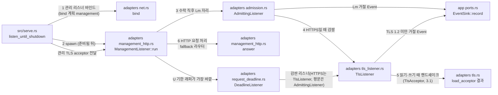

# 관리 리스너 모듈 설계

관리 리스너(`[management] listen`)가 접속을 받고, 관리 HTTPS(내장 TLS)와 루프백 평문 HTTP를 처리하는 구조를 다룬다. 접속은 상태 리스너와 같은 관리·상태 연결 상한 Lm을 쓴다. 관리 리스너의 접속은 L을 쓰지 않는다. 이 문서는 작업 4.2에서 썼다. 로그인과 세션 검사는 작업 4.3이 더했다. 정적 파일 제공은 작업 4.6이 더했다. 조회(4.4)·종료(4.5)는 맡지 않는다.

| 항목 | 값 |
| --- | --- |
| 구조 시점 | Current (작업 4.6 구현 뒤) |
| 문서 상태 | Draft |
| 구현 대조 | Verified — 작업 4.6 시점, 커밋 `54a59e7`. 그 시점의 WSL 전체 게이트는 Chromium이 없어 `dashboard_browser` 두 시험이 실패했다([대조 기록](#대조-기록) 4.6). Chrome을 설치한 뒤 커밋 `df3b5b2`에서 통과했다([개발 환경 how-to](../how-to/set-up-and-verify.md#4-검증) 실행 기록 4). 4.3 항목도 [대조 기록](#대조-기록)에 있다 |
| 코드 위치 | `crates/adapters/src/admission.rs`(`AdmittingListener`, `Admitted`), `crates/adapters/src/tls_listener.rs`(`TlsListener`, `TlsIo`, `Handshake`, `Recorded`, `offers_no_tls12`), `crates/adapters/src/request_deadline.rs`(`DeadlineListener`, `Deadlined`), `crates/adapters/src/management_http.rs`(`ManagementListener`, `PeerAddr`, `answer`, `static_answer`, `static_file`), `crates/adapters/src/management_http/session_api.rs`(`answer`), `crates/adapters/src/status_http.rs`(`StatusListener`), `crates/adapters/src/dashboard_assets.rs`(`Asset`, `ASSETS`, `find_asset`), `crates/adapters/src/config_file.rs`(`read_management`), `crates/app/src/events.rs`(`Stage::Tls`, `RejectReason::TlsVersionUnsupported`), `crates/app/src/settings.rs`(`Settings::management_listener`, `Settings::other_listeners`), `src/serve.rs`(`listen_until_shutdown`, `stop_task`) |
| 코드 지도 | [코드 지도 2절](code-map.md#2-코드-위치와-구성요소), [3절](code-map.md#3-진입점) |
| 관련 스펙 | [운영 스펙 2절](../specs/operations.md#2-상태와-검증-매개변수)의 OPS-014, OPS-034, OPS-033(일부: 관리 연결), OPS-004(일부: 관리 연결을 L에 세지 않음), OPS-036, OPS-006(일부: 관리 TLS 협상과 첫 요청 머리의 U, 사용자 결정 2026-10-21 Q12), [관리 스펙 7절](../specs/management.md#7-수용-테스트)의 MGT-015(4.4 완료 조건으로 옮김, 사용자 결정 2026-10-21 Q14), [대시보드 스펙 7절](../specs/dashboard.md#7-수용-테스트)의 DASH-014(일부: 세션 없이 `/app/` 파일을 직접 요청하면 로그인 화면으로 보낸다. 상세 화면 행동은 작업 4.10·4.11) |
| 관련 계약 | [관리 API 계약 1.1·1.3·1.4.1·1.11절](../contracts/management-api-v1.md#11-공통-규칙)(라우팅 순서, 쿠키, 정적 경로), [2.1·2.2절](../contracts/management-api-v1.md#21-오류-본문과-상태-코드)(401 본문과 헤더), [운영 정보 계약 1.5·1.6절](../contracts/ops-info-v1.md#15-사건-목록)(`connection_rejected`, `tls_version_unsupported`), [설정 계약 1.2절](../contracts/config-v1.md#12-키-표)(`management.listen`, `management.cert_file`·`key_file`), [프런트엔드 컨벤션 1.1·1.2절](../conventions/frontend.md#11-정적-파일-구조)(정적 파일 구조, 실행 파일 내장) |
| 관련 ADR | [ADR-0001 내장 TLS](../decisions/ADR-0001-built-in-tls.md), [ADR-0004 tokio·rustls](../decisions/ADR-0004-tokio-rustls.md) |

## 1. 책임과 경계

- 맡는 책임:
  - 접속 수락: 관리 리스너는 바인드한 뒤 접속을 받는다. 수락 직후 Lm 예산의 자리를 잡는다. 자리가 없으면 `connection_rejected`(`listener` = `management`, `stage` = `accept`, `reason` = `admin_connection_limit`, `limit`)를 기록하고 HTTP 응답 없이 닫는다.
  - 관리 HTTPS: `[management] cert_file`·`key_file`이 있으면 수락한 접속마다 내장 TLS 핸드셰이크를 한다(`TlsAcceptor`, 작업 3.1). TLS 1.2 미만만 제안한 클라이언트는 `connection_rejected`(`listener` = `management`, `stage` = `tls`, `reason` = `tls_version_unsupported`)를 기록하고 평문 응답 없이 닫는다(OPS-036).
  - 평문 HTTP: 두 파일이 모두 없으면 평문 HTTP를 쓴다. 설정 검사가 주소를 루프백으로 제한한다(`config_file.rs` `read_management`, 설정 계약 1.2절). 관리 리스너는 이 제한을 다시 검사하지 않는다.
  - 요청 처리 순서(3·4절): `POST /api/v1/session`은 로그인이다. 세션을 보지 않고 로그인 처리로 넘긴다(관리 로그인과 세션 설계 4절). 나머지 `/api/v1/` 요청은 관리 세션을 먼저 본다. 세션이 없으면 경로·메서드와 관계없이 401을 준다(관리 API 계약 1.3절 2단계). 정적 경로는 1.11절 표를 따른다.
  - 응답 헤더: 모든 관리 응답에 `Cache-Control: no-store`를 붙인다(1.1절). 모든 401에 `WWW-Authenticate: Session realm="vnc-relay"`를 붙인다(2.1절). 쿠키가 있었던 401은 `relay_admin_session` 쿠키를 지운다(1.4.1절). HTTPS 리스너가 보낸 지우기 쿠키에는 `Secure`를 붙인다.
  - 상대 주소: 관리 응답에 들어가는 주소는 소켓의 실제 상대 주소다. 전달 헤더(`Forwarded`·`X-Forwarded-For`)는 읽지 않는다(1.1절, 관리 스펙 MGT-015).
  - 요청 시간 제한: 접속마다 U(`[timeouts] tls_upgrade_secs`)를 건다. TLS 핸드셰이크와 첫 요청 머리가 끝날 때까지는 수락 때부터 잰 절대 기한이다. 그 뒤에는 읽기·쓰기가 있을 때마다 U를 다시 잰다(사용자 결정 2026-10-22(Q25), 9절 11번). 기한이 지나면 평문 응답 없이 닫는다(4·6절).
  - 정적 파일 제공(작업 4.6): 실행 파일에 넣은 대시보드 파일을 준다. 제공 경로와 Content-Type은 `dashboard_assets.rs` 표가 정한다(프런트엔드 컨벤션 1.2절). `/login/` 아래 파일은 세션 없이 받는다. `/`(`app/index.html`)와 `/app/` 아래 파일은 세션이 있어야 받는다. 없으면 `/login/`으로 303한다. 정적 요청의 세션 확인은 읽기만 하고 유휴 기한을 늘리지 않는다(계약 1.4.2절).
- 맡지 않는 책임:
  - 로그인 처리와 관리 세션 발급(작업 4.3, [관리 로그인과 세션 설계](management-session.md)).
  - 관리 세션 검사·CSRF 검사·유휴 만료(작업 4.3, [관리 로그인과 세션 설계](management-session.md)).
  - 조회 API 처리(작업 4.4), 종료 API 처리(작업 4.5).
  - 관리 리스너의 연결 기록 `connection_accepted`. ops-info-v1 §1.5가 관리 리스너에 이 사건을 정하지 않는다.
  - TLS 핸드셰이크 실패 가운데 버전 거절이 아닌 것(인증서 오류, 클라이언트 중단). 9절 6번(Q13).
- 다른 모듈에 공개하는 기능:
  - `vnc_relay_adapters::management_http::ManagementListener`
  - `vnc_relay_adapters::tls_listener::TlsListener`(관리 HTTPS가 쓴다. WSS 진입점은 `TlsIo`를 소켓마다 직접 쓴다)
  - `vnc_relay_adapters::admission::AdmittingListener`(상태·관리 리스너가 같이 쓴다)

## 2. 내부 구조

화살표는 실행 중 호출이다. 현재 코드와 목표 구조를 한 그림에 섞지 않는다. 이 그림은 현재 구조다.

| 요소(파일·심볼) | 역할 | 만들어지는 시점과 소유자 | 의존 대상 |
| --- | --- | --- | --- |
| `crates/adapters/src/admission.rs` `AdmittingListener` | 수락 직후 Lm 자리를 잡는다. 자리가 없으면 거절 Event를 기록하고 닫는다. 리스너 이름(`management`·`status`)을 받는다. | 관리·상태 리스너의 `run` 안에서 만든다 | tokio, app, domain |
| `crates/adapters/src/admission.rs` `Admitted` | Lm 자리를 든 접속. 자리는 접속이 끝나면 돌아간다. TCP 스트림만 감싼다. | `AdmittingListener::accept`가 만든다 | tokio, domain |
| `crates/adapters/src/tls_listener.rs` `TlsListener` | `axum::serve::Listener`를 감싼다. 수락 때는 핸드셰이크를 기다리지 않는다. 접속의 `Io`가 읽기·쓰기 때 핸드셰이크를 진행한다. | HTTPS 관리 리스너가 `run` 안에서 만든다 | tokio-rustls, app, domain |
| `crates/adapters/src/request_deadline.rs` `DeadlineListener`, `Deadlined` | `axum::serve::Listener`를 감싼다. 접속마다 U 타이머를 든다. 첫 요청 머리(`\r\n\r\n`)가 끝나기 전에는 수락 때부터 잰 절대 기한이다. 끝난 뒤에는 읽기·쓰기가 있을 때마다 U를 다시 건다. 기한이 지나면 `TimedOut` 오류를 돌려준다. | `ManagementListener::run`이 HTTPS·평문 모두에서 `axum::serve`에 넘기는 가장 바깥 리스너로 만든다 | tokio, axum |
| `crates/adapters/src/management_http.rs` `ManagementListener` | 관리 리스너 하나. 관리 HTTPS 또는 루프백 평문 HTTP를 처리한다. | `serve`가 관리 리스너를 바인드한 뒤 띄운다. 종료 때 `serve`가 멈춘다. | axum, tokio, tokio-rustls, adapters 내부 모듈 |
| `crates/adapters/src/management_http.rs` `answer` | fallback 라우터. 4절 순서로 응답을 고른다. `/api/v1/` 요청은 `management_http/session_api.rs`의 `answer`로 넘긴다. 정적 경로(`/`·`/login/`·`/app/`)는 `static_answer`로 넘긴다. 그 밖의 경로는 303이다. | `ManagementListener::run`이 만든다 | axum, serde_json |
| `crates/adapters/src/management_http.rs` `static_answer`, `static_file` | 정적 경로 응답을 만든다(4절 6–8단계). 메서드를 검사하고, `/`·`/app/`은 세션을 읽기만 확인한 뒤 `dashboard_assets.rs` 표에서 파일을 찾는다. 파일 응답에 헤더를 붙인다. | `answer`가 정적 경로일 때 부른다 | axum, app(`AdminAuth::authorize`), `dashboard_assets.rs` |
| `crates/adapters/src/management_http.rs` `PeerAddr` | 접속의 상대 소켓 주소를 `PeerIp`로 바꾼다(IPv4 매핑 IPv6는 IPv4로). 로그인 제한 키와 로그 `peer_ip`가 같은 값을 쓴다. `axum::extract::connect_info::Connected`를 구현한다. | `ManagementListener::run`이 `into_make_service_with_connect_info::<PeerAddr>()`로 만든다 | domain(`PeerIp`), axum |
| `crates/adapters/src/management_http/session_api.rs` `answer` | `/api/v1/` 요청을 맡는다. `POST /api/v1/session`은 로그인(`login`)이다. 그 밖은 세션 검사 → CSRF → 경로 → 메서드 순으로 검사한다. 4.4·4.5 경로는 아직 없어 인증 뒤 `404 not_found`다(관리 로그인과 세션 설계 9절 카). | `management_http.rs` `answer`가 `/api/v1/`일 때 부른다 | axum, app(`AdminAuth`) |
| `crates/adapters/src/status_http.rs` `StatusListener` | 상태 리스너. 이 문서가 옮긴 `AdmittingListener`를 `status` 이름으로 쓴다. | `serve`가 상태 리스너를 바인드한 직후 띄운다. | `admission` 모듈 |
| `crates/adapters/src/dashboard_assets.rs` `Asset`, `ASSETS`, `find_asset` | 정적 파일 표. 한 항목은 제공 경로, Content-Type, `include_bytes!`로 넣은 본문을 가진다. `find_asset`은 요청 경로와 정확히 같은 항목만 찾는다. `preview/`·`tests/`는 넣지 않는다. | 빌드 때 상수로 실행 파일에 들어간다 | 없음(std) |
| `crates/app/src/events.rs` `Stage::Tls`, `RejectReason::TlsVersionUnsupported` | `connection_rejected`의 `stage` 값 `tls`와 `reason` 값 `tls_version_unsupported` | 사건이 생길 때 | 없음 |
| `crates/adapters/src/config_file.rs` `read_management` | 평문 HTTP 주소가 루프백이 아니면 `config_plaintext_management_not_loopback` 설정 오류를 낸다. 관리 리스너는 이 검사를 다시 하지 않는다. | 설정 읽기 때 | 없음 |
| `crates/app/src/settings.rs` `Settings::management_listener`, `Settings::other_listeners` | `management_listener`는 관리 리스너 바인드 계획(이름 `management`, 키 `management.listen`)을 만든다. `other_listeners`는 관리 리스너를 넣지 않는다. | `serve`가 바인드 전에 부른다 | 없음 |
| `src/serve.rs` `listen_until_shutdown` | 관리 리스너를 바인드하고, 준비됨 뒤 띄우고, 종료 때 진입점 정리 뒤에 멈춘다. 관리 TLS acceptor를 `ManagementListener`에 넘긴다. WSS용 `wss_tls`는 `take()`로 꺼내 `WsEntryPoint`에 넘긴다(작업 3.2). | serve 실행마다 | adapters, app, domain, tokio |

## 3. 데이터 모델

| 이름 | 필드·형태 | 저장 위치 | 제약과 항상 지켜야 할 조건 |
| --- | --- | --- | --- |
| `ManagementListener` | `listener: TcpListener`, `tls: Option<TlsAcceptor>`, `admin_budget: Arc<ConnectionBudget>`, `tls_upgrade: Duration`(U) | 메모리, `run`이 소비 | `tls`가 `Some`이면 HTTPS, `None`이면 평문. 두 값 중 하나만 쓴다. `tls_upgrade`는 설정 `[timeouts] tls_upgrade_secs`다. |
| `TlsListener<L>` | `inner: L`, `acceptor: TlsAcceptor`, `log: Arc<dyn EventSink>`, `name: &'static str` | 메모리 | `L::Addr`는 `SocketAddr`여야 한다. 거절 기록에 상대 IP를 쓴다. |
| `TlsIo<IO>` | `Handshaking(Handshake<IO>)`, `Established(TlsStream<Recorded<IO>>)`, `Failed(HandshakeFailure)` | 접속 하나의 `Io`값 | 상태는 앞으로만 간다: `Handshaking` → `Established` 또는 `Failed`. `Failed`에서는 되돌아가지 않는다. |
| `Handshake<IO>` | `accept: Accept<Recorded<IO>>`, `capture: Capture`, `peer: PeerIp`, `log: Arc<dyn EventSink>`, `name: &'static str` | `TlsIo::Handshaking` 안 | 핸드셰이크가 끝나면 `Accept`를 버린다. 버전 거절을 기록할 때 `peer`를 쓴다. |
| `Recorded<IO>` | `io: IO`, `capture: Capture`(`Arc<Mutex<Option<Vec<u8>>>>`) | 접속 하나. `Accept`가 읽는 `Io`를 감싼다 | 핸드셰이크 동안 읽은 바이트를 `capture`에 복사한다(최대 `CAPTURE_LIMIT` = 5 + 16 384 바이트). 핸드셰이크가 끝나면 `capture`를 `None`으로 바꾼다. |
| `Admitted` | `stream: TcpStream`, `_permit: BudgetPermit` | 접속 하나 | `_permit`은 `Admitted`가 사라질 때 Lm으로 돌아간다. 핸드셰이크 중에도 자리를 든다. |
| `Deadlined<IO>` | `io: IO`, `limit: Duration`(U), `timer: Pin<Box<Sleep>>`, `head_done: bool`, `window: u32`(마지막 4바이트) | 접속 하나 | `head_done`은 `\r\n\r\n`을 읽으면 참이 되고 되돌아가지 않는다. `window`는 머리 끝을 찾는 데만 쓴다. 기한이 지나면 읽기·쓰기가 `TimedOut`을 돌려준다. |
| 관리 응답 본문 | `{"error":{"code":"unauthenticated","message":…}}`, `{"error":{"code":"not_found","message":…}}` | HTTP 응답 | 2.1절 형식만 쓴다. `message`는 요청 입력값을 담지 않는다. |
| 지우기 쿠키 | `relay_admin_session=; Path=/; Max-Age=0; HttpOnly; SameSite=Strict` (HTTPS면 `; Secure` 추가) | `Set-Cookie` 헤더 | 1.4.1절 속성과 맞춘다. 값은 비운다. |
| `Asset` | `path: &'static str`(제공 경로, 예: `/app/tokens.css`), `content_type: &'static str`, `body: &'static [u8]`(`include_bytes!`) | 실행 파일의 상수(`ASSETS`) | 경로는 `/login/`·`/app/`로 시작하거나 `/`(`app/index.html`에 대응)다. 확장자는 `.html`·`.css`·`.js`만 쓴다. `preview/`·`tests/` 경로는 넣지 않는다. 대조 시험(`tests/dashboard_assets.rs`)이 표와 `web/dashboard/` 파일 목록을 비교한다. |

## 4. 처리 순서

| 순서 | 코드 위치 | 조건·계산 | 바뀌는 상태 | 결과를 쓰는 곳 |
| --- | --- | --- | --- | --- |
| 1 | `admission.rs` `AdmittingListener::accept` | TCP 수락 뒤 Lm 자리를 잡는다. 수락 오류는 `ACCEPT_RETRY_DELAY` 뒤 다시 수락한다. | Lm 사용량 +1 | 자리 없음: `connection_rejected`(`stage` = `accept`, `admin_connection_limit`), 연결 닫음 |
| 2 | `tls_listener.rs` `TlsListener::accept` | 평문이면 이 단계를 건너뛴다(`tls` = `None`일 때 `serve`가 `TlsListener`를 만들지 않는다). HTTPS면 `TlsIo::Handshaking`을 만든다. 핸드셰이크는 하지 않는다. | `TlsIo` 상태 `Handshaking` | 없음 |
| 3 | `tls_listener.rs` `TlsIo::poll_handshake` | `poll_read`·`poll_write`·`poll_flush`가 먼저 부른다. 핸드셰이크를 진행한다. 성공하면 `Established`로 바꾸고 캡처를 `None`으로 바꾼다. 실패하면 캡처한 ClientHello 바이트(레코드 한 개 분)로 버전을 판정한다. `supported_versions`가 있으면 그 목록에 TLS 1.2 이상이 없을 때, 없으면 `legacy_version`이 TLS 1.2 미만일 때 버전 거절이다. 버전 거절이면 기록을 먼저 쓴다. 그다음 `Failed`로 바꾸고 `io::Error`를 돌려준다. | `TlsIo` 상태 `Established` 또는 `Failed` | 버전 거절: `connection_rejected`(`listener` = `management`, `stage` = `tls`, `reason` = `tls_version_unsupported`). 그 밖의 실패: 기록 없음(사용자 결정 Q13). |
| 4 | `request_deadline.rs` `Deadlined::poll_read`·`poll_write`·`poll_flush` | 읽기·쓰기 전에 타이머를 먼저 본다. 기한이 지났으면 `TimedOut`을 돌려준다. 첫 요청 머리가 끝나기 전에는 절대 기한(수락 + U)이다. 끝난 뒤 바이트가 오가면 U를 다시 건다. 2·3단계의 TLS 핸드셰이크도 이 안에서 진행된다. | 타이머, `head_done`, `window` | 기한이 지나면 axum이 접속을 닫는다(6절). 머리가 끝나면 axum이 요청을 5단계(`answer`)로 넘긴다. |
| 5 | `management_http.rs` `answer` 1단계 | 경로가 `/api/v1/`로 시작하면 `management_http/session_api.rs` `answer`로 넘긴다. 그 안에서 `POST /api/v1/session`은 세션을 보지 않고 로그인한다. 그 밖의 `/api/v1/` 요청은 세션을 먼저 본다. 세션이 없으면 경로·메서드와 관계없이 `401`이고, 요청에 `relay_admin_session` 쿠키가 있었으면 지우기 `Set-Cookie`를 붙인다. 세션이 있으면 CSRF(`POST`·`DELETE`) → 경로 → 메서드 순으로 검사한다(관리 로그인과 세션 설계 4절, 관리 API 계약 1.3절). | 없음 | 응답(`WWW-Authenticate`, `Cache-Control: no-store`). 로그인과 세션의 응답 본문·상태 코드는 관리 로그인과 세션 설계 4·6절 |
| 6 | `management_http.rs` `answer` 2단계, `static_answer` | 경로가 `/`, `/login/`, `/app/`로 시작하면(정적 경로) 메서드가 `GET`·`HEAD`가 아닐 때 `405`(`Allow: GET, HEAD`, `invalid_request` 본문). 세션은 보지 않는다. | 없음 | 응답 |
| 7 | `static_answer` 3단계 | 경로가 `/`이거나 `/app/`로 시작하면(보호 경로) `AdminAuth::authorize`로 세션을 읽기만 확인한다. 세션이 없으면 `303`, `Location: /login/`, 본문 없음. 쿠키는 지우지 않고 유휴 기한은 늘리지 않는다(계약 1.4.2절). | 없음 | 응답 |
| 8 | `static_answer` 4단계, `dashboard_assets.rs` `find_asset` | 표에서 요청 경로와 정확히 같은 항목을 찾는다. 있으면 `200`: GET은 본문, HEAD는 본문 없이 같은 `Content-Length`. 헤더는 파일 응답 규칙(`Content-Type`, `Cache-Control`, 보안 헤더)을 따른다. 없으면 `404` `not_found` 본문(9절 13번). 세션이 있는 `/`도 항목이 없으면 `404`다(9절 12번). | 없음 | 응답 |
| 9 | `management_http.rs` `answer` 4단계 | 나머지 경로는 메서드와 관계없이 `303`, `Location: /login/`, 본문 없음. 계약 1.11절 표는 존재하는 그 밖의 경로에 `404`를, 없는 경로에 `303`을 준다. 이 리스너에는 존재하는 그 밖의 경로가 없어 모두 `303`이다. | 없음 | 응답 |

관리 응답은 모두 `Cache-Control: no-store`를 가진다. 정적 보안 헤더(`X-Content-Type-Options`·`Referrer-Policy`·`Content-Security-Policy`, 1.11절)는 정적 파일 응답(200)에만 붙인다. CSP는 계약 1.1.0부터 필수다(사용자 결정 2026-10-22(Q37)). 303과 404 응답에는 보안 헤더를 붙이지 않는다. 작업 4.6이 구현했다.

## 5. 상태와 초기화

- 관리 리스너는 바인드 뒤 `serve`가 준비됨 전환과 `server_ready` 기록을 마친 뒤 접속을 받는다. 상태 리스너처럼 준비 전 응답은 없다.
- Lm 사용량은 접속마다 하나씩 늘고 접속이 끝나면 줄어든다. 관리 연결과 상태 연결이 같은 예산을 쓴다.
- 관리 TLS acceptor는 `serve` 시작 단계에서 검사하고 만든다(`tls.md` 7절). 핸드셰이크 중 인증서를 다시 읽지 않는다. 설정 변경은 재시작으로 반영한다(설정 계약 1.2절).
- 종료 요청을 받으면 `serve`가 진입점 연결을 정리한 뒤 관리 리스너 작업을 멈춘다. 종료 유예 G와 `shutdown_started`는 작업 5.3이 맡는다.

## 6. 오류 처리

| 실패 지점 | 처리 방법 | 남는 상태 | 관련 스펙 시나리오 |
| --- | --- | --- | --- |
| Lm 자리 없음 | `connection_rejected`(`stage` = `accept`, `admin_connection_limit`, `limit`). HTTP 응답 없이 닫는다. | 접속 없음. L은 바뀌지 않는다. | OPS-033(일부), OPS-004(일부) |
| TLS 1.2 미만만 제안 | 평문 응답 없이 닫는다. 같은 접속에서 평문으로 바꾸지 않는다. `connection_rejected`(`stage` = `tls`, `tls_version_unsupported`). 버전 판정은 접속의 첫 TLS 레코드(5 + 16384 = 16389바이트)만 본다. ClientHello가 그 레코드를 넘으면 판정하지 못해 기록하지 않는다. rustls는 그래도 접속을 거절한다(사용자 결정 2026-10-21, Q17). | 접속 없음 | OPS-036 |
| 그 밖의 TLS 핸드셰이크 실패(인증서 오류, 클라이언트가 중간에 끊음) | 평문 응답 없이 닫는다. 기록하지 않는다(사용자 결정 2026-10-21, Q13). | 접속 없음. 자리는 돌아간다. | OPS-036(일부) |
| TLS 핸드셰이크가 U 안에 끝나지 않음 | 수락 때부터 U가 지나면 읽기·쓰기가 `TimedOut`으로 끝나고 axum이 접속을 닫는다. 평문 응답을 보내지 않는다. 기록하지 않는다(구현 판단: `connection_aborted`는 `conn_id`가 필요하다). | 접속 없음. Lm 자리는 돌아간다. | OPS-006(일부), OPS-033(일부) |
| 첫 요청 머리가 U 안에 끝나지 않음 | 같은 방법으로 닫는다. 기록하지 않는다(구현 판단). | 접속 없음. Lm 자리는 돌아간다. | OPS-006(일부), OPS-033(일부) |
| 첫 요청 뒤 읽기·쓰기가 U 동안 없음(keep-alive 유휴) | 같은 방법으로 닫는다(사용자 결정 2026-10-22(Q25)). 기록하지 않는다(구현 판단, 9절 11번). | 접속 없음. Lm 자리는 돌아간다. | OPS-006(일부) |
| 수락 오류 | `ACCEPT_RETRY_DELAY` 뒤 다시 수락한다. 기록하지 않는다(ops-info-v1은 수락 실패 사건이 없다). | 없음 | 없음 |
| 관리 요청의 읽기 오류 | axum이 접속을 닫는다. 기록하지 않는다(`connection_aborted`는 `conn_id`가 필요하다). | 접속 없음 | 구현 판단(Q13은 TLS 실패만 다룬다) |
| 보호 정적 경로(`/`, `/app/`)에 세션이 없거나 만료됨 | `303`, `Location: /login/`, 본문 없음. 쿠키를 지우지 않는다. 유휴 기한을 늘리지 않는다(계약 1.4.2절). | 없음 | DASH-014(일부) |

## 7. 설계 선택

| 선택 | 이유 | 검토한 다른 방법 | 근거 |
| --- | --- | --- | --- |
| TLS 핸드셰이크를 `TlsIo`의 읽기·쓰기 때 진행한다 | 한 클라이언트가 핸드셰이크를 멈춰도 다른 접속의 수락이 막히지 않는다. axum이 접속마다 작업을 만든다. | 수락 루프에서 `TlsAcceptor::accept`를 기다린다(수락이 한 접속에 묶임). 수락마다 백그라운드 작업과 채널을 만든다(구조가 커짐). | ADR-0004 tokio·rustls. 설계의 같은 접속 수락 원칙(tcp-entry-point 설계). |
| Lm 자리를 TLS 핸드셰이크 전에 잡는다 | 핸드셰이크 작업도 Lm 안에 들어가 자원을 제한한다. 관리 TLS는 Lm을 넘지 않는다. | 핸드셰이크 뒤에 자리를 잡는다(핸드셰이크 작업이 Lm 밖에서 늘어남). | OPS-033(Lm은 관리·상태 연결 상한). |
| `TlsListener<L>`을 일반 `Listener`로 만든다 | 관리 HTTPS가 이 wrapper를 쓴다. WSS 진입점은 `TlsIo`를 소켓마다 직접 쓴다(`Wire`, 작업 3.2). | 관리 리스너 안에 TLS 코드를 넣는다(WSS 중복). | tls.md 1절(연결 수락은 진입점 모듈) |
| `Admitted`는 `TcpStream`만 감싼다 | 관리·상태 리스너 모두 평문 TCP 위에 Lm을 세운다. TLS는 그 위에 쌓는다. | `Admitted<S>`로 일반화한다(사용처가 없다). | 이 문서 2절 |
| 관리 라우팅은 fallback 한 곳에서 한다 | 1.3절 순서(세션 확인이 경로·메서드 판정보다 먼저)를 한 함수에 둔다. 상태 리스너와 같은 방식이다. | 경로마다 axum 라우트를 둔다(순서가 흩어지고 HEAD·405 기본 응답이 계약과 다르다). | 관리 API 계약 1.3절, `status_http.rs` 주석 |
| 지우기 쿠키의 `Secure`는 리스너 종류로 정한다 | 1.4.1절 표가 HTTPS 리스너에만 `Secure`를 정한다. | 요청 헤더로 판정한다(전달 헤더를 쓰지 않는다는 1.1절과 충돌). | 관리 API 계약 1.4.1절, MGT-017 |
| 관리 요청 읽기와 TLS 핸드셰이크에 U를 쓴다. 첫 요청 머리가 끝날 때까지 접속 수락 때부터 잰다. 그 뒤에는 읽기·쓰기가 한 번 있을 때마다 U를 다시 잰다(사용자 결정 2026-10-22(Q25), 9절 11번). | 멈춘 클라이언트가 Lm 자리를 무기한 잡지 못하게 한다. U는 WS·WSS 업그레이드와 같은 설정 값이다(사용자 결정 2026-10-21, Q12). | 새 설정 키를 만든다(계약 변경). 제한 없이 둔다(멈춘 클라이언트가 자리를 무기한 잡는다). | 설정 계약 1.2절 U 행, 운영 스펙 1절 U, OPS-006 |
| 시간 제한은 `serve::Listener` 래퍼(`request_deadline.rs`)로 건다 | `axum::serve`에는 읽기 제한 설정이 없다. 래퍼는 HTTPS와 평문에 같은 규칙을 준다. | hyper 연결 설정을 직접 쓴다(hyper를 직접 크레이트로 쓰는 결정이 없다). | axum 0.8.9 `serve` |
| ALPN을 쓰지 않는다 | `tls.rs`가 ALPN을 설정하지 않는다. 관리 API는 HTTP/1.1만 쓴다. | `http/1.1`을 광고한다(사용자 결정 2026-10-21, Q15로 쓰지 않기로 했다). | tls.md 7절, 9절 |
| 버전 거절은 ClientHello 바이트로 판정한다(RFC 8446 4.2.1). | rustls는 버전을 보기 전에 `signature_algorithms` 확장을 검사한다(`server/hs.rs` `process_client_hello`). rustls 오류 변형으로 판정하면 TLS 1.0·1.1 클라이언트를 버전 거절로 못 보고, `signature_algorithms`가 없는 TLS 1.2 클라이언트를 잘못 거절한다. | rustls 오류 변형으로 판정(기각). | rustls 0.23.46 `server/hs.rs`, RFC 8446 4.2.1 |
| 루트 시험(`tests/serve.rs`)에 `rustls`를 개발 의존성으로 더한다. 공개 주소의 HTTPS 401과 평문 요청 거절을 확인하려면 TLS 클라이언트가 필요하다. 동기 `rustls::StreamOwned`와 `TcpStream`을 써서 `tokio-rustls`와 `rustls-pki-types`는 더하지 않는다. | OPS-014의 공개 주소 조건은 루트 시험에서만 확인할 수 있다. 어댑터 시험의 루프백 HTTPS 401은 공개 주소의 수락을 보여 주지 않는다. | 어댑터 시험에만 둔다(OPS-014가 부분으로 남는다). 수동 확인으로 둔다(자동 시험이 없어 회귀를 막지 못한다). | PRD '구현 기술' 행(rustls 승인), `xtask/src/layers.rs` 루트 외부 crate 목록, 코드 지도 2절 실행파일 조립 행, 서버 시작 설계 루트 외부 crate 행(tokio 선례). |
| 정적 파일을 `include_bytes!` 표로 실행 파일에 넣는다. 제공 경로는 표의 정확한 문자열과 비교한다. | 배포 파일이 실행 파일 하나에 들어가고 실행 위치의 파일에 의존하지 않는다. 표가 한 곳에 있어 대조 시험(`tests/dashboard_assets.rs`)이 목록 어긋남을 잡는다. | `build.rs`가 표를 생성한다(빌드 입력이 늘어난다). 실행 파일 옆 디렉터리에서 읽는다(설치 위치에 의존한다). 새 crate(`include_dir`·`rust-embed`)를 쓴다(사용자 승인이 필요하다). | 프런트엔드 컨벤션 1.2절, 사용자 결정 2026-10-22(Q33) |

## 8. 현재 코드와의 차이

- 4.2의 대조 결과는 4.3 이후 현재 구현과 맞지 않는다. 작업 4.3이 '맡지 않는 책임' 목록과 4절 5단계를 바꿨다. 아래 대조 기록의 4.2 항목은 그 시점 기록으로 남기고, 4.3 항목이 현재 기준이다.

## 대조 기록

### 작업 4.6

- 대조 범위: 커밋 `e1ba857`(`7b136a1` 이후 dashboard 커밋 3개 포함, 제 경로는 아님) + 작업 트리(이 문서, `crates/adapters/src/dashboard_assets.rs`(새 파일), `crates/adapters/src/lib.rs`, `crates/adapters/src/management_http.rs`, `crates/adapters/tests/management.rs`, `tests/dashboard_assets.rs`(새 파일), `docs/architectures/code-map.md`).
- 대조 방법: 2절 요소 표의 `answer`, `static_answer`, `static_file`, `dashboard_assets.rs`(`Asset`, `ASSETS`, `find_asset`)를 `grep`으로 찾았다. 4절 6–9단계를 `management_http.rs`의 검사 순서(메서드 → 세션 읽기 → 표 조회 → 303)와 맞췄다. 정적 200 응답 헤더는 `static_file`을 읽어 1절 규칙과 맞췄다. 자동 시험은 `crates/adapters/tests/management.rs`의 정적 경로 시험과 `tests/dashboard_assets.rs`의 표 대조 시험이다. 실제 서버는 `cargo run -- serve`로 한 번 띄워 curl로 확인했다(아래 스모크 표).
- 대조 결과: 2절 요소 표와 4절 6–9단계가 구현과 맞다. 9절 2번은 해결로 바꿨고, 12번은 `/`의 404 조건을 세션 유무로 나눴다. 관리 API 계약 5절에는 정적 경로 행이 없다. 시험은 계약 1.11절 표를 기준으로 했다. 5절에 행을 넣을지는 계약 변경이라 사용자 확인이 필요하다.
- 작업 4.6 시나리오 변화: DASH-014 미연결 → 부분. 표식은 `crates/adapters/tests/management.rs`의 `protected_files_redirect_to_login_without_a_session`(`/// spec: dashboard.md:DASH-014 partial`)이다. 다른 시나리오 표식은 바뀌지 않았다. 4.3 시점 수치(통과 10, 부분 27, 미연결 110)와 이번 수치의 나머지 차이는 4.3 이후 커밋에서 왔을 것으로 본다. `7b136a1`을 따로 돌려 확인하지 않았다 [INFERENCE].
- 환경: Windows 11 Pro 10.0.26200 x64; WSL2 Ubuntu 24.04.4, Rust 1.99.1.
- 검증 기록:

| 명령 | 환경 | 결과 |
| --- | --- | --- |
| `powershell -NoProfile -ExecutionPolicy Bypass -File D:/vr-tools/vr-win.ps1 -Only all` | Windows 11 Pro 10.0.26200 x64 | 통과(`ALL PASSED (all)`). 시나리오 148건: 통과 15, 부분 23, 실패 0, 미실행 1, 미연결 109. 오류 0건. 미실행 1건은 OPS-007(Unix 전용)이다. `dashboard_browser.rs` 2개는 Windows에서 통과한다(Chromium 있음). |
| `wsl -d Ubuntu -- bash /mnt/d/vr-tools/vr-full.sh` | WSL2 Ubuntu 24.04.4 | 실패(`판정: 실패 (cargo test 실패)`, `error: 1 target failed: -p vnc-relay --test dashboard_browser`, `FAILED: scenarios`). 실패한 시험은 `dashboard_browser.rs`의 `dashboard_components_pass_in_browser`와 `dashboard_preview_pass_in_browser` 두 개뿐이다. 원인은 WSL에 Chromium이 없는 것이다. 나머지 단계(fmt, clippy, layers, tokens, `management.rs` 37개, `dashboard_assets.rs` 2개, `serve`, licenses, deny)는 통과했다. 시나리오 148건: 통과 16, 부분 23, 실패 0, 미실행 0, 미연결 109. 오류 0건. |

- 판정: 구조 시점 `Current`, 구현 대조 `Verified`(작업 트리 범위). WSL 전체 게이트의 브라우저 시험 두 개는 알려진 환경 문제(Chromium 부재)다. 이 작업의 변경과 무관하다. 문서 상태 `Draft`는 그대로다.
- 스모크(`cargo run -- serve --config`, 루프백 평문 관리 `127.0.0.1:18090`, 세션은 `POST /api/v1/session`으로 얻음. 임시 설정과 계정 파일은 삭제했다):

| 요청 | 세션 | 결과 |
| --- | --- | --- |
| `GET /login/tokens.css` | 없음 | `200 OK`, `Content-Type: text/css; charset=utf-8`, `Content-Length: 4928`, `Cache-Control: no-store`, `X-Content-Type-Options: nosniff`, `Referrer-Policy: no-referrer`, `Content-Security-Policy: default-src 'self'; frame-ancestors 'none'` |
| `HEAD /login/tokens.css` | 없음 | `200 OK`, 같은 헤더와 `Content-Length: 4928`, 본문 0바이트 |
| `GET /app/tokens.css`, `GET /`, `GET /preview/index.html` | 없음 | `303 See Other`, `Location: /login/`, 보안 헤더 없음 |
| `GET /login/missing.css` | 없음 | `404 Not Found`, JSON `not_found`, 보안 헤더 없음 |
| `POST /login/tokens.css` | 없음 | `405 Method Not Allowed`, `Allow: GET, HEAD` |
| `GET /app/tokens.css` | 있음 | `200 OK`, `Content-Length: 4928`, 헤더는 위와 같음 |
| `GET /app/styles/base.css` | 있음 | `200 OK`, `Content-Length: 950`, 헤더는 위와 같음 |
| `GET /`, `GET /app/missing.js` | 있음 | `404 Not Found`, JSON `not_found`(표에 `app/index.html` 항목이 없다. 9절 12번) |
| `GET /preview/index.html`, `GET /tests/components.html` | 있음 | `303 See Other`, `Location: /login/`(표에 없는 경로) |

### 작업 4.3

- 대조 범위: 커밋 `59f3f62` + 작업 트리(이 문서, `management-session.md`, `management-api-v1.md`, `ops-info-v1.md`, `code-map.md`, `architectures/README.md`, `docs/TODO.md`의 문서 변경).
- 대조 방법: 2절 요소 표의 파일·심볼을 `grep`으로 찾았다. `PeerAddr`(`management_http.rs` 118행)와 `session_api.rs` `answer`를 2절 표에 더했다. `management_http.rs` `answer`의 `/api/v1/` 분기와 `session_api.rs`의 검사 순서(세션 → CSRF → 경로 → 메서드)를 4절 5단계와 비교해 5단계를 고쳤다. 1절 응답 헤더 규칙은 `unauthorized`(206행), `CLEAR_SESSION_COOKIE`(42행)·`CLEAR_SESSION_COOKIE_SECURE`(44행)와 맞는다. 4절 6–8단계(정적 경로)는 이번 작업의 변경 범위 밖이라 다시 읽지 않았다.
- 대조 결과: 1절 맡는 책임·맡지 않는 책임(4.3 항목 포함), 2절 요소 표, 4절 5단계가 구현과 맞다. 4.2 시점 설명(`/api/v1/`를 항상 401로 답함)은 4절 5단계와 8절에서 고쳤다.
- 작업 4.3 시점 상태: OPS-034 부분(운영 조회 API 4.4 전), OPS-014 부분(운영 조회·종료 API 4.4·4.5 전), OPS-006 부분(로그인 본문 읽기는 9절 11번과 같이 읽기마다 U를 다시 잰다), OPS-033 부분, MGT-015 미연결(작업 4.4).
- 환경: Windows 11 Pro 10.0.26200 x64, Visual Studio Build Tools 2022 17.14.37806.7, `AWS_LC_SYS_PREBUILT_NASM=1`; WSL2 Ubuntu 24.04.4, Rust 1.99.1.
- 검증 기록:

| 명령 | 환경 | 결과 |
| --- | --- | --- |
| `wsl -d Ubuntu -- bash /mnt/d/vr-tools/vr-full.sh` | WSL2 Ubuntu 24.04.4 | 통과(`ALL PASSED`). 시나리오 148건: 통과 11, 부분 27, 실패 0, 미실행 0, 미연결 110. 오류 0건. |
| `powershell -NoProfile -ExecutionPolicy Bypass -File D:/vr-tools/vr-win.ps1 -Only all` | Windows 11 Pro 10.0.26200 x64 | 통과(`ALL PASSED (all)`). 시나리오 148건: 통과 10, 부분 27, 실패 0, 미실행 1, 미연결 110. 오류 0건. Windows 미실행 1은 OPS-007(Unix 전용)이다. |

- 판정: 구조 시점 `Current`, 구현 대조 `Verified`(커밋 `59f3f62` + 작업 트리). 문서 상태 `Draft`는 그대로다. 9절 5번(표기)과 11번(keep-alive 절대 제한)은 남는다.

### 작업 4.2

- 대조 범위: 커밋 `ea024fc`(작업 4.2, 관리 TLS 핸드셰이크와 요청 머리 읽기에 U 적용) + 작업 트리 변경(이 문서, `docs/TODO.md`, `docs/contracts/config-v1.md`, `docs/architectures/code-map.md`).
- 대조 방법: 2절 요소 표의 파일·심볼을 grep으로 찾았다. `request_deadline.rs`의 `DeadlineListener`·`Deadlined`를 읽어 U 적용 순서를 4절 표와 맞췄다. 접속 수락부터 첫 요청 머리 끝까지는 절대 제한이고, 그 뒤에는 읽기·쓰기마다 다시 잰다. `management_http.rs` `answer`(3·4절 순서), `tls_listener.rs` `TlsIo::poll_handshake`·`offers_no_tls12`(버전 판정), `src/serve.rs` `listen_until_shutdown`·`stop_task`(바인드·준비됨·종료 순서)를 읽어 4절 표와 맞췄다. U 규칙은 `crates/adapters/tests/management.rs`의 `stalled_tls_handshake_is_closed_after_u_without_an_answer`, `stalled_request_frees_its_lm_place_after_u`, `idle_connection_after_a_reply_is_closed_after_u`로 시험했다. 세 시험은 U를 300 ms로 줄인 설정(`SHORT_UPGRADE`)을 쓴다.
- 환경: Windows 11 Pro 10.0.26200 x64, WSL2 Ubuntu 24.04(`VERSION_ID="24.04"`), rustc·cargo 1.99.1, `Cargo.lock`의 axum 0.8.9, rustls 0.23.46, tokio-rustls 0.26.6.

| 명령 | 환경 | 결과 |
| --- | --- | --- |
| `wsl -d Ubuntu -- bash /mnt/d/vr-tools/vr-full.sh` | WSL2 Ubuntu 24.04 | 통과(`ALL PASSED`). 시나리오 148건: 통과 4, 부분 19, 실패 0, 미실행 0, 미연결 125. 오류 0건. |
| `powershell -NoProfile -ExecutionPolicy Bypass -File D:/vr-tools/vr-win.ps1 -Only all` | Windows 11 Pro 10.0.26200 x64 | 통과(`ALL PASSED (all)`). 시나리오 148건: 통과 3, 부분 19, 실패 0, 미실행 1, 미연결 125. 오류 0건. |
| `wsl -d Ubuntu -- bash /mnt/d/vr-tools/vr-full.sh` (커밋 `e701997`, 테스트 추가 뒤) | WSL2 Ubuntu 24.04 | Main이 보고한 실행 결과(이 작업에서 다시 실행하지 않음): 시나리오 148건: 통과 11, 부분 20, 실패 0, 미실행 0, 미연결 117. |

- 대상 시나리오 상태(`ea024fc`, 두 환경 같음): OPS-006 부분(이번 작업: 관리 TLS 핸드셰이크·첫 요청 머리·유휴 U 시험), OPS-033 부분(이번 작업: 멈춘 요청의 Lm 자리 반환 시험 추가), OPS-014 부분, OPS-034 부분(운영 조회 API 작업 4.4 전까지 전체가 아니다), OPS-004 부분, OPS-036 부분(아래 `e701997` 행에서 통과로 바뀜), MGT-017 부분, MGT-015 미연결(작업 4.4 완료 조건).
- `e701997` 변화: OPS-036 통과. 시험은 `crates/adapters/tests/websocket.rs`의 `tls10_and_tls11_are_refused_and_tls12_and_tls13_succeed_on_wss_and_management`(`/// spec: operations.md:OPS-036`, 부분 표식 없음)다. TLS 1.0·1.1 거절과 TLS 1.2·1.3 성립을 WSS와 관리 HTTPS에서 함께 본다. Ubuntu 실행 결과만 있다(위 표). Windows 실행 결과는 이 문서에 없다. 이 문서의 나머지 상태는 `e701997`에서 다시 대조하지 않았다(미관찰).
- Windows 보고서의 미실행 1건은 OPS-007이다(`tests/serve.rs` `closes_and_logs_every_held_connection_when_stopping`이 이번 실행에 없음).
- 판정: 구조 대조를 마쳤다. 구조 시점은 `Current`, 구현 대조는 `Verified`(작업 트리 범위)다. 문서 상태는 `Draft`로 둔다(열린 질문 5·11이 남아 있다. 11은 사용자 결정이 필요하다).
- TODO 4.2는 `[ ]`로 둔다. MGT-015는 사용자 결정 2026-10-21(Q14)로 작업 4.4 완료 조건에 옮겼다. OPS-014 부분 사유: 운영 조회·종료 API가 아직 없다(작업 4.4·4.5). 공개 평문 주소 시작 거절(`tests/serve.rs` `refuses_plaintext_management_on_a_public_address_with_exit_code_3`), 계정 없음 시작 거절(`serve`), 인증서 누락 시작 거절(3.1 `serve`), 미인증 401(`management.rs`와 `answers_api_queries_with_401_without_login_on_loopback_plaintext`)은 확인했다. OPS-034 부분 사유: 운영 조회 엔드포인트(작업 4.4)가 아직 없어, 로그인 없이 `/api/v1/` 요청이 401로 거절되는 것만 확인했다. 비루프백 평문 시작 실패와 루프백 평문 시작은 serve 테스트로 확인했다.

### 작업 4.2 시나리오 범위 (2026-10-22)

- 기준: 커밋 `ed71c77` + 작업 트리(테스트 커밋과 이 문서 커밋). 시험 파일은 `tests/serve.rs`다.
- 앞의 `### 작업 4.2` 기록에서 OPS-014·OPS-034에 붙였던 테스트 이름과 표식은 이 기록으로 바뀌었다.
- OPS-034 통과: `refuses_public_plaintext_and_answers_login_less_queries_with_401_on_loopback`(비부분)가 두 조건을 헬퍼로 실행한다.
  - 공개 주소 평문 관리 설정: `refuses_plaintext_management_on_a_public_address_with_exit_code_3`. 종료 코드 3, 포트를 잡지 않는다.
  - 루프백 평문에서 로그인 없는 조회·종료: `answers_api_queries_with_401_without_login_on_loopback_plaintext`. 세션 정보, 요약, 대기, 세션 목록, 세션 상세, 최근 종료 목록(GET 여섯 개)과 세션 종료(POST 하나)가 모두 `401 unauthenticated`다.
  - 401은 `/api/v1/` 경로를 라우팅하기 전에 판정한다(관리 API 계약 1.3절). 그래서 아직 없는 조회 경로(작업 4.4)도 401로 거절한다. 실제 조회 응답은 작업 4.4에서, 종료 응답은 작업 4.5에서 확인한다.
- OPS-014 부분: `public_management_never_starts_on_plaintext_or_without_tls_or_an_account`(부분)가 세 시작 거절을 확인한다.
  - 공개 주소 평문: 위 `refuses_plaintext_management_on_a_public_address_with_exit_code_3`.
  - 공개 주소 인증서 누락: `refuses_public_management_without_its_certificate_with_exit_code_3`(종료 코드 3, `tls_file_invalid`).
  - 공개 주소 계정 없음: `refuses_public_management_without_an_account_with_exit_code_5`(종료 코드 5, `accounts_file_missing`).
  - 세 경우 모두 종료 뒤 포트가 비어 있다(`assert_released`).
  - 빠진 부분: 공개 주소의 HTTPS 401과 TLS 실행 중 평문 요청 거절. 루트 `tests/serve.rs`에는 TLS 클라이언트가 없고, 이 작업에서 개발 의존성을 더하지 않았다. 루프백 HTTPS 401은 `crates/adapters/tests/management.rs`의 `https_clients_on_tls12_and_tls13_get_the_unauthenticated_answer`(OPS-036 부분)가 확인한다. 그래서 OPS-014는 부분이다.
- OPS-001·OPS-012 부분: `refuses_to_start_without_a_usable_account_with_exit_code_5`에서 OPS-014 부분 표식을 뺐다. 루프백 계정 시험은 공개 주소의 수락 결과를 확인하지 않는다.
- OPS-033·OPS-004(관리 연결): `refuses_management_connections_beyond_lm_and_keeps_lm_and_l_apart`와 `refuses_status_connections_beyond_lm_and_keeps_lm_and_l_apart`는 부분 표식을 그대로 둔다. 관리 로그인·조회·종료 가능 여부는 작업 4.4·4.5에서 확인한다.
- TODO 4.2는 `[ ]`로 둔다. OPS-014가 부분이라 완료 조건을 다 채우지 못했다.
- 검증 기록(작업 트리, 2026-10-22, `cargo fmt --all` 뒤):
  - Ubuntu `vr-full.sh`: `ALL PASSED`. `시나리오 148건: 통과 15, 부분 23, 실패 0, 미실행 0, 미연결 110`.
  - Windows `vr-win.ps1 -Only all`: `ALL PASSED (all)`. `시나리오 148건: 통과 14, 부분 23, 실패 0, 미실행 1, 미연결 110`. 미실행 1건은 OPS-007이다. Unix 전용 시험 `closes_and_logs_every_held_connection_when_stopping`이 Windows 실행에 없다(Ubuntu에서는 부분).
  - 대상 행(두 환경 같음): OPS-002 통과, OPS-034 통과, OPS-014 부분, OPS-033 부분, OPS-004 부분.

- 추가 기록(작업 트리, 2026-10-22, 루트 시험에 TLS 클라이언트를 더함). 위 "빠진 부분", "OPS-014 부분", "TODO 4.2는 `[ ]`" 문장은 이 기록으로 바뀌었다.
  - 개발 의존성: 루트 `Cargo.toml`의 `[dev-dependencies]`에 `rustls`(작업공간 설정 그대로)를 더했다. 시험 전용이라 제품 의존성은 바뀌지 않았다. `xtask/src/layers.rs`의 루트 외부 crate 목록에 `rustls`를 더했다. 근거는 7절 설계 선택 표의 마지막 행이다.
  - OPS-014 통과: `public_management_never_starts_on_plaintext_or_without_tls_or_an_account`(비부분)가 네 조건을 함께 확인한다. 공개 주소 평문 거절, 인증서 누락 거절, 계정 없음 거절(위 세 줄)과, 공개 HTTPS 확인이다. 관리 리스너를 `0.0.0.0`에 열고 `127.0.0.1`로 접속한다. 평문 `GET /api/v1/summary`에는 `HTTP/` 응답이 없다. TLS로 보낸 로그인 없는 요청(GET 여섯 개, 세션 종료 POST 하나)은 `401 unauthenticated`이고 데이터가 없다.
  - 헬퍼: `public_https_refuses_plaintext_and_answers_login_less_requests_with_401`, `https_request`(동기 `rustls::StreamOwned`와 `TcpStream`, 신뢰하는 것은 테스트용 루트 CA뿐), `plaintext_request_gets_no_http_reply`.
  - 상태: OPS-014 통과, OPS-034 통과. OPS-033·OPS-004는 4.2 완료 조건대로 관리 연결 부분만 보며, 판정은 부분 그대로다. TODO 4.2의 완료 표시는 Main이 정한다. `docs/TODO.md`는 이 작업에서 고치지 않았다.
  - 검증 기록(작업 트리, `cargo fmt --all` 뒤): Ubuntu `vr-full.sh` ALL PASSED, 시나리오 148건: 통과 16, 부분 22, 실패 0, 미실행 0, 미연결 110. Windows `vr-win.ps1 -Only all` ALL PASSED (all), 시나리오 148건: 통과 15, 부분 22, 실패 0, 미실행 1, 미연결 110. 미실행 1건은 OPS-007(Unix 전용).
  - 위험: 이 시험은 `0.0.0.0`에 바인드한다. 모든 네트워크 인터페이스에 잠깐 열린다. Windows에서 방화벽 허용 창이 뜰 수 있다(관찰하지 않았다). 바인드가 막히는 환경에서는 이 시험이 실패한다.

## 9. 미결정 사항

| 항목 | 영향 | 확정 위치 |
| --- | --- | --- |
| 1. (해결) `POST /api/v1/session`(4.2) 응답은 4.2 시점의 401 `unauthenticated`였다. 작업 4.3이 로그인을 구현해 응답이 바뀌었다(관리 로그인과 세션 설계 4.1절). 사용자 결정 2026-10-21(Q15)로 승인됐던 값이다. | 로그인 전까지 응답 본문 | 사용자 결정 2026-10-21(Q15) |
| 2. (해결) `GET /login/`·`/login/<파일>`(4.2)의 404 `not_found`는 사용자 결정 2026-10-21(Q15)로 승인됐다. 작업 4.6이 `dashboard_assets.rs` 표에 있는 파일을 준다. 표에 없는 파일은 404다. | 로그인 HTML 본문은 4.9 전까지 없다(12번) | 사용자 결정 2026-10-21(Q15), 9절 12번 |
| 3. (해결) 핸드셰이크와 요청 읽기 제한 시간은 U(`[timeouts] tls_upgrade_secs`)를 쓴다. 사용자 결정 2026-10-21(Q12). 설정 계약 1.2절 U 행을 넓혔다. | 멈춘 핸드셰이크가 Lm 자리를 무기한 잡지 않는다 | 사용자 결정 2026-10-21(Q12), 설정 계약 1.2절 |
| 4. (해결) 관리 HTTPS의 ALPN은 쓰지 않는다. 사용자 결정 2026-10-21(Q15)로 승인됐다. | 클라이언트 협상 방식(HTTP/1.1만) | 사용자 결정 2026-10-21(Q15) |
| 5. IPv4 매핑 IPv6 주소(`::ffff:a.b.c.d`) 표기. 가정은 `PeerIp`(`peer_ip.rs`)가 IPv4로 바꾼 값을 쓴다. 로그인 제한과 로그가 같은 값을 쓴다. 계약 6절의 표기 항목은 아직 닫히지 않았다. | 관리 응답의 `address.ip` 표기 | 관리 API 계약 6절 열린 항목 |
| 6. (해결) 버전 거절이 아닌 TLS 실패(인증서 오류, 클라이언트 중단)는 기록하지 않는다. 사용자 결정 2026-10-21(Q13). 운영 정보 계약은 바뀌지 않는다. | 관리 TLS 실패의 감사 흔적이 없다 | 사용자 결정 2026-10-21(Q13) |
| 7. (해결) U의 관리 TLS 적용은 3번과 같은 사용자 결정 2026-10-21(Q12)이다. | 3번과 같음 | 사용자 결정 2026-10-21(Q12) |
| 8. (해결) MGT-015(상대 주소)는 TODO 4.4 완료 조건으로 옮긴다. TODO 4.2 완료 조건에서는 뺀다. 사용자 결정 2026-10-21(Q14). | TODO 4.2·4.4 완료 판정 | 사용자 결정 2026-10-21(Q14), `docs/TODO.md` |
| 9. (해결) 비루프백 평문 시작 실패(OPS-014·OPS-034)의 검증 위치. 서버 수준 테스트를 두 개로 나눴다. `tests/serve.rs`의 `refuses_public_plaintext_and_answers_login_less_queries_with_401_on_loopback`(OPS-034 통과, 비부분: 공개 평문 시작 거절과 루프백 평문 401을 함께 확인)와 `public_management_never_starts_on_plaintext_or_without_tls_or_an_account`(OPS-014 부분: 공개 평문·인증서 누락·계정 없음의 시작 거절). 설정 규칙 테스트 `allows_plaintext_management_only_on_loopback`(OPS-034 부분)는 그대로 둔다. 범위는 작업 4.2 시나리오 범위 기록을 본다. | 표식 위치만 바뀜(해결됨) | 구현 판단(서버 수준 테스트 추가, 해결됨) |
| 10. (해결) 첫 TLS 레코드(16 389바이트)만으로 버전을 판정하는 한계를 받아들인다. 사용자 결정 2026-10-21(Q17). 현재 코드가 이 옵션이다. | 관리 TLS 버전 거절의 감사 흔적. OPS-036 시험(`crates/adapters/tests/websocket.rs`의 `tls10_and_tls11_are_refused_and_tls12_and_tls13_succeed_on_wss_and_management`)은 첫 레코드 안의 거절 기록을 확인한다. 첫 레코드를 넘는 ClientHello의 기록은 시험하지 않는다. | 사용자 결정 2026-10-21(Q17) |
| 11. (해결) 첫 요청 머리 뒤 keep-alive 요청 머리에는 절대 제한이 없다. 읽기·쓰기가 없는 동안 U만 잰다. 검토한 옵션은 (a) 요청마다 절대 제한을 다시 건다, (b) 관리 응답에 `Connection: close`를 붙인다(계약 변경), (c) 접속 수명 상한을 둔다. 모두 채택하지 않는다. | 느린 keep-alive 요청이 U 간격마다 Lm 자리를 연장할 수 있다(OPS-006 부분). 받아들인 한계다. | 사용자 결정 2026-10-22(Q25) |
| 12. (해결) `login/index.html`과 `app/index.html`(화면 HTML)은 4.6이 쓰지 않는다. 화면 본문은 작업 4.9·4.10이 만든다. 그래서 지금은 `/login/`이 404이고, 세션이 있는 `/`도 404다(세션이 없는 `/`는 303). `GET /login/`·`GET /`의 HTML `200` 확인은 4.9·4.10 완료 조건으로 옮겼다. | 로그인 화면은 4.9 전까지 열리지 않는다. 표에 HTML 항목이 없다. | 사용자 결정 2026-10-22(Q43), 작업 4.9·4.10 |
| 13. 미결정. 정적 `404`의 본문. 현재는 JSON `not_found`(사용자 결정 2026-10-21(Q15)의 값)다. 관리 API 계약 2.1절은 JSON 본문을 `/api/v1/`에 적용하고 정적 `303`·`404`를 예외로 적는다(1.11절). 예외가 본문 없음인지 JSON 유지인지 문서가 분명하지 않다. 추천: 현재 값을 유지한다. 구현은 유지했다. | 정적 404 응답 형식 | 관리 API 계약 2.1절, 사용자 확인 필요 |
| 14. 미결정. `/app/` 아래 하위 디렉터리 파일(`components/`, `styles/`)을 `/app/<파일>`로 준다. 추천: 허용(프런트엔드 컨벤션 1.1절 트리와 맞다). 구현은 허용했다. | 정적 경로 규칙 | 프런트엔드 컨벤션 1.1절, 사용자 확인 필요 |
| 15. 미결정. 로그인 화면 정적 응답에 `Cache-Control: no-store`를 붙인다. 계약 1.11절은 보호 정적 응답에 이 헤더를 요구한다. 추천: 유지(프런트엔드 컨벤션 1.2절의 기본값). 구현은 유지했다. | 로그인 화면 응답의 캐시 | 프런트엔드 컨벤션 1.2절 |
