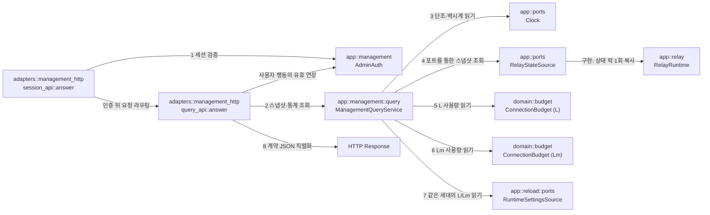

# 관리 조회 API 모듈 설계

관리 리스너(`[management] listen`)에서 인증된 관리자에게 서버 요약, 대기 연결 목록, 활성 세션 목록·상세, 최근 종료 목록을 제공하는 조회 API의 구조와 데이터 흐름을 정의한다. 중계 상태는 메모리 락 안에서 복사하고, 인증·HTTP 직렬화·소켓 I/O는 그 락 밖에서 처리한다.

| 항목 | 값 |
| --- | --- |
| 구조 시점 | Current |
| 문서 상태 | Draft |
| 구현 대조 | Verified — [대조 기록](#대조-기록) |
| 코드 위치 | `crates/app/src/management/query.rs`, `crates/adapters/src/management_http/query_api.rs`, `crates/domain/src/budget.rs` |
| 코드 지도 | [코드 지도 2절](code-map.md#2-코드-위치와-구성요소) |
| 관련 스펙 | [관리 스펙](../specs/management.md) MGT-001~007, MGT-013, MGT-015, MGT-016, MGT-021, MGT-023~024, MGT-026, MGT-051, MGT-054~055, [운영 스펙](../specs/operations.md) OPS-033 |
| 관련 계약 | [관리 API 계약 1.6~1.10·1.12절](../contracts/management-api-v1.md#16-서버-요약-get-apiv1summary)(1.9절은 종료 응답 `closed_session`), [2.1절](../contracts/management-api-v1.md#21-오류-본문과-상태-코드), [설정 계약 1.2절](../contracts/config-v4.md#12-키-표)(P, R), [운영 정보 계약 1.5절](../contracts/ops-info-v2.md#15-사건-목록) |
| 관련 ADR | [ADR-0003 단일 인스턴스·메모리 상태](../decisions/ADR-0003-single-instance-memory-state.md), [ADR-0004 tokio·rustls](../decisions/ADR-0004-tokio-rustls.md) |
| 관련 문서 | [접속 ticket 모듈 설계](relay-access-ticket.md) |

## 1. 책임과 경계

- 맡는 책임:
  - 인증 우선 검증: 공통 `session_api::answer`가 유효한 관리 세션 쿠키를 검증한다. 경로·메서드·형식 검사보다 인증이 우선하며, 실패하면 즉시 `401 unauthenticated`를 반환한다([관리 API 계약 2.1절](../contracts/management-api-v1.md#21-오류-본문과-상태-코드)).
  - 조회 경로 라우팅: 인증 통과 후 다섯 조회 엔드포인트(`GET /api/v1/summary`, `GET /api/v1/waiting`, `GET /api/v1/sessions`, `GET /api/v1/sessions/{session_id}`, `GET /api/v1/closed-sessions`)를 처리한다. 조회 경로는 `GET`만 허용하며, 다른 메서드는 `405`(`Allow: GET`, `code: "invalid_request"`)로 거절한다.
  - 세션 인증 및 유휴 갱신 연계: `X-Relay-Poll` 헤더는 오직 `GET` 요청에서 값 `1`만 유효하며, 다른 값이나 다른 메서드에 포함되면 `400 invalid_request`를 반환한다. 오직 헤더가 없을 때만 사용자 행동으로 간주하여 관리 세션 유휴 만료 시각을 연장한다(`AdminAuth::touch`). 자동 폴링 요청(`X-Relay-Poll: 1`)은 유휴 만료를 연장하지 않는다.
  - 스냅샷 일관성 보장(MGT-016): 한 요청에서 `RelayRuntime`의 `std::sync::Mutex<RelayState>`를 한 번만 짧게 획득해 대기·활성·최근 종료 상태를 복사한다. 바로 뒤에 기준 시점(`as_of_wall`, `as_of_mono`)을 읽는다. 집계와 목록은 이 복사본에서 만든다. 서버 요약의 L·Lm 사용량은 잠금 밖에서 `ConnectionBudget::current()`로 따로 읽으므로, 연결이 바뀌는 동안 같은 응답의 집계와 잠깐 어긋날 수 있다. 이는 스펙 2.2절이 허용한 동작이다.
  - 활성 세션 상태 및 포함 범위: `closing` 상태인 세션도 정리가 완료되기 전까지는 활성 세션 목록에 포함되고 `counts.active`에 집계된다(스펙 §2, §3.2).
  - 식별자 기준 상세 조회: 세션 상세 조회는 오직 `session_id`로만 대상을 찾으며, 동일한 중계 ID(`relay_id`)를 가진 다른 세션으로 대체하지 않는다(MGT-R02, MGT-R07).
  - 세션 식별자 형식 검증: `GET /api/v1/sessions/{session_id}` 요청 시 정규식 크레이트 없이 ASCII 조건문(`len 1~64`, 영문 대소문자·숫자·밑줄·하이픈)으로 검증한다. 잘못된 형식이면 즉시 `400 invalid_request`를 반환하고, 형식은 올바르나 활성 세션 표에 없으면(최근 종료 목록에 있는 경우 포함) `404 not_found`를 반환한다(스펙 §2.3, MGT-023).
  - 연결 수 및 예산 사용량 집계(MGT-026): 초기 교환 중 연결 수(`handshaking`), Mode I 대상 연결 중 연결 수(`target_connecting`), 중계 연결 상한 및 사용량(L), 관리·상태 연결 상한 및 사용량(Lm)을 반환한다. 모든 수치는 원자적 변수 및 인메모리 상태에서 직접 읽으므로 읽기 실패 분기(dead branch)가 없으며 항상 정수와 `null` 사유를 반환한다.
  - 단조 시간 기반 경과 시간 산출(MGT-007): 프로세스 가동 시간(`server.uptime_ms`), 대기 시간(`waited_ms`), 세션 경과 시간은 단조 시계(`Instant`) 차이로 계산해 시스템 시각 보정 시 음수가 발생하지 않도록 보장한다. 표시용 시각은 UTC ISO 8601 문자열로 변환한다.
  - 최근 종료 세션 목록 제공: 메모리에 보관된 최대 R개의 세션과 8가지 종료 원인(`close_cause`)을 `ClosedSessionsView`로 만들고 계약 형식으로 직렬화한다. ticket 만료로 정리한 활성 세션은 `session_expired`다([접속 ticket 모듈 설계](relay-access-ticket.md#43-101-뒤)).
- 맡지 않는 책임:
  - 관리자 로그인·세션 토큰 발급·CSRF 검증: [관리 로그인과 세션 설계](management-session.md)가 소유한다.
  - 관리자 종료(`POST /api/v1/sessions/{session_id}/terminate`): [관리자 종료 설계](management-terminate.md)가 소유한다.
  - 대시보드 정적 HTML·CSS·JS 파일 제공: [관리 리스너 모듈 설계](management-listener.md)가 소유한다.
  - 생존·준비 엔드포인트(`/livez`, `/readyz`): [상태 리스너와 준비 상태 모듈 설계](status-listener.md)가 소유한다.
  - 클라이언트 대시보드의 폴링 타이머 및 렌더링: [대시보드 화면 스펙](../specs/dashboard.md)이 소유한다.
  - 설정 파일 조회·검증·편집과 파일 상태/이력: [설정 보기·편집 서비스](config-edit.md)가 별도 공유 재로드 mutex에서 처리한다. 중계 상태 락과 파일 I/O를 함께 잡지 않는다.
- 다른 모듈에 공개하는 기능:
  - `vnc_relay_application::management::query::ManagementQueryService`
  - `vnc_relay_adapters::management_http::query_api::answer`
  - `vnc_relay_adapters::management_http::logs_api::answer`

## 2. 내부 구조

화살표는 실행 중 호출 또는 주입이다.

| 요소(파일·심볼) | 역할 | 만들어지는 시점과 소유자 | 의존 대상 |
| --- | --- | --- | --- |
| `crates/app/src/management/query.rs` `ManagementQueryService` | 서버 요약, 대기 목록, 활성 세션, 최근 종료 목록의 응용 뷰를 생성한다. L/Lm은 runtime source에서 한 번에 읽는다. | 시작 시 `src/serve.rs`가 생성하고 `ManagementListener`에 전달한다. | `RelayStateSource`, `ConnectionBudget`, `Clock`, `RuntimeSettingsSource` |
| `crates/adapters/src/management_http/query_api.rs` `answer` | 요약·대기·활성 목록·상세·최근 종료 요청을 분기하고 JSON 응답을 구성한다. | `session_api::answer`가 인증 뒤 전달한다. | `ManagementQueryService`, `AdminAuth`, `serde_json`, `axum` |
| `crates/domain/src/budget.rs` `ConnectionBudget::current` | L 및 Lm의 현재 점유 카운트(`used`)를 원자적으로 읽는다. | 시작 시 `src/serve.rs`가 예산을 생성한다. | `AtomicU32` |
| `crates/app/src/ports.rs` `RelayStateSource` | 중계 런타임 상태 스냅샷을 조회하는 포트 trait이다. | `ManagementQueryService`가 주입받고 `RelayRuntime`이 구현한다. | `Clock`, `RelaySnapshot` |
| `crates/app/src/relay.rs` `RelayRuntime::snapshot` | 상태 락을 한 번 획득하여 대기·활성·최근 종료 목록과 카운터를 복사한다. `handshaking`과 `max_entries`(R)도 제공한다. | 시작 시 `src/serve.rs`가 런타임을 생성하여 공유한다. | `Clock`, `RelayState` |
| `crates/app/src/relay.rs` `RelayRuntime::track_handshaking` | `pub fn track_handshaking<'a>(&'a self) -> HandshakingGuard<'a, C>`는 `handshaking`을 1 늘리고 소멸 시 1 줄이는 RAII 가드를 반환한다. | TCP(`net.rs`) 및 WS·WSS(`websocket.rs`) 연결 준비 진입점에서 호출한다. | `std::sync::Mutex<RelayState>` |
| `crates/app/src/relay.rs` `HandshakingGuard` | 초기 교환 중인 연결 수를 세는 RAII 카운터 가드다. | TCP는 `net.rs`의 `handle_connection` 진입 전, WS·WSS는 `websocket.rs`의 101 응답 flush 직후 생성한다. 연결 준비가 끝나면 소멸한다. | `RelayRuntime::track_handshaking` |
| `crates/app/src/relay.rs` `ActivePeer` | 활성 세션의 상대(`Server(ConnectionContext)` 또는 `Target(SocketAddr)`)를 나타낸다. 대상 주소가 항상 유효함을 타입으로 보장한다. | `SessionPair` 및 `ActiveSessionSnapshot` 생성 시 소유한다. | `ConnectionContext`, `SocketAddr` |

## 3. 데이터 모델

외부 교환 형식은 [관리 API 계약 1.6~1.8·1.10절](../contracts/management-api-v1.md#16-서버-요약-get-apiv1summary)을 준수하며, 아래는 내부 응용 및 어댑터 모델이다.

| 이름 | 필드·형태 | 저장 위치 | 제약과 항상 지켜야 할 조건 |
| --- | --- | --- | --- |
| `SummaryView` | `as_of: SystemTime`, `server: ServerStateView`, `counts: CountsView`, `usage: UsageView` | 응용 조회 결과 | 어댑터가 `as_of`를 UTC ISO 8601(`Z`)로 직렬화한다. `counts.waiting`과 `counts.active`는 같은 시점 목록 길이와 일치한다. |
| `ServerStateView` | `state: &'static str` (`ready` \| `shutdown_grace`), `uptime_ms: u64` | `SummaryView` 내부 | `uptime_ms`는 음수가 될 수 없으며 단조 시간 차이로 계산한다. |
| `CountsView` | `waiting: u64`, `active: u64`, `handshaking: u64`, `target_connecting: u64` | `SummaryView` 내부 | 인메모리 카운터를 정수로 제공한다. 어댑터는 계약의 `null` 사유 필드를 함께 쓴다. |
| `UsageView` | `relay_connections: ResourceUsageView`, `admin_connections: ResourceUsageView` | `SummaryView` 내부 | L과 Lm의 사용량은 서로 독립적으로 산출된다. |
| `ResourceUsageView` | `current: u64`, `limit: u64` | `UsageView` 내부 | current는 budget 원자 계수, limit는 현재 runtime 값이다. 상한을 낮춘 직후에는 `current > limit`도 유효하며 기존 점유를 취소하지 않는다. 직렬화는 정수와 계약의 null 사유 필드를 제공한다. |
| `WaitingItemView` | `role: &'static str` (`viewer` \| `server`), `relay_id: String`, `connected_at: SystemTime`, `waited_ms: u64`, `transport: &'static str`, `address: SocketAddr`, `forwarded_ip: Option<PeerIp>` | `WaitingListView.items` 배열 | `relay_id`는 1~247자의 숫자 원문 문자열을 보존한다. `waited_ms`는 `as_of`까지의 단조 시간 경과다. `address`는 실제 소켓 상대 주소다. `forwarded_ip`는 신뢰 프록시 판정 결과이며 TCP는 항상 `null`이다. |
| `ActiveSessionItemView` | `session_id`, `state`, `mode`, `viewer_transport`, `target_transport`, `viewer_forwarded_ip`, `target_forwarded_ip`, `started_at`, 양방향 `bytes_*`, `viewer_address`, `target_address` | `SessionListView.items` 및 `SessionDetailView.session` | 양쪽 전송은 `tcp`·`ws`·`wss`다. Mode I의 target은 `tcp`, Mode II는 실제 Server 전송이다. 전달 주소는 신뢰 프록시 판정 결과 또는 `null`이다. Mode I의 대상 전달 주소와 직접 연결의 전달 주소는 `null`이다. `closing`도 활성 목록에 포함한다. |
| `ClosedSessionsView` | `as_of: SystemTime`, `max_entries: u64`, `items: Vec<ClosedSessionItemView>` | 응용 조회 결과 | `max_entries`는 설정된 R 값이다. `items`는 정리가 끝난 활성 세션만 담는다. |
| `ClosedSessionItemView` | `session_id`, `mode`, `viewer_transport`, `target_transport`, `started_at`, `ended_at`, `duration_ms`, 양방향 `bytes_*`, `viewer_address`, `target_address`, `viewer_forwarded_ip`, `target_forwarded_ip`, `close_cause` | `ClosedSessionsView.items` | 양쪽 전송과 `session_expired`를 포함한 종료 원인을 반환한다. 초기 교환·대기 중 만료는 넣지 않는다. 주소는 종료 직전 활성 항목의 값이다. `duration_ms`는 `milliseconds(ClosedSession::duration())`이며 `session_closed` 로그와 같은 단조 시계 값이다. 최대 R개이며 오래된 항목부터 제거한다. |
| 주소 직렬화 | `SocketAddr` → `{"ip": String, "port": u16}` | `query_api::format_address` | 실제 소켓 주소를 쓴다. `format_ip`가 `IpAddr::to_canonical()`을 적용하므로 IPv4 매핑 IPv6는 `a.b.c.d`로 쓴다. |

세션 활성화 때 `ClosedMetadata`에 중계 ID 참조·양쪽 소켓 주소·양쪽 전달 주소를 보존한다. `ActiveGuard`는 정상 정리와 소유자 소실 정리 모두에서 이 값을 `recent_metadata`에 넣는다. 관리자 종료의 `closed_session`도 같은 `ClosedSessionSnapshot`에서 만들므로 최근 종료 항목과 필드가 같다. 도메인 `ClosedSession`은 HTTP 주소 형식을 알지 못한다.

## 4. 처리 순서

[관리 API 계약 2.1절](../contracts/management-api-v1.md#21-오류-본문과-상태-코드)의 규칙에 따라 공통 `session_api::answer`가 인증을 가장 먼저 검사한다.

| 순서 | 코드 위치(파일·심볼) | 조건·계산 | 바뀌는 상태 | 결과를 쓰는 곳 |
| --- | --- | --- | --- | --- |
| 1 | `management_http/session_api.rs` | `AdminAuth::authorize`로 세션 쿠키 검증. 실패 시 경로·메서드·형식 검사보다 먼저 `401 unauthenticated` 반환 및 쿠키 삭제 헤더 부착 | 없음 | 401 응답 또는 다음 단계 |
| 2 | `management_http/query_api.rs` `answer` | 요청 경로가 `/api/v1/summary`, `/waiting`, `/sessions`, `/closed-sessions`, `/sessions/{session_id}` 중 하나인지 판별. 알 수 없는 경로이면 `404 not_found` | 없음 | 404 응답 또는 다음 단계 |
| 3 | `management_http/query_api.rs` | 요청 메서드가 `GET`인지 검사. `GET`이 아니면 `405`(`Allow: GET`, `code: "invalid_request"`, message: "이 경로는 GET 요청만 받는다.") | 없음 | 405 응답 또는 다음 단계 |
| 4 | `management_http/query_api.rs` | `session_api.rs`의 `poll_flag` 헬퍼로 `X-Relay-Poll` 헤더 검증. 부재(`Some(false)`) 시 `AdminAuth::touch` 호출. `1`(`Some(true)`)이면 `touch` 건너뜀. 그 외(`None`)는 `400 invalid_request` | 유휴 기한 연장 여부 결정 | 다음 단계 또는 400 |
| 5 | `management_http/query_api.rs` | 빈 본문은 통과한다. 본문이 있으면 `Content-Type: application/json`이어야 하며, 아니면 `415 invalid_request`다. JSON 본문 내용은 무시한다. | 없음 | 다음 단계 또는 415 |
| 6 | `ManagementQueryService::capture_snapshot` | `RelayStateSource::snapshot`으로 중계 상태를 복사한 뒤 `Clock::wall`과 `Clock::monotonic`을 읽는다. 런타임 구현은 `RelayRuntime::snapshot`에서 상태 락을 한 번 획득한다. | 없음 | `RelaySnapshot`과 표시·경과 시각 |
| 7 | `ManagementQueryService` | 요약은 runtime `with_current` 한 번에서 L/Lm 쌍을 복사한 뒤 budget 사용량·라이프사이클을 조합한다. 대기는 단조 waited_ms, 상세는 session_id 검사와 활성 목록 검색, 최근 종료는 완료 목록 변환을 수행한다. | 없음 | 계약 DTO 객체 |
| 8 | `management_http/query_api.rs` | JSON 직렬화 및 공통 헤더(`Cache-Control: no-store`) 부착 | 없음 | `200 OK` HTTP Response |

### 4.1 폴링 주기 P와 조회 제한 시간 전달 흐름

대시보드 화면이 조회를 주기적으로 수행하기 위한 설정값(P, 조회 제한 시간, 종료 대기 한도)은 `GET /api/v1/summary`에 포함되지 않는다.
1. 관리자가 로그인하거나 세션 정보를 복구할 때(`POST /api/v1/session` 또는 `GET /api/v1/session`), 응답 본문의 `dashboard.poll_secs`(P), `dashboard.query_timeout_secs`, `dashboard.terminate_timeout_secs`가 클라이언트에 전달된다([관리 API 계약 1.5·1.12절](../contracts/management-api-v1.md#112-폴링-주기와-조회-제한-시간의-전달)).
2. 대시보드 클라이언트는 이 주기 P를 바탕으로 타이머를 가동하여 `GET /api/v1/summary`, `GET /api/v1/waiting`, `GET /api/v1/sessions`, `GET /api/v1/closed-sessions` 요청에 `X-Relay-Poll: 1` 헤더를 붙여 전송한다.
3. 서버의 조회 핸들러는 `X-Relay-Poll: 1` 헤더를 감지하여 세션 유휴 기한 연장(`touch`)을 건너뛴다(MGT-025).

## 5. 상태와 초기화

- 초기화 시점: `src/serve.rs`에서 `RelayRuntime`, `RelayService`, `LifecycleService`, `ConnectionBudget`을 조립한 뒤 `ManagementQueryService`를 생성한다. watcher·설정 편집·중계 reader와 같은 `ReloadCell`을 `RuntimeSettingsSource`로 주입한 뒤 `ManagementListener`에 전달한다.
- 상태 소유자와 수명:
  - 활성 세션 표와 대기 표는 `RelayRuntime` 내부의 `std::sync::Mutex<RelayState>`가 소유하며, 프로세스 수명 동안만 유지된다.
  - 최근 종료 목록은 `recent_closed::List`가 소유하며 최대 R개를 보관한다. 항목별 `ClosedMetadata`는 같은 락 안의 `recent_metadata`에 두고, 목록에서 밀려난 항목과 함께 지운다. 프로세스가 재시작되면 모두 비워진다(ADR-0003).
  - L/Lm 예산은 `ConnectionBudget`이 원자적으로 관리한다.
- 동시 실행과 락 불변식:
  - 중계 펌프 루프(`pump`)는 소켓 쓰기 성공 시 `on_update`로 세션 바이트 카운터를 갱신하며 런타임 상태 락을 잡는다.
  - `RelayRuntime::snapshot`은 이 락을 메모리 복사에만 사용하며 소켓 I/O나 비동기 `.await`를 일절 수행하지 않는다.
  - 조회는 메타데이터 복사 동안 펌프의 같은 락 획득을 지연시킬 수 있다. 락 안에서는 중계 바이트를 읽거나 쓰지 않는다. 소요 시간을 측정한 기록은 없으며, MGT-016의 블랙박스 시험만으로 내부 일관성 전체를 입증하지 않는다.

## 6. 오류 처리

[관리 API 계약 2.1절](../contracts/management-api-v1.md#21-오류-본문과-상태-코드)의 순서와 형식을 따른다. 모든 `/api/v1/` 오류 본문은 `{"error":{"code":"<코드>","message":"<문장>"}}` 형태다. 405의 오류 코드도 `invalid_request`다.

| 실패 지점 | 상태 코드 및 반환 형식 | 남는 상태 | 관련 스펙 시나리오 |
| --- | --- | --- | --- |
| 1. 관리 세션 쿠키 누락·만료·무효 (경로·메서드 검사보다 우선) | `401 unauthenticated`, 쿠키가 있었다면 만료 `Set-Cookie`, `WWW-Authenticate: Session realm="vnc-relay"` | 만료 세션 제거, 중계 영향 없음 | MGT-019, MGT-021, MGT-027, 계약 2.1절 |
| 2. 알 수 없는 `/api/v1/` 경로 또는 활성 세션 미발견 | `404 not_found` | 상태 변경 없음 | MGT-004, MGT-023, 계약 2.1절 |
| 3. 지원하지 않는 HTTP 메서드 | `405` (`Allow: GET`, `code: invalid_request`, message: "이 경로는 GET 요청만 받는다.") | 상태 변경 없음 | 계약 2.1절 |
| 4. `session_id` ASCII 형식 불일치 | `400 invalid_request`, message: "세션 식별자 형식이 올바르지 않습니다." | 상태 변경 없음 | MGT-003, DASH-026, 계약 2.1절 |
| 5. `X-Relay-Poll`이 `1`이 아니거나 비-GET에 포함 | `400 invalid_request`, message: "X-Relay-Poll은 값 1을 가진 GET 요청에만 쓸 수 있다." | 상태 변경 없음 | MGT-025, 계약 2.1절 |
| 6. GET에 비어 있지 않은 비JSON 본문 | `415 invalid_request`, message: "요청 본문은 application/json이어야 한다." | 상태 변경 없음 | 계약 1.1절 |
| 7. 정상적인 빈 목록(대기 0건, 활성 0건 등) | `200 OK`와 `items: []` 반환. `500 internal`이나 오류로 대신하지 않음 | 상태 변경 없음 | MGT-004 |
| 8. 리소스 메트릭 읽기 실패 분기 | 아토믹 변수 및 인메모리 카운터로 읽기 실패 분기(dead branch)가 없으며 항상 정수 반환. (계약의 `read_failed`는 실패 경로가 존재할 때의 규정임) | 상태 변경 없음 | 스펙 §2, 계약 §1.1 |
| 9. 스냅샷 생성 중 내부 실패 | 경로 없음. `RelayStateSource::snapshot`은 실패를 반환하지 않으므로 `query_api.rs`에는 500 응답이 없다. 계약의 `500 internal`은 로그인·세션 등 실패 경로가 있는 처리에 해당한다. MGT-004의 조회 오류는 실제 조회 경로의 `400 invalid_request`·`404 not_found`로 판정한다. | 상태 변경 없음 | MGT-004, DASH-003 |

## 7. 설계 선택과 테스트 계획

### 7.1 설계 선택

| 선택 | 이유 | 검토한 다른 방법 | 근거 |
| --- | --- | --- | --- |
| `RelayRuntime::snapshot`의 단일 락 복사 | 메타데이터만 복사하고 소켓 I/O는 하지 않는다. | 채널 전달, RCU | 관리 스펙 5절 |
| 인증 우선 검사 | 세션 인증(401)을 경로(404)·메서드(405)보다 먼저 수행한다. | 라우터 경로 분기 우선 | 관리 API 계약 2.1절 |
| 단조 시간 기반 경과 시간 | 벽시계 보정에도 음수가 되지 않는다. | 벽시계 차감 | MGT-007 |
| `handshaking` RAII 가드 | 준비 종료 때 자동으로 카운터를 줄인다. | L에서 대기·활성 수를 빼서 추정 | MGT-026 |
| `ConnectionBudget::current()` | 원자적 `used`를 읽는다. | 외부 카운터 | MGT-026 |
| 인메모리 정수와 `null` 사유 | 실패할 수 없는 카운터에 죽은 실패 분기를 두지 않는다. | 임의 실패 분기 | 관리 API 계약 1.1절, MGT-026 |
| ASCII `session_id` 검사 | 정규식 의존성 없이 길이 1~64, 영숫자·`_`·`-`를 O(N)으로 검사한다. | regex crate | 관리 API 계약 1.8절 |
| 상대 IP 정규화 | `PeerIp`·운영 로그와 같은 `IpAddr::to_canonical()`을 쓴다. | 원시 매핑 IPv6 표기 | 관리 API 계약 1.1절 |
| `media_type_allows`로 GET 본문 검사 | 빈 본문은 통과하고 비JSON 본문은 415다. | 모두 400 | 관리 API 계약 1.1절 |

### 7.2 수용 테스트 계획 (시나리오별 대응)

테스트 소스의 `/// spec:` 메타 정보가 시나리오와 시험을 연결한다. 현재 결과는 [테스트 컨벤션](../conventions/testing.md)에 따라 `cargo xtask scenarios`가 만드는 `scenario-report.md`와 CI에서 확인한다. 아래는 시험 책임과 관찰 범위다.

| 시나리오 ID | 요구사항 / 규칙 | 테스트 수준 | 테스트 대상 위치 | 검증 내용 |
| --- | --- | --- | --- | --- |
| MGT-001 | FR-06 / MGT-R01 | 통합 | `crates/adapters/tests/management.rs` | 대기 n개·활성 m개에서 요약 집계와 목록의 항목 수·내용을 비교한다. |
| MGT-002 | FR-06 / MGT-R01 | 통합 | `crates/adapters/tests/management.rs` | 초기 교환·Mode I 대상 연결·종료 정리 상태의 집계 반영 시점을 확인한다. |
| MGT-003 | FR-06 / MGT-R02 | 통합 | `crates/adapters/tests/management.rs` | 상세의 모드·전송·주소·바이트, UTC ISO 8601 시각과 정수 바이트를 확인한다. |
| MGT-004 | FR-06 / MGT-R03 | 단위/통합 | `tests/management_query.rs` | 빈 목록의 `200 OK`·빈 배열과 실제 조회 오류(`400 invalid_request`·`404 not_found`)를 구분한다. |
| MGT-005 | FR-06 / MGT-R04 | 단위/통합 | `crates/app/src/relay/session.rs`, `crates/adapters/tests/management.rs` | 실제 관리 HTTP와 실제 `RelayRuntime`·`RelayService`에 공개 `RelayStream` 포트로 부분 쓰기(2·3바이트)와 부분 성공 뒤 쓰기 실패를 넣는다. 방향별로 다른 크기의 데이터를 보내 활성 상세와 최근 종료 목록의 카운터가 실제로 쓴 바이트와 같고 정수인지 확인한다(`completion_mgt005_partial_success_and_write_failure_count_only_delivered_bytes`) |
| MGT-006 | FR-06 / MGT-R04 | 통합 | `crates/adapters/tests/management.rs` | TCP·WS·WSS에서 프레이밍을 뺀 순수 RFB 페이로드 집계를 확인한다. |
| MGT-007 | FR-06 / MGT-R04 | 단위/통합 | `crates/app/src/management/query.rs`, `crates/adapters/tests/management.rs` | 조절 가능한 `Clock`으로 같은 중계 ID 재접속의 새 카운터, 벽시계 역행·전진 중 0 이상·단조 증가하는 경과 시간, 새 런타임·리스너로 대신한 재시작 뒤 빈 목록과 새 식별자를 한 함수에서 확인한다. |
| MGT-013 | FR-06·FR-08 / MGT-R08 | 통합 | `crates/adapters/tests/management.rs` | 조회와 400·401·403·404·405, 실패하는 가짜 중계 제어 포트의 `500 terminate_failed` 응답에 비밀번호·해시·세션 토큰·원시 스트림이 없는지 확인한다. |
| MGT-015 | FR-06 / MGT-R10 | 통합 | `crates/adapters/tests/management.rs` | `X-Forwarded-For`·`Forwarded`를 넣어도 주소 필드가 실제 소켓 상대를 유지하는지 확인한다. |
| MGT-016 | FR-06 / MGT-R01 | 단위/통합 | `crates/adapters/tests/management.rs` | 상태 복사 직후 실제 종료·수락을 일으켜 집계·목록·`as_of`가 한 복사본을 따르는지 확인한다. L 사용량이 집계보다 앞서는 응답과 다음 응답의 일치도 확인한다. |
| MGT-021 | FR-06·7절 / MGT-R11 | 통합 | `crates/adapters/tests/management.rs` | 세션 쿠키 없는 조회가 `401 unauthenticated`이고 보호 정보가 없는지 확인한다. |
| MGT-023 | FR-06 / MGT-R15 | 통합 | `crates/adapters/tests/management.rs` | 정상 EOF·연결 오류·관리자 종료와 `internal_error`를 포함한 종료 원인을 구별한다. 끝난 식별자의 상세 조회는 404다. ticket의 `session_expired`는 [접속 ticket 모듈 설계](relay-access-ticket.md#43-101-뒤)와 MGT-052 범위다. 종료 요청 검증은 [관리자 종료 설계](management-terminate.md)가 맡는다. |
| MGT-024 | FR-06 / MGT-R15 | 단위/통합 | `crates/domain/src/recent_closed.rs`, `crates/adapters/tests/management.rs` | R 초과 시 FIFO 제거와 재시작 뒤 빈 목록을 확인한다. |
| MGT-026 | FR-06 / MGT-R17 | 통합 | `crates/adapters/tests/management.rs`, `tests/management_query.rs` | 초기 교환 n개·Mode I 대상 연결 m개·L 도달 때 counts와 usage를 확인한다. Windows는 약 2초의 연결 재시도 창에서 요약 하나를 얻고, 놓치면 새 Mode I 연결로 최대 5회 시도한다. |
| OPS-033 | OPS-R18 / OPS-033 | 통합 | `tests/management_query.rs` | L=2를 채워도 로그인·조회·관리자 종료가 되고, Lm=2를 채워도 새 중계 수락·매칭·양방향 전달이 되는지 한 함수에서 확인한다(`exhausted_relay_and_admin_budgets_leave_the_other_service_operational`). |
| MGT-051 | FR-06 / MGT-R10·R15 | 단위/통합 | `crates/app/src/management/query.rs`, `crates/adapters/src/management_http/query_api.rs`, `crates/adapters/src/management_http/terminate_api.rs` | 활성 목록·상세 직렬화에서 실제 소켓 상대 주소 유지 및 필수 nullable 전달 주소(`viewer_forwarded_ip`, `target_forwarded_ip`) 투영과 null 처리 검증, 최근 종료 및 종료 요약의 `target_transport` 유지 검증 |
| MGT-054 | FR-06 / MGT-R30 | 단위/시스템 | `crates/app/src/management/query.rs`, `crates/adapters/src/management_http/query_api.rs`, `tests/serve.rs` | 대기 항목의 `transport`·`address`·`forwarded_ip` 투영과 직렬화, 실제 실행파일의 TCP·WS·WSS 대기 연결과 신뢰 프록시 유무(`real_waiting_lists_preserve_all_entry_transports_and_proxy_addresses`) |
| MGT-055 | FR-06 / MGT-R30 | 단위/통합/시스템 | `crates/app/src/management/query.rs`, `crates/adapters/src/management_http/{query_api,terminate_api}.rs`, `crates/adapters/tests/management.rs`, `tests/serve.rs` | 최근 종료 항목과 `closed_session`의 `duration_ms`·주소·전달 주소. 실제 실행파일에서 Mode I·II, 자연 종료·관리자 종료, 신뢰 프록시 유무를 조합하고 `session_closed` 로그의 `duration_ms`와 비교(`real_closed_lists_and_termination_preserve_addresses_and_logged_monotonic_duration`) |

## 최근 로그 조회

`GET /api/v1/logs`(MGT-046~050)는 `crates/adapters/src/management_http/logs_api.rs`가 제공한다. 중계 스냅샷 조회와 별도 경로다.

- `session_api::answer`가 인증 뒤 `logs_api::answer`로 보낸다. 미인증은 401이고, GET 이외는 405 `invalid_request`와 `Allow: GET`이다.
- 본문이 있으면 `Content-Type: application/json`이어야 한다. 아니면 415 `invalid_request`다.
- `X-Relay-Poll: 1`은 유휴 만료를 연장하지 않는다. 헤더 없는 사용자 행동은 연장한다.
- `level`, `event`, `q`, `session_id`, `before`, `after`, `limit`를 검사한다. 단일 값의 중복·형식·범위 오류는 400 `invalid_request`다. 알 수 없는 매개변수는 무시하고 `=` 없는 매개변수는 빈 값으로 읽는다.
- `RecentLogs::query`는 버퍼 잠금 안에서 커서 범위·전체 보관 경계와 `Arc<LogEntry>`·필요한 세션 연계 참조를 확보한다. 필드 검사와 페이지 선택은 잠금 밖에서 한다. `LogsResponse::to_json_string`은 깊은 복사 없이 `as_of`, `max_entries`, `oldest_seq`, `latest_seq`, `has_more`, `items[]`를 직렬화한다.
- `recent_logs.max_entries`는 설정 보기의 재시작 키다. 관리 인증·쿠키·로그인 제한은 전달 주소가 아닌 실제 소켓 IP를 쓴다.

## 설정 조회와 동적 상한

설정 GET은 [ConfigEditService](config-edit.md#3-데이터-모델과-get)가 맡는다. `ManagementQueryService`에는 파일 I/O를 넣지 않는다. `src/serve.rs`는 watcher·설정 편집과 같은 `ReloadCell`을 `Arc<dyn RuntimeSettingsSource>`로 주입한다. `summary`는 `with_current` 한 번으로 같은 세대의 L/Lm을 읽는다. budget은 사용량의 원자 계수만 제공한다([동적 상한 설계](connection-limits.md), [설정 재로드 구분](../contracts/config-v4.md#18-재로드-구분)).

## 서버 종료 항목의 조회

`src/serve.rs`는 `finish_relay_shutdown`으로 중계 작업이 합류한 뒤 관리 리스너를 멈춘다. 따라서 Grace → Force로 세션을 정리한 뒤 관리 리스너가 끝나기 전까지 `GET /api/v1/closed-sessions`에서 `server_shutdown`을 관찰할 수 있다. `completion_mgt023_shutdown_history_is_queryable_and_preserves_prior_eof_cause`는 이 구간과 먼저 EOF 정리를 시작한 세션의 `peer_eof` 유지를 확인한다.

## 대조 기록

| 날짜 | 대상 | 환경 | 확인 방법 | 실제 결과 |
| --- | --- | --- | --- | --- |
| 2026-11-08 | 작업 트리의 `ManagementQueryService::{new,summary}`와 `src/serve.rs`의 주입 | 저장소 소스 읽기 | `RuntimeSettingsSource`의 공유와 한 번의 `with_current`에서 L/Lm을 읽는 구조를 대조했다. | 동적 상한의 주입·조회 구조가 소스와 일치한다. |
| 2026-11-04 | `0196cab`의 MGT-026 Windows 연결 관찰 | Windows | 가득 찬 listen 백로그와 닫힌 루프백 포트의 대상 연결 거절까지 걸린 시간을 측정했다. | 각각 2.016초·2.039초였다. 시험은 이 연결 대기 창에서 요약을 읽는다. |

부분 쓰기·시각 보정·실패 완료 시험은 실제 관리 HTTP·인증·직렬화·`RelayRuntime`을 쓰지만 해당 입력은 실제 OS 입력이 아닌 시험용 포트로 만든다.
