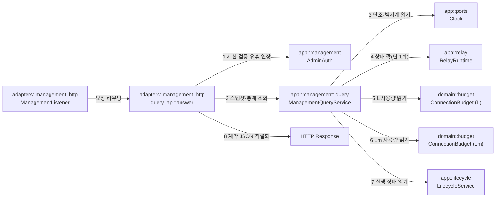

# 관리 조회 API 모듈 설계

관리 리스너(`[management] listen`)에서 인증된 관리자에게 서버 요약, 대기 연결 목록, 활성 세션 목록·상세, 최근 종료 목록을 제공하는 조회 API의 구조와 데이터 흐름을 정의한다. 한 응답 안의 단일 기준 시점(`as_of`) 일관성을 보장하며, 중계 스트림을 멈추거나 데이터를 소비하지 않고 마이크로초 단위의 짧은 메모리 락으로 스냅샷을 구성한다.

| 항목 | 값 |
| --- | --- |
| 구조 시점 | Target |
| 문서 상태 | Draft |
| 구현 대조 | 미대조 |
| 코드 위치 | `crates/app/src/management/query.rs`, `crates/adapters/src/management_http/query_api.rs`, `crates/domain/src/budget.rs` |
| 코드 지도 | [코드 지도 2절](code-map.md#2-코드-위치와-구성요소) |
| 관련 스펙 | [관리 스펙](../specs/management.md) MGT-001~007, MGT-013, MGT-015, MGT-016, MGT-021, MGT-023~024, MGT-026, [운영 스펙](../specs/operations.md) OPS-033 |
| 관련 계약 | [관리 API 계약 1.6~1.8·1.10·1.12절](../contracts/management-api-v1.md#16-서버-요약-get-apiv1summary), [2.1절](../contracts/management-api-v1.md#21-오류-본문과-상태-코드), [설정 계약 1.2절](../contracts/config-v2.md#12-키-표)(P, R), [운영 정보 계약 1.5절](../contracts/ops-info-v1.md#15-사건-목록) |
| 관련 ADR | [ADR-0003 단일 인스턴스·메모리 상태](../decisions/ADR-0003-single-instance-memory-state.md), [ADR-0004 tokio·rustls](../decisions/ADR-0004-tokio-rustls.md) |

## 1. 책임과 경계

- 맡는 책임:
  - 인증 우선 검증: 유효한 관리 세션 쿠키를 검증한다. 경로·메서드·형식 검사보다 인증이 항상 우선하며([관리 API 계약 2.1절](../contracts/management-api-v1.md#21-오류-본문과-상태-코드) line 355: "경로·메서드가 틀려도 인증이 먼저다"), 인증 실패 시 즉시 `401 unauthenticated`를 반환한다.
  - 조회 경로 라우팅: 인증 통과 후 네 가지 조회 엔드포인트(`GET /api/v1/summary`, `GET /api/v1/waiting`, `GET /api/v1/sessions`, `GET /api/v1/sessions/{session_id}`, `GET /api/v1/closed-sessions`)를 처리한다. 조회 경로는 오직 `GET` 요청만 허용하며, 다른 메서드는 `405`(`Allow: GET`, `code: "invalid_request"`)로 거절한다.
  - 세션 인증 및 유휴 갱신 연계: `X-Relay-Poll` 헤더는 오직 `GET` 요청에서 값 `1`만 유효하며, 다른 값이나 다른 메서드에 포함되면 `400 invalid_request`를 반환한다. 오직 헤더가 없을 때만 사용자 행동으로 간주하여 관리 세션 유휴 만료 시각을 연장한다(`AdminAuth::touch`). 자동 폴링 요청(`X-Relay-Poll: 1`)은 유휴 만료를 연장하지 않는다.
  - 스냅샷 일관성 보장(MGT-016): 한 번의 요청 처리 안에서 단일 기준 시점(`as_of_mono`, `as_of_wall`)을 포착하고, `RelayRuntime`의 `std::sync::Mutex<RelayState>`를 단 한 번만 짧게 획득해 대기·활성·최근 종료 상태를 복사한다.
  - 활성 세션 상태 및 포함 범위: `closing` 상태인 세션도 정리가 완료되기 전까지는 활성 세션 목록에 포함되고 `counts.active`에 집계된다(스펙 §2, §3.2).
  - 식별자 기준 상세 조회: 세션 상세 조회는 오직 `session_id`로만 대상을 찾으며, 동일한 중계 ID(`relay_id`)를 가진 다른 세션으로 대체하지 않는다(MGT-R02, MGT-R07).
  - 세션 식별자 형식 검증: `GET /api/v1/sessions/{session_id}` 요청 시 정규식 크레이트 없이 ASCII 조건문(`len 1~64`, 영문 대소문자·숫자·밑줄·하이픈)으로 검증한다. 잘못된 형식이면 즉시 `400 invalid_request`를 반환하고, 형식은 올바르나 활성 세션 표에 없으면(최근 종료 목록에 있는 경우 포함) `404 not_found`를 반환한다(스펙 §2.3, MGT-023).
  - 연결 수 및 예산 사용량 집계(MGT-026): 초기 교환 중 연결 수(`handshaking`), Mode I 대상 연결 중 연결 수(`target_connecting`), 중계 연결 상한 및 사용량(L), 관리·상태 연결 상한 및 사용량(Lm)을 반환한다. 모든 수치는 원자적 변수 및 인메모리 상태에서 직접 읽으므로 읽기 실패 분기(dead branch)가 없으며 항상 정수와 `null` 사유를 반환한다.
  - 단조 시간 기반 경과 시간 산출(MGT-007): 프로세스 가동 시간(`server.uptime_ms`), 대기 시간(`waited_ms`), 세션 경과 시간은 단조 시계(`Instant`) 차이로 계산해 시스템 시각 보정 시 음수가 발생하지 않도록 보장한다. 표시용 시각은 UTC ISO 8601 문자열로 변환한다.
  - 최근 종료 세션 목록 제공: 메모리에 보관된 최대 R개의 최근 종료 세션과 6가지 종료 원인(`close_cause`)을 계약 형식(`ClosedSessionsResponse`)에 맞춰 직렬화한다.
- 맡지 않는 책임:
  - 관리자 로그인·세션 토큰 발급·CSRF 검증: 작업 4.3의 [관리 로그인과 세션 설계](management-session.md)가 소유한다.
  - 관리자 종료(`POST /api/v1/sessions/{session_id}/terminate`): 작업 4.5가 소유한다.
  - 대시보드 정적 HTML·CSS·JS 파일 제공: 작업 4.6의 [관리 리스너 모듈 설계](management-listener.md)가 소유한다.
  - 생존·준비 엔드포인트(`/livez`, `/readyz`): [상태 리스너와 준비 상태 모듈 설계](status-listener.md)가 소유한다.
  - 클라이언트 대시보드의 폴링 타이머 및 렌더링: [대시보드 화면 스펙](../specs/dashboard.md)이 소유한다.
- 다른 모듈에 공개하는 기능:
  - `vnc_relay_app::management::query::ManagementQueryService`
  - `vnc_relay_adapters::management_http::query_api::answer`

## 2. 내부 구조

화살표는 실행 중 호출 또는 주입이다.

| 요소(파일·심볼) | 역할 | 만들어지는 시점과 소유자 | 의존 대상 |
| --- | --- | --- | --- |
| `crates/app/src/management/query.rs` `ManagementQueryService` | 서버 요약, 대기 목록, 활성 세션, 최근 종료 목록의 일관된 응용 뷰를 생성한다. | 시작 시 `src/serve.rs`가 생성하고 `ManagementListener`에 전달한다. | `RelayRuntime`, `ConnectionBudget`, `Clock`, `LifecycleService` |
| `crates/adapters/src/management_http/query_api.rs` `answer` | `/api/v1/summary`, `/waiting`, `/sessions`, `/closed-sessions` 요청을 분기하고 JSON 응답을 구성한다. | `management_http.rs`의 `answer`가 `/api/v1/` 요청 중 세션 경로 이외를 전달한다. | `ManagementQueryService`, `AdminAuth`, `serde_json`, `axum` |
| `crates/domain/src/budget.rs` `ConnectionBudget::current` | L 및 Lm의 현재 점유 카운트(`used`)를 원자적으로 읽는다. **(신규 추가)** | 시작 시 `src/serve.rs`가 예산 생성 시 소유한다. | `AtomicU32` |
| `crates/app/src/relay.rs` `RelayRuntime::snapshot` | `std::sync::Mutex<RelayState>`를 단 1회 획득하여 대기·활성·최근종료 목록과 카운터를 복제한다. **(기존 메서드 확장: handshaking 카운터 및 max_entries(R) 노출)** | 시작 시 `src/serve.rs`가 생성하여 공유한다. | `Clock`, `RelayState` |
| `crates/app/src/relay.rs` `HandshakingGuard` | 초기 교환 진행 중인 연결 수를 세기 위한 RAII 카운터 가드다. **(신규 추가)** | `handle_connection` 진입 시 생성되고 완료 시 소멸한다. | `RelayRuntime` (또는 `RelayService`) |

## 3. 데이터 모델

외부 교환 형식은 [관리 API 계약 1.6~1.8·1.10절](../contracts/management-api-v1.md#16-서버-요약-get-apiv1summary)을 준수하며, 아래는 내부 응용 및 어댑터 모델이다.

| 이름 | 필드·형태 | 저장 위치 | 제약과 항상 지켜야 할 조건 |
| --- | --- | --- | --- |
| `SummaryResponse` | `as_of: String`, `server: ServerStateView`, `counts: CountsView`, `usage: UsageView` | HTTP 직렬화 시 일시 생성 | `as_of`는 UTC ISO 8601(`Z`). `counts.waiting`과 `counts.active`는 동일 시점 목록 길이와 일치해야 한다. |
| `ServerStateView` | `state: &'static str` (`ready` \| `shutdown_grace`), `uptime_ms: u64` | `SummaryResponse` 내부 | `uptime_ms`는 음수가 될 수 없으며 단조 시간 차이로 계산한다. |
| `CountsView` | `waiting: u64`, `active: u64`, `handshaking: Option<u64>`, `handshaking_unavailable_reason: Option<&'static str>`, `target_connecting: Option<u64>`, `target_connecting_unavailable_reason: Option<&'static str>` | `SummaryResponse` 내부 | 본 구현은 인메모리 카운터로 항상 정확한 정수를 제공하므로 수치는 `Some`이고 사유는 `None`이다. |
| `UsageView` | `relay_connections: ResourceUsageView`, `admin_connections: ResourceUsageView` | `SummaryResponse` 내부 | L과 Lm의 사용량은 서로 독립적으로 산출된다. |
| `ResourceUsageView` | `current: Option<u64>`, `current_unavailable_reason: Option<&'static str>`, `limit: u64` | `UsageView` 내부 | 상한에 도달하면 `current == limit`이다. 본 구현은 `AtomicU32`에서 직접 읽으므로 `current`는 항상 `Some`이고 사유는 `None`이다. (계약의 `read_failed`는 실패 경로가 존재할 때의 규정임) |
| `WaitingItemView` | `role: &'static str` (`viewer` \| `server`), `relay_id: String`, `connected_at: String`, `waited_ms: u64` | `WaitingResponse.items` 배열 | `relay_id`는 1~247자의 숫자 원문 문자열을 보존한다. `waited_ms`는 `as_of`까지의 단조 시간 경과다. |
| `ActiveSessionView` | `session_id: String`, `state: &'static str` (`active` \| `closing`), `mode: &'static str` (`mode1` \| `mode2`), `viewer_transport: &'static str` (`tcp` \| `ws` \| `wss`), `started_at: String`, `bytes_viewer_to_target: u64`, `bytes_target_to_viewer: u64`, `viewer_address: PeerAddressView`, `target_address: PeerAddressView` | `SessionsResponse.items` 및 상세 | `bytes_*`는 단조 증가하며 감소하거나 순환하지 않는다. `closing` 세션도 활성 세션에 포함된다. |
| `ClosedSessionsResponse` | `as_of: String`, `max_entries: u64`, `items: Vec<ClosedSessionItemView>` | HTTP 직렬화 시 일시 생성 | `max_entries`는 설정된 R 값이다. `items`는 정리가 끝난 활성 세션만 담는다. |
| `ClosedSessionItemView` | `session_id: String`, `mode: &'static str`, `viewer_transport: &'static str`, `started_at: String`, `ended_at: String`, `bytes_viewer_to_target: u64`, `bytes_target_to_viewer: u64`, `close_cause: &'static str` | `ClosedSessionsResponse.items` 배열 | 최대 R개 보관되며, 오래된 항목부터 선입선출(FIFO)로 제거된다. |
| `PeerAddressView` | `ip: String`, `port: u16` | 세션 뷰 내부 | 프록시 전달 헤더를 무시하고 실제 소켓 상대 주소를 반영한다. IPv4 매핑 IPv6는 Q88 결정 전까지 계약 가정(소켓 원시값)을 따른다. |

## 4. 처리 순서

[관리 API 계약 2.1절](../contracts/management-api-v1.md#21-오류-본문과-상태-코드) line 355의 "경로·메서드가 틀려도 인증이 먼저다" 규칙에 따라, 기존 `session_api.rs`와 동일하게 인증 검사를 최우선으로 배치한다.

| 순서 | 코드 위치(파일·심볼) | 조건·계산 | 바뀌는 상태 | 결과를 쓰는 곳 |
| --- | --- | --- | --- | --- |
| 1 | `management_http/session_api.rs` | `AdminAuth::authorize`로 세션 쿠키 검증. 실패 시 경로·메서드·형식 검사보다 먼저 `401 unauthenticated` 반환 및 쿠키 삭제 헤더 부착 | 없음 | 401 응답 또는 다음 단계 |
| 2 | `management_http/query_api.rs` `answer` | 요청 경로가 `/api/v1/summary`, `/waiting`, `/sessions`, `/closed-sessions`, `/sessions/{session_id}` 중 하나인지 판별. 알 수 없는 경로이면 `404 not_found` | 없음 | 404 응답 또는 다음 단계 |
| 3 | `management_http/query_api.rs` | 요청 메서드가 `GET`인지 검사. `GET`이 아니면 `405`(`Allow: GET`, `code: "invalid_request"`, message: "이 경로는 GET 요청만 받는다.") | 없음 | 405 응답 또는 다음 단계 |
| 4 | `management_http/query_api.rs` | `session_api.rs`의 `poll_flag` 헬퍼로 `X-Relay-Poll` 헤더 검증. 부재(`Some(false)`) 시 `AdminAuth::touch` 호출. `1`(`Some(true)`)이면 `touch` 건너뜀. 그 외(`None`)는 `400 invalid_request` | 유휴 기한 연장 여부 결정 | 다음 단계 또는 400 |
| 5 | `management_http/query_api.rs` | 본문 검사: 빈 본문은 통과. 본문이 있는 경우의 거절(415/400)은 9.2절 계약 불일치를 따름 | 없음 | 다음 단계 또는 415/400 |
| 6 | `ManagementQueryService::snapshot` | `clock.monotonic()`과 `clock.wall()`을 동시 샘플링하고, `RelayRuntime::snapshot`으로 메모리 락을 1회 획득해 복제 | 없음 | `QuerySnapshot` |
| 7 | `ManagementQueryService` | 경로에 따라 DTO 조립:  - 요약: L/Lm 예산 읽기 및 라이프사이클 전이 상태 확인 - 대기: `waited_ms` 단조 계산 및 접속 시각 변환 - 세션: 상세의 경우 ASCII 조건문으로 `session_id` 검증 후 활성 목록 검색 - 최근종료: FIFO 정렬된 완료 목록 변환 | 없음 | 계약 DTO 객체 |
| 8 | `management_http/query_api.rs` | JSON 직렬화 및 공통 헤더(`Cache-Control: no-store`) 부착 | 없음 | `200 OK` HTTP Response |

### 4.1 폴링 주기 P와 조회 제한 시간 전달 흐름

대시보드 화면이 조회를 주기적으로 수행하기 위한 설정값(P, 조회 제한 시간, 종료 대기 한도)은 `GET /api/v1/summary`에 포함되지 않는다.
1. 관리자가 로그인하거나 세션 정보를 복구할 때(`POST /api/v1/session` 또는 `GET /api/v1/session`), 응답 본문의 `dashboard.poll_secs`(P), `dashboard.query_timeout_secs`, `dashboard.terminate_timeout_secs`가 클라이언트에 전달된다([관리 API 계약 1.5·1.12절](../contracts/management-api-v1.md#112-폴링-주기와-조회-제한-시간의-전달)).
2. 대시보드 클라이언트는 이 주기 P를 바탕으로 타이머를 가동하여 `GET /api/v1/summary`, `GET /api/v1/waiting`, `GET /api/v1/sessions`, `GET /api/v1/closed-sessions` 요청에 `X-Relay-Poll: 1` 헤더를 붙여 전송한다.
3. 서버의 조회 핸들러는 `X-Relay-Poll: 1` 헤더를 감지하여 세션 유휴 기한 연장(`touch`)을 건너뛴다(MGT-025).

## 5. 상태와 초기화

- 초기화 시점: `src/serve.rs`에서 `RelayRuntime`, `RelayService`, `LifecycleService`, `ConnectionBudget`을 조립한 뒤 `ManagementQueryService`를 생성하여 `ManagementListener`에 주입한다.
- 상태 소유자와 수명:
  - 활성 세션 표와 대기 표는 `RelayRuntime` 내부의 `std::sync::Mutex<RelayState>`가 소유하며(`crates/app/src/relay.rs:9, 390`), 프로세스 수명 동안만 유지된다.
  - 최근 종료 목록은 `RecentClosedList`가 소유하며 최대 R개를 보관한다. 프로세스가 재시작되면 모두 비워진다(ADR-0003).
  - L/Lm 예산은 `ConnectionBudget`이 원자적으로 관리한다.
- 동시 실행과 락 불변식:
  - 중계 펌프 루프(`pump`)는 소켓 쓰기 성공 시 `on_update`를 통해 세션 바이트 카운터를 `RelayState`에 갱신할 때 `runtime.lock()`을 획득한다(`crates/app/src/relay.rs:1038–1050`).
  - `RelayRuntime::snapshot`은 이 락을 메모리 복사에만 사용하며 소켓 I/O나 비동기 `.await`를 일절 수행하지 않는다.
  - 따라서 조회가 데이터 쓰기를 지연시키는 시간은 메모리 복사 1회 분량(마이크로초 수준)에 불과하며, 중계 스트림을 멈추거나 데이터를 소비하지 않는다(스펙 §5).

## 6. 오류 처리

[관리 API 계약 2.1절](../contracts/management-api-v1.md#21-오류-본문과-상태-코드)의 순서와 형식을 따른다. 모든 `/api/v1/` 오류 응답 본문은 `{"error":{"code":"<코드>","message":"<문장>"}}` 형태를 유지한다. 405는 별도 코드가 없으며 계약 line 359에 따라 `code: "invalid_request"`를 사용한다.

| 실패 지점 | 상태 코드 및 반환 형식 | 남는 상태 | 관련 스펙 시나리오 |
| --- | --- | --- | --- |
| 1. 관리 세션 쿠키 누락·만료·무효 (경로·메서드 검사보다 우선) | `401 unauthenticated` 반환, 쿠키가 존재했다면 만료 `Set-Cookie` 전송, `WWW-Authenticate: Session realm="vnc-relay"` 부착 | 세션 무효화, 중계 영향 없음 | MGT-019, MGT-021, MGT-027, 계약 2.1절 line 355 |
| 2. 알 수 없는 `/api/v1/` 경로 또는 활성 세션 미발견 | `404 not_found` (`code`: `not_found`, `message`: "지정한 세션을 찾을 수 없습니다." 또는 경로 미발견) | 상태 변경 없음 | MGT-004, MGT-023, 계약 2.1절 line 358 |
| 3. 지원하지 않는 HTTP 메서드(POST, DELETE 등) | `405` (`Allow: GET`, `code`: `invalid_request`, `message`: "이 경로는 GET 요청만 받는다.") | 상태 변경 없음 | 계약 2.1절 line 359 |
| 4. 세션 상세 요청의 `session_id` ASCII 형식 불일치 | `400 invalid_request` (`code`: `invalid_request`, `message`: "세션 식별자 형식이 올바르지 않습니다.") | 상태 변경 없음 | MGT-003, DASH-026, 계약 2.1절 line 359 |
| 5. `X-Relay-Poll` 헤더가 `1`이 아님 (또는 비-GET에 포함) | `400 invalid_request` (`code`: `invalid_request`, `message`: "X-Relay-Poll은 값 1을 가진 GET 요청에만 쓸 수 있다.") | 상태 변경 없음 | MGT-025, 계약 2.1절 line 359 |
| 6. GET 요청에 비어있지 않으나 JSON이 아닌 본문 포함 시 | `415 invalid_request` (`code`: `invalid_request`, `message`: "요청 본문은 application/json이어야 한다.") | 상태 변경 없음 | 계약 1.1절 line 38 |
| 7. 정상적인 빈 목록(대기 0건, 활성 0건 등) | `200 OK`와 `items: []` 반환. `500 internal`이나 오류로 대신하지 않음 | 상태 변경 없음 | MGT-004 |
| 8. 리소스 메트릭 읽기 실패 분기 | 아토믹 변수 및 인메모리 카운터로 읽기 실패 분기(dead branch)가 없으며 항상 정수 반환. (계약의 `read_failed`는 실패 경로가 존재할 때의 규정임) | 상태 변경 없음 | 스펙 §2, 계약 §1.1 |
| 9. 스냅샷 생성 중 예상치 못한 내부 실패 | `500 internal` (`code`: `internal`, `message`: "내부 오류가 발생했습니다.") | 중계 영향 없음 | MGT-004, DASH-003 |

## 7. 설계 선택과 테스트 계획

### 7.1 설계 선택

| 선택 | 이유 | 검토한 다른 방법 | 근거 |
| --- | --- | --- | --- |
| `RelayRuntime::snapshot`의 단일 락 복제 방식 | `std::sync::Mutex<RelayState>`를 짧게 획득하여 메타데이터만 복제하므로, 펌프의 쓰기 지연을 마이크로초 단위로 한정하고 스트림 멈춤을 방지한다. | 채널 메시지 전달 방식, RCU 잠금 구조 | 스펙 §5 "조회가 중계 스트림을 멈추거나 데이터를 소비해서는 안 된다", **이 문서의 판단, 사용자 결정 없음** |
| 인증 우선 검증 순서 준수 | 계약 §2.1 line 355("경로·메서드가 틀려도 인증이 먼저다") 및 `session_api.rs`의 기존 순서와 동일하게 세션 인증(401)을 경로(404)·메서드(405)보다 먼저 수행한다. | 라우터 수준의 경로 분기 우선 | 계약 §2.1 line 355, **이 문서의 판단, 사용자 결정 없음** |
| 단조 시간(`Instant`) 기반 경과 시간 산출 | NTP 시각 동기화나 윤초로 시스템 벽시계가 뒤로 이동해도 경과 시간이 음수가 되지 않도록 보장한다(MGT-007). | 벽시계(`SystemTime`) 단순 차감 | 관리 스펙 2.1절, MGT-007, **이 문서의 판단, 사용자 결정 없음** |
| `RelayRuntime`에 `handshaking` RAII 가드 도입 | 초기 교환 진행 중인 연결을 정확히 세어 `counts.handshaking`에 반영하고, 종료 시점에 자동으로 감소시킨다. | L 예산에서 대기/활성 수를 빼서 추정하는 방식 | 관리 스펙 2절, MGT-026, **이 문서의 판단, 사용자 결정 없음** |
| `ConnectionBudget`에 `current()` 관찰 메서드 추가 | 원자적 변수(`used`)를 읽어 L 및 Lm의 현재 사용량을 요약 응답에 정확히 전달한다. | 별도의 외부 카운터 유지 | 운영 스펙 2절, MGT-026, **이 문서의 판단, 사용자 결정 없음** |
| 카운터 수치의 인메모리 확정 정수 반환과 dead branch 배제 | 단일 프로세스 인메모리 구조에서 `handshaking`과 `target_connecting` 및 L/Lm 사용량은 런타임이 정확한 정수를 보유하므로 항상 정수를 반환하고 사유는 `null`로 둔다. 읽기 실패 분기(dead branch)는 두지 않는다. | 임의의 실패 분기 유지 | 스펙 §2, 계약 §1.1, MGT-026, **이 문서의 판단, 사용자 결정 없음** |
| ASCII 조건문 기반 `session_id` 검증 | 정규식 크레이트 의존성 없이 `len 1~64`, `is_ascii_alphanumeric()` 또는 `_`, `-` 검사로 O(N) 검증을 수행한다. | 별도 regex 크레이트 의존성 도입 | 계약 §1.8, **이 문서의 판단, 사용자 결정 없음** |
| 상대 IP 주소의 계약 가정 준수(Q88 대기) | Q88 사용자 결정 전까지는 계약 §6 line 565의 가정대로 소켓 원시 주소 표현을 유지하며, Q88 결정 시 `to_canonical()`로 전환할 수 있도록 추상화한다. | 사전 단독 결정 | 계약 §6 line 565, **사용자 결정 대기(Q88)** |
| GET 본문 검증 시 `media_type_allows` 적용 | 계약 §1.1 line 38 및 기존 `session_api.rs` 구현 기준에 따라 빈 본문은 통과하고 비-JSON 비어있지 않은 본문은 415로 거절한다. | 400 일괄 거절 | 계약 1.1절 line 38, **이 문서의 판단, 사용자 결정 없음** |

### 7.2 수용 테스트 계획 (시나리오별 대응)

모든 테스트는 구현 검증 시 러너에 의해 실행될 계획이며, 아래 표는 계획된 계층과 대상 파일이다.

| 시나리오 ID | 요구사항 / 규칙 | 테스트 수준 | 테스트 대상 위치(계획) | 검증 내용 |
| --- | --- | --- | --- | --- |
| MGT-001 | FR-06 / MGT-R01 | 통합 | `crates/adapters/tests/management.rs` | 대기 연결 n개, 활성 세션 m개 상태에서 요약 집계와 각 목록 API의 항목 수 및 내용 일치 검증 계획 |
| MGT-002 | FR-06 / MGT-R01 | 통합 | `crates/adapters/tests/management.rs` | 초기 교환 중, Mode I 대상 연결 중, 종료 정리 중의 각 상태가 대기·활성 집계에 올바른 시점에 반영되는지 검증 계획 |
| MGT-003 | FR-06 / MGT-R02 | 통합 | `crates/adapters/tests/management.rs` | 활성 세션 식별자로 상세 조회 시 모드·전송경로·주소·바이트수 확인, 시작 시각 UTC ISO 8601 및 바이트 정수 검증 계획 |
| MGT-004 | FR-06 / MGT-R03 | 단위/통합 | `crates/adapters/tests/management.rs` | 대기/활성 목록이 비었을 때 `200 OK` 빈 배열 반환과, 핸들러 실패 시의 `500 internal` 분리 검증 계획 |
| MGT-005 | FR-06 / MGT-R04 | 단위/통합 | `crates/app/src/relay/session.rs`, `crates/adapters/tests/management.rs` | Viewer→Target, Target→Viewer 양방향 데이터 및 부분 쓰기 발생 시 정확한 바이트 누적과 조회 검증 계획 |
| MGT-006 | FR-06 / MGT-R04 | 통합 | `crates/adapters/tests/management.rs` | TCP, WS, WSS 각각의 전송 경로에서 프로토콜 프레이밍 제외 후 순수 RFB 페이로드 카운터 집계 검증 계획 |
| MGT-007 | FR-06 / MGT-R04 | 단위/통합 | `crates/app/src/management/query.rs` | 가짜 시계를 이용해 벽시계 보정(과거 이동)을 시뮬레이션해도 경과 시간이 0 이상 유지됨을 검증 계획 |
| MGT-013 | FR-06·FR-08 / MGT-R08 | 통합 | `crates/adapters/tests/management.rs` | 요약·대기·세션·종료세션 응답 및 400/401/404/500 오류 본문에 계정 비밀번호, 해시, 원시 스트림 미포함 검증 계획 |
| MGT-015 | FR-06 / MGT-R10 | 통합 | `crates/adapters/tests/management.rs` | `X-Forwarded-For`, `Forwarded` 헤더를 주입해도 실제 소켓 피어 주소가 응답 주소에 표시됨을 검증 계획 |
| MGT-016 | FR-06 / MGT-R01 | 단위/통합 | `crates/adapters/tests/management.rs` | 쿼리 응답 생성 중 세션이 추가/종료되어도 단일 응답 내부의 `as_of`와 목록/카운트의 일관성 보장 검증 계획 |
| MGT-021 | FR-06·7절 / MGT-R11 | 통합 | `crates/adapters/tests/management.rs` | 세션 쿠키 없이 4개 조회 엔드포인트 직접 호출 시 `401 unauthenticated` 반환 및 보호 정보 차단 검증 계획 |
| MGT-023 | FR-06 / MGT-R15 | 통합 | `crates/adapters/tests/management.rs` | 정상 EOF, 연결 오류, 관리자 종료로 끝난 세션의 최근 종료 목록 조회 및 종료 원인 6종 구별 표시, 최근 종료된 세션 식별자로 상세 조회 시 `404 not_found` 반환 검증 계획 (종료 요청 검증은 작업 4.5 몫) |
| MGT-024 | FR-06 / MGT-R15 | 단위/통합 | `crates/domain/src/recent_closed.rs`, `crates/adapters/tests/management.rs` | 최근 종료 목록이 R개 초과 시 FIFO 삭제 검증 및 프로세스 재시작 시 메모리 목록 초기화 검증 계획 |
| MGT-026 | FR-06 / MGT-R17 | 통합 | `crates/adapters/tests/management.rs` | 초기 교환 n개, Mode I 대상 연결 m개, L 도달 상태에서 요약의 `counts` 및 `usage` 일치 검증 계획 |
| OPS-033 | OPS-R18 / OPS-033 | 통합 | `tests/serve.rs` | 관리·상태 연결(Lm)이 L과 분리되어 집계되며 상한 도달 시 `admin_connection_limit` 격리 검증 계획 |

## 8. 현재 코드와의 차이

| 항목 | 현재 코드(파일·심볼) | 목표 설계 | 전환 계획 |
| --- | --- | --- | --- |
| L/Lm 예산의 현재 점유량 조회 | `crates/domain/src/budget.rs` `ConnectionBudget`에 `limit()`만 존재 | `pub fn current(&self) -> u32` 메서드를 추가하여 `used.load(Ordering::Acquire)` 값을 반환 | 도메인 `budget.rs`에 메서드 추가 |
| 초기 교환 중 연결 수 카운터 | `crates/app/src/relay.rs`에 handshaking 카운터 없음 | `RelayRuntime`에 `handshaking: usize` 카운터를 두고 `handle_connection` 진입/퇴출 시 가드로 증감 | `RelayState` 또는 `RelayRuntime`에 필드 및 가드 추가 |
| 스냅샷 내 handshaking 수치 및 R | `crates/app/src/relay.rs` `RelaySnapshot`에 `target_connecting`과 `recent_closed`만 있음 | `pub handshaking: usize` 필드를 추가하고, 설정된 R 값인 `max_entries`를 스냅샷 또는 런타임에서 노출 | `RelaySnapshot` 구조체 확장 |
| 관리 조회 서비스 | `crates/app/src/management/`에 `login.rs`, `session.rs`만 존재 | `crates/app/src/management/query.rs` `ManagementQueryService` 구현 | 사용 사례 모듈 추가 |
| 관리 HTTP 조회 라우팅 | `crates/adapters/src/management_http/session_api.rs`가 세션 이외 경로에 `404` 반환 | `crates/adapters/src/management_http/query_api.rs`를 구현하고 인증 우선 순서로 `/summary`, `/waiting`, `/sessions`, `/closed-sessions` 처리 (`session_api.rs`의 `poll_flag`, `media_type_allows` 재사용) | 어댑터 라우터 연동 |
| 관리 리스너 의존 주입 | `src/serve.rs`에서 `ManagementListener` 생성 시 런타임/쿼리 서비스 미주입 | `ManagementListener`에 `query_service` 또는 `runtime`과 `relay_budget`을 주입하여 기동 | `serve.rs` 조립 갱신 |

## 9. 미결정 사항과 계약 점검

### 9.1 IPv4 매핑 IPv6 주소의 표기 방식 [사용자 결정 대기(Q88)]
- **배경**: [관리 API 계약 6절 line 565](../contracts/management-api-v1.md#6-초안을-확정하기-전에-해결할-사항)에서는 "IPv4 매핑 IPv6 주소(`::ffff:a.b.c.d`)를 `ip`에 어떻게 표기할지 정하지 않았다. 소켓이 주는 값을 변환하지 않는 쪽을 가정한다."라고 기술하고 있다. 반면, 운영 로그와 출발지 IP 허용 목록을 다루는 `PeerIp`(`crates/domain/src/peer_ip.rs`)는 `ip.to_canonical()`을 사용하여 `::ffff:a.b.c.d`를 점분리 10진수 IPv4 `a.b.c.d`로 자동 정규화한다. `ConnectionContext.peer_addr`, 서버 컨텍스트, `ActiveSessionSnapshot.target`에 원시 `SocketAddr`이 보존되어 있으므로 어느 쪽이든 구현 가능하다.
- **선택지**:
  - **선택지 A (권장)**: `PeerIp`의 변환 규칙과 동일하게 `to_canonical()`을 적용하여 `a.b.c.d` 형태로 표기한다. 운영자가 설정 파일에 지정한 `allow` 대역 및 운영 로그의 `peer_ip`와 조회 화면의 IP 문자열이 완전히 일치하게 된다.
  - **선택지 B (현재 계약 가정)**: 계약 6절의 현재 가정대로 소켓이 보고한 원시 표현인 `::ffff:a.b.c.d` 문자열 그대로 출력한다.
- **권고 사유**: 선택지 A. 운영 로그의 주소 표현 및 allow list 판정과 일관성을 유지할 수 있으며 대시보드 화면에서도 운영자가 직관적으로 IPv4 주소를 식별할 수 있다. 사용자 결정 전까지는 계약 가정(선택지 B)을 유지하되 결정 즉시 선택지 A로 전환할 수 있도록 구조를 분리한다.

---

### 9.2 (해결: 이 문서의 판단, 사용자 결정 없음) 조회 GET 경로에 비어있지 않은 본문이 포함된 경우의 오류 상태 코드(415)
- **배경**: [관리 API 계약 1.1절](../contracts/management-api-v1.md#11-공통-규칙) line 38에서는 "본문이 있는 요청은 Content-Type: application/json을 보내야 한다. 다르면 415와 invalid_request로 거절한다."라고 명시하고 있으며, 기존 `crates/adapters/src/management_http/session_api.rs:236–238`(`media_type_allows`)도 비어있지 않은 비-JSON 본문에 대해 `415 invalid_request`를 반환한다. 반면 [관리 API 계약 2.1절](../contracts/management-api-v1.md#21-오류-본문과-상태-코드) 경로별 표(lines 370–371)는 가능한 오류에 415를 빠뜨리고 400만 적고 있다.
- **해결**: [문서 작성 규칙](../../AGENTS.md) line 77에 따라, 이미 채택된 기준(계약 1.1절 line 38)과 기존 동작(`session_api.rs`)이 일치하므로 해석 A(`media_type_allows`로 검사해 `415 invalid_request` 반환)를 규칙으로 확정한다. 2.1절 표는 '가능한 오류'를 예시하는 과정에서 GET의 415를 누락한 불완전한 문서 기술이며, 1.9절 line 237은 본문이 본질적으로 없는 terminate에 한정된 규정이다. 2.1절 표의 명확화를 사용자에게 보고한다.

---

### 구현 점검: `server_shutdown` 종료 원인의 외부 조회 가시성

[관리 API 계약 6절 line 570](../contracts/management-api-v1.md#6-초안을-확정하기-전에-해결할-사항) 및 TODO 4.4에서 지적한 `server_shutdown` 항목의 관찰 가능성은 설계 미결정이 아닌 구현 동작 점검 항목이다.
- `src/serve.rs:421–435`의 실제 종료 순서에 따르면, 종료 신호를 받은 후 `finish_relay_shutdown`이 중계 진입점 작업들을 합류시킬 때까지 관리 리스너 작업(`management_task`)은 취소되지 않고 계속 동작한다.
- 따라서 정상 종료 유예(G) 만료 또는 유예 중 두 번째 신호에 의해 세션들이 강제 정리된 시점부터 관리 리스너가 실제로 종료되기 전까지의 짧은 구간 동안, 또는 멈춘 시간(paused clock)을 사용하는 시스템 테스트 하네스에서 `GET /api/v1/closed-sessions`를 호출하면 `server_shutdown` 항목이 정상적으로 관찰될 수 있다.
- 시스템 시험 계획에서 두 번째 신호 후 유예 구간 동안의 조회를 검증 항목으로 구성한다.
