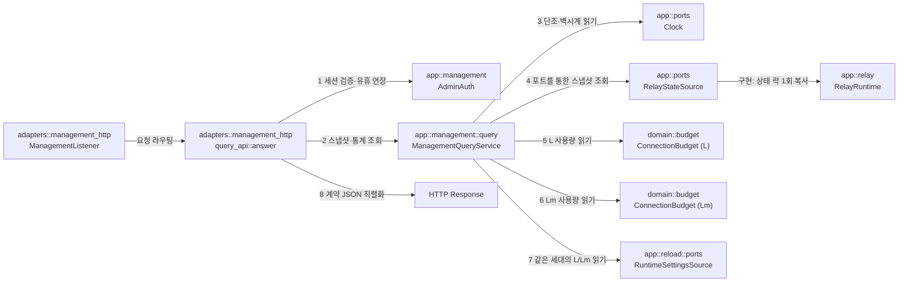

# 관리 조회 API 모듈 설계

## 설정 조회 분리와 동적 상한 (Current / Active)

설정 GET은 [ConfigEditService](config-edit.md#3-데이터-모델과-get)가 맡는다. 중계 registry를 복사하는 `ManagementQueryService`에는 파일 I/O를 넣지 않는다. `ManagementQueryService.settings: Arc<dyn RuntimeSettingsSource>`를 `src/serve.rs`에서 같은 `ReloadCell`로 주입하고 `summary`가 `with_current` 한 번으로 L/Lm을 같은 세대에서 읽는다. budget은 사용량의 원자 계수만 제공한다. counts와 사용량의 약한 일관성 예외는 유지한다([동적 상한 설계](connection-limits.md), [설정 §1.8 L/Lm](../contracts/config-v4.md#18-재로드-구분), [관리 MGT-R17·R19](../specs/management.md#33-설정-보기와-동적-설정-편집)).

관리 리스너(`[management] listen`)에서 인증된 관리자에게 서버 요약, 대기 연결 목록, 활성 세션 목록·상세, 최근 종료 목록을 제공하는 조회 API의 구조와 데이터 흐름을 정의한다. 중계 상태는 메모리 락 안에서 복사하고, 인증·HTTP 직렬화·소켓 I/O는 그 락 밖에서 처리한다.

| 항목 | 값 |
| --- | --- |
| 구조 시점 | Current |
| 문서 상태 | Draft |
| 구현 대조 | 2026-11-08 작업 트리의 `ManagementQueryService::{new,summary}`와 `src/serve.rs`의 `RuntimeSettingsSource` 주입을 소스 읽기로 대조. 새 동적 상한 시험은 커밋 `eae442f`의 두 OS 게이트에서 통과([작업 6.9 판정표](../how-to/set-up-and-verify.md#42-작업-69-판정표)). 과거 증거는 [작업 4.4 완료 대조](#작업-44-완료-대조2026-11-04). 최근 로그 조회·양쪽 전송·전달 주소 범위의 구현은 커밋 `3df0693`이다. 시험은 커밋 `51bd747`의 두 OS 게이트에서 통과했다([WSS Server·프록시·최근 로그 판정표](../how-to/set-up-and-verify.md#43-wss-server프록시-tls-종료최근-로그-판정표)). |
| 코드 위치 | `crates/app/src/management/query.rs`, `crates/adapters/src/management_http/query_api.rs`, `crates/domain/src/budget.rs` |
| 코드 지도 | [코드 지도 2절](code-map.md#2-코드-위치와-구성요소) |
| 관련 스펙 | [관리 스펙](../specs/management.md) MGT-001~007, MGT-013, MGT-015, MGT-016, MGT-021, MGT-023~024, MGT-026, MGT-051, [운영 스펙](../specs/operations.md) OPS-033 |
| 관련 계약 | [관리 API 계약 1.6~1.8·1.10·1.12절](../contracts/management-api-v1.md#16-서버-요약-get-apiv1summary), [2.1절](../contracts/management-api-v1.md#21-오류-본문과-상태-코드), [설정 계약 1.2절](../contracts/config-v4.md#12-키-표)(P, R), [운영 정보 계약 1.5절](../contracts/ops-info-v2.md#15-사건-목록) |
| 관련 ADR | [ADR-0003 단일 인스턴스·메모리 상태](../decisions/ADR-0003-single-instance-memory-state.md), [ADR-0004 tokio·rustls](../decisions/ADR-0004-tokio-rustls.md) |
| 관련 문서 | [접속 ticket 모듈 설계](relay-access-ticket.md) |

R1은 `ActiveSessionItemView`와 `ClosedSessionItemView`에 필수 `target_transport`를 더했다. Mode I은 항상 `tcp`이고, Mode II는 실제 Server 전송이다.

R2는 `ActiveSessionItemView`에 필수 nullable 전달 주소(`viewer_forwarded_ip`, `target_forwarded_ip`)를 더한다. `RelayRuntime` 스냅샷에서 `Option<PeerIp>`를 읽고, `query_api`가 활성 목록·상세 JSON에 정규화된 문자열 또는 `null`로 쓴다. Mode I의 `target_forwarded_ip`와 직접 연결의 전달 주소는 항상 `null`이다. 최근 종료 항목(`ClosedSessionItemView`)과 관리자 종료 응답의 `closed_session`은 계약 1.9·1.10절대로 주소 필드를 포함하지 않는다. 소켓 상대 주소(`viewer_address`, `target_address`)는 프록시 전달 헤더와 무관하게 실제 소켓 주소를 유지한다. `recent_logs.max_entries`는 설정 보기의 재시작 키이며 로그 버퍼·`GET /api/v1/logs`는 R3 범위다. 관리 인증·쿠키·로그인 제한의 소켓 IP 기준은 그대로다.

R3은 최근 로그 조회 `GET /api/v1/logs`(MGT-046~050)를 `crates/adapters/src/management_http/logs_api.rs`로 제공한다(사용자 결정 2026-11-08(Q187·Q191)).
- `session_api` 인증 뒤 `/api/v1/logs` 경로를 `logs_api::answer`로 연결한다.
- 인증이 없으면 401 `unauthenticated`를 반환하고, 다른 HTTP 메서드는 405 `invalid_request`(`Allow: GET`)로 거절한다.
- 본문이 있는 요청은 `Content-Type: application/json`이어야 하며, 아니면 415 `invalid_request`로 거절한다.
- `X-Relay-Poll: 1`은 세션 유휴 만료를 연장하지 않고, 헤더가 없으면 사용자 행동으로 간주하여 연장한다.
- 쿼리 매개변수(`level`, `event`, `q`, `session_id`, `before`, `after`, `limit`)를 검증하며, 단일 값 매개변수 중복이나 형식·범위 오류는 400 `invalid_request`로 거절한다. 정의되지 않은 알 수 없는 매개변수는 무시하고, `=`가 없는 매개변수는 빈 문자열 값으로 해석한다.
- `RecentLogs::query`는 버퍼 잠금 안에서 커서 범위와 전체 보관 경계를 읽는다. 범위 안 항목의 `Arc<LogEntry>`와 필요한 세션 연계 사건 참조만 확보한다. 필드 일치 검사와 페이지 선택은 잠금 밖에서 한다. `LogsResponse::to_json_string`은 필드 목록을 직접 읽어 깊은 복사 없이 응답 계약(`as_of`, `max_entries`, `oldest_seq`, `latest_seq`, `has_more`, `items[]`)에 맞춰 직렬화한다.

## 1. 책임과 경계

- 맡는 책임:
  - 인증 우선 검증: 유효한 관리 세션 쿠키를 검증한다. 경로·메서드·형식 검사보다 인증이 항상 우선하며([관리 API 계약 2.1절](../contracts/management-api-v1.md#21-오류-본문과-상태-코드) line 355: "경로·메서드가 틀려도 인증이 먼저다"), 인증 실패 시 즉시 `401 unauthenticated`를 반환한다.
  - 조회 경로 라우팅: 인증 통과 후 네 가지 조회 엔드포인트(`GET /api/v1/summary`, `GET /api/v1/waiting`, `GET /api/v1/sessions`, `GET /api/v1/sessions/{session_id}`, `GET /api/v1/closed-sessions`)를 처리한다. 조회 경로는 오직 `GET` 요청만 허용하며, 다른 메서드는 `405`(`Allow: GET`, `code: "invalid_request"`)로 거절한다.
  - 세션 인증 및 유휴 갱신 연계: `X-Relay-Poll` 헤더는 오직 `GET` 요청에서 값 `1`만 유효하며, 다른 값이나 다른 메서드에 포함되면 `400 invalid_request`를 반환한다. 오직 헤더가 없을 때만 사용자 행동으로 간주하여 관리 세션 유휴 만료 시각을 연장한다(`AdminAuth::touch`). 자동 폴링 요청(`X-Relay-Poll: 1`)은 유휴 만료를 연장하지 않는다.
  - 스냅샷 일관성 보장(MGT-016): 한 번의 요청 처리 안에서 `RelayRuntime`의 `std::sync::Mutex<RelayState>`를 단 한 번만 짧게 획득해 대기·활성·최근 종료 상태를 복사하고, 바로 뒤에 기준 시점(`as_of_wall`, `as_of_mono`)을 읽는다. 집계와 목록은 이 한 번의 복사에서 만든다. 서버 요약의 L·Lm 사용량은 잠금 밖에서 `ConnectionBudget::current()`로 따로 읽으므로, 연결이 바뀌는 동안 같은 응답의 집계와 잠깐 어긋날 수 있다. 이는 스펙 2.2절이 허용한 동작이다(사용자 결정 2026-11-04(Q100)).
  - 활성 세션 상태 및 포함 범위: `closing` 상태인 세션도 정리가 완료되기 전까지는 활성 세션 목록에 포함되고 `counts.active`에 집계된다(스펙 §2, §3.2).
  - 식별자 기준 상세 조회: 세션 상세 조회는 오직 `session_id`로만 대상을 찾으며, 동일한 중계 ID(`relay_id`)를 가진 다른 세션으로 대체하지 않는다(MGT-R02, MGT-R07).
  - 세션 식별자 형식 검증: `GET /api/v1/sessions/{session_id}` 요청 시 정규식 크레이트 없이 ASCII 조건문(`len 1~64`, 영문 대소문자·숫자·밑줄·하이픈)으로 검증한다. 잘못된 형식이면 즉시 `400 invalid_request`를 반환하고, 형식은 올바르나 활성 세션 표에 없으면(최근 종료 목록에 있는 경우 포함) `404 not_found`를 반환한다(스펙 §2.3, MGT-023).
  - 연결 수 및 예산 사용량 집계(MGT-026): 초기 교환 중 연결 수(`handshaking`), Mode I 대상 연결 중 연결 수(`target_connecting`), 중계 연결 상한 및 사용량(L), 관리·상태 연결 상한 및 사용량(Lm)을 반환한다. 모든 수치는 원자적 변수 및 인메모리 상태에서 직접 읽으므로 읽기 실패 분기(dead branch)가 없으며 항상 정수와 `null` 사유를 반환한다.
  - 단조 시간 기반 경과 시간 산출(MGT-007): 프로세스 가동 시간(`server.uptime_ms`), 대기 시간(`waited_ms`), 세션 경과 시간은 단조 시계(`Instant`) 차이로 계산해 시스템 시각 보정 시 음수가 발생하지 않도록 보장한다. 표시용 시각은 UTC ISO 8601 문자열로 변환한다.
  - 최근 종료 세션 목록 제공: 메모리에 보관된 최대 R개의 최근 종료 세션과 8가지 종료 원인(`close_cause`)을 계약 형식(`ClosedSessionsResponse`)에 맞춰 직렬화한다. ticket 만료로 정리한 활성 세션은 `session_expired`다([접속 ticket 모듈 설계](relay-access-ticket.md#43-101-뒤)).
- 맡지 않는 책임:
  - 관리자 로그인·세션 토큰 발급·CSRF 검증: 작업 4.3의 [관리 로그인과 세션 설계](management-session.md)가 소유한다.
  - 관리자 종료(`POST /api/v1/sessions/{session_id}/terminate`): 작업 4.5가 소유한다.
  - 대시보드 정적 HTML·CSS·JS 파일 제공: 작업 4.6의 [관리 리스너 모듈 설계](management-listener.md)가 소유한다.
  - 생존·준비 엔드포인트(`/livez`, `/readyz`): [상태 리스너와 준비 상태 모듈 설계](status-listener.md)가 소유한다.
  - 클라이언트 대시보드의 폴링 타이머 및 렌더링: [대시보드 화면 스펙](../specs/dashboard.md)이 소유한다.
  - 설정 파일 조회·검증·편집과 파일 상태/이력: [설정 보기·편집 서비스](config-edit.md)가 별도 공유 재로드 mutex에서 처리한다. 중계 상태 락과 파일 I/O를 함께 잡지 않는다.
- 다른 모듈에 공개하는 기능:
  - `vnc_relay_app::management::query::ManagementQueryService`
  - `vnc_relay_adapters::management_http::query_api::answer`
  - `vnc_relay_adapters::management_http::logs_api::answer`

## 2. 내부 구조

화살표는 실행 중 호출 또는 주입이다.

| 요소(파일·심볼) | 역할 | 만들어지는 시점과 소유자 | 의존 대상 |
| --- | --- | --- | --- |
| `crates/app/src/management/query.rs` `ManagementQueryService` | 서버 요약, 대기 목록, 활성 세션, 최근 종료 목록의 응용 뷰를 생성한다. L/Lm은 runtime source에서 한 번에 읽는다. | 시작 시 `src/serve.rs`가 생성하고 `ManagementListener`에 전달한다. | `RelayStateSource`, `ConnectionBudget`, `Clock`, `RuntimeSettingsSource` |
| `crates/adapters/src/management_http/query_api.rs` `answer` | `/api/v1/summary`, `/waiting`, `/sessions`, `/closed-sessions` 요청을 분기하고 JSON 응답을 구성한다. | `management_http.rs`의 `answer`가 `/api/v1/` 요청 중 세션 경로 이외를 전달한다. | `ManagementQueryService`, `AdminAuth`, `serde_json`, `axum` |
| `crates/domain/src/budget.rs` `ConnectionBudget::current` | L 및 Lm의 현재 점유 카운트(`used`)를 원자적으로 읽는다. **(신규 추가)** | 시작 시 `src/serve.rs`가 예산 생성 시 소유한다. | `AtomicU32` |
| `crates/app/src/ports.rs` `RelayStateSource` | 중계 런타임 상태 스냅샷을 조회하기 위한 포트 trait이다. **(신규 추가)** | `ManagementQueryService`가 주입받아 사용하며 `RelayRuntime`이 구현한다. | `Clock`, `RelaySnapshot` |
| `crates/app/src/relay.rs` `RelayRuntime::snapshot` | `std::sync::Mutex<RelayState>`를 단 1회 획득하여 대기·활성·최근종료 목록과 카운터를 복제하며, `RelayStateSource`를 구현한다. **(기존 메서드 확장: handshaking 카운터 및 max_entries(R) 노출)** | 시작 시 `src/serve.rs`가 생성하여 공유한다. | `Clock`, `RelayState` |
| `crates/app/src/relay.rs` `RelayRuntime::track_handshaking` | `pub fn track_handshaking<'a>(&'a self) -> HandshakingGuard<'a, C>` 형태로 `handshaking` 카운터를 1 증가시키고 소멸 시 1 감소시키는 RAII 가드를 반환한다. **(신규 추가)** | TCP(`net.rs`) 및 WS·WSS(`websocket.rs`) 연결 준비 진입점에서 호출한다. | `std::sync::Mutex<RelayState>` |
| `crates/app/src/relay.rs` `HandshakingGuard` | 초기 교환 진행 중인 연결 수를 세기 위한 RAII 카운터 가드다. **(신규 추가)** | TCP는 `net.rs`의 `handle_connection` 진입 전, WS·WSS는 `websocket.rs`의 101 응답 flush 직후 생성되고 연결 준비 종료 시 소멸한다. | `RelayRuntime::track_handshaking` |
| `crates/app/src/relay.rs` `ActivePeer` | 활성 세션의 원격 피어(`Server(ConnectionContext)` 또는 `Target(SocketAddr)`)를 나타내는 enum이다. 대상 주소(`target_address`)가 항상 유효함을 타입 수준에서 보장한다. **(신규 추가)** | `SessionPair` 및 `ActiveSessionSnapshot` 생성 시 소유한다. | `ConnectionContext`, `SocketAddr` |

## 3. 데이터 모델

외부 교환 형식은 [관리 API 계약 1.6~1.8·1.10절](../contracts/management-api-v1.md#16-서버-요약-get-apiv1summary)을 준수하며, 아래는 내부 응용 및 어댑터 모델이다.

| 이름 | 필드·형태 | 저장 위치 | 제약과 항상 지켜야 할 조건 |
| --- | --- | --- | --- |
| `SummaryResponse` | `as_of: String`, `server: ServerStateView`, `counts: CountsView`, `usage: UsageView` | HTTP 직렬화 시 일시 생성 | `as_of`는 UTC ISO 8601(`Z`). `counts.waiting`과 `counts.active`는 동일 시점 목록 길이와 일치해야 한다. |
| `ServerStateView` | `state: &'static str` (`ready` \| `shutdown_grace`), `uptime_ms: u64` | `SummaryResponse` 내부 | `uptime_ms`는 음수가 될 수 없으며 단조 시간 차이로 계산한다. |
| `CountsView` | `waiting: u64`, `active: u64`, `handshaking: u64`, `target_connecting: u64` | `SummaryResponse` 내부 | 본 구현은 인메모리 카운터로 항상 정확한 정수를 제공하므로 `Option` 없이 정수로 노출하고, 어댑터 직렬화 시 계약 요구에 따라 `null` 사유를 추가한다. |
| `UsageView` | `relay_connections: ResourceUsageView`, `admin_connections: ResourceUsageView` | `SummaryResponse` 내부 | L과 Lm의 사용량은 서로 독립적으로 산출된다. |
| `ResourceUsageView` | `current: u64`, `limit: u64` | `UsageView` 내부 | current는 budget 원자 계수, limit는 현재 runtime 값이다. 상한을 낮춘 직후에는 `current > limit`도 유효하며 기존 점유를 취소하지 않는다. 직렬화는 정수와 계약의 null 사유 필드를 제공한다. |
| `WaitingItemView` | `role: &'static str` (`viewer` \| `server`), `relay_id: String`, `connected_at: String`, `waited_ms: u64` | `WaitingResponse.items` 배열 | `relay_id`는 1~247자의 숫자 원문 문자열을 보존한다. `waited_ms`는 `as_of`까지의 단조 시간 경과다. |
| `ActiveSessionView` | `session_id`, `state`, `mode`, `viewer_transport`, `target_transport`, `viewer_forwarded_ip`, `target_forwarded_ip`, `started_at`, 양방향 `bytes_*`, `viewer_address`, `target_address` | `SessionsResponse.items` 및 상세 | 양쪽 전송은 `tcp`·`ws`·`wss`다. Mode I의 target은 `tcp`, Mode II는 실제 Server 전송이다. 전달 주소는 신뢰 프록시 판정 결과 또는 `null`이다. `closing`도 활성 목록에 포함한다. |
| `ClosedSessionsResponse` | `as_of: String`, `max_entries: u64`, `items: Vec<ClosedSessionItemView>` | HTTP 직렬화 시 일시 생성 | `max_entries`는 설정된 R 값이다. `items`는 정리가 끝난 활성 세션만 담는다. |
| `ClosedSessionItemView` | `session_id`, `mode`, `viewer_transport`, `target_transport`, `started_at`, `ended_at`, 양방향 `bytes_*`, `close_cause` | `ClosedSessionsResponse.items` | 정리된 세션이 보존한 양쪽 전송과 `session_expired`를 포함한 종료 원인을 반환한다. 초기 교환·대기 중 만료는 이 목록에 넣지 않는다. 계약 1.10절에 따라 주소 필드는 포함하지 않는다. 최대 R개이며 오래된 항목부터 제거한다. |
| `PeerAddressView` | `ip: String`, `port: u16` | 세션 뷰 내부 | 프록시 전달 헤더를 무시하고 실제 소켓 상대 주소를 반영한다. 목표 표기는 `IpAddr::to_canonical()`을 적용하며 IPv4 매핑 IPv6는 `a.b.c.d`로 쓴다(사용자 결정 2026-11-02(Q88)). 같은 작업에서 직렬화를 수정한다(9.1절). |

## 4. 처리 순서

[관리 API 계약 2.1절](../contracts/management-api-v1.md#21-오류-본문과-상태-코드) line 355의 "경로·메서드가 틀려도 인증이 먼저다" 규칙에 따라, 기존 `session_api.rs`와 동일하게 인증 검사를 최우선으로 배치한다.

| 순서 | 코드 위치(파일·심볼) | 조건·계산 | 바뀌는 상태 | 결과를 쓰는 곳 |
| --- | --- | --- | --- | --- |
| 1 | `management_http/session_api.rs` | `AdminAuth::authorize`로 세션 쿠키 검증. 실패 시 경로·메서드·형식 검사보다 먼저 `401 unauthenticated` 반환 및 쿠키 삭제 헤더 부착 | 없음 | 401 응답 또는 다음 단계 |
| 2 | `management_http/query_api.rs` `answer` | 요청 경로가 `/api/v1/summary`, `/waiting`, `/sessions`, `/closed-sessions`, `/sessions/{session_id}` 중 하나인지 판별. 알 수 없는 경로이면 `404 not_found` | 없음 | 404 응답 또는 다음 단계 |
| 3 | `management_http/query_api.rs` | 요청 메서드가 `GET`인지 검사. `GET`이 아니면 `405`(`Allow: GET`, `code: "invalid_request"`, message: "이 경로는 GET 요청만 받는다.") | 없음 | 405 응답 또는 다음 단계 |
| 4 | `management_http/query_api.rs` | `session_api.rs`의 `poll_flag` 헬퍼로 `X-Relay-Poll` 헤더 검증. 부재(`Some(false)`) 시 `AdminAuth::touch` 호출. `1`(`Some(true)`)이면 `touch` 건너뜀. 그 외(`None`)는 `400 invalid_request` | 유휴 기한 연장 여부 결정 | 다음 단계 또는 400 |
| 5 | `management_http/query_api.rs` | 본문 검사: 빈 본문은 통과. 본문이 있는 경우의 거절(415/400)은 9.2절 계약 불일치를 따름 | 없음 | 다음 단계 또는 415/400 |
| 6 | `ManagementQueryService::capture_snapshot` | `RelayStateSource::snapshot`으로 중계 상태를 복사한 뒤 `Clock::wall`과 `Clock::monotonic`을 읽는다. 런타임 구현은 `RelayRuntime::snapshot`에서 상태 락을 한 번 획득한다. | 없음 | `RelaySnapshot`과 표시·경과 시각 |
| 7 | `ManagementQueryService` | 요약은 runtime `with_current` 한 번에서 L/Lm 쌍을 복사한 뒤 budget 사용량·라이프사이클을 조합한다. 대기는 단조 waited_ms, 상세는 session_id 검사와 활성 목록 검색, 최근 종료는 완료 목록 변환을 수행한다. | 없음 | 계약 DTO 객체 |
| 8 | `management_http/query_api.rs` | JSON 직렬화 및 공통 헤더(`Cache-Control: no-store`) 부착 | 없음 | `200 OK` HTTP Response |

### 4.1 폴링 주기 P와 조회 제한 시간 전달 흐름

대시보드 화면이 조회를 주기적으로 수행하기 위한 설정값(P, 조회 제한 시간, 종료 대기 한도)은 `GET /api/v1/summary`에 포함되지 않는다.
1. 관리자가 로그인하거나 세션 정보를 복구할 때(`POST /api/v1/session` 또는 `GET /api/v1/session`), 응답 본문의 `dashboard.poll_secs`(P), `dashboard.query_timeout_secs`, `dashboard.terminate_timeout_secs`가 클라이언트에 전달된다([관리 API 계약 1.5·1.12절](../contracts/management-api-v1.md#112-폴링-주기와-조회-제한-시간의-전달)).
2. 대시보드 클라이언트는 이 주기 P를 바탕으로 타이머를 가동하여 `GET /api/v1/summary`, `GET /api/v1/waiting`, `GET /api/v1/sessions`, `GET /api/v1/closed-sessions` 요청에 `X-Relay-Poll: 1` 헤더를 붙여 전송한다.
3. 서버의 조회 핸들러는 `X-Relay-Poll: 1` 헤더를 감지하여 세션 유휴 기한 연장(`touch`)을 건너뛴다(MGT-025).

## 5. 상태와 초기화

- 초기화 시점: `src/serve.rs`에서 `RelayRuntime`, `RelayService`, `LifecycleService`, `ConnectionBudget`을 조립한 뒤 `ManagementQueryService`를 생성한다. watcher·설정 편집·중계 reader와 같은 `ReloadCell`을 `RuntimeSettingsSource`로 주입한 뒤 `ManagementListener`에 전달한다.
- 상태 소유자와 수명:
  - 활성 세션 표와 대기 표는 `RelayRuntime` 내부의 `std::sync::Mutex<RelayState>`가 소유하며(`crates/app/src/relay.rs:9, 390`), 프로세스 수명 동안만 유지된다.
  - 최근 종료 목록은 `RecentClosedList`가 소유하며 최대 R개를 보관한다. 프로세스가 재시작되면 모두 비워진다(ADR-0003).
  - L/Lm 예산은 `ConnectionBudget`이 원자적으로 관리한다.
- 동시 실행과 락 불변식:
  - 중계 펌프 루프(`pump`)는 소켓 쓰기 성공 시 `on_update`를 통해 세션 바이트 카운터를 `RelayState`에 갱신할 때 `runtime.lock()`을 획득한다(`crates/app/src/relay.rs:1038–1050`).
  - `RelayRuntime::snapshot`은 이 락을 메모리 복사에만 사용하며 소켓 I/O나 비동기 `.await`를 일절 수행하지 않는다.
  - 조회는 메타데이터 복사 동안 펌프의 같은 락 획득을 지연시킬 수 있다. 락 안에서는 중계 바이트를 읽거나 쓰지 않는다. 소요 시간을 측정한 기록은 없으며, MGT-016의 블랙박스 시험만으로 내부 일관성 전체를 입증하지 않는다.

## 6. 오류 처리

[관리 API 계약 2.1절](../contracts/management-api-v1.md#21-오류-본문과-상태-코드)의 순서와 형식을 따른다. 모든 `/api/v1/` 오류 응답 본문은 `{"error":{"code":"<코드>","message":"<문장>"}}` 형태를 유지한다. 405는 별도 코드가 없으며 계약 line 359에 따라 `code: "invalid_request"`를 사용한다.

| 실패 지점 | 상태 코드 및 반환 형식 | 남는 상태 | 관련 스펙 시나리오 |
| --- | --- | --- | --- |
| 1. 관리 세션 쿠키 누락·만료·무효 (경로·메서드 검사보다 우선) | `401 unauthenticated` 반환, 쿠키가 존재했다면 만료 `Set-Cookie` 전송, `WWW-Authenticate: Session realm="vnc-relay"` 부착 | 세션 무효화, 중계 영향 없음 | MGT-019, MGT-021, MGT-027, 계약 2.1절 line 355 |
| 2. 알 수 없는 `/api/v1/` 경로 또는 활성 세션 미발견 | `404 not_found` (`code`: `not_found`, `message`: "지정한 세션을 찾을 수 없습니다." 또는 경로 미발견) | 상태 변경 없음 | MGT-004, MGT-023, 계약 2.1절 line 358 |
| 3. 지원하지 않는 HTTP 메서드(POST, DELETE 등) | `405` (`Allow: GET`, `code`: `invalid_request`, `message`: "이 경로는 GET 요청만 받는다.") | 상태 변경 없음 | 계약 2.1절 line 359 |
| 4. 세션 상세 요청의 `session_id` ASCII 형식 불일치 | `400 invalid_request` (`code`: `invalid_request`, `message`: "세션 식별자 형식이 올바르지 않습니다.") | 상태 변경 없음 | MGT-003, DASH-026, 계약 2.1절 line 359 |
| 5. `X-Relay-Poll` 헤더가 `1`이 아님 (또는 비-GET에 포함) | `400 invalid_request` (`code`: `invalid_request`, `message`: "X-Relay-Poll은 값 1을 가진 GET 요청에만 쓸 수 있다.") | 상태 변경 없음 | MGT-025, 계약 2.1절 line 359 |
| 6. GET 요청에 비어있지 않으나 JSON이 아닌 본문 포함 시 | `415 invalid_request` (`code`: `invalid_request`, `message`: "요청 본문은 application/json이어야 한다.") | 상태 변경 없음 | 계약 1.1절 line 38 |
| 7. 정상적인 빈 목록(대기 0건, 활성 0건 등) | `200 OK`와 `items: []` 반환. `500 internal`이나 오류로 대신하지 않음 | 상태 변경 없음 | MGT-004 |
| 8. 리소스 메트릭 읽기 실패 분기 | 아토믹 변수 및 인메모리 카운터로 읽기 실패 분기(dead branch)가 없으며 항상 정수 반환. (계약의 `read_failed`는 실패 경로가 존재할 때의 규정임) | 상태 변경 없음 | 스펙 §2, 계약 §1.1 |
| 9. 스냅샷 생성 중 내부 실패 | 경로 없음. `RelayStateSource::snapshot`은 실패를 돌려주지 않으므로 조회 처리(`query_api.rs`)에는 `500` 응답이 없다. 계약 2.1절의 `500 internal`은 실패 경로가 있는 처리(로그인·세션 경로의 `session_api.rs`)에만 해당한다. MGT-004의 "조회 오류"는 실제 조회 경로의 `400 invalid_request`·`404 not_found`로 판정한다(사용자 결정 2026-11-04(Q95)) | 상태 변경 없음 | MGT-004, DASH-003 |

## 7. 설계 선택과 테스트 계획

### 7.1 설계 선택

| 선택 | 이유 | 검토한 다른 방법 | 근거 |
| --- | --- | --- | --- |
| `RelayRuntime::snapshot`의 단일 락 복제 방식 | `std::sync::Mutex<RelayState>` 안에서는 메타데이터만 복사하고 소켓 I/O는 하지 않는다. | 채널 메시지 전달 방식, RCU 잠금 구조 | 스펙 §5 "조회가 중계 스트림을 멈추거나 데이터를 소비해서는 안 된다", **이 문서의 판단, 사용자 결정 없음** |
| 인증 우선 검증 순서 준수 | 계약 §2.1 line 355("경로·메서드가 틀려도 인증이 먼저다") 및 `session_api.rs`의 기존 순서와 동일하게 세션 인증(401)을 경로(404)·메서드(405)보다 먼저 수행한다. | 라우터 수준의 경로 분기 우선 | 계약 §2.1 line 355, **이 문서의 판단, 사용자 결정 없음** |
| 단조 시간(`Instant`) 기반 경과 시간 산출 | NTP 시각 동기화나 윤초로 시스템 벽시계가 뒤로 이동해도 경과 시간이 음수가 되지 않도록 보장한다(MGT-007). | 벽시계(`SystemTime`) 단순 차감 | 관리 스펙 2.1절, MGT-007, **이 문서의 판단, 사용자 결정 없음** |
| `RelayRuntime`에 `handshaking` RAII 가드 도입 | 초기 교환 진행 중인 연결을 정확히 세어 `counts.handshaking`에 반영하고, 종료 시점에 자동으로 감소시킨다. | L 예산에서 대기/활성 수를 빼서 추정하는 방식 | 관리 스펙 2절, MGT-026, **이 문서의 판단, 사용자 결정 없음** |
| `ConnectionBudget`에 `current()` 관찰 메서드 추가 | 원자적 변수(`used`)를 읽어 L 및 Lm의 현재 사용량을 요약 응답에 정확히 전달한다. | 별도의 외부 카운터 유지 | 운영 스펙 2절, MGT-026, **이 문서의 판단, 사용자 결정 없음** |
| 카운터 수치의 인메모리 확정 정수 반환과 dead branch 배제 | 단일 프로세스 인메모리 구조에서 `handshaking`과 `target_connecting` 및 L/Lm 사용량은 런타임이 정확한 정수를 보유하므로 항상 정수를 반환하고 사유는 `null`로 둔다. 읽기 실패 분기(dead branch)는 두지 않는다. | 임의의 실패 분기 유지 | 스펙 §2, 계약 §1.1, MGT-026, **이 문서의 판단, 사용자 결정 없음** |
| ASCII 조건문 기반 `session_id` 검증 | 정규식 크레이트 의존성 없이 `len 1~64`, `is_ascii_alphanumeric()` 또는 `_`, `-` 검사로 O(N) 검증을 수행한다. | 별도 regex 크레이트 의존성 도입 | 계약 §1.8, **이 문서의 판단, 사용자 결정 없음** |
| 상대 IP 주소 정규화 | `PeerIp`·운영 로그와 같은 `IpAddr::to_canonical()` 규칙으로 IPv4 매핑 IPv6를 `a.b.c.d`로 쓴다. | 원시 소켓의 매핑 IPv6 표현 유지 | 관리 API 계약 1.1절, 사용자 결정 2026-11-02(Q88) |
| GET 본문 검증 시 `media_type_allows` 적용 | 계약 §1.1 line 38 및 기존 `session_api.rs` 구현 기준에 따라 빈 본문은 통과하고 비-JSON 비어있지 않은 본문은 415로 거절한다. | 400 일괄 거절 | 계약 1.1절 line 38, **이 문서의 판단, 사용자 결정 없음** |

### 7.2 수용 테스트 계획 (시나리오별 대응)

모든 테스트는 구현 검증 시 러너에 의해 실행될 계획이며, 아래 표는 계획된 계층과 대상 파일이다.

| 시나리오 ID | 요구사항 / 규칙 | 테스트 수준 | 테스트 대상 위치(계획) | 검증 내용 |
| --- | --- | --- | --- | --- |
| MGT-001 | FR-06 / MGT-R01 | 통합 | `crates/adapters/tests/management.rs` | 대기 연결 n개, 활성 세션 m개 상태에서 요약 집계와 각 목록 API의 항목 수 및 내용 일치 검증 계획 |
| MGT-002 | FR-06 / MGT-R01 | 통합 | `crates/adapters/tests/management.rs` | 초기 교환 중, Mode I 대상 연결 중, 종료 정리 중의 각 상태가 대기·활성 집계에 올바른 시점에 반영되는지 검증 계획 |
| MGT-003 | FR-06 / MGT-R02 | 통합 | `crates/adapters/tests/management.rs` | 활성 세션 식별자로 상세 조회 시 모드·전송경로·주소·바이트수 확인, 시작 시각 UTC ISO 8601 및 바이트 정수 검증 계획 |
| MGT-004 | FR-06 / MGT-R03 | 단위/통합 | `tests/management_query.rs` | 대기·활성 목록이 비었을 때의 `200 OK` 빈 배열과 실제 조회 오류(`400 invalid_request`·`404 not_found`)를 서로 다른 결과로 확인한다(사용자 결정 2026-11-04(Q95)) |
| MGT-005 | FR-06 / MGT-R04 | 단위/통합 | `crates/app/src/relay/session.rs`, `crates/adapters/tests/management.rs` | 실제 관리 HTTP와 실제 `RelayRuntime`·`RelayService`에 공개 `RelayStream` 포트로 부분 쓰기(2·3바이트)와 부분 성공 뒤 쓰기 실패를 넣는다. 방향별로 다른 크기의 데이터를 보내 활성 상세와 최근 종료 목록의 카운터가 실제로 쓴 바이트와 같고 정수인지 확인한다(`completion_mgt005_partial_success_and_write_failure_count_only_delivered_bytes`) |
| MGT-006 | FR-06 / MGT-R04 | 통합 | `crates/adapters/tests/management.rs` | TCP, WS, WSS 각각의 전송 경로에서 프로토콜 프레이밍 제외 후 순수 RFB 페이로드 카운터 집계 검증 계획 |
| MGT-007 | FR-06 / MGT-R04 | 단위/통합 | `crates/app/src/management/query.rs`, `crates/adapters/tests/management.rs` | 실제 관리 HTTP와 실제 런타임에 조절 가능한 `Clock` 포트를 넣는다. 같은 중계 ID 재접속의 새 세션 카운터 분리, 벽시계 역행·전진 중 경과 시간의 0 이상·단조 증가, 새 런타임·리스너로 대신한 재시작(사용자 결정 2026-11-04(Q101)) 뒤 빈 목록과 새 식별자를 한 함수에서 확인한다(`completion_mgt007_reconnect_fresh_runtime_and_wall_steps_keep_counters_separate`) |
| MGT-013 | FR-06·FR-08 / MGT-R08 | 통합 | `crates/adapters/tests/management.rs` | 조회 응답과 400·401·403·404·405 오류, 실패하는 가짜 중계 제어 포트로 만든 `500 terminate_failed` 본문에 비밀번호·해시·세션 토큰·원시 스트림이 없음을 확인한다(사용자 결정 2026-11-04(Q95)) |
| MGT-015 | FR-06 / MGT-R10 | 통합 | `crates/adapters/tests/management.rs` | `X-Forwarded-For`, `Forwarded` 헤더를 주입해도 실제 소켓 피어 주소가 응답 주소에 표시됨을 검증 계획 |
| MGT-016 | FR-06 / MGT-R01 | 단위/통합 | `crates/adapters/tests/management.rs` | 상태 복사 직후 실제 종료와 실제 연결 수락을 일으켜, 각 응답의 집계·목록이 그 응답이 복사한 상태와 같고 `as_of`가 하나인지 확인한다. L 사용량이 같은 응답의 집계보다 앞설 수 있음(사용자 결정 2026-11-04(Q100))과 다음 응답에서 맞는 것도 확인한다(`completion_mgt016_counts_lists_and_as_of_follow_one_capture_while_usage_is_sampled`) |
| MGT-021 | FR-06·7절 / MGT-R11 | 통합 | `crates/adapters/tests/management.rs` | 세션 쿠키 없이 4개 조회 엔드포인트 직접 호출 시 `401 unauthenticated` 반환 및 보호 정보 차단 검증 계획 |
| MGT-023 | FR-06 / MGT-R15 | 통합 | `crates/adapters/tests/management.rs` | 정상 EOF, 연결 오류, 관리자 종료로 끝난 세션의 최근 종료 목록 조회 및 `internal_error`(사용자 결정 2026-11-02(Q94))를 포함한 기존 종료 원인 7종 구별 표시, 최근 종료된 세션 식별자로 상세 조회 시 `404 not_found` 반환 검증 계획. ticket의 추가 원인 `session_expired`는 [접속 ticket 모듈 설계](relay-access-ticket.md#43-101-뒤)와 MGT-052 범위다. 종료 요청 검증은 작업 4.5 몫이다. |
| MGT-024 | FR-06 / MGT-R15 | 단위/통합 | `crates/domain/src/recent_closed.rs`, `crates/adapters/tests/management.rs` | 최근 종료 목록이 R개 초과 시 FIFO 삭제 검증 및 프로세스 재시작 시 메모리 목록 초기화 검증 계획 |
| MGT-026 | FR-06 / MGT-R17 | 통합 | `crates/adapters/tests/management.rs` | 초기 교환 n개, Mode I 대상 연결 m개, L 도달 상태에서 요약의 `counts` 및 `usage` 일치 검증 계획 |
| OPS-033 | OPS-R18 / OPS-033 | 통합 | `tests/management_query.rs` | L=2를 실제 중계 연결로 채운 상태에서 로그인·조회·관리자 종료가 되고, Lm=2를 관리·상태 연결로 채운 상태에서 새 중계 연결이 수락·매칭·양방향 전달되는지 한 함수에서 확인한다(`exhausted_relay_and_admin_budgets_leave_the_other_service_operational`, 커밋 `e9221c6`) |
| MGT-051 | FR-06 / MGT-R10·R15 | 단위/통합 | `crates/app/src/management/query.rs`, `crates/adapters/src/management_http/query_api.rs`, `crates/adapters/src/management_http/terminate_api.rs` | 활성 목록·상세 직렬화에서 실제 소켓 상대 주소 유지 및 필수 nullable 전달 주소(`viewer_forwarded_ip`, `target_forwarded_ip`) 투영과 null 처리 검증, 최근 종료 및 종료 요약의 `target_transport` 유지 검증 |

## 9. 미결정 사항과 계약 점검

### 9.1 (해결) IPv4 매핑 IPv6 주소의 표기 방식

사용자 결정 2026-11-02(Q88)으로 정규 표기를 확정했다. `IpAddr::to_canonical()`을 적용해 `::ffff:a.b.c.d`를 `a.b.c.d`로 쓴다. `PeerIp`와 운영 로그도 같은 규칙을 쓴다. 기준은 [관리 API 계약 1.1절](../contracts/management-api-v1.md#11-공통-규칙)의 `address.ip`다.

커밋 `35329fc`가 `crates/adapters/src/management_http/query_api.rs`의 `format_ip`에 이 규칙을 적용했다(Current). 단위 시험 3개(`formats_ipv4_mapped_ipv6_as_ipv4_without_changing_port`, `preserves_plain_ipv6_and_port`, `preserves_plain_ipv4_and_port`)가 Windows에서 통과했다. 두 OS의 전체 완료 검증 기록은 대조 기록에 따로 남긴다.

---

### 9.2 (해결: 이 문서의 판단, 사용자 결정 없음) 조회 GET 경로에 비어있지 않은 본문이 포함된 경우의 오류 상태 코드(415)
- **배경**: [관리 API 계약 1.1절](../contracts/management-api-v1.md#11-공통-규칙)과 기존 `session_api.rs`의 `media_type_allows`는 비어있지 않은 비JSON 본문을 `415 invalid_request`로 거절한다. 2.1절 GET 경로 표에는 415가 빠져 있었다.
- **해결**: 기존 공통 규칙과 동작을 유지한다. 같은 작업에서 계약 2.1절의 조회 GET 경로와 `GET /api/v1/session`에 415를 보완한다(T415). terminate는 1.9절의 특수 규칙에 따라 모든 본문을 400으로 거절한다(사용자 결정 2026-11-02(Q89)).

---

### 구현 점검: `server_shutdown` 종료 원인의 외부 조회 가시성

[관리 API 계약 6절 line 570](../contracts/management-api-v1.md#6-초안을-확정하기-전에-해결할-사항) 및 TODO 4.4에서 지적한 `server_shutdown` 항목의 관찰 가능성은 설계 미결정이 아닌 구현 동작 점검 항목이다.
- `src/serve.rs:421–435`의 실제 종료 순서에 따르면, 종료 신호를 받은 후 `finish_relay_shutdown`이 중계 진입점 작업들을 합류시킬 때까지 관리 리스너 작업(`management_task`)은 취소되지 않고 계속 동작한다.
- 따라서 정상 종료 유예(G) 만료 또는 유예 중 두 번째 신호에 의해 세션들이 강제 정리된 시점부터 관리 리스너가 실제로 종료되기 전까지의 짧은 구간 동안, 또는 멈춘 시간(paused clock)을 사용하는 시스템 테스트 하네스에서 `GET /api/v1/closed-sessions`를 호출하면 `server_shutdown` 항목이 정상적으로 관찰될 수 있다.
- 시스템 시험 계획에서 두 번째 신호 후 유예 구간 동안의 조회를 검증 항목으로 구성한다.

## 대조 기록

### 작업 4.4 구현 대조와 실행 기록

- 대상: 설계 커밋 `bc7e762`, 구현·시험 커밋 `ec05fd1`과 MGT-002 시험 보강 커밋 `b20b8dc`(`test(management): observe closing sessions in query API inclusion test`). 이 기록은 문서만 바꾸며 계약 규칙이나 코드를 바꾸지 않는다.
- 대조 방법: 코드의 심볼과 호출 흐름을 읽고 설계와 비교했다. 시험 작업자가 작업 트리에서 두 환경의 게이트를 실행했고, 조정 에이전트가 보고서 수치를 확인했다. 보고서는 Windows의 `target/scenario-report.md`와 WSL 보고서 사본 `D:/vr-tools/tmp/wsl-scenario-report.md`다. 이 문서 작업에서 게이트를 다시 실행하지 않았다.
- 대조 범위:
  - `crates/app/src/management/query.rs`의 `ManagementQueryService`가 `ports.rs`의 `RelayStateSource`, L·Lm `ConnectionBudget`, `Clock`을 주입받는다. `src/serve.rs`가 이를 조립해 `ManagementListener`에 넘긴다.
  - `management_http/session_api.rs`의 인증 뒤 `query_api.rs`가 요약·대기·활성 목록·상세·최근 종료 조회를 처리한다. `summary_response`는 정수 카운터와 계약상 `null` 사유를 직렬화한다.
  - `relay.rs`의 `ActivePeer::Server`·`Target`이 활성 세션의 상대 주소를 보유한다. `target_address()`가 실제 주소를 반환하므로 빈 주소를 대신 만들어 넣지 않는다.
  - `RelayRuntime::track_handshaking`이 반환한 `HandshakingGuard`는 TCP의 `net.rs`에서 `handle_connection` 전에, WS·WSS의 `websocket.rs`에서 101 응답 flush 뒤에 획득한다. 연결 준비를 마치거나 중단하면 가드가 수를 돌려준다.
- 판정: 모듈 설계 템플릿의 구현 전 차이 표를 제거하고 구조 시점을 `Current`로 바꿨다. `Verified`는 위 구조 대조 범위이며 모든 시나리오의 완료를 뜻하지 않는다. 문서 상태는 `Draft`로 유지한다. Q88은 사용자 결정 2026-11-02(Q88)으로 해결했으며 직렬화 수정은 같은 작업에서 진행한다. 아래 부분 증거는 남아 있다.
- 검증 기록(모든 시각은 2026-11-01 UTC):

| 명령 | 환경 | 결과 |
| --- | --- | --- |
| `vr-win.ps1 -Only all` | Windows, `ec05fd1` | 18:19:56Z 보고서: `ALL PASSED (all)`. 150건: 통과 69, 부분 64, 실패 0, 미실행 0, 미연결 17, 오류 0. `management.md` 27건: 통과 8, 부분 15, 실패 0, 미실행 0, 미연결 4. |
| `vr-full.sh` | WSL, `ec05fd1` | 18:25:46Z 첫 실행: `tests/reload.rs`의 `new_tls_pair_is_used_by_new_handshakes_and_keeps_open_connections`(OPS-024) 1건 실패. 감지 뒤 `reload_applied`까지 3357 ms로 D = 1000 ms를 넘었다. |
| `cargo test --test reload new_tls_pair_is_used_by_new_handshakes_and_keeps_open_connections` | WSL, `CARGO_TARGET_DIR=$HOME/vnc-relay-target`, `ec05fd1` 소스 | 반복문으로 5회 실행했다. 매회 약 1.4초가 걸렸고 모두 통과했다. |
| `vr-full.sh` 재실행 | WSL, `ec05fd1` | 18:33:21Z 보고서: `ALL PASSED`. 150건: 통과 73, 부분 60, 실패 0, 미실행 0, 미연결 17, 오류 0. |
| `vr-win.ps1 -Only all` | Windows, `b20b8dc` | 19:04:30Z 보고서: `ALL PASSED (all)`. 150건: 통과 70, 부분 63, 실패 0, 미실행 0, 미연결 17, 오류 0. `management.md` 27건: 통과 9, 부분 14, 실패 0, 미실행 0, 미연결 4. |
| `vr-full.sh` | WSL, `b20b8dc` | 19:09:51Z 첫 실행 보고서: `ALL PASSED`. 150건: 통과 74, 부분 59, 실패 0, 미실행 0, 미연결 17, 오류 0. `management.md` 27건: 통과 10, 부분 13, 실패 0, 미실행 0, 미연결 4. |

- WSL 보고서 머리의 `ec05fd1 + 미커밋 변경`은 보고서 생성기(`xtask/src/scenarios/report.rs`의 `commit`, 270~287행)가 작업 트리 전체의 `git status --porcelain` 출력이 비어 있지 않으면 붙이는 표시다. WSL은 `core.autocrlf`가 미설정이며 `.agents/`, 루트 `AGENTS.md`, `docs/`의 55개 경로가 수정으로 표시됐지만 `git diff --ignore-cr-at-eol` 출력은 비어 있었다. 이 경로들은 줄바꿈만 달랐다. `crates/`, `src/`, `tests/`, `xtask/`, `Cargo.*` 경로에는 차이가 없으므로 WSL 게이트가 시험한 소스는 `ec05fd1`이다.
- `b20b8dc`의 WSL 보고서도 `+ 미커밋 변경`을 표시했다. 같은 55개 경로의 줄바꿈 차이이며 `git diff --ignore-cr-at-eol --stat` 출력은 비어 있었다. 위 생성기 규칙에 따른 표시로, 게이트가 시험한 소스는 `b20b8dc`다. 새 게이트 결과와 수치는 시험 작업자 보고서에서 사용자가 확인한 사실을 기록했으며 이 문서 작업에서는 재실행하지 않았다.

전체 게이트 부하에서 OPS-024의 D 초과가 한 번 관찰됐다. 원인은 확정하지 않았다. `ec05fd1`은 재로드·TLS 교체 경로를 바꾸지 않는다. 단독 5회와 전체 재실행이 통과했더라도 첫 실패를 없던 결과로 보지 않는다.

아래 상태는 `b20b8dc`의 Windows·WSL 두 보고서 기준이다. MGT-002만 전체 증거로 통과로 바뀌었고 나머지 작업 4.4 상태는 `ec05fd1` 기록과 같다.

| 시나리오 | 두 보고서의 상태 | 확인한 범위와 남은 증거 |
| --- | --- | --- |
| MGT-001·003·006·015·021·024 | 통과 | 요약·목록·상세, 필드와 전송 방식, 실제 상대 주소, 비인증 거절, 최근 종료 목록의 상한·재시작을 확인했다. |
| MGT-026 | WSL 통과, Windows 부분 | Linux 전용 정확한 수치 시험은 통과했다. Windows는 이 전체 증거를 갖추지 못했다. |
| MGT-002 | 통과 | `b20b8dc`에서 E = 5초의 반닫기로 목록·상세의 `state == "closing"`과 `counts.active` 포함을 확인했다. 상대가 닫힌 뒤 상세 404와 최근 종료 목록 포함도 확인했다. `ec05fd1`에서는 초기 교환·대상 연결 구간만 확인하고 `closing` 미관찰로 부분이었다. |
| MGT-004 | 부분 | 빈 성공과 오류 응답을 확인했으나 `500 internal` 경로를 강제로 만들지 않았다. |
| MGT-005 | 부분 | 방향별 전송량은 확인했으나 시스템 시험에서 부분 쓰기를 만들지 않았다. |
| MGT-007 | 부분 | 벽시계 역행은 단위 시험, 재접속은 시스템 시험으로 확인했다. 두 시험은 각각 부분 표식이며 전체 통과로 합치지 않는다. |
| MGT-013 | 부분 | 조회 응답의 비밀 미노출을 확인했다. 작업 4.5의 `completion_q89_auth_csrf_validation_order_and_chunked_body_are_state_preserving`은 종료 요청의 400 본문과 성공 응답에 비밀이 없음을 확인하고, 401·403·404·405는 상태와 오류 코드만 확인한다. `500 terminate_failed` 본문은 실제 네트워크 입력만으로 만들 수 없어 단위 시험으로만 확인했다. |
| MGT-023 | 통과 | 작업 4.5의 `completion_mgt023_eof_connection_error_and_admin_history_have_final_fields_and_old_ids_404`가 정상 EOF·연결 오류·관리자 종료의 최근 종료 기록과 이전 식별자의 상세 404를 확인했다. 커밋 `59fc535`의 두 OS 게이트에서 통과했다. |
| MGT-016 | 부분 | 블랙박스 상태 변동 시험만 있으며 내부 기준 시점 일관성 전체의 증거는 아니다. |
| OPS-033 | 부분 | 관리·상태 연결의 집계와 중계 상한 분리 일부를 확인했다. 전체 시나리오 증거는 남는다. |

- 시험 위치: `tests/management_query.rs`, 단위 시험 `crates/app/src/management/query.rs`, `crates/app/src/relay.rs`, `crates/domain/src/budget.rs`. 시나리오 상태는 시험 표식과 보고서의 판정을 따른다.
- 남은 범위: 작업 4.4는 위 부분 증거 때문에 완료로 표시하지 않는다. IPv4 매핑 IPv6 주소 표기는 Q88 결정 전까지 계약의 원시 소켓 주소 가정을 유지한다.

### 작업 4.4 완료 대조(2026-11-04)

결론: 작업 4.4의 완료 조건 시나리오는 모두 두 OS에서 비부분 시험으로 통과한다. 커밋 `b0c25f9`의 두 OS 게이트가 통과했다. 그 게이트에서 Windows만 부분이던 MGT-026은 커밋 `0196cab`의 Windows 시험으로 채웠다. 다른 OS의 자동화 불가 예외(사용자 결정 2026-11-04(Q99))는 쓰지 않는다.

- 판정 기준: 사용자 결정 2026-11-04(Q95·Q100·Q101). Q95는 실제 네트워크로 만들 수 없는 실패 경로에 시험용 포트 구현을 쓰도록 정했다. Q100은 L·Lm 사용량을 집계 일관성에서 뺐다. Q101은 MGT-007의 재시작을 새 런타임·리스너로 대신하도록 인정했다.
- 시험 커밋: `bb44c4f`(MGT-004·012·013), `e9221c6`(OPS-033), `fb8a362`(MGT-005·007·016, `server_shutdown` 조회), `b0c25f9`(로그 순서 단언 보정), `0196cab`(MGT-026 Windows).

| 명령 | 환경 | 결과 |
| --- | --- | --- |
| `vr-full.sh` | WSL, `082f5f1` | 실패(`FAILED: scenarios`). `tests/relay_log_scenarios.rs`의 `operations_log_records_contract_events_and_correlates_identifiers`가 수락 사건의 `ts`가 이후 사건의 `ts`보다 늦다는 단언에서 실패했다. `ts`는 기록 때의 벽시계이고, 수락 기록은 연결 작업을 만들기 전에 남는다(`crates/adapters/src/net.rs`). 그래서 벽시계 보정으로 판단했다 [INFERENCE: 실패 실행의 로그 파일은 남지 않았다]. 계약은 `ts`의 단조성을 약속하지 않으므로 `b0c25f9`에서 벽시계 비교 단언 4개를 지우고 줄 순서로 판정했다. 이 시험은 WSL에서 3회 통과했다. |
| `vr-full.sh` | WSL, `b0c25f9` | 2026-11-04T12:01:00Z 보고서: `ALL PASSED`. 151건: 통과 100, 부분 40, 실패 0, 미실행 0, 미연결 11, 오류 0. `management.md` 27건 모두 통과. 머리의 `+ 미커밋 변경`은 줄바꿈 차이다. |
| `vr-win.ps1 -Only all` | Windows, `b0c25f9` | 2026-11-04T12:08:11Z 보고서: `ALL PASSED (all)`. 151건: 통과 92, 부분 48, 실패 0, 미실행 0, 미연결 11, 오류 0. `management.md` 27건: 통과 25, 부분 2(MGT-026·MGT-027). |
| `vr-win.ps1 -Only all` | Windows, `a70df88`(`0196cab`의 MGT-026 Windows 시험과 문서 기록 포함) | 2026-11-04T12:25:35Z 보고서: `ALL PASSED (all)`. 151건: 통과 93, 부분 47, 실패 0, 미실행 0, 미연결 11, 오류 0. `management.md` 27건: 통과 26, 부분 1(MGT-027, 작업 4.3 범위). MGT-026은 `counts_and_usage_match_at_limit_with_pending_connections_windows`로 통과했다. |

| 시나리오 | 판정 | 증거 |
| --- | --- | --- |
| MGT-001·002·003·006·015·021·023·024 | 통과 | 위 `b20b8dc` 기록과 작업 4.5의 MGT-023 시험이 두 OS에서 다시 통과했다. |
| MGT-004 | 통과 | `tests/management_query.rs`의 `empty_success_vs_failure_distinction`(비부분, `bb44c4f`)이 빈 목록의 `200`·`items: []`와 404 `not_found`·400 `invalid_request`(405·415 포함)를 서로 다른 결과로 확인한다. 조회 처리에는 500 경로가 없다(6절 9행, Q95). |
| MGT-005 | 통과 | `crates/adapters/tests/management.rs`의 `completion_mgt005_partial_success_and_write_failure_count_only_delivered_bytes`(비부분). 공개 `RelayStream` 포트로 2·3바이트 부분 쓰기와 5바이트 성공 뒤 쓰기 실패를 넣고, 활성 상세와 최근 종료 목록의 방향별 카운터가 실제로 쓴 바이트와 같은 정수인지 확인한다(Q95). |
| MGT-007 | 통과 | `completion_mgt007_reconnect_fresh_runtime_and_wall_steps_keep_counters_separate`(비부분). 같은 중계 ID 재접속의 새 카운터, 벽시계 역행·전진 중 0 이상·단조 증가하는 경과 시간, 새 런타임·리스너로 대신한 재시작 뒤 빈 목록과 새 식별자를 한 함수에서 확인한다(Q101). |
| MGT-013 | 통과 | `completion_mgt013_query_auth_and_failed_termination_responses_keep_secrets_private`(비부분, `bb44c4f`). 조회 경로 5종, 401·403·400·404·405, 가짜 중계 제어 포트로 만든 `500 terminate_failed`의 본문과 헤더에 비밀·원시 스트림이 없다(Q95). |
| MGT-016 | 통과 | `completion_mgt016_counts_lists_and_as_of_follow_one_capture_while_usage_is_sampled`(비부분). 상태 복사 직후 실제 종료·실제 수락을 일으켜도 각 응답의 집계·목록이 그 응답의 복사본과 같고 `as_of`가 하나다. L 사용량이 집계보다 앞서는 응답은 Q100이 허용한 동작으로 확인한다. |
| MGT-026 | 통과(두 OS) | Linux: `tests/management_query.rs`의 `counts_and_usage_match_at_limit_with_pending_connections_linux`(비부분). listen 백로그를 가득 채운 대상(`Backlog::saturated`)에 Mode I 대상 연결을 보류시킨다. Windows: `counts_and_usage_match_at_limit_with_pending_connections_windows`(비부분, `0196cab`). Windows는 가득 찬 백로그와 닫힌 루프백 포트 모두에 약 2초 동안 연결을 재시도한 뒤 거절한다(2026-11-04 측정 2.016 s·2.039 s). 시험은 그 창 안의 요약 응답 하나로 판정하고, 창을 놓치면 새 Mode I 연결로 최대 5번 다시 한다. Windows에서 3회 단독 실행과 시험 파일 전체 2회 실행이 통과했다. |
| OPS-033 | 통과 | `tests/management_query.rs`의 `exhausted_relay_and_admin_budgets_leave_the_other_service_operational`(비부분, `e9221c6`). |

- `server_shutdown` 항목 조회: `completion_mgt023_shutdown_history_is_queryable_and_preserves_prior_eof_cause`(MGT-023 부분 표식)가 실제 Grace → Force 뒤 최근 종료 목록 API에서 `server_shutdown` 항목과, 이미 EOF 정리를 시작한 세션의 `peer_eof` 유지(사용자 결정 2026-11-01(Q82))를 확인했다. 두 OS 게이트에서 통과했다.
- 남은 한계: MGT-005·007·016·012·013의 시험용 포트는 실제 관리 HTTP·인증·직렬화·`RelayRuntime`을 쓰지만, 부분 쓰기·시각 보정·실패 완료는 실제 OS 입력이 아니다(Q95·Q101).

