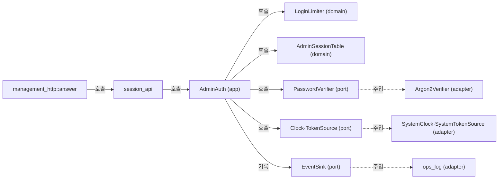

# 관리 로그인과 세션 모듈 설계

관리자 로그인(`POST /api/v1/session`)을 처리하고, 관리 세션 쿠키와 CSRF 토큰을 검사하며, 로그인 실패를 계정별·출발지별로 세어 제한 시간 동안 로그인을 거절한다. 관리 세션은 서버 메모리에만 두며 프로세스를 재시작하면 모두 무효다. 이 문서는 작업 4.3 범위다. 조회 API(4.4)와 종료 API(4.5)는 이 문서의 세션 검사를 쓰지만 구현하지 않는다. 정적 파일과 로그인 화면(4.6)도 맡지 않는다.

| 항목 | 값 |
| --- | --- |
| 구조 시점 | Current |
| 문서 상태 | Draft |
| 구현 대조 | Verified — 커밋 `a143539`(설계 수정 구현) + 작업 트리 기준. 대조 기록은 [대조 기록](#대조-기록)의 작업 4.3 구현 대조(Phase 2) |
| 코드 위치 | `crates/domain/src/admin_session.rs`(`AdminSessionToken`, `AdminCsrfToken`, `AdminSession`, `AdminSessionTable`, `AdminSessionPolicy`), `crates/domain/src/login_limit.rs`(`LoginLimitPolicy`, `LoginLimiter`, `LimitScope`), `crates/app/src/management.rs`(`AdminAuth`), `crates/app/src/management/login.rs`, `crates/app/src/management/session.rs`, `crates/app/src/ports.rs`(`Clock`, `PasswordVerifier`, `TokenSource`), `crates/adapters/src/clock.rs`(`SystemClock`, `timestamp`), `crates/adapters/src/crypto.rs`(`SystemTokenSource`), `crates/adapters/src/accounts_file/hasher.rs`(`Argon2Verifier`), `crates/adapters/src/management_http.rs`(`ManagementListener`, `answer`), `crates/adapters/src/management_http/session_api.rs`, `src/serve.rs` |
| 코드 지도 | [코드 지도 2절](code-map.md#2-코드-위치와-구성요소), [3절](code-map.md#3-진입점) |
| 관련 스펙 | [관리 스펙 3.0절](../specs/management.md#30-관리자-로그인과-세션)과 [7절](../specs/management.md#7-수용-테스트)의 MGT-014, MGT-017~020, MGT-022, MGT-025, MGT-027(MGT-018 포함); [운영 스펙](../specs/operations.md)의 OPS-029, OPS-012(로그인 사건 부분) |
| 관련 계약 | [관리 API 계약 1.1·1.3·1.4·1.5절](../contracts/management-api-v1.md#13-요청-처리-순서)(본문 미디어 타입과 `as_of`, 처리 순서, 세션과 쿠키, 로그인과 세션 정보), [2.1절](../contracts/management-api-v1.md#21-오류-본문과-상태-코드)(401·403 본문과 헤더), [운영 정보 계약 1.4·1.5·1.8·1.11절](../contracts/ops-info-v1.md)(로그인 사건과 비밀 값), [설정 계약 1.2절](../contracts/config-v2.md#12-키-표)(`[management.login_limit]`, `[management.session]`) |
| 관련 ADR | [ADR-0003 단일 인스턴스와 메모리 상태](../decisions/ADR-0003-single-instance-memory-state.md) |

## 1. 책임과 경계

- 맡는 책임:
  - 로그인: 요청 본문을 검사하고, 계정과 비밀번호를 Argon2id로 검증한다. 맞으면 관리 세션과 CSRF 토큰을 만든다.
  - 로그인 제한: 실패를 계정 이름별과 출발지 IP별로 센다. 실패가 F를 넘으면 제한 시간 동안 로그인을 거절한다.
  - 세션 검사: 쿠키의 세션이 살아 있는지 본다. 살아 있으면 계정과 CSRF 토큰을 돌려준다.
  - CSRF 검사: `POST`·`DELETE` 요청의 `X-CSRF-Token`을 세션의 값과 비교한다.
  - 유휴 만료 연장: 사용자 행동 요청이 검사와 처리를 통과했을 때만 유휴 만료 시각을 늦춘다.
  - 로그아웃: 세션을 무효화한다. 활성 VNC 중계 세션은 건드리지 않는다.
  - 로그인 사건: `admin_login_succeeded`, `admin_login_failed`, `admin_login_limited`를 기록한다.
- 맡지 않는 책임:
  - 관리 HTTP 해석과 `Set-Cookie`·`Cookie` 헤더 문자열 처리: 어댑터(`management_http`, `session_api`)가 한다. 응용 계층은 헤더를 모른다.
  - 관리 세션 종료 사건(`admin_terminate`)과 관리자 종료 권한 검사: 작업 4.5.
  - 조회 응답 작성: 작업 4.4.
  - 활성 VNC 세션 조회와 종료: 관리 세션과 독립이다. 세션 검사는 활성 세션 표를 읽거나 바꾸지 않는다.
  - 계정 파일 읽기와 쓰기: 관리자 계정 준비 CLI와 시작 모듈이 맡는다([관리자 계정 준비 CLI 모듈 설계](admin-accounts.md)).
- 다른 모듈에 공개하는 기능: `AdminAuth::login`, `AdminAuth::authorize`, `AdminAuth::check_csrf`, `AdminAuth::touch`, `AdminAuth::logout`, `SessionView`, `LoggedIn`, `AuthorizedAdmin`, `AuthError`(작업 4.4·4.5가 `authorize`와 `touch`를 호출한다).

## 2. 내부 구조

화살표는 실행 중 호출을 뜻한다. 점선 화살표는 시작 때 주입을 뜻한다.

| 요소(파일·심볼) | 역할 | 만들어지는 시점과 소유자 | 의존 대상 |
| --- | --- | --- | --- |
| `crates/domain/src/admin_session.rs` `AdminSessionToken`, `AdminCsrfToken` | 형식이 맞는 세션 토큰과 CSRF 토큰 값 | 입력 검사 때 `parse`로 만든다 | 없음 |
| `crates/domain/src/admin_session.rs` `AdminSession`, `AdminSessionTable` | 세션의 계정·CSRF·두 만료 시각과 보관소 | `AdminAuth`가 소유한다 | `AccountName` |
| `crates/domain/src/login_limit.rs` `LoginLimiter` | 계정별·출발지별 실패 기록과 제한 상태 | `AdminAuth`가 소유한다 | `PeerIp` |
| `crates/app/src/management.rs` `AdminAuth` | 로그인·세션 검사·로그아웃의 응용 서비스. 상태는 `Mutex`로 묶는다 | `serve`가 시작 때 한 번 만든다 | 포트 4개, 계정 목록, 더미 해시 |
| `crates/app/src/management/login.rs` | 로그인 판정 순서(검증, 잠금 구간의 검사와 기록) | `AdminAuth`의 메서드 | `LoginLimiter`, `AdminSessionTable` |
| `crates/app/src/management/session.rs` | 세션 검사, 유휴 연장, 로그아웃 | `AdminAuth`의 메서드 | `AdminSessionTable`, `TokenSource` |
| `crates/app/src/ports.rs` `Clock`, `PasswordVerifier`, `TokenSource` | 시계, 비밀번호 검증, 무작위 토큰과 상수 시간 비교의 포트 | 정의만 한다 | 없음 |
| `crates/adapters/src/clock.rs` `SystemClock`, `timestamp` | 시계 구현과 `YYYY-MM-DDThh:mm:ss.sssZ` 형식 | 시작 때 `serve`가 만든다 | `std::time` |
| `crates/adapters/src/crypto.rs` `SystemTokenSource` | `random_bytes`로 토큰을 만들고 `aws_lc_rs::constant_time`으로 비교 | 시작 때 `serve`가 만든다 | `aws-lc-rs` |
| `crates/adapters/src/accounts_file/hasher.rs` `Argon2Verifier` | `argon2`로 해시를 검증한다. 틀린 비밀번호는 `Ok(false)` | 시작 때 `serve`가 만든다 | `argon2` |
| `crates/adapters/src/management_http/session_api.rs` | `/api/v1/session` 처리, 본문 검사(로그인 본문, GET·DELETE 본문 미디어 타입), 쿠키 헤더, GET 응답의 `as_of`, 401·403 응답 | `answer`가 호출한다 | `AdminAuth`, `SystemClock`(시각 문자열 만들기) |

## 3. 데이터 모델

모듈 밖과 주고받는 형식은 계약에 두고, 여기에서는 링크한다.

| 이름 | 필드·형태 | 저장 위치 | 제약과 항상 지켜야 할 조건 |
| --- | --- | --- | --- |
| `AdminSessionToken` | 문자열(64자 소문자 16진수) | 쿠키 값으로 클라이언트에만 있음. 서버는 `AdminSessionTable`의 키로 든다 | 32바이트 무작위 값에서 만든다. 형식이 틀리면 조회하지 않고 `unauthenticated`다. 로그에 쓰지 않는다. `Debug`는 `<redacted>`만 찍는다 |
| `AdminCsrfToken` | 문자열(64자 소문자 16진수) | 세션 값의 한 필드. 로그인 응답 본문과 세션 정보로만 나간다 | 세션마다 하나다. 세션 전체 수명 동안 바뀌지 않는다. 로그에 쓰지 않는다. `Debug`는 `<redacted>` |
| `AdminSession` | `account: AccountName`, `csrf: AdminCsrfToken`, `idle_deadline`·`absolute_deadline: Duration`(단조, 만료 판정), `idle_wall`·`absolute_wall: SystemTime`(벽시계, 발급·연장 때 정한 값) | `AdminSessionTable`(메모리) | 단조 기한은 `idle_deadline ≤ absolute_deadline`이다. 벽시계 값도 `idle_wall ≤ absolute_wall`이다. `absolute_*`는 로그인 뒤 바뀌지 않는다. `idle_*`는 유휴 연장 때만 바뀐다. 조회 때 다시 계산하지 않는다. 응답의 `idle_expires_at`·`absolute_expires_at`은 `idle_wall()`·`absolute_wall()` 값이다 |
| `AdminSessionTable` | 토큰 문자열 → `AdminSession` 맵 | 메모리 | 만료되거나 로그아웃된 항목은 로그인과 조회 때 지운다. 프로세스 재시작 때 비운다(ADR-0003) |
| `AdminSessionPolicy` | `idle: Duration`(Si), `max_lifetime: Duration`(Sa) | 시작 때 설정에서 만들어 `AdminAuth`가 든다 | Si ≤ Sa. 설정 검사가 보장한다([설정 계약](../contracts/config-v2.md#12-키-표)) |
| `LoginLimitPolicy` | `per_account: u32`(F_a), `per_source: u32`(F_s), `window: Duration`(W), `lockout: Duration`(L) | 메모리(설정에서 만든다) | 설정 범위를 따른다: F 1–100, W 60–86400초, 제한 시간 60–86400초 |
| `LoginLimiter` | 계정 이름 키 표와 출발지 키 표. 각 항목은 실패 시각 목록과 제한 해제 시각 | 메모리 | 실패 시각은 `now − W`보다 오래된 것을 지운다. 제한이 풀리면 항목을 지운다. 성공은 기록을 바꾸지 않는다 |
| `LimitScope` | `Account` \| `Source` | 값 | 이벤트의 `scope` 값(`account`·`source`)과 같다 |
| `SessionView` | 계정 이름, CSRF 토큰, `idle_expires_at`·`absolute_expires_at`·`as_of`(벽시계 `SystemTime`) | 값(응답 만들 때만) | 응용 계층이 `SystemTime`을 넣는다. 어댑터가 `timestamp`로 문자열을 만든다. `as_of`는 GET 응답에만 쓴다 |

## 4. 처리 순서

대표 시나리오 MGT-017(HTTPS 로그인)과 MGT-022(실패 제한)를 따라 호출 순서대로 쓴다.

### 4.1 로그인 `POST /api/v1/session`

| 순서 | 코드 위치(파일·심볼) | 조건·계산 | 바뀌는 상태 | 결과를 쓰는 곳 |
| --- | --- | --- | --- | --- |
| 1 | `session_api` 로그인 처리 | `X-Relay-Poll` 헤더가 있으면 `400 invalid_request`(계약 2.1절). `Content-Type`의 미디어 타입이 `application/json`이 아니면 `415 invalid_request`(매개변수는 보지 않는다). 본문을 16384바이트까지 읽는다. 넘거나 읽기에 실패하면 `400 invalid_request`. 본문 읽기에 별도 시간 제한은 없다(9절 파) | 없음 | 응답 |
| 2 | `session_api` 본문 검사 | JSON 객체여야 한다. `account`·`password`는 있어야 하고 문자열이며 비어 있으면 안 된다. 아니면 `400 invalid_request`. 알 수 없는 필드는 무시한다 | 없음(이 실패는 F에 세지 않는다) | 응답 |
| 3 | `AdminAuth::login` | 계정 이름을 `AccountName::parse`로 본다. 문법을 어기면 `AuthError::InvalidAccount`로 `400 invalid_request`를 준다. 검증, 셈, 사건 기록을 하지 않는다(7절 계정 이름 행). 문법에 맞으면 목록에서 찾는다. 있으면 그 해시를, 없으면 더미 해시를 쓴다 | 없음 | 다음 단계 또는 응답 |
| 4 | `PasswordVerifier::verify` | 계정이 있든 없든 검증을 정확히 한 번 한다(잠금 중에도 한다). 결과는 `matched`로 둔다. 검증 오류는 `500 internal` | 없음(잠금 밖에서 한다) | 다음 단계 |
| 5 | `AdminAuth::login` 잠금 구간 | 잠금을 잡고 `LoginLimiter::check(account, source, now)`를 본다. 제한 중이면 scope를 얻는다 | 없음 | 다음 단계 |
| 6 | 제한 중 | 올바른 비밀번호여도 거절한다. `admin_login_failed`(`reason`=`limited`, `scope`, 실제 계정이면 `admin_account`, `peer_ip`)를 기록한다. 실패 기록은 세지 않는다 | 없음 | `401 login_failed` |
| 7 | 성공 | `matched`이고 계정이 목록에 있을 때만 성공이다. `AdminSessionTable`에서 요청 쿠키의 기존 세션을 지운다(유효했을 때만). 새 세션을 만든다. 단조 기한은 `Clock::now`로, 공개 값은 `Clock::wall`로 정해 저장한다. `admin_login_succeeded`를 기록한다 | 세션 추가·삭제 | `200` + `Set-Cookie`, 세션 정보 |
| 8 | 실패 | `LoginLimiter::record_failure(account, source, now)`로 두 키에 실패를 적는다. 어느 키든 실패가 F를 넘으면 그 키의 제한을 시작하고 기록을 비운다. `admin_login_failed`(`reason`=`invalid_credentials`)를 기록하고, 새로 시작한 제한마다 `admin_login_limited`를 한 번 기록한다 | 실패 기록, 제한 시작 | `401 login_failed` |

잠금 구간은 검사(5단계)와 기록(7·8단계)을 한 번에 묶는다. 검증은 잠금 밖에서 한다. 그래서 검증 중에 다른 요청이 제한을 시작해도, 뒤에 도는 실패는 제한 중으로 거절되며 세지 않는다. 제한 횟수를 넘는 실패가 쌓이지 않는다.

### 4.2 세션 검사와 연장

| 순서 | 코드 위치(파일·심볼) | 조건·계산 | 바뀌는 상태 | 결과를 쓰는 곳 |
| --- | --- | --- | --- | --- |
| 1 | `session_api` 쿠키 읽기 | `Cookie` 헤더에서 `relay_admin_session` 값을 찾는다. 형식이 틀리면 없는 것으로 본다 | 없음 | 다음 단계 |
| 2 | `AdminAuth::authorize` | 조회 전에 기한이 지난 항목을 모두 지운다(`prune`, 7절 자동 정리). 남은 항목에서 토큰을 찾는다. 만료 시각은 `now ≥ deadline`이면 이미 무효다 | 만료 항목 삭제 | 없으면 `401 unauthenticated` + 쿠키 지우기 |
| 3 | `AdminAuth::authorize`(CSRF) | `POST`·`DELETE`만. `TokenSource::same_token(세션 값, X-CSRF-Token 값)`이 거짓이면 `403 csrf_invalid`. 세션은 그대로 둔다 | 없음 | 응답 |
| 4 | 경로·메서드 검사(어댑터) | 404, 405를 먼저 본다. 이어서 `X-Relay-Poll`(400)과 GET·DELETE 본문 미디어 타입(415)을 본다. 로그인 본문 검사는 4.1절 1–2단계다 | 없음 | 응답 |
| 5 | `AdminAuth::touch` | 성공한 사용자 행동 요청만. 단조 유휴 기한 = `min(now + Si, 단조 절대 기한)`. 공개 유휴 값 = `min(벽시계 + Si, 저장된 절대 공개 값)` | 유휴 기한 연장 | 응답 |

`X-Relay-Poll: 1`이 있는 `GET`(자동 폴링)은 5단계를 건너뛴다. 연장하지 않는다. 헤더 없는 `GET`은 사용자 행동으로 보고 연장한다(사용자 결정 2026-10-22(Q30), 9절 나).

### 4.3 로그아웃 `DELETE /api/v1/session`

4.2절 1–4단계(쿠키, 세션, CSRF, 경로·메서드·본문 검사)를 거친 뒤 `AdminAuth::logout`이 세션을 지운다. 연장하지 않는다. 응답은 `204`와 쿠키 지우기다. 활성 VNC 세션은 건드리지 않는다(MGT-020).

## 5. 상태와 초기화

- 초기화·로딩 시점: `serve`가 계정 파일을 읽은 뒤(`accounts_file::load`) `AdminAuth`를 만든다. 더미 해시를 이때 한 번 만든다. 계정 목록은 시작 때 읽은 값을 쓴다. 파일을 다시 읽지 않는다(cli-v1 §1.7).
- 상태 소유자와 제거 시점: `AdminAuth`가 `Mutex<AdminState>` 하나로 세션 표와 제한 표를 든다. 프로세스가 끝나면 없어진다. 재시작하면 모두 무효다(MGT-R18).
- 동시 실행과 순서: `AdminAuth`의 메서드는 동기 함수다. 잠금은 표를 읽고 쓰는 동안만 잡는다. 비밀번호 검증은 잠금 밖에서 한다. 관리 HTTP 핸들러는 로그인 호출을 `tokio::task::spawn_blocking`으로 넘긴다. 잠금을 `.await`를 넘겨 들고 있지 않는다.

## 6. 오류 처리

| 실패 지점 | 처리 방법 | 남는 상태 | 관련 스펙 시나리오 |
| --- | --- | --- | --- |
| 본문 형식·크기·필드 검사(`session_api`)와 계정 이름 문법 검사(`AdminAuth::login`) | `415` 또는 `400 invalid_request`. GET·DELETE의 본문 미디어 타입도 `415`다. 로그인 실패로 세지 않는다 | 변화 없음 | MGT-018(계약 2.1절) |
| `X-Relay-Poll` 값이 `1`이 아니거나, `GET`이 아닌 요청에 있다(어댑터). 허용되지 않는 메서드(예: `PUT`)는 4.2절 4단계 순서대로 `405`가 먼저다 | `400 invalid_request`. 세션을 연장하지 않는다 | 변화 없음 | MGT-025(계약 1.4.2절) |
| 계정 없음·틀린 비밀번호(`AdminAuth::login`) | `401 login_failed`, 본문과 헤더는 제한 중과 같다. 실패를 두 키에 적는다 | 실패 기록 추가 | MGT-018, MGT-022 |
| 제한 중(`LoginLimiter::check`) | `401 login_failed`(같은 본문). 실패를 세지 않고 제한을 늘리지 않는다 | 변화 없음 | MGT-022 |
| 해시 검증 실패(`Argon2Verifier`, OS 오류) | `500 internal`. 세션을 만들지 않고 실패를 세지 않는다. 사건을 기록하지 않는다(9절 하) | 변화 없음 | 계약 2.1절 |
| 더미 해시 만들기 실패(시작) | 서버 시작을 실패로 끝낸다(종료 코드 1, 런타임 오류) | 없음 | 사용자 결정 2026-10-22(Q30), 9절 다 |
| 세션 없음·만료·로그아웃·재시작 뒤(`authorize`) | `401 unauthenticated` + `WWW-Authenticate`. 요청에 쿠키가 있었으면 쿠키 지우기 `Set-Cookie`도 보낸다 | 만료 항목 삭제 | MGT-019, MGT-020, MGT-027 |
| CSRF 불일치·없음(`authorize`) | `403 csrf_invalid`. 세션 유지 | 변화 없음 | MGT-014 |
| 로그인 사건 기록 실패 | 기록기가 흡수한다([운영 로그 모듈 설계](ops-log.md)). 흐름을 바꾸지 않는다 | 변화 없음 | OPS-029 |

## 7. 설계 선택

| 선택 | 이유 | 검토한 다른 방법 | 근거 |
| --- | --- | --- | --- |
| 토큰은 32바이트 무작위 값을 소문자 16진수 64자로 쓴다(쿠키 값과 CSRF 토큰 모두). **구현 판단(사용자 결정 없음)** | 계약은 URL 안전 256비트 값을 요구한다(1.5절). 16진수는 그 조건을 만족하고, 새 크레이트 없이 만든다 | base64url(`base64` 크레이트 필요), 긴 UUID | 관리 API 계약 1.4.1·1.5절 |
| 검사와 기록은 같은 잠금 구간에서 한다. 검증은 잠금 밖에서 한다. **구현 판단(사용자 결정 없음)** | 검사와 기록이 나뉘면 검증 중에 시작된 제한을 넘어 실패가 더 쌓인다. 한 구간이면 기록은 F+1번째 실패에서 멈춘다 | 검사 후 검증 후 기록(초과 가능) | MGT-R14 |
| 모든 로그인 시도는 검증을 정확히 한 번 한다. 계정이 없으면 더미 해시를 쓴다. 제한 중에도 한다. **사용자 결정 2026-10-22(Q31)** | 응답 시간으로 계정 존재나 제한 상태를 알 수 없어야 한다(계약 1.5절 권장). 이 규칙은 검증 횟수를 세는 구조 시험으로 판정한다. 자동 시간 측정은 하지 않는다(9절 사). 검증 횟수가 같아야 비교가 된다 | 계정 없음이면 바로 거절 | 계약 1.5절(권장), 관리 스펙 3.0절 4번 |
| 더미 해시는 시작 때 `[admin.argon2]` 매개변수로 만든다. **구현 판단(사용자 결정 없음)** | 계정 해시와 같은 비용이어야 시간이 비슷하다. 시작 때 한 번이면 요청마다 비용이 없다 | 상수 PHC 문자열(매개변수가 바뀌면 어긋남) | 계약 1.5절 |
| 실패 제한은 계정 이름 문자열(문법을 통과한 입력 그대로)과 출발지 `PeerIp`로 센다. 없는 계정도 센다. 기준을 넘는 실패가 나면 그 키의 제한을 시작하고 기록을 비운다. 성공은 기록을 지우지 않는다. 제한 중 시도는 세지 않고 제한을 늘리지 않는다. 없는 계정도 세는 것은 계약이 정한다. 입력 그대로 세는 것은 **구현 판단(사용자 결정 없음)**이다. 기록 비우기, 성공 뒤 유지, 제한 중 시도는 **사용자 결정 2026-10-22(Q30)**이다 | 계약 1.5절이 없는 계정도 세라고 한다. 입력 그대로 세면 정규화 규칙이 필요 없다. 성공 뒤 기록을 둘지는 사용자가 정했다 | 정규화한 이름(존재 여부가 드러남), 성공 시 초기화 | MGT-022, MGT-R14 |
| 계정 이름이 `AccountName::parse` 문법(`[a-z0-9._-]`, 1~32바이트, 계약 1.5절)을 어기면 검증 없이 `400 invalid_request`로 거절한다. 사건을 기록하지 않고 실패 셈에도 넣지 않는다. 문법은 공개 규칙이라 계정 존재 여부를 드러내지 않는다. **계약이 정한다(9절 라)** | 계약 2.1절은 필드 오류를 400으로 정하고, 이 오류는 셈에 넣지 않는다(`invalid_request`). 계정 이름은 필드 값이다. 401로 하면 셈과 응답을 계약 밖 규칙으로 맞춰야 한다 | 401 `login_failed`와 셈(이전 설계) | 계약 1.5절(문법), 2.1절(`invalid_request`) |
| 로그인이 세션을 만들 때, 요청에 들어온 유효한 쿠키의 세션을 같은 요청에서 지운다 | 계약 1.4.1절은 "이전 세션 무효"를 요구한다. 지우는 방법은 계약이 정하지 않는다. 한 계정의 여러 세션은 허용한다 | 계정당 하나로 제한(여러 탭이 서로 끊음) | 계약 1.4.1절 |
| `401`에 쿠키가 있었으면 지우기 `Set-Cookie`를 보낸다. 로그인 실패에도 적용한다. 계약 1.4.1절 문장을 그대로 따른다. **계약이 정한다** | 계약 1.4.1절의 문장이 모든 401에 적용된다. 실패한 로그인이 기존 쿠키를 지우는 부작용이 있다 | 로그인 실패에서는 지우지 않음(계약과 다르다) | 계약 1.4.1절 |
| 헤더 없는 `GET /api/v1/session`은 사용자 행동으로 보고 유휴 만료를 연장한다. **사용자 결정 2026-10-22(Q30)** | 계약 1.4.2절은 헤더 없는 인증 요청을 사용자 행동으로 정한다 | 세션 정보 조회는 연장하지 않음 | 계약 1.4.2절, 관리 스펙 MGT-R16 |
| 로그인 `POST`에 `X-Relay-Poll` 헤더가 있으면 `400 invalid_request`다. 세션을 만들지 않는다. **계약이 정한다** | 계약 2.1절이 `X-Relay-Poll` 오류를 400으로 정한다 | 무시하고 로그인 처리 | 계약 1.4.2절, 2.1절 |
| 만료 판정은 단조 `Duration`으로 한다. 공개 값(`idle_expires_at`·`absolute_expires_at`·`as_of`)은 벽시계 `SystemTime`이다. 발급 때와 유휴 연장 때 `Clock::wall()`로 정해 세션에 저장하고, 조회 때 다시 계산하지 않는다. 응용 계층은 `SystemTime`을 넣고 어댑터가 `timestamp`로 문자열을 만든다. **구현 판단(사용자 결정 없음)** | `Instant::now`·`SystemTime::now`는 응용 계층에서 금지다(`crates/app/clippy.toml`). 조회 때 벽시계를 다시 더하면 시계가 조정될 때 공개 값이 흔들린다 | 조회 때 단조 값에서 벽시계로 계산(이전 설계) | `crates/app/clippy.toml`, 계약 1.1절(시각 형식) |
| `timestamp`(`YYYY-MM-DDThh:mm:ss.sssZ`)를 운영 로그 모듈의 비공개 함수에서 `clock.rs`로 옮긴다. **구현 판단(사용자 결정 없음)** | 로그와 응답이 같은 형식을 써야 한다. 옮기면 중복이 없다 | 응답마다 형식 복사 | 계약 1.1절, 운영 정보 계약 1.1절 |
| 상수 시간 비교는 `aws_lc_rs::constant_time::verify_slices_are_equal`로 한다(어댑터). `subtle`은 쓰지 않는다 | 승인된 크레이트만 쓴다(`xtask/src/layers.rs`). 길이가 다르면 거짓이다 | `subtle` 추가 | `docs/conventions/rust.md` |
| 세션 표와 제한 표는 `HashMap`(토큰·계정·출발지를 키로)이다. 조회는 상수 시간이 아니다 | 토큰은 256비트 무작위 값이라 추측으로 찾을 수 없다. 비교가 필요한 CSRF만 상수 시간이다. **구현 판단(사용자 결정 없음)** | 정렬 맵(이득 없음) | MGT-R13 |
| 자동 정리: 로그인과 조회 때 만료 항목을 지운다. 상한은 두지 않는다. **사용자 결정 2026-10-22(Q30)** | 세션 수와 실패 키 수는 요청 속도에 따라 자란다. 정리만으로 Sa·W 뒤에는 줄어든다 | 용량 상한과 가장 오래된 항목 삭제(9절 바) | MGT-R13, MGT-R14 |
| 세션 쿠키 속성: `Path=/; HttpOnly; SameSite=Strict`, HTTPS에서만 `; Secure`. 세션 쿠키에는 `Max-Age`·`Expires`·`Domain`을 쓰지 않는다. 쿠키를 지우는 `Set-Cookie`(6절, 7절 148행)만 `Max-Age=0`을 쓴다 | 계약 1.4.1절과 관리 스펙 MGT-017 행의 규칙. 지우기 쿠키는 계약 1.4.1절이 `Max-Age=0`을 요구한다 | 없음 | 계약 1.4.1절 |
| 응답 헤더: 모든 관리 응답 `Cache-Control: no-store`, 401은 `WWW-Authenticate: Session realm="vnc-relay"` | 계약 1.1절·2.1절 | 없음 | 계약 1.1·2.1절 |
| GET 세션 정보 응답의 최상위 `as_of`는 벽시계 시각(`timestamp` 형식)이다. 계약 1.1절은 모든 GET 성공 응답에 `as_of`를 요구한다. 로그인 응답에는 넣지 않는다. **GET은 계약이 정한다. 로그인 응답 제외는 구현 판단(사용자 결정 없음)** | 계약 1.1절이 GET 성공 응답에 요구한다. 로그인 응답에 넣을지는 계약이 정하지 않았다 | 로그인 응답에도 넣기 | 계약 1.1절 |
| `GET`·`DELETE` 본문: 본문이 있으면 `Content-Type`이 `application/json`이어야 한다. 아니면 `415 invalid_request`이고 상태는 바뀌지 않는다. 본문 유무는 `to_bytes(body, 0)`의 실패로 본다. JSON 본문은 받고 내용은 무시한다. 시험은 HTTP/1.1 `Content-Length`와 chunked 본문으로 했다(HTTP/2는 시험하지 않았다). **415는 계약이 정한다. 본문 유무 판정과 JSON 본문 무시는 구현 판단(사용자 결정 없음)** | 계약 1.1절은 본문이 있는 요청에 `application/json`을 요구한다. 기존 구현은 두 메서드의 본문을 버렸다 | 본문이 있어도 미디어 타입을 보지 않음(기존 구현) | 계약 1.1절, 1.3절 4단계 |
| 로그인 본문의 미디어 타입 매개변수(`charset` 등)는 보지 않고, 읽기 실패는 `400 invalid_request`로 답한다. **구현 판단(사용자 결정 없음)** | 계약은 미디어 타입만 정한다. 읽기 실패를 본문 형식 오류로 본다 | 매개변수가 다르면 415 | 계약 2.1절(`invalid_request`) |
| `spawn_blocking` 작업 중단(`JoinError`)은 `500 internal`로 답한다. **구현 판단(사용자 결정 없음)** | 계약은 중단 상황을 정하지 않았다. 검증 오류와 같은 내부 오류로 본다 | 연결 끊기 | 계약 2.1절(`internal`) |
| 세션 정보의 `dashboard`는 중첩 객체다. 계약 5절 예시가 이 모양이다. 1.5절 표의 `dashboard.poll_secs` 같은 점 표기는 이 객체의 값을 가리키는 것으로 읽는다. **해석(계약 5절 예시 기준)** | 계약 5절 예시가 정한 모양을 따른다 | 점이 들어간 평면 키 | 계약 5절 예시, 1.5절 |
| 로그인 실패 본문 문장은 `로그인할 수 없다.`다. **구현 판단(사용자 결정 없음)** | 계약은 문장을 정하지 않았다. 계정 없음·틀린 비밀번호·제한 중 세 경우가 같아야 한다 | 경우별 문장(존재 여부가 드러남) | 계약 2.1절(`login_failed`) |
| 어댑터 시험은 Argon2 매개변수를 8 KiB·1·1로 낮춘다. 루트 시험은 19456·2·1이다(`tests/admin.rs`·`tests/serve.rs`와 같다). **구현 판단(사용자 결정 없음, 시험 코드만)** | 시험 시간을 줄인다. 운영 코드의 매개변수는 바뀌지 않는다 | 운영 매개변수 사용 | 없음 |
| MGT-019(만료 쿠키)·MGT-025(유휴 만료와 절대 만료)는 어댑터 안의 시험으로 확인한다. 실제 관리 리스너와 실제 `RelayRuntime`을 연결하고 짧은 `AdminSessionPolicy`를 쓴다(MGT-019는 Si 300 ms, MGT-025는 Si 400 ms·Sa 1.2 s). **구현 판단(사용자 결정 없음, 시험 코드만)** | 설정 계약의 최솟값(Si 300초 이상, Sa 3600초 이상) 때문에 실행파일 시험은 몇 분에서 한 시간을 기다려야 한다. 시험은 운영 코드의 정책 형식을 그대로 쓰고 값만 줄인다 | 실행파일 시험에서 설정값으로 기다리기 | 설정 계약 1.2절 범위, 관리 스펙 MGT-019·MGT-025 |

## 8. 현재 코드와의 차이

| 항목 | 설계 시점의 코드(파일·심볼) | 목표 설계 | 해소 위치 | 상태 |
| --- | --- | --- | --- | --- |
| 로그인 처리 | 없음. `management_http.rs` `answer`가 `/api/v1/`을 모두 401로 답했다 | 4.1절 | `session_api.rs`, `AdminAuth::login` | 구현 완료, 검증 통과 |
| 관리 세션 검사 | 없음. `has_session_cookie`는 쿠키 이름만 봤다 | 4.2절 | `session.rs`의 `AdminAuth::authorize`·`check_csrf`·`touch`·`logout` | 구현 완료, 검증 통과 |
| 요청 처리 순서 | `answer`가 `/api/v1/` 401을 항상 줬다(management-listener.md 4절 5단계) | 계약 1.3절 순서 | `answer`가 `/api/v1/`을 `session_api::answer`에 넘긴다. 관리 리스너 4절 갱신 | 구현 완료, 검증 통과 |
| 피어 주소 | `ManagementListener`는 `ConnectInfo`를 쓰지 않았다 | 출발지 `PeerIp`를 로그인 제한에 쓴다 | `management_http.rs`의 `PeerAddr`(`Connected` 구현)와 `into_make_service_with_connect_info::<PeerAddr>()` | 구현 완료, 검증 통과 |
| 시계·토큰·검증 포트 | 없음. `ports.rs`에는 `EventSink`, `AccountStore`, `AccountInput`, `PasswordHasher`만 있었다 | 2절 | `ports.rs`(`Clock`, `PasswordVerifier`, `TokenSource`), `clock.rs`, `crypto.rs`(`SystemTokenSource`) | 구현 완료, 검증 통과 |
| `timestamp` | `ops_log.rs` 비공개 함수 | `clock.rs` 공개 함수 | `clock.rs` | 구현 완료, 검증 통과 |
| 로그인 사건 | 없음. `events.rs`에 `admin_login_*` 변형이 없었다 | 4.1절 6·7·8단계 | `events.rs`, `ops_log.rs`(줄 형식 시험 `admin_login_lines_carry_only_their_own_fields`, 운영 정보 계약 표 참고) | 구현 완료, 일부 시험 |
| 더미 해시·Argon2 검증 | `hasher.rs`의 `Argon2Hasher`는 해시 만들기만 했다 | `Argon2Verifier` 추가 | `hasher.rs`(`Argon2Verifier`), `login.rs`(`dummy_hash`) | 구현 완료, 검증 통과 |
| 세션 공개 값과 `as_of` | 조회 때 `wall_at`으로 계산(`management.rs`). `as_of` 없음 | 저장된 벽시계 값, GET에 `as_of` | `admin_session.rs`, `management.rs`(`SessionView`), `session.rs`, `session_api.rs` | 구현 완료, 검증 통과 |
| GET·DELETE 본문 미디어 타입 | 검사하지 않음 | 본문이 있으면 `application/json`이 아니면 415 | `session_api.rs` | 구현 완료, 검증 통과(HTTP/1.1만 시험) |
| 계정 이름 문법 | 문법을 어긴 이름도 계정 없음으로 보고 `401 login_failed`로 답하며 셈에 넣었다 | 400, 검증·셈·사건 없음 | `login.rs`, `session_api.rs` | 구현 완료, 검증 통과 |

## 9. 미결정 사항

사용자 결정이 필요한 항목은 아래 표에 옵션과 추천을 적는다. 추천은 수정 구현에 반영한다. 결정이 난 항목은 `(해결)`로 표시하고 결정 기록을 적는다. 계약이 정한 항목(이전의 가·너·거)은 7절에 옮겼다.

| 항목 | 영향 | 확정 위치 |
| --- | --- | --- |
| 나. (해결) 헤더 없는 `GET /api/v1/session`이 유휴 만료를 연장할지. 사용자 결정 2026-10-22(Q30, 3번): 연장한다(옵션 (1)). 7절 149행 | 화면을 다시 불러올 때마다 Si가 늘어난다 | 관리 API 계약 1.4.2절, 사용자 결정 2026-10-22(Q30) |
| 다. (해결) 더미 해시 만들기가 시작 때 실패하면 시작을 실패로 본다(종료 코드 1). 사용자 결정 2026-10-22(Q30, 5번). 6절 132행 | 실패가 조용히 넘어가면 계정 없음과 있음의 시간 차가 생긴다 | 사용자 결정 2026-10-22(Q30) |
| 라. (해결) 계정 이름이 문법을 어긴 경우는 400 `invalid_request`로 답하고 실패 수에 세지 않는다(7절 계정 이름 행). 계약 1.5절이 계정 이름 문법을, 2.1절이 필드 오류를 400으로 정하므로 계약이 정한 동작이다. 문법은 공개 규칙이라 400이 감추어야 할 정보를 드러내지 않는다 | 401과 셈에 넣는 방식(수정 전 구현)은 계약과 맞지 않는다 | 관리 API 계약 1.5절·2.1절 |
| 마. (해결) 제한 기록과 실패 키 표의 상한. 사용자 결정 2026-10-22(Q30, 4번): 상한 없음, 정리만(옵션 (1)). 7절 155행 | 많은 다른 계정 이름으로 공격하면 메모리가 W 동안 자란다. 요청 크기는 16 KiB로 제한된다 | 관리 스펙 3.0절, 사용자 결정 2026-10-22(Q30) |
| 바. (해결) 세션 표의 상한. 사용자 결정 2026-10-22(Q30, 4번): 상한 없음. 로그인은 관리자 계정 비밀번호를 알아야만 세션을 만든다 | 계정이 맞는 요청은 세션을 계속 만들 수 있다. 정리는 Sa 뒤에 된다 | 관리 스펙 3.0절, 사용자 결정 2026-10-22(Q30) |
| 사. (해결) 응답 시간 동등성의 판정 방법. 사용자 결정 2026-10-22(Q31): 구조 시험으로 판정한다. 모든 시도가 Argon2 검증을 정확히 한 번 한다(`CountingVerifier`; 어댑터 시험 `wrong_password_and_unknown_account_get_the_same_refusal`, `limited_logins_refuse_alike_and_the_right_password_works_after_the_locks`). 자동 시간 측정은 하지 않는다. 기존 계정 해시의 Argon2 매개변수가 더미 해시의 매개변수와 같은지는 이 결정 밖이며 확인하지 않았다 [INFERENCE: 다를 수 있다] | MGT-018, MGT-022의 "응답 구분 불가"는 시간 측정으로 증명하지 않는다. 검증 횟수가 같아도 시간이 같다는 증거는 아니다. 판정 근거는 검증 횟수다 | 관리 API 계약 6절, 사용자 결정 2026-10-22(Q31) |
| 아. (해결) IPv4 매핑 IPv6 주소는 `PeerIp`가 바꾼 IPv4 값을 쓴다. 로그인 제한 키와 로그 `peer_ip`가 같은 값을 쓴다(운영 정보 계약 1.10절, `peer_ip.rs`). 소켓 원형 값은 쓰지 않는다. 관리 API 계약의 표기 항목도 사용자 결정 2026-11-02(Q88)로 닫혔다. | 같은 장치가 두 표기로 오면 제한이 나뉘는 일을 막는다 | 관리 API 계약 1.1절·6절, 사용자 결정 2026-11-02(Q88) |
| 자. (해결) 브라우저가 `WWW-Authenticate: Session`을 기본 인증 창으로 바꾸는지. 2026-11-04 관찰: Windows의 Chrome 156.0.8078.76·Edge 156.0.4314.58과 WSL의 Firefox 159.0은 `Session` 401에 인증 창을 띄우지 않고 JSON 본문을 보였다. 같은 브라우저가 `Basic` 401에는 인증 요구로 반응했다(Chrome·Edge `net::ERR_INVALID_AUTH_CREDENTIALS`, Firefox `network.authRequired`). Safari는 macOS가 없어 관찰하지 않았다 | 401이 로그인 창을 띄우면 화면 동작이 달라진다. 관찰한 세 브라우저에서는 띄우지 않았다 | 관리 API 계약 6절(관찰 항목), 작업 4.12(Safari) |
| 차. 재시작 뒤 활성 VNC 세션 유지 여부는 이 문서가 다루지 않는다 | 관리 세션만 무효다. 중계는 재시작 때 이미 끊긴다 | 관리 스펙 3.0절 7번(기존 규칙) |
| 카. (해결) 작업 4.4·4.5가 운영 조회·상세·최근 종료 조회와 관리자 종료 경로를 구현했다. `session_api.rs`는 인증 검사 뒤 `query_api.rs` 또는 `terminate_api.rs`로 넘긴다. 작업 4.3의 임시 `404 not_found`는 더는 쓰지 않는다. | 계약의 조회·종료 경로가 실제 응답한다. | TODO 4.4·4.5 완료, 임시 동작의 근거는 사용자 결정 2026-10-22(Q40) |
| 타. (해결) 관리 리스너 9절 11번(요청 머리 뒤 절대 기한 없음)은 사용자 결정 2026-10-22(Q25)로 닫혔다. 머리 뒤 U는 유휴 제한일 뿐이다. 검증·수락된 terminate의 정리 완료 대기에는 사용자 결정 2026-11-02(Q92)의 예외를 적용한다. | 관리 리스너 9절 11번과 TODO 4.2·4.5는 해결·완료 상태다. | TODO 4.2·4.5 완료, 사용자 결정 2026-10-22(Q25), 사용자 결정 2026-11-02(Q92) |
| 파. (해결) 로그인 본문 읽기에 절대 시간 제한이 없다. 관리 리스너의 시간 제한(`request_deadline.rs`)은 머리가 끝난 뒤 전송이 있을 때마다 타이머를 다시 시작한다. 사용자 결정 2026-10-22(Q25): 두지 않는다(옵션 (1)). 요청마다와 본문에 대한 절대 기한은 없다 | 전송이 U보다 자주 있으면 천천히 보내는 본문이 관리 연결 자리(Lm)를 오래 잡을 수 있다 | 관리 리스너 9절 11번, 사용자 결정 2026-10-22(Q25) |
| 하. (해결) 응용 계층의 내부 오류(`AuthError::Internal`)는 `500 internal` 응답만 주고 사건을 남기지 않는다(사용자 결정 2026-10-22(Q40)) | 운영 정보 계약에 내부 오류 사건이 없다. 500의 원인은 기록에 남지 않는다 | 운영 정보 계약, 사용자 결정 2026-10-22(Q40) |
| 러. (해결) 로그인마다 Argon2 검증이 CPU를 쓴다. 사용자 결정 2026-10-22(Q30, 6번): 검증 CPU를 따로 제한하지 않는다(옵션 (b)). 관리 연결 상한(Lm)에 기댄다. 연결 하나가 검증 하나를 돌린다고 보면 동시 검증 수는 Lm을 넘지 않는다 [INFERENCE] | Lm이 클수록 CPU를 많이 쓴다. 상한이 없으면 부하가 Lm 값에 따라 정해진다 | 관리 리스너 9절, 사용자 결정 2026-10-22(Q30) |

## 대조 기록

### 작업 4.3 대조

- 대조 범위: 커밋 `59f3f62` + 작업 트리(이 문서, `management-listener.md`, `management-api-v1.md`, `ops-info-v1.md`, `code-map.md`, `architectures/README.md`, `docs/TODO.md`의 문서 변경).
- 대조 방법:
  - 2절 기호: `same_token`(`crypto.rs` 39행), `dummy_hash`(`login.rs` 18행), `PeerAddr`(`management_http.rs` 118행), `timestamp`(`clock.rs`)를 `grep`으로 찾았다.
  - 4.1절 5–8단계: `login.rs` `login`(39행)과 비교했다.
  - 4.2절 1–5단계: `session.rs` `authorize`(25행), `check_csrf`(46행), `touch`(61행); `session_api.rs` `login`(68행), `get_session`(97행), `delete_session`(109행), `refuse`(163행)와 비교했다.
  - 6절: `refuse`(`session_api.rs`), `unauthorized`(`management_http.rs` 206행), `src/cli.rs` `EXIT_RUNTIME`과 비교했다.
  - 7절 쿠키: `CLEAR_SESSION_COOKIE`(`management_http.rs` 42행)와 비교했다.
- 구현과 어긋나 문서를 고친 곳:
  - 4.2절 2단계: 코드의 `prune`은 조회와 로그인 때 기한이 지난 항목을 모두 지운다. 문서의 "무효이면 지운다" 문장을 고쳤다.
  - 6절 `X-Relay-Poll` 행: 허용되지 않는 메서드는 4.2절 4단계 순서대로 `405`가 먼저다.
  - 7절 쿠키 행: 세션 쿠키 속성과 지우기 쿠키 속성(`Max-Age=0`)을 나눴다.
  - 8절 상태 열: 검증 결과에 맞췄다. 로그인 사건 행만 일부 시험이다.
- 대조하지 않은 것:
  - 9절 미결정 항목(가–너): 사용자 결정 전이라 구현을 바꾸지 않았다. 대조는 현재 구현 기준이다.
  - 응답 시간 동등성(MGT-018, MGT-022): 측정하지 않았다(9절 사). 검증 횟수 검사는 `login.rs` 시험 `every_attempt_runs_one_password_check_including_unknown_and_limited`가 맡는다.
  - 4.4·4.5 경로: 아직 없다. 조회·종료 경로의 401 시험은 `tests/serve.rs`의 `answers_api_queries_with_401_without_login_on_loopback_plaintext`(평문 루프백에서 로그인 없이 조회한 경우)만 있다. 세션 검사 뒤의 조회·종료 시험은 4.4·4.5에서 한다(9절 카).
  - `500 internal` 경로(검증 오류, `spawn_blocking` 중단): 코드만 대조했다. 강제로 실패시키는 시험은 없다.
- 환경: Windows 11 Pro 10.0.26200 x64, Visual Studio Build Tools 2022 17.14.37806.7, `AWS_LC_SYS_PREBUILT_NASM=1`; WSL2 Ubuntu 24.04.4, Rust 1.99.1.
- 검증 기록:

| 명령 | 환경 | 결과 |
| --- | --- | --- |
| `wsl -d Ubuntu -- bash /mnt/d/vr-tools/vr-full.sh` | WSL2 Ubuntu 24.04.4, Rust 1.99.1, `CARGO_TARGET_DIR=~/vnc-relay-target` | `ALL PASSED`. `시나리오 148건: 통과 11, 부분 27, 실패 0, 미실행 0, 미연결 110. 오류 0건.` `판정: 통과` |
| `powershell -NoProfile -ExecutionPolicy Bypass -File D:/vr-tools/vr-win.ps1 -Only all` | Windows 11 Pro 10.0.26200 x64, Rust 1.99.1, Visual Studio Build Tools 2022 17.14.37806.7, `AWS_LC_SYS_PREBUILT_NASM=1` | `ALL PASSED (all)`. `시나리오 148건: 통과 10, 부분 27, 실패 0, 미실행 1, 미연결 110. 오류 0건.` `판정: 통과`. 미실행 1은 OPS-007(Unix 전용 `closes_and_logs_every_held_connection_when_stopping`) |

- 두 명령은 이 기록을 쓰기 전에 실행했다. `xtask`는 이 기록 문서를 읽지 않는다.
- 시나리오 결과 열은 부분 행을 `미실행`으로 둔다(`docs/AGENTS.md` 검증 기록 규칙). 4.3의 부분 상태는 위 표와 9절 카 항목에 적었다.
- 판정: 구조 시점 `Current`. 위 대조 기록의 `Verified`는 커밋 `59f3f62` 구현 기준이다. 설계 수정(아래) 뒤의 구현은 아래 Phase 2 기록에서 다시 대조했다. 문서 상태 `Draft`는 그대로다. 9절 미결정 항목은 남는다.

### 작업 4.3 설계 수정(Phase 2)

리뷰 지적에 따른 설계 변경이다. 구현 전에 적었다. 구현 뒤 각 항목을 다시 대조한다.

- 바뀐 설계: 7절의 계정 이름, 벽시계 공개 값, `as_of`, GET·DELETE 본문, 대시보드 행. 8절 마지막 세 행. 9절 라·사·파·러 행.
- 계약이 정한 항목으로 닫았다: 가(401 쿠키 지우기, 계약 1.4.1절), 너(GET·DELETE 본문 415, 계약 1.1절), 거(중첩 `dashboard`, 계약 5절 예시). 9절에서 뺐다.
- 구현 판단으로 남긴 것: 계정 이름 문법 400(라), 벽시계 공개 값 저장(7절), 본문 유무 판정과 JSON 본문 무시(7절), 로그인 응답에 `as_of`를 넣지 않음(7절).
- 고친 설명: 9절 파의 이전 문장 "관리 리스너의 제한 시간은 요청 머리만 덮는다"는 틀렸다. `request_deadline.rs`는 머리가 끝난 뒤 전송마다 타이머를 다시 시작한다.

### 작업 4.3 구현 대조(Phase 2)

- 대조 범위: 커밋 `a143539`(설계 수정 구현, 6개 파일)의 내용. 검증 뒤 코드를 바꾸지 않았다. 이 기록을 담은 문서 변경은 별도 커밋이다.
- 대조 방법: 아래 심볼은 읽기와 `grep`으로 확인했다.
  - 3절 `AdminSession`: `admin_session.rs`의 `idle_wall`·`absolute_wall` 필드(112–113행). `start`(120행)와 `extend_idle`(144행)이 발급·연장 때 벽시계 값을 정한다. `idle_deadlines`(190–203행)는 두 시계 모두 절대 기한으로 자른다. 응답 값은 `idle_wall()`(178행)·`absolute_wall()`(183행)이다.
  - 3절 `SessionView`와 4.2절 5단계: `management.rs`의 `session_view(session, wall)`(129행)가 저장된 값을 옮긴다. `wall_at`은 운영 코드에 남아 있지 않다.
  - 7절 `as_of`: `session_api.rs`의 `session_response(…, as_of: bool)`(162–173행)가 GET에서만 `as_of`를 넣는다.
  - 4.2절 4단계와 7절 본문 행: `get_session`(99행)과 `delete_session`(119행)은 `X-Relay-Poll` 400을 본 뒤 `media_type_allows`(236행)로 415를 본다. `is_json`(225행)을 함께 읽었다.
  - 7절 계정 이름 행: `login.rs`의 `AccountName::parse`(50행)가 실패하면 `AuthError::InvalidAccount`(`management.rs` 45행)가 된다. `refuse`(`session_api.rs` 200행)가 `400 invalid_request`(`ACCOUNT_MESSAGE`, 37행)로 답한다. `admin_account`는 실제 계정에만 넣는다(`login.rs` 55행).
- 고치기 전후 시험: 수정 전에 시험을 추가해 실패를 먼저 확인했다. 어댑터 `tests/management.rs`는 30 통과, 3 실패였다(`login_account_outside_the_name_grammar_is_a_bad_request`, `get_and_delete_with_a_body_must_send_application_json`, `session_view_carries_as_of_as_a_timestamp`). 앱 라이브러리는 22 통과, 2 실패였다(`management::login::tests::account_outside_the_name_grammar_is_refused_and_not_counted`, `management::session::tests::wall_clock_jumps_do_not_move_the_published_deadlines`). 고친 뒤 모두 통과한다. 도메인 시험 `wall_deadlines_are_the_values_at_issue_and_extension`(`admin_session.rs` 305행)은 발급·연장 때 벽시계 값을 확인하는 새 시험이다(MGT-025 일부).
- 구현 판단(사용자 결정 없음)으로 남긴 것은 위 설계 수정 항목과 7절 표다. 9절 미결정 중 나·다·라·마·바·하·러는 추천과 같은 쪽으로 구현했다. 파는 추천(2)과 달리 현재 구현(1)이다. 사·자·차·카·타는 열어 두었다.
- 대조하지 않은 것:
  - 응답 시간 동등성(MGT-018, MGT-022): 측정하지 않았다(9절 사).
  - 4.4·4.5 경로: 아직 없다. 세션 검사 뒤의 조회·종료 시험은 없다(9절 카).
  - `500 internal` 경로(검증 오류, `spawn_blocking` 중단): 강제로 실패시키는 시험은 없다. 코드만 대조했다.
  - HTTP/2 본문: 시험하지 않았다(7절 159행).
  - 관리 리스너 문서(`management-listener.md`)는 고치지 않았다. 리스너 서술(경로 나누기, 시간 제한, TLS)은 이번 수정으로 바뀌지 않았다. 그 문서의 검증 기록은 `59f3f62` 그대로다.
- 환경: Windows 11 Pro 10.0.26200 x64, Visual Studio Build Tools 2022 17.14.37806.7, `AWS_LC_SYS_PREBUILT_NASM=1`. WSL2 Ubuntu 24.04.4, Rust 1.99.1, `CARGO_TARGET_DIR=~/vnc-relay-target`(WSL).
- 검증 기록:

| 명령 | 환경 | 결과 |
| --- | --- | --- |
| `wsl -d Ubuntu -- bash /mnt/d/vr-tools/vr-full.sh` | WSL2 Ubuntu 24.04.4, Rust 1.99.1, `CARGO_TARGET_DIR=~/vnc-relay-target` | `ALL PASSED`. `시나리오 148건: 통과 11, 부분 27, 실패 0, 미실행 0, 미연결 110. 오류 0건.` `판정: 통과` |
| `powershell -NoProfile -ExecutionPolicy Bypass -File D:/vr-tools/vr-win.ps1 -Only all` | Windows 11 Pro 10.0.26200 x64, Rust 1.99.1, Visual Studio Build Tools 2022 17.14.37806.7, `AWS_LC_SYS_PREBUILT_NASM=1` | `ALL PASSED (all)`. `시나리오 148건: 통과 10, 부분 27, 실패 0, 미실행 1, 미연결 110. 오류 0건.` `판정: 통과`. 미실행 1은 OPS-007(Unix 전용 `closes_and_logs_every_held_connection_when_stopping`) |

- 두 명령은 커밋 `a143539`와 같은 내용의 트리에서 한 번씩 실행했다. 검증 뒤 코드를 바꾸지 않았다.
- 판정: 구현 대조 `Verified`는 커밋 `a143539` 구현 기준이다. 문서 상태 `Draft`는 그대로다. 9절 미결정 항목은 사용자 결정까지 남는다.

### 작업 4.3 결정 반영(2026-10-22)

- 적용한 결정: 사용자 결정 2026-10-22(Q25, Q30, Q31). 바꾼 곳은 6절 132행, 7절 143·145·149·155행, 8절 176행, 9절 나·다·마·바·사·타·파·러 행이다. 9절 라·자·차·카·하는 그대로 남는다. 아는 이미 해결이다.
- 결정의 뜻: 머리 뒤 U는 유휴 제한만이다(Q25). 성공 뒤에도 실패 기록을 두고, 제한 중 시도는 세지 않는다(Q30-1·2). 나·다·마·바·러는 Q30의 옵션을 따른다. MGT-018·022의 응답 구분 불가는 구조 시험으로 판정한다(Q31).
- 시험 변경: MGT-018과 MGT-022를 비부분 시험으로 바꿨다(`crates/adapters/tests/management.rs`, 커밋 `8c87e69`). 두 시험은 `FakeClock`으로 시간을 정하고 `CountingVerifier`로 검증 횟수를 센다. 실제 대기를 쓰던 부분 시험 두 개는 지웠다.
- MGT-018의 판정: "운영 데이터 미노출"을 확인하려고 세션 없이 세션 조회와 4.4 경로(`summary`, `waiting`, `sessions`, `closed-sessions`)를 요청했다. 모두 인증 검사에서 `401 unauthenticated`로 거절됐다. 4.4 경로 자체는 아직 없다(9절 카).
- 앞선 기록 정정: 이 절보다 앞선 `작업 4.3 대조`와 `구현 대조(Phase 2)`의 "9절 미결정 항목" 서술과 "응답 시간 동등성(MGT-018, MGT-022): 측정하지 않았다"는 이 결정으로 현재 상태가 아니다. 앞선 기록은 고치지 않는다.
- 대조 범위: 커밋 `8c87e69`의 내용과 작업 트리(이 문서, 다른 작업의 문서 변경 포함).
- 환경: Windows 11 Pro 10.0.26200 x64, Visual Studio Build Tools 2022 17.14.37806.7, `AWS_LC_SYS_PREBUILT_NASM=1`. WSL2 Ubuntu 24.04.4, Rust 1.99.1, `CARGO_TARGET_DIR=~/vnc-relay-target`(WSL).
- 검증 기록:

| 명령 | 환경 | 결과 |
| --- | --- | --- |
| `wsl -d Ubuntu -- bash /mnt/d/vr-tools/vr-full.sh` | WSL2 Ubuntu 24.04.4, Rust 1.99.1, `CARGO_TARGET_DIR=~/vnc-relay-target` | `ALL PASSED`. `시나리오 148건: 통과 14, 부분 24, 실패 0, 미실행 0, 미연결 110. 오류 0건.` `판정: 통과` |
| `powershell -NoProfile -ExecutionPolicy Bypass -File D:/vr-tools/vr-win.ps1 -Only all` | Windows 11 Pro 10.0.26200 x64, Rust 1.99.1, Visual Studio Build Tools 2022 17.14.37806.7, `AWS_LC_SYS_PREBUILT_NASM=1` | `ALL PASSED (all)`. `시나리오 148건: 통과 13, 부분 24, 실패 0, 미실행 1, 미연결 110. 오류 0건.` `판정: 통과`. 미실행 1은 OPS-007 |

- 통과 수 변화: 앞선 기록(WSL 11, Windows 10)보다 늘었다. 늘어난 것은 MGT-018, MGT-022(커밋 `8c87e69`)와 OPS-002(커밋 `b505c60`, 다른 작업의 `tests/serve.rs` 비부분 시험)다.
- 판정: 문서 상태 `Draft`는 그대로다. 9절 라·자·차·카·하는 남는다. 4.4·4.5 경로, `500 internal` 강제 시험, HTTP/2 본문은 아직 시험하지 않았다.

### 작업 4.3 남은 판단 정리(2026-10-22)

- 적용한 결정: 사용자 결정 2026-10-22(Q40). 9절 하(내부 오류에 사건 없음)와 카(4.4·4.5 전 미구현 경로 404)를 현재 구현대로 확정했다.
- 9절 라는 계약 1.5절·2.1절이 정한 동작으로 닫았다. 7절 계정 이름 행의 표시도 "계약이 정한다"로 고쳤다.
- 남은 미결정: 9절 자(브라우저 기본 인증 창 관찰)와 차(이 문서 범위 밖)다.
- 코드는 바꾸지 않았다. 문서만 바뀌었으므로 검증 명령은 다시 실행하지 않았다. 직전 검증 기록은 위 `작업 4.3 결정 반영(2026-10-22)` 절의 표다.

### 작업 4.3 증거 보강과 브라우저 관찰(2026-11-04)

결론: 작업 4.3은 아직 완료가 아니다. 커밋 `b0c25f9`의 두 OS 게이트는 통과했다. 완료 조건 시나리오 중 MGT-027·OPS-029는 Linux에서만 비부분 시험이 있고 Windows는 부분이다. 두 시나리오의 Windows 시험은 의사 콘솔(ConPTY)로 실행파일을 띄워 만들 수 있으므로 자동화 불가 예외(사용자 결정 2026-11-04(Q99))에 해당하지 않는다. 작업 5.3이 Windows 콘솔 시험 파일(사용자 결정 2026-11-04(Q103))에서 두 시험을 만든 뒤 4.3을 닫는다. (보충: 커밋 `de693ad`에서 MGT-027·OPS-029의 Windows 비부분 시험이 추가되어 두 OS 모두 통과했다. 아래 [작업 4.3 완료 대조(2026-11-04)](#작업-43-완료-대조2026-11-04) 참조.)

- 시험 커밋: `c0d3b59`(MGT-017·019·020·025·027·OPS-029 비부분 시험), `34cefe5`(MGT-025 폴링을 조회 경로로 돌림), `bb44c4f`(가짜 중계 제어 포트로 500 경로 시험, Q95), `b0c25f9`(로그 순서 단언 보정, [관리 조회 대조 기록](management-query.md#작업-44-완료-대조2026-11-04)). 이 절은 문서만 바꾼다.
- 브라우저 관찰: 9절 자와 [관리 API 계약 6절](../contracts/management-api-v1.md#6-초안을-확정하기-전에-해결할-사항)의 기본 인증 창·로그인 CSRF 항목을 Chrome 156.0.8078.76·Edge 156.0.4314.58(Windows)과 Firefox 159.0(WSL)에서 확인했다. Safari는 macOS가 없어 관찰하지 않았다. 작업 4.12가 Safari를 다시 다룬다.

| 명령 | 환경 | 결과 |
| --- | --- | --- |
| `wsl -d Ubuntu -- bash /mnt/d/vr-tools/vr-full.sh` | WSL2 Ubuntu 24.04.4, Rust 1.99.1, `b0c25f9` | 2026-11-04T12:01:00Z 보고서: `ALL PASSED`. 151건: 통과 100, 부분 40, 실패 0, 미실행 0, 미연결 11, 오류 0. |
| `powershell -NoProfile -ExecutionPolicy Bypass -File D:/vr-tools/vr-win.ps1 -Only all` | Windows 11 Pro 10.0.26200 x64, Rust 1.99.1, `b0c25f9` | 2026-11-04T12:08:11Z 보고서: `ALL PASSED (all)`. 151건: 통과 92, 부분 48, 실패 0, 미실행 0, 미연결 11, 오류 0. |

| 시나리오 | 판정 | 비부분 증거와 남은 증거 |
| --- | --- | --- |
| MGT-014 | 통과(두 OS) | `tests/management_terminate.rs`의 `completion_q89_auth_csrf_validation_order_and_chunked_body_are_state_preserving` |
| MGT-017 | 통과(두 OS) | `crates/adapters/tests/management.rs`의 `https_and_plain_loopback_logins_set_transport_cookies_and_allow_queries` |
| MGT-018 | 통과(두 OS) | `wrong_password_and_unknown_account_get_the_same_refusal`(`8c87e69`) |
| MGT-019 | 통과(두 OS) | `expired_admin_cookie_cannot_query_or_terminate_and_the_relay_survives` |
| MGT-020 | 통과(두 OS) | `tests/management_session.rs`의 `logout_refuses_the_old_cookie_but_keeps_other_admin_and_relay_sessions` |
| MGT-022 | 통과(두 OS) | `limited_logins_refuse_alike_and_the_right_password_works_after_the_locks`(`8c87e69`) |
| MGT-025 | 통과(두 OS) | `idle_polling_and_absolute_activity_expiry_leave_existing_relays_alive` |
| MGT-027 | WSL 통과, Windows 부분 | WSL: `tests/management_session.rs`의 `restart_ends_the_admin_session_and_login_works_again`(`#[cfg(unix)]`, 정상 종료 신호 뒤 재시작). Windows: `forced_restart_ends_the_admin_session_and_login_works_again`(부분, 강제 종료 뒤 재시작). 남은 증거: Windows 콘솔 정상 종료 요청(Ctrl+C) 뒤 재시작. Rust에서 콘솔 API를 부르려면 `unsafe`가 필요하고, 시험 파일 하나의 예외는 Q103으로 작업 5.3에 허용됐다. (보충: 커밋 `976550f`에서 Windows 비부분 시험 통과, 아래 대조 참조) |
| OPS-029 | WSL 통과, Windows 부분 | WSL: `tests/management_session.rs`의 `cli_prepared_admins_have_hidden_salted_credentials_and_equal_relay_rights`(`#[cfg(target_os = "linux")]`, PTY로 숨김 비밀번호 입력). Windows: 계정 파일·해시·로그인 단위·통합 시험이 부분으로 통과한다. 남은 증거: ConPTY로 `admin add`의 숨김 입력을 넣는 같은 범위의 시험. 작업 5.3의 Windows 콘솔 시험 파일에서 만든다. (보충: 커밋 `976550f`에서 Windows 비부분 시험 통과, 아래 대조 참조) |

- 남은 미결정: 9절 차(이 문서 범위 밖)만 남는다. 9절 자는 Safari를 빼고 해결됐다.

### 작업 4.3 완료 대조(2026-11-04)

결론: 작업 4.3은 완료했다. 커밋 `de693ad`의 두 OS 게이트에서 모든 완료 조건 시나리오(MGT-014, MGT-017~020, MGT-022, MGT-025, MGT-027, OPS-029)가 두 OS에서 비부분 시험으로 통과했다.

- 시험 추가: 커밋 `976550f`에서 Windows 의사 콘솔(ConPTY)을 다루는 `tests/windows_console.rs`(`#[expect(unsafe_code)]` 허용, 사용자 결정 2026-11-04(Q103))에 MGT-027과 OPS-029의 비부분 시험을 추가했다.
- 게이트 결과:
  - WSL `vr-full.sh` (2026-11-04T13:31:32Z 보고서): `ALL PASSED`. 152건 중 통과 107, 부분 35, 실패 0, 미실행 1(OPS-044), 미연결 9, 오류 0. `management.md` 27건 모두 통과(27/27).
  - Windows `vr-win.ps1 -Only all` (2026-11-04T13:39:13Z 보고서): `ALL PASSED (all)`. 152건 중 통과 103, 부분 40, 실패 0, 미실행 0, 미연결 9, 오류 0. `management.md` 27건 모두 통과(27/27).

| 시나리오 | 판정 | WSL(Linux) 비부분 시험 | Windows 비부분 시험 |
| --- | --- | --- | --- |
| MGT-014 | 통과(두 OS) | `tests/management_terminate.rs` `completion_q89_auth_csrf_validation_order_and_chunked_body_are_state_preserving` | 같음 |
| MGT-017 | 통과(두 OS) | `crates/adapters/tests/management.rs` `https_and_plain_loopback_logins_set_transport_cookies_and_allow_queries` | 같음 |
| MGT-018 | 통과(두 OS) | `crates/adapters/tests/management.rs` `wrong_password_and_unknown_account_get_the_same_refusal` | 같음 |
| MGT-019 | 통과(두 OS) | `crates/adapters/tests/management.rs` `expired_admin_cookie_cannot_query_or_terminate_and_the_relay_survives` | 같음 |
| MGT-020 | 통과(두 OS) | `tests/management_session.rs` `logout_refuses_the_old_cookie_but_keeps_other_admin_and_relay_sessions` | 같음 |
| MGT-022 | 통과(두 OS) | `crates/adapters/tests/management.rs` `limited_logins_refuse_alike_and_the_right_password_works_after_the_locks` | 같음 |
| MGT-025 | 통과(두 OS) | `crates/adapters/tests/management.rs` `idle_polling_and_absolute_activity_expiry_leave_existing_relays_alive` | 같음 |
| MGT-027 | 통과(두 OS) | `tests/management_session.rs` `restart_ends_the_admin_session_and_login_works_again` (SIGTERM 정상 종료) | `tests/windows_console.rs` `graceful_restart_ends_the_admin_session_and_login_works_again` (ConPTY Ctrl+C 정상 종료) |
| OPS-029 | 통과(두 OS) | `tests/management_session.rs` `cli_prepared_admins_have_hidden_salted_credentials_and_equal_relay_rights` (PTY) | `tests/windows_console.rs` `cli_prepared_admins_have_hidden_salted_credentials_and_equal_relay_rights` (ConPTY; Windows 계정 파일 ACL은 운영자 책임으로 모드 검사 제외) |

- 브라우저 검증: 기본 인증 창과 로그인 CSRF 방어는 Chrome·Edge(Windows)와 Firefox(WSL)에서 확인을 완료했다(Safari는 작업 4.12로 이관).
- 남은 미결정: 9절 차(이 문서 범위 밖)만 남는다.
