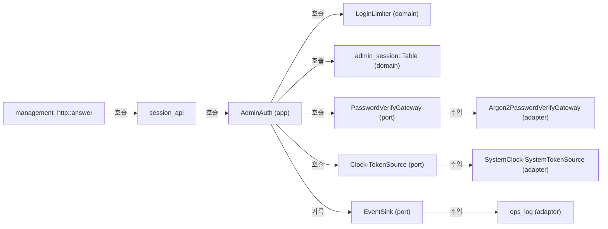

# 관리 로그인과 세션 모듈 설계

관리자 로그인(`POST /api/v1/session`)을 처리하고, 관리 세션 쿠키와 CSRF 토큰을 검사하며, 로그인 실패를 계정별·출발지별로 세어 제한 시간 동안 로그인을 거절한다. 관리 세션은 서버 메모리에만 두며 프로세스를 재시작하면 모두 무효다. 조회·종료·설정 GET/PATCH가 이 문서의 공통 인증 경계를 쓴다. 각 업무 처리와 정적 파일·화면 구현은 맡지 않는다.

| 항목 | 값 |
| --- | --- |
| 구조 시점 | Current |
| 문서 상태 | Draft |
| 구현 대조 | Verified — [대조 기록](#대조-기록) |
| 코드 위치 | `crates/domain/src/admin_session.rs`(`admin_session::Token`, `AdminCsrfToken`, `AdminSession`, `admin_session::Table`, `admin_session::Policy`), `crates/domain/src/login_limit.rs`(`login_limit::Policy`, `LoginLimiter`, `LimitScope`), `crates/app/src/management.rs`(`AdminAuth`), `crates/app/src/management/login.rs`, `crates/app/src/management/session.rs`, `crates/app/src/ports.rs`(`Clock`, `PasswordVerifyGateway`, `TokenSource`), `crates/adapters/src/clock.rs`(`SystemClock`, `timestamp`), `crates/adapters/src/crypto.rs`(`SystemTokenSource`), `crates/adapters/src/accounts_file/hasher.rs`(`Argon2PasswordVerifyGateway`), `crates/adapters/src/management_http.rs`(`ManagementListener`, `answer`), `crates/adapters/src/management_http/session_api.rs`, `src/serve.rs` |
| 코드 지도 | [코드 지도 2절](code-map.md#2-코드-위치와-구성요소), [3절](code-map.md#3-진입점) |
| 관련 스펙 | [관리 스펙 3.0절](../specs/management.md#30-관리자-로그인과-세션)과 [7절](../specs/management.md#7-수용-테스트)의 MGT-014, MGT-017~020, MGT-022, MGT-025, MGT-027(MGT-018 포함); [운영 스펙](../specs/operations.md)의 OPS-029, OPS-012(로그인 사건 부분) |
| 관련 계약 | [관리 API 계약 1.1·1.3·1.4·1.5절](../contracts/management-api-v1.md#13-요청-처리-순서)(본문 미디어 타입과 `as_of`, 처리 순서, 세션과 쿠키, 로그인과 세션 정보), [2.1절](../contracts/management-api-v1.md#21-오류-본문과-상태-코드)(401·403 본문과 헤더), [운영 정보 계약 1.4·1.5·1.8·1.11절](../contracts/ops-info-v2.md)(로그인 사건과 비밀 값), [설정 계약 1.2절](../contracts/config-v4.md#12-키-표)(`[management.login_limit]`, `[management.session]`) |
| 관련 ADR | [ADR-0003 단일 인스턴스와 메모리 상태](../decisions/ADR-0003-single-instance-memory-state.md) |

## 1. 책임과 경계

- 맡는 책임:
  - 로그인: 요청 본문을 검사하고, 계정과 비밀번호를 Argon2id로 검증한다. 맞으면 관리 세션과 CSRF 토큰을 만든다.
  - 로그인 제한: 실패를 계정 이름별과 출발지 IP별로 센다. 실패가 F를 넘으면 제한 시간 동안 로그인을 거절한다.
  - 세션 검사: 쿠키의 세션이 살아 있는지 본다. 살아 있으면 계정과 CSRF 토큰을 돌려준다.
  - CSRF 검사: 로그인 이외의 `POST`·`PATCH`·`DELETE` 요청에서 `X-CSRF-Token`을 세션의 값과 비교한다. 경로 분기보다 먼저 검사한다.
  - 유휴 만료 연장: 사용자 행동 요청이 검사와 처리를 통과했을 때만 유휴 만료 시각을 늦춘다.
  - 로그아웃: 세션을 무효화한다. 활성 VNC 중계 세션은 건드리지 않는다.
  - 로그인 사건: `admin_login_succeeded`, `admin_login_failed`, `admin_login_limited`를 기록한다.
- 맡지 않는 책임:
  - 관리 HTTP 해석과 `Set-Cookie`·`Cookie` 헤더 문자열 처리: 어댑터(`management_http`, `session_api`)가 한다. 응용 계층은 헤더를 모른다.
  - 관리 세션 종료 사건(`admin_terminate`)과 관리자 종료 권한 검사: [관리자 종료 설계](management-terminate.md).
  - 조회 응답 작성: [관리 조회 설계](management-query.md).
  - 설정 파일 조회·편집과 편집 감사 사건: [설정 보기·편집 서비스](config-edit.md). 이 서비스는 `AuthorizedAdmin`의 계정과 실제 소켓 `PeerIp`를 받으며 별도 특권 관리자 역할을 만들지 않는다.
  - 활성 VNC 세션 조회와 종료: 관리 세션과 독립이다. 세션 검사는 활성 세션 표를 읽거나 바꾸지 않는다.
  - 계정 파일 읽기와 쓰기: 관리자 계정 준비 CLI와 시작 모듈이 맡는다([관리자 계정 준비 CLI 모듈 설계](admin-accounts.md)).
- 다른 모듈에 공개하는 기능: `AdminAuth::login`, `AdminAuth::authorize`, `AdminAuth::check_csrf`, `AdminAuth::touch`, `AdminAuth::logout`, `SessionView`, `LoggedIn`, `AuthorizedAdmin`, `AuthError`. 중계 조회·종료와 설정 handler가 인증 결과를 받아 성공한 사용자 행동에 `touch`를 호출한다.

## 2. 내부 구조

화살표는 실행 중 호출을 뜻한다. 점선 화살표는 시작 때 주입을 뜻한다.

| 요소(파일·심볼) | 역할 | 만들어지는 시점과 소유자 | 의존 대상 |
| --- | --- | --- | --- |
| `crates/domain/src/admin_session.rs` `admin_session::Token`, `AdminCsrfToken` | 형식이 맞는 세션 토큰과 CSRF 토큰 값 | 입력 검사 때 `parse`로 만든다 | 없음 |
| `crates/domain/src/admin_session.rs` `AdminSession`, `admin_session::Table` | 세션의 계정·CSRF·두 만료 시각과 보관소 | `AdminAuth`가 소유한다 | `account::Name` |
| `crates/domain/src/login_limit.rs` `LoginLimiter` | 계정별·출발지별 실패 기록과 제한 상태 | `AdminAuth`가 소유한다 | `PeerIp` |
| `crates/app/src/management.rs` `AdminAuth` | 로그인·세션 검사·로그아웃의 응용 서비스. 상태는 `Mutex`로 묶는다 | `serve`가 시작 때 한 번 만든다 | 포트 4개, 계정 목록, 더미 해시 |
| `crates/app/src/management/login.rs` | 로그인 판정 순서(검증, 잠금 구간의 검사와 기록) | `AdminAuth`의 메서드 | `LoginLimiter`, `admin_session::Table` |
| `crates/app/src/management/session.rs` | 세션 검사, 유휴 연장, 로그아웃 | `AdminAuth`의 메서드 | `admin_session::Table`, `TokenSource` |
| `crates/app/src/ports.rs` `Clock`, `PasswordVerifyGateway`, `TokenSource` | 시계, 비밀번호 검증, 무작위 토큰과 상수 시간 비교의 포트 | 정의만 한다 | 없음 |
| `crates/adapters/src/clock.rs` `SystemClock`, `timestamp` | 시계 구현과 `YYYY-MM-DDThh:mm:ss.sssZ` 형식 | 시작 때 `serve`가 만든다 | `std::time` |
| `crates/adapters/src/crypto.rs` `SystemTokenSource` | `random_bytes`로 토큰을 만들고 `aws_lc_rs::constant_time`으로 비교 | 시작 때 `serve`가 만든다 | `aws-lc-rs` |
| `crates/adapters/src/accounts_file/hasher.rs` `Argon2PasswordVerifyGateway` | `argon2`로 해시를 검증한다. 틀린 비밀번호는 `Ok(false)` | 시작 때 `serve`가 만든다 | `argon2` |
| `crates/adapters/src/management_http/session_api.rs` | `/api/v1/session` 처리, 본문 검사(로그인 본문, GET·DELETE 본문 미디어 타입), 쿠키 헤더, GET 응답의 `as_of`, 401·403 응답 | `answer`가 호출한다 | `AdminAuth`, `SystemClock`(시각 문자열 만들기) |

## 3. 데이터 모델

모듈 밖과 주고받는 형식은 계약에 두고, 여기에서는 링크한다.

| 이름 | 필드·형태 | 저장 위치 | 제약과 항상 지켜야 할 조건 |
| --- | --- | --- | --- |
| `admin_session::Token` | 문자열(64자 소문자 16진수) | 쿠키 값으로 클라이언트에만 있음. 서버는 `admin_session::Table`의 키로 든다 | 32바이트 무작위 값에서 만든다. 형식이 틀리면 조회하지 않고 `unauthenticated`다. 로그에 쓰지 않는다. `Debug`는 `<redacted>`만 찍는다 |
| `AdminCsrfToken` | 문자열(64자 소문자 16진수) | 세션 값의 한 필드. 로그인 응답 본문과 세션 정보로만 나간다 | 세션마다 하나다. 세션 전체 수명 동안 바뀌지 않는다. 로그에 쓰지 않는다. `Debug`는 `<redacted>` |
| `AdminSession` | `account: account::Name`, `csrf: AdminCsrfToken`, `idle_deadline`·`absolute_deadline: Duration`(단조, 만료 판정), `idle_wall`·`absolute_wall: SystemTime`(벽시계, 발급·연장 때 정한 값) | `admin_session::Table`(메모리) | 단조 기한은 `idle_deadline ≤ absolute_deadline`이다. 벽시계 값도 `idle_wall ≤ absolute_wall`이다. `absolute_*`는 로그인 뒤 바뀌지 않는다. `idle_*`는 유휴 연장 때만 바뀐다. 조회 때 다시 계산하지 않는다. 응답의 `idle_expires_at`·`absolute_expires_at`은 `idle_wall()`·`absolute_wall()` 값이다 |
| `admin_session::Table` | 토큰 문자열 → `AdminSession` 맵 | 메모리 | 만료되거나 로그아웃된 항목은 로그인과 조회 때 지운다. 프로세스 재시작 때 비운다(ADR-0003) |
| `admin_session::Policy` | `idle: Duration`(Si), `max_lifetime: Duration`(Sa) | 시작 때 설정에서 만들어 `AdminAuth`가 든다 | Si ≤ Sa. 설정 검사가 보장한다([설정 계약](../contracts/config-v4.md#12-키-표)) |
| `login_limit::Policy` | `per_account: u32`(F_a), `per_source: u32`(F_s), `window: Duration`(W), `lockout: Duration`(L) | 메모리(설정에서 만든다) | 설정 범위를 따른다: F 1–100, W 60–86400초, 제한 시간 60–86400초 |
| `LoginLimiter` | 계정 이름 키 표와 출발지 키 표. 각 항목은 실패 시각 목록과 제한 해제 시각 | 메모리 | 실패 시각은 `now − W`보다 오래된 것을 지운다. 제한이 풀리면 항목을 지운다. 성공은 기록을 바꾸지 않는다 |
| `LimitScope` | `Account` \| `Source` | 값 | 이벤트의 `scope` 값(`account`·`source`)과 같다 |
| `SessionView` | 계정 이름, CSRF 토큰, `idle_expires_at`·`absolute_expires_at`·`as_of`(벽시계 `SystemTime`) | 값(응답 만들 때만) | 응용 계층이 `SystemTime`을 넣는다. 어댑터가 `timestamp`로 문자열을 만든다. `as_of`는 GET 응답에만 쓴다 |

## 4. 처리 순서

대표 시나리오 MGT-017(HTTPS 로그인)과 MGT-022(실패 제한)를 따라 호출 순서대로 쓴다.

### 4.1 로그인 `POST /api/v1/session`

| 순서 | 코드 위치(파일·심볼) | 조건·계산 | 바뀌는 상태 | 결과를 쓰는 곳 |
| --- | --- | --- | --- | --- |
| 1 | `session_api` 로그인 처리 | `X-Relay-Poll`이 있으면 `400 invalid_request`. `Content-Type`이 `application/json`이 아니면 `415 invalid_request`(매개변수는 보지 않는다). 본문은 16384바이트까지 읽는다. 초과·읽기 실패는 `400 invalid_request`다. 요청 머리 뒤에는 전송마다 U를 다시 재며 본문별 절대 기한은 없다. | 없음 | 응답 |
| 2 | `session_api` 본문 검사 | JSON 객체여야 한다. `account`·`password`는 있어야 하고 문자열이며 비어 있으면 안 된다. 아니면 `400 invalid_request`. 알 수 없는 필드는 무시한다 | 없음(이 실패는 F에 세지 않는다) | 응답 |
| 3 | `AdminAuth::login` | 계정 이름을 `account::Name::parse`로 본다. 문법을 어기면 `AuthError::InvalidAccount`로 `400 invalid_request`를 준다. 검증, 셈, 사건 기록을 하지 않는다(7절 계정 이름 행). 문법에 맞으면 목록에서 찾는다. 있으면 그 해시를, 없으면 더미 해시를 쓴다 | 없음 | 다음 단계 또는 응답 |
| 4 | `PasswordVerifyGateway::verify` | 계정이 있든 없든 검증을 정확히 한 번 한다(잠금 중에도 한다). 결과는 `matched`로 둔다. 검증 오류는 `500 internal` | 없음(잠금 밖에서 한다) | 다음 단계 |
| 5 | `AdminAuth::login` 잠금 구간 | 잠금을 잡고 `LoginLimiter::check(account, source, now)`를 본다. 제한 중이면 scope를 얻는다 | 없음 | 다음 단계 |
| 6 | 제한 중 | 올바른 비밀번호여도 거절한다. `admin_login_failed`(`reason`=`limited`, `scope`, 실제 계정이면 `admin_account`, `peer_ip`)를 기록한다. 실패 기록은 세지 않는다 | 없음 | `401 login_failed` |
| 7 | 성공 | `matched`이고 계정이 목록에 있을 때만 성공이다. `admin_session::Table`에서 요청 쿠키의 기존 세션을 지운다(유효했을 때만). 새 세션을 만든다. 단조 기한은 `Clock::now`로, 공개 값은 `Clock::wall`로 정해 저장한다. `admin_login_succeeded`를 기록한다 | 세션 추가·삭제 | `200` + `Set-Cookie`, 세션 정보 |
| 8 | 실패 | `LoginLimiter::record_failure(account, source, now)`로 두 키에 실패를 적는다. 어느 키든 실패가 F를 넘으면 그 키의 제한을 시작하고 기록을 비운다. `admin_login_failed`(`reason`=`invalid_credentials`)를 기록하고, 새로 시작한 제한마다 `admin_login_limited`를 한 번 기록한다 | 실패 기록, 제한 시작 | `401 login_failed` |

잠금 구간은 검사(5단계)와 기록(7·8단계)을 한 번에 묶는다. 검증은 잠금 밖에서 한다. 그래서 검증 중에 다른 요청이 제한을 시작해도, 뒤에 도는 실패는 제한 중으로 거절되며 세지 않는다. 제한 횟수를 넘는 실패가 쌓이지 않는다.

### 4.2 세션 검사와 연장

| 순서 | 코드 위치(파일·심볼) | 조건·계산 | 바뀌는 상태 | 결과를 쓰는 곳 |
| --- | --- | --- | --- | --- |
| 1 | `session_api` 쿠키 읽기 | `Cookie` 헤더에서 `relay_admin_session` 값을 찾는다. 형식이 틀리면 없는 것으로 본다 | 없음 | 다음 단계 |
| 2 | `AdminAuth::authorize` | 조회 전에 기한이 지난 항목을 모두 지운다(`prune`, 7절 자동 정리). 남은 항목에서 토큰을 찾는다. 만료 시각은 `now ≥ deadline`이면 이미 무효다 | 만료 항목 삭제 | 없으면 `401 unauthenticated` + 쿠키 지우기 |
| 3 | `session_api::answer` → `AdminAuth::check_csrf` | 로그인 이외 `POST`·`PATCH`·`DELETE`에 적용한다. 중복/누락/틀린 `X-CSRF-Token`은 경로 분기 전에 `403 csrf_invalid`다. 세션은 유지한다. | 없음 | 응답 또는 다음 단계 |
| 4 | 경로·메서드 검사(어댑터) | session/config/terminate/logs/query로 분기한 뒤 메서드·poll·본문을 검사한다. 설정 PATCH는 poll 헤더를 거절하고 JSON 본문을 64 KiB까지 읽는다. 로그인 본문은 16 KiB다. | 없음 | 각 handler 응답 |
| 5 | `AdminAuth::touch` | 성공한 사용자 행동 요청만. 단조 유휴 기한 = `min(now + Si, 단조 절대 기한)`. 공개 유휴 값 = `min(벽시계 + Si, 저장된 절대 공개 값)` | 유휴 기한 연장 | 응답 |

`X-Relay-Poll: 1`이 있는 `GET`(자동 폴링)은 5단계를 건너뛴다. 헤더 없는 `GET`은 사용자 행동으로 보고 연장한다.

설정 GET은 성공 뒤에만 `touch`하며 `X-Relay-Poll: 1`이면 연장하지 않는다. 화면은 설정 진입·명시 새로고침 때만 GET하고 자동 폴링하지 않는다. PATCH는 성공(no-op 포함) 뒤에만 연장하며 인증·CSRF·입력·파일·충돌·쓰기 실패는 연장하지 않는다. 파일 트랜잭션은 `spawn_blocking`에서 끝까지 수행하므로 응답 연결이 사라져도 서버의 저장·commit을 취소하지 않는다([설정 보기·편집 §6](config-edit.md#6-http시간-제한종료-유예)).

로그인과 세션 GET 응답의 `session_body`는 `DashboardHints::terminate_timeout_secs()`로 현재 E+5를 읽는다. P와 query timeout은 시작값이다. 이 힌트 변경은 이미 시작한 종료 교환의 타이머를 바꾸지 않는다. `management.config_edit` 활성화에는 재시작이 필요하므로 기존 세션을 재사용하지 않고 다시 로그인한다.

### 4.3 로그아웃 `DELETE /api/v1/session`

4.2절 1–4단계(쿠키, 세션, CSRF, 경로·메서드·본문 검사)를 거친 뒤 `AdminAuth::logout`이 세션을 지운다. 연장하지 않는다. 응답은 `204`와 쿠키 지우기다. 활성 VNC 세션은 건드리지 않는다(MGT-020).

## 5. 상태와 초기화

- 초기화·로딩 시점: `serve`가 계정 파일을 읽은 뒤(`accounts_file::load`) `AdminAuth`를 만든다. 더미 해시를 이때 한 번 만든다. 계정 목록은 시작 때 읽은 값을 쓴다. 파일을 다시 읽지 않는다(cli-v1 §1.7).
- 상태 소유자와 제거 시점: `AdminAuth`가 `Mutex<AdminState>` 하나로 세션 표와 제한 표를 든다. 프로세스가 끝나면 없어진다. 재시작하면 모두 무효다(MGT-R18).
- 동시 실행과 순서: `AdminAuth`의 메서드는 동기 함수다. 잠금은 표를 읽고 쓰는 동안만 잡는다. 비밀번호 검증은 잠금 밖에서 한다. 관리 HTTP 핸들러는 로그인 호출을 `tokio::task::spawn_blocking`으로 넘긴다. 잠금을 `.await`를 넘겨 들고 있지 않는다.

## 6. 오류 처리

| 실패 지점 | 처리 방법 | 남는 상태 | 관련 스펙 시나리오 |
| --- | --- | --- | --- |
| 본문 형식·크기·필드 검사(`session_api`)와 계정 이름 문법 검사(`AdminAuth::login`) | `415` 또는 `400 invalid_request`. GET·DELETE의 본문 미디어 타입도 `415`다. 로그인 실패로 세지 않는다 | 변화 없음 | MGT-018(계약 2.1절) |
| `X-Relay-Poll` 값이 `1`이 아니거나, `GET`이 아닌 요청에 있다(어댑터). 허용되지 않는 메서드(예: `PUT`)는 4.2절 4단계 순서대로 `405`가 먼저다 | `400 invalid_request`. 세션을 연장하지 않는다 | 변화 없음 | MGT-025(계약 1.4.2절) |
| 계정 없음·틀린 비밀번호(`AdminAuth::login`) | `401 login_failed`, 본문과 헤더는 제한 중과 같다. 실패를 두 키에 적는다 | 실패 기록 추가 | MGT-018, MGT-022 |
| 제한 중(`LoginLimiter::check`) | `401 login_failed`(같은 본문). 실패를 세지 않고 제한을 늘리지 않는다 | 변화 없음 | MGT-022 |
| 해시 검증 실패(`Argon2PasswordVerifyGateway`, OS 오류) | `500 internal`. 세션을 만들지 않고 실패를 세지 않는다. 운영 정보 계약에 내부 오류 사건이 없어 사건을 기록하지 않는다. | 변화 없음 | 계약 2.1절 |
| 더미 해시 만들기 실패(시작) | 서버 시작을 실패로 끝낸다(종료 코드 1, 런타임 오류). | 없음 | 관리 API 계약 1.5절 |
| 세션 없음·만료·로그아웃·재시작 뒤(`authorize`) | `401 unauthenticated` + `WWW-Authenticate`. 요청에 쿠키가 있었으면 쿠키 지우기 `Set-Cookie`도 보낸다 | 만료 항목 삭제 | MGT-019, MGT-020, MGT-027 |
| CSRF 불일치·없음(`AdminAuth::check_csrf`) | `403 csrf_invalid`. 세션 유지 | 변화 없음 | MGT-014 |
| 로그인 사건 기록 실패 | 기록기가 흡수한다([운영 로그 모듈 설계](ops-log.md)). 흐름을 바꾸지 않는다 | 변화 없음 | OPS-029 |

## 7. 설계 선택

| 선택 | 이유 | 검토한 다른 방법 | 근거 |
| --- | --- | --- | --- |
| 토큰은 32바이트 무작위 값을 소문자 16진수 64자로 쓴다(쿠키 값과 CSRF 토큰 모두). | URL 안전 256비트 조건을 만족하고 새 크레이트가 필요 없다. | base64url, 긴 UUID | 관리 API 계약 1.4.1·1.5절 |
| 검사와 기록은 같은 잠금 구간에서 하고 검증은 잠금 밖에서 한다. | 검증 중에 시작된 제한을 넘어 실패가 더 쌓이지 않는다. 기록은 F+1번째 실패에서 멈춘다. | 검사·검증·기록을 분리 | MGT-R14 |
| 모든 로그인 시도는 계정 유무·제한 여부와 관계없이 검증을 정확히 한 번 한다. 없는 계정은 더미 해시를 쓴다. | 응답 구분 불가는 `SpyCountingPasswordVerifier` 구조 시험으로 판정한다. 자동 시간 측정은 하지 않는다. 검증 횟수가 같다는 사실만으로 실행 시간이 같다고 주장하지 않는다. | 없는 계정 즉시 거절 | 관리 API 계약 1.5절, MGT-018, MGT-022 |
| 더미 해시는 시작 때 `[admin.argon2]` 매개변수로 만든다. | 요청마다 해시를 만드는 비용이 없다. 기존 계정 해시의 매개변수와 같다는 보장은 없다. | 상수 PHC 문자열 | 관리 API 계약 1.5절 |
| 실패 제한은 문법을 통과한 계정 이름 원문과 실제 소켓 `PeerIp`로 센다. 없는 계정도 센다. F를 넘으면 그 키의 제한을 시작하고 기록을 비운다. 성공은 기록을 지우지 않는다. 제한 중 시도는 세지 않고 제한을 늘리지 않는다. | 이름 정규화로 존재 여부를 드러내지 않는다. IPv4 매핑 IPv6는 `PeerIp`의 정규화 값을 쓴다. | 이름 정규화, 성공 시 초기화 | MGT-022, MGT-R14 |
| `account::Name::parse` 문법(`[a-z0-9._-]`, 1~32바이트)을 어기면 검증 없이 `400 invalid_request`로 거절한다. 사건과 실패 셈에 넣지 않는다. | 공개 필드 문법 오류이며 계정 존재 여부를 드러내지 않는다. | 401과 실패 셈 | 관리 API 계약 1.5·2.1절 |
| 로그인이 세션을 만들 때, 요청에 들어온 유효한 쿠키의 세션을 같은 요청에서 지운다 | 계약 1.4.1절은 "이전 세션 무효"를 요구한다. 지우는 방법은 계약이 정하지 않는다. 한 계정의 여러 세션은 허용한다 | 계정당 하나로 제한(여러 탭이 서로 끊음) | 계약 1.4.1절 |
| `401`에 쿠키가 있었으면 지우기 `Set-Cookie`를 보낸다. 로그인 실패에도 적용한다. 계약 1.4.1절 문장을 그대로 따른다. **계약이 정한다** | 계약 1.4.1절의 문장이 모든 401에 적용된다. 실패한 로그인이 기존 쿠키를 지우는 부작용이 있다 | 로그인 실패에서는 지우지 않음(계약과 다르다) | 계약 1.4.1절 |
| 헤더 없는 `GET /api/v1/session`은 유휴 만료를 연장한다. | 헤더 없는 인증 요청은 사용자 행동이다. | 세션 정보 조회는 연장하지 않음 | 계약 1.4.2절, MGT-R16 |
| 로그인 `POST`에 `X-Relay-Poll` 헤더가 있으면 `400 invalid_request`다. 세션을 만들지 않는다. **계약이 정한다** | 계약 2.1절이 `X-Relay-Poll` 오류를 400으로 정한다 | 무시하고 로그인 처리 | 계약 1.4.2절, 2.1절 |
| 만료 판정은 단조 `Duration`으로 한다. 공개 값은 벽시계 `SystemTime`이며 발급·연장 때 저장하고 조회 때 다시 계산하지 않는다. 어댑터가 `timestamp`로 직렬화한다. | 응용 계층은 직접 시스템 시계를 읽지 않는다. 시계 보정이 조회만으로 공개 만료 값을 바꾸지 않는다. | 조회 때 단조 값에서 벽시계 값 계산 | `crates/app/clippy.toml`, 계약 1.1절 |
| `clock.rs`의 `timestamp`는 `YYYY-MM-DDThh:mm:ss.sssZ` 형식을 만든다. | 운영 로그와 응답이 같은 함수를 쓴다. | 형식 코드 복제 | 계약 1.1절, 운영 정보 계약 1.1절 |
| 상수 시간 비교는 `aws_lc_rs::constant_time::verify_slices_are_equal`로 한다(어댑터). `subtle`은 쓰지 않는다 | 승인된 크레이트만 쓴다(`xtask/src/layers.rs`). 길이가 다르면 거짓이다 | `subtle` 추가 | `docs/conventions/rust.md` |
| 세션 표와 제한 표는 `HashMap`이다. 조회는 상수 시간이 아니다. | 토큰은 256비트 무작위 값이다. CSRF 비교는 상수 시간으로 한다. | 정렬 맵 | MGT-R13 |
| 로그인과 조회 때 만료 항목을 지운다. 세션 표·실패 키 표의 상한과 별도 검증 CPU 제한은 없다. | 관리 연결 상한 Lm으로 접속을 제한한다. 많은 이름은 W 동안, 유효 로그인은 Sa 동안 메모리를 늘릴 수 있다. | 용량 상한, 오래된 항목 축출 | MGT-R13, MGT-R14 |
| 세션 쿠키는 `Path=/; HttpOnly; SameSite=Strict`이며 HTTPS에만 `Secure`를 붙인다. `Max-Age`·`Expires`·`Domain`은 없다. 지우기 쿠키만 `Max-Age=0`을 쓴다. | 세션 쿠키와 지우기 쿠키의 속성을 구분한다. | 없음 | 계약 1.4.1절, MGT-017 |
| 응답 헤더: 모든 관리 응답 `Cache-Control: no-store`, 401은 `WWW-Authenticate: Session realm="vnc-relay"` | 계약 1.1절·2.1절 | 없음 | 계약 1.1·2.1절 |
| GET 세션 정보의 `as_of`는 벽시계 시각이다. 로그인 응답에는 넣지 않는다. | 모든 GET 성공 응답에 `as_of`가 필요하다. | 로그인 응답에도 포함 | 계약 1.1절 |
| GET·DELETE는 본문이 있으면 `application/json`이어야 한다. 아니면 415이고 상태는 바뀌지 않는다. `to_bytes(body, 0)`으로 본문 유무를 보고 JSON 본문은 내용과 관계없이 받는다. | 공통 본문 미디어 타입 규칙을 적용한다. 관리 리스너는 HTTP/1.1을 쓴다. | 본문 미디어 타입 무시 | 계약 1.1·1.3절 |
| 로그인 미디어 타입 매개변수는 무시하고 읽기 실패는 400으로 답한다. | 미디어 타입만 검사한다. | 매개변수가 다르면 415 | 계약 2.1절 |
| `spawn_blocking` 중단(`JoinError`)은 `500 internal`이다. | 내부 오류로 분류한다. | 연결 끊기 | 계약 2.1절 |
| `dashboard`는 중첩 객체다. | 계약의 `dashboard.*` 점 표기는 중첩 필드를 가리킨다. | 평면 키 | 계약 1.5·5절 |
| 로그인 실패 문장은 `로그인할 수 없다.`다. | 계정 없음·틀린 비밀번호·제한 중의 문장이 같다. | 경우별 문장 | 계약 2.1절 |
| 어댑터 시험의 Argon2 값은 8 KiB·1·1이고 루트 시험은 19456·2·1이다. | 운영값을 바꾸지 않고 시험 비용을 줄인다. | 운영값만 사용 | `tests/admin.rs`, `tests/serve.rs` |
| MGT-019·025는 실제 관리 리스너·`RelayRuntime`과 짧은 정책을 쓴다. MGT-019는 Si 300 ms, MGT-025는 Si 400 ms·Sa 1.2 s다. | 설정 최솟값(Si 300초, Sa 3600초)으로 기다리는 대신 같은 정책 자료형의 경계를 확인한다. | 실행파일에서 최솟값만 사용 | 설정 계약 1.2절, MGT-019, MGT-025 |

## 대조 기록

| 날짜 | 대상 | 환경 | 확인 방법 | 실제 결과 |
| --- | --- | --- | --- | --- |
| 2026-11-08 | 작업 트리의 `session_api::answer`·`session_body`, `DashboardHints::terminate_timeout_secs`, `config_api::answer` | 저장소 소스 읽기 | PATCH CSRF 경계, 설정 성공 뒤 touch, 로그인·세션 GET 응답 시 현재 E+5 계산을 대조했다. | 기재한 인증 경계와 힌트 생성 흐름이 소스와 일치한다. |

### 브라우저 관찰

| 날짜 | 대상 | 환경 | 방법 | 실제 결과 |
| --- | --- | --- | --- | --- |
| 2026-11-04 | `b0c25f9`의 관리 HTTP 인증·로그인 경계 | Windows Chrome 156.0.8078.76·Edge 156.0.4314.58, WSL Firefox 159.0 | 실제 `/api/v1/summary`의 Session 401을 로컬 Basic 401과 비교했다. 다른 사이트의 JSON fetch·no-cors text/plain·폼 로그인과 정상 로그인 뒤 교차 사이트 요청을 확인했다. | Session은 JSON을 보이고 Basic은 인증 요구로 반응했다. JSON 로그인은 사전 요청에서 차단됐다. 폼은 415이고 쿠키가 없었다. 공격 뒤 로그인 쿠키·성공 사건은 생기지 않았다. 정상 로그인 쿠키는 교차 사이트 no-cors 요청에 실리지 않았다. |

WebKit 대체 환경의 관찰은 [프런트엔드 검증 기록](../how-to/verify-dashboard-frontend.md#43-webkit-인증csrf-관찰-기록)을 따른다. 실제 Safari의 기본 인증 창과 SameSite 동작은 미확인이다. 확인 책임은 브라우저 호환성 검토 담당자에게 있다.

자동 시험의 현재 결과는 [테스트 컨벤션](../conventions/testing.md)에 따라 `cargo xtask scenarios`의 `scenario-report.md`와 CI에서 확인한다. 재시작·숨김 입력은 Linux의 `tests/management_session.rs`(PTY·SIGTERM)와 Windows의 `tests/windows_console.rs`(ConPTY·Ctrl+C)가 다룬다. Windows 계정 파일 ACL은 운영자 책임이며 모드 검사에서 제외한다.
