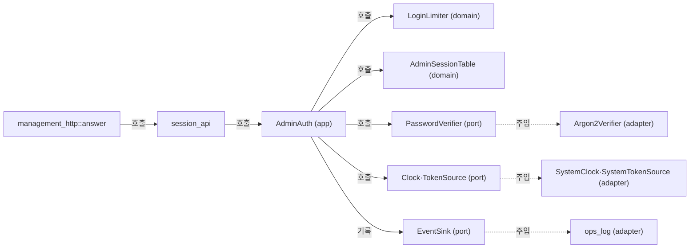

# 관리 로그인과 세션 모듈 설계

관리자 로그인(`POST /api/v1/session`)을 처리하고, 관리 세션 쿠키와 CSRF 토큰을 검사하며, 로그인 실패를 계정별·출발지별로 세어 제한 시간 동안 로그인을 거절한다. 관리 세션은 서버 메모리에만 두며 프로세스를 재시작하면 모두 무효다. 이 문서는 작업 4.3 범위다. 조회 API(4.4)와 종료 API(4.5)는 이 문서의 세션 검사를 쓰지만 구현하지 않는다. 정적 파일과 로그인 화면(4.6)도 맡지 않는다.

| 항목 | 값 |
| --- | --- |
| 구조 시점 | Target |
| 문서 상태 | Draft |
| 구현 대조 | 미대조 |
| 코드 위치 | `crates/domain/src/admin_session.rs`(`AdminSessionToken`, `AdminCsrfToken`, `AdminSession`, `AdminSessionTable`, `AdminSessionPolicy`), `crates/domain/src/login_limit.rs`(`LoginLimitPolicy`, `LoginLimiter`, `LimitScope`), `crates/app/src/management.rs`(`AdminAuth`), `crates/app/src/management/login.rs`, `crates/app/src/management/session.rs`, `crates/app/src/ports.rs`(`Clock`, `PasswordVerifier`, `TokenSource`), `crates/adapters/src/clock.rs`(`SystemClock`, `timestamp`), `crates/adapters/src/crypto.rs`(`SystemTokenSource`), `crates/adapters/src/accounts_file/hasher.rs`(`Argon2Verifier`), `crates/adapters/src/management_http.rs`(`ManagementListener`, `answer`), `crates/adapters/src/management_http/session_api.rs`, `src/serve.rs` |
| 코드 지도 | [코드 지도 2절](code-map.md#2-코드-위치와-구성요소), [3절](code-map.md#3-진입점) |
| 관련 스펙 | [관리 스펙 3.0절](../specs/management.md#30-관리자-로그인과-세션)과 [7절](../specs/management.md#7-수용-테스트)의 MGT-014, MGT-017~020, MGT-022, MGT-025, MGT-027(MGT-018 포함); [운영 스펙](../specs/operations.md)의 OPS-029, OPS-012(로그인 사건 부분) |
| 관련 계약 | [관리 API 계약 1.3·1.4·1.5절](../contracts/management-api-v1.md#13-요청-처리-순서)(처리 순서, 세션과 쿠키, 로그인과 세션 정보), [2.1절](../contracts/management-api-v1.md#21-오류-본문과-상태-코드)(401·403 본문과 헤더), [운영 정보 계약 1.4·1.5·1.8·1.11절](../contracts/ops-info-v1.md)(로그인 사건과 비밀 값), [설정 계약 1.2절](../contracts/config-v1.md#12-키-표)(`[management.login_limit]`, `[management.session]`) |
| 관련 ADR | [ADR-0003 단일 인스턴스와 메모리 상태](../decisions/ADR-0003-single-instance-memory-state.md) |

## 1. 책임과 경계

- 맡는 책임:
  - 로그인: 요청 본문을 검사하고, 계정과 비밀번호를 Argon2id로 검증한다. 맞으면 관리 세션과 CSRF 토큰을 만든다.
  - 로그인 제한: 실패를 계정 이름별과 출발지 IP별로 센다. 실패가 F를 넘으면 제한 시간 동안 로그인을 거절한다.
  - 세션 검사: 쿠키의 세션이 살아 있는지 본다. 살아 있으면 계정과 CSRF 토큰을 돌려준다.
  - CSRF 검사: `POST`·`DELETE` 요청의 `X-CSRF-Token`을 세션의 값과 비교한다.
  - 유휴 만료 연장: 사용자 행동 요청이 검사와 처리를 통과했을 때만 유휴 만료 시각을 늦춘다.
  - 로그아웃: 세션을 무효화한다. 활성 VNC 중계 세션은 건드리지 않는다.
  - 로그인 사건: `admin_login_succeeded`, `admin_login_failed`, `admin_login_limited`를 기록한다.
- 맡지 않는 책임:
  - 관리 HTTP 해석과 `Set-Cookie`·`Cookie` 헤더 문자열 처리: 어댑터(`management_http`, `session_api`)가 한다. 응용 계층은 헤더를 모른다.
  - 관리 세션 종료 사건(`admin_terminate`)과 관리자 종료 권한 검사: 작업 4.5.
  - 조회 응답 작성: 작업 4.4.
  - 활성 VNC 세션 조회와 종료: 관리 세션과 독립이다. 세션 검사는 활성 세션 표를 읽거나 바꾸지 않는다.
  - 계정 파일 읽기와 쓰기: 관리자 계정 준비 CLI와 시작 모듈이 맡는다([관리자 계정 준비 CLI 모듈 설계](admin-accounts.md)).
- 다른 모듈에 공개하는 기능: `AdminAuth::login`, `AdminAuth::authorize`, `AdminAuth::check_csrf`, `AdminAuth::touch`, `AdminAuth::logout`, `SessionView`, `LoggedIn`, `AuthorizedAdmin`, `AuthError`(작업 4.4·4.5가 `authorize`와 `touch`를 호출한다).

## 2. 내부 구조

화살표는 실행 중 호출을 뜻한다. 점선 화살표는 시작 때 주입을 뜻한다.

| 요소(파일·심볼) | 역할 | 만들어지는 시점과 소유자 | 의존 대상 |
| --- | --- | --- | --- |
| `crates/domain/src/admin_session.rs` `AdminSessionToken`, `AdminCsrfToken` | 형식이 맞는 세션 토큰과 CSRF 토큰 값 | 입력 검사 때 `parse`로 만든다 | 없음 |
| `crates/domain/src/admin_session.rs` `AdminSession`, `AdminSessionTable` | 세션의 계정·CSRF·두 만료 시각과 보관소 | `AdminAuth`가 소유한다 | `AccountName` |
| `crates/domain/src/login_limit.rs` `LoginLimiter` | 계정별·출발지별 실패 기록과 제한 상태 | `AdminAuth`가 소유한다 | `PeerIp` |
| `crates/app/src/management.rs` `AdminAuth` | 로그인·세션 검사·로그아웃의 응용 서비스. 상태는 `Mutex`로 묶는다 | `serve`가 시작 때 한 번 만든다 | 포트 4개, 계정 목록, 더미 해시 |
| `crates/app/src/management/login.rs` | 로그인 판정 순서(검증, 잠금 구간의 검사와 기록) | `AdminAuth`의 메서드 | `LoginLimiter`, `AdminSessionTable` |
| `crates/app/src/management/session.rs` | 세션 검사, 유휴 연장, 로그아웃 | `AdminAuth`의 메서드 | `AdminSessionTable`, `TokenSource` |
| `crates/app/src/ports.rs` `Clock`, `PasswordVerifier`, `TokenSource` | 시계, 비밀번호 검증, 무작위 토큰과 상수 시간 비교의 포트 | 정의만 한다 | 없음 |
| `crates/adapters/src/clock.rs` `SystemClock`, `timestamp` | 시계 구현과 `YYYY-MM-DDThh:mm:ss.sssZ` 형식 | 시작 때 `serve`가 만든다 | `std::time` |
| `crates/adapters/src/crypto.rs` `SystemTokenSource` | `random_bytes`로 토큰을 만들고 `aws_lc_rs::constant_time`으로 비교 | 시작 때 `serve`가 만든다 | `aws-lc-rs` |
| `crates/adapters/src/accounts_file/hasher.rs` `Argon2Verifier` | `argon2`로 해시를 검증한다. 틀린 비밀번호는 `Ok(false)` | 시작 때 `serve`가 만든다 | `argon2` |
| `crates/adapters/src/management_http/session_api.rs` | `/api/v1/session` 처리, 본문 검사, 쿠키 헤더, 401·403 응답 | `answer`가 호출한다 | `AdminAuth`, `SystemClock`(시각 변환) |

## 3. 데이터 모델

모듈 밖과 주고받는 형식은 계약에 두고, 여기에서는 링크한다.

| 이름 | 필드·형태 | 저장 위치 | 제약과 항상 지켜야 할 조건 |
| --- | --- | --- | --- |
| `AdminSessionToken` | 문자열(64자 소문자 16진수) | 쿠키 값으로 클라이언트에만 있음. 서버는 `AdminSessionTable`의 키로 든다 | 32바이트 무작위 값에서 만든다. 형식이 틀리면 조회하지 않고 `unauthenticated`다. 로그에 쓰지 않는다. `Debug`는 `<redacted>`만 찍는다 |
| `AdminCsrfToken` | 문자열(64자 소문자 16진수) | 세션 값의 한 필드. 로그인 응답 본문과 세션 정보로만 나간다 | 세션마다 하나다. 세션 전체 수명 동안 바뀌지 않는다. 로그에 쓰지 않는다. `Debug`는 `<redacted>` |
| `AdminSession` | `account: AccountName`, `csrf: AdminCsrfToken`, `idle_deadline: Duration`, `absolute_deadline: Duration` | `AdminSessionTable`(메모리) | 두 기한은 단조 시계 값이다. `idle_deadline ≤ absolute_deadline`이 항상 참이다. 로그인 뒤 `absolute_deadline`은 바뀌지 않는다 |
| `AdminSessionTable` | 토큰 문자열 → `AdminSession` 맵 | 메모리 | 만료되거나 로그아웃된 항목은 로그인과 조회 때 지운다. 프로세스 재시작 때 비운다(ADR-0003) |
| `AdminSessionPolicy` | `idle: Duration`(Si), `max_lifetime: Duration`(Sa) | 시작 때 설정에서 만들어 `AdminAuth`가 든다 | Si ≤ Sa. 설정 검사가 보장한다([설정 계약](../contracts/config-v1.md#12-키-표)) |
| `LoginLimitPolicy` | `per_account: u32`(F_a), `per_source: u32`(F_s), `window: Duration`(W), `lockout: Duration`(L) | 메모리(설정에서 만든다) | 설정 범위를 따른다: F 1–100, W 60–86400초, 제한 시간 60–86400초 |
| `LoginLimiter` | 계정 이름 키 표와 출발지 키 표. 각 항목은 실패 시각 목록과 제한 해제 시각 | 메모리 | 실패 시각은 `now − W`보다 오래된 것을 지운다. 제한이 풀리면 항목을 지운다. 성공은 기록을 바꾸지 않는다 |
| `LimitScope` | `Account` \| `Source` | 값 | 이벤트의 `scope` 값(`account`·`source`)과 같다 |
| `SessionView` | 계정 이름, CSRF 토큰, 두 만료 시각(단조 `Duration`) | 값(응답 만들 때만) | 응답에 쓰기 전에 어댑터가 벽시계 시각으로 바꾼다 |

## 4. 처리 순서

대표 시나리오 MGT-017(HTTPS 로그인)과 MGT-022(실패 제한)를 따라 호출 순서대로 쓴다.

### 4.1 로그인 `POST /api/v1/session`

| 순서 | 코드 위치(파일·심볼) | 조건·계산 | 바뀌는 상태 | 결과를 쓰는 곳 |
| --- | --- | --- | --- | --- |
| 1 | `session_api` 로그인 처리 | `Content-Type`의 미디어 타입이 `application/json`이 아니면 `415 invalid_request`(매개변수는 보지 않는다). 본문을 16384바이트까지 읽는다. 넘거나 읽기에 실패하면 `400 invalid_request`. 본문 읽기에 별도 시간 제한은 없다(9절 파) | 없음 | 응답 |
| 2 | `session_api` 본문 검사 | JSON 객체여야 한다. `account`·`password`는 있어야 하고 문자열이며 비어 있으면 안 된다. 아니면 `400 invalid_request`. 알 수 없는 필드는 무시한다 | 없음(이 실패는 F에 세지 않는다) | 응답 |
| 3 | `AdminAuth::login` | 계정 이름을 `AccountName::parse`로 본다. 실패하거나 목록에 없으면 더미 해시를 쓴다 | 없음 | 다음 단계 |
| 4 | `PasswordVerifier::verify` | 계정이 있든 없든 검증을 정확히 한 번 한다(잠금 중에도 한다). 결과는 `matched`로 둔다. 검증 오류는 `500 internal` | 없음(잠금 밖에서 한다) | 다음 단계 |
| 5 | `AdminAuth::login` 잠금 구간 | 잠금을 잡고 `LoginLimiter::check(account, source, now)`를 본다. 제한 중이면 scope를 얻는다 | 없음 | 다음 단계 |
| 6 | 제한 중 | 올바른 비밀번호여도 거절한다. `admin_login_failed`(`reason`=`limited`, `scope`, 실제 계정이면 `admin_account`, `peer_ip`)를 기록한다. 실패 기록은 세지 않는다 | 없음 | `401 login_failed` |
| 7 | 성공 | `matched`이면 `AdminSessionTable`에서 요청 쿠키의 기존 세션을 지우고(유효했을 때만), 새 세션을 만든다. 두 기한을 정한다. `admin_login_succeeded`를 기록한다 | 세션 추가·삭제 | `200` + `Set-Cookie`, 세션 정보 |
| 8 | 실패 | `LoginLimiter::record_failure(account, source, now)`로 두 키에 실패를 적는다. 어느 키든 실패가 F를 넘으면 그 키의 제한을 시작하고 기록을 비운다. `admin_login_failed`(`reason`=`invalid_credentials`)를 기록하고, 새로 시작한 제한마다 `admin_login_limited`를 한 번 기록한다 | 실패 기록, 제한 시작 | `401 login_failed` |

잠금 구간은 검사(5단계)와 기록(7·8단계)을 한 번에 묶는다. 검증은 잠금 밖에서 한다. 그래서 검증 중에 다른 요청이 제한을 시작해도, 뒤에 도는 실패는 제한 중으로 거절되며 세지 않는다. 제한 횟수를 넘는 실패가 쌓이지 않는다.

### 4.2 세션 검사와 연장

| 순서 | 코드 위치(파일·심볼) | 조건·계산 | 바뀌는 상태 | 결과를 쓰는 곳 |
| --- | --- | --- | --- | --- |
| 1 | `session_api` 쿠키 읽기 | `Cookie` 헤더에서 `relay_admin_session` 값을 찾는다. 형식이 틀리면 없는 것으로 본다 | 없음 | 다음 단계 |
| 2 | `AdminAuth::authorize` | 기한 안에서 세션을 찾는다. 만료 시각은 `now ≥ deadline`이면 이미 무효다. 무효이면 만료된 항목을 지운다 | 만료 항목 삭제 | 없으면 `401 unauthenticated` + 쿠키 지우기 |
| 3 | `AdminAuth::authorize`(CSRF) | `POST`·`DELETE`만. `TokenSource::same_token(세션 값, X-CSRF-Token 값)`이 거짓이면 `403 csrf_invalid`. 세션은 그대로 둔다 | 없음 | 응답 |
| 4 | 경로·메서드 검사(어댑터) | 404·405·400(`X-Relay-Poll`)·415·400(본문) 검사 | 없음 | 응답 |
| 5 | `AdminAuth::touch` | 성공한 사용자 행동 요청만. `idle_deadline = min(now + Si, absolute_deadline)` | 유휴 기한 연장 | 응답 |

`X-Relay-Poll: 1`이 있는 `GET`(자동 폴링)은 5단계를 건너뛴다. 연장하지 않는다. 헤더 없는 `GET`은 사용자 행동으로 보고 연장한다([구현 판단](#7-설계-선택), 9절 나).

### 4.3 로그아웃 `DELETE /api/v1/session`

2단계까지와 3단계(CSRF)를 거친 뒤 `AdminAuth::logout`이 세션을 지운다. 연장하지 않는다. 응답은 `204`와 쿠키 지우기다. 활성 VNC 세션은 건드리지 않는다(MGT-020).

## 5. 상태와 초기화

- 초기화·로딩 시점: `serve`가 계정 파일을 읽은 뒤(`accounts_file::load`) `AdminAuth`를 만든다. 더미 해시를 이때 한 번 만든다. 계정 목록은 시작 때 읽은 값을 쓴다. 파일을 다시 읽지 않는다(cli-v1 §1.7).
- 상태 소유자와 제거 시점: `AdminAuth`가 `Mutex<AdminState>` 하나로 세션 표와 제한 표를 든다. 프로세스가 끝나면 없어진다. 재시작하면 모두 무효다(MGT-R18).
- 동시 실행과 순서: `AdminAuth`의 메서드는 동기 함수다. 잠금은 표를 읽고 쓰는 동안만 잡는다. 비밀번호 검증은 잠금 밖에서 한다. 관리 HTTP 핸들러는 로그인 호출을 `tokio::task::spawn_blocking`으로 넘긴다. 잠금을 `.await`를 넘겨 들고 있지 않는다.

## 6. 오류 처리

| 실패 지점 | 처리 방법 | 남는 상태 | 관련 스펙 시나리오 |
| --- | --- | --- | --- |
| 본문 형식·크기·필드 검사(`session_api`) | `415` 또는 `400 invalid_request`. 로그인 실패로 세지 않는다 | 변화 없음 | MGT-018(계약 2.1절) |
| `X-Relay-Poll` 값이 `1`이 아니거나, `GET`이 아닌 요청에 있다(어댑터) | `400 invalid_request`. 세션을 연장하지 않는다 | 변화 없음 | MGT-025(계약 1.4.2절) |
| 계정 없음·틀린 비밀번호(`AdminAuth::login`) | `401 login_failed`, 본문과 헤더는 제한 중과 같다. 실패를 두 키에 적는다 | 실패 기록 추가 | MGT-018, MGT-022 |
| 제한 중(`LoginLimiter::check`) | `401 login_failed`(같은 본문). 실패를 세지 않고 제한을 늘리지 않는다 | 변화 없음 | MGT-022 |
| 해시 검증 실패(`Argon2Verifier`, OS 오류) | `500 internal`. 세션을 만들지 않고 실패를 세지 않는다. 사건을 기록하지 않는다(9절 하) | 변화 없음 | 계약 2.1절 |
| 더미 해시 만들기 실패(시작) | 서버 시작을 실패로 끝낸다(종료 코드 1, 런타임 오류) | 없음 | 구현 판단(9절 다) |
| 세션 없음·만료·로그아웃·재시작 뒤(`authorize`) | `401 unauthenticated` + `WWW-Authenticate`. 요청에 쿠키가 있었으면 쿠키 지우기 `Set-Cookie`도 보낸다 | 만료 항목 삭제 | MGT-019, MGT-020, MGT-027 |
| CSRF 불일치·없음(`authorize`) | `403 csrf_invalid`. 세션 유지 | 변화 없음 | MGT-014 |
| 로그인 사건 기록 실패 | 기록기가 흡수한다([운영 로그 모듈 설계](ops-log.md)). 흐름을 바꾸지 않는다 | 변화 없음 | OPS-029 |

## 7. 설계 선택

| 선택 | 이유 | 검토한 다른 방법 | 근거 |
| --- | --- | --- | --- |
| 토큰은 32바이트 무작위 값을 소문자 16진수 64자로 쓴다(쿠키 값과 CSRF 토큰 모두). **구현 판단(사용자 결정 없음)** | 계약은 URL 안전 256비트 값을 요구한다(1.5절). 16진수는 그 조건을 만족하고, 새 크레이트 없이 만든다 | base64url(`base64` 크레이트 필요), 긴 UUID | 관리 API 계약 1.4.1·1.5절 |
| 검사와 기록은 같은 잠금 구간에서 한다. 검증은 잠금 밖에서 한다. **구현 판단(사용자 결정 없음)** | 검사와 기록이 나뉘면 검증 중에 시작된 제한을 넘어 실패가 더 쌓인다. 한 구간이면 기록은 F+1번째 실패에서 멈춘다 | 검사 후 검증 후 기록(초과 가능) | MGT-R14 |
| 모든 로그인 시도는 검증을 정확히 한 번 한다. 계정이 없으면 더미 해시를 쓴다. 제한 중에도 한다. **구현 판단(사용자 결정 없음)** | 응답 시간으로 계정 존재나 제한 상태를 알 수 없어야 한다(계약 1.5절 권장). 검증 횟수가 같아야 비교가 된다 | 계정 없음이면 바로 거절 | 계약 1.5절(권장), 관리 스펙 3.0절 4번 |
| 더미 해시는 시작 때 `[admin.argon2]` 매개변수로 만든다. **구현 판단(사용자 결정 없음)** | 계정 해시와 같은 비용이어야 시간이 비슷하다. 시작 때 한 번이면 요청마다 비용이 없다 | 상수 PHC 문자열(매개변수가 바뀌면 어긋남) | 계약 1.5절 |
| 실패 제한은 계정 이름 문자열(입력 그대로)과 출발지 `PeerIp`로 센다. 없는 계정도 센다. 기준을 넘는 실패가 나면 그 키의 제한을 시작하고 기록을 비운다. 성공은 기록을 지우지 않는다. 제한 중 시도는 세지 않고 제한을 늘리지 않는다. **구현 판단(사용자 결정 없음)** | 계약 1.5절이 없는 계정도 세라고 한다. 입력 그대로 쓰면 이름 규칙을 따지기 전에 셀 수 있다. 성공 초기화는 계약이 정하지 않는다(9절 가) | 정규화한 이름(존재 여부가 드러남), 성공 시 초기화 | MGT-022, MGT-R14 |
| 계정 이름이 CLI 규칙(1.2절)을 어기면 실제 없는 계정으로 본다. `401 login_failed`로 거절하고 셈에 넣는다. **구현 판단(사용자 결정 없음)** | 규칙을 드러내지 않는다. 400은 계약의 400 목록에 없다 | 400 `invalid_request`(9절 라) | 계약 1.5절 |
| 로그인이 세션을 만들 때, 요청에 들어온 유효한 쿠키의 세션을 같은 요청에서 지운다 | 계약 1.4.1절은 "이전 세션 무효"를 요구한다. 지우는 방법은 계약이 정하지 않는다. 한 계정의 여러 세션은 허용한다 | 계정당 하나로 제한(여러 탭이 서로 끊음) | 계약 1.4.1절 |
| `401`에 쿠키가 있었으면 지우기 `Set-Cookie`를 보낸다. 로그인 실패에도 적용한다(계약 문장을 그대로 따른다). **구현 판단(사용자 결정 없음)** | 계약 1.4.1절의 문장이 모든 401에 적용된다. 실패한 로그인이 기존 쿠키를 지우는 부작용이 있다(9절 가) | 로그인 실패에서는 지우지 않음 | 계약 1.4.1절 |
| 헤더 없는 `GET /api/v1/session`은 사용자 행동으로 보고 유휴 만료를 연장한다. **구현 판단(사용자 결정 없음)** | 계약 1.4.2절은 헤더 없는 인증 요청을 사용자 행동으로 정한다 | 세션 정보 조회는 연장하지 않음 | 계약 1.4.2절, 관리 스펙 MGT-R16 |
| 만료 시각은 응용 계층이 단조 `Duration`으로 계산한다. 어댑터가 `Clock::wall()`에 더해 벽시계 시각으로 바꾼다. **구현 판단(사용자 결정 없음)** | `Instant::now`·`SystemTime::now`는 응용 계층에서 금지다(`crates/app/clippy.toml`). 시각 바꾸기는 어댑터 몫이다 | 응용 계층이 직접 시각을 얻기 | `crates/app/clippy.toml` |
| `timestamp`(`YYYY-MM-DDThh:mm:ss.sssZ`)를 운영 로그 모듈의 비공개 함수에서 `clock.rs`로 옮긴다. **구현 판단(사용자 결정 없음)** | 로그와 응답이 같은 형식을 써야 한다. 옮기면 중복이 없다 | 응답마다 형식 복사 | 계약 1.1절, 운영 정보 계약 1.1절 |
| 상수 시간 비교는 `aws_lc_rs::constant_time::verify_slices_are_equal`로 한다(어댑터). `subtle`은 쓰지 않는다 | 승인된 크레이트만 쓴다(`xtask/src/layers.rs`). 길이가 다르면 거짓이다 | `subtle` 추가 | `docs/conventions/rust.md` |
| 세션 표와 제한 표는 `HashMap`(토큰·계정·출발지를 키로)이다. 조회는 상수 시간이 아니다 | 토큰은 256비트 무작위 값이라 추측으로 찾을 수 없다. 비교가 필요한 CSRF만 상수 시간이다. **구현 판단(사용자 결정 없음)** | 정렬 맵(이득 없음) | MGT-R13 |
| 자동 정리: 로그인과 조회 때 만료 항목을 지운다. 상한은 두지 않는다. **구현 판단(사용자 결정 없음)** | 세션 수와 실패 키 수는 요청 속도에 따라 자란다. 정리만으로 Sa·W 뒤에는 줄어든다 | 용량 상한과 가장 오래된 항목 삭제(9절 바) | MGT-R13, MGT-R14 |
| 쿠키 속성: `Path=/; HttpOnly; SameSite=Strict`, HTTPS에서만 `; Secure`. `Max-Age`·`Expires`·`Domain`은 쓰지 않는다 | 계약 1.4.1절과 관리 스펙 MGT-017 행의 규칙 | 없음 | 계약 1.4.1절 |
| 응답 헤더: 모든 관리 응답 `Cache-Control: no-store`, 401은 `WWW-Authenticate: Session realm="vnc-relay"` | 계약 1.1절·2.1절 | 없음 | 계약 1.1·2.1절 |
| `GET`·`DELETE` 요청의 본문은 검사하지 않는다(현재 구현). **구현 판단(사용자 결정 없음, 9절 너)** | 계약 1.1절 본문 형식은 본문이 있는 모든 요청의 `Content-Type`을 보고 `415`로 거절한다고 적었다. 계약 1.3절 4단계도 본문을 검증한다고 적었다. 두 규칙이 `GET`·`DELETE`에 어떻게 적용되는지 계약이 정하지 않았다 | 본문이 있으면 `Content-Type`을 보고 `415`(계약 1.1절 문장 그대로) | 계약 1.1절, 1.3절 4단계 |
| 로그인 본문의 미디어 타입 매개변수(`charset` 등)는 보지 않고, 읽기 실패는 `400 invalid_request`로 답한다. **구현 판단(사용자 결정 없음)** | 계약은 미디어 타입만 정한다. 읽기 실패를 본문 형식 오류로 본다 | 매개변수가 다르면 415 | 계약 2.1절(`invalid_request`) |
| `spawn_blocking` 작업 중단(`JoinError`)은 `500 internal`로 답한다. **구현 판단(사용자 결정 없음)** | 계약은 중단 상황을 정하지 않았다. 검증 오류와 같은 내부 오류로 본다 | 연결 끊기 | 계약 2.1절(`internal`) |
| 세션 정보의 `dashboard`는 중첩 객체다. **구현 판단(사용자 결정 없음, 9절 거)** | 계약 1.5절 표는 `dashboard.poll_secs`처럼 점 표기로 적었다 | 점이 들어간 평면 키 | 계약 1.5절 |
| 로그인 실패 본문 문장은 `로그인할 수 없다.`다. **구현 판단(사용자 결정 없음)** | 계약은 문장을 정하지 않았다. 계정 없음·틀린 비밀번호·제한 중 세 경우가 같아야 한다 | 경우별 문장(존재 여부가 드러남) | 계약 2.1절(`login_failed`) |
| 어댑터 시험은 Argon2 매개변수를 8 KiB·1·1로 낮춘다. 루트 시험은 19456·2·1이다(`tests/admin.rs`·`tests/serve.rs`와 같다). **구현 판단(사용자 결정 없음, 시험 코드만)** | 시험 시간을 줄인다. 운영 코드의 매개변수는 바뀌지 않는다 | 운영 매개변수 사용 | 없음 |

## 8. 현재 코드와의 차이

| 항목 | 설계 시점의 코드(파일·심볼) | 목표 설계 | 해소 위치 | 상태 |
| --- | --- | --- | --- | --- |
| 로그인 처리 | 없음. `management_http.rs` `answer`가 `/api/v1/`을 모두 401로 답했다 | 4.1절 | `session_api.rs`, `AdminAuth::login` | 구현 완료, 검증 전 |
| 관리 세션 검사 | 없음. `has_session_cookie`는 쿠키 이름만 봤다 | 4.2절 | `session.rs`의 `AdminAuth::authorize`·`check_csrf`·`touch`·`logout` | 구현 완료, 검증 전 |
| 요청 처리 순서 | `answer`가 `/api/v1/` 401을 항상 줬다(management-listener.md 4절 5단계) | 계약 1.3절 순서 | `answer`가 `/api/v1/`을 `session_api::answer`에 넘긴다. 관리 리스너 4절 갱신 | 구현 완료, 검증 전 |
| 피어 주소 | `ManagementListener`는 `ConnectInfo`를 쓰지 않았다 | 출발지 `PeerIp`를 로그인 제한에 쓴다 | `management_http.rs`의 `into_make_service_with_connect_info::<SocketAddr>()` | 구현 완료, 검증 전 |
| 시계·토큰·검증 포트 | 없음. `ports.rs`에는 `EventSink`, `AccountStore`, `AccountInput`, `PasswordHasher`만 있었다 | 2절 | `ports.rs`(`Clock`, `PasswordVerifier`, `TokenSource`), `clock.rs`, `crypto.rs`(`SystemTokenSource`) | 구현 완료, 검증 전 |
| `timestamp` | `ops_log.rs` 비공개 함수 | `clock.rs` 공개 함수 | `clock.rs` | 구현 완료, 검증 전 |
| 로그인 사건 | 없음. `events.rs`에 `admin_login_*` 변형이 없었다 | 4.1절 6·7·8단계 | `events.rs`, `ops_log.rs`(줄 형식 시험은 없음, 운영 정보 계약 표 참고) | 구현 완료, 일부 시험 |
| 더미 해시·Argon2 검증 | `hasher.rs`의 `Argon2Hasher`는 해시 만들기만 했다 | `Argon2Verifier` 추가 | `hasher.rs`(`Argon2Verifier`), `login.rs`(`dummy_hash`) | 구현 완료, 검증 전 |

## 9. 미결정 사항

사용자 결정이 필요한 항목은 아래 표에 옵션과 추천을 적는다. 추천은 구현에 반영했다. 파와 너 항목만 예외다. 파는 본문 읽기 시간 제한이 아직 없다. 너는 추천이 코드 변경을 요구해 사용자 확인 뒤에 한다.

| 항목 | 영향 | 확정 위치 |
| --- | --- | --- |
| 가. 로그인 실패에 쿠키가 있었을 때 `Set-Cookie` 지우기를 보낼지. 옵션: (1) 계약 문장대로 보낸다(현재 구현). (2) 로그인 실패에서는 보내지 않는다. 추천: (1), 계약을 바꾸는 결정은 사용자가 한다 | 실패한 로그인이 브라우저의 기존 쿠키를 지운다. 서버 세션은 그대로 살아 있다 | 관리 API 계약 1.4.1절, 사용자 |
| 나. 헤더 없는 `GET /api/v1/session`이 유휴 만료를 연장할지. 옵션: (1) 연장한다(계약 문장대로, 현재 구현). (2) 연장하지 않는다. 추천: (1) | 화면을 다시 불러올 때마다 Si가 늘어난다 | 관리 API 계약 1.4.2절, 사용자 |
| 다. 더미 해시 만들기가 시작 때 실패하면 시작을 실패로 볼지. 추천: 실패로 끝낸다 | 실패가 조용히 넘어가면 계정 없음과 있음의 시간 차가 생긴다 | 구현 판단 확정 필요 없음(사용자 확인 권장) |
| 라. CLI 규칙을 어긴 계정 이름: 401 `login_failed`(현재 구현) 또는 400 `invalid_request`. 추천: 401 | 400이면 규칙이 드러난다. 401이면 계약 400 목록을 넓히지 않는다 | 관리 API 계약 1.5절, 사용자 |
| 마. 제한 기록과 실패 키 표의 상한. 옵션: (1) 상한 없음, 정리만(현재 구현). (2) 상한과 가장 오래된 항목 삭제. 추천: (1) | 많은 다른 계정 이름으로 공격하면 메모리가 W 동안 자란다. 요청 크기는 16 KiB로 제한된다 | 관리 스펙 3.0절, 사용자 |
| 바. 세션 표의 상한. 추천: 상한 없음. 로그인은 관리자 계정 비밀번호를 알아야만 세션을 만든다 | 계정이 맞는 요청은 세션을 계속 만들 수 있다. 정리는 Sa 뒤에 된다 | 관리 스펙 3.0절, 사용자 |
| 사. 응답 시간 동등성의 측정 방법. 계약 6절이 정하지 않았다 | MGT-018, MGT-022의 "응답 구분 불가"를 자동 시간 검사로 증명하지 못한다. 4.3은 검증 횟수 검사(단위 테스트)만 한다 | 관리 API 계약 6절 |
| 아. IPv4 매핑 IPv6 주소를 그대로 셀지. 계약 6절과 관리 리스너 9절 5번이 열어 둔 항목이다 | 같은 장치가 두 표기로 오면 제한이 나뉜다 | 관리 API 계약 6절, 사용자 |
| 자. 브라우저가 `WWW-Authenticate: Session`을 기본 인증 창으로 바꾸는지 | 401이 로그인 창을 띄우면 화면 동작이 달라진다 | 관리 API 계약 6절(관찰 항목) |
| 차. 재시작 뒤 활성 VNC 세션 유지 여부는 이 문서가 다루지 않는다 | 관리 세션만 무효다. 중계는 재시작 때 이미 끊긴다 | 관리 스펙 3.0절 7번(기존 규칙) |
| 카. 4.3에서 `/api/v1/summary`·`waiting`·`sessions`·`closed-sessions`·`terminate` 경로는 인증 검사 뒤 `404 not_found`로 답한다(작업 4.4·4.5 전까지) | 계약의 경로가 아직 없다. 세션 검사는 적용되어 있다 | 작업 4.4·4.5 |
| 타. 관리 리스너 9절 11번(요청 머리의 절대 기한 없음)과 TODO 4.2 `[ ]` 상태는 이 작업의 범위 밖이다 | 4.2의 미해결 항목이 남아 있다 | 사용자 결정(관리 리스너 9절 11번) |
| 파. 로그인 본문 읽기에 시간 제한이 없다. 관리 리스너의 제한 시간은 요청 머리만 덮는다. 옵션: (1) 지금은 두고 관리 리스너 9절 11번과 함께 정한다(현재 구현). (2) 본문 읽기에 별도 시간 제한을 둔다. 추천: (2), 값은 사용자가 정한다 | 천천히 보내는 본문이 관리 연결 자리(Lm)를 오래 잡을 수 있다 | 관리 리스너 9절 11번, 사용자 |
| 하. 응용 계층의 내부 오류(`AuthError::Internal`)는 사건을 남기지 않는다. 옵션: (1) `500 internal` 응답만 준다(현재 구현). (2) 내부 오류 사건을 정의한다. 추천: (1) | 운영 정보 계약에 내부 오류 사건이 없다. 500의 원인은 기록에 남지 않는다 | 운영 정보 계약, 사용자 |
| 거. `dashboard` 값의 모양. 계약 1.5절은 `dashboard.poll_secs`·`dashboard.query_timeout_secs`·`dashboard.terminate_timeout_secs`로 적었다. 옵션: (1) 중첩 객체 `dashboard`(현재 구현). (2) 점이 들어간 평면 키. (3) 계약 문장을 고친다. 추천: (1), 사용자 확인 필요 | 대시보드 화면이 값을 읽는 방식이 달라진다 | 관리 API 계약 1.5절, 사용자 |
| 너. `GET`·`DELETE` 요청 본문의 `Content-Type` 검사. 계약 1.1절은 본문이 있는 요청에 `415`를 요구한다. 현재 구현은 `GET`·`DELETE` 본문을 검사하지 않는다(7절). 옵션: (1) 계약 1.1절 문장을 본문을 받는 요청으로 좁힌다. (2) 본문이 있는 모든 요청에서 `Content-Type`을 검사해 `415`를 준다(코드 변경 필요). 추천: (2), 코드 변경은 사용자 확인 후 진행 | `GET`·`DELETE`에 본문을 보내면 현재는 본문과 무관하게 응답한다. 계약 문장과 다르다 | 관리 API 계약 1.1절·1.3절 4단계, 사용자 |
