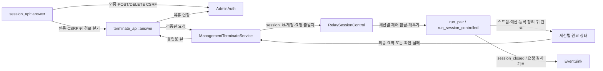

# 관리자 종료 API 모듈 설계

인증된 관리자가 `session_id`로 지정한 활성 세션 하나를 종료하고, 실제 자원 정리가 끝난 뒤 결과를 받는 구조다. HTTP 요청은 종료 의사만 전달한다. 스트림과 연결 예산을 소유한 기존 중계 작업이 정리하고 완료를 알린다. 작업 4.5의 제품 경로와 시험을 구현했다. 실제 실행 결과는 8절에서 구분한다. Q89~Q92는 사용자 결정 2026-11-02로 해결했다.

| 항목 | 값 |
| --- | --- |
| 구조 시점 | Current — 제품 경로와 단위·시스템 시험으로 확인한 범위. 남은 입증은 8절 |
| 문서 상태 | Active — 작업 4.5 사용자 지시와 Q89~Q92 적용 |
| 구현 대조 | Verified — `5a38bfc` 이후 작업 트리의 작업 4.5 변경. 2026-11-02 Windows·WSL 실행 범위는 8절 |
| 코드 위치 | `crates/app/src/management/terminate.rs`, `crates/adapters/src/management_http/terminate_api.rs`, `crates/app/src/ports.rs`, `crates/app/src/relay.rs`, `crates/app/src/relay/session.rs`, `crates/app/src/events.rs`, `crates/adapters/src/ops_log.rs`, `crates/adapters/src/request_deadline.rs`, `src/serve.rs` |
| 코드 지도 | [코드 지도](code-map.md#2-코드-위치와-구성요소) |
| 관련 스펙 | [관리 3.2·4·7절](../specs/management.md#32-관리자-종료) MGT-008~012, MGT-013·014·023; [운영](../specs/operations.md#7-수용-테스트) OPS-011·043; [중계](../specs/relay.md#7-수용-테스트) RLY-020 |
| 관련 계약 | [관리 API 1.9절](../contracts/management-api-v1.md#19-관리자-종료-post-apiv1sessionssession_idterminate), 1.1~1.4·2.1·6절; [운영 정보 1.8절](../contracts/ops-info-v1.md#18-관리자-계정명-기록-규칙) |
| 관련 ADR | [ADR-0003 메모리 상태](../decisions/ADR-0003-single-instance-memory-state.md), [ADR-0004 tokio·rustls](../decisions/ADR-0004-tokio-rustls.md) |

## 1. 책임과 경계

- 맡는 책임: 종료 요청 검증, 세션 식별자에 한정한 종료 명령, 기존 정리에 합류, 완료 알림 대기, 결과·요약 응답, 관리자 계정명을 포함한 사건 기록이다.
- 맡지 않는 책임: 로그인과 CSRF 토큰 발급은 [관리 세션](management-session.md), 조회 뷰는 [관리 조회](management-query.md), 스트림 소유·E·G·종료 원인은 [중계 수명](relay-session.md)이 맡는다. UI 확인·응답 유실 뒤 재조회는 화면과 계약의 Consumer 규칙이다.
- 문서 분리 이유: 조회는 상태를 복사하지만 종료는 상태 변경·비동기 완료·요청 경합을 다룬다. [아키텍처 작성 규칙](AGENTS.md#작성-규칙)의 “한 문서는 하나의 구조 질문에 답한다”는 원칙에 따라 `management-query.md`를 늘리지 않고 별도 모듈 설계를 둔다.
- 공개 기능: 응용 `ManagementTerminateService::request_terminate`·`complete`, 포트 `RelaySessionControl::request_terminate`, 런타임의 세션별 종료 요청 수락이다.

## 2. 내부 구조

아래 화살표는 호출·명령 전달·완료 전달이다. HTTP나 응용 서비스는 중계 스트림을 빌리거나 소유하지 않는다. `src/serve.rs`가 같은 `RelayRuntime`을 조회 포트와 종료 포트로 주입한다.

| 요소(파일·심볼) | 역할 | 만들어지는 시점과 소유자 | 의존 대상 |
| --- | --- | --- | --- |
| `management_http/session_api.rs` `answer` | 로그인 이외 요청의 인증과 POST·DELETE CSRF를 경로·메서드보다 먼저 검사한다. | 관리 요청마다 호출 | `AdminAuth`, 조회·종료 어댑터 |
| `management_http/terminate_api.rs` | 인증·CSRF 뒤 경로·메서드·폴링 헤더·형식·본문을 검사하고 응답을 직렬화한다. | 요청마다 호출 | 응용 종료 서비스, 기존 쿠키·오류 응답 헬퍼 |
| `management/terminate.rs` `ManagementTerminateService` | 동기로 명령을 수락한 뒤 `complete`에서 완료를 기다린다. 대상 없음과 정리 합류를 감사한다. | `serve`가 시작 때 생성 | `RelaySessionControl`, `Clock`, `EventSink` |
| `ports.rs` `RelaySessionControl` | 제네릭 런타임을 HTTP에서 직접 다루지 않는 종료 경계 | `RelayRuntime<C>`가 구현 | 세션 식별자, 계정명, 완료 수신 핸들 |
| `relay.rs`의 활성 등록·`SessionControl`·`run_pair` | 세션당 명령·완료 상태를 소유한다. 동기 엔진 poll과 명령 수락을 직렬화하고 실제 회수를 확인한다. | 세션 활성화부터 정리 완료까지 | `Session`, `RelayStream`, 예산, 매칭 표 |
| `relay/session.rs` `run_session_controlled` | 기존 lifecycle·시한·양방향 작업과 함께 관리자 명령을 poll한다. | 기존 세션 소유 작업 | `begin_admin_close`, E, G |
| `events.rs`·`ops_log.rs` | `admin_terminate` 사건과 관리자 계정명 직렬화 | 요청 처리 결과 확정 때 | 운영 정보 계약 |

## 3. 데이터 모델

외부 요청·응답은 [관리 API 1.9·1.10절](../contracts/management-api-v1.md#19-관리자-종료-post-apiv1sessionssession_idterminate)을 따른다. 최근 종료 목록을 다시 검색해서 응답을 만들지 않는다.

| 이름 | 필드·형태 | 저장 위치 | 제약과 항상 지켜야 할 조건 |
| --- | --- | --- | --- |
| `ActiveSessionSnapshot`·`SessionControl` | 조회 메타데이터와 비공개 제어 상태를 서로 다른 표에 둠 | `RelayState.active`·`controls`, 같은 `SessionId` 키 | 공개 스냅샷에는 채널·계정·요청자를 복사하지 않는다. 두 표는 같은 등록 전이에서 추가·제거한다. |
| `AdminClose` | 인증된 `AccountName`, 실제 `PeerIp` | `SessionControl.admin`의 단일 최초 요청 | 수락 시각은 단일 `watch<Option<Duration>>` 명령에 보존한다. 입력 계정명·중계 ID를 받지 않는다. |
| `TerminationTicket`·`AcceptedTermination` | 새 종료 여부, 완료 수신자, 응용 서비스가 보존하는 인증·대상 문맥 | 요청 처리 수명 | 새 종료 여부는 최초 수락 때 확정한다. 소유자의 뒤늦은 명령 수신 시점으로 뒤집지 않는다. |
| 완료 상태 | `watch<Option<Result<Arc<ClosedSessionSnapshot>, ()>>>` | 세션별 `SessionControl.completion` | 알림 전에 완료돼도 결과를 읽는다. 성공 요약은 R=0·목록 축출과 무관하게 보유한다. |
| `TerminateView` | `as_of`, `result`, `closed_session` | 응답 생성 때 | 성공의 요약은 필수·non-null이다. R=0·목록 축출·동시 다른 종료에도 요약을 잃지 않는다. |

`closed_session`에는 `session_id`, `mode`, `viewer_transport`, `started_at`, `ended_at`, 두 방향 최종 바이트 정수, 실제 `close_cause`만 넣는다. 시각은 UTC 밀리초 3자리이고 `ended_at >= started_at`이다. 주소·관리자 계정·CSRF·원시 데이터·중계 ID를 넣지 않는다. `as_of`는 응답을 만드는 시점이다. 이는 계약 1.1.1·1.9·1.10절에 따른 **이 문서의 판단**이다.

## 4. 처리 순서

### 4.1 검증과 명령 수락

[관리 API 1.3절](../contracts/management-api-v1.md#13-요청-처리-순서)을 그대로 따른다. 로그인 예외를 제외하면 인증(401) → POST·DELETE의 CSRF(403) → 경로·메서드·`X-Relay-Poll`·`session_id` 형식·본문(404·405·400) → 처리 순서다. terminate의 본문은 `Content-Type`과 관계없이 400이며 415 규칙보다 우선한다(사용자 결정 2026-11-02(Q89)). 앞 단계에서 거절하면 뒤 단계는 하지 않는다.

| 순서 | 코드 위치 | 조건·계산 | 바뀌는 상태 | 결과를 쓰는 곳 |
| --- | --- | --- | --- | --- |
| 1 | `session_api::answer` | `AdminAuth::authorize` 실패는 경로·메서드보다 먼저 401. 기존 쿠키 삭제·`WWW-Authenticate` 규칙 재사용 | 중계 변화 없음 | 응답 또는 인증된 요청 |
| 2 | `session_api::answer`, `AdminAuth::check_csrf` | 모든 POST·DELETE에 기존 단일 헤더 읽기와 상수 시간 토큰 비교 사용. 없거나 중복·불일치면 경로·메서드를 보기 전에 403. 계정은 `AuthorizedAdmin`에서 얻음 | 관리 세션·중계 유지 | 다음 검사 |
| 3 | `terminate_api` 경로 분기 | 정확한 `/api/v1/sessions/{session_id}/terminate`만 취급. 경로 없음은 404, 다른 메서드는 405와 `Allow: POST` | 없음 | 다음 검사 |
| 4 | 폴링 헤더 검사 | POST의 `X-Relay-Poll`은 값에 관계없이 400 | 없음 | 다음 검사 |
| 5 | 형식 검사 | 기존 ASCII 길이 1~64·영숫자·`_`·`-` 검사 재사용. 형식 오류는 400. 형식은 맞으나 내부 정규 ID로 해석되지 않는 값은 조회 결과 404 | 없음 | 다음 검사 |
| 6 | 본문 검사 | 본문은 없어야 함. 실제 본문이 있으면 `Content-Type`과 관계없이 400 `invalid_request`. 공통 415 규칙보다 우선함(사용자 결정 2026-11-02(Q89), 계약 1.9절) | 없음 | 다음 검사 또는 오류 |
| 7 | 종료 포트 | 활성 표에서 제어 핸들을 복제하고 상태 잠금을 놓는다. 세션별 제어 잠금으로 소유자의 동기 poll과 수락을 직렬화한다. 수락 시각부터 E를 재며, `closing`이면 완료를 기다린다. 이미 제거됐거나 완료했으면 최근 목록에 있어도 404다. | 새 종료 또는 기존 정리 합류 | `TerminationTicket` |
| 8 | `AdminAuth::touch` | 검증·수락된 사용자 행동 요청만 기존 Sa를 넘지 않게 Si 연장. 수락 시 인증·계정을 확정하고 대기 뒤 재검증하지 않음(계약 1.3절 5단계). 거절 요청은 연장하지 않음 | 관리 세션 유휴 기한 | 비동기 완료 대기 |

본문 검사는 선언된 길이만 믿지 않고 chunked 본문도 확인한다. 빈 본문의 `Content-Type`은 요구하지 않는다. 본문을 끝없이 모으지 않으며 기존 관리 I/O의 U 경계를 사용한다. 본문 오류·미완료 요청에서는 종료 명령을 보내지 않는다. 본문 검증이 끝나기 전에는 U를 멈추지 않는다(사용자 결정 2026-11-02(Q89), 사용자 결정 2026-11-02(Q92)).

### 4.2 중계 소유자의 정리와 알림

1. 세션 소유자는 관리자 명령 채널을 기존 lifecycle·시한과 함께 poll한다. 아무 데이터도 오지 않는 유휴 세션도 명령으로 깨어나야 한다. 채널 종료 자체를 관리자 종료로 해석하지 않는다.
2. 세션별 제어 잠금으로 확정한 순서대로 `Session::begin_admin_close(accepted_at)`를 적용한다. 새 종료를 수락한 계정을 보존하고 조회 상태에 `closing`을 공개한다. 자연 EOF·오류·Force·다른 관리자 정리가 먼저면 기존 정리에 합류하며 원인·계정·E를 바꾸지 않는다. 소유자의 한 번의 동기 poll도 같은 제어 잠금을 잡으므로, 늦게 관찰한 자연 사건이 이미 수락한 관리자 종료를 앞서지 않는다. 제어 잠금 뒤 활성 표 잠금을 잡으며, 활성 표에서 핸들을 찾을 때는 표 잠금을 놓은 뒤 제어 잠금을 잡는다. 잠금을 든 채 `await`하지 않는다.
3. 관리자 종료를 선택한 뒤 새 애플리케이션 데이터를 읽거나 새 메시지를 쓰기 시작하지 않는다. 이미 시작한 WS 프레임만 기존 방향 버퍼에서 `pending_write_len()` 이하로 마무리한다. 그 성공한 부분 쓰기는 최종 카운터에 더한다. 새 TCP 읽기는 하지 않으며 수락 시각의 E를 유지한다. 프레임 뒤 `RelayCloseAction::AdminTerminated`로 Close 4005를 진행한다. TCP는 양 끝점을 닫는다. 미전달 데이터의 완전 도착은 보장하지 않는다(중계 스펙 3.4절, 중계 수명 Q83).
4. 처음 정리를 시작한 시각으로 절대 E를 유지한다. 관리자 정리도 매 시한 검사에서 `expire_close`를 적용한다. E와 같은 시각이면 만료다. 후속 종료 요청으로 E를 다시 시작하지 않는다. E 만료 시 끝나지 않은 정리 교환을 기다리지 않고 로컬 스트림·버퍼를 회수한다. 회수가 확인되면 `close_timeout` 요약을 가진 `terminated`가 가능하며, E 만료 자체를 500으로 바꾸지 않는다(계약 1.9절 253행).
   합류 요청도 같은 절대 정리 시한을 공유하므로 남은 E만 기다린다. E+5는 Consumer의 응답 대기 여유이며 서버 기한을 늘리지 않는다. 검증·수락된 완료 대기 동안만 연결별 U를 멈춘다. `request_deadline.rs`의 연결별 제어가 첫 응답 쓰기에서 U를 다시 잰다. 검증과 그 밖의 요청은 기존 U를 유지한다(사용자 결정 2026-11-02(Q92)).
5. 기존 순서대로 두 스트림을 버린 뒤 L permit을 돌려준다. `Session::finish`로 최종 요약을 만든다. 같은 상태 잠금 아래 활성 제거·Mode II 점유 해제·최근 종료 추가를 끝내고 `session_closed`를 정확히 한 번 기록한다. 소유자 취소나 `finish` 실패 경로도 활성 등록을 제거하면 이 사건을 생략하지 않는다.
6. 성공 시에만 공유 완료 상태에 응답용 최종 요약을 게시한다. 확인 실패는 `terminate_failed`로 전달하되 `session_closed`와 구분한다. 종료 가드는 식별자·시작 시각·실제 전송 카운터·최초 정리 원인·계정을 보존하고, 제거 전에 실제 회수와 사건 기록을 한 번 수행한다. 정리 실패를 새 원인으로 만들지 않는다. 관리자 정리가 먼저면 `admin_terminated`, 자연 정리가 먼저면 그 최초 원인을 쓴다. 단, 관리자 정리의 E가 만료되면 `close_timeout`이며 EOF를 관찰하지 않았으면 `side`를 생략한다. 이 `session_closed`에는 `admin_account`를 넣지 않고 `admin_terminate`로 계정을 추적한다(사용자 결정 2026-11-02(Q91)). `engine_completed`만으로 완료 응답하거나 조회에서 정리 중 항목을 먼저 숨기지 않는다. R=0에서도 성공 완료 핸들은 요약을 보유한다.
7. 요청 처리자는 락 없이 완료 수신자를 `await`한다. 성공은 200, 확인 실패는 500 `terminate_failed`다. 기다리는 동안 소켓 펌프를 직접 poll하거나 바쁜 반복·동기 대기를 하지 않는다. HTTP가 소유자 작업을 취소하거나 같은 세션을 별도 작업으로 다시 정리하지 않는다.

세션당 명령 슬롯·완료 상태를 두고 요청자는 수신 핸들만 복제한다. 스트림·B 크기 버퍼·permit을 복제하지 않는다. 완료 요약과 제어 상태는 마지막 소유자·수신자가 사라지면 해제한다. 반복 요청을 무제한 명령 큐로 쌓지 않는다. 이는 기존 단일 소유자와 짧은 상태 잠금 패턴을 유지하기 위한 **이 문서의 판단**이다([중계 수명 6절](relay-session.md#정리-순서와-정확히-한-번-반환)).

### 4.3 결과·경합·로그

| 상황 | 응답·상태 | 사건 처리 |
| --- | --- | --- |
| 이 요청이 종료를 시작하고 정리 완료 | 200 `terminated`; 실제 원인은 `admin_terminated` 또는 E 만료의 `close_timeout` | `session_closed` 뒤 `admin_terminate`의 `terminated`. `admin_terminated`인 종료 사건만 최초 수행 계정을 포함하며 `close_timeout`의 계정은 감사 사건으로 추적(Q91) |
| 첫 요청이 정리 중일 때 다른 요청 | 정리 완료 뒤 200 `already_closed`; 동일 최종 요약, E 불연장. 기존 정리 확인 실패면 동일하게 500 | `session_closed` 추가 기록 없음. 요청 계정과 `session_id`를 담은 `admin_terminate(result=already_closed)`·info(Q90) |
| 자연 종료가 먼저 시작됨 | 남은 정리 완료 뒤 200 `already_closed`; 자연 원인 유지 | 관리자 원인으로 재분류하지 않음. 요청 계정과 `session_id`를 담은 `admin_terminate(result=already_closed)`·info(Q90) |
| 활성 등록 조회 전에 정리 완료·동일 ID 재사용 | 404; 새 세션이나 최근 종료 항목을 종료하지 않음 | `admin_terminate` `not_found`, `session_id` 없음 |
| 정리 완료를 확인하지 못함 | 500 `terminate_failed`; 성공 요약을 만들지 않음 | 활성 제거 시 최초 정리 원인으로 `session_closed`를 반드시 한 번 기록한 뒤 `admin_terminate` `failed`·error. 인증 계정·실제 출발지·유효 대상 `session_id` 포함 |

`admin_terminate`와 종료 원인 `admin_terminated`는 서로 다른 이름이다. `session_closed`가 `admin_terminated`이면 `admin_account`가 필수다. `admin_terminate`에는 항상 인증된 계정과 실제 소켓 `peer_ip`를 넣는다. 응답에는 계정명을 넣지 않는다. 기존 sink 실패 정책은 정리를 중단하지 않는다. 성공·실패와 관계없이 활성 제거의 `session_closed` 뒤 감사 사건을 남긴다(운영 정보 계약 1.5·1.8절). `already_closed`의 종료 사건은 실제 최초 원인을 유지하고 합류 요청 계정은 감사 사건에만 쓴다(사용자 결정 2026-11-02(Q90)). 관리자 E 만료의 `close_timeout`에서는 EOF가 없으면 `side`를 생략한다. `session_closed.admin_account`는 생략하고 같은 `session_id`의 `admin_terminate`로 계정을 추적한다(사용자 결정 2026-11-02(Q91)).

## 5. 상태와 초기화

- 초기화: 기존 `serve`에서 같은 중계 런타임·시계·로그를 종료 서비스에 넣고 관리 리스너에 주입한다. 테스트용 빈 런타임을 제품 코드에 만들지 않는다.
- 수명: 활성화 때 종료 제어·완료 상태와 최종 사건에 필요한 자료를 함께 만들고 원래 세션 소유자가 완료 발신자를 가진다. 자연 종료도 동일 알림을 보내야 `already_closed` 대기가 끝난다. 소유자가 중간에 사라지면 가드가 자원 회수·활성 제거·최초 원인의 `session_closed` 기록 뒤 확인 실패를 게시하며 영원히 Pending을 남기지 않는다.
- 취소 안전성: 요청자의 연결 해제·응답 유실은 이미 수락한 종료를 되돌리지 않는다. 소유자가 최초 명령과 감사 문맥을 보존한다. 합류 요청은 살아 있는 수신 처리자가 감사하며, 취소된 합류자의 문맥을 별도 보관하지 않는다. 인증·계정은 수락 때 확정하고 완료 시 재검증하지 않는다. 이는 **이 문서의 판단, 사용자 결정 없음**이다(7.1절).
- 종료 유예: Running뿐 아니라 Grace에서도 로그인·조회·종료를 처리한다(운영 스펙 3.4절). G 만료나 두 번째 신호를 E만큼 늦추지 않는다. Force와 명령도 같은 상태 잠금 아래 직렬화하고 이미 만료된 Force를 먼저 반영한다. 관리자가 먼저 정리를 시작했다면 원인을 보존하고, Force가 먼저 시작했다면 관리자는 기존 정리에 합류한다. 이는 Q82와 수락 선형화에 따른 **이 문서의 판단, 사용자 결정 없음**이다(7.1절).
- 잠금: 활성 표에서 제어 핸들을 복제한 뒤 표 잠금을 놓는다. 세션별 제어 잠금은 명령 수락과 엔진의 한 번의 동기 poll을 직렬화한다. 이 잠금 안의 짧은 활성 표 갱신은 허용한다. 어떤 잠금도 정리 알림·네트워크·타이머의 `await`를 넘기지 않는다.

## 6. 오류 처리

| 실패 지점 | 처리 방법 | 남는 상태 | 관련 시나리오 |
| --- | --- | --- | --- |
| 관리 세션 없음·무효·만료 | 401와 기존 인증 헤더·쿠키 삭제 규칙 | 모든 중계 유지, 감사 종료 사건 없음 | MGT-008 |
| CSRF 없음·중복·불일치 | 403 `csrf_invalid` | 관리 로그인·대상·다른 세션 유지 | MGT-014 |
| 잘못된 경로·메서드·ID·본문·폴링 헤더 | 404·405·400, 앞선 단계에서 중단 | 종료 명령·유휴 연장 없음 | 계약 오류 시험 |
| 정규 형식이지만 없는·끝난 대상 | 404 `not_found` | 새 세션 유지 | MGT-010·011·023 |
| E 만료 뒤 로컬 자원 강제 회수 확인 | 200, 시작 요청은 `terminated`, 요약 원인 `close_timeout` | 활성·점유 제거, 예산 반환 | MGT-009·011, RLY-020 |
| 소유자 소멸·모델 종료 실패·완료 확인 실패 | 500 `terminate_failed`; 가짜 성공 요약 없음 | 가드로 로컬 자원·활성·점유 회수. 제거 시 최초 정리 원인의 `session_closed`를 반드시 한 번 기록. 남은 상태는 재조회 | MGT-012 |
| HTTP 응답 유실 | 완료 여부를 응답으로 보장할 수 없음; 이미 수락한 정리는 지속 | Consumer는 자동 재전송 없이 재조회 | MGT-012 |

로컬 자원·등록 회수와 최종 요약이 확인되면 `poll_close` 오류만으로 실패시키지 않는다. 소유자 소멸·모델 종료 실패·완료 확인 실패는 500이다. HTTP의 실패 결과와 수명 사건은 별개이므로 활성 제거 시 `session_closed`를 생략하지 않는다. 원인은 정리를 시작한 첫 원인이며 실패 자체로 바꾸지 않는다(운영 정보 계약 1.5·1.6절). 이는 **이 문서의 판단, 사용자 결정 없음**이다. 관리자 정리의 E 만료는 `close_timeout`으로 바꾸는 예외다(사용자 결정 2026-11-02(Q91)). 계약 2.1절 경로 표는 `internal`도 허용하지만 이 설계는 구현에 없는 내부 실패 분기를 만들어 넣지 않는다.

## 7. 설계 선택과 테스트 계획

### 7.1 설계 선택

| 선택 | 이유 | 다른 방법 | 근거 |
| --- | --- | --- | --- |
| 조회와 종료 문서·서비스 분리 — 이 문서의 판단 | 읽기 뷰와 상태 변경·완료 소유권의 책임이 다름 | 조회 서비스에 명령 메서드를 섞음 | [아키텍처 작성 규칙](AGENTS.md#작성-규칙), 관리 스펙 3.1·3.2절 |
| 기존 소유자에게 종료 전달 — 이 문서의 판단 | 다른 세션 펌프를 막지 않고 자원 반환을 한 곳에서 확인 | HTTP가 스트림을 직접 닫거나 전역 런타임 종료 | 관리 스펙 MGT-R06, 중계 수명 6절 |
| 실제 종료 요약을 완료 핸들로 전달 — 이 문서의 판단 | R=0에서도 필수 `closed_session` 제공 | 최근 종료 목록 재검색·임시 성공 요약 | 관리 API 247행·1.10절 |
| 일반 정수 카운터와 기존 ID·CSRF 헬퍼 재사용 — 이 문서의 판단 | 별도 집계·다른 식별자 문법을 만들지 않음 | 별도 종료용 ID·로그인 토큰 비교 | 관리 API 1.4·1.8·1.9절 |
| E 초과는 강제 회수 뒤 성공 가능 — 이 문서의 판단 | `close_timeout`이어도 `terminated`라는 계약을 그대로 적용 | E 만료를 무조건 `terminate_failed`로 매핑 | 관리 API 253·257행 |
| 수락 선형화·E 시작 — 이 문서의 판단, 사용자 결정 없음 | 세션별 제어 잠금으로 자연 종료·관리자 요청·Force의 모델 적용 순서를 직렬화한다. 최초 계정·결과는 한 번 확정하며 수락 시각부터 E를 잰다. 전체 활성 표 잠금은 짧은 조회·갱신에만 쓴다. | 소유자가 명령을 관찰할 때 결과를 다시 판정하거나 E를 시작 | 관리 API 1.9절의 active·closing·부재 구분과 E 한도, 중계 수명 6절의 전이 직렬화 |
| 확인 실패와 수명 사건 분리 — 이 문서의 판단, 사용자 결정 없음 | 실제 회수·최종 요약 확인이 기준이다. transport close 오류만으로 실패시키지 않되 확인 실패는 500. 활성 제거 시 최초 원인의 `session_closed`를 반드시 한 번 낸다. | 모든 poll_close Err를 실패 처리하거나 실패 경로의 종료 사건을 생략 | 관리 API 1.9·2.1절, 운영 정보 1.5절의 시작·종료 짝(160행)·1.6절의 최초 원인 |
| 요청 연결 해제 뒤 최초 명령·감사 보존 — 이 문서의 판단, 사용자 결정 없음 | 소유자는 정리와 최초 요청 감사를 계속한다. 합류자는 살아 있는 수신 처리자가 감사하고 취소된 합류자의 문맥은 별도 보관하지 않는다. | 수락된 모든 합류자 문맥을 완료까지 별도 보존 | 관리 API 1.9절 Consumer의 응답 유실·자동 재전송 금지·재조회, 운영 정보 1.5절의 처리 결과 시점 감사 |
| 수락 때 인증·계정 확정 — 이 문서의 판단, 사용자 결정 없음 | 대기 중 만료·로그아웃으로 이미 수락한 동작·응답·감사 계정을 바꾸지 않는다. 완료 시 인증을 반복하지 않는다. | 완료 때 재검증하여 401로 대체 | 관리 API 1.3절 5단계의 처리·사용자 행동 유휴 연장, 1.4.1절 로그아웃의 중계 독립 |
| Force와 관리자 종료의 최초 원인 보존 — 이 문서의 판단, 사용자 결정 없음 | 같은 전이 순서에서 만료된 Force를 먼저 반영하되 이미 수락·시작한 관리자 원인은 보존한다. 관리자는 먼저 시작한 Force 정리에 합류한다. | 늦게 처리한 Force로 관리자 원인을 덮어씀 | 운영 정보 1.6절 238행 Q82, 위 요청 수락 선형화 |

### 7.2 시험 범위

`tests/management_terminate.rs`는 실제 프로세스·HTTP·TCP·WS·WSS를 사용한다. 소유자 취소·정확한 E 경계는 응용 단위 시험이 보충한다. 표의 계획 범위 중 실행으로 입증한 부분만 8절에 적는다. 전체 행을 입증하지 못한 표식은 `partial`을 유지한다.

| 시나리오 | 계획 위치·수준 | 입력·관찰·판정 범위 |
| --- | --- | --- |
| MGT-008 | `crates/adapters/tests/management.rs`, 새 `tests/management_terminate.rs` | 실제 활성 두 세션에 로그인 없는 직접 POST. 401, 두 스트림·카운터 유지. 만료·로그아웃·재시작 쿠키도 추가 확인 |
| MGT-009 | `tests/management_terminate.rs`, `relay.rs` 단위 | TCP·WS·WSS, Mode I·II의 여러 활성 세션 중 하나 종료. 소켓·L·등록 회수 뒤 응답, `closing` 포함, 나머지 전송 유지, `closed_session` 최종 값·R=0 |
| MGT-010 | `tests/management_terminate.rs` | 같은 중계 ID로 새 세션을 만든 뒤 옛 `session_id`로 종료. 404, 새 세션의 데이터·수명 유지 |
| MGT-011 | `relay.rs` 제어 가능한 단위, 시스템 | 자연 종료 전·중·후, 두 관리자 동시 요청, 응답 뒤 반복. `terminated` 하나·합류 `already_closed`·완료 후 404를 구분, 최초 원인·계정·E 불변 |
| MGT-012 | `relay.rs`·`management/terminate.rs` 단위, 어댑터 통합(실패하는 가짜 중계 제어 포트), HTTP 응답 유실 시스템 | 실제 소유자 취소·완료 채널 소멸·모델 종료 실패로 확인 실패를 유도. 500·성공 요약 없음. 활성 제거 시 최초 원인의 `session_closed` 1회와 시작 사건의 짝 확인. 수락 뒤 HTTP 연결을 끊어도 소유자는 정리·최초 요청 감사 지속. 어댑터 통합 시험이 실제 관리 HTTP·인증·직렬화로 500과 응답 유실을 한 함수에서 확인한다(사용자 결정 2026-11-04(Q95)). Consumer의 결과 불명 표시·재조회는 화면 시나리오 DASH-012·DASH-013이 맡는다 |
| OPS-011 | `crates/adapters/tests/ops_info_contract.rs`, `tests/management_terminate.rs` | 실제 수행 계정·실제 peer·level·결과·식별자 생략과 한 줄 JSON. 성공·terminate_failed 모두 활성 제거 시 `session_closed` 1회가 감사보다 먼저임을 확인. `already_closed`의 info·session_id(Q90), 관리자 E 만료의 close_timeout·EOF 없으면 side 생략·종료 사건 계정 생략과 감사 계정 추적(Q91). 이미 있는 중계 사건 증거와 합쳐 전체 행을 판단 |
| RLY-020 관리자 종료 부분 | `relay/session.rs` 단위·시스템 | `duplex`와 제어 가능한 `poll_close`·멈춘 시계로 E 직전·동일 시각·오류·계속 Pending을 관찰. 한 세션 회수·활성 수·원인 확인. EOF·연결 오류의 기존 증거도 유지 |
| MGT-013·014·023 | 어댑터·시스템 | 종료 실패의 비밀 비노출, CSRF 거절의 상태 유지, 관리자 종료의 최근 종료 기록·옛 ID 상세/종료 404를 보충 |
| OPS-043 | 종료 유예 시스템·소유자 단위 | Grace 중 로그인·요약·관리자 종료·readyz를 함께 확인. G<E·두 번째 신호·Force 경합은 원인 보존과 시한 불연장 확인 |
| 계약 순서·경계(시나리오를 억지로 연결하지 않음) | 어댑터 단위·계약 | 잘못된 POST·DELETE 경로+CSRF 없음은 403, 비변경 메서드는 CSRF 생략 뒤 404/405. 폴링 헤더 오류가 ID·본문보다 먼저임을 확인. ID 오류+본문, JSON/비JSON/chunked 본문은 모두 400(Q89), 빈 본문, R=0·축출, 늦은 수신자·소유자 소멸. E>U여도 검증·수락된 완료 대기 연결은 유지하고 응답 쓰기부터 U 재개(Q92), 대기 중 관리 만료·로그아웃 |

## 8. 현재 구조와 검증 범위

`5a38bfc` 이후 작업 트리에서 작업 4.5의 제품 경로와 시험을 대조했다. 2026-11-02 Windows와 WSL Ubuntu에서 아래 범위를 실행했다. 같은 작업 트리에는 WS keepalive의 공유 포트·진입 단계 변경도 포함한다. 계약의 실행 기록과 TODO 완료 판정은 별도로 관리한다.

| 항목 | 현재 코드와 확인할 내용 |
| --- | --- |
| 진입·검증 | `session_api::answer`가 전체 POST·DELETE CSRF를 먼저 검사한다. `terminate_api`가 정확한 경로·메서드·폴링 헤더·ID·실제 본문을 순서대로 검사한다. |
| 수락·완료 | `RelaySessionControl`이 세션별 제어 핸들을 반환한다. `run_session_controlled`는 무데이터 유휴 세션도 명령으로 깨운다. `run_pair`는 스트림·L·등록 정리와 `session_closed` 뒤 실제 요약을 게시한다. |
| 취소·실패 | `ActiveGuard`가 실제 `Session` 모델을 소유한다. 소유자 취소 때 스트림·permit 반환 뒤 대기 중 관리자 명령을 먼저 적용하고 `Session::finish_after_owner_loss`를 한 번 호출한다. 같은 `ClosedSession`으로 `session_closed`와 최근 목록을 만든다. 원인·side·시각·카운터를 별도 제어 복사본에서 가져오지 않는다. typed `error_kind`는 모델 갱신 콜백이 즉시 보존하고 최종 원인이 `connection_error`일 때만 쓴다. 등록·점유 제거와 종료 사건 뒤 실패 완료를 게시한다. 최초 원인은 유지한다. 원인이 없으면 Running은 `internal_error`, Grace·Force는 `server_shutdown`이다(사용자 결정 2026-11-02(Q94)). `internal_error`는 운영 정보 계약 1.3절에 따라 `warn`이다. panic 되감기가 스트림을 버리므로 WS Close를 보내지 못한다(구현 한계, 이 문서의 판단, 사용자 결정 없음, [WebSocket 계약 2.2절](../contracts/websocket-relay-v1.md#22-close-코드와-스펙-오류의-대응)). 최초 관리자 문맥은 HTTP 취소와 무관하게 런타임이 감사한다. |
| 활성 가시성 | 조기 `engine_completed` 제외를 제거했다. 스트림·permit·등록 회수 전까지 `closing`이 활성 수에 남는다. Force도 이 실제 정리 중 세션을 센다. |
| E·감사 | 활성 표 잠금 아래 읽은 단일 수락 시각으로 먼저 G 만료를 판정한다. G와 같거나 늦으면 Force를 적용한 뒤 기존 정리에 합류한다. 새 관리자 종료만 그 시각부터 E를 잰다. E 만료는 `close_timeout`, EOF 없으면 `side` 없음, 종료 사건 계정 없음이다. 계정은 `admin_terminate`로 추적한다. |
| U | `request_deadline.rs`의 연결별 제어를 통해 수락된 완료 대기만 멈춘다. 응답 쓰기가 U를 다시 시작한다. 검증 단계·다른 연결은 멈추지 않는다. |
| 시스템 시험 | `tests/management_terminate.rs` 7개는 Windows 3회와 WSL 1회 모두 통과했다. 같은 실행의 `management_query`는 Windows 16개·WSL 17개, `management_session`은 각 3개 모두 통과했다. MGT-008·009·010·011·014·023은 전체 표식이다. MGT-012·013, OPS-011, RLY-020은 아래 남은 범위 때문에 부분 표식이다. |
| 단위·회귀 | 최종 리뷰 보정 뒤 양 OS의 `cargo clippy --workspace --all-targets -- -D warnings`와 `cargo test -p vnc-relay-app -p vnc-relay-adapters`가 통과했다(응용 각 122개, 어댑터 단위 Windows 99개·WSL 100개와 모든 통합 시험). 같은 엔진 poll에서 EOF 뒤 panic이 나도 로그와 최근 목록의 최종 요약이 같고 종료 사건이 한 번인 회귀 시험을 포함한다. 변경한 domain 시험 89개도 Windows에서 통과했다. `management_terminate` 7개는 최종 보정 뒤 Windows·WSL 각 1회 다시 통과했다. 변경 파일 rustfmt를 적용했고 최종 변경 `relay.rs`의 rustfmt check도 통과했다. |
| 남은 입증 | 실제 네트워크 입력만으로 `500 terminate_failed`를 결정적으로 만들 수 없었다. 제품용 실패 훅은 넣지 않았다. 실제 소유자 취소의 실패 완료·자원 반환·사건 순서, 서비스의 실패 완료·채널 소멸, 어댑터의 500 직렬화는 각각 단위 시험으로 통과했다. HTTP 500 종단 간 경로와 Consumer 화면의 결과 불명·재조회 동작은 미입증이다. OPS-011 전체 운영 사건 행과 RLY-020의 EOF·연결 오류 전체 범위도 새 관리자 종료 시험의 full 표식으로 대신하지 않는다. |

실행 중 시험의 세 가지 문제를 바로잡았다. 관리 어댑터의 유휴 만료 시험을 실제 정책 Si=600초에 맞췄다. Windows의 비동기 listener에서 받은 Mode I 시험 소켓을 blocking으로 바꿨다. 기존 조회 시험은 CSRF 없는 POST에 405를 기대했으므로, 올바른 CSRF를 넣어 인증→CSRF→메서드 순서를 유지했다. 이 보정 후 위 최종 반복 시험이 통과했다.

Windows Cargo 실행에는 `CARGO_TARGET_DIR=D:/vr-target-term`, `AWS_LC_SYS_PREBUILT_NASM=1`, `TEMP=TMP=D:/vr-tools/tmp`를 사용했다. WSL은 `CARGO_TARGET_DIR=$HOME/vnc-relay-target-term`을 사용했다. 관리 시스템 시험 명령은 양쪽 모두 `cargo test --test management_terminate --test management_query --test management_session`이다.

전체 게이트(커밋 `59fc535`): Windows `vr-win.ps1 -Only all`은 2026-11-01T23:41:53Z 보고서에서 `ALL PASSED (all)`이다(통과 77, 부분 61, 실패 0, 미연결 12). WSL `vr-full.sh`는 23:51:07Z 보고서에서 `FAILED: scenarios`다(통과 81, 부분 55, 실패 2, 미연결 12). 실패 2건은 이 작업과 무관한 RLY-025·026 netns 시험이며, WSL에 `nft`가 없어 실패했다(사용자 결정 2026-11-02(Q93)). `tests/management_terminate.rs` 7건과 관련 단위 시험은 두 OS에서 모두 통과했다. 두 OS의 판정은 MGT-008·009·010·011·014·023 통과, MGT-012·013·OPS-011·RLY-020 부분이다. 계약 실행 기록은 [관리 API 5절](../contracts/management-api-v1.md#5-예제와-계약-테스트)과 [운영 정보 계약 실행 기록](../contracts/ops-info-v1.md#계약-테스트-실행-기록)에 있다.

작업 4.5 완료 대조(2026-11-04): 위 표의 "남은 입증"을 아래 시험으로 채웠다. 커밋 `b0c25f9`의 두 OS 게이트(WSL 2026-11-04T12:01:00Z `ALL PASSED`, Windows 12:08:11Z `ALL PASSED (all)`)에서 MGT-008~012, OPS-011, RLY-020이 모두 두 OS에서 통과했다. 작업 4.5의 완료 조건을 모두 충족했다.

| 시나리오 | 비부분 증거 | 커밋 |
| --- | --- | --- |
| MGT-012 | `crates/adapters/tests/management.rs`의 `completion_mgt012_failed_control_and_lost_response_never_invent_completion`. 실패하는 가짜 중계 제어 포트를 실제 관리 HTTP·인증·직렬화에 연결해 HTTP 500 종단 간 경로와 응답 유실 뒤 소유자 정리를 한 함수에서 확인한다(사용자 결정 2026-11-04(Q95)). 제품 코드에 실패 훅은 없다. | `bb44c4f` |
| OPS-011 | `tests/relay_log_scenarios.rs`의 `operations_log_records_contract_events_and_correlates_identifiers`. 실행파일의 수락·거절·대기·매칭·연결 실패·종료와 관리자 종료 사건을 한 실행에서 확인한다. 순서는 로그 줄 순서로 판정한다(`b0c25f9`). | `b5c1a78`, `b0c25f9` |
| RLY-020 | `tests/management_terminate.rs`의 `completion_mgt023_eof_connection_error_and_admin_history_have_final_fields_and_old_ids_404`. EOF·연결 오류·관리자 종료를 한 함수에서 확인한다. | `b5c1a78` |

Consumer 화면의 결과 불명·재조회 동작은 이 작업의 범위가 아니며 화면 시나리오 DASH-012·DASH-013(작업 4.11)이 맡는다.

## 9. 미결정 사항

Q89~Q92는 모두 해결했다. 아래 표는 결정 근거다. 구현·시험 범위는 8절을 따른다. 검증 순서는 계약 1.3절을 따른다. 수락 선형화·실패 판정·취소·인증 수명·Force 경합은 7.1절의 **이 문서의 판단, 사용자 결정 없음**으로 유지한다.

| 항목 | 문서 근거와 결정 | 선택 | 영향·확정 위치 |
| --- | --- | --- | --- |
| (해결) Q89: terminate 본문 | 모든 본문은 `Content-Type`과 관계없이 400 `invalid_request`. 1.9절 특수 규칙이 1.1절의 415보다 우선한다. | A | 사용자 결정 2026-11-02(Q89), 관리 API 1.1·1.9절과 본문 계약 시험 |
| (해결) Q90: `already_closed` 감사 결과 | `admin_terminate.result=already_closed`를 추가한다. `info`이며 `session_id`를 포함한다. `session_closed`는 실제 최초 원인을 유지한다. | A | 사용자 결정 2026-11-02(Q90), 운영 정보 1.5절 |
| (해결) Q91: 관리자 E 초과의 원인·side·계정 | `close_cause=close_timeout`. EOF가 없으면 `side` 생략. `session_closed.admin_account`는 생략하며 계정은 `admin_terminate`로 추적한다. | A | 사용자 결정 2026-11-02(Q91), 관리 API 1.9절·운영 정보 1.6절 |
| (해결) Q92: 관리 연결 U와 E 대기 | 검증·수락된 terminate의 완료 대기 중에만 U를 멈추고 응답 쓰기부터 다시 잰다. Q25의 예외다. | A | 사용자 결정 2026-11-02(Q92), 설정 계약 1.2절·관리 리스너 설계 4절·E>U 시험(TODO 4.5) |

관리 API 6절의 Q88 주소 표기는 사용자 결정 2026-11-02(Q88)으로 해결했다. 로그인 CSRF 브라우저 관찰과 기본 인증 창 관찰은 2026-11-04에 Safari를 빼고 해결했다([관리 로그인과 세션 대조 기록](management-session.md#작업-43-증거-보강과-브라우저-관찰2026-11-04)). 종료 응답에는 주소가 없고 로그인 구현도 바꾸지 않으므로 이 작업에서 새 선택을 하지 않는다. `server_shutdown` 종료 항목의 외부 조회는 2026-11-04에 실제 Grace → Force 시험으로 확인했다([관리 조회 대조 기록](management-query.md#작업-44-완료-대조2026-11-04)).
