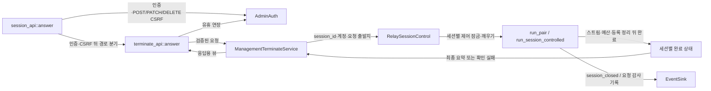

# 관리자 종료 API 모듈 설계

인증된 관리자가 `session_id`로 지정한 활성 세션 하나를 종료하고, 실제 자원 정리가 끝난 뒤 결과를 받는 구조다. HTTP 요청은 종료 의사만 전달한다. 스트림과 연결 예산을 소유한 중계 작업이 정리하고 완료를 알린다.

| 항목 | 값 |
| --- | --- |
| 구조 시점 | Current |
| 문서 상태 | Active |
| 구현 대조 | Verified — [현재 구조와 검증 범위](#8-현재-구조와-검증-범위) |
| 코드 위치 | `crates/app/src/management/terminate.rs`, `crates/adapters/src/management_http/terminate_api.rs`, `crates/app/src/ports.rs`, `crates/app/src/relay.rs`, `crates/app/src/relay/session.rs`, `crates/app/src/events.rs`, `crates/adapters/src/ops_log.rs`, `crates/adapters/src/request_deadline.rs`, `src/serve.rs` |
| 코드 지도 | [코드 지도](code-map.md#2-코드-위치와-구성요소) |
| 관련 스펙 | [관리 3.2·4·7절](../specs/management.md#32-관리자-종료) MGT-008~012, MGT-013·014·023·055; [운영](../specs/operations.md#7-수용-테스트) OPS-011·043; [중계](../specs/relay.md#7-수용-테스트) RLY-020 |
| 관련 계약 | [관리 API 1.9절](../contracts/management-api-v1.md#19-관리자-종료-post-apiv1sessionssession_idterminate), 1.1~1.4·2.1·6절; [운영 정보 1.8절](../contracts/ops-info-v2.md#18-관리자-계정명-기록-규칙) |
| 관련 ADR | [ADR-0003 메모리 상태](../decisions/ADR-0003-single-instance-memory-state.md), [ADR-0004 tokio·rustls](../decisions/ADR-0004-tokio-rustls.md) |

## 1. 책임과 경계

- 맡는 책임: 종료 요청 검증, 세션 식별자에 한정한 종료 명령, 기존 정리에 합류, 완료 알림 대기, 결과·요약 응답, 관리자 계정명을 포함한 사건 기록이다.
- 맡지 않는 책임: 로그인과 CSRF 토큰 발급은 [관리 세션](management-session.md), 조회 뷰는 [관리 조회](management-query.md), 스트림 소유·E·G·종료 원인은 [중계 수명](relay-session.md)이 맡는다. UI 확인·응답 유실 뒤 재조회는 화면과 계약의 Consumer 규칙이다.
- 문서 분리 이유: 조회는 상태를 복사하지만 종료는 상태 변경·비동기 완료·요청 경합을 다룬다. [아키텍처 작성 규칙](AGENTS.md#작성-규칙)의 “한 문서는 하나의 구조 질문에 답한다”는 원칙에 따라 `management-query.md`를 늘리지 않고 별도 모듈 설계를 둔다.
- 공개 기능: 응용 `ManagementTerminateService::request_terminate`·`complete`, 포트 `RelaySessionControl::request_terminate`, 런타임의 세션별 종료 요청 수락이다.

## 2. 내부 구조

아래 화살표는 호출·명령 전달·완료 전달이다. HTTP나 응용 서비스는 중계 스트림을 빌리거나 소유하지 않는다. `src/serve.rs`가 같은 `RelayRuntime`을 조회 포트와 종료 포트로 주입한다.

| 요소(파일·심볼) | 역할 | 만들어지는 시점과 소유자 | 의존 대상 |
| --- | --- | --- | --- |
| `management_http/session_api.rs` `answer` | 로그인 이외 요청의 인증과 POST·PATCH·DELETE CSRF를 경로·메서드보다 먼저 검사한다. | 관리 요청마다 호출 | `AdminAuth`, 조회·종료 어댑터 |
| `management_http/terminate_api.rs` | 인증·CSRF 뒤 경로·메서드·폴링 헤더·형식·본문을 검사하고 응답을 직렬화한다. | 요청마다 호출 | 응용 종료 서비스, 기존 쿠키·오류 응답 헬퍼 |
| `management/terminate.rs` `ManagementTerminateService` | 동기로 명령을 수락한 뒤 `complete`에서 완료를 기다린다. 대상 없음과 정리 합류를 감사한다. | `serve`가 시작 때 생성 | `RelaySessionControl`, `Clock`, `EventSink` |
| `ports.rs` `RelaySessionControl` | 제네릭 런타임을 HTTP에서 직접 다루지 않는 종료 경계 | `RelayRuntime<C>`가 구현 | 세션 식별자, 계정명, 완료 수신 핸들 |
| `relay.rs`의 활성 등록·`SessionControl`·`run_pair` | 세션당 명령·완료 상태를 소유한다. 동기 엔진 poll과 명령 수락을 직렬화하고 실제 회수를 확인한다. | 세션 활성화부터 정리 완료까지 | `Session`, `RelayStream`, 예산, 매칭 표 |
| `relay/session.rs` `run_session_controlled` | 기존 lifecycle·시한·양방향 작업과 함께 관리자 명령을 poll한다. | 기존 세션 소유 작업 | `begin_admin_close`, E, G |
| `events.rs`·`ops_log.rs` | `admin_terminate` 사건과 관리자 계정명 직렬화 | 요청 처리 결과 확정 때 | 운영 정보 계약 |

## 3. 데이터 모델

외부 요청·응답은 [관리 API 1.9·1.10절](../contracts/management-api-v1.md#19-관리자-종료-post-apiv1sessionssession_idterminate)을 따른다. 최근 종료 목록을 다시 검색해서 응답을 만들지 않는다.

| 이름 | 필드·형태 | 저장 위치 | 제약과 항상 지켜야 할 조건 |
| --- | --- | --- | --- |
| `ActiveSessionSnapshot`·`SessionControl` | 조회 메타데이터와 비공개 제어 상태를 서로 다른 표에 둠 | `RelayState.active`·`controls`, 같은 `SessionId` 키 | 공개 스냅샷에는 채널·계정·요청자를 복사하지 않는다. 두 표는 같은 등록 전이에서 추가·제거한다. |
| `AdminClose` | 인증된 `AccountName`, 실제 `PeerIp` | `SessionControl.admin`의 단일 최초 요청 | 수락 시각은 단일 `watch<Option<Duration>>` 명령에 보존한다. 입력 계정명·중계 ID를 받지 않는다. |
| `TerminationTicket`·`AcceptedTermination` | 새 종료 여부, 완료 수신자, 응용 서비스가 보존하는 인증·대상 문맥 | 요청 처리 수명 | 새 종료 여부는 최초 수락 때 확정한다. 소유자의 뒤늦은 명령 수신 시점으로 뒤집지 않는다. |
| 완료 상태 | `watch<Option<Result<Arc<ClosedSessionSnapshot>, ()>>>` | 세션별 `SessionControl.completion` | 알림 전에 완료돼도 결과를 읽는다. 성공 요약은 R=0·목록 축출과 무관하게 보유한다. |
| `TerminateView` | `as_of`, `result`, `closed_session` | 응답 생성 때 | 성공의 요약은 필수·non-null이다. R=0·목록 축출·동시 다른 종료에도 요약을 잃지 않는다. |

`closed_session`에는 `session_id`, `mode`, `viewer_transport`, `target_transport`, `started_at`, `ended_at`, `duration_ms`, 두 방향 최종 바이트 정수, 양 끝 소켓 주소, 전달 주소(없으면 `null`), 실제 `close_cause`를 넣는다. Mode I의 대상 전송은 `tcp`이고 Mode II는 실제 Server의 `tcp`·`ws`·`wss`다. `Session` → `ClosedSession` → `ClosedSessionSnapshot` → 완료 핸들 → `terminate_api` 흐름으로 전송 값을 보존한다. R=0·목록 축출 뒤에도 두 전송 값과 최종 요약을 유지한다. 주소·전달 주소·지속 시간은 최근 종료 목록과 같은 스냅샷에서 직렬화한다([관리 조회 설계](management-query.md)). 시각은 UTC 밀리초 3자리이고 `ended_at >= started_at`이다. `duration_ms`는 `session_closed` 로그와 같은 단조 시계 값이며 두 시각의 차이로 계산하지 않는다. 관리자 계정·CSRF·원시 데이터·중계 ID는 넣지 않는다. `as_of`는 응답 생성 시점이다.

## 4. 처리 순서

### 4.1 검증과 명령 수락

[관리 API 1.3절](../contracts/management-api-v1.md#13-요청-처리-순서)을 따른다. 로그인 이외는 인증(401) → POST·PATCH·DELETE의 CSRF(403) → 경로·메서드·`X-Relay-Poll`·`session_id`·본문(404·405·400) → 처리 순서다. terminate의 본문은 `Content-Type`과 관계없이 400이며 공통 415 규칙보다 우선한다. 앞 단계에서 거절하면 뒤 단계는 하지 않는다.

| 순서 | 코드 위치 | 조건·계산 | 바뀌는 상태 | 결과를 쓰는 곳 |
| --- | --- | --- | --- | --- |
| 1 | `session_api::answer` | `AdminAuth::authorize` 실패는 경로·메서드보다 먼저 401. 기존 쿠키 삭제·`WWW-Authenticate` 규칙 재사용 | 중계 변화 없음 | 응답 또는 인증된 요청 |
| 2 | `session_api::answer`, `AdminAuth::check_csrf` | POST·PATCH·DELETE에 단일 헤더 읽기와 상수 시간 비교를 쓴다. 누락·중복·불일치는 경로·메서드보다 먼저 403이다. 계정은 `AuthorizedAdmin`에서 얻는다. | 관리 세션·중계 유지 | 다음 검사 |
| 3 | `terminate_api` 경로 분기 | 정확한 `/api/v1/sessions/{session_id}/terminate`만 취급. 경로 없음은 404, 다른 메서드는 405와 `Allow: POST` | 없음 | 다음 검사 |
| 4 | 폴링 헤더 검사 | POST의 `X-Relay-Poll`은 값에 관계없이 400 | 없음 | 다음 검사 |
| 5 | 형식 검사 | 기존 ASCII 길이 1~64·영숫자·`_`·`-` 검사 재사용. 형식 오류는 400. 형식은 맞으나 내부 정규 ID로 해석되지 않는 값은 조회 결과 404 | 없음 | 다음 검사 |
| 6 | 본문 검사 | 본문은 없어야 한다. 본문이 있으면 `Content-Type`과 관계없이 400 `invalid_request`다. 공통 415 규칙보다 우선한다(계약 1.9절). | 없음 | 다음 검사 또는 오류 |
| 7 | 종료 포트 | 활성 표에서 제어 핸들을 복제하고 상태 잠금을 놓는다. 세션별 제어 잠금으로 소유자의 동기 poll과 수락을 직렬화한다. 수락 시각부터 E를 재며, `closing`이면 완료를 기다린다. 이미 제거됐거나 완료했으면 최근 목록에 있어도 404다. | 새 종료 또는 기존 정리 합류 | `TerminationTicket` |
| 8 | `AdminAuth::touch` | 검증·수락된 사용자 행동 요청만 기존 Sa를 넘지 않게 Si 연장. 수락 시 인증·계정을 확정하고 대기 뒤 재검증하지 않음(계약 1.3절 5단계). 거절 요청은 연장하지 않음 | 관리 세션 유휴 기한 | 비동기 완료 대기 |

본문 검사는 선언된 길이만 믿지 않고 chunked 본문도 확인한다. 빈 본문의 `Content-Type`은 요구하지 않는다. 본문을 끝없이 모으지 않으며 관리 I/O의 U를 적용한다. 본문 오류·미완료 요청에서는 종료 명령을 보내지 않는다. 본문 검증이 끝나기 전에는 U를 멈추지 않는다.

### 4.2 중계 소유자의 정리와 알림

1. 세션 소유자는 관리자 명령 채널을 기존 lifecycle·시한과 함께 poll한다. 아무 데이터도 오지 않는 유휴 세션도 명령으로 깨어나야 한다. 채널 종료 자체를 관리자 종료로 해석하지 않는다.
2. 세션별 제어 잠금으로 확정한 순서대로 `Session::begin_admin_close(accepted_at)`를 적용한다. 새 종료를 수락한 계정을 보존하고 조회 상태에 `closing`을 공개한다. 자연 EOF·오류·Force·다른 관리자 정리가 먼저면 기존 정리에 합류하며 원인·계정·E를 바꾸지 않는다. 소유자의 한 번의 동기 poll도 같은 제어 잠금을 잡으므로, 늦게 관찰한 자연 사건이 이미 수락한 관리자 종료를 앞서지 않는다. 제어 잠금 뒤 활성 표 잠금을 잡으며, 활성 표에서 핸들을 찾을 때는 표 잠금을 놓은 뒤 제어 잠금을 잡는다. 잠금을 든 채 `await`하지 않는다.
3. 관리자 종료를 선택한 뒤 새 애플리케이션 데이터를 읽거나 새 메시지를 쓰기 시작하지 않는다. 이미 시작한 WS 프레임만 방향 버퍼에서 `pending_write_len()` 이하로 마무리한다. 성공한 부분 쓰기는 최종 카운터에 더한다. 새 TCP 읽기는 하지 않으며 수락 시각의 E를 유지한다. 프레임 뒤 `RelayCloseAction::AdminTerminated`로 Close 4005를 진행한다. TCP는 양 끝점을 닫는다. 미전달 데이터의 완전 도착은 보장하지 않는다(중계 스펙 3.4절).
4. 처음 정리를 시작한 시각으로 절대 E를 유지한다. 관리자 정리도 매 시한 검사에서 `expire_close`를 적용한다. E와 같은 시각이면 만료다. 후속 종료 요청으로 E를 다시 시작하지 않는다. E 만료 시 끝나지 않은 정리 교환을 기다리지 않고 로컬 스트림·버퍼를 회수한다. 회수가 확인되면 `close_timeout` 요약을 가진 `terminated`가 가능하며, E 만료 자체를 500으로 바꾸지 않는다(계약 1.9절).
   합류 요청도 같은 절대 정리 시한의 남은 E만 기다린다. E+5는 Consumer의 응답 대기 여유이며 서버 기한을 늘리지 않는다. 검증·수락된 완료 대기 동안만 연결별 U를 멈춘다. `request_deadline.rs`의 연결별 제어가 첫 응답 쓰기에서 U를 다시 잰다. 검증과 그 밖의 요청은 U를 유지한다.
5. 기존 순서대로 두 스트림을 버린 뒤 L permit을 돌려준다. `Session::finish`로 최종 요약을 만든다. 같은 상태 잠금 아래 활성 제거·Mode II 점유 해제·최근 종료 추가를 끝내고 `session_closed`를 정확히 한 번 기록한다. 소유자 취소나 `finish` 실패 경로도 활성 등록을 제거하면 이 사건을 생략하지 않는다.
6. 성공 시에만 공유 완료 상태에 응답용 최종 요약을 게시한다. 확인 실패는 `terminate_failed`로 전달하되 `session_closed`와 구분한다. 종료 가드는 식별자·시작 시각·실제 전송 카운터·최초 정리 원인·계정을 보존한다. 제거 전에 실제 회수와 사건 기록을 한 번 수행한다. 정리 실패를 새 원인으로 만들지 않는다. 관리자 정리가 먼저면 `admin_terminated`, 자연 정리가 먼저면 그 최초 원인을 쓴다. 관리자 정리의 E가 만료되면 `close_timeout`이며 EOF를 관찰하지 않았으면 `side`를 생략한다. 이 `session_closed`에는 `admin_account`를 넣지 않고 `admin_terminate`로 계정을 추적한다. `engine_completed`만으로 완료 응답하거나 조회에서 정리 중 항목을 먼저 숨기지 않는다. R=0에서도 성공 완료 핸들은 요약을 보유한다.
7. 요청 처리자는 락 없이 완료 수신자를 `await`한다. 성공은 200, 확인 실패는 500 `terminate_failed`다. 기다리는 동안 소켓 펌프를 직접 poll하거나 바쁜 반복·동기 대기를 하지 않는다. HTTP가 소유자 작업을 취소하거나 같은 세션을 별도 작업으로 다시 정리하지 않는다.

세션당 명령 슬롯·완료 상태를 두고 요청자는 수신 핸들만 복제한다. 스트림·B 크기 버퍼·permit을 복제하지 않는다. 완료 요약과 제어 상태는 마지막 소유자·수신자가 사라지면 해제한다. 반복 요청을 무제한 명령 큐로 쌓지 않는다. 이는 기존 단일 소유자와 짧은 상태 잠금 패턴을 유지하기 위한 **이 문서의 판단**이다([중계 수명 6절](relay-session.md#정리-순서와-정확히-한-번-반환)).

### 4.3 결과·경합·로그

| 상황 | 응답·상태 | 사건 처리 |
| --- | --- | --- |
| 이 요청이 종료를 시작하고 정리 완료 | 200 `terminated`; 실제 원인은 `admin_terminated` 또는 E 만료의 `close_timeout` | `session_closed` 뒤 `admin_terminate(result=terminated)`. `admin_terminated` 종료 사건만 최초 계정을 포함하며 `close_timeout` 계정은 감사 사건으로 추적 |
| 첫 요청이 정리 중일 때 다른 요청 | 정리 완료 뒤 200 `already_closed`; 동일 요약, E 불연장. 확인 실패면 동일하게 500 | 종료 사건 추가 없음. 요청 계정·`session_id`를 담은 `admin_terminate(result=already_closed)`·info |
| 자연 종료가 먼저 시작됨 | 정리 완료 뒤 200 `already_closed`; 자연 원인 유지 | 관리자 원인으로 재분류하지 않음. 요청 계정·`session_id`를 담은 `admin_terminate(result=already_closed)`·info |
| 활성 등록 조회 전에 정리 완료·동일 ID 재사용 | 404; 새 세션이나 최근 종료 항목을 종료하지 않음 | `admin_terminate` `not_found`, `session_id` 없음 |
| 정리 완료를 확인하지 못함 | 500 `terminate_failed`; 성공 요약을 만들지 않음 | 활성 제거 시 최초 정리 원인으로 `session_closed`를 반드시 한 번 기록한 뒤 `admin_terminate` `failed`·error. 인증 계정·실제 출발지·유효 대상 `session_id` 포함 |

`admin_terminate` 사건과 `admin_terminated` 종료 원인은 다르다. `session_closed`가 `admin_terminated`이면 `admin_account`가 필수다. `admin_terminate`는 항상 인증 계정과 실제 소켓 `peer_ip`를 담는다. 응답에는 계정명을 넣지 않는다. sink 실패는 정리를 중단하지 않는다. 성공·실패와 관계없이 활성 제거의 `session_closed` 뒤 감사 사건을 남긴다. `already_closed`는 최초 종료 원인을 유지하고 합류 계정은 감사 사건에만 쓴다. 관리자 E 만료의 `close_timeout`은 EOF가 없으면 `side`를 생략한다. 종료 사건의 계정은 생략하고 같은 `session_id`의 감사 사건으로 추적한다(운영 정보 계약 1.5·1.8절).

## 5. 상태와 초기화

- 초기화: 기존 `serve`에서 같은 중계 런타임·시계·로그를 종료 서비스에 넣고 관리 리스너에 주입한다. 테스트용 빈 런타임을 제품 코드에 만들지 않는다.
- 수명: 활성화 때 종료 제어·완료 상태와 최종 사건에 필요한 자료를 함께 만들고 원래 세션 소유자가 완료 발신자를 가진다. 자연 종료도 동일 알림을 보내야 `already_closed` 대기가 끝난다. 소유자가 중간에 사라지면 가드가 자원 회수·활성 제거·최초 원인의 `session_closed` 기록 뒤 확인 실패를 게시하며 영원히 Pending을 남기지 않는다.
- 취소 안전성: 요청자의 연결 해제·응답 유실은 수락된 종료를 되돌리지 않는다. 소유자가 최초 명령과 감사 문맥을 보존한다. 합류 요청은 살아 있는 수신 처리자가 감사하며, 취소된 합류자의 문맥은 별도 보관하지 않는다. 인증·계정은 수락 때 확정하고 완료 시 재검증하지 않는다.
- 종료 유예: Running과 Grace 모두 로그인·조회·종료를 처리한다. G 만료나 두 번째 신호를 E만큼 늦추지 않는다. Force와 명령도 같은 상태 잠금 아래 직렬화하고 이미 만료된 Force를 먼저 반영한다. 관리자가 먼저 정리를 시작했으면 원인을 보존한다. Force가 먼저면 관리자는 기존 정리에 합류한다.
- 잠금: 활성 표에서 제어 핸들을 복제한 뒤 표 잠금을 놓는다. 세션별 제어 잠금은 명령 수락과 엔진의 한 번의 동기 poll을 직렬화한다. 이 잠금 안의 짧은 활성 표 갱신은 허용한다. 어떤 잠금도 정리 알림·네트워크·타이머의 `await`를 넘기지 않는다.

## 6. 오류 처리

| 실패 지점 | 처리 방법 | 남는 상태 | 관련 시나리오 |
| --- | --- | --- | --- |
| 관리 세션 없음·무효·만료 | 401와 기존 인증 헤더·쿠키 삭제 규칙 | 모든 중계 유지, 감사 종료 사건 없음 | MGT-008 |
| CSRF 없음·중복·불일치 | 403 `csrf_invalid` | 관리 로그인·대상·다른 세션 유지 | MGT-014 |
| 잘못된 경로·메서드·ID·본문·폴링 헤더 | 404·405·400, 앞선 단계에서 중단 | 종료 명령·유휴 연장 없음 | 계약 오류 시험 |
| 정규 형식이지만 없는·끝난 대상 | 404 `not_found` | 새 세션 유지 | MGT-010·011·023 |
| E 만료 뒤 로컬 자원 강제 회수 확인 | 200, 시작 요청은 `terminated`, 요약 원인 `close_timeout` | 활성·점유 제거, 예산 반환 | MGT-009·011, RLY-020 |
| 소유자 소멸·모델 종료 실패·완료 확인 실패 | 500 `terminate_failed`; 가짜 성공 요약 없음 | 가드로 로컬 자원·활성·점유 회수. 제거 시 최초 정리 원인의 `session_closed`를 반드시 한 번 기록. 남은 상태는 재조회 | MGT-012 |
| HTTP 응답 유실 | 완료 여부를 응답으로 보장할 수 없음; 이미 수락한 정리는 지속 | Consumer는 자동 재전송 없이 재조회 | MGT-012 |

로컬 자원·등록 회수와 최종 요약이 확인되면 `poll_close` 오류만으로 실패시키지 않는다. 소유자 소멸·모델 종료 실패·완료 확인 실패는 500이다. HTTP 실패와 수명 사건은 별개이므로 활성 제거 시 `session_closed`를 생략하지 않는다. 원인은 최초 정리 원인이며 실패 자체로 바꾸지 않는다. 관리자 정리의 E 만료만 `close_timeout`으로 바꾼다. 계약 2.1절은 `internal`도 허용하지만 구현에 없는 내부 실패 분기를 만들지 않는다.

## 7. 설계 선택과 테스트 계획

### 7.1 설계 선택

| 선택 | 이유 | 다른 방법 | 근거 |
| --- | --- | --- | --- |
| 조회·종료 서비스 분리 | 읽기 뷰와 상태 변경·완료 소유권의 책임이 다르다. | 조회 서비스에 명령 혼합 | 관리 스펙 3.1·3.2절 |
| 기존 소유자에게 종료 전달 | 자원 반환을 한 곳에서 확인한다. | HTTP가 스트림을 닫거나 전역 종료 | MGT-R06, 중계 수명 6절 |
| 실제 요약을 완료 핸들로 전달 | R=0에도 필수 `closed_session`을 제공한다. | 최근 목록 재검색, 가짜 요약 | 관리 API 1.9·1.10절 |
| 정수 카운터·ID·CSRF 헬퍼 재사용 | 별도 집계·문법을 만들지 않는다. | 종료 전용 ID | 관리 API 1.4·1.8·1.9절 |
| E 초과는 회수 확인 뒤 성공 가능 | `close_timeout`도 `terminated`일 수 있다. | E 만료를 모두 실패로 처리 | 관리 API 1.9절 |
| 수락 선형화와 E 시작 | 세션별 잠금으로 자연 사건·관리자 요청·Force를 직렬화한다. 최초 계정·결과를 한 번 정하고 수락부터 E를 잰다. | 관찰 때 결과 재판정·E 시작 | 관리 API 1.9절, 중계 수명 전이 직렬화 |
| 확인 실패와 수명 사건 분리 | 회수·최종 요약 확인이 기준이다. 활성 제거 시 최초 원인의 종료 사건을 한 번 낸다. | 모든 close 오류를 실패 처리 | 운영 정보 1.5·1.6절 |
| 최초 명령·감사 보존 | HTTP가 취소돼도 최초 소유자는 정리·감사를 계속한다. 취소된 합류 문맥은 별도 보존하지 않는다. | 모든 합류 문맥 보존 | 관리 API Consumer 재조회 규칙 |
| 수락 때 인증·계정 확정 | 대기 중 만료·로그아웃이 수락된 동작·응답·감사 계정을 바꾸지 않는다. | 완료 때 인증 반복 | 관리 API 1.3·1.4.1절 |
| Force와 관리자 종료의 최초 원인 보존 | 만료 Force를 먼저 반영하되 먼저 시작한 관리자 원인을 덮지 않는다. | 뒤늦은 Force로 원인 교체 | 운영 정보 1.6절 |

### 7.2 시험 범위

`tests/management_terminate.rs`는 실제 프로세스·HTTP·TCP·WS·WSS를 사용한다. 소유자 취소·정확한 E 경계는 응용 단위 시험이 보충한다. 현재 결과는 [테스트 컨벤션](../conventions/testing.md)에 따라 `cargo xtask scenarios`가 만드는 `scenario-report.md`와 CI에서 확인한다.

| 시나리오 | 계획 위치·수준 | 입력·관찰·판정 범위 |
| --- | --- | --- |
| MGT-008 | `crates/adapters/tests/management.rs`, `tests/management_terminate.rs` | 실제 활성 두 세션에 로그인 없는 직접 POST. 401, 두 스트림·카운터 유지. 만료·로그아웃·재시작 쿠키도 확인 |
| MGT-009 | `tests/management_terminate.rs`, `relay.rs` 단위 | TCP·WS·WSS, Mode I·II의 여러 활성 세션 중 하나 종료. 소켓·L·등록 회수 뒤 응답, `closing` 포함, 나머지 전송 유지, `closed_session` 최종 값·R=0 |
| MGT-010 | `tests/management_terminate.rs` | 같은 중계 ID로 새 세션을 만든 뒤 옛 `session_id`로 종료. 404, 새 세션의 데이터·수명 유지 |
| MGT-011 | `relay.rs` 제어 가능한 단위, 시스템 | 자연 종료 전·중·후, 두 관리자 동시 요청, 응답 뒤 반복. `terminated` 하나·합류 `already_closed`·완료 후 404를 구분, 최초 원인·계정·E 불변 |
| MGT-012 | `relay.rs`·`management/terminate.rs` 단위, 어댑터 통합, HTTP 응답 유실 시스템 | 소유자 취소·완료 채널 소멸·모델 종료 실패로 확인 실패를 유도한다. 500·성공 요약 없음·종료 사건 1회와 순서를 확인한다. 수락 뒤 HTTP를 끊어도 정리·최초 감사는 계속된다. 실제 관리 HTTP에 실패하는 시험용 중계 제어 포트를 연결한다. Consumer의 결과 불명·재조회는 DASH-012·DASH-013이 맡는다. |
| OPS-011 | `crates/adapters/tests/ops_info_contract.rs`, `tests/management_terminate.rs` | 실제 계정·peer·level·결과·식별자 생략과 한 줄 JSON. 성공·실패 모두 종료 사건이 감사보다 먼저 한 번인지 확인. `already_closed`의 info·session_id와 관리자 E 만료의 원인·side·계정 규칙 확인 |
| RLY-020 관리자 종료 부분 | `relay/session.rs` 단위·시스템 | `duplex`와 제어 가능한 `poll_close`·멈춘 시계로 E 직전·동일 시각·오류·계속 Pending을 관찰. 한 세션 회수·활성 수·원인 확인. EOF·연결 오류의 기존 증거도 유지 |
| MGT-013·014·023 | 어댑터·시스템 | 종료 실패의 비밀 비노출, CSRF 거절의 상태 유지, 관리자 종료의 최근 종료 기록·옛 ID 상세/종료 404를 보충 |
| MGT-055 종료 응답 부분 | `tests/serve.rs`, `terminate_api.rs` 단위, `crates/adapters/tests/management.rs` | 관리자 종료 응답의 `closed_session`이 같은 세션의 최근 종료 항목과 같은지 확인한다. `duration_ms`는 `session_closed` 로그 값과 같고, 주소는 종료 전 활성 항목과 같으며, 없는 전달 주소는 `null`이다 |
| OPS-043 | 종료 유예 시스템·소유자 단위 | Grace 중 로그인·요약·관리자 종료·readyz를 함께 확인. G<E·두 번째 신호·Force 경합은 원인 보존과 시한 불연장 확인 |
| 계약 순서·경계 | 어댑터 단위·계약 | CSRF가 잘못된 변경 요청은 경로보다 먼저 403이다. 폴링 오류→ID→본문 순서를 확인한다. JSON·비JSON·chunked 본문은 모두 400이다. R=0·축출·늦은 수신자·소유자 소멸, E>U의 완료 대기와 응답 쓰기의 U 재개, 대기 중 만료·로그아웃을 확인한다. |

## 8. 현재 구조와 검증 범위

| 날짜 | 대상 | 환경 | 확인 방법 | 실제 결과 |
| --- | --- | --- | --- | --- |
| 2026-11-02 | `5a38bfc` 이후 작업 트리의 종료 제품 경로와 시험 | Windows 11 Pro 10.0.26200 x64, WSL Ubuntu | `session_api::answer`, `terminate_api`, `RelaySessionControl`, `run_session_controlled`, `run_pair`, `ActiveGuard`, `request_deadline.rs`의 호출·소유·정리 순서를 소스로 대조했다. | 아래 현재 구조가 구현과 일치한다. 이 기록은 자동 시험의 현재 통과 여부를 대신하지 않는다. |

- `ActiveGuard`가 실제 `Session` 모델을 소유한다. 소유자 취소 때 스트림·permit 반환 뒤 대기 중 관리자 명령을 적용하고 `Session::finish_after_owner_loss`를 한 번 부른다. 같은 `ClosedSession`으로 종료 사건과 최근 목록을 만든다.
- typed `error_kind`는 모델 갱신 콜백이 보존하고 최종 원인이 `connection_error`일 때만 쓴다. 등록·점유 제거와 종료 사건 뒤 실패 완료를 게시한다.
- 원인이 없으면 Running은 `internal_error`, Grace·Force는 `server_shutdown`이다. `internal_error`는 warn이다. panic 되감기는 스트림을 버리므로 WS Close를 보내지 못한다([WebSocket 계약](../contracts/websocket-relay-v2.md#22-close-코드와-스펙-오류의-대응)).
- 스트림·permit·등록 회수 전까지 `closing`은 활성 수에 남는다. Force도 정리 중 세션을 센다.
- 수락 시각으로 G 만료를 먼저 판정한다. G와 같거나 늦으면 Force를 적용하고 기존 정리에 합류한다. 새 관리자 종료만 그 시각부터 E를 잰다.
- 수락된 완료 대기만 연결별 U를 멈춘다. 첫 응답 쓰기가 U를 다시 시작한다. 검증 단계와 다른 연결은 멈추지 않는다.
