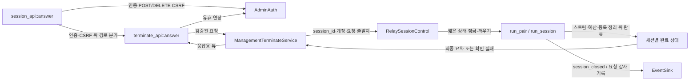

# 관리자 종료 API 모듈 설계

인증된 관리자가 `session_id`로 지정한 활성 세션 하나를 종료하고, 실제 자원 정리가 끝난 뒤 결과를 받는 구조를 설계한다. HTTP 요청은 종료 의사만 전달한다. 스트림과 연결 예산을 소유한 기존 중계 작업이 정리하고 완료를 알린다. 이 문서는 작업 4.5의 설계안이며 코드나 시험 결과가 아니다. 9절의 사용자 결정 대기 항목은 구현 전에 확정해야 한다.

| 항목 | 값 |
| --- | --- |
| 구조 시점 | Target |
| 문서 상태 | Draft |
| 구현 대조 | 미대조. 기존 코드 조사와 구현 전 차이는 8절에 기록한다. |
| 코드 위치 | 계획: `crates/app/src/management/terminate.rs`, `crates/adapters/src/management_http/terminate_api.rs`; 확장: `crates/app/src/ports.rs`, `crates/app/src/relay.rs`, `crates/app/src/relay/session.rs`, `crates/app/src/events.rs`, `crates/adapters/src/ops_log.rs`, `src/serve.rs` |
| 코드 지도 | [코드 지도](code-map.md#2-코드-위치와-구성요소) |
| 관련 스펙 | [관리 3.2·4·7절](../specs/management.md#32-관리자-종료) MGT-008~012, MGT-013·014·023; [운영](../specs/operations.md#7-수용-테스트) OPS-011·043; [중계](../specs/relay.md#7-수용-테스트) RLY-020 |
| 관련 계약 | [관리 API 1.9절](../contracts/management-api-v1.md#19-관리자-종료-post-apiv1sessionssession_idterminate), 1.1~1.4·2.1·6절; [운영 정보 1.8절](../contracts/ops-info-v1.md#18-관리자-계정명-기록-규칙) |
| 관련 ADR | [ADR-0003 메모리 상태](../decisions/ADR-0003-single-instance-memory-state.md), [ADR-0004 tokio·rustls](../decisions/ADR-0004-tokio-rustls.md) |

## 1. 책임과 경계

- 맡는 책임: 종료 요청 검증, 세션 식별자에 한정한 종료 명령, 기존 정리에 합류, 완료 알림 대기, 결과·요약 응답, 관리자 계정명을 포함한 사건 기록이다.
- 맡지 않는 책임: 로그인과 CSRF 토큰 발급은 [관리 세션](management-session.md), 조회 뷰는 [관리 조회](management-query.md), 스트림 소유·E·G·종료 원인은 [중계 수명](relay-session.md)이 맡는다. UI 확인·응답 유실 뒤 재조회는 화면과 계약의 Consumer 규칙이다.
- 문서 분리 이유: 조회는 상태를 복사하지만 종료는 상태 변경·비동기 완료·요청 경합을 다룬다. [아키텍처 작성 규칙](AGENTS.md#작성-규칙)의 “한 문서는 하나의 구조 질문에 답한다”는 원칙에 따라 `management-query.md`를 늘리지 않고 별도 모듈 설계를 둔다.
- 계획 공개 기능: 응용 `ManagementTerminateService::terminate`, 포트 `RelaySessionControl::request_terminate`, 런타임의 세션별 종료 요청 수락. 이름과 내부 형태는 아래 설계안이며 아직 공개 API가 아니다.

## 2. 내부 구조

아래 화살표는 호출·명령 전달·완료 전달이다. HTTP나 응용 서비스는 중계 스트림을 빌리거나 소유하지 않는다. `src/serve.rs`가 같은 `RelayRuntime`을 조회 포트와 종료 포트로 주입한다.

| 요소(파일·심볼) | 역할 | 만들어지는 시점과 소유자 | 의존 대상 |
| --- | --- | --- | --- |
| `management_http/session_api.rs` `answer` | 로그인 이외 요청의 인증과 POST·DELETE CSRF를 경로·메서드보다 먼저 검사한다. | 관리 요청마다 호출 | `AdminAuth`, 조회·종료 어댑터 |
| `management_http/terminate_api.rs` | 인증·CSRF 뒤 경로·메서드·폴링 헤더·형식·본문을 검사하고 응답을 직렬화한다. | 요청마다 호출 | 응용 종료 서비스, 기존 쿠키·오류 응답 헬퍼 |
| `management/terminate.rs` `ManagementTerminateService` | 검증된 계정으로 종료 포트를 호출하고 알림을 비동기로 기다린다. | `serve`가 시작 때 생성 | `RelaySessionControl`, `Clock`, `EventSink` |
| `ports.rs` `RelaySessionControl` | 제네릭 런타임을 HTTP에서 직접 다루지 않는 종료 경계 | `RelayRuntime<C>`가 구현 | 세션 식별자, 계정명, 완료 수신 핸들 |
| `relay.rs`의 활성 등록·`run_pair` | 명령·완료 상태를 활성 세션과 함께 소유하고 실제 회수를 확인한다. | 세션 활성화부터 정리 완료까지 | `Session`, `RelayStream`, 예산, 매칭 표 |
| `relay/session.rs` `run_session` | 기존 lifecycle·시한·양방향 작업과 함께 관리자 명령을 poll한다. | 기존 세션 소유 작업 | `begin_admin_close`, E, G |
| `events.rs`·`ops_log.rs` | `admin_terminate` 사건과 관리자 계정명 직렬화 | 요청 처리 결과 확정 때 | 운영 정보 계약 |

## 3. 데이터 모델

외부 요청·응답은 [관리 API 1.9·1.10절](../contracts/management-api-v1.md#19-관리자-종료-post-apiv1sessionssession_idterminate)을 따른다. 최근 종료 목록을 다시 검색해서 응답을 만들지 않는다.

| 이름(계획) | 필드·형태 | 저장 위치 | 제약과 항상 지켜야 할 조건 |
| --- | --- | --- | --- |
| `ActiveEntry` | 현재 `ActiveSessionSnapshot`과 비공개 종료 제어·완료 상태 | `RelayState.active`의 같은 세션 항목 | 공개 조회 스냅샷에는 채널·계정·요청자를 복사하지 않는다. |
| `TerminateRequest` | 인증으로 얻은 `AccountName`, 실제 `PeerIp`, 수락 단조 시각 | 세션 소유자가 받는 단일 미처리 명령 슬롯 | 입력 계정명·`relay_id`를 받지 않는다. 새 종료를 시작하는 명령은 하나뿐이다. |
| `TerminationTicket` | 잠금 아래 확정한 종료 시작 또는 기존 정리 합류 결과, 같은 세션의 완료 수신 핸들 | 요청 처리 수명 | 자연 종료·Force·관리자 요청을 같은 전이 순서로 판정한다. 소유자의 뒤늦은 명령 수신 시점으로 결과를 뒤집지 않는다(7.1절). |
| `CompletionState` | 미완료 또는 `Result<Arc<ClosedSessionSnapshot>, CleanupUnconfirmed>` | 세션별 `watch` 등 보존형 완료 상태 | 알림 전에 완료돼도 결과를 읽을 수 있어야 한다. `Notify`만 쓰고 상태를 따로 확인하지 않는 방식은 피한다. |
| `TerminateView` | `as_of`, `result`, `closed_session` | 응답 생성 때 | 성공의 요약은 필수·non-null이다. R=0·목록 축출·동시 다른 종료에도 요약을 잃지 않는다. |

`closed_session`에는 `session_id`, `mode`, `viewer_transport`, `started_at`, `ended_at`, 두 방향 최종 바이트 정수, 실제 `close_cause`만 넣는다. 시각은 UTC 밀리초 3자리이고 `ended_at >= started_at`이다. 주소·관리자 계정·CSRF·원시 데이터·중계 ID를 넣지 않는다. `as_of`는 응답을 만드는 시점이다. 이는 계약 1.1.1·1.9·1.10절에 따른 **이 문서의 판단**이다.

## 4. 처리 순서

### 4.1 검증과 명령 수락

[관리 API 1.3절](../contracts/management-api-v1.md#13-요청-처리-순서)을 그대로 따른다. 로그인 예외를 제외하면 인증(401) → POST·DELETE의 CSRF(403) → 경로·메서드·`X-Relay-Poll`·`session_id` 형식·본문(404·405·400·415) → 처리 순서다. 앞 단계에서 거절하면 뒤 단계는 하지 않는다. 앞선 설계 요청의 경로·메서드 우선 지시는 오류였으며 계약 간 충돌이 아니다.

| 순서 | 코드 위치(계획) | 조건·계산 | 바뀌는 상태 | 결과를 쓰는 곳 |
| --- | --- | --- | --- | --- |
| 1 | `session_api::answer` | `AdminAuth::authorize` 실패는 경로·메서드보다 먼저 401. 기존 쿠키 삭제·`WWW-Authenticate` 규칙 재사용 | 중계 변화 없음 | 응답 또는 인증된 요청 |
| 2 | `session_api::answer`, `AdminAuth::check_csrf` | 모든 POST·DELETE에 기존 단일 헤더 읽기와 상수 시간 토큰 비교 사용. 없거나 중복·불일치면 경로·메서드를 보기 전에 403. 계정은 `AuthorizedAdmin`에서 얻음 | 관리 세션·중계 유지 | 다음 검사 |
| 3 | `terminate_api` 경로 분기 | 정확한 `/api/v1/sessions/{session_id}/terminate`만 취급. 경로 없음은 404, 다른 메서드는 405와 `Allow: POST` | 없음 | 다음 검사 |
| 4 | 폴링 헤더 검사 | POST의 `X-Relay-Poll`은 값에 관계없이 400 | 없음 | 다음 검사 |
| 5 | 형식 검사 | 기존 ASCII 길이 1~64·영숫자·`_`·`-` 검사 재사용. 형식 오류는 400. 형식은 맞으나 내부 정규 ID로 해석되지 않는 값은 조회 결과 404 | 없음 | 다음 검사 |
| 6 | 본문 검사 | 본문은 없어야 함. 모든 실제 본문을 400으로 거절하는 안을 추천하되 비JSON의 415 우선관계는 Q89 결정 대기. JSON 본문도 허용하지 않음(계약 1.9절) | 없음 | 다음 검사 또는 오류 |
| 7 | 종료 포트 | `session_id`로만 활성 등록을 조회하고 완료 수신자를 먼저 확보. 잠금 아래 수락을 선형화하고 그 시각부터 E를 잼. 이미 제거됐다면 최근 종료 목록에 있어도 404. `closing`이면 기존 완료를 기다림 | 새 종료 또는 기존 정리 합류 | `TerminationTicket` |
| 8 | `AdminAuth::touch` | 검증·수락된 사용자 행동 요청만 기존 Sa를 넘지 않게 Si 연장. 수락 시 인증·계정을 확정하고 대기 뒤 재검증하지 않음(계약 1.3절 5단계). 거절 요청은 연장하지 않음 | 관리 세션 유휴 기한 | 비동기 완료 대기 |

본문 검사는 선언된 길이만 믿지 않고 chunked 본문도 확인한다. 빈 본문의 `Content-Type`은 요구하지 않는다. 본문을 끝없이 모으지 않으며 기존 관리 I/O의 U 경계를 사용한다. 본문 오류·미완료 요청에서는 종료 명령을 보내지 않는다. Content-Type 공통 규칙과 특수 규칙의 관계는 9절 Q89에 남긴다.

### 4.2 중계 소유자의 정리와 알림

1. 세션 소유자는 관리자 명령 채널을 기존 lifecycle·시한과 함께 poll한다. 아무 데이터도 오지 않는 유휴 세션도 명령으로 깨어나야 한다. 채널 종료 자체를 관리자 종료로 해석하지 않는다.
2. 활성 등록 잠금 아래 확정한 전이 순서대로 `Session::begin_admin_close(accepted_at)`를 적용한다. 새 종료를 수락한 시점의 계정을 최초 수행 계정으로 보존하고 `closing`을 공개한다. 자연 EOF·오류·Force·다른 관리자 정리가 먼저 시작됐다면 기존 정리에 합류하며 원인·계정·E를 바꾸지 않는다. 소유자의 자연 종료 게시도 같은 순서로 직렬화하고, 나중에 관찰한 사건이 이미 수락한 관리자 종료를 앞서지 않게 한다(7.1절).
3. 관리자 종료를 선택한 뒤 새 애플리케이션 데이터를 읽거나 쓰기 시작하지 않는다. TCP는 양 끝점을 닫고 WS·WSS는 `RelayCloseAction::AdminTerminated`의 기존 Close 매핑을 사용한다. 이미 전송을 시작한 WS 프레임의 마무리 등 전송 규칙은 기존 어댑터를 따른다. 미전달 데이터의 완전 도착은 보장하지 않는다(중계 스펙 3.4절).
4. 처음 정리를 시작한 시각으로 절대 E를 유지한다. 관리자 정리도 매 시한 검사에서 `expire_close`를 적용한다. E와 같은 시각이면 만료다. 후속 종료 요청으로 E를 다시 시작하지 않는다. E 만료 시 끝나지 않은 정리 교환을 기다리지 않고 로컬 스트림·버퍼를 회수한다. 회수가 확인되면 `close_timeout` 요약을 가진 `terminated`가 가능하며, E 만료 자체를 500으로 바꾸지 않는다(계약 1.9절 253행).
   합류 요청도 같은 절대 정리 시한을 공유하므로 남은 E만 기다린다. E+5는 Consumer의 응답 대기 여유이며 서버의 정리 기한을 늘리는 값이 아니다. 관리 연결의 U가 이 기다림을 먼저 끊는 문제는 9절 Q92다.
5. 기존 순서대로 두 스트림을 버린 뒤 L permit을 돌려준다. `Session::finish`로 최종 요약을 만든다. 같은 상태 잠금 아래 활성 제거·Mode II 점유 해제·최근 종료 추가를 끝내고 `session_closed`를 정확히 한 번 기록한다. 소유자 취소나 `finish` 실패 경로도 활성 등록을 제거하면 이 사건을 생략하지 않는다.
6. 성공 시에만 공유 완료 상태에 응답용 최종 요약을 게시한다. 확인 실패는 `terminate_failed`로 전달하되 `session_closed`와 구분한다. 종료 가드는 식별자·시작 시각·실제 전송 카운터·최초 정리 원인·계정을 보존하고, 제거 전에 실제 회수와 사건 기록을 한 번 수행한다. 정리 실패를 새 원인으로 만들지 않는다. 관리자 정리가 먼저면 `admin_terminated`, 자연 정리가 먼저면 그 최초 원인을 쓴다. E 만료의 별도 원인·side·계정은 Q91에 따른다. `engine_completed`만으로 완료 응답하거나 조회에서 정리 중 항목을 먼저 숨기지 않는다. R=0에서도 성공 완료 핸들은 요약을 보유한다.
7. 요청 처리자는 락 없이 완료 수신자를 `await`한다. 성공은 200, 확인 실패는 500 `terminate_failed`다. 기다리는 동안 소켓 펌프를 직접 poll하거나 바쁜 반복·동기 대기를 하지 않는다. HTTP가 소유자 작업을 취소하거나 같은 세션을 별도 작업으로 다시 정리하지 않는다.

세션당 명령 슬롯·완료 상태를 두고 요청자는 수신 핸들만 복제한다. 스트림·B 크기 버퍼·permit을 복제하지 않는다. 완료 요약과 제어 상태는 마지막 소유자·수신자가 사라지면 해제한다. 반복 요청을 무제한 명령 큐로 쌓지 않는다. 이는 기존 단일 소유자와 짧은 상태 잠금 패턴을 유지하기 위한 **이 문서의 판단**이다([중계 수명 6절](relay-session.md#정리-순서와-정확히-한-번-반환)).

### 4.3 결과·경합·로그

| 상황 | 응답·상태 | 사건 처리 |
| --- | --- | --- |
| 이 요청이 종료를 시작하고 정리 완료 | 200 `terminated`; 실제 원인은 `admin_terminated` 또는 E 만료의 `close_timeout` | 최초 수행 계정으로 `session_closed`, 그 뒤 `admin_terminate`의 `terminated` |
| 첫 요청이 정리 중일 때 다른 요청 | 정리 완료 뒤 200 `already_closed`; 동일 최종 요약, E 불연장. 기존 정리 확인 실패면 동일하게 500 | `session_closed` 추가 기록 없음. 합류 요청의 감사 결과 값은 9절 Q90 |
| 자연 종료가 먼저 시작됨 | 남은 정리 완료 뒤 200 `already_closed`; 자연 원인 유지 | 관리자 원인으로 재분류하지 않음. 요청 감사는 Q90 |
| 활성 등록 조회 전에 정리 완료·동일 ID 재사용 | 404; 새 세션이나 최근 종료 항목을 종료하지 않음 | `admin_terminate` `not_found`, `session_id` 없음 |
| 정리 완료를 확인하지 못함 | 500 `terminate_failed`; 성공 요약을 만들지 않음 | 활성 제거 시 최초 정리 원인으로 `session_closed`를 반드시 한 번 기록한 뒤 `admin_terminate` `failed`·error. 인증 계정·실제 출발지·유효 대상 `session_id` 포함 |

`admin_terminate`와 종료 원인 `admin_terminated`는 서로 다른 이름이다. `session_closed`가 `admin_terminated`이면 `admin_account`가 필수다. `admin_terminate`에는 항상 인증된 계정과 실제 소켓 `peer_ip`를 넣는다. 응답에는 계정명을 넣지 않는다. 기존 sink 실패 정책은 정리를 중단하지 않는다. 성공·실패와 관계없이 활성 제거의 `session_closed` 뒤 감사 사건을 남긴다(운영 정보 계약 1.5절의 시작·종료 짝과 1.8절). 관리자 E 초과의 `close_timeout` 원인·side·계정은 Q91 결정 대기이며 계정 필드를 임의로 확장하지 않는다.

## 5. 상태와 초기화

- 초기화: 기존 `serve`에서 같은 중계 런타임·시계·로그를 종료 서비스에 넣고 관리 리스너에 주입한다. 테스트용 빈 런타임을 제품 코드에 만들지 않는다.
- 수명: 활성화 때 종료 제어·완료 상태와 최종 사건에 필요한 자료를 함께 만들고 원래 세션 소유자가 완료 발신자를 가진다. 자연 종료도 동일 알림을 보내야 `already_closed` 대기가 끝난다. 소유자가 중간에 사라지면 가드가 자원 회수·활성 제거·최초 원인의 `session_closed` 기록 뒤 확인 실패를 게시하며 영원히 Pending을 남기지 않는다.
- 취소 안전성: 요청자의 연결 해제·응답 유실은 이미 수락한 종료를 되돌리지 않는다. 소유자가 최초 명령과 감사 문맥을 보존한다. 합류 요청은 살아 있는 수신 처리자가 감사하며, 취소된 합류자의 문맥을 별도 보관하지 않는다. 인증·계정은 수락 때 확정하고 완료 시 재검증하지 않는다. 이는 **이 문서의 판단, 사용자 결정 없음**이다(7.1절).
- 종료 유예: Running뿐 아니라 Grace에서도 로그인·조회·종료를 처리한다(운영 스펙 3.4절). G 만료나 두 번째 신호를 E만큼 늦추지 않는다. Force와 명령도 같은 상태 잠금 아래 직렬화하고 이미 만료된 Force를 먼저 반영한다. 관리자가 먼저 정리를 시작했다면 원인을 보존하고, Force가 먼저 시작했다면 관리자는 기존 정리에 합류한다. 이는 Q82와 수락 선형화에 따른 **이 문서의 판단, 사용자 결정 없음**이다(7.1절).
- 잠금: 활성 검색·명령 수락·완료 수신자 확보만 짧은 상태 전이로 묶는다. 상태 락이나 인증 락을 든 채 정리 알림·네트워크·타이머를 기다리지 않는다.

## 6. 오류 처리

| 실패 지점 | 처리 방법 | 남는 상태 | 관련 시나리오 |
| --- | --- | --- | --- |
| 관리 세션 없음·무효·만료 | 401와 기존 인증 헤더·쿠키 삭제 규칙 | 모든 중계 유지, 감사 종료 사건 없음 | MGT-008 |
| CSRF 없음·중복·불일치 | 403 `csrf_invalid` | 관리 로그인·대상·다른 세션 유지 | MGT-014 |
| 잘못된 경로·메서드·ID·본문·폴링 헤더 | 404·405·400, 앞선 단계에서 중단 | 종료 명령·유휴 연장 없음 | 계약 오류 시험 |
| 정규 형식이지만 없는·끝난 대상 | 404 `not_found` | 새 세션 유지 | MGT-010·011·023 |
| E 만료 뒤 로컬 자원 강제 회수 확인 | 200, 시작 요청은 `terminated`, 요약 원인 `close_timeout` | 활성·점유 제거, 예산 반환 | MGT-009·011, RLY-020 |
| 소유자 소멸·모델 종료 실패·완료 확인 실패 | 500 `terminate_failed`; 가짜 성공 요약 없음 | 가드로 로컬 자원·활성·점유 회수. 제거 시 최초 정리 원인의 `session_closed`를 반드시 한 번 기록. 남은 상태는 재조회 | MGT-012 |
| HTTP 응답 유실 | 완료 여부를 응답으로 보장할 수 없음; 이미 수락한 정리는 지속 | Consumer는 자동 재전송 없이 재조회 | MGT-012 |

로컬 자원·등록 회수와 최종 요약이 확인되면 `poll_close` 오류만으로 실패시키지 않는다. 소유자 소멸·모델 종료 실패·완료 확인 실패는 500이다. HTTP의 실패 결과와 수명 사건은 별개이므로 활성 제거 시 `session_closed`를 생략하지 않는다. 원인은 정리를 시작한 첫 원인이며 실패 자체로 바꾸지 않는다(운영 정보 계약 1.5·1.6절). 이는 **이 문서의 판단, 사용자 결정 없음**이다. E 만료의 예외는 Q91에 남긴다. 계약 2.1절 경로 표는 `internal`도 허용하지만 이 설계는 구현에 없는 내부 실패 분기를 만들어 넣지 않는다.

## 7. 설계 선택과 테스트 계획

### 7.1 설계 선택

| 선택 | 이유 | 다른 방법 | 근거 |
| --- | --- | --- | --- |
| 조회와 종료 문서·서비스 분리 — 이 문서의 판단 | 읽기 뷰와 상태 변경·완료 소유권의 책임이 다름 | 조회 서비스에 명령 메서드를 섞음 | [아키텍처 작성 규칙](AGENTS.md#작성-규칙), 관리 스펙 3.1·3.2절 |
| 기존 소유자에게 종료 전달 — 이 문서의 판단 | 다른 세션 펌프를 막지 않고 자원 반환을 한 곳에서 확인 | HTTP가 스트림을 직접 닫거나 전역 런타임 종료 | 관리 스펙 MGT-R06, 중계 수명 6절 |
| 실제 종료 요약을 완료 핸들로 전달 — 이 문서의 판단 | R=0에서도 필수 `closed_session` 제공 | 최근 종료 목록 재검색·임시 성공 요약 | 관리 API 247행·1.10절 |
| 일반 정수 카운터와 기존 ID·CSRF 헬퍼 재사용 — 이 문서의 판단 | 별도 집계·다른 식별자 문법을 만들지 않음 | 별도 종료용 ID·로그인 토큰 비교 | 관리 API 1.4·1.8·1.9절 |
| E 초과는 강제 회수 뒤 성공 가능 — 이 문서의 판단 | `close_timeout`이어도 `terminated`라는 계약을 그대로 적용 | E 만료를 무조건 `terminate_failed`로 매핑 | 관리 API 253·257행 |
| 요청 수락 선형화·E 시작 — 이 문서의 판단, 사용자 결정 없음 | 활성 등록 잠금 아래 자연 종료·관리자 요청·Force를 직렬화하고 수락 시각부터 E를 잰다. 최초 계정·결과를 한 번 확정하며 깨우기 지연으로 E를 늘리지 않는다. | 소유자가 명령을 관찰할 때 다시 판정·E 시작 | 관리 API 1.9절의 도착 시 활성·closing·부재 구분과 E 한도, 중계 수명 6절의 전이 직렬화 |
| 확인 실패와 수명 사건 분리 — 이 문서의 판단, 사용자 결정 없음 | 실제 회수·최종 요약 확인이 기준이다. transport close 오류만으로 실패시키지 않되 확인 실패는 500. 활성 제거 시 최초 원인의 `session_closed`를 반드시 한 번 낸다. | 모든 poll_close Err를 실패 처리하거나 실패 경로의 종료 사건을 생략 | 관리 API 1.9·2.1절, 운영 정보 1.5절의 시작·종료 짝(160행)·1.6절의 최초 원인 |
| 요청 연결 해제 뒤 최초 명령·감사 보존 — 이 문서의 판단, 사용자 결정 없음 | 소유자는 정리와 최초 요청 감사를 계속한다. 합류자는 살아 있는 수신 처리자가 감사하고 취소된 합류자의 문맥은 별도 보관하지 않는다. | 수락된 모든 합류자 문맥을 완료까지 별도 보존 | 관리 API 1.9절 Consumer의 응답 유실·자동 재전송 금지·재조회, 운영 정보 1.5절의 처리 결과 시점 감사 |
| 수락 때 인증·계정 확정 — 이 문서의 판단, 사용자 결정 없음 | 대기 중 만료·로그아웃으로 이미 수락한 동작·응답·감사 계정을 바꾸지 않는다. 완료 시 인증을 반복하지 않는다. | 완료 때 재검증하여 401로 대체 | 관리 API 1.3절 5단계의 처리·사용자 행동 유휴 연장, 1.4.1절 로그아웃의 중계 독립 |
| Force와 관리자 종료의 최초 원인 보존 — 이 문서의 판단, 사용자 결정 없음 | 같은 전이 순서에서 만료된 Force를 먼저 반영하되 이미 수락·시작한 관리자 원인은 보존한다. 관리자는 먼저 시작한 Force 정리에 합류한다. | 늦게 처리한 Force로 관리자 원인을 덮어씀 | 운영 정보 1.6절 238행 Q82, 위 요청 수락 선형화 |

### 7.2 계획 시험

다음은 실행하지 않은 시험 계획이다. `/// spec: <spec file>:<ID>`를 실제 행 전체를 확인한 시험에만 붙인다. 범위가 남으면 `partial`을 유지한다. 기존 부분 시험을 단순히 비부분 표식으로 바꾸지 않는다.

| 시나리오 | 계획 위치·수준 | 입력·관찰·판정 범위 |
| --- | --- | --- |
| MGT-008 | `crates/adapters/tests/management.rs`, 새 `tests/management_terminate.rs` | 실제 활성 두 세션에 로그인 없는 직접 POST. 401, 두 스트림·카운터 유지. 만료·로그아웃·재시작 쿠키도 추가 확인 |
| MGT-009 | `tests/management_terminate.rs`, `relay.rs` 단위 | TCP·WS·WSS, Mode I·II의 여러 활성 세션 중 하나 종료. 소켓·L·등록 회수 뒤 응답, `closing` 포함, 나머지 전송 유지, `closed_session` 최종 값·R=0 |
| MGT-010 | `tests/management_terminate.rs` | 같은 중계 ID로 새 세션을 만든 뒤 옛 `session_id`로 종료. 404, 새 세션의 데이터·수명 유지 |
| MGT-011 | `relay.rs` 제어 가능한 단위, 시스템 | 자연 종료 전·중·후, 두 관리자 동시 요청, 응답 뒤 반복. `terminated` 하나·합류 `already_closed`·완료 후 404를 구분, 최초 원인·계정·E 불변 |
| MGT-012 | `relay.rs`·`management/terminate.rs` 단위, HTTP 응답 유실 시스템 | 실제 소유자 취소·완료 채널 소멸·모델 종료 실패로 확인 실패를 유도. 500·성공 요약 없음. 활성 제거 시 최초 원인의 `session_closed` 1회와 시작 사건의 짝 확인. 수락 뒤 HTTP 연결을 끊어도 소유자는 정리·최초 요청 감사 지속. Consumer 재조회 규칙은 별도 화면 시험까지 포함해야 full |
| OPS-011 | `crates/adapters/tests/ops_info_contract.rs`, `tests/management_terminate.rs` | 실제 수행 계정·실제 peer·level·결과·식별자 생략과 한 줄 JSON. 성공·terminate_failed 모두 활성 제거 시 `session_closed` 1회가 감사보다 먼저임을 확인. 이미 있는 중계 사건 증거와 합쳐 전체 행을 판단 |
| RLY-020 관리자 종료 부분 | `relay/session.rs` 단위·시스템 | `duplex`와 제어 가능한 `poll_close`·멈춘 시계로 E 직전·동일 시각·오류·계속 Pending을 관찰. 한 세션 회수·활성 수·원인 확인. EOF·연결 오류의 기존 증거도 유지 |
| MGT-013·014·023 | 어댑터·시스템 | 종료 실패의 비밀 비노출, CSRF 거절의 상태 유지, 관리자 종료의 최근 종료 기록·옛 ID 상세/종료 404를 보충 |
| OPS-043 | 종료 유예 시스템·소유자 단위 | Grace 중 로그인·요약·관리자 종료·readyz를 함께 확인. G<E·두 번째 신호·Force 경합은 원인 보존과 시한 불연장 확인 |
| 계약 순서·경계(시나리오를 억지로 연결하지 않음) | 어댑터 단위·계약 | 잘못된 POST·DELETE 경로+CSRF 없음은 403, 비변경 메서드는 CSRF 생략 뒤 404/405. 폴링 헤더 오류가 ID·본문보다 먼저임을 확인. ID 오류+본문, JSON/비JSON/chunked 본문(Q89), 빈 본문, R=0·축출, 늦은 수신자·소유자 소멸, E>U(Q92), 대기 중 관리 만료·로그아웃 |

## 8. 현재 코드와의 차이

기존 코드 조사 기준은 `ec05fd1` 소스다. 아래는 구현 계획이며 `Verified`나 시험 통과 기록이 아니다.

| 항목 | 현재 코드 | 목표 설계 | 전환 계획 |
| --- | --- | --- | --- |
| HTTP 진입 | `crates/adapters/src/management_http/session_api.rs` `answer`는 인증 뒤 세션 이외를 `query_api::answer`로 전달 | 계약 1.3절의 인증→CSRF→경로·메서드 순서로 종료 어댑터 분기 | Q89~Q92 확정 후 기존 조회 경로를 유지하며 추가 |
| 관리자 상태 전이 | `crates/domain/src/session.rs`의 `Session::begin_admin_close`·`expire_close`는 존재 | 외부 명령으로 실제 호출, 절대 E 적용 | 기존 도메인 동작 재사용 |
| 명령·알림 | `run_session`에는 lifecycle만 있고 세션별 종료·완료 알림 없음 | 세션당 명령 슬롯과 완료 상태 | `ports.rs`·`relay.rs`·`relay/session.rs` 연결 |
| 완료 시점 | `crates/app/src/relay.rs` `run_pair`는 엔진 종료만으로 `engine_completed` 설정, `RelayRuntime::snapshot`은 이 항목을 제외 | 소켓·permit·활성·매칭 정리 뒤 완료 게시 | 종료 처리 중 조회와 API 응답 기준을 함께 정리 |
| 오류 확인 | `crates/app/src/relay/session.rs` `run_session`은 `poll_close`의 Ready 결과를 성공·오류 구분 없이 소비 | 실제 회수·최종 요약 확인 기준으로 결과 전달, 실패에도 최초 원인의 종료 사건 | 7.1절 판단에 따라 결과·가드의 최종 사건 자료 전달 추가 |
| 관리자 E | 같은 `run_session`의 `expire_close` 호출은 EOF 시한에만 연결 | 관리자 시작 시각의 E에도 적용 | 관리자 명령과 시한 처리 확장 |
| 회수 순서 | `crates/app/src/relay.rs` `run_pair`는 스트림→permit→모델 finish→등록 제거·사건·최근 종료 순서 | 성공은 그 뒤 완료 요약 게시, 실패도 활성 제거 시 종료 사건 후 확인 실패 게시 | 기존 순서 보존, 조기 오류·가드 취소에서도 시작·종료 사건의 짝 보장 |
| 계정·감사 | 같은 `run_pair`의 `session_closed.admin_account`는 항상 None. `crates/app/src/events.rs` `Event`에 `admin_terminate` 없음 | 최초 계정 전달, 계약 사건 출력 | `events.rs`·`ops_log.rs`·완료 경로 확장 |

## 9. 미결정 사항

다음 네 항목만 **사용자 결정 대기**다. 추천은 확정된 사용자 결정이 아니다. 검증 순서는 계약 1.3절을 따르고, 수락 선형화·실패 판정·취소·인증 수명·Force 경합은 7.1절의 **이 문서의 판단, 사용자 결정 없음**으로 정리한다.

| 항목 | 문서 근거와 미정 범위 | 선택지와 추천 | 영향·확정 위치 |
| --- | --- | --- | --- |
| 사용자 결정 대기(Q89): terminate 본문 | 관리 API 1.9절은 모든 본문 400, 1.1절은 비JSON 본문 415. 우선관계가 불명확하다. | A 모든 본문 400, B 비JSON만 415. **추천 A**: 1.9절을 특수 규칙으로 적용 | 관리 API 1.1·1.9절과 본문 계약 시험 |
| 사용자 결정 대기(Q90): `already_closed` 감사 결과 | 관리 API 1.9절의 HTTP 결과가 운영 정보 1.5절의 로그 result 목록에는 없다. | A 로그에 already_closed 추가, B terminated로 매핑, C 합류 감사 생략. **추천 A** | 감사 result·session_id·level을 운영 정보 1.5절에서 확정 |
| 사용자 결정 대기(Q91): 관리자 E 초과의 원인·side·계정 | 관리 API 1.9절은 close_timeout. 운영 정보 1.6절은 EOF E 예외만 명시하며 side는 먼저 EOF를 낸 쪽이다. 관리자 E의 계정 필드도 미정이다. | A 관리자 E의 close_timeout 예외·EOF 없으면 side 없음·계정은 admin_terminate로 추적 명시, B admin_terminated 유지. **추천 A** | 관리 API·운영 정보의 원인·side·계정 정합화 |
| 사용자 결정 대기(Q92): 관리 연결 U와 E 대기 | 설정 계약 1.2절·Q25는 I/O 없으면 U 만료. 종료는 E 대기·Consumer E+5여서 E>=U이면 연결이 먼저 끊길 수 있다. | A 검증·수락된 종료 완료 대기만 U 중지 후 응답 I/O부터 복원, B U 유지·응답 유실 규칙 적용. **추천 A** | Q25 예외이므로 사용자 확정 필요. 설정 계약·관리 리스너 설계·E>U 시험 |

관리 API 6절의 Q88 주소 표기·로그인 CSRF 브라우저 관찰·기본 인증 창 관찰은 기존 열린 항목이다. 종료 응답에는 주소가 없고 로그인 구현도 바꾸지 않으므로 이 작업에서 새 선택을 하지 않는다. `server_shutdown` 종료 항목의 외부 조회 가시성은 Force 경합 시험과 연계하되 관찰 전에는 입증했다고 쓰지 않는다.
