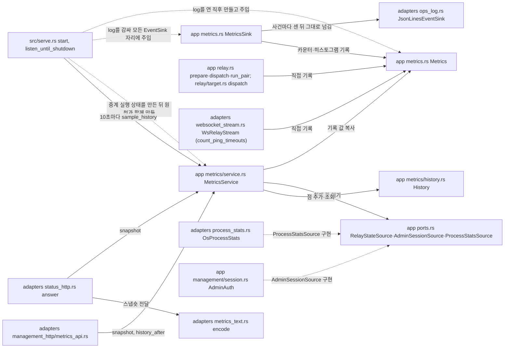

# 메트릭 모듈 설계

메트릭 값을 기록하고, 응답할 때 현재 값을 모아 두 표현으로 내보내는 구조를 정한다. 기록의 중심은 app의 `Metrics` 하나다. 운영 로그 사건에서 세는 값은 운영 로그 기록부를 감싼 `MetricsSink`가 센다. 사건이 없는 값은 동작이 끝나는 코드가 `Metrics`에 직접 기록한다. 현재 값과 프로세스 값은 응답을 만들 때 읽는다. 상태 리스너의 `/metrics`와 관리 API의 `GET /api/v1/metrics`는 같은 스냅숏(`MetricsSnapshot`)을 서로 다른 형식으로 쓴다.

| 항목 | 값 |
| --- | --- |
| 구조 시점 | Current |
| 문서 상태 | Draft |
| 구현 대조 | Verified — [대조 기록](#대조-기록) |
| 코드 위치 | `crates/app/src/metrics.rs`와 `crates/app/src/metrics/`, `crates/app/src/ports.rs`(`ProcessStatsSource`, `AdminSessionSource`, `RelayStateSource::counts`), `crates/adapters/src/metrics_text.rs`, `crates/adapters/src/process_stats.rs`와 `crates/adapters/src/process_stats/`, `crates/adapters/src/status_http.rs`, `crates/adapters/src/management_http/metrics_api.rs`, `crates/adapters/src/websocket_stream.rs`(`count_ping_timeouts`), `src/serve.rs` |
| 코드 지도 | [코드 지도 2.2절](code-map.md#22-app)·[2.3절](code-map.md#23-adapters와-실행파일-조립)의 메트릭 행 |
| 관련 스펙 | [운영 스펙 3.8절](../specs/operations.md#38-메트릭) OPS-082~094, [관리 스펙 2.5절](../specs/management.md#25-메트릭) MGT-056~061, [화면 스펙 SCR-007](../specs/dashboard.md#scr-007-메트릭) DASH-068~081 |
| 관련 계약 | [메트릭 v1](../contracts/metrics-v1.md), [관리 API v1 1.16절](../contracts/management-api-v1.md#116-메트릭-get-apiv1metrics), [설정 v4](../contracts/config-v4.md)의 `metrics.enabled` |
| 관련 ADR | [ADR-0011](../decisions/ADR-0011-pull-metrics-on-status-listener.md) |

## 1. 책임과 경계

- 맡는 책임:
  - 운영 로그 사건을 세는 카운터와 히스토그램을 기록한다.
  - 사건이 없는 값(초기 교환 시간, Mode I 대상 연결 시간, 방향별 전송량, WebSocket ping 시간 초과)을 기록하는 함수를 제공한다.
  - 응답할 때 중계 상태·L·Lm·관리 세션 수·프로세스 값을 읽어 계약 1.3절 순서의 스냅숏을 만든다.
  - 준비됨부터 10초마다 추이 점을 찍어 최근 1시간 추이에 360개까지 보관한다. 6번째 점마다 같은 점을 최근 24시간 추이에도 넣어 1440개까지 보관한다.
  - 스냅숏을 Prometheus 텍스트 0.0.4로 바꾼다.
- 맡지 않는 책임:
  - HTTP 경로·인증·폴링 헤더·오류 본문: [상태 리스너](status-listener.md)와 [관리 리스너](management-listener.md)가 맡는다.
  - 로그 줄 쓰기: [운영 로그](ops-log.md)가 맡는다. `MetricsSink`는 사건을 센 뒤 그대로 넘긴다.
  - 설정 키 검증: [설정 로딩](config-loading.md)이 맡는다.
  - 화면 계산(비율·차이·p95 상한): 대시보드가 맡는다([화면 스펙 SCR-007](../specs/dashboard.md#scr-007-메트릭)).
- 다른 모듈에 공개하는 기능:
  - `vnc_relay_app::metrics::Metrics`: 기록 전용 저장소. `record_handshake`, `record_target_connect`, `add_io`, `record_ping_timeout`.
  - `vnc_relay_app::metrics::MetricsSink`: `EventSink` 구현.
  - `vnc_relay_app::metrics::MetricsService`: 읽기 전용. `snapshot`, `sample_history`, `history_after(기간, 순번)`.
  - `vnc_relay_app::metrics::history::HistoryWindow`: 추이 기간(`Hour`·`Day`)과 기간별 간격·보관 개수.
  - `vnc_relay_app::ports::ProcessStatsSource`와 `ProcessStats`, `AdminSessionSource`, `RelayStateSource::counts`.
  - `vnc_relay_adapters::metrics_text::encode`.
  - `vnc_relay_adapters::process_stats::OsProcessStats`.
  - `vnc_relay_adapters::websocket_stream::WsRelayStream::count_ping_timeouts`: WS·WSS 중계 연결이 ping 시간 초과를 세게 하는 선택 설정.

## 2. 내부 구조

실선 화살표는 실행 중 호출이다. 점선 화살표는 시작할 때 주입하는 의존이다. 의존 방향은 [코드 지도](code-map.md)의 레이어 표를 따른다. adapters와 실행파일 조립 crate가 app을 부르며, app은 adapters를 알지 못한다.

| 요소(파일·심볼) | 역할 | 만들어지는 시점과 소유자 | 의존 대상 |
| --- | --- | --- | --- |
| `crates/app/src/metrics.rs` `Metrics` | 카운터·히스토그램·전송량·ping 시간 초과의 기록 | `src/serve.rs` `start`가 운영 로그 기록부를 연 직후 `Arc`로 만든다. 프로세스가 끝날 때 없어진다 | `Clock`(가동 시간 기준점) |
| `crates/app/src/metrics.rs` `MetricsSink` | `EventSink` 장식자. 사건 종류와 필드로 해당 메트릭을 센 뒤 감싼 기록부에 넘긴다 | `Metrics`와 함께 만든다. 이후 모든 `Arc<dyn EventSink>` 자리에 이것을 넘긴다 | `Metrics`, 감싼 `EventSink` |
| `crates/app/src/metrics/service.rs` `MetricsService` | 기록 값과 현재 값을 모아 스냅숏을 만들고, 추이 점을 찍고 돌려준다 | `src/serve.rs` `listen_until_shutdown`이 중계 실행 상태(`RelayRuntime`)를 만든 직후, 상태 리스너를 열기 전에 만든다 | `Metrics`, `MetricSources`(`RelayStateSource`, L·Lm `ConnectionBudget`, `RuntimeSettingsSource`, `AdminSessionSource`, `ProcessStatsSource`), `Clock` |
| `crates/app/src/metrics/history.rs` `History`·`Ring`·`HistoryWindow` | 두 추이 기간의 고리 버퍼(`Ring`)와 기간마다 따로 매기는 순번. 최근 1시간 360개, 최근 24시간 1440개 | `MetricsService`가 소유한다 | 없음 |
| `crates/app/src/metrics/snapshot.rs` `MetricsSnapshot` | 계약 1.3절 순서의 계열 목록. 두 표현이 함께 쓴다 | 요청마다 만들고 응답 뒤 버린다 | 없음 |
| `crates/app/src/ports.rs` `ProcessStatsSource` | 프로세스 값 읽기 포트. 값마다 `Option` | `src/serve.rs`가 `OsProcessStats`를 주입한다 | 없음 |
| `crates/app/src/ports.rs` `AdminSessionSource` | 지금 유효한 관리 세션 수를 읽는 포트 | `src/serve.rs`가 `AdminAuth`를 주입한다(`crates/app/src/management/session.rs`의 구현) | 없음 |
| `crates/adapters/src/process_stats.rs` `OsProcessStats` | Linux는 `linux.rs`가 `/proc/self/status`·`/proc/self/stat`·`/proc/self/fd`를 읽는다. Windows는 `windows.rs`가 Win32 API를 부른다 | `src/serve.rs`가 시작할 때 만든다 | std, `windows-sys` |
| `crates/adapters/src/metrics_text.rs` `encode` | 스냅숏을 Prometheus 텍스트로 바꾼다. 이름 변환·라벨 이스케이프·누적 버킷·수 표기 | 함수. 상태 없음 | 없음 |
| `crates/adapters/src/status_http.rs` `answer` | `metrics.enabled`가 참이면 `GET /metrics`에 텍스트로 답한다. 거짓이면 정의하지 않은 경로와 같다 | `StatusListener::new`가 켜졌을 때만 `MetricsService`를 받는다 | `MetricsService`, `metrics_text` |
| `crates/adapters/src/management_http/metrics_api.rs` | `GET /api/v1/metrics`. 폴링 헤더·`history_window`·`history_after` 해석·JSON 직렬화. 추이는 `serde_json::Map`에 옮겨 담아 `json!`의 값 복사를 하지 않는다 | 관리 리스너 라우터가 연결한다. 인증은 `session_api.rs`가 먼저 한다 | `MetricsService` |
| `src/serve.rs` | 생성·주입, 준비됨 뒤 추이 표본 작업 시작 | 프로세스 시작 | 위 요소 모두 |

직접 기록하는 자리는 다음과 같다. 함수는 이미 그 동작의 결과를 아는 곳에 둔다.

| 값 | 기록하는 코드 | 시점 |
| --- | --- | --- |
| 초기 교환 시간 | `crates/app/src/relay.rs` `RelayService::prepare`가 재고 `RelayService::dispatch`가 기록 | `prepare`는 `handshake::exchange`가 성공을 돌려준 때까지의 구간을 `PreparedConnection::exchange_elapsed`에 담는다. 구간은 `ConnectionContext::exchange_at`(H 시작)부터다. `dispatch`는 접속 ticket의 중계 ID 확인을 통과한 뒤, 대상 연결이나 매칭으로 넘기기 전에 기록한다. 그 확인으로 거절한 연결은 기록하지 않는다 |
| Mode I 대상 연결 시간 | `crates/app/src/relay/target.rs` `dispatch` | 연결 성공이나 `target_connect_failed` 원인을 판정한 때. 구간은 C를 시작한 때부터이며 `target_connect_failed`의 `elapsed_ms`와 같다. 정책·L 거절, 종료·중단은 기록하지 않는다 |
| 방향별 전송량 | `crates/app/src/relay.rs` `RelayService::run_pair`가 `session::run_session_controlled`에 넘기는 갱신 함수 | 갱신 함수가 불릴 때마다 세션 누적 바이트의 증가분을 더한다. 누적 바이트는 상대 전송 계층에 쓰기에 성공할 때만 는다 |
| WebSocket ping 시간 초과 | `crates/adapters/src/websocket_stream.rs` `WsRelayStream::poll_keepalive_timers` | `Keepalive::poll`이 pong 대기 만료로 처음 바뀐 때 참을 돌려준다. 연결마다 한 번이다. `count_ping_timeouts`로 `Metrics`와 리스너를 받은 연결만 센다. `crates/adapters/src/websocket.rs`가 WS·WSS 중계 연결마다 이것을 부른다 |

## 3. 데이터 모델

메트릭의 이름·속성·두 표현의 형식은 [메트릭 계약](../contracts/metrics-v1.md)이 정한다.

| 이름 | 필드·형태 | 저장 위치 | 제약과 항상 지켜야 할 조건 |
| --- | --- | --- | --- |
| 사건 카운터 | 계열마다 `Mutex<Vec<(키, u64)>>`. 키는 계약 1.3절 속성 순서의 `[Option<Arc<str>>; N]`이다. 없는 속성은 `None`이다 | 메모리 | 값은 줄지 않는다. 한 번 생긴 키는 지우지 않는다. 목록을 키 순서로 유지하므로 이 순서가 계약 1.6절의 표본 순서다. 이미 있는 키는 문자열 비교로 찾아 할당 없이 더한다 |
| 히스토그램 | 계열마다 `Mutex<Vec<(키, Histogram)>>`. `Histogram`은 `bucket_counts: Vec<u64>`(경계 수 + 1), `count: u64`, `sum: f64` | 메모리 | `bucket_counts`의 합은 `count`다. 경계는 계약 1.5절의 상수 배열 |
| 전송량 | `[AtomicU64; 2]`. 방향 `viewer_to_target`, `target_to_viewer` | 메모리 | 잠금 없이 `fetch_add(Relaxed)`로 더한다 |
| ping 시간 초과 | 사건 카운터와 같은 계열 구조. 속성은 `listener` 하나 | 메모리 | 기록한 리스너만 스냅숏에 낸다 |
| `ProcessStats` | `cpu: Option<CpuTimes>`, `memory_usage`·`memory_virtual`·`threads: Option<u64>`, `open: OpenCount`(Linux 파일 기술자, Windows 핸들, 그 밖은 없음) | 읽을 때마다 새로 만든다 | `None`은 읽지 못한 값이다. 0으로 바꾸지 않는다 |
| `MetricsSnapshot` | `as_of`, `service_version`, `families: Vec<MetricFamily>`. `MetricFamily`는 이름·종류·단위·`# HELP` 문구·`available`·경계·점 목록 | 요청마다 | 계열 순서는 계약 1.3절. 플랫폼에 없는 계열은 넣지 않는다 |
| `HistoryPoint` | `seq: u64`, `at: SystemTime`, `values: [Option<Number>; 9]`(계약 1.8절 계열 키 순서) | `History`의 기간별 `VecDeque`. 최근 1시간 최대 360개, 최근 24시간 최대 1440개 | 기간마다 `seq`는 0부터 하나씩 는다. 가득 차면 가장 오래된 점을 버린다. 24시간 추이의 점은 1시간 추이에서 `seq`가 6의 배수인 점과 `at`·`values`가 같다 |
| `HistoryWindow` | `Hour`(`1h`, 10초, 360개), `Day`(`24h`, 60초, 1440개). `interval()`·`capacity()` | 상수 | 관리 API 응답의 `interval_secs`·`capacity`와 표본 작업의 주기(`Hour`)가 이 값을 쓴다 |

현재 값은 저장하지 않는다. 응답할 때 다음 원천에서 읽는다.

| 값 | 원천 |
| --- | --- |
| 진행 중 연결·대기·활성 세션 수 | `RelayStateSource::counts`. 한 번의 짧은 잠금에서 단계·역할·전송 경로·모드별 수만 센다(`RelayCounts`). 목록을 복제하지 않는다 |
| L·Lm 사용량 | `ConnectionBudget::current` |
| L·Lm 상한 | `RuntimeSettingsSource::with_current`의 `limits` |
| 관리 세션 수 | `AdminSessionSource::live_sessions`(구현은 `AdminAuth`). 그 시각에 유효한 세션만 센다(`AdminSessionTable::live_count`) |
| 가동 시간 | `Metrics`를 만들 때 읽은 `Clock::monotonic`과 지금 값의 차이 |
| 프로세스 값 | `ProcessStatsSource::read` |

## 4. 처리 순서

대표 시나리오 [OPS-083](../specs/operations.md#7-수용-테스트)(켜진 `/metrics` 응답)을 따른다.

| 순서 | 코드 위치(파일·심볼) | 조건·계산 | 바뀌는 상태 | 결과를 쓰는 곳 |
| --- | --- | --- | --- | --- |
| 1 | `crates/adapters/src/admission.rs` `AdmittingListener` | Lm 확보. 실패하면 응답 없이 닫는다 | Lm 사용량 1 증가 | axum 연결 |
| 2 | `crates/adapters/src/status_http.rs` `answer` | 경로가 `/metrics`이고 `metrics.enabled`가 참인지, 메서드가 `GET`인지 | 없음 | 거짓이면 404, `GET`이 아니면 405 |
| 3 | `crates/app/src/metrics/service.rs` `MetricsService::snapshot` | `Metrics`의 사건 카운터·히스토그램을 계열마다 짧게 잠가 복사한다. 전송량은 원자 값을 읽는다 | 없음 | 스냅숏 |
| 4 | 같은 함수 | `MetricSources`에서 현재 값과 프로세스 값을 읽는다. 읽지 못한 프로세스 값은 `available = false` | 없음 | 스냅숏 |
| 5 | `crates/adapters/src/metrics_text.rs` `encode` | 계약 1.6절 규칙으로 쓴다. 히스토그램 버킷은 누적으로 바꾼다 | 없음 | 응답 본문 |
| 6 | `answer` | `Content-Type: text/plain; version=0.0.4; charset=utf-8`, `Cache-Control: no-store` | 응답 뒤 Lm 반환 | 수집 도구 |

관리 API 응답([MGT-057](../specs/management.md#7-수용-테스트))은 3·4 단계를 같이 쓰고, 5 단계 대신 `metrics_api.rs`가 계약 1.7절 JSON을 쓴다. `history_query`가 `history_window`(생략하면 `1h`)와 `history_after`를 한 번에 해석한다. `history`는 `MetricsService::history_after(기간, 순번)`이 돌려준 점이고, `interval_secs`·`capacity`는 그 기간의 값이다.

사건 계수([OPS-085~088](../specs/operations.md#7-수용-테스트))는 `MetricsSink::record`가 맡는다. 사건 종류로 메트릭을 고르고 필드에서 속성 값을 꺼내 센 뒤, 감싼 기록부의 `record`를 부른다. 로그 쓰기 실패와 관계없이 센다. 속성 값은 운영 로그가 쓰는 것과 같은 `as_str`·`name` 함수에서 얻는다.

추이 표본([MGT-058](../specs/management.md#7-수용-테스트))의 첫 점은 `src/serve.rs` `listen_until_shutdown`이 `lifecycle.mark_ready()` 바로 앞에서 `MetricsService::sample_history`를 직접 불러 찍는다. 그래서 준비됨을 본 요청은 언제나 점을 하나 이상 받는다. 그 뒤 점은 준비됨 직후 시작하는 `sample_history` 작업이 10초마다 찍는다. 이 작업은 바로 끝나는 첫 틱을 건너뛴다. 지연된 틱은 몰아서 찍지 않는다. 작업은 정상 종료 유예가 끝나 프로세스를 정리할 때 멈춘다.

`History::push`는 점을 최근 1시간 추이에 넣고, 그 점의 1시간 순번이 6의 배수이면 같은 점을 최근 24시간 추이에도 넣는다([MGT-061](../specs/management.md#7-수용-테스트)). 그래서 준비됨의 첫 점은 두 기간 모두 `seq = 0`이고, 그 뒤 24시간 추이에는 1분마다 점이 하나 쌓인다. 두 기간이 같은 표본 작업을 쓰므로 틱이 늦으면 두 기간의 간격이 함께 길어진다.

## 5. 상태와 초기화

- 초기화·로딩 시점: `src/serve.rs` `start`가 운영 로그 기록부를 연 직후 `Metrics`와 `MetricsSink`를 만든다. 그래서 시작 중 사건도 센다. `listen_until_shutdown`은 L 예산과 중계 실행 상태를 상태 리스너보다 먼저 만든다. 그 뒤 모든 원천을 받아 `MetricsService`를 만든다. 그래서 `/metrics`가 처음 답할 때부터 모든 원천이 있다. 중계 진입점은 준비됨 뒤에 연결을 받으므로 그 전의 대기·세션·진행 중 연결 수는 실제로 0이다.
- 상태 소유자와 제거 시점: `Metrics`가 기록 값을, `MetricsService`가 두 기간의 추이를 소유한다. 두 고리 버퍼는 만들 때 최대 개수만큼 자리를 잡는다. 점 하나가 160바이트(Windows x64)·168바이트(Linux x64)이므로 24시간 추이는 약 230KiB다. 재로드는 값을 지우지 않는다. 프로세스가 끝나면 없어진다.
- 동시 실행과 순서: 전송량은 잠금 없이 더한다. 사건 카운터·히스토그램은 계열마다 다른 잠금을 쓰며, 잠금 안에서는 찾기·더하기·복사만 한다. 스냅숏은 계열마다 따로 잠그므로 서로 다른 계열 사이의 값은 잠깐 어긋날 수 있다. 같은 계열 안의 점은 한 잠금에서 읽는다. 중계 상태 수는 계약 1.1절대로 한 번의 잠금에서 읽는다.

## 6. 오류 처리

| 실패 지점 | 처리 방법 | 남는 상태 | 관련 스펙 시나리오 |
| --- | --- | --- | --- |
| `crates/adapters/src/process_stats.rs` `OsProcessStats::read` | 값마다 따로 읽는다. 실패한 값만 `None`으로 둔다. 로그를 남기지 않는다(수집 주기마다 같은 줄이 쌓이는 것을 막는다) | 없음 | OPS-094, MGT-060 |
| `metrics_api.rs`의 `history_query`(`history_window`·`history_after` 해석) | `400 invalid_request` | 없음 | MGT-059 |
| `answer`의 메서드 판정 | `405`와 `Allow: GET` | 없음 | OPS-084 |
| 잠금 오염(`PoisonError`) | 안쪽 값을 그대로 쓴다. 잠금 안에서는 패닉할 코드를 부르지 않는다 | 값 유지 | 해당 없음 |

## 7. 설계 선택

| 선택 | 이유 | 검토한 다른 방법 | 근거 |
| --- | --- | --- | --- |
| Prometheus 텍스트를 직접 쓴다 | PRD 구현 기술 목록 밖의 crate를 더하지 않는다. 형식이 작고 계약으로 고정했다 | `prometheus`·`opentelemetry` crate: 의존성과 빌드 크기가 늘고 계약의 이름·순서를 그대로 내기 어렵다 | [ADR-0011](../decisions/ADR-0011-pull-metrics-on-status-listener.md) |
| 사건 카운터를 운영 로그 기록부 장식자에서 센다 | 로그 사건 수와 같아야 한다는 규칙을 한 곳에서 지킨다. 호출 자리마다 세면 빠뜨릴 수 있다 | 호출 자리마다 기록: 사건 30여 곳에 같은 코드가 퍼진다 | [운영 스펙 3.8절](../specs/operations.md#38-메트릭) 4번 |
| 전송량은 원자 값으로 더한다 | 데이터 전송마다 부르는 경로라 잠금을 두지 않는다 | 사건 카운터와 같은 잠금: 중계 경로 성능을 해칠 수 있다 | 운영 스펙 3.8절 12번 |
| 사건 카운터는 키 순서로 정렬한 `Vec`과 계열별 잠금 | 사건은 전송보다 드물다. 정렬된 목록이 표본 순서를 그대로 준다. 이미 있는 조합은 `&str` 비교로 찾으므로 처음 생긴 조합만 할당한다 | `BTreeMap`: 소유 키로만 찾을 수 있어 사건마다 키를 할당한다. 모든 조합을 미리 만든 배열: 원인 코드가 많고, 기록하지 않은 조합을 내지 않는 규칙과 맞지 않는다 | 메트릭 계약 1.1·1.6절 |
| 기록(`Metrics`)과 읽기(`MetricsService`)를 나눈다 | 기록은 로그를 연 직후부터 필요하고, 읽기는 중계 실행 상태 같은 원천이 모두 있어야 한다. 나누면 늦게 연결하는 빈 자리가 없다 | 한 객체에 원천을 나중에 연결: 연결 전 상태를 따로 다뤄야 한다 | 이 문서 5절 |
| 중계 상태 수는 새 `RelayStateSource::counts`로 센다 | 기존 `snapshot()`은 목록 세 개를 복제한다. 수만 필요하다 | `snapshot()` 재사용: 수집마다 불필요한 할당이 생긴다 | [Rust 컨벤션](../conventions/rust.md) |
| ping 시간 초과는 `WsRelayStream`이 센다. 세는 연결은 `count_ping_timeouts`로 정한다 | Linux에서는 TCP 연결 유지 실패도 같은 `DeadConnection`이 되므로, app에서는 둘을 나눌 수 없다. 선택 설정으로 두면 `WsRelayStream::new`의 인자가 늘지 않고, 중계 연결만 센다 | app이 `DeadConnection`을 셈: TCP keepalive 판정을 빼라는 계약 1.3절과 맞지 않는다. `new`가 `Metrics`를 받음: 메트릭이 필요 없는 시험과 호출 자리까지 값을 넘겨야 한다 | 메트릭 계약 1.3절 |
| 관리 세션 수는 app 포트 `AdminSessionSource`로 읽는다 | 메트릭 읽기가 관리 인증 구현에 묶이지 않는다. 시험은 세션 수를 대역으로 바꾼다 | `Arc<AdminAuth>`를 직접 받음: 메트릭 모듈이 관리 인증 모듈의 구체 타입에 의존한다 | 이 문서 3절 |
| 프로세스 값은 `/proc`와 `windows-sys`로 직접 읽는다 | 새 crate 없이 두 OS를 지원한다 | `sysinfo` crate: PRD 목록 밖이다 | PRD 구현 기술 행, [Rust 컨벤션 2.1절](../conventions/rust.md#21-unsafe-예외) |
| 추이는 서버가 보관한다 | 대시보드를 새로 열어도 최근 1시간과 최근 24시간을 바로 본다 | 브라우저 보관: 화면을 열기 전 구간이 없다 | PRD 확정 기준 메트릭 행 |
| 24시간 추이는 1시간 추이의 6번째 점을 그대로 넣는다 | 표본 작업과 잠금이 하나로 남는다. 같은 시각의 두 기간 값이 같다. 누적 값(연결 수·전송량·CPU 시간)은 두 점의 차이로 1분 비율을 그대로 구한다 | 1분 평균 점: 순간 값(세션 수·메모리)의 1분 안 변화를 담지만 집계 상태가 늘고 두 기간의 값이 달라진다. 60초 표본 작업을 따로 둠: 두 기간의 시각이 어긋나고 작업이 하나 는다 | [메트릭 계약 1.8절](../contracts/metrics-v1.md) "두 기간의 관계" |
| 추이 JSON은 `Map`에 옮겨 담아 만든다 | `json!`은 넣는 값을 `to_value`로 한 번 더 복사한다. 점이 1440개이면 응답마다 값 트리를 두 벌 만든다. 새 의존성 없이 복사를 뺀다 | `serde` 파생 구조체: adapters에 `serde` 의존성이 는다 | [Rust 컨벤션](../conventions/rust.md) |

## 8. 현재 코드와의 차이

없다. 2~6절의 파일·심볼이 현재 코드와 같다. 대시보드 화면(SCR-007)의 계산과 표시는 이 문서의 범위가 아니다.

## 대조 기록

- 날짜·대상: 2026-11-19 작업 트리의 메트릭 기록·읽기·두 표현과 두 추이 기간.
- 환경·방법: 2~6절의 파일·심볼을 코드와 대조했다. Windows 11 x64에서 `crates/app/src/metrics/tests.rs`, `crates/adapters/tests/ops_info_contract.rs`의 `/metrics` 시험, `crates/adapters/tests/management.rs`의 메트릭 API 시험, `crates/adapters/src/management_http/metrics_api.rs`·`crates/adapters/src/websocket_stream/tests.rs`의 단위 시험, 실행파일 시험 `tests/metrics.rs`를 실행했다.
- 결과: 본문과 일치한다. 시나리오별 결과는 `cargo xtask scenarios`가 만드는 `scenario-report.md`에서 확인한다([테스트 컨벤션](../conventions/testing.md#7-테스트와-스펙-시나리오-연결)).

## 9. 미결정 사항

없다.
