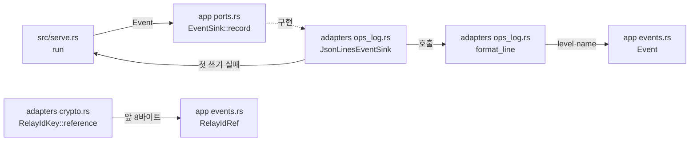

# 운영 로그 모듈 설계

운영 로그 사건을 JSON Lines로 표준 출력이나 로그 파일에 쓰는 구조를 다룬다. 사건의 종류와 `level`은 app이, 줄 형식과 출력은 adapters가 맡는다. [운영 정보 계약](../contracts/ops-info-v2.md)의 공통 규칙(1.1~1.4절), 중계 ID 참조 값(1.9절), 상대 주소 표기(1.10절), 로그에 넣지 않는 값(1.11절)을 구현한다. app의 `Event`는 시작·준비·종료·설정 경고와 접속·대기·세션·재로드·관리자 사건을 정의한다.

| 항목 | 값 |
| --- | --- |
| 구조 시점 | Current |
| 문서 상태 | Draft |
| 구현 대조 | 소스 대조와 수동 로그 회전 관찰은 [대조 기록](#대조-기록)을 따른다. |
| 코드 위치 | `crates/domain/src/peer_ip.rs`, `crates/app/src/events.rs`, `crates/app/src/ports.rs`, `crates/adapters/src/ops_log.rs`, `crates/adapters/src/crypto.rs`, `src/serve.rs`(사건 기록 위치) |
| 코드 지도 | [코드 지도 2절](code-map.md#2-코드-위치와-구성요소) |
| 관련 스펙 | [운영 스펙 3.5절](../specs/operations.md#35-운영-정보), OPS-012(일부) |
| 관련 계약 | [운영 정보 계약](../contracts/ops-info-v2.md) 1.1~1.5·1.9~1.11절, [설정 계약 1.2절](../contracts/config-v4.md#12-키-표)(`log.output`)·[2.1절](../contracts/config-v4.md#21-설정-오류와-준비-실패)(`log_file_unavailable`)·[2.2절](../contracts/config-v4.md#22-경고), [CLI 계약 1.8절](../contracts/cli-v1.md#18-수동-시작과-종료)(시작 순서) |
| 관련 ADR | 없음 |
| 관련 문서 | [접속 ticket 모듈 설계](relay-access-ticket.md) |

`LOG_CONTRACT`는 `ops-info/2.3.0`이다. 2.1.0은 접속 ticket 사건을([접속 ticket 모듈 설계](relay-access-ticket.md)), 2.2.0은 IP 정보 DB 사건 `ip_db_loaded`·`ip_db_unavailable`과 WSS TLS 단계 `connection_rejected`의 `conn_id`를 더했다([접속 출처 통계 모듈 설계](source-stats.md)). 2.3.0은 출발지 IP 차단 목록의 `ip_denied`를 `connection_rejected.reason`·`waiting_removed.reason`·`session_closed.close_cause`에 더했다. 등록 단계의 Mode I 거절은 `relay_id_ref` 없이 `mode=mode1`로 쓴다(`Event::RegistrationRejected.relay_id_ref`가 `None`). `listener`는 `tcp_viewer`·`tcp_server`·`ws`·`wss`·`management`·`status` 중 하나다. WS·WSS는 경로 판정 전 role을 생략하고 켜진 경로 판정 뒤 role을 보존한다. TCP 수락은 고정 role을 출력한다. `allow_all_source`는 WS·WSS 역할 목록일 때 role을 더하고 `plaintext_ws_enabled.listener`는 `ws`다. `session_started.server_transport`는 Server의 전송 방식을 기록한다.

[운영 정보 계약](../contracts/ops-info-v2.md)의 `forwarded_ip`, `viewer_forwarded_ip`, `server_forwarded_ip`, `connection_rejected.reason = forwarded_for_invalid`, `trust_all_proxies` 경고를 사용한다. 신뢰 프록시의 전달 주소를 도출한 뒤의 사건에 `forwarded_ip`가 기록되며, 소켓 상대 IP인 `peer_ip`는 바꾸지 않는다. 전체 범위를 포괄하는 `trusted_proxies` 항목은 시작·재로드 때 `trust_all_proxies` 경고(`listener`, `item`, `phase`)로 기록한다.

최근 로그는 메모리 보관(`RecentLogs`, OPS-068)과 `GET /api/v1/logs`(MGT-046~050)를 연결한다.
- `recent_logs.max_entries` 상한(0~10000, 기본 1000, 0=끄기, 재시작 필요)의 메모리 링 버퍼(`RecentLogs`)를 프로세스 시작 시 생성한다.
- `JsonLinesEventSink::prepare`는 `event_entry`가 만든 `LogEntry`의 `Vec<(&'static str, Value)>`를 그대로 사용한다. `LogEntry::fmt`는 정적 키와 값을 중간 문자열 없이 출력 버퍼에 쓴다. 보관할 때만 `Arc<LogEntry>`를 만들며, 별도 `Map`이나 키 복사본은 만들지 않는다. 보관 버퍼가 없거나 상한이 0이면 줄만 만든다.
- 출력 위치(`stdout`/파일) 및 파일 쓰기 성공/실패와 독립적으로 보관된다.
- `src/serve.rs::run`이 만든 `Arc<RecentLogs>`를 기록 싱크와 `listen_until_shutdown`의 관리 서비스에 직접 전달한다. 조회용 빈 대체 버퍼는 만들지 않는다.
- `record`와 `reopen`은 출력 잠금 안에서 보관 순번을 정하고 줄을 쓴다. 잠금 순서는 출력 → 최근 로그 버퍼다. 조회는 버퍼 잠금만 사용한다. 따라서 파일 줄과 `seq`의 순서가 같으며, 쓰기 실패도 보관 순번을 소비한다.
- 시퀀스 번호 `seq`는 1부터 시작해 단조 증가하며 재사용되지 않는다. 상한 초과 시 가장 오래된 항목을 꺼내고, 버퍼 잠금을 푼 뒤 해제한다. `0`이면 보관하지 않는다. 프로세스 재시작 시 비어 있다.
- `RecentLogs::query`로 조건(`level`, `event`, `q`, `session_id`, `before`, `after`, `limit`)에 맞는 로그 항목을 검색한다.
  - 버퍼 잠금 안에서 전체 버퍼의 `oldest_seq`·`latest_seq`를 읽는다. `partition_point`로 `before`·`after` 범위를 정하고 그 범위의 `Arc`만 복제한다. 이후 일치 검사와 페이지 선택은 잠금 밖에서 한다.
  - 커서 없음과 `before`는 최신 항목부터 역순으로 훑어 `limit + 1`개를 모으면 즉시 멈춘 뒤 오름차순으로 정렬한다.
  - `after`는 커서 직후부터 순방향으로 훑어 `limit + 1`개를 모으면 즉시 멈추므로 `after=latest` 폴링 시 전체를 탐색하지 않는다.
  - `session_id`가 있으면 같은 잠금 안에서 해당 세션의 최신 `session_started` 참조도 확보한다. 이 사건은 커서 범위 밖에 있을 수 있다. 잠금을 푼 뒤 두 연결 식별자를 읽어 범위 안 사건의 `conn_id`와 대조한다. 커서 경계 때문에 세션 연계가 사라지지 않는다.
  - `q` 검색은 사전 변환된 소문자 바이트 패턴과 바이트 단위로 대조(`contains_ascii_case_insensitive`)하며, 수는 스택 버퍼 포맷팅을 사용하여 힙 할당 없이 수행한다.
  - `LogsResponse::to_json_string`은 `LogEntry`의 필드 목록을 직접 직렬화한다. 깊은 복사나 JSON 재해석은 하지 않는다.

## 1. 책임과 경계

- 맡는 책임:
  - 줄 형식(1.1절): 줄마다 JSON 객체 하나와 LF, UTF-8, 값이 없는 선택 필드는 생략(`null` 없음). `detail`은 512바이트, `origin`·`target_host`는 256바이트에서 같은 `cut` 함수로 UTF-8 문자 경계에 맞춰 자른다.
  - 공통 필드(1.2·1.3절): `ts`(UTC, 밀리초, 끝에 `Z`), `level`(`info`·`warn`·`error`), `event`.
  - 출력 위치: `log.output`이 `"stdout"`이면 표준 출력, 경로면 그 파일에 이어 쓴다. 파일이 없으면 만든다. 설정을 읽기 전과 로그 파일을 열기 전의 사건은 표준 출력에 쓴다.
  - 줄 섞임 방지와 보관 순서: 한 줄을 다 만든 뒤 출력 잠금을 잡는다. 같은 잠금 안에서 버퍼에 보관하고 한 번에 쓴다.
  - 쓰기 실패: 그 줄을 버리고 서비스를 계속한다. 처음 실패할 때만 실행파일 조립 쪽에 알려 stderr에 `warning[log_write_failed]` 한 줄을 쓰게 한다.
  - 로그 파일 열기 실패: `log_file_unavailable`(종료 코드 3).
  - 로그 파일 다시 열기: 이름 변경·삭제·생성 알림과 Dp마다 같은 경로를 이어 쓰기로 연다. 파일이 없으면 만든다. 쓰기와 같은 잠금 안에서 핸들을 바꾼다. 실패하면 이전 핸들을 유지한다.
  - 시작 사건: `server_starting`, 설정 경고(`phase=startup`), `startup_failed`(진단 하나에 한 줄), `server_stopped`.
  - `relay_id_ref` 계산(1.9절): 운영체제 난수로 만든 32바이트 키, HMAC-SHA-256 결과의 앞 8바이트를 소문자 16진수 16자로 쓴다.
  - `peer_ip` 표기(1.10절): IPv4-mapped IPv6 주소는 IPv4로 바꾼다. IPv6는 RFC 5952 소문자 축약형이다. 포트와 영역 식별자는 쓰지 않는다.
  - 로그에 넣지 않는 값(1.11절)을 타입으로 막는다. 사건 필드에 원시 바이트·비밀 타입을 받지 않는다. 중계 ID는 `RelayIdRef`로만 사건에 들어간다.
- 맡지 않는 책임:
  - 대기·매칭·세션·재로드·관리자 사건을 만드는 시점. 각 기능이 `crates/app/src/events.rs`의 `Event`를 기록한다. 접속 사건은 [TCP 진입점](tcp-entry-point.md), `relay_connection_limit`·`handshake_timeout`·`peer_eof`·`connection_error`는 [연결 상한과 시간 제한](connection-limits.md), `server_ready`·`admin_connection_limit`은 [상태 리스너](status-listener.md)가 맡는다. 이 모듈은 각 사건의 줄 형식과 출력을 맡는다.
  - `shutdown_started`·`shutdown_forced`를 기록하는 시점. `serve`의 `begin_relay_shutdown`과 `RelayService`가 맡는다([중계 수명 설계 5.2절](relay-session.md#52-정상-종료와-g)).
  - `server_ready`를 기록하는 시점. 준비 상태를 바꾸는 [상태 리스너와 준비 상태 모듈 설계](status-listener.md)가 맡는다. 이 모듈은 줄 형식만 맡는다.
  - 프로세스 시작 때 `RelayIdKey`를 만드는 일과 그 실패 처리, `relay_id_ref`를 실제 사건에 넣는 일. 키 생성 실패는 리스너 바인드 전에 `runtime_unavailable`(종료 코드 1)로 끝난다([중계 수명 설계 5.1절](relay-session.md#51-프로세스-시작과-키)).
  - `accounts_file_permissive` 경고. 운영 정보 계약의 사건이 아니며 stderr에만 쓴다([`serve` 시작 모듈 설계](serve-startup.md)).
- 다른 모듈에 공개하는 기능:
  - `vnc_relay_domain::peer_ip::PeerIp`
  - `vnc_relay_app::events::{Event, Level, Phase, RelayIdRef, LOG_CONTRACT}`
  - `vnc_relay_app::ports::EventSink`
  - `vnc_relay_adapters::ops_log::{JsonLinesEventSink, LogFileError, LogEntry, RecentLogs, LogsFilter, LogsResponse, LogItemResponse, format_line}`
  - `vnc_relay_adapters::crypto::{RelayIdKey, CryptoError}`

## 2. 내부 구조

화살표는 실행 중 호출이다. crate 의존 방향은 [코드 지도 레이어 표](code-map.md#레이어와-의존-방향)를 따른다.

| 요소(파일·심볼) | 역할 | 만들어지는 시점과 소유자 | 의존 대상 |
| --- | --- | --- | --- |
| `crates/domain/src/peer_ip.rs` `PeerIp` | 상대 IP 값. 만들 때 IPv4-mapped IPv6를 IPv4로 바꾼다. `Display`가 1.10절 표기다. 출발지 IP 허용 판정도 같은 값을 쓴다. | 연결을 수락할 때 | 없음 |
| `crates/app/src/events.rs` `Event` | 사건 하나. 변형마다 계약 1.5절의 사건 하나다. `name()`이 사건 이름, `level()`이 1.3·1.5절의 `level`을 준다. | 사건이 생길 때, 기록한 뒤 버린다 | `settings`(`ConfigWarning`), domain(`ConnId`, `EntryPoint`, `PeerIp`, `handshake::Mode`) |
| `crates/app/src/events.rs` `Level`, `Phase`, `RelayIdRef`, `LOG_CONTRACT` | `level` 값, `phase` 값(`startup`·`reload`), 중계 ID 참조 값(16진수 16자만 만든다), `server_starting`의 `log_contract` 값 | 값 타입 | 없음 |
| `crates/app/src/ports.rs` `EventSink` | 사건 기록 포트. `record(&self, &Event)`. 실패를 돌려주지 않는다. 기록 실패가 사용 사례의 흐름을 바꾸지 않게 하기 위해서다. | trait | `events` |
| `crates/adapters/src/ops_log.rs` `JsonLinesEventSink` | `EventSink` 구현. 출력(표준 출력 또는 이어 쓰기 파일)을 잠금 안에 두고 한 줄을 `write_all` 한 번으로 쓴다. 첫 쓰기 실패 때 생성할 때 받은 알림 함수를 한 번 부른다. | `serve::run`이 설정 검증 뒤 만든다. 프로세스가 끝날 때까지 | app, serde_json |
| `JsonLinesEventSink::reopen`, `file_path` | 파일 경로를 감지기에 제공한다. 같은 출력 잠금 안에서 다시 열고 핸들을 바꾼다. 실패 연속 구간의 첫 실패만 이전 파일에 `log_reopen_failed`로 쓴다. 첫 실패 알림 함수는 stderr 진단을 조립 쪽에 맡긴다. | 파일 출력 싱크의 수명 | app 사건 |
| `crates/adapters/src/ops_log.rs` `format_line` | 사건과 시각으로 한 줄(LF 포함)을 만든다. 필드 순서는 `ts`, `level`, `event`, 사건 필드다. 문자열 길이 제한을 적용한다. | 호출마다 | app, serde_json |
| `crates/adapters/src/ops_log.rs` `LogFileError` | 로그 파일을 열 수 없는 이유. `code()`는 `log_file_unavailable`이다. 원인 문장에 경로를 넣지 않는다. | `JsonLinesEventSink::open`이 만든다 | 없음 |
| `crates/adapters/src/crypto.rs` `RelayIdKey`, `CryptoError` | 1.9절 키와 HMAC-SHA-256 계산. `Debug`는 키를 가린다. 키를 저장하거나 기록하지 않는다. | 프로세스 시작 때 한 번. | aws-lc-rs, app |
| `src/serve.rs` `run` | 시작 단계마다 사건을 기록한다(4절). 진단 줄(stderr)과 운영 로그 줄을 둘 다 쓴다. | `serve` 실행마다 | adapters, app |

## 3. 데이터 모델

줄 형식은 [운영 정보 계약 1절](../contracts/ops-info-v2.md#1-형식과-의미)이 기준이다. 여기서는 메모리 타입과 필드 대응만 정한다.

| 이름 | 필드·형태 | 줄의 필드 | 제약과 항상 지켜야 할 조건 |
| --- | --- | --- | --- |
| `Event::ServerStarting` | 없음 | `log_contract`(`LOG_CONTRACT` = `ops-info/2.3.0`) | 시작 단계의 첫 사건이다. |
| `Event::ConfigWarning` | `warning: ConfigWarning`, `phase: Phase` | 사건 이름은 경고 코드. `plaintext_ws_enabled`: `listener=ws`, `listen`. `allow_all_source`: `listener`, WS·WSS 목록의 `role`, `item`, `phase`. `trust_all_proxies`: `listener`, `item`, `phase`. 나머지는 기존 필드. | `item`은 항목의 표준 표기다. `trust_all_proxies`는 신뢰 프록시 목록에 전체 체계 항목이 있을 때 기록한다. |
| `Event::ConfigWarning`의 ticket 경고 | `TicketTcpBypass { role }`, `TicketPlaintextWs { role }`, `phase` | `ticket_tcp_bypass`: 해당 TCP `listener`, `role`, `phase`. `ticket_plaintext_ws`: `listener=ws`, `role`, `phase` | ticket을 켠 역할의 TCP·평문 WS가 켜졌을 때 쓴다. 재로드는 해당 ticket `enabled` 키가 실제 바뀐 경우에만 다시 쓴다. |
| `Event::StartupFailed` | `reason: &'static str`, `config_key: Option<String>`, `listener: Option<&'static str>`, `detail: Option<String>` | 같은 이름 | 진단 하나에 한 줄이다(계약 1.6절). `detail`에 설정 값·경로·파일 내용을 넣지 않는다(6절). |
| `Event::ServerStopped` | 없음 | 없음 | 마지막 줄이다. |
| `Event::ShutdownStarted`, `ShutdownTrigger` | `Requested` 또는 `FatalError { detail }`, G, 활성 수 | `trigger`, `grace_secs`, `active_sessions`, 장애 때만 `detail` | 정상은 `info`, 장애는 `error`다. `RelayService`가 최초 종료 원인을 기록하고 재요청은 새 시작 사건을 만들지 않는다. |
| `Event::HandshakeRejected` | `conn_id: ConnId`, `entry_point: EntryPoint`, `peer_ip: PeerIp`, `reason: RejectReason`, `mode: Option<Mode>` | 사건 이름 `connection_rejected`. `conn_id`, `listener`, `stage`, `reason`, `peer_ip`, 선택 `mode` | `stage`는 항상 `initial_exchange`다. 사유는 `handshake_invalid`·`mode_disabled`다. 후자는 호출자가 `Some(Mode)`를 준다. `level`은 `warn`이다. domain의 `handshake::Mode`를 쓴다. 초기 요청·ID 원문은 보관하지 않는다. 실제 연결에서는 `relay.rs`의 `handle_connection` 실패 경로가 기록한다. [초기 교환 설계 6절](initial-exchange.md#6-사건오류자원-회수) |
| `Event::TicketAccepted` | `conn_id`, `listener`, `role`, `peer_ip`, 선택 `forwarded_ip`, `ticket_jti`, 선택 `ticket_sub`·`session_expires_at` | `ticket_accepted`, `info`, 위 필드 | 사용 기록을 쓴 뒤, U 재확인·101 전송 전에 쓴다. `sx`를 네 자리 연도 UTC로 표시할 수 없으면 `session_expires_at`만 생략한다. |
| `Event::TicketRelayMismatch` | 연결 정보, `mode`, 선택 `relay_id_ref`, `ticket_jti` | `connection_rejected`, `warn`, `stage=initial_exchange`, `reason=ticket_relay_mismatch` | 기존 초기 요청 검사 뒤 `dispatch`가 쓴다. Mode II만 `relay_id_ref`가 있다. |
| 기존 중단·대기 제거·세션 종료 사건의 만료 원인 | `AbortReason::SessionExpired`, `WaitingRemovalReason::SessionExpired`, `CloseCause::SessionExpired` | 초기 교환 `connection_aborted(reason=session_expired)`, 대기 `waiting_removed(reason=session_expired)`, 활성 정리 `session_closed(close_cause=session_expired)` | 모두 `info`다. 활성 세션은 `side`가 없다. E가 지나도 `session_expired`를 유지한다. |
| `Event::UpgradeRejected`의 ticket 거절 | `RejectReason::Ticket`, 선택 `ticket_jti` | `connection_rejected`, `warn`, `stage=upgrade`, ticket 오류 사유 | `ticket_jti`는 서명 확인 뒤 문법이 유효한 값일 때만 넣는다. ticket 원문은 기록하지 않는다. |
| `Event::ReloadApplied` | `trigger: ReloadTrigger`, `applied: Vec<String>` | `trigger`, `applied` | 파일 감지는 `file_watch`, 편집 commit은 `config_edit`다. 실제 바뀐 실행값/TLS/ticket 공개 키 항목만 담고 값은 넣지 않는다. 같은 경로의 공개 키 목록이 바뀌면 `public_keys_file`을 넣는다. |
| `Event::ConfigEdited` | `admin_account: AccountName`, `peer_ip: PeerIp`, `config_keys`, `revision` | 같은 이름 | info. 요청 changes 중 파일값이 달라진 키와 새 바이트 revision이다. 이미 pending이던 실행값 차이는 `ReloadApplied.applied`에만 추가된다. |
| `Event::ConfigEditRejected` | `admin_account: AccountName`, `peer_ip: PeerIp`, `reason: String`, `config_keys: Option<Vec<String>>` | 같은 이름, 없는 config_keys는 생략 | warn. reason은 여섯 편집 업무 오류의 API code다. 설정값·후보·revision은 없다. 인증·CSRF·invalid_request·internal에는 만들지 않는다. |
| `Event::ConnectionRejected` | `listener: &'static str`, `conn_id: Option<ConnId>`, `stage: Stage`, `reason: RejectReason`, `peer_ip: PeerIp` | `connection_rejected`, `listener`, 있을 때만 `conn_id`, `stage`, `reason`, `peer_ip` | 수락 단계(`stage=accept`)는 아직 `conn_id`가 없다. WSS의 TLS 단계 거절은 수락 때 받은 `conn_id`를 쓴다(2.2.0). [접속 출처 통계](source-stats.md)가 이 값으로 보류한 수락을 꺼낸다. |
| `Event::IpDbLoaded` | `key: IpDbKey`, `database_type: String`, `build_time: SystemTime`, `phase: Phase` | `ip_db_loaded`, `config_key`, `database_type`, `build_time`, `phase` | info. `database_type`은 앞 128자다. `phase`는 `startup` 또는 `reload`다. |
| `Event::IpDbUnavailable` | `key: IpDbKey`, `reason: IpDbFailure`, `phase: Phase`, `detail: Option<String>` | `ip_db_unavailable`, `config_key`, `reason`, `phase`, 선택 `detail` | warn. `reason`은 `file_unreadable`·`file_too_large`·`invalid_format`·`unsupported_data`다. `detail`에 경로와 파일 내용을 넣지 않는다. 같은 원인과 내용 표시의 실패는 다시 쓰지 않는다. |
| `Level` | `Info`, `Warn`, `Error` | `level` | 2.2.0에 다른 값이 없다. |
| `RelayIdRef` | 소문자 16진수 16자 `String` | `relay_id_ref` | HMAC 결과 앞 8바이트로만 만든다. 원문 중계 ID로 만드는 생성자가 없다. |
| `PeerIp` | `IpAddr` | `peer_ip` | IPv4-mapped가 아니다. 포트·영역 식별자가 없다. |

## 4. 처리 순서

대표 시나리오는 OPS-012의 시작 부분이다. 계정 파일의 해시 하한 미만으로 시작에 실패할 때 로그에 해시가 나오지 않는다.

| 순서 | 코드 위치(파일·심볼) | 조건·계산 | 바뀌는 상태 | 결과를 쓰는 곳 |
| --- | --- | --- | --- | --- |
| 1 | `src/serve.rs` `run`, `config_file::load` | 설정에 진단이 있으면 진단마다 stderr에 `error[...]`, 표준 출력에 `startup_failed`(`reason`, `config_key`)를 쓰고 3으로 끝난다. 로그 출력 위치를 아직 모르므로 표준 출력이다. | 없음 | stderr, 표준 출력 |
| 2 | `JsonLinesEventSink::open` | `settings.log.output`을 연다. 실패하면 stderr에 `error[log_file_unavailable] key=log.output`, 표준 출력에 `startup_failed`를 쓰고 3으로 끝난다. | 로그 출력 | 3단계 |
| 3 | `EventSink::record` | `server_starting`, 이어서 `Settings::warnings`의 경고마다 경고 사건(`phase` = `startup`) | 없음 | 로그 출력 |
| 4 | `accounts_file::load`, `accounts::require_any` | 진단마다 stderr에 `error[...]`, 로그에 `startup_failed`(`reason`, `config_key` = `admin.accounts_file`)를 쓰고 5로 끝난다. `detail`은 없다. 진단 문장도 해시를 담지 않는다. | 없음 | stderr, 로그 출력 |
| 5 | `serve.rs` 런타임·신호 처리기 준비 | 실패하면 `startup_failed`(`runtime_unavailable`, `detail` = 운영체제 오류 문장)를 쓰고 1로 끝난다. | 없음 | 로그 출력 |
| 5-1 | `serve.rs` TLS 검사 → `reload::ticket_keys::load` | TLS 파일 뒤 ticket을 켠 역할의 공개 키 파일을 검사한다. 키 진단마다 `startup_failed(reason=ticket_keys_invalid, config_key)`와 stderr 오류 줄을 쓴다. TLS 오류와 함께 모아 바인드 전 종료 코드 3으로 끝낸다. | 오류면 없음 | 로그 출력 |
| 6 | `net::bind` | 실패마다 `startup_failed`(`listener_bind_failed`, `listener`, `config_key`, `detail` = 주소를 뺀 원인)를 쓰고 4로 끝난다. | 바인드한 리스너 | 로그 출력 |
| 7 | `ShutdownSignal::wait` | 첫 종료 요청을 받으면 리스너를 닫고 `server_stopped`를 쓴 뒤 0으로 끝난다. | 없음 | 로그 출력 |

ticket 사건의 생성 위치·순서·필드는 [접속 ticket 모듈 설계](relay-access-ticket.md#42-업그레이드대표-시나리오-ws-038)를 따른다. 공개 키 파일 내용과 ticket 원문은 로그·오류 문장에 넣지 않는다.

`format_line`은 `Event::name()`·`level()`과 사건 필드로 `LogEntry`의 순서 있는 필드 목록을 만든다. 정적 키와 `serde_json::Value`를 `fmt::Write`로 직접 직렬화해 `{...}\n`을 만든다. serde_json이 문자열 안의 줄바꿈과 제어 문자를 이스케이프하므로 줄은 LF 하나로 끝난다.

편집 경로에서는 `ConfigEditService::patch`가 같은 공유 재로드 mutex 안에서 검증→임시 파일 원자 교체→`commit_prepared`→`ConfigEdited` 기록을 끝낸다. `ConfigEditService::reject`는 여섯 업무 오류에만 `ConfigEditRejected`를 기록한다. 파일 교체 직전 revision 불일치나 재읽기 실패는 `reason=config_conflict`다. GET·거절·no-op은 `last_reload`를 바꾸지 않는다. 뒤따른 watcher의 같은 후보도 추가 `reload_applied`·`config_edited`·이력 갱신을 만들지 않는다. 로그 쓰기 실패를 app에 반환하지 않는 기존 포트 규칙은 이 경로에도 같다([설정 보기·편집 §4](config-edit.md#4-patch-처리-순서)).

### 설정 편집과 재로드 사건 (Current / Active)

`Event::ConfigEdited`·`ConfigEditRejected`는 `ConfigEditService::patch`가 만들고 `format_line`이 JSON Lines로 직렬화한다. `ReloadService::commit_prepared`는 `ReloadApplied { trigger, applied }`를 만들며 trigger는 `file_watch` 또는 `config_edit`다. 실제 바뀐 대상 정책의 `allow_all_target`도 `phase=reload`로 기록한다. 파일 편집 성공은 재로드 commit 뒤 `config_edited` 순서다. 실행값 차이가 있으면 먼저 `reload_applied`가 나온다. no-op은 둘 다 없고 인증/CSRF/invalid_request에도 편집 사건이 없다. 계정은 `AuthorizedAdmin`, peer는 실제 socket `PeerIp`, revision은 저장 바이트 SHA-256이며 설정값은 기록하지 않는다([설정 보기·편집 §7](config-edit.md#7-사건오류와-남는-상태), [운영 정보 §1.5](../contracts/ops-info-v2.md#15-사건-목록)·[§1.8](../contracts/ops-info-v2.md#18-관리자-계정명-기록-규칙), OPS-058~062).

### 4.1 로그 파일 교체

`file_watch`는 로그 경로의 생성·삭제·이름 변경 알림을 별도 신호로 보낸다. `ReloadWatcher::run`은 재로드 후보 처리와 독립된 `reopen_log` 작업을 함께 실행한다. 이 작업은 알림을 받으면 곧바로, 그리고 Dp마다 `JsonLinesEventSink::reopen`을 부른다. 재로드 안정화가 오래 걸려도 로그의 Dp 시도는 계속된다. 표준 출력 싱크는 이 작업을 만들지 않는다.

`reopen`은 줄 쓰기와 같은 잠금을 잡고 같은 경로를 이어 쓰기로 연다. 성공하면 핸들을 바꾸고 실패 연속 구간을 끝낸다. 성공 사건은 쓰지 않는다. 실패하면 핸들을 그대로 둔다. 실패 연속 구간의 첫 실패만 이전 파일에 `log_reopen_failed`(`warn`, `reason=log_file_unavailable`, `config_key=log.output`, 경로 없는 원인 문장 `detail`)를 쓴다. 잠금을 푼 뒤 알림 함수가 `warning[log_reopen_failed] key=log.output: <message>`를 stderr에 쓴다. 실패 사건 자체를 쓰지 못하면 기존 쓰기 실패 규칙을 따른다.

로그 파일을 열 수 있는데 로그 디렉터리 알림 등록만 실패하면 시작을 계속한다. `reload_watch_failed`(`notify_error`)를 쓰고 Dp마다 다시 열기와 감시 등록을 시도한다. 설정·TLS 감시 준비 실패는 기존처럼 시작 실패다.

## 5. 상태와 초기화

- 초기화 시점: `JsonLinesEventSink`는 설정 검증 뒤, 계정 파일을 읽기 전에 만든다. 그 전의 `startup_failed`는 표준 출력용 싱크(`JsonLinesEventSink::stdout`)로 쓴다.
- 상태 소유자와 제거 시점: `serve::run`이 싱크를 소유한다. TCP 진입점 작업과 연결 작업에는 `Arc<dyn EventSink>`로 넘긴다. 파일은 프로세스가 끝날 때 닫힌다.
- 동시 실행과 순서: 여러 작업이 동시에 `record`를 부를 수 있다. 출력 잠금을 잡은 순서로 `seq`를 배정하고 줄을 쓴다. `ts`는 직렬화 전의 시각이므로 동시 호출에서는 `seq`와 시각의 정렬 순서가 다를 수 있다. 보관 순서와 파일 줄 순서는 같다.
- 파일 출력은 원래 경로와 출력 잠금 안의 실패 연속 구간 표시를 보관한다. 다시 열기는 같은 잠금으로 직렬화한다. 줄을 이전 파일과 새 파일에 나누거나 두 번 쓰지 않는다.
- `RelayIdKey`는 프로세스마다 한 번 만든다. 재시작하면 키가 바뀐다(1.9절).

## 6. 오류 처리

| 실패 지점 | 처리 방법 | 남는 상태 | 관련 스펙 시나리오 |
| --- | --- | --- | --- |
| 로그 파일 열기 | `log_file_unavailable`. stderr 진단과 표준 출력의 `startup_failed`. 종료 코드 3. 원인은 운영체제 오류 종류로 고른다: 상위 디렉터리 없음 "상위 디렉터리가 없다.", 권한 없음 "권한이 없다.", 디렉터리 "디렉터리다.", 그 밖은 운영체제 오류 문장 | 없음 | 없음(설정 계약 2.1절) |
| 줄 쓰기 | 그 줄을 버린다. 처음 실패할 때만 알림 함수를 부른다. `serve`는 stderr에 `warning[log_write_failed] key=log.output`을 쓴다. | 다음 줄은 다시 쓰기를 시도한다 | 없음(운영 정보 계약 1.1절) |
| 실행 중 파일 다시 열기 | 이전 핸들을 유지한다. 실패 연속 구간의 첫 실패만 stderr 경고와 이전 파일의 `log_reopen_failed`를 남긴다. 성공하면 표시를 지운다. | 이전 파일 핸들, 실패 연속 구간 표시 | OPS-045 |
| 난수 키 생성 | `CryptoError`. 바인드 전 `runtime_unavailable`과 종료 코드 1로 끝낸다. | 없음 | 없음 |

`startup_failed`의 `detail`에는 아래만 넣는다. 설정 값을 쓰지 않는 1.11절 규칙 때문이다.

| `reason` | `detail` |
| --- | --- |
| `config_*`, `accounts_*` | 없음. 진단 문장에 설정 값이나 계정 이름이 들어갈 수 있다. |
| `ticket_keys_invalid` | 키 파일 내용·경로·ticket 원문을 넣지 않는다. 진단은 고정된 짧은 원인만 쓴다. |
| `log_file_unavailable` | 원인 문장(예: "상위 디렉터리가 없다."). 경로는 넣지 않는다. |
| `listener_bind_failed` | 원인 문장(예: "이미 사용 중이다."). 주소는 넣지 않는다. |
| `runtime_unavailable` | 운영체제 오류 문장 |

### 6.1 로그 다시 열기 시험

| 위치·시험 함수 | 확인 범위 |
| --- | --- |
| `crates/adapters/src/file_watch/reopen_tests.rs` `reopens_on_notifications_and_poll_and_reports_each_failure_streak_once` | 주입한 알림·시계의 Dp, 실패 연속 구간 첫 사건·알림, 복구와 새 실패 |
| 같은 파일 `log_directory_registration_failure_keeps_poll_and_retries` | 로그 디렉터리 감시 실패 시 시작 지속과 Dp 등록 재시도 |
| `tests/log_reopen.rs` `renamed_log_is_recreated_without_lost_or_duplicate_lines` | 실제 바이너리의 알림 재열기와 접속 사건 유실·중복 없음 |
| `tests/log_reopen.rs`와 `tests/windows_console.rs`의 `log_reopen_failure_warns_once_keeps_old_file_and_recovers` | 공통 본문 `tests/common/log_reopen.rs`를 실행한다. Linux는 실제 stderr, Windows는 기존 ConPTY가 받은 콘솔 진단을 확인한다. 실패 경고 형식·경로 비노출·이전 파일 기록·복구 뒤 새 파일 기록·정상 종료를 확인한다. 알림과 Dp 중 어느 쪽이 먼저 시도해도 같은 실패·복구 결과로 판정한다. |

## 7. 설계 선택

| 선택 | 이유 | 검토한 다른 방법 | 근거 |
| --- | --- | --- | --- |
| tracing을 쓰지 않고 사건 enum과 `EventSink` 포트로 직접 JSON 줄을 쓴다. PRD 구현 기술 행에서 tracing·tracing-subscriber를 뺀다. | 계약 1.2절의 키 이름(`ts`), 소문자 `level`, 평면 필드, 배열 필드(`listeners`)를 그대로 쓸 수 있다. 사건 이름·필드를 컴파일러가 검사한다. | tracing-subscriber JSON 출력(키 이름 `timestamp`, 대문자 `level`, `fields` 중첩이 고정). tracing과 직접 만든 Layer(중첩 값을 문자열로 넘겨야 한다). | [rust.md 7절](../conventions/rust.md) `Sink` |
| HMAC-SHA-256과 난수에 aws-lc-rs를 직접 쓴다. | rustls와 같은 암호 구현을 한 벌만 둔다. | RustCrypto `hmac`·`sha2`·`getrandom`. 암호 구현이 두 벌이 된다. | [PRD 구현 기술](../requirements/PRD.md#확정-기준) |
| `startup_failed`는 진단 하나에 한 줄이다. | 1.5절의 `config_key?`·`listener?`는 진단 하나를 가리킨다. stderr 진단 줄과 1:1로 대응해 로그만으로 고칠 키를 모두 알 수 있다. | 오류 코드마다 한 줄. 같은 코드의 키가 여럿이면 `config_key`를 생략해야 한다. | [운영 정보 계약 1.6절](../contracts/ops-info-v2.md#16-원인-코드) |
| 계정 파일 오류의 `config_key`는 `admin.accounts_file`이다. | 계정 파일 안 경로(`account[1].name`)는 설정 키가 아니다. 문제가 있는 파일을 가리키는 설정 키가 `admin.accounts_file`이다. | 진단의 `key`를 그대로 쓴다. `config_key`의 뜻(설정 키)과 어긋난다. | [운영 정보 계약 1.4절](../contracts/ops-info-v2.md#14-필드-사전) |
| `listener_bind_failed` 줄은 `listener`와 `config_key`를 함께 쓴다. | 리스너 이름과 고칠 설정 키를 한 줄에서 볼 수 있다. 둘 다 선택 필드다. | `listener`만 쓴다(계약 5절 예제). | [운영 정보 계약 1.5절](../contracts/ops-info-v2.md#15-사건-목록) |
| 쓰기 실패 알림은 adapters가 직접 stderr에 쓰지 않고 생성할 때 받은 함수로 실행파일 조립에 넘긴다. | 명령행 출력은 실행파일 조립 crate만 쓴다. | adapters가 stderr에 쓴다. 출력 규칙을 어긴다. | [rust.md 2절](../conventions/rust.md) "출력" 행 |
| 시각은 `record`가 부를 때의 `SystemTime`이다. `format_line`은 시각을 인수로 받는다. | 기록은 사건 직후에 한다. 형식 테스트가 고정 시각을 쓸 수 있다. | `Clock` 포트. 지금은 시각을 바꿔 넣을 사용 사례 테스트가 없다. | [테스트 컨벤션 2절](../conventions/testing.md) |
| `ts`의 날짜 계산을 직접 한다(1970년 기준 일수 → 그레고리력). | PRD 목록에 날짜 crate가 없다. 계산은 짧고 단위 테스트로 경계(윤년·세기)를 확인할 수 있다. | 날짜 crate 추가. PRD 행 변경이 필요하다. | [PRD "구현 기술" 행](../requirements/PRD.md#확정-기준) |
| 종료 유예 진입 때 `shutdown_started`를 쓴다. 강제 정리할 활성 세션이 있으면 `shutdown_forced`를 먼저 쓰고 각 `session_closed`를 쓴다. 모든 작업 회수 뒤 `server_stopped`를 마지막에 쓴다. | G=0·G 만료·두 번째 요청·Windows 콘솔 창 닫기에도 같은 사건 순서와 남은 세션 조건을 적용한다. | 세션이 없어도 `shutdown_forced`를 쓰는 방법. 실제 강제 정리가 있었던 것처럼 보인다. | [운영 정보 계약 1.5절](../contracts/ops-info-v2.md#15-사건-목록) |
| 길이 제한은 JSON 이스케이프 전 값의 UTF-8 바이트 수에 적용한다. | 계약 1.1절은 필드 값의 길이를 정한다. 이스케이프 뒤 길이로 자르면 이스케이프 문자 중간에서 잘릴 수 있다. | 이스케이프 뒤 바이트 수. 줄 길이 상한은 정확하지만 자르는 위치 계산이 복잡하다. | [운영 정보 계약 1.1절](../contracts/ops-info-v2.md#11-로그-일반-규칙) |
| 다시 열기는 adapters의 구체 싱크 기능으로 둔다. `EventSink` 포트에는 넣지 않는다. | 파일 핸들 관리는 운영 사건의 의미가 아니라 출력 구현의 책임이다. | app 포트에 파일 기능을 넣는 방법 | 없음 |
| 로그 알림과 Dp 작업을 재로드 후보 작업과 독립적으로 진행한다. | 연속 설정 변경으로 안정화가 끝나지 않아도 Dp 재열기를 계속해야 한다. | 재로드 루프의 주기 확인에서만 다시 여는 방법 | 없음 |

## 8. 현재 코드와의 차이

없다. 2~4절의 파일·심볼이 현재 코드와 같다.

## 대조 기록

### 구조 대조

- 날짜·대상: 2026-11-08 작업 트리의 `Event::ConfigEdited`·`ConfigEditRejected`·`ReloadApplied`, `ConfigEditService::patch`, `format_line` 직렬화 arm.
- 환경·방법: 저장소 소스를 읽고 사건 생성과 직렬화 경계를 대조했다.
- 결과: 본문의 편집·재로드 사건 순서와 일치한다. 시나리오별 현재 결과는 `cargo xtask scenarios`가 만드는 `scenario-report.md`와 CI에서 확인한다([테스트 컨벤션](../conventions/testing.md#7-테스트와-스펙-시나리오-연결)).

### 로그 회전 수동 관찰

- 대상: 커밋 `1c7c7a9`(구현 `a4716e9`)의 두 OS release 실행파일. 관찰 날짜는 원기록에 없다.
- 환경: Windows 11 Pro 10.0.26200 x64·Ubuntu 24.04.4(WSL2), Rust 1.99.1.
- 방법: 실행 중 로그 파일을 수동 회전한 뒤 원래 경로와 회전 파일을 확인했다.
- 결과: 두 OS에서 원래 경로를 다시 만들었고 회전 뒤 사건은 새 파일에만 남았다.

## 9. 미결정 사항

없다.
