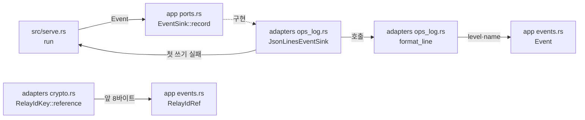

# 운영 로그 모듈 설계

운영 로그 사건을 JSON Lines로 표준 출력이나 로그 파일에 쓰는 구조를 다룬다. 사건의 종류와 `level`은 app이, 줄 형식과 출력은 adapters가 맡는다. [운영 정보 계약](../contracts/ops-info-v1.md)의 공통 규칙(1.1~1.4절), 중계 ID 참조 값(1.9절), 상대 주소 표기(1.10절), 로그에 넣지 않는 값(1.11절)을 구현한다. app의 `Event`는 시작·준비·종료·설정 경고와 접속·대기·세션·재로드·관리자 사건을 정의한다.

| 항목 | 값 |
| --- | --- |
| 구조 시점 | Current |
| 문서 상태 | Draft |
| 구현 대조 | Verified — [대조 기록](#대조-기록) |
| 코드 위치 | `crates/domain/src/peer_ip.rs`, `crates/app/src/events.rs`, `crates/app/src/ports.rs`, `crates/adapters/src/ops_log.rs`, `crates/adapters/src/crypto.rs`, `src/serve.rs`(사건 기록 위치) |
| 코드 지도 | [코드 지도 2절](code-map.md#2-코드-위치와-구성요소) |
| 관련 스펙 | [운영 스펙 3.5절](../specs/operations.md#35-운영-정보), OPS-012(일부) |
| 관련 계약 | [운영 정보 계약](../contracts/ops-info-v1.md) 1.1~1.5·1.9~1.11절, [설정 계약 1.2절](../contracts/config-v2.md#12-키-표)(`log.output`)·[2.1절](../contracts/config-v2.md#21-설정-오류와-준비-실패)(`log_file_unavailable`)·[2.2절](../contracts/config-v2.md#22-경고), [CLI 계약 1.8절](../contracts/cli-v1.md#18-수동-시작과-종료)(시작 순서) |
| 관련 ADR | 없음 |

## 1. 책임과 경계

- 맡는 책임:
  - 줄 형식(1.1절): 줄마다 JSON 객체 하나와 LF, UTF-8, 값이 없는 선택 필드는 생략(`null` 없음). `detail`은 512바이트에서 UTF-8 문자 경계로 자른다. `origin`(256바이트)·`target_host`(256바이트) 자르기는 그 필드를 가진 사건을 더하는 작업(3.2·2.8)이 같은 `cut` 함수로 더한다.
  - 공통 필드(1.2·1.3절): `ts`(UTC, 밀리초, 끝에 `Z`), `level`(`info`·`warn`·`error`), `event`.
  - 출력 위치: `log.output`이 `"stdout"`이면 표준 출력, 경로면 그 파일에 이어 쓴다. 파일이 없으면 만든다. 설정을 읽기 전과 로그 파일을 열기 전의 사건은 표준 출력에 쓴다.
  - 줄 섞임 방지: 한 줄을 다 만든 뒤 잠금을 잡고 한 번에 쓴다.
  - 쓰기 실패: 그 줄을 버리고 서비스를 계속한다. 처음 실패할 때만 실행파일 조립 쪽에 알려 stderr에 `warning[log_write_failed]` 한 줄을 쓰게 한다(사용자 결정 2026-10-20).
  - 로그 파일 열기 실패: `log_file_unavailable`(종료 코드 3, 사용자 결정 2026-10-20).
  - 로그 파일 다시 열기: 이름 변경·삭제·생성 알림과 Dp마다 같은 경로를 이어 쓰기로 연다. 파일이 없으면 만든다. 쓰기와 같은 잠금 안에서 핸들을 바꾼다. 실패하면 이전 핸들을 유지한다(사용자 결정 2026-11-04(Q104·Q109·Q110)).
  - 작업 2.3의 사건: `server_starting`, 설정 경고 4종(`phase`는 `startup`), `startup_failed`(진단 하나에 한 줄), `server_stopped`.
  - `relay_id_ref` 계산(1.9절): 운영체제 난수로 만든 32바이트 키, HMAC-SHA-256 결과의 앞 8바이트를 소문자 16진수 16자로 쓴다.
  - `peer_ip` 표기(1.10절): IPv4-mapped IPv6 주소는 IPv4로 바꾼다. IPv6는 RFC 5952 소문자 축약형이다. 포트와 영역 식별자는 쓰지 않는다.
  - 로그에 넣지 않는 값(1.11절)을 타입으로 막는다. 사건 필드에 원시 바이트·비밀 타입을 받지 않는다. 중계 ID는 `RelayIdRef`로만 사건에 들어간다.
- 맡지 않는 책임:
  - 대기·매칭·세션·재로드·관리자 사건을 만드는 시점. 각 기능이 `crates/app/src/events.rs`의 `Event`를 기록한다. 접속 수락·거절·중단 사건은 작업 2.4가 더했다([TCP 진입점 모듈 설계](tcp-entry-point.md)). 작업 2.5가 `relay_connection_limit`(`limit` 필드)과 `handshake_timeout`·`peer_eof`·`connection_error`(`error_kind` 필드)를 더했다([연결 상한과 시간 제한 모듈 설계](connection-limits.md)). 작업 2.6이 `server_ready`(`listeners` 필드)와 `admin_connection_limit`을 더했다([상태 리스너와 준비 상태 모듈 설계](status-listener.md)). 이 모듈은 각 사건의 줄 형식과 출력을 맡는다.
  - `shutdown_started`·`shutdown_forced`를 기록하는 시점. `serve`의 `begin_relay_shutdown`과 `RelayService`가 맡는다([중계 수명 설계 5.2절](relay-session.md#52-정상-종료와-g), 작업 5.3 완료).
  - `server_ready`를 기록하는 시점. 준비 상태를 바꾸는 [상태 리스너와 준비 상태 모듈 설계](status-listener.md)가 맡는다. 이 모듈은 줄 형식만 맡는다.
  - 프로세스 시작 때 `RelayIdKey`를 만드는 일과 그 실패 처리, `relay_id_ref`를 실제 사건에 넣는 일. 작업 2.9에서 구현했다. 키 생성 실패는 리스너 바인드 전에 `runtime_unavailable`(종료 코드 1)로 끝난다(사용자 결정 2026-11-01(Q76), [중계 수명 설계 5.1절](relay-session.md#51-프로세스-시작과-키)).
  - `accounts_file_permissive` 경고. 운영 정보 계약의 사건이 아니며 stderr에만 쓴다([`serve` 시작 모듈 설계](serve-startup.md)).
- 다른 모듈에 공개하는 기능:
  - `vnc_relay_domain::peer_ip::PeerIp`
  - `vnc_relay_app::events::{Event, Level, Phase, RelayIdRef, LOG_CONTRACT}`
  - `vnc_relay_app::ports::EventSink`
  - `vnc_relay_adapters::ops_log::{JsonLinesEventSink, LogFileError, format_line}`
  - `vnc_relay_adapters::crypto::{RelayIdKey, CryptoError}`

## 2. 내부 구조

화살표는 실행 중 호출이다. crate 의존 방향은 [코드 지도 레이어 표](code-map.md#레이어와-의존-방향)를 따른다.

| 요소(파일·심볼) | 역할 | 만들어지는 시점과 소유자 | 의존 대상 |
| --- | --- | --- | --- |
| `crates/domain/src/peer_ip.rs` `PeerIp` | 상대 IP 값. 만들 때 IPv4-mapped IPv6를 IPv4로 바꾼다. `Display`가 1.10절 표기다. 작업 2.4의 허용 판정도 같은 값을 쓴다. | 연결을 수락할 때 | 없음 |
| `crates/app/src/events.rs` `Event` | 사건 하나. 변형마다 계약 1.5절의 사건 하나다. `name()`이 사건 이름, `level()`이 1.3·1.5절의 `level`을 준다. | 사건이 생길 때, 기록한 뒤 버린다 | `settings`(`ConfigWarning`), domain(`ConnId`, `EntryPoint`, `PeerIp`, `handshake::Mode`) |
| `crates/app/src/events.rs` `Level`, `Phase`, `RelayIdRef`, `LOG_CONTRACT` | `level` 값, `phase` 값(`startup`·`reload`), 중계 ID 참조 값(16진수 16자만 만든다), `server_starting`의 `log_contract` 값 | 값 타입 | 없음 |
| `crates/app/src/ports.rs` `EventSink` | 사건 기록 포트. `record(&self, &Event)`. 실패를 돌려주지 않는다. 기록 실패가 사용 사례의 흐름을 바꾸지 않게 하기 위해서다. | trait | `events` |
| `crates/adapters/src/ops_log.rs` `JsonLinesEventSink` | `EventSink` 구현. 출력(표준 출력 또는 이어 쓰기 파일)을 잠금 안에 두고 한 줄을 `write_all` 한 번으로 쓴다. 첫 쓰기 실패 때 생성할 때 받은 알림 함수를 한 번 부른다. | `serve::run`이 설정 검증 뒤 만든다. 프로세스가 끝날 때까지 | app, serde_json |
| `JsonLinesEventSink::reopen`, `file_path` | 파일 경로를 감지기에 제공한다. 같은 출력 잠금 안에서 다시 열고 핸들을 바꾼다. 실패 연속 구간의 첫 실패만 이전 파일에 `log_reopen_failed`로 쓴다. 첫 실패 알림 함수는 stderr 진단을 조립 쪽에 맡긴다. | 파일 출력 싱크의 수명 | app 사건 |
| `crates/adapters/src/ops_log.rs` `format_line` | 사건과 시각으로 한 줄(LF 포함)을 만든다. 필드 순서는 `ts`, `level`, `event`, 사건 필드다. 문자열 길이 제한을 적용한다. | 호출마다 | app, serde_json |
| `crates/adapters/src/ops_log.rs` `LogFileError` | 로그 파일을 열 수 없는 이유. `code()`는 `log_file_unavailable`이다. 원인 문장에 경로를 넣지 않는다. | `JsonLinesEventSink::open`이 만든다 | 없음 |
| `crates/adapters/src/crypto.rs` `RelayIdKey`, `CryptoError` | 1.9절 키와 HMAC-SHA-256 계산. `Debug`는 키를 가린다. 키를 저장하거나 기록하지 않는다. | 프로세스 시작 때 한 번. 시작 순서에 넣는 일은 작업 2.9다. | aws-lc-rs, app |
| `src/serve.rs` `run` | 시작 단계마다 사건을 기록한다(4절). 진단 줄(stderr)과 운영 로그 줄을 둘 다 쓴다. | `serve` 실행마다 | adapters, app |

## 3. 데이터 모델

줄 형식은 [운영 정보 계약 1절](../contracts/ops-info-v1.md#1-형식과-의미)이 기준이다. 여기서는 메모리 타입과 필드 대응만 정한다.

| 이름 | 필드·형태 | 줄의 필드 | 제약과 항상 지켜야 할 조건 |
| --- | --- | --- | --- |
| `Event::ServerStarting` | 없음 | `log_contract`(`LOG_CONTRACT` = `ops-info/1.3.0`) | 시작 단계의 첫 사건이다. |
| `Event::ConfigWarning` | `warning: ConfigWarning`, `phase: Phase` | 사건 이름은 경고 코드. `plaintext_ws_enabled`: `listener`, `listen`. `allow_all_source`: `listener`, `item`, `phase`. `allow_all_target`: `item`, `phase`. `status_listen_not_loopback`: `listen` | `item`은 항목의 표준 표기다([설정 로딩 모듈 설계](config-loading.md) 7절). |
| `Event::StartupFailed` | `reason: &'static str`, `config_key: Option<String>`, `listener: Option<&'static str>`, `detail: Option<String>` | 같은 이름 | 진단 하나에 한 줄이다(계약 1.6절). `detail`에 설정 값·경로·파일 내용을 넣지 않는다(6절). |
| `Event::ServerStopped` | 없음 | 없음 | 마지막 줄이다. |
| `Event::ShutdownStarted`, `ShutdownTrigger` | `Requested` 또는 `FatalError { detail }`, G, 활성 수 | `trigger`, `grace_secs`, `active_sessions`, 장애 때만 `detail` | 정상은 `info`, 장애는 `error`다. `RelayService`가 최초 종료 원인을 기록하고 재요청은 새 시작 사건을 만들지 않는다. 사용자 결정 2026-11-05(Q114). |
| `Event::HandshakeRejected` | `conn_id: ConnId`, `entry_point: EntryPoint`, `peer_ip: PeerIp`, `reason: RejectReason`, `mode: Option<Mode>` | 사건 이름 `connection_rejected`. `conn_id`, `listener`, `stage`, `reason`, `peer_ip`, 선택 `mode` | `stage`는 항상 `initial_exchange`다. 사유는 `handshake_invalid`·`mode_disabled`다. 후자는 호출자가 `Some(Mode)`를 준다. `level`은 `warn`이다. domain의 `handshake::Mode`를 쓴다. 초기 요청·ID 원문은 보관하지 않는다. 사건·JSON·계약 시험을 구현했다. 실제 연결에서는 `relay.rs`의 `handle_connection` 실패 경로가 기록한다. [초기 교환 설계 6절](initial-exchange.md#6-사건오류자원-회수) |
| `Level` | `Info`, `Warn`, `Error` | `level` | v1에 다른 값이 없다. |
| `RelayIdRef` | 소문자 16진수 16자 `String` | `relay_id_ref` | HMAC 결과 앞 8바이트로만 만든다. 원문 중계 ID로 만드는 생성자가 없다. |
| `PeerIp` | `IpAddr` | `peer_ip` | IPv4-mapped가 아니다. 포트·영역 식별자가 없다. |

## 4. 처리 순서

대표 시나리오는 OPS-012의 시작 부분이다. 계정 파일의 해시 하한 미만으로 시작에 실패할 때 로그에 해시가 나오지 않는다.

| 순서 | 코드 위치(파일·심볼) | 조건·계산 | 바뀌는 상태 | 결과를 쓰는 곳 |
| --- | --- | --- | --- | --- |
| 1 | `src/serve.rs` `run`, `config_file::load` | 설정에 진단이 있으면 진단마다 stderr에 `error[...]`, 표준 출력에 `startup_failed`(`reason`, `config_key`)를 쓰고 3으로 끝난다. 로그 출력 위치를 아직 모르므로 표준 출력이다. | 없음 | stderr, 표준 출력 |
| 2 | `JsonLinesEventSink::open` | `settings.log.output`을 연다. 실패하면 stderr에 `error[log_file_unavailable] key=log.output`, 표준 출력에 `startup_failed`를 쓰고 3으로 끝난다. | 로그 출력 | 3단계 |
| 3 | `EventSink::record` | `server_starting`, 이어서 `Settings::warnings`의 경고마다 경고 사건(`phase` = `startup`) | 없음 | 로그 출력 |
| 4 | `accounts_file::load`, `accounts::require_any` | 진단마다 stderr에 `error[...]`, 로그에 `startup_failed`(`reason`, `config_key` = `admin.accounts_file`)를 쓰고 5로 끝난다. `detail`은 없다. 진단 문장도 해시를 담지 않는다. | 없음 | stderr, 로그 출력 |
| 5 | `serve.rs` 런타임·신호 처리기 준비 | 실패하면 `startup_failed`(`runtime_unavailable`, `detail` = 운영체제 오류 문장)를 쓰고 1로 끝난다. | 없음 | 로그 출력 |
| 6 | `net::bind` | 실패마다 `startup_failed`(`listener_bind_failed`, `listener`, `config_key`, `detail` = 주소를 뺀 원인)를 쓰고 4로 끝난다. | 바인드한 리스너 | 로그 출력 |
| 7 | `ShutdownSignal::wait` | 첫 종료 요청을 받으면 리스너를 닫고 `server_stopped`를 쓴 뒤 0으로 끝난다. | 없음 | 로그 출력 |

`format_line`은 `Event::name()`·`level()`과 사건 필드로 `serde_json::Value` 목록을 만들고, 키와 값을 차례로 직렬화해 `{...}\n`을 만든다. serde_json이 문자열 안의 줄바꿈과 제어 문자를 이스케이프하므로 줄은 LF 하나로 끝난다.

### 4.1 로그 파일 교체

`file_watch`는 로그 경로의 생성·삭제·이름 변경 알림을 별도 신호로 보낸다. `ReloadWatcher::run`은 재로드 후보 처리와 독립된 `reopen_log` 작업을 함께 실행한다. 이 작업은 알림을 받으면 곧바로, 그리고 Dp마다 `JsonLinesEventSink::reopen`을 부른다. 재로드 안정화가 오래 걸려도 로그의 Dp 시도는 계속된다. 표준 출력 싱크는 이 작업을 만들지 않는다.

`reopen`은 줄 쓰기와 같은 잠금을 잡고 같은 경로를 이어 쓰기로 연다. 성공하면 핸들을 바꾸고 실패 연속 구간을 끝낸다. 성공 사건은 쓰지 않는다. 실패하면 핸들을 그대로 둔다. 실패 연속 구간의 첫 실패만 이전 파일에 `log_reopen_failed`(`warn`, `reason=log_file_unavailable`, `config_key=log.output`, 경로 없는 원인 문장 `detail`)를 쓴다. 잠금을 푼 뒤 알림 함수가 `warning[log_reopen_failed] key=log.output: <message>`를 stderr에 쓴다. 실패 사건 자체를 쓰지 못하면 기존 쓰기 실패 규칙을 따른다.

로그 파일을 열 수 있는데 로그 디렉터리 알림 등록만 실패하면 시작을 계속한다. `reload_watch_failed`(`notify_error`)를 쓰고 Dp마다 다시 열기와 감시 등록을 시도한다. 설정·TLS 감시 준비 실패는 기존처럼 시작 실패다(사용자 결정 2026-11-04(Q111)).

## 5. 상태와 초기화

- 초기화 시점: `JsonLinesEventSink`는 설정 검증 뒤, 계정 파일을 읽기 전에 만든다. 그 전의 `startup_failed`는 표준 출력용 싱크(`JsonLinesEventSink::stdout`)로 쓴다.
- 상태 소유자와 제거 시점: `serve::run`이 싱크를 소유한다. TCP 진입점 작업과 연결 작업에는 `Arc<dyn EventSink>`로 넘긴다. 파일은 프로세스가 끝날 때 닫힌다.
- 동시 실행과 순서: 여러 작업이 동시에 `record`를 부를 수 있다. 줄은 잠금 안에서 한 번에 쓰므로 섞이지 않는다. 같은 연결의 사건은 그 연결 작업이 차례로 부르므로 발생 순서대로 남는다.
- 파일 출력은 원래 경로와 출력 잠금 안의 실패 연속 구간 표시를 보관한다. 다시 열기는 같은 잠금으로 직렬화한다. 줄을 이전 파일과 새 파일에 나누거나 두 번 쓰지 않는다.
- `RelayIdKey`는 프로세스마다 한 번 만든다. 재시작하면 키가 바뀐다(1.9절).

## 6. 오류 처리

| 실패 지점 | 처리 방법 | 남는 상태 | 관련 스펙 시나리오 |
| --- | --- | --- | --- |
| 로그 파일 열기 | `log_file_unavailable`. stderr 진단과 표준 출력의 `startup_failed`. 종료 코드 3. 원인은 운영체제 오류 종류로 고른다: 상위 디렉터리 없음 "상위 디렉터리가 없다.", 권한 없음 "권한이 없다.", 디렉터리 "디렉터리다.", 그 밖은 운영체제 오류 문장 | 없음 | 없음(설정 계약 2.1절) |
| 줄 쓰기 | 그 줄을 버린다. 처음 실패할 때만 알림 함수를 부른다. `serve`는 stderr에 `warning[log_write_failed] key=log.output`을 쓴다. | 다음 줄은 다시 쓰기를 시도한다 | 없음(운영 정보 계약 1.1절) |
| 실행 중 파일 다시 열기 | 이전 핸들을 유지한다. 실패 연속 구간의 첫 실패만 stderr 경고와 이전 파일의 `log_reopen_failed`를 남긴다. 성공하면 표시를 지운다. | 이전 파일 핸들, 실패 연속 구간 표시 | OPS-045 |
| 난수 키 생성 | `CryptoError`. 작업 2.9가 시작 실패 처리를 정한다. | 없음 | 없음 |

`startup_failed`의 `detail`에는 아래만 넣는다. 설정 값을 쓰지 않는 1.11절 규칙 때문이다.

| `reason` | `detail` |
| --- | --- |
| `config_*`, `accounts_*` | 없음. 진단 문장에 설정 값이나 계정 이름이 들어갈 수 있다. |
| `log_file_unavailable` | 원인 문장(예: "상위 디렉터리가 없다."). 경로는 넣지 않는다. |
| `listener_bind_failed` | 원인 문장(예: "이미 사용 중이다."). 주소는 넣지 않는다. |
| `runtime_unavailable` | 운영체제 오류 문장 |

### 6.1 로그 다시 열기 시험

| 위치·시험 함수 | 확인 범위 |
| --- | --- |
| `crates/adapters/src/file_watch/reopen_tests.rs` `reopens_on_notifications_and_poll_and_reports_each_failure_streak_once` | 주입한 알림·시계의 Dp, 실패 연속 구간 첫 사건·알림, 복구와 새 실패 |
| 같은 파일 `log_directory_registration_failure_keeps_poll_and_retries` | Q111 시작 지속과 Dp 등록 재시도 |
| `tests/log_reopen.rs` `renamed_log_is_recreated_without_lost_or_duplicate_lines` | 실제 바이너리의 알림 재열기와 접속 사건 유실·중복 없음 |
| `tests/log_reopen.rs`와 `tests/windows_console.rs`의 `log_reopen_failure_warns_once_keeps_old_file_and_recovers` | 공통 본문 `tests/common/log_reopen.rs`를 실행한다. Linux는 실제 stderr, Windows는 기존 ConPTY가 받은 콘솔 진단을 확인한다. 실패 경고 형식·경로 비노출·이전 파일 기록·복구 뒤 새 파일 기록·정상 종료를 확인한다. 알림과 Dp 중 어느 쪽이 먼저 시도해도 같은 실패·복구 결과로 판정한다. |

## 7. 설계 선택

| 선택 | 이유 | 검토한 다른 방법 | 근거 |
| --- | --- | --- | --- |
| tracing을 쓰지 않고 사건 enum과 `EventSink` 포트로 직접 JSON 줄을 쓴다. PRD 구현 기술 행에서 tracing·tracing-subscriber를 뺀다. | 계약 1.2절의 키 이름(`ts`), 소문자 `level`, 평면 필드, 배열 필드(`listeners`)를 그대로 쓸 수 있다. 사건 이름·필드를 컴파일러가 검사한다. | tracing-subscriber JSON 출력(키 이름 `timestamp`, 대문자 `level`, `fields` 중첩이 고정). tracing과 직접 만든 Layer(중첩 값을 문자열로 넘겨야 한다). | 사용자 결정 2026-10-20, [rust.md 7절](../conventions/rust.md) `Sink` |
| HMAC-SHA-256과 난수에 aws-lc-rs를 직접 쓴다. | OPS-TBD-009에서 rustls 암호 모듈로 aws-lc-rs를 골랐다. 같은 암호 구현을 한 벌만 둔다. | RustCrypto `hmac`·`sha2`·`getrandom`. 암호 구현이 두 벌이 된다. | 사용자 결정 2026-10-20, [운영 스펙 8절](../specs/operations.md#8-미결정-사항) OPS-TBD-009 |
| `startup_failed`는 진단 하나에 한 줄이다. 계약 1.6절의 "오류 코드마다 한 줄" 문장을 이 뜻으로 고쳤다. | 1.5절의 `config_key?`·`listener?`는 진단 하나를 가리킨다. stderr 진단 줄과 1:1로 대응해 로그만으로 고칠 키를 모두 알 수 있다. | 오류 코드마다 한 줄. 같은 코드의 키가 여럿이면 `config_key`를 생략해야 한다. | 사용자 결정 2026-10-20, [운영 정보 계약 1.6절](../contracts/ops-info-v1.md#16-원인-코드) |
| 계정 파일 오류의 `config_key`는 `admin.accounts_file`이다. | 계정 파일 안 경로(`account[1].name`)는 설정 키가 아니다. 문제가 있는 파일을 가리키는 설정 키가 `admin.accounts_file`이다. | 진단의 `key`를 그대로 쓴다. `config_key`의 뜻(설정 키)과 어긋난다. | [운영 정보 계약 1.4절](../contracts/ops-info-v1.md#14-필드-사전) |
| `listener_bind_failed` 줄은 `listener`와 `config_key`를 함께 쓴다. | 리스너 이름과 고칠 설정 키를 한 줄에서 볼 수 있다. 둘 다 선택 필드다. | `listener`만 쓴다(계약 5절 예제). | [운영 정보 계약 1.5절](../contracts/ops-info-v1.md#15-사건-목록) |
| 쓰기 실패 알림은 adapters가 직접 stderr에 쓰지 않고 생성할 때 받은 함수로 실행파일 조립에 넘긴다. | 명령행 출력은 실행파일 조립 crate만 쓴다. | adapters가 stderr에 쓴다. 출력 규칙을 어긴다. | [rust.md 2절](../conventions/rust.md) "출력" 행 |
| 시각은 `record`가 부를 때의 `SystemTime`이다. `format_line`은 시각을 인수로 받는다. | 기록은 사건 직후에 한다. 형식 테스트가 고정 시각을 쓸 수 있다. | `Clock` 포트. 지금은 시각을 바꿔 넣을 사용 사례 테스트가 없다. | [테스트 컨벤션 2절](../conventions/testing.md) |
| `ts`의 날짜 계산을 직접 한다(1970년 기준 일수 → 그레고리력). | PRD 목록에 날짜 crate가 없다. 계산은 짧고 단위 테스트로 경계(윤년·세기)를 확인할 수 있다. | 날짜 crate 추가. PRD 행 변경이 필요하다. | [PRD "구현 기술" 행](../requirements/PRD.md#확정-기준) |
| 종료 유예 진입 때 `shutdown_started`를 쓴다. 강제 정리할 활성 세션이 있으면 `shutdown_forced`를 먼저 쓰고 각 `session_closed`를 쓴다. 모든 작업 회수 뒤 `server_stopped`를 마지막에 쓴다. | G=0·G 만료·두 번째 요청·Windows 콘솔 창 닫기에도 같은 사건 순서와 남은 세션 조건을 적용한다. | 세션이 없어도 `shutdown_forced`를 쓰는 방법. 실제 강제 정리가 있었던 것처럼 보인다. | [운영 정보 계약 1.5절](../contracts/ops-info-v1.md#15-사건-목록), 사용자 결정 2026-11-04(Q102) |
| 길이 제한은 JSON 이스케이프 전 값의 UTF-8 바이트 수에 적용한다. | 계약 1.1절은 필드 값의 길이를 정한다. 이스케이프 뒤 길이로 자르면 이스케이프 문자 중간에서 잘릴 수 있다. | 이스케이프 뒤 바이트 수. 줄 길이 상한은 정확하지만 자르는 위치 계산이 복잡하다. | [운영 정보 계약 1.1절](../contracts/ops-info-v1.md#11-로그-일반-규칙) |
| 다시 열기는 adapters의 구체 싱크 기능으로 둔다. `EventSink` 포트에는 넣지 않는다. | 파일 핸들 관리는 운영 사건의 의미가 아니라 출력 구현의 책임이다. | app 포트에 파일 기능을 넣는 방법 | 이 문서의 판단, 사용자 결정 없음 |
| 로그 알림과 Dp 작업을 재로드 후보 작업과 독립적으로 진행한다. | 연속 설정 변경으로 안정화가 끝나지 않아도 Dp 재열기를 계속해야 한다. | 재로드 루프의 주기 확인에서만 다시 여는 방법 | 이 문서의 판단, 사용자 결정 없음 |

## 8. 현재 코드와의 차이

없다. 2~4절의 파일·심볼이 현재 코드와 같다.

## 대조 기록

| 대조 범위 | 환경 | 확인 방법 | 결과 |
| --- | --- | --- | --- |
| 작업 2.3 변경(기준 커밋 `f25983a` + 작업 트리) | Ubuntu 24.04.4(WSL2), Rust 1.99.1 | 2~4절의 파일·심볼과 실제 코드를 대조했다. 줄 형식·출력·`relay_id_ref`는 [운영 정보 계약의 계약 테스트 실행 기록](../contracts/ops-info-v1.md#계약-테스트-실행-기록), `peer_ip` 표기는 `crates/domain/src/peer_ip.rs` 단위 테스트로 확인했다. 레이어 규칙은 `cargo xtask layers`로 확인했다. Windows는 빌드도 타입 검사도 하지 않았다(9절). | 통과 |
| 작업 2.6 변경(기준 커밋 `b1f2ad5` + 작업 트리): `server_ready`의 `listeners` 배열, `ConnectionRejected::listener` | Ubuntu 24.04.4(WSL2), Rust 1.99.1 | `crates/adapters/src/ops_log.rs` `push_event_fields`를 대조했다. `writes_server_ready_with_the_name_and_address_of_every_listener`와 `writes_limit_and_error_kind_with_the_reasons_that_carry_them`이 통과했다. | 통과 |
| Windows 실행(기준 커밋 `e1cfc4f` + Windows 경고 수정) | Windows 11 Pro 10.0.26200, Rust 1.99.1(`x86_64-pc-windows-msvc`), Visual Studio Build Tools 2022 17.14.37806.7, `AWS_LC_SYS_PREBUILT_NASM=1` | aws-lc-sys를 미리 만든 NASM 오브젝트로 빌드했다. `crates/adapters/tests/ops_info_contract.rs` 13건(파일 이어 쓰기·새 파일 만들기 포함)과 `tests/serve.rs`의 표준 출력 `startup_failed` 줄 검사가 통과했다. Linux 전용인 쓰기 실패 테스트(`/dev/full`)는 실행하지 않았다. | 통과 |
| 작업 5.6 로그 다시 열기(커밋 `1c7c7a9`, 구현 `a4716e9`) | Windows 11 Pro 10.0.26200 x64 · Ubuntu 24.04.4(WSL2), Rust 1.99.1 | 4.1절·6절·6.1절의 심볼(`reopen_log`, `JsonLinesEventSink::reopen`, `report_log_reopen_failure`)을 코드와 대조했다. 두 OS 게이트(Windows `ALL PASSED (all)`, Ubuntu `ALL PASSED`)에서 OPS-045가 통과했다. 비부분 증거는 `reopens_on_notifications_and_poll_and_reports_each_failure_streak_once`이고, 실제 stderr 경고·이전 파일 유지·복구는 두 OS 바이너리 시험이 확인했다. 두 OS release 실행파일의 수동 회전도 원래 경로를 다시 만들었고 회전 뒤 사건은 새 파일에만 남았다([CLI 계약 실행 기록](../contracts/cli-v1.md#계약-테스트-실행-기록)). | 통과 |

## 9. 미결정 사항

| 항목 | 영향 | 확정 위치 |
| --- | --- | --- |
| (해결) `RelayIdKey` 생성 실패의 시작 처리 | 리스너 바인드 전에 멈추고 확보한 자원을 회수한다. `runtime_unavailable`(종료 코드 1)로 끝낸다. | TODO 2.9 완료, 사용자 결정 2026-11-01(Q76), [중계 수명 설계 5.1절](relay-session.md#51-프로세스-시작과-키) |
