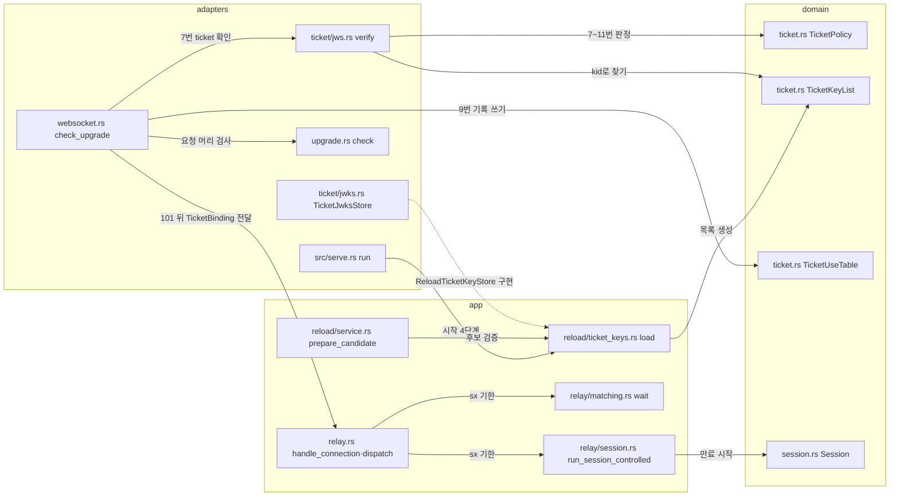

# 접속 ticket 모듈 설계

접속 ticket(ticket)은 WS·WSS 역할마다 켤 수 있는 선택형 업그레이드 확인이다. 이 문서는 ticket 확인이 코드의 어느 레이어에서 무엇을 판정하고, 공개 키·사용 기록·세션 만료 시각을 누가 소유하며, 101 뒤의 중계 흐름에 어떻게 이어지는지를 정한다. 핵심 결론은 세 가지다. 첫째, 형식에 무관한 규칙(클레임 시각 판정, 공개 키 목록, 사용 기록)은 domain에 둔다. JSON·서명 확인은 adapters에 둔다. 둘째, 공개 키는 실행 중 설정 스냅샷(`Settings`)에 함께 담는다. 그래서 한 업그레이드 검사가 한 세대의 키와 설정을 함께 읽는다. 셋째, 101 뒤에는 ticket에서 꺼낸 값(`TicketBinding`)만 중계 서비스에 넘긴다. 중계 서비스는 JWS를 알지 못한다.

| 항목 | 값 |
| --- | --- |
| 구조 시점 | Current |
| 문서 상태 | Draft |
| 구현 대조 | Verified — [2026-11-11 대조 기록](#2026-11-11-대조-기록). 구현은 커밋 `4be8e0e`이다. 시험은 같은 커밋의 두 OS 게이트에서 통과했다([접속 ticket 판정표](../how-to/set-up-and-verify.md#45-접속-ticket-판정표)). |
| 코드 위치 | `crates/domain/src/ticket.rs`, `crates/app/src/settings.rs`, `crates/app/src/reload/`, `crates/app/src/relay.rs`·`relay/`, `crates/adapters/src/ticket.rs`·`ticket/`, `crates/adapters/src/upgrade.rs`·`websocket.rs`, `src/serve.rs` |
| 코드 지도 | [코드 지도](code-map.md) |
| 관련 스펙 | [WS·WSS 스펙](../specs/websocket.md) WS-037~046, [중계 스펙](../specs/relay.md) RLY-029~032, [운영 스펙](../specs/operations.md) OPS-070~073, [관리 스펙](../specs/management.md) MGT-052~053, [화면 스펙](../specs/dashboard.md) DASH-020·029·035~037 |
| 관련 계약 | [WebSocket 계약 1.9절](../contracts/websocket-relay-v2.md#19-접속-ticket), [설정 계약 1.2·1.8·1.11절](../contracts/config-v4.md), [운영 정보 계약](../contracts/ops-info-v2.md), [관리 API 계약 1.10·1.13·1.14절](../contracts/management-api-v1.md), [CLI 계약 2.1절](../contracts/cli-v1.md#21-종료-코드) |
| 관련 ADR | [ADR-0009](../decisions/ADR-0009-optional-relay-access-ticket.md), [ADR-0003](../decisions/ADR-0003-single-instance-memory-state.md) |

## 1. 책임과 경계

- 맡는 책임:
  - 역할별 ticket 설정 값과 공개 키 목록을 읽고 검증한다. 시작·재로드·감시·편집 구분에 연결한다.
  - ticket을 켠 역할의 업그레이드 요청에서 ticket 개수·JWS·서명·클레임·시각을 확인한다. 사용 기록을 원자적으로 쓴다.
  - 101 뒤 초기 요청의 중계 ID를 ticket의 `rid`와 대조한다. 세션 만료 시각 `sx`에 초기 교환·대기·활성 세션을 끝낸다.
  - 새 사건·원인 값·경고를 운영 로그·관리 API·대시보드에 전달한다.
- 맡지 않는 책임:
  - ticket 발급, 발급 쪽 서명 키 관리, 클라이언트의 ticket 전달. 사용처의 일이다([WebSocket 계약 1.9.7절](../contracts/websocket-relay-v2.md#197-발급-쪽과-클라이언트의-의무)).
  - TCP 진입점의 확인. TCP는 ticket을 받지 못하므로 경고만 한다.
  - 기존 업그레이드 검사(경로·헤더·주소·Origin·서브프로토콜·두 번째 IP 검사)와 기존 초기 요청 검사. [WebSocket 진입점 모듈 설계](websocket-entry-point.md)와 [초기 교환 처리 모듈 설계](initial-exchange.md)가 맡는다.
- 다른 모듈에 공개하는 기능:
  - domain: `ticket::TicketPolicy`, `TicketClaims`, `TicketKey`, `TicketKeyList`, `TicketUseTable`, `TicketError`, `TicketKeyError`, `decode_base64url`, `split_compact`, `audience`.
  - app: `settings::TicketSettings`·`TicketRoleSettings`, `reload::ports::ReloadTicketKeyStore`, `reload::ticket_keys::load`, `relay::TicketBinding`, 새 사건·원인 값.
  - adapters: `ticket::TicketJwksStore`, `ticket::jws::verify`.

## 2. 내부 구조

화살표는 실행 중 호출을 뜻한다. 점선은 실행 중 주입(포트 구현 전달)이다. 의존 방향은 [코드 지도의 레이어 표](code-map.md)와 같다. adapters는 app과 domain을, app은 domain을 쓴다. domain은 외부 crate를 쓰지 않는다.

| 요소(파일·심볼) | 역할 | 만들어지는 시점과 소유자 | 의존 대상 |
| --- | --- | --- | --- |
| `crates/domain/src/ticket.rs` `TicketPolicy` | 클레임 대조와 시각 판정(1.9.3절 7~11번) | 업그레이드 검사마다 실행 중 설정에서 만든다. 검사 뒤 버린다. | `RelayId`, `Role` |
| `crates/domain/src/ticket.rs` `TicketKeyList`·`TicketKey` | 역할의 공개 키 1~16개. `kid` 고유. 두 역할의 같은 키 판정 | 시작 4단계와 재로드 후보 검증 때 만든다. `Settings`가 소유한다. | 없음 |
| `crates/domain/src/ticket.rs` `TicketUseTable` | (역할, `jti`) 사용 기록. 확인과 쓰기를 한 번에 한다. `exp + 5`에 지운다 | `serve` 시작 때 하나 만든다. WS·WSS 진입점이 `Arc<Mutex<_>>`로 함께 쓴다. 프로세스와 함께 없어진다. | `Role` |
| `crates/domain/src/ticket.rs` `decode_base64url`·`split_compact`·`audience` | 패딩 없는 base64url 해독, JWS 세 부분 나누기, 역할별 `aud` 고정 값 | 함수 | 없음 |
| `crates/app/src/settings.rs` `TicketSettings`·`TicketRoleSettings` | 역할별 `enabled`·`issuer`·`relay_host`·`public_keys_file`·최대 수명과 읽은 키 목록 | 설정 로더가 값을 채운다. 키 목록은 `reload::ticket_keys::load`가 채운다. | domain `TicketKeyList` |
| `crates/app/src/reload/ports.rs` `ReloadTicketKeyStore` | 공개 키 파일 바이트를 키 목록으로 바꾸는 포트 | `serve`가 adapters 구현을 주입한다. | domain `TicketKeyList` |
| `crates/app/src/reload/ticket_keys.rs` `load` | 켠 역할의 공개 키 파일을 읽고 해석한다. 두 역할의 같은 키를 거절한다. 진단을 만든다 | 함수. 시작과 재로드가 함께 쓴다. | `ReloadFileStore`, `ReloadTicketKeyStore` |
| `crates/adapters/src/ticket/jwks.rs` `TicketJwksStore` | JWKS 형식 검사와 P-256 점 검사(aws-lc-rs) | `serve`가 만든다. | `aws-lc-rs`, `serde_json`, domain |
| `crates/adapters/src/ticket/jws.rs` `verify` | 1.9.3절 2~11번. JSON 중복 멤버 검사, ES256 서명 확인, 클레임 자료형 | 함수 | `aws-lc-rs`, `serde_json`, domain |
| `crates/adapters/src/upgrade.rs` `check`·`TicketOffer` | 서브프로토콜 값 가운데 `ticket.`으로 시작하는 값의 개수와 값 | 요청마다 | 없음 |
| `crates/adapters/src/websocket.rs` `check_upgrade`·`upgrade` | 7~9번 순서, 401 응답, `ticket_accepted`, 101 때 `TicketBinding` 계산 | 연결마다 | 위 요소 |
| `crates/app/src/relay.rs` `TicketBinding` | 101 뒤의 `jti`·`rid`·세션 만료 기한(단조 시각) | 업그레이드가 만들어 `handle_connection`에 넘긴다. 연결과 함께 없어진다. | domain `RelayId` |

## 3. 데이터 모델

외부 형식은 [WebSocket 계약 1.9절](../contracts/websocket-relay-v2.md#19-접속-ticket)과 [설정 계약 1.11절](../contracts/config-v4.md#111-접속-ticket-공개-키-파일-형식)이 정한다.

| 이름 | 필드·형태 | 저장 위치 | 제약과 항상 지켜야 할 조건 |
| --- | --- | --- | --- |
| `TicketClaims` | `iss`·`aud`·`rh`: `String`, `rid`: `RelayId`, `jti`: `String`, `iat`·`exp`: `u64`, `sx`: `Option<u64>`, `sub`: `Option<String>` | 업그레이드 검사 중 메모리 | `jti`·`sub`는 1~128바이트. 숫자는 0 이상 정수만 받는다. `aud`는 문자열 하나다. |
| `TicketPolicy` | `issuer`·`relay_host`: `&str`, `audience`: `&'static str`, `max_lifetime_secs`·`started_at_secs`: `u64` | 검사 중 메모리 | 시계 오차 5초 고정(`CLOCK_SKEW_SECS`). 실패 이유는 계약 순서로 하나만 낸다. |
| `TicketKey` | `kid`: `String`, `x`·`y`: `[u8; 32]` | `Settings` | P-256 곡선 위의 점이다. 확인은 adapters가 만들 때 한다. |
| `TicketKeyList` | 1~16개 `TicketKey`, `kid` 순으로 정렬 | `Settings` | `kid` 1~128바이트·고유. 꺼진 역할은 빈 목록이다. `Debug`는 키 수만 쓴다. |
| `TicketUseTable` | `(Role, String)` 집합과 `(만료 초, Role, String)` 정렬 집합 | WS·WSS 진입점이 함께 쓰는 메모리 | 서명을 확인한 ticket만 든다. 기록은 `exp + 5`초에 지운다. 개수 상한이 없다. |
| `TicketRoleSettings` | `enabled`: `bool`, `issuer`·`relay_host`: `Option<String>`, `public_keys_file`: `Option<PathBuf>`, `max_lifetime`: `Duration`, `keys`: `TicketKeyList` | 실행 중 설정 스냅샷 | `enabled = true`이면 앞 세 값이 있고 `keys`가 비어 있지 않다. 최대 수명은 10~600초, 기본 60초다. |
| `TicketBinding` | `jti`: `String`, `relay_id`: `RelayId`, `session_deadline`: `Option<Duration>`(단조 시각) | 연결 작업 | `session_deadline`은 101 직후 한 번 정하며 재로드로 바뀌지 않는다. |
| `TicketOffer` | `None` / `One(String)` / `Many` | 업그레이드 검사 중 | `ticket.` 접두어를 뗀 JWS만 담는다. 로그·응답에 쓰지 않는다. |

## 4. 처리 순서

### 4.1 시작

| 순서 | 코드 위치(파일·심볼) | 조건·계산 | 바뀌는 상태 | 결과를 쓰는 곳 |
| --- | --- | --- | --- | --- |
| 1 | `src/serve.rs` `run` | 함수 시작 때 `SystemTime`을 잰다. | 기동 시각 | `WsPolicy.started_at` |
| 2 | `crates/adapters/src/config_file.rs` `read_relay` | `[relay.ticket.viewer]`·`[relay.ticket.server]`를 읽는다. 문자열 1~256바이트, 수명 10~600. `enabled = true`이면 `issuer`·`relay_host`·`public_keys_file` 필수(`config_missing_key`). 경로는 설정 파일 디렉터리 기준이다. | `TicketRoleSettings`(키 목록은 빈 값) | 설정 진단 |
| 3 | `src/serve.rs` `run` → `reload::ticket_keys::load` | TLS 파일 검사 뒤 켠 역할의 공개 키 파일을 읽고 해석한다. 두 역할이 모두 켜져 있으면 같은 키를 검사한다. | `keys` 채움 | 실패하면 `error[ticket_keys_invalid]`와 `startup_failed`를 진단마다 쓰고 TLS 오류와 함께 종료 코드 3. 바인드 전이다. |
| 4 | `crates/app/src/settings.rs` `Settings::warnings` | 켠 역할의 TCP 진입점이 켜져 있으면 `ticket_tcp_bypass`, `[relay.ws]`에서 그 역할이 켜져 있으면 `ticket_plaintext_ws` | 없음 | 시작 경고(`phase = startup`) |
| 5 | `src/serve.rs` | `TicketUseTable` 하나를 만들어 WS·WSS `WsPolicy`에 같이 넣는다. 감시 대상에 켠 역할의 공개 키 파일을 더한다. | 사용 기록, 감시 경로 | 진입점, 파일 감지 |

### 4.2 업그레이드(대표 시나리오 WS-038)

| 순서 | 코드 위치(파일·심볼) | 조건·계산 | 바뀌는 상태 | 결과를 쓰는 곳 |
| --- | --- | --- | --- | --- |
| 1 | `upgrade.rs` `check` | 기존 1~6번. 서브프로토콜 값에서 `ticket.` 접두어 값을 센다. 값이 있는데 `binary`가 없으면 기존 400이 먼저다. | `ValidUpgrade.ticket` | `check_upgrade` |
| 2 | `websocket.rs` `check_upgrade` | 같은 `with_current` 안에서 역할의 ticket이 켜져 있으면 확인한다. 꺼져 있으면 2.0.0과 같다. | 없음 | 다음 순서 |
| 3 | `ticket/jws.rs` `verify` | 개수 → JWS 구문(세 부분·base64url·JSON 객체·중복 멤버) → 헤더(`alg = ES256`, `kid` 1~128바이트, `crit` 없음) → `kid`의 키 → ES256 R‖S 64바이트 서명 → 클레임 자료형·`rid`·`jti`·`sub` → `TicketPolicy::check`(7~11번). 현재 시각은 `Clock::wall`을 Unix 초로 내린 값이다. | 없음 | 실패: `Refusal::Ticket{reason, jti}`. `jti`는 서명 통과 뒤 문법이 맞을 때만 담는다. |
| 4 | `websocket.rs` `check_upgrade` | 기존 두 번째 IP 검사(8번) | 없음 | 실패: 403 `Refusal::IpNotAllowed(jti)`. ticket을 켠 역할이면 확인을 통과한 ticket의 `jti`를 `ticket_jti`로 기록한다. 사용 기록은 쓰지 않는다 |
| 5 | `websocket.rs` `check_upgrade` → `TicketUseTable::try_record` | 잠금 안에서 만료 기록을 지우고, 없으면 쓴다. | 사용 기록 | 실패: 401 `ticket_reused`(`ticket_jti` 기록) |
| 6 | `websocket.rs` `upgrade` | `ticket_accepted`(`info`)를 쓴 뒤 기존 U 재확인, 101 전송. 응답 서브프로토콜은 `binary`뿐이다. `sx`가 9999-12-31T23:59:59Z보다 늦으면 `session_expires_at`만 생략한다. | 없음 | 운영 로그, 클라이언트 |
| 7 | `websocket.rs` `upgrade` → `session_deadline` | 101 flush 직후 `exchange_at`에 `sx − 현재 벽시계`(음수면 0)를 더해 세션 만료 기한을 정한다. 더하기는 최댓값에서 멈춘다. 그래서 `sx`가 있으면 기한이 항상 있다. 초기 교환·대기에서는 유한한 H·W와 비교한다. 활성 세션 타이머는 한 번에 최대 하루(`MAX_TIMER_STEP`)만 잠들고, 깨어나면 시계를 다시 읽는다. | `TicketBinding` | `RelayService::handle_connection` |

거절 응답은 `HTTP/1.1 401 Unauthorized`, `WWW-Authenticate: VncRelayTicket`, 빈 본문이다. 거절 사건은 기존 `Event::UpgradeRejected`에 `ticket_jti`를 더해 쓴다.

### 4.3 101 뒤

| 순서 | 코드 위치(파일·심볼) | 조건·계산 | 바뀌는 상태 | 결과를 쓰는 곳 |
| --- | --- | --- | --- | --- |
| 1 | `relay.rs` `prepare` → `relay/handshake.rs` `exchange` | H 기한과 세션 만료 기한 가운데 이른 값을 기다린다. 두 값이 같으면 기존 H 시간 초과다. 세션 만료가 이르면 `Aborted(SessionExpired)` | 연결 종료 | Close 4013, `connection_aborted(stage=initial_exchange, reason=session_expired)` `info` |
| 2 | `relay.rs` `dispatch` | 기존 초기 요청 검사 뒤, 모드 분기 전. ticket이 있는데 Mode I이면 거절. Mode II 중계 ID가 `rid`와 바이트 단위로 다르면 거절. `mode1.enabled = false`의 1008은 기존 검사가 먼저 낸다. | 연결 종료 | Close 4012, `connection_rejected(stage=initial_exchange, reason=ticket_relay_mismatch)` `warn`. `mode`, `ticket_jti`, Mode II이면 `relay_id_ref` |
| 3 | `relay/matching.rs` `wait`·`dispatch` | 세션 만료 기한이 W 기한보다 이르고 지나면 대기에서 뺀다. 두 기한이 같거나 W가 이르면 기존 W 만료다. 상대가 도착하면 매칭 전에 이미 만료된 대기 연결을 먼저 정리한다. 매칭 중 기한을 넘긴 연결은 활성 세션이 되지 않는다. | 대기 표 | Close 4013, `waiting_removed(reason=session_expired)` `info` |
| 4 | `relay.rs` `run_pair` → `relay/session.rs` `run_session_controlled` | 두 쪽 기한 가운데 이른 값. 세션이 활성일 때만 `Session::begin_session_expiry`를 부른다. | `CloseCause::SessionExpired` | WS·WSS 쪽 Close 4013, TCP 쪽 소켓 닫기, 클라이언트 Close를 E까지 기다림. `session_closed` `info`, `side` 없음. 최근 종료 목록 |

### 4.4 재로드와 편집

| 순서 | 코드 위치(파일·심볼) | 조건·계산 | 바뀌는 상태 | 결과를 쓰는 곳 |
| --- | --- | --- | --- | --- |
| 1 | `reload/service.rs` `prepare_candidate` | TLS 검사 뒤 `ticket_keys::load`로 후보의 키를 채운다. 실패하면 후보 전체 거절 | 없음 | `reload_rejected(reason=ticket_keys_invalid, config_key)`. 기존 키 유지 |
| 2 | `reload/service.rs` `dynamic_changed_keys` | ticket 10개 값을 비교한다. `public_keys_file`은 경로가 바뀌었을 때 넣는다. | `applied` | 다음 순서 |
| 3 | `reload/service.rs` `prepare_candidate` | 실행 중과 후보 모두 그 역할을 켰고 경로가 같으면 키 목록을 의미로 비교한다. 다르면 `public_keys_file`을 `applied`에 더한다. | `applied` | `reload_applied` |
| 4 | `reload/service.rs` | `applied`에 `relay.ticket.<role>.enabled`가 있을 때만 그 역할의 ticket 경고를 다시 쓴다(`phase = reload`). | 없음 | 운영 로그 |
| 5 | `reload/service.rs` `watched_paths` | 후보에서 켠 역할의 공개 키 파일을 감시 대상에 넣는다. | 감시 경로 | 파일 감지 |
| 6 | `management/config/items.rs` | ticket 10개 항목을 계약 순서(WS·WSS 역할 뒤, `mode1` 앞)로 낸다. 모두 `dynamic`. 경로 2개는 편집 불가. 나머지 8개는 그 역할이 WS 또는 WSS에서 켜졌을 때만 편집 가능 | 없음 | `GET`·`PATCH /api/v1/config` |

## 5. 상태와 초기화

- 초기화·로딩 시점: 기동 시각과 사용 기록은 `serve` 시작 때 한 번 만든다. 공개 키는 시작 4단계와 재로드 후보 검증 때 읽는다. 업그레이드 검사는 파일을 읽지 않는다.
- 상태 소유자와 제거 시점:
  - 공개 키: 설정 스냅샷이 소유한다. 새 스냅샷이 게시되면 다음 업그레이드부터 새 키를 쓴다.
  - 사용 기록: `Arc<Mutex<TicketUseTable>>`. 기록을 쓸 때 만료 항목을 앞에서부터 지운다. 재로드·켜고 끄기·키 교체로 지우지 않는다. 재시작하면 사라진다.
  - `TicketBinding`: 연결 작업이 소유한다. 세션이 끝나면 사라진다.
- 동시 실행과 순서:
  - 사용 기록은 잠금 하나 안에서 확인과 쓰기를 한다. 같은 (역할, `jti`)로 동시에 온 요청 가운데 하나만 성공한다.
  - ticket 확인과 두 번째 IP 검사는 같은 설정 세대를 읽는다(`with_current` 한 번). 서명 확인은 잠금 밖의 계산이지만 설정 읽기 잠금 안에서 한다. 재로드 게시는 그동안 기다린다.
  - 세션 만료 기한은 단조 시각이다. 벽시계가 바뀌어도 101 뒤의 기한은 바뀌지 않는다.

## 6. 오류 처리

| 실패 지점 | 처리 방법 | 남는 상태 | 관련 스펙 시나리오 |
| --- | --- | --- | --- |
| `ticket/jws.rs` `verify` | 401과 `WWW-Authenticate: VncRelayTicket`. 사용 기록·대기 등록 없음 | 기록 없음. 같은 ticket은 다음 요청에서 다시 확인될 수 있다 | WS-039~041·043~045 |
| `TicketUseTable::try_record` | 401 `ticket_reused` | 먼저 쓴 기록 유지 | WS-042 |
| 101 전송 실패 | 기존처럼 연결을 닫는다 | 기록은 쓰인 채 남는다(계약 1.9.4절) | WS-042 |
| `reload::ticket_keys::load`(시작) | 진단마다 오류 줄과 `startup_failed`. 종료 코드 3 | 바인드 전 종료 | OPS-070 |
| `reload::ticket_keys::load`(재로드) | 후보 전체 거절 | 기존 설정·키·기록 유지 | OPS-072 |
| 공개 키 파일 감시 준비 실패(시작) | 설정 파일과 같은 `watch_unavailable` | 종료 코드 1 | OPS-072 |
| `relay.rs` `dispatch` 대조 실패 | Close 4012 | 같은 중계 ID로 기다리던 상대는 그대로 | RLY-029·030·032 |
| 세션 만료 | 단계별 Close 4013과 `info` 사건 | 최근 종료 목록(활성 세션만) | RLY-031, MGT-052 |

공개 키 파일 내용과 ticket 원문은 어떤 오류 문장에도 넣지 않는다. 진단의 `message`는 고정된 짧은 원인만 쓴다(OPS-073).

## 7. 설계 선택

| 선택 | 이유 | 검토한 다른 방법 | 근거 |
| --- | --- | --- | --- |
| 공개 키 목록을 `Settings`에 넣는다 | 업그레이드 검사가 설정과 키를 한 세대로 읽는다. 재로드의 원자적 교체를 그대로 쓴다 | TLS처럼 `ReloadSnapshot`의 별도 칸: 검사 경로가 두 원천을 읽어야 한다 | 이 문서의 판단, 사용자 결정 없음 |
| 서명 확인은 aws-lc-rs `ECDSA_P256_SHA256_FIXED` | 이미 rustls 암호 모듈로 쓰는 crate다. 고정 길이 R‖S만 받아 DER을 자연히 거절한다 | 새 JWT crate: 의존성·라이선스 검토가 늘고 계약의 엄격한 규칙(중복 멤버, 숫자 형식)을 그대로 쓰기 어렵다 | PRD 1절 "rustls 암호 모듈은 aws-lc-rs" |
| JSON 중복 멤버는 `serde_json`으로 구문을 확인한 뒤 멤버 이름만 훑어 찾는다 | 새 직접 의존성(`serde`) 없이 이스케이프를 해독한 이름으로 비교한다 | `serde` visitor: adapters 직접 의존성과 레이어 허용 목록이 바뀐다 | 이 문서의 판단, 사용자 결정 없음 |
| base64url·JWS 나누기·클레임 판정·키 목록·사용 기록은 domain | 외부 crate 없이 시험할 수 있는 계약 규칙이다 | adapters에 모두 두기: 규칙 시험이 I/O 시험에 섞인다 | [코드 지도 레이어 표](code-map.md) |
| 101 뒤에는 `TicketBinding`만 `handle_connection`의 새 인자로 넘긴다 | 중계 서비스는 JWS를 몰라도 된다. `ConnectionContext`는 `Copy`로 유지한다 | `ConnectionContext`에 넣기: `Copy`가 깨지고 TCP 경로까지 바뀐다 | 이 문서의 판단, 사용자 결정 없음 |
| 두 역할의 같은 키는 Server 쪽 `relay.ticket.server.public_keys_file` 진단으로 낸다 | 진단 하나가 한 키를 가리켜야 한다. 키 순서상 뒤 키다 | 두 키 모두에 진단: 같은 원인이 두 번 보인다 | 이 문서의 판단, 사용자 결정 없음 |
| 재로드 경고는 `applied`에 그 역할의 `enabled`가 있을 때만 다시 쓴다 | 기존 `allow_all_target`·`trust_all_proxies`처럼 바뀐 키에만 경고한다 | 재로드마다 쓰기: 바뀌지 않은 설정의 경고가 반복된다 | 이 문서의 판단, 사용자 결정 없음 |
| 세션 만료로 시작한 정리는 E가 지나도 `session_expired`를 유지한다 | 계약이 `close_timeout`으로 바꾸는 예외를 EOF·관리자 종료로만 정했다 | `close_timeout`으로 바꾸기: 계약 문장과 다르다 | [운영 정보 계약](../contracts/ops-info-v2.md) `session_closed` 절 |
| 이미 정리를 시작한 세션에는 만료가 원인을 바꾸지 않는다 | 첫 원인 규칙을 따른다. 정리는 이미 E로 제한된다 | 즉시 강제 종료: 정리 규칙이 둘이 된다 | 이 문서의 판단, 사용자 결정 없음 |
| H·W 기한과 세션 만료 기한이 같으면 기존 시간 초과(`connection_aborted(reason=handshake_timeout)`·`waiting_expired`)를 쓴다 | 계약이 같은 시각의 우선순위를 정하지 않았다. ticket을 켜지 않은 연결과 같은 사건을 유지한다 | 세션 만료 우선: 설정 H·W와 같은 시각인데도 사건이 ticket에 따라 달라진다 | 이 문서의 판단, 사용자 결정 없음 |
| `sx`가 9999-12-31T23:59:59Z보다 늦으면 `session_expires_at`만 생략한다 | 운영 로그 시각은 `ts`와 같은 네 자리 연도 형식이다. 확인과 만료 타이머는 `sx`를 그대로 쓴다 | 확장 연도 표기(`+YYYYYY`): 수집 도구가 같은 형식으로 읽지 못한다. ticket 거절: 계약의 "0 이상 정수" 규칙과 다르다 | [운영 정보 계약 1.4절](../contracts/ops-info-v2.md#14-필드-사전), [WebSocket 계약 1.9.4절](../contracts/websocket-relay-v2.md#194-사용-기록). 이 문서의 판단, 사용자 결정 없음 |
| 세션 만료 기한은 단조 시각에 포화 덧셈으로 더하고 버리지 않는다 | 계약은 모든 `sx`를 101 뒤 종료 시각으로 정한다. `tokio::time::sleep`은 30년을 넘는 지연을 30년으로 줄인다. 그래서 초기 교환·대기는 유한한 H·W와 비교하고, 활성 세션 타이머는 하루 단위로 잠든 뒤 시계를 다시 읽는다. 30년 뒤의 깨어남을 기한 도달로 보지 않는다(`relay/session.rs` `far_ticket_expiry_outlives_the_tokio_sleep_cap_and_fires_at_sx`) | 넘치면 기한 없음: 계약과 달리 그 연결은 끝나지 않는다. 한 번의 긴 sleep: 30년 뒤에 일찍 만료한다 | [WebSocket 계약 1.9.2·1.9.5절](../contracts/websocket-relay-v2.md#192-ticket-형식과-클레임). 이 문서의 판단, 사용자 결정 없음 |
| 숫자 클레임은 지수 없는 u64 정수 표기만 받는다 | `serde_json`은 소수점·지수 표기와 2^64 이상 정수를 실수로 읽는다. 두 경우를 구분하지 않고 6단계에서 거절한다. `iat`·`exp`는 어차피 8·9단계에서 같은 원인으로 거절된다 | 큰 정수 원문 해석: 숫자 문법을 직접 다시 구현해야 한다 | [WebSocket 계약 1.9.2절](../contracts/websocket-relay-v2.md#192-ticket-형식과-클레임). 이 문서의 판단, 사용자 결정 없음 |

## 8. 현재 코드와의 차이

2026-11-11 구현으로 2~5절의 설계가 현재 코드가 됐다. 남은 차이는 없다. 새 파일은 `crates/domain/src/ticket.rs`, `crates/app/src/reload/ticket_keys.rs`, `crates/adapters/src/ticket.rs`·`ticket/jwks.rs`·`ticket/jws.rs`다. 재로드 대상은 43개, 편집 대상은 37개, 운영 로그는 `ops-info/2.1.0`이다.

### 2026-11-11 대조 기록

- 기준: 커밋 `4be8e0e`.
- 방법: 2~6절의 파일·심볼·처리 순서를 `crates/domain/src/ticket.rs`, `crates/app/src/settings.rs`·`reload/ticket_keys.rs`·`relay.rs`·`relay/handshake.rs`·`relay/matching.rs`·`relay/session.rs`, `crates/adapters/src/ticket.rs`·`ticket/jwks.rs`·`ticket/jws.rs`·`upgrade.rs`·`websocket.rs`, `src/serve.rs`와 읽어 대조했다. [코드 지도](code-map.md)의 경로·심볼 검사(`tests/code_map.rs`)를 함께 쓴다.
- 정적 검토: 커밋 전 코드 검토에서 세 가지를 찾아 같은 커밋에서 고쳤다. `TicketParts`의 `Debug`가 ticket 부분을 그대로 출력했다. 업그레이드 직전 IP 재검사의 403에 확인을 통과한 ticket의 `ticket_jti`가 빠졌다. 활성 세션 타이머가 30년 상한으로 깬 시각을 먼 `sx` 도달로 보았다. 고친 동작은 4.2절 4·7행과 7절에 있다.
- 결과: 2~6절과 코드 사이에 남은 차이가 없다.
- 남은 한계: 사용 기록에는 개수 상한이 없다(3절 `TicketUseTable` 행). 실제 발급 쪽과 클라이언트의 연동은 이 저장소에서 실행하지 않았다.
- 구조 판정: `Current`·`Verified`. **이 문서의 판단, 사용자 결정 없음**.
- 이번 검증: 커밋 `4be8e0e`의 두 OS 전체 게이트에서 연결된 시나리오가 모두 통과했다([접속 ticket 판정표](../how-to/set-up-and-verify.md#45-접속-ticket-판정표)).

## 9. 미결정 사항

없다. 대시보드 시안(DASH-TBD-006)은 사용자 결정 2026-11-11(Q215~Q219)으로 채택했다([화면 스펙 8절](../specs/dashboard.md#8-미결정-사항)).
