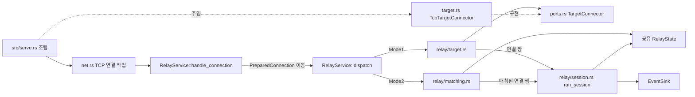

# 대상 연결·매칭·중계 수명 모듈 설계

이 문서는 유효한 `PreparedConnection<S>`를 받아 Mode I 대상에 연결하거나 Mode II 상대를 찾고, 양방향 중계와 세션 정리까지 이어 가는 목표 구조를 정한다. 예를 들어 Server가 `ID:0123`으로 기다릴 때 Viewer가 같은 ID로 접속하면 두 연결을 한 세션으로 옮긴다. 초기 요청 뒤의 데이터부터 상대에게 한 번씩 전달한다.

| 항목 | 값 |
| --- | --- |
| 구조 시점 | Target |
| 문서 상태 | Draft |
| 구현 대조 | 부분 대조. domain·app·adapters의 대상 연결·매칭·중계와 단위·루프백 시험을 구현했다. TCP 진입점과 시작 키 조립은 연결했다. WS·WSS 진입점은 `638cf09`에서 연결했다. OS 종료 요청과 G 감독 작업은 `src/serve.rs`가 조립한다. 실행 기록은 8절을 따른다. |
| 코드 위치 | `crates/domain/src/{matching,session,recent_closed,target_policy}.rs`, `crates/app/src/{ports,events,relay}.rs`와 `relay/{handshake,target,matching,session}.rs`, `crates/adapters/src/{target,crypto,ops_log}.rs`와 `net.rs`의 `TcpRelayStream`, `crates/adapters/tests/{tcp_target,ops_info_contract}.rs` |
| 코드 지도 | [코드 지도](code-map.md#2-코드-위치와-구성요소) |
| 관련 스펙 | [중계](../specs/relay.md): RLY-003·006~021·023·025~027. [운영](../specs/operations.md): OPS-005·007~009·023·039·042~043. [관리](../specs/management.md#2-조회-대상과-상태): MGT-005 일부 |
| 관련 계약 | [Repeater 초기 교환](../contracts/repeater-handshake-v1.md), [설정 1.2·1.5절](../contracts/config-v2.md#12-키-표), [운영 정보 1.5~1.9절](../contracts/ops-info-v1.md#15-사건-목록), [관리 API 1.6~1.10절](../contracts/management-api-v1.md#16-서버-요약-get-apiv1summary), [WebSocket 1.4~1.6절](../contracts/websocket-relay-v1.md#14-데이터-메시지와-제어-프레임) |
| 관련 ADR | [ADR-0003 단일 인스턴스·메모리 상태](../decisions/ADR-0003-single-instance-memory-state.md), [ADR-0004 tokio·rustls](../decisions/ADR-0004-tokio-rustls.md) |

작업 2.8·2.9·2.10을 한 문서로 묶는다. 세 작업이 같은 연결 소유권, L 예산, 활성 등록과 정리 경계를 공유하기 때문이다. 각 작업의 구현 범위는 절과 파일로 나눈다. 이 배치와 아래 내부 API·동시 실행 방식은 모두 **이 문서의 판단, 사용자 결정 없음**이다. 계약이 정한 외부 동작은 바꾸지 않는다. 계약에 없는 오류 대응은 9절의 권고이며, 채택 전 구현 기준이 아니다.

업무 용어는 [용어집](../../GLOSSARY.md#중계-방식과-세션)을 따른다. [초기 교환 설계](initial-exchange.md)의 출력 인터페이스를 재사용한다. 유효 요청을 임시로 보류하거나 닫지 않는다. 2.8~2.10의 실제 다음 단계가 모두 준비된 뒤 TCP 진입점을 연결한다. 이는 이번 작업의 프로젝트 판단이며 사용자 결정은 없다.

## 1. 책임과 경계

| 레이어 | 맡는 책임 | 맡지 않는 책임 |
| --- | --- | --- |
| domain | 최종 IP·포트 허용 판정, 정확한 중계 ID 비교, 대기·점유 상태 전이, 세션 상태·종료 원인·바이트 수, 최대 R개의 최근 종료 목록 | 소켓·DNS·시계·난수·tokio. 시각과 난수 결과를 값으로 받는다. |
| app | `PreparedConnection` 분기, C·W·E, L·Lw 소유권, 원자적 전이, 중계 읽기·쓰기, 사건 생성, 조회용 메모리 상태, 종료 신호에 따른 정리 | `tokio::net`, `tokio::fs`, 프로세스·OS 신호, TLS·WebSocket 프레임 |
| adapters | DNS 해석, 검사한 단일 IP로 TCP 연결, TCP keepalive K, 전송 방식별 종료·단절 감지, 난수·HMAC, JSON Lines | 대상 정책·중복 정책·종료 원인의 재정의 |
| `src` | 구현체 주입, 시작 실패 처리, 리스너·작업의 실행과 회수, OS 종료 신호를 app 수명 관리로 전달 | 매칭 규칙, 바이트 전달, 소켓별 종료 원인 판정 |

app은 tokio의 `time`, `sync`, `io-util`만 제품 코드에서 쓴다. `std::future::poll_fn`으로 여러 진행 조건을 기다린다. app에서 작업을 `spawn`하지 않는다. adapters 또는 `src`의 작업이 app future를 실행한다. `macros`·`rt`·`test-util`은 app 개발 의존에만 둔다. [초기 교환 설계 2·5절](initial-exchange.md#2-내부-구조)의 금지 목록 확장을 함께 적용한다. [Rust 컨벤션](../conventions/rust.md#2-규칙)의 모듈·오류·이름 규칙을 따른다.

공개 입구는 `RelayService::dispatch(prepared, control)`이다. 성공은 대상 연결 또는 실제 대기·매칭·중계 수명을 끝까지 실행한다. 초기 교환은 계속 `handle_connection(...) -> Result<PreparedConnection<S>, RelayError>`를 반환한다. 해석 완료를 세션 시작으로 취급하지 않는다.

## 2. 내부 구조

다음 그림의 화살표는 실행 중 호출과 소유권 전달이다. 컴파일 의존은 `src` → adapters → app → domain이다. 점선은 app 포트에 adapters 구현체를 주입하는 관계다. 현재 코드와 목표 흐름을 섞지 않았다.

| 요소·계획 파일 | 역할 | 생성 시점·소유자 | 의존 대상 |
| --- | --- | --- | --- |
| `crates/domain/src/target_policy.rs` `TargetPolicy` | `permits_name(name, port)`와 `permits_ip(ip, port)` 추가. 기존 `TargetItem`, `IpItem::contains` 재사용 | 시작 설정이 소유 | 기존 주소·포트 값 |
| `crates/domain/src/matching.rs` `WaitingTable` | `RelayId`별 `Waiting`·`Claimed`·`Active`·`Closing` 점유 판정. 연결 식별자·세션 식별자를 비교해 전이 | app의 `RelayState`가 소유 | `RelayId`, `Role`, `ConnId`, `SessionId` |
| `crates/domain/src/session.rs` `SessionId`, `Session`, `CloseCause` | 식별자 형식, `active`·`closing`, 첫 종료 원인, 방향별 카운터 | 세션 활성화 때 생성 | std 값 |
| `crates/domain/src/recent_closed.rs` `RecentClosedList` | 정리된 세션의 요약, R 초과 시 가장 오래된 항목 제거 | 프로세스마다 하나 | `session` |
| `crates/app/src/relay.rs` `RelayService`, `RelayState` | 초기 교환과 다음 단계 연결, 상태 잠금과 공통 포트 | `serve`가 공유 `Arc` 하나 생성 | domain, `ports`, 허용된 tokio |
| `crates/app/src/relay/target.rs` | Mode I C·정책·L와 대상 연결 결과 | Mode I 연결 작업 | `TargetConnector`, `Clock`, 예산 |
| `crates/app/src/relay/matching.rs` | 대기 I/O·W·Lw, 연결 쌍 인계 | 각 대기 연결 작업 | `WaitingTable`, 스트림 인터페이스 |
| `crates/app/src/relay/session.rs` `run_session` | 두 방향 중계·EOF·E·최종 정리 | 매칭 또는 대상 연결을 완료한 작업 | `Session`, 스트림 인터페이스 |
| `crates/app/src/ports.rs` | `TargetConnector`, `RelayIdSource`, `SessionIdSource`와 전송 수명 인터페이스 추가 | trait 정의 | domain·tokio 입출력 trait |
| `crates/adapters/src/target.rs` `TcpTargetConnector` | DNS와 단일 `SocketAddr` TCP 연결, K 적용 | `serve`가 생성 | tokio·socket2·app |
| `crates/adapters/src/net.rs` TCP 스트림 래퍼 | TCP 단절 알림·FIN·입출력 구현. 수락과 연결 쪽에서 같은 래퍼 사용 | 소켓마다 하나 | tokio·app |
| `crates/adapters/src/crypto.rs` | 기존 `RelayIdKey`에 `RelayIdSource` 구현. `SystemSessionIdSource` 추가 | 프로세스마다 하나 | aws-lc-rs·app |
| `crates/app/src/events.rs`, `crates/adapters/src/ops_log.rs` | 6절 사건과 JSON 필드 추가 | 사건마다 | 기존 `EventSink` 경로 |

`matching.rs`의 domain 표는 소켓을 갖지 않는다. app의 대기 항목이 실제 스트림과 permit을 소유한다. 표의 연결 키와 app 항목은 같은 잠금 아래 함께 넣고 뺀다. 별도 DB나 외부 상태 저장소는 없다.

## 3. 데이터 모델과 인계 계약

### 3.1 초기 교환에서 받는 값

`PreparedConnection<S>`는 2.7이 만든 스트림, `HandshakeRequest`, 후속 데이터, `ConnectionContext`, L의 `BudgetPermit` 하나를 이동받는다. `ConnectionContext`의 `conn_id`, 진입점·역할, 실제 상대 IP, 수락·초기 교환 진입 단조 시각을 그대로 쓴다. 이번 app 구현은 실제 소켓 주소 `peer_addr`와 표시용 수락 시각 `accepted_wall`도 문맥에 보존한다. 다음 진입점 연결 작업이 실제 수락 값으로 채운다. 파싱한 요청·IP나 현재 벽시계로 상대 주소·수락 시각을 재구성하지 않는다.

H 감시는 유효 요청 반환으로 끝난다. C·W·E에서 H를 다시 쓰지 않는다. `PreparedConnection`을 복제하지 않는다. L permit을 다시 얻거나 단계 전환 때 반환하지 않는다. 후속 데이터 `n`바이트는 이미 해당 연결의 B를 쓴 상태다.

### 3.2 전송 수명 인터페이스

`RelayStream: AsyncRead + AsyncWrite + Unpin + Send`를 초기 교환부터 정리까지 쓴다. WS Close와 TCP half-close를 종료 action으로 구분한다. 초기 실패도 action을 먼저 실행한다. `WsRelayStream`은 같은 포트를 구현한다.

- `RelayStream`은 위 입출력 trait에 더해 전송 종류와 `poll_close(action)`을 제공한다. TCP·WS 라이브러리 타입을 반환하지 않는다. 별도 `poll_terminal`은 두지 않는다. EOF는 읽기 결과가 0일 때, 오류는 읽기·쓰기 오류를 받았을 때 관찰한다.
- `poll_close`의 action은 TCP 쓰기 방향 종료, 계약 사유에 따른 전체 종료, 상대 정상 종료, 서버 종료를 구분한다. TCP 쓰기 종료는 `AsyncWrite::poll_shutdown`에 대응한다. 전체 종료 완료 뒤 래퍼를 drop해 소켓을 회수한다.
- `AsyncRead`의 0바이트는 TCP 읽기 EOF 또는 WS 어댑터가 알려 준 Close다. 빈 WS 바이너리 메시지를 EOF로 바꾸면 안 된다. `RelayStreamError::new(kind).into_io_error()`가 표준 I/O 오류 안에 계약의 종류를 보존한다. app은 `RelayStreamError::classify(&error)`로 읽는다. 명시된 종류가 없는 소켓 오류만 `io_error`다. `ws_protocol_error`, `ws_text_message`, `ws_message_too_large`는 그대로 사건과 `StreamError(kind)` action에 전달한다.
- `AsyncWrite`는 쓰기에 성공한 **페이로드** 길이만 반환한다. WS 어댑터는 무제한 내부 큐에 복사한 길이를 성공으로 알리면 안 된다. 아직 전송 계층에 쓰지 못한 데이터의 소유권은 방향 버퍼에 남긴다.
- WS 어댑터가 저장한 미전달 페이로드도 같은 B에 포함한다. 제어 프레임·TLS 프레이밍은 스트림과 카운터에 섞지 않는다. 자체 프레임 코덱은 사용자 결정 2026-11-01(Q77)을 따른다. M>B 프레임의 스트리밍은 사용자 결정 2026-11-01(Q78)을 따른다. Kw 전체 생존 판정은 작업 3.4 범위다.

초기 교환 실패는 `HandshakeInvalid`(WS 4008), `HandshakeTimeout`(4009), `ModeDisabled`(1008), `ServerShutdown`(1001) action으로 구별한다. 형식 있는 스트림 오류는 `StreamError(kind)`로 전달한다. WS 어댑터는 종류에 따라 1002·1003·1009를 선택한다. TCP는 추가 오류 바이트 없이 FIN·소켓 정리만 수행한다. `handle_connection`은 실패 판정 뒤 절대 `close_started + E`까지 action을 진행한다. 이후 stream → L permit → 사건 순서로 정리한다. H는 요청 판정의 기한이다. Close 대기 때문에 H를 다시 시작하지 않는다. 초기 실패의 종료 교환에도 기존 E를 쓴다. Close 오류·E 만료는 원래 초기 실패의 사건 사유를 바꾸지 않는다.

초기 실패와 활성화 전 두 연결의 Close 대기는 action 완료·절대 E·Grace의 절대 G·Force 중 먼저 온 경계에서 끝낸다. Grace 수신 때 E나 G를 다시 시작하지 않는다. 대기 중 수명 변경도 wake 원인이다. 경계 뒤에는 stream → permit → 사건 순서를 그대로 지킨다.

TCP에서 시작하되 중계 엔진은 Viewer와 반대쪽 스트림 타입을 다르게 받을 수 있게 한다. 공유 대기 표에는 `Box<dyn RelayStream>`을 보관한다. `Unpin` 조건으로 poll할 때만 `Pin<&mut dyn RelayStream>`을 만든다. 이 연결당 한 번의 타입 소거는 미래의 TCP Server와 WS Viewer를 같은 표에서 매칭하기 위한 선택이다. 중계 청크마다 박싱하거나 복사하지 않는다.

[WS 스트림 설계 5.4절](websocket-stream.md#54-필요한-공통-인터페이스-변경)의 현재 포트와 소유 루프를 따른다. 별도 WS 전용 스트림 trait나 소켓 소유 작업은 없다. 아래 진행 방식은 **이 문서의 판단, 사용자 결정 없음**이다. 시작한 출력 프레임의 drain 범위는 사용자 결정 2026-11-01(Q83)을 따른다.

| 현재 경계 | 구현과 의미 | 소유자 |
| --- | --- | --- |
| 활성 WS의 제어 출력 | 세션 소유자가 페이로드 방향 poll과 별도로 `viewer.poll_flush`를 poll한다. 이미 큐에 있는 Pong과 부분 제어 출력을 진행한다. 입력을 읽거나 B 뒤를 미리 읽지 않는다. `Pending`이어도 두 페이로드 방향을 계속 poll한다. | `relay/session.rs`의 `run_session`. 오류는 `RelayStreamError::classify`로 분류한 Viewer 출력 오류다. |
| closing의 종료 출력·수신 정리 | `poll_close(action)`을 반복 poll한다. 같은 절대 E·G·Force 경계를 적용한다. | 기존 세션 소유자. 별도 제어 작업을 만들지 않는다. |
| 미완료 WS 출력 프레임 | `pending_write_len(&self) -> usize`가 이미 시작한 프레임의 잔여 페이로드 길이를 반환한다. TCP는 0이다. app 버퍼의 같은 미전달 범위를 E 안에서 마친다. | `RelayStream`과 `WsRelayStream`. 병렬 쓰기 API나 별도 메시지 큐는 없다. |

`poll_maintenance`는 현재 포트에 없다. 출력 flush는 B 뒤의 새 Ping을 관찰하지 않는다. B가 찬 데이터 뒤의 제어 프레임 관찰과 Kw 정책은 [WS 스트림 설계 9.5절](websocket-stream.md#95-kw의-여러-ping과-b-backpressure)과 작업 3.4의 열린 범위다. 현재 Pong 출력 진행을 Kw 완료로 확대하지 않는다.

### 3.3 공유 메모리 상태

| 이름 | 형태·저장 위치 | 항상 지켜야 할 조건 |
| --- | --- | --- |
| `RelayState` | app 공유 잠금 안의 대기 표·점유 표·활성 표·최근 종료 목록·128비트 발급 카운터·수명 단계 | 한 전이에서 관련 항목을 함께 변경한다. 발급 ID 집합은 없다. 잠금 안에서 비동기 대기·DNS·소켓 쓰기를 하지 않는다. |
| 대기 항목 | `RelayId`, 역할, `conn_id`, 수락 시각, `registered_at`, `deadline = registered_at + W`, `relay_id_ref`, 스트림·후속 데이터·L permit·Lw permit | ID 원문은 비교·인증된 관리 조회에만 쓴다. 로그는 ref만 쓴다. |
| `Claimed` 점유 | ID, 역할 순서의 두 연결 식별자, 선행 대기 메타데이터, 매칭 시각 | 두 연결 식별자가 인계의 소유권을 구별한다. 활성화 때 세션 식별자를 이동한다. 인계 중에도 ID를 점유하며 조회의 대기·활성 목록에는 노출하지 않는다. |
| 활성 항목 | `Session`, 두 끝점 메타데이터, 연결 소유자, 종료 요청·완료 알림 | `active`와 `closing` 모두 활성 수에 포함한다. Mode II의 양 역할을 함께 점유한다. |
| 방향 버퍼 | 원본 연결의 후속 데이터와 읽기 작업 공간, 미전달 범위의 시작·끝 인덱스 | 원본 연결마다 미전달 페이로드와 그 저장 공간은 B 이내다. 두 방향 합계는 최대 2B다. |
| `SessionId` | 계약의 `ses_` + 소문자 영문·숫자 26자 | 중계 ID·연결 식별자와 별도다. 프로세스 안에서 한 번 발급한 값을 다시 쓰지 않는다. |
| 최근 종료 항목 | 계약 1.10절의 시작·종료 시각, 최종 두 카운터, 종료 원인과 식별자·모드·전송 | 정리된 활성 세션만 넣는다. 대기 만료·연결 실패는 넣지 않는다. R=0이면 보관하지 않는다. |

세션 식별자는 시작 때 만든 비밀 키와 128비트 카운터로 만든다. 카운터의 big-endian 16바이트에 키가 있는 의사 난수 순열을 적용한다. 순열은 입력과 출력이 일대일인 변환이다. 그 결과를 `SessionId::from_block([u8; 16])`로 인코딩한다. 출력은 `ses_`와 소문자 base32 26자이며 알파벳은 `a-z2-7`이다. 마지막 문자의 쓰지 않는 하위 2비트는 0이다. `SessionId::parse`도 이 정규 형식을 검사한다.

발급 경로에는 OS 난수 호출·충돌 재시도·발급 ID 집합이 없다. 순열과 정규 인코딩이 모두 일대일이므로 카운터가 순환하지 않는 한 재사용은 구조적으로 불가능하다. 키가 없으면 다음 값을 예측할 수 없으므로 관리 API 1.8절의 불투명·무작위 형식을 만족한다고 판단한다. 카운터는 checked 증가하며 128비트 전 범위를 소진하면 재사용하지 않고 발급을 중지한다. 이는 현실적인 운영 수명보다 큰 수학적 경계이며 새 런타임 난수 실패 사건을 만들지 않는다. 이 선택과 이유는 **이 문서의 판단, 사용자 결정 없음**이다.

외부 API도 확인했다. aws-lc-rs 1.18.2는 공개 `cipher::EncryptingKey::ecb`와 `AES_128`을 제공한다. 그러나 [`encrypt`와 `less_safe_encrypt`](https://docs.rs/aws-lc-rs/1.18.2/aws_lc_rs/cipher/struct.EncryptingKey.html)는 모두 `Result<DecryptionContext, Unspecified>`를 반환한다. [원시 AES·block 모듈](https://docs.rs/aws-lc-rs/1.18.2/src/aws_lc_rs/cipher.rs.html)은 `pub(crate)`다. 공개된 무실패 단일 블록 AES API는 없다. 따라서 런타임 실패 없는 포트에는 기존 [`hmac::sign`](https://docs.rs/aws-lc-rs/1.18.2/aws_lc_rs/hmac/fn.sign.html)을 쓰는 고정 6라운드 balanced Feistel 순열을 선택한다(**이 문서의 판단, 사용자 결정 없음**). 일반 데이터 암호화가 아니라 식별자용 128비트 순열이다.

구성은 고정한다. 입력 카운터를 big-endian 64비트 `L`, `R`로 나눈다. 각 라운드 `i = 0..5`에서 `F = HMAC-SHA-256(key, b"vnc-relay/session-id/v1" || [i] || R.to_be_bytes())`의 앞 8바이트를 big-endian 정수로 읽는다. `(L, R) = (R, L XOR F)`로 바꾼다. 최종 `L || R`을 인코딩한다. 라운드별 입력을 구별하고, 기존 HMAC 구현을 재사용한다. 각 라운드는 역변환이 있으므로 충돌이 없다. 키·카운터·라운드 입력은 로그에 넣지 않는다. 키는 시작 때만 생성한다. adapters의 향후 구현 시험에서 고정 벡터·역변환·서로 다른 카운터의 결과를 확인한다. 이번 domain 구현에는 암호 코드나 키를 넣지 않는다.

조회용 `snapshot()`은 같은 잠금 안에서 기준 시각을 한 번 잡고 대기·활성·최근 종료와 집계를 복사한다. HTTP 인증·직렬화는 작업 4.4가 맡는다. `connected_at`은 수락 시각이고, `waited_ms`는 등록 단조 시각부터 잰다. 활성 주소는 실제 상대 IP·포트 또는 실제 연결한 대상 IP·포트다. 표시 시각은 벽시계, 경과 시간은 기존 `Clock::monotonic()`을 쓴다. 시스템 시각이 뒤로 가면 `ended_at`은 `started_at`보다 작지 않게 한다. 예산 현재 사용량 조회 API는 아직 `ConnectionBudget`에 없으므로 4.4에서 같은 예산의 관측 API를 더한다. 별도 추정 카운터를 기준값으로 만들지 않는다.

조회 스냅샷은 대기를 `connected_at`, 활성을 `started_at` 오름차순으로 정렬한다. 최근 종료는 `ended_at` 내림차순이다. 같은 시각의 순서는 정하지 않는다. ID 원문은 대기 항목에만, 상대 주소는 활성 항목에만 내보낸다. 내부 점유 표를 API 응답으로 직접 직렬화하지 않는다.

## 4. 처리 순서

### 4.1 작업 2.8: Mode I 대상 연결

`TargetConnector`는 app에 두고 adapters가 구현한다. 정적 제네릭 포트의 `resolve(name) -> Future<Result<Vec<IpAddr>, TargetError>>`와 `connect(SocketAddr) -> Future<Result<Stream, TargetError>>`를 분리한다. 연결 future는 단일 IP·포트만 받는다. `TargetError`는 해석 실패, 연결 거절, 기타 연결 오류를 구분한다. C 초과는 app이 만든다. 연결 future를 취소하면 시도 중인 소켓도 닫아야 한다. OS DNS 작업이 취소 뒤 완료돼도 결과를 버리고 연결을 열지 않는다.

| 순서 | 위치·처리 | 상태·결과 |
| --- | --- | --- |
| 1 | `dispatch`가 `Mode1(TargetAddress)`를 선택한다. 종료 중인지 확인한다. | 초기 교환 중 집계에서 제외. 대상 연결 중 집계로 옮긴다. 아직 세션 식별자 없음 |
| 2 | `relay/target.rs`가 `started = clock.monotonic()`, 절대 기한 `started + C`를 한 번 만든다. | IP 리터럴이면 해석을 생략하되 같은 C를 사용 |
| 3 | DNS 요청이면 `TargetPolicy::permits_name`으로 정규화된 이름·포트를 검사한다. 거절이면 DNS와 연결을 하지 않는다. 허용이면 `resolve`를 기다린다. | DNS 실패·빈 결과는 `resolve_failed`. 결과는 IPv4·IPv6 모두 포함 |
| 4 | 각 IP를 canonical IPv4로 바꾼다. `permits_ip`가 단일 IP·포트를 검사한다. | 금지 주소는 시도하지 않는다. 허용 주소가 없으면 `target_not_allowed`. 이름 허용만으로 IP를 허용하지 않음 |
| 5 | 첫 대상 소켓 생성 직전에 수락 측과 **같은** L에서 `try_acquire`한다. | 없으면 `relay_connection_limit`, `stage = target_connect`, `limit = L`. 대상 소켓 없음(OPS-023) |
| 6 | 허용한 `SocketAddr`를 `connect`에 준다. 연결 성립 후 K를 적용한다. `TcpStream::connect((name, port))`처럼 이름을 다시 해석하는 API는 쓰지 않는다. | 연결 중에도 대상 L permit 유지. 성공 소켓과 실제 IP·포트 반환 |
| 7 | 연결 성공 직후 C·서버 종료를 다시 확인한다. 두 소켓과 permit을 세션 시작 함수로 이동한다. | 활성 등록과 `session_started`, 이어서 `run_session` |

C는 이름 해석과 모든 허용 후보의 연결 시도를 합친 절대 기한이다. 각 await 뒤에도 `now >= deadline`을 확인한다. 단계·후보마다 다시 C를 주지 않는다. K 설정은 활성 등록 전에 끝낸다. K 설정 실패면 활성화하지 않는다. 대상 소켓을 닫고 대상 L 자리를 돌려준 뒤 Viewer도 실패 경로로 정리한다. `target_connect_failed`의 `reason=connect_error`를 기록하고 `error_kind`는 넣지 않는다. RLY-R18이 대상에도 K를 요구하므로 적용되지 않은 세션을 성공으로 만들지 않는다. 기존 catch-all 원인을 재사용하므로 새 계약 값은 필요 없다. 이는 **이 문서의 판단, 사용자 결정 없음**이다.

포트 내부의 `TargetError::KeepaliveFailed`는 일반 `ConnectError`와 구별한다. K 실패 뒤 다음 DNS 후보를 시도해 세션을 만들면 이 실패 경로의 “세션 없음” 조건을 놓칠 수 있기 때문이다. 이 값이면 app은 후보 순회를 끝내고 대상 permit을 반환한다. 외부 사건과 `Display` 값은 기존 `connect_error`이며 새 wire 코드를 만들지 않는다. 일반 연결 오류는 나머지 후보를 계속 시도한 뒤 집계한다. 이 내부 구별은 **이 문서의 판단, 사용자 결정 없음**이다. `target_k_failure_is_terminal_but_other_candidate_errors_are_aggregated`가 두 경로와 L 반환·마지막 IP를 비교한다.

DNS 후보는 반환 순서를 유지해 허용된 주소만 순차 시도한다. 한 시점에 대상 소켓은 하나다. 실패한 소켓을 닫은 뒤 다음 후보를 시도하며 같은 대상 L permit과 C를 유지한다. 재해석·자동 재접속은 하지 않는다. 기한 만료는 `connect_timeout`, 시도한 후보가 모두 연결 거절이면 `connect_refused`, 그 밖의 전부 실패는 `connect_error`다. 실패 사건의 `target_ip`는 마지막으로 시도한 IP다. 아직 시도하지 않았다면 생략한다. 금지 후보만 있으면 연결 실패가 아니라 정책 거절이다. 순차 시도는 자원 상한과 실패 원인을 단순하게 추적하기 위한 선택이다(**이 문서의 판단, 사용자 결정 없음**).

대상 L이 부족하면 app은 사유를 이름에 담은 `RelayCloseAction::TargetConnectionLimit`를 사용한다(사용자 결정 2026-11-01(Q79)). 이 값이 이전의 사유 없는 `Reject`를 대체한다. TCP는 기존처럼 추가 바이트 없이 FIN·소켓 정리하며 동작을 바꾸지 않는다. WS·WSS는 101 성공 후 Mode I 대상 연결용 L이 부족할 때 close 4011(`relay_connection_limit`)로 닫는다. 운영 로그는 TCP와 같이 `connection_rejected(stage=target_connect, reason=relay_connection_limit, limit=L)`를 기록한다.

### 4.2 작업 2.9: Mode II 등록과 원자적 매칭

원자적 전이는 동시에 온 작업 중 하나만 상태를 바꾼다는 뜻이다. app은 `RelayState` 잠금 아래 domain 표의 판정과 스트림 이동을 함께 한다. 잠금은 짧게 잡는다. I/O 결과로 이미 관찰한 EOF·오류만 값으로 반영한다.

1. 새 요청의 정확한 `RelayId`로 ref를 계산한다. 수명 상태가 종료 중이면 등록하지 않는다.
2. 잠금을 잡고 현재 시각을 읽는다. 같은 ID 대기의 `now >= deadline`, 관찰한 EOF·오류를 먼저 판정한다. 종료 대상은 매칭 후보에서 제거한다. 제거된 연결의 정리는 잠금 밖에서 끝낸다.
3. 유효한 같은 역할 대기가 있거나 `Claimed`·`Active`·`Closing`이 ID를 점유했으면 후발만 `duplicate_id`로 거절한다. 기존 대기와 세션은 건드리지 않는다. 후발은 Lw를 얻지 않고 대기 사건도 만들지 않는다. TCP는 오류 바이트 없이 FIN, 미래 WS·WSS는 close 4004다(Q74).
4. 유효한 반대 역할 대기가 있으면 Lw 고갈 여부보다 먼저 매칭한다. 추가 대기 항목을 만들지 않으므로 후발용 Lw가 필요 없다. 두 연결의 종료 상태·W·서버 종료를 다시 검사하고 둘을 한 번에 `Claimed`로 옮긴다. 선행 항목의 Lw permit을 이 전이에서 반환한다. L permit 두 개는 유지한다.
5. 반대 역할이 없으면 Lw `try_acquire`를 잠금 안에서 호출한다. 없으면 `waiting_full`로 후발만 거절한다. 있으면 `registered_at`·W 기한과 app 항목을 함께 삽입한다. `waiting_registered`를 기록한다. 처음 온 역할이 Viewer인지 Server인지에 따른 별도 경로를 두지 않는다.
6. 매칭을 확정한 작업이 두 스트림을 소유한다. 다른 연결 작업에는 소유권 인계 완료를 알린다. 빈손이 된 작업은 끝나며 permit을 다시 반환하지 않는다. 잠금 안에서 `Claimed`의 두 연결 식별자·세대를 확인해 활성 항목으로 바꾼다. 세션 시작 함수를 한 번만 부른다.
7. 활성 등록·`session_started` 뒤 두 후속 버퍼를 `run_session`으로 이동한다. `waited_ms`는 먼저 등록된 연결의 등록부터 매칭까지다. 매칭 때문에 `waiting_removed`를 추가하지 않는다. 계약에 그런 reason이 없다.

매칭을 확정할 때 동기화된 카운터에서 다음 값 하나를 가져와 순열·인코딩을 적용한다. 반환형에는 `RandomError`가 없고 발급 집합에 넣는 단계도 없다. 인계 직전 W·관찰한 종료·서버 수명은 그대로 검사한다. 카운터 후보를 계산하는 동안 W를 멈추지 않는다. 시작 키와 순열을 사용하는 이유는 3.3절과 같다(**이 문서의 판단, 사용자 결정 없음**).

대기 작업은 W 타이머, 서버 종료 알림, 매칭 인계 알림, I/O를 함께 기다린다. B가 남으면 그 길이까지만 읽어 후속 데이터 뒤에 붙인다. B가 차면 읽기를 멈춘다. 별도 OS 종료 준비 신호로 FIN을 탐색하지 않는다. EOF는 `read=0`, 오류는 실제 I/O 오류가 돌아올 때 관찰한다. 따라서 매칭 전 B 이상을 보낸 상대가 FIN도 보내면, 저장 바이트를 매칭 뒤 소진하고 다시 읽은 다음에야 종료를 관찰할 수 있다. 그 전에는 매칭할 수 있다. 정상 VNC 끝점의 대기 데이터는 최대 12바이트이므로 이 한계는 대기 중 B 이상을 보내는 상대에 해당한다. 대기 항목의 점유는 W와 Lw로 제한한다.

이 선택은 이식 가능한 읽기 API만 쓰고, TCP half-close(RLY-019)와 관찰된 전이 경합 규칙을 일관되게 적용하기 위한 것이다(**이 문서의 판단, 사용자 결정 없음**). 데이터를 버리거나 B+1 버퍼로 EOF를 탐색하지 않는다. 매칭은 기존 허용 판정을 재사용한다. 재로드된 출발지 허용 목록으로 대기를 다시 거절하지 않는다.

**RLY-014 경합 규칙(이 문서의 판단, 사용자 결정 없음):** W 정확 경계는 만료다. 잠금 아래 관찰된 EOF·오류·만료 또는 매칭 중 먼저 확정된 전이 하나만 실행한다. `Claimed` 인계 때에도 이미 관찰한 종료를 활성화하지 않는다. 활성화 뒤 새로 관찰한 EOF는 세션 종료 경로다. 아직 읽기 결과로 관찰하지 않은 원격의 과거 종료를 소급해 판정하지 않는다.

대기 만료 작업은 `(relay_id, conn_id)`가 모두 같은 항목만 제거한다. 활성 정리 작업은 `(relay_id, session_id)`가 같은 점유만 해제한다. 이전 연결의 늦은 작업이 같은 ID의 새 대기·세션을 지우지 못한다(RLY-016).

구현한 domain API는 `WaitingTable::new(Lw, W)`, `arrive`, `expire`, `observe_eof`, `remove_waiting`, `activate`, `cancel_claim`, `begin_closing`, `release`다. `arrive`는 `Waiting`, `Claimed`, `Expired`, `Rejected` 중 하나를 준다. `Expired(old)`이면 app이 같은 잠금 아래 옛 항목과 Lw permit을 회수하고 같은 새 도착을 다시 처리한다. 새 연결은 아직 등록·거절되지 않았다. `Waiting`을 반환한 전이는 app이 같은 잠금 아래 스트림과 실제 Lw permit을 붙인 뒤 공개한다. domain의 대기 수는 메타데이터이며 별도의 permit 예산이 아니다.

표는 현재 점유 중인 `ConnId`만 집합으로 보관한다. 같은 연결을 다른 ID로 두 번 인계하면 `ConnectionOccupied`를 반환하며 기존 연결은 닫지 않는다. 이 집합은 현재 연결 수에 비례하고 해제 때 지운다. 삭제하지 않는 발급 세션 식별자 집합과 다르다. `DuplicateId`·`WaitingFull`만 계약 거절 코드를 가진다. `InvalidClaim`·`ConnectionOccupied`는 호출 순서 오류이며 새 wire 사유로 기록하지 않는다. `waiting()`·`iter()`·`get()`은 복사 없는 메타데이터 조회다.

### 4.3 작업 2.10: 두 방향 중계

`run_session`은 두 방향을 같은 세션 소유자에서 번갈아 poll한다. 한 방향의 읽기·쓰기가 막혀도 다른 방향과 종료 신호를 계속 poll한다. app에 소켓별 작업 생성이나 무제한 메시지 채널을 추가하지 않는다.

각 방향은 `Buffered → Reading → Writing → Eof → WriteClosed` 상태를 가진다. 후속 데이터가 있으면 `Buffered`에서 시작한다. 없으면 `Reading`에서 시작한다.

1. 후속 데이터의 미전달 범위를 상대에 먼저 쓴다. 새 읽기보다 항상 앞선다. 성공한 부분 쓰기 길이만큼 인덱스와 해당 방향 카운터를 늘린다.
2. 미전달 데이터가 남아 있으면 다시 읽지 않는다. 모두 소진하면 같은 저장 공간을 재사용한다. `read`에 주는 슬라이스는 남은 B 이하이고, 별도 B 크기 버퍼를 중복 보유하지 않는다.
3. 새로 읽은 바이트도 같은 쓰기 경로를 쓴다. `write_all` 한 번의 최종 성공만 세면 부분 성공 뒤 오류를 놓치므로 직접 부분 쓰기를 센다. 0바이트 쓰기는 진행으로 보지 않고 쓰기 오류로 처리한다.
4. 한쪽 TCP 읽기 EOF를 관찰하면 첫 EOF 시각과 쪽을 저장하고 즉시 절대 `eof_at + E`를 만든다. 이미 읽은 데이터를 모두 쓴 뒤 상대의 쓰기 방향만 닫는다. 해당 drain·shutdown도 같은 E 안에서 끝내야 한다.
5. 반대 방향은 계속 읽고 전달한다. 반대 EOF와 모든 미전달 데이터·쓰기 종료가 E 전에 끝나면 `peer_eof`로 정리한다. E가 지나면 남은 데이터를 보장하지 않고 `close_timeout`으로 정리한다. 읽기·쓰기·shutdown 직후에도 E를 확인한다. EOF마다 E를 새로 시작하지 않는다.
6. I/O 오류는 그 세션만 정리한다. 다른 대기와 활성 항목을 순회해 닫지 않는다. 원인을 일으킨 쪽은 읽기이면 입력 끝점, 쓰기이면 출력 끝점이다. 정상 EOF와 달리 미전달 바이트의 완전한 도착은 보장하지 않는다.
7. 활성 WS는 페이로드 진행과 별도로 `viewer.poll_flush`를 poll한다. `Pending`은 페이로드 진행을 막지 않는다. 오류는 Viewer 출력 쪽 `connection_error`로 처리한다. closing에서는 `poll_close`가 종료 진행을 맡는다.

TCP half-close는 읽기 쪽 전체 소켓 drop이 아니다. 예를 들어 Viewer가 요청 뒤 쓰기를 닫아도 Server가 보낸 응답은 Viewer로 계속 전달한다(RLY-019). 데이터가 없다는 이유의 세션 유휴 타이머는 없다. K를 넘는 정상 유휴도 유지한다.

각 카운터는 상대 전송 계층에 쓰기에 성공한 스트림 바이트만 센다. 초기 요청 250바이트, Viewer 시작 바이트 12바이트, TLS·WS 프레이밍과 제어 데이터는 제외한다. 후속 데이터와 RFB 자체의 초기 교환·인증·화면 데이터는 포함한다. 새 세션은 0부터 시작한다. `u64`의 포화 덧셈으로 감소·순환을 막는 안을 쓴다(**이 문서의 판단, 사용자 결정 없음**). 조회 스냅샷에는 같은 잠금 아래 확정한 두 카운터를 담는다. EOF·오류 시 마지막 부분 쓰기도 반영한다. 실제 애플리케이션 수신 완료로 설명하지 않는다.

구현한 `Session`은 `new`, `record_write`, `observe_eof`, `complete_direction`, `io_error`, `dead_connection`, `begin_admin_close`, `force_server_shutdown`, `expire_close`, `finish`를 공개한다. 시각은 호출자가 값으로 준다. `observe_eof`는 방향별 입력 종료만 표시한다. app이 버퍼 소진과 상대 쓰기 종료까지 마친 뒤 `complete_direction`을 부른다. `finish`는 실제 소켓·permit 정리 뒤 한 번만 호출할 수 있고 `ClosedSession`을 반환한다. `ClosedSession`은 외부 생성자와 `Clone`이 없으므로 같은 정리 결과를 중복 삽입하지 않는다. `SessionId`는 고정 30바이트 저장 공간을 쓰며 인코딩 때 할당하지 않는다. `SessionId::parse`는 Producer 형식용이다. 관리 URL의 더 넓은 Consumer 문법을 이 함수로 거절하지 않는다.

`RecentClosedList::new(R)`, `push(ClosedSession)`, `iter`, `len`, `is_empty`, `max_entries`는 정리된 세션만 다룬다. `push`는 최대 R개를 유지하고 `ended_at` 내림차순으로 보관한다. 뒤늦게 전달된 오래된 종료 시각도 순서와 상한을 바꾸지 않는다. R=0이면 요약을 보관하지 않는다. 반복자는 항목을 빌리므로 조회마다 이력을 복제하지 않는다.

### 4.4 WS를 나중에 연결하는 경계

WS·WSS는 `WsRelayStream`을 통해 같은 초기 교환→`dispatch`에 연결되어 있다. 자체 프레임 코덱은 사용자 결정 2026-11-01(Q77)을 따른다. M>B 스트리밍과 같은 방향 B 상한은 사용자 결정 2026-11-01(Q78)을 따른다. 현재 제어 처리는 클라이언트 Ping에 대한 Pong, 요청하지 않은 Pong 무시, 제어 페이로드 제외다. Kw 주기의 서버 Ping과 Pong 기한은 작업 3.4 범위다.

- `Session::first_eof()`의 첫 쪽으로 Close 순서를 고정한다. Viewer가 먼저 Close를 보내면 `PeerEof`를 선택한다. 유효한 수신 코드만 응답한다. 코드가 없으면 1000이다. Close 앞의 데이터를 TCP로 소진한 뒤 TCP 쓰기 방향을 닫는다.
- Viewer가 먼저 Close를 보냈다면 이미 시작한 출력 프레임의 잔여만 같은 E 안에서 마친다. 새 메시지는 시작하지 않는다. 이후 TCP 데이터는 버리고 전송량에 세지 않는다. TCP EOF도 같은 E까지 기다린다. 사용자 결정 2026-11-01(Q83)을 따른다.
- TCP가 먼저 EOF를 내면 받은 데이터를 WS로 소진한 뒤 `WriteHalf`로 Close 1000을 보낸다. `WriteHalf`가 `Pending`인 동안 늦은 Viewer Close를 받아도 `PeerEof` 응답으로 바꾸지 않는다. 상대 Close 또는 같은 E까지 WS 데이터를 TCP로 전달할 수 있다. Close를 보낸 뒤 새 WS 데이터 메시지는 시작하지 않는다.
- TCP 오류 4007, 반대 TCP 끊긴 연결 4006, 관리자 종료 4005, 서버 종료 1001의 action을 구분한다. Mode I 대상 L 부족은 `TargetConnectionLimit`로 4011을 보낸다(사용자 결정 2026-11-01(Q79)).
- `Force` 또는 G 만료이면 먼저 `Session::force_server_shutdown()`을 적용한다. 이후 보존된 원인으로 action을 선택한다. typed 오류는 `StreamError(kind)`를 유지한다. Viewer 첫 EOF는 `PeerEof`를 유지한다. TCP 첫 EOF는 `WriteHalf`를 유지한다. 기존 정리 원인이 없을 때만 `ServerShutdown`(1001)을 선택한다. 사용자 결정 2026-11-01(Q82)을 따른다.
- 강제 경계에서는 Close 교환이나 막힌 shutdown을 기다리지 않는다. action을 한 번 poll한 뒤 소유자에게 반환한다. 이미 보낸 Close는 다시 보내지 않는다. 반환하는 `error_kind`는 최종 원인이 `ConnectionError`일 때만 유지한다.
- `run_session`은 Force에서도 최종 원인이 `ConnectionError`이면 기존 `error_kind`를 반환한다. `RelayService::run_pair`는 두 스트림과 L permit을 반환한 뒤 `SessionClosed`에 이 값을 넣는다. 다른 최종 원인에는 오류 종류를 붙이지 않는다. 최초 원인은 사용자 결정 2026-11-01(Q82)을 따른다. 필드는 [운영 정보 계약 1.6·1.7절](../contracts/ops-info-v1.md#16-원인-코드)을 따른다.
- terminal disposal은 유효한 프레임과 거절한 프레임을 구별한다. 유효한 프레임은 decode하며 페이로드를 폐기한다. 상대 Close 또는 transport EOF 뒤 종료한다. 1002·1003·1009로 거절한 프레임은 원시 입력을 폐기한다. 그 안의 Close 모양 바이트를 응답으로 해석하지 않는다. 두 경로 모두 app의 절대 E·G·Force로 제한한다. 구체적인 내부 처리는 **이 문서의 판단, 사용자 결정 없음**이다. [WS 스트림 설계 5절](websocket-stream.md#5-기존-relaystream과의-대응)을 따른다.

## 5. 상태와 초기화

### 5.1 프로세스 시작과 키

기존 [운영 로그 설계](ops-log.md#5-상태와-초기화)의 ref 계산을 재사용한다. 시작 4단계에서 비동기 런타임과 종료 신호 처리기를 준비한 직후, TLS 파일 검사 전에 `RelayIdKey::generate()`와 별도 세션 식별자 키 생성을 한 번씩 실행한다. 키 두 개는 서로 독립된 OS 난수 32바이트다. [CLI 1.8절](../contracts/cli-v1.md#18-수동-시작과-종료)의 시작 순서를 유지하며, 리스너는 아직 없다. 키를 파일에 저장하거나 `Debug`·로그에 내보내지 않는다. `RelayIdSource::reference(&RelayId) -> RelayIdRef` 포트만 ref 계산에 주입한다. 정확한 ID 바이트를 HMAC 입력으로 쓰고 ref를 매칭 키로 쓰지 않는다.

어느 키든 생성하지 못하면 준비됨으로 가지 않는다. 리스너를 바인드하기 전에 멈추고 확보한 자원을 회수한 뒤 `runtime_unavailable`(종료 코드 1)로 비정상 종료한다(사용자 결정 2026-11-01(Q76)). 고정 키·키 없는 해시로 대체하지 않는다.

공유 `RelayService`는 L 예산 하나, 별도 Lw 예산 하나, 대상 정책, H·W·C·E·B·R, 공유 `Clock`, `EventSink`, 시작 키를 가진 ref·식별자 순열·연결 포트로 만든다. 런타임 난수 포트와 발급 ID 집합은 없다. Lm은 기존 관리·상태 예산에 남긴다. Lw는 등록된 대기 항목만 점유한다. 두 모드의 활성 세션은 모두 L 두 자리와 Lw 0자리다.

### 5.2 정상 종료와 G

첫 종료 요청은 리스너 수락 중지와 app 수명 전이를 먼저 확정한다. 같은 상태 잠금 아래 `ready → shutdown_grace`로 바꾸고 이후 등록·매칭·세션 활성화를 막는다. 대기·초기 교환·대상 연결 중인 작업은 즉시 취소·정리한다. 종료 직전에 연결 또는 매칭이 준비돼도 상태 잠금의 활성화 시점이 종료 뒤이면 세션을 만들지 않는다.

이미 활성인 세션은 `shutdown_started`부터 한 절대 G까지 정상 중계를 계속한다. 자발적으로 끝나면 실제 원인으로 정리한다. G=0, G 만료 또는 두 번째 종료 요청이면 신규 읽기를 멈춘다. 아직 정리를 시작하지 않은 세션만 `server_shutdown`으로 정리한다. EOF·오류·단절·관리자 종료를 먼저 관찰한 세션은 기존 원인을 유지한다(사용자 결정 2026-11-01(Q82)). `shutdown_forced`는 남은 세션이 있을 때만 그 `session_closed`보다 먼저 기록한다.

app 수명은 `Running`, `Grace { deadline }`, `Force`다. `src/serve.rs`가 OS 종료 요청을 받아 `request_shutdown`을 호출한다. 별도 `supervisor`가 `drive_shutdown`으로 G를 진행한다. `finish_relay_shutdown`은 모든 진입점 소유자가 끝날 때까지 이 감독 작업을 유지한다. 두 번째 요청은 `Force`를 요청한다. 모든 진입점을 join한 뒤에만 감독 작업을 abort하고 join한다. 소유 작업이 먼저 끝나면 G를 기다리지 않는다. 이 조립 방식은 **이 문서의 판단, 사용자 결정 없음**이다. [시작 설계 4절](serve-startup.md#4-처리-순서)을 따른다.

유예 중 관리 조회·로그인·관리자 종료와 상태 조회는 계속 실행한다. 모든 중계 정리가 끝난 뒤 관리·상태·감지 작업을 거두고 `server_stopped`를 마지막에 쓴다. 강제 정리의 최근 종료 항목도 Q82의 최초 원인을 유지한다. 프로세스 종료 전에 실제 HTTP 조회 기회가 생긴다고 보장하지 않는다.

## 6. 사건·오류·정리

공통 `ts`·`level`·`event`와 선택 필드 생략 규칙은 [운영 정보 계약](../contracts/ops-info-v1.md#12-공통-필드)이 기준이다. 아래는 만드는 위치와 필드 대응이다. 새로운 wire 사건 이름은 만들지 않는다.

Mode II가 초기 교환을 마쳤더라도 대기 등록이 완료되기 전에 서버 종료로 중단되면 `connection_aborted(stage=register, reason=server_shutdown)`을 쓴다(사용자 결정 2026-11-01(Q81)). 매칭되었으나 아직 활성화되지 않은 상태에서 서버가 종료되면 이미 등록되어 있던 쪽은 `waiting_removed(reason=server_shutdown)`로, 도착하여 등록 중이던 쪽은 `connection_aborted(stage=register, reason=server_shutdown)`로 기록한다. Mode I의 대응 단계는 `target_connect`를 유지한다.

| 발생 조건 | 사건·level | 계약 필드 |
| --- | --- | --- |
| Mode I 정책 거절 | `connection_rejected`, warn | `conn_id`, `listener`, `role=viewer`, `mode=mode1`, `peer_ip`, `stage=target_connect`, `reason=target_not_allowed`, `target_host`, `target_port`, 검사한 경우 `target_ip` |
| 대상 L 부족 | `connection_rejected`, warn | 위 연결 문맥, `stage=target_connect`, `reason=relay_connection_limit`, `limit` |
| 해석·연결 실패 | `target_connect_failed`, warn | `conn_id`, `listener`, `viewer_transport`, `peer_ip`, `target_host`, `target_port`, C 시작부터 `elapsed_ms`, 시도 IP가 있으면 `target_ip`, `reason=resolve_failed/connect_refused/connect_timeout/connect_error` |
| 대상 연결 중 서버 종료 | `connection_aborted`, info | `conn_id`, `listener`, `stage=target_connect`, `reason=server_shutdown`, `peer_ip`, 수락부터 `elapsed_ms`, `role`, `mode` |
| 대기 등록 | `waiting_registered`, info | `conn_id`, `listener`, `role`, `mode=mode2`, `relay_id_ref`, `peer_ip` |
| 후발 중복·Lw 부족 | `connection_rejected`, warn | 후발 `conn_id`, `listener`, `role`, `mode=mode2`, `peer_ip`, `stage=register`, `reason=duplicate_id`와 `relay_id_ref`, 또는 `reason=waiting_full`과 `limit=Lw` |
| W 만료 | `waiting_expired`, info | `conn_id`, `role`, `relay_id_ref`, `waited_ms`. 별도의 `wait_timeout` 중단 사건을 중복 기록하지 않음 |
| EOF·오류·단절·서버 종료로 대기 제거 | `waiting_removed`, info. 오류·단절은 warn | `conn_id`, `role`, `relay_id_ref`, `waited_ms`, `reason=peer_eof/connection_error/dead_connection/server_shutdown`, 연결 오류면 `error_kind` |
| 활성화 성공 | `session_started`, info | `session_id`, `mode`, `viewer_transport`, `viewer_conn_id`, `viewer_peer_ip`. Mode II: `server_conn_id`, `server_peer_ip`, `relay_id_ref`, 선행 `waited_ms`. Mode I: `target_ip`, `target_port`, 이름 요청이면 `target_host` |
| 활성 세션 최종 정리 | `session_closed`, 원인별 | `session_id`, `mode`, `viewer_transport`, UTC `started_at`, `duration_ms`, `bytes_viewer_to_target`, `bytes_target_to_viewer`, `close_cause`. Mode II `relay_id_ref`. 필요한 `side`, `error_kind`, `admin_account` |

대상 IP 요청의 `target_host`는 요청에서 얻은 단일 IP의 정규 표기다. DNS 요청이면 정규화한 이름이다. 원시 요청을 잘라 쓰지 않는다. formatter는 기존 `cut`으로 `target_host` 256바이트 제한을 적용한다. 세션 생성 전에는 `session_id`를 사건에 넣지 않는다. 페이로드·초기 요청·ID 원문·키를 사건에 받지 않는다.

| 종료 원인 | level·추가 필드 | 최종 정리 의미 |
| --- | --- | --- |
| `peer_eof` | info, 먼저 EOF를 낸 `side` | 일반 경로는 양방향 소진·쓰기 종료 완료. Force 경계에서는 먼저 관찰한 EOF를 보존하며 drain 완료를 보장하지 않음(Q82) |
| `connection_error` | warn, 오류 쪽 `side`, `error_kind=io_error` 등 | 해당 연결 쌍만 종료 |
| `dead_connection` | warn, 응답 없는 `side` | 2.11의 감지 결과를 받음. 유휴 자체를 이 원인으로 만들지 않음 |
| `admin_terminated` | info, `admin_account`, side 없음 | 4.5에서 지정 세션만 종료, 완료 알림 뒤 API 응답 |
| `close_timeout` | warn, EOF가 있으면 먼저 EOF를 낸 `side` | EOF 뒤 E 초과. 관리자 종료 E 초과도 같은 원인이며 4.5가 구현 |
| `server_shutdown` | warn, side 없음 | G 만료·두 번째 종료 요청 뒤 아직 정리를 시작하지 않은 남은 세션 강제 정리(사용자 결정 2026-11-01(Q82)). 먼저 EOF를 관찰했거나 오류·단절·관리자 종료가 시작된 세션은 최초 원인 유지 |

종료 원인은 [관리 API 1.10절](../contracts/management-api-v1.md#110-최근-종료-목록-get-apiv1closed-sessions)과 [운영 정보 계약 1.6절](../contracts/ops-info-v1.md#16-원인-코드)을 따른다. 한 세션의 `close_cause`는 정리를 시작하게 한 첫 원인이다. 일반 경로의 `peer_eof`는 양방향 소진·쓰기 종료 뒤 확정한다. 한쪽 EOF는 먼저 E와 `closing`을 시작한다. 이후 반대 방향 I/O가 실패하면 `connection_error`를 쓴다. E가 먼저 만료하면 `close_timeout`이다. 다만 G 만료나 두 번째 요청으로 즉시 정리할 때는 `force_server_shutdown()`이 먼저 관찰한 EOF를 `peer_eof`로 보존한다. 이는 양방향 drain 완료를 보장한다는 뜻이 아니다. 이미 정한 오류·단절·관리자 종료도 보존한다(사용자 결정 2026-11-01(Q82)). 원인이 전혀 없을 때만 `server_shutdown`을 선택한다. 양방향 전송이 끝난 뒤 소켓 정리 오류는 원인을 바꾸지 않는다. 관리자 종료의 E 만료는 관리 API 1.9절의 `close_timeout` 규칙을 따른다.

### 정리 순서와 정확히 한 번 반환

1. 해당 연결·세션에 종료 소유자를 하나만 정한다. 활성 세션은 `closing`으로 남기고 Mode II ID 점유도 유지한다. 새 읽기·매칭은 중지한다. 정상 TCP EOF의 허용된 반대 방향 전달은 4.3절을 따른다.
2. 대기 등록을 제거할 때는 연결 식별자까지 비교한다. 같은 잠금 아래 Lw permit을 반환하고 실제 스트림을 정리하는 소유자에게 옮긴다. 중복 제거 요청은 아무 permit도 갖지 못한다.
3. 스트림의 종료 action을 실행하고 소켓·방향 버퍼를 버린다. 모든 split·래퍼 참조가 사라져 실제 소켓이 닫힌 뒤에만 L permit을 drop한다. 완료되지 않는 종료 교환은 E 또는 강제 종료 경계에서 끊는다.
4. 대기 제거·매칭 전이에서 이미 Lw를 반환했으므로 비동기 소켓 정리에서는 다시 반환하지 않는다. `BudgetPermit`은 복제하지 않는다. 수동 수치 차감도 하지 않는다.
5. 활성 정리 완료는 잠금 아래 활성 항목 제거·같은 `session_id`의 ID 점유 해제·최근 종료 추가를 함께 한다. 최종 카운터와 시각을 확정한다. `session_closed`를 한 번 기록하고 완료 알림을 보낸다. 관리자 API는 이 알림 뒤에만 응답할 수 있다.
6. 대기 만료·중단은 자원을 돌려준 뒤 각각 `waiting_expired`·`waiting_removed`를 한 번 기록한다. Mode I 연결 실패도 대상 소켓·추가 L·Viewer 스트림·기존 L·대상 연결 중 등록을 정리한 뒤 `target_connect_failed`를 쓴다. 정책·등록 거절도 Close·stream·permit 정리를 마친 뒤 거절 사건을 기록한다.

같은 연결·세션의 사건 순서를 유지하기 위해 등록·활성화·최종 제거의 사건은 해당 상태 전이를 직렬화하는 구간에서 기록한다. EventSink의 느린 출력이 전이 잠금을 잡을 수 있지만 소켓 I/O를 그 안에서 기다리지는 않는다. 다른 연결의 같은-ID 사건에 전역 순서를 추가로 보장하지 않는다. 로그 쓰기 실패는 기존 sink 정책대로 줄만 버리고 정리와 permit 반환을 계속한다. 이 동시 실행 선택은 **이 문서의 판단, 사용자 결정 없음**이다.

## 7. 설계 선택과 테스트 계획

| 선택 | 이유 | 다른 방법 | 근거 |
| --- | --- | --- | --- |
| 공통 서비스·공유 잠금·domain 전이 | 양 역할·만료·종료가 같은 상태를 동시에 바꾸는 지점을 한 곳으로 모음 | ID별 독립 작업과 다중 잠금. 등록·활성 집계 일관성 확인이 더 어려움 | [ADR-0003](../decisions/ADR-0003-single-instance-memory-state.md), RLY-013·014 |
| 단계 간 연결·버퍼·permit 이동 | 중복 L 반환과 후속 바이트 재전송을 타입 소유권으로 막음 | 단계마다 재확보·복사 | [초기 교환 설계 5·6절](initial-exchange.md#5-후속-바이트와-b), OPS-023 |
| 방향마다 쓰기를 소진한 뒤 다음 읽기 | B와 바이트 순서를 간단히 확인할 수 있음 | 무제한 채널·기본 버퍼 크기의 복사 함수 | RLY-003·017·018, MGT-005 |
| 포트가 IP 하나로만 연결 | DNS 정책 검사 뒤 재해석 우회를 막음 | hostname을 TCP connect에 전달 | [설정 계약 1.5절](../contracts/config-v2.md#15-mode-i-대상-허용-항목-문법) |

이 표의 내부 선택은 모두 **이 문서의 판단, 사용자 결정 없음**이다. 외부 시나리오 자체는 연결한 스펙·계약을 따른다.

### 계획된 시험

다음은 실행 결과가 아니라 구현 때 만들 시험이다. 단위 시험은 소켓 없이 제어 가능한 Clock·난수·부분 읽기·부분 쓰기 스트림을 사용한다. 시간 진행은 2.7과 같은 Clock·tokio 정지 시각을 함께 쓴다. 함수 바로 위에 표식을 각각 별도 줄로 쓴다. [테스트 컨벤션](../conventions/testing.md#2-규칙)을 따른다.

| 범위·계획 위치와 함수 | 표식 | 직접 비교할 결과 |
| --- | --- | --- |
| `tests/relay.rs` `relays_mode_one_to_the_pinned_vnc_server` | `/// spec: relay.md:RLY-006` | 고정 실제 UltraVNC Server·Viewer 화면·입력. 외부 준비와 how-to가 필요하므로 ignore 표식, 실제 실행 전 지원 완료 아님 |
| `crates/adapters/tests/target.rs` `refuses_forbidden_ips_ports_and_resolved_addresses` | `/// spec: relay.md:RLY-007` 및 별도 줄 `/// spec: relay.md:RLY-008` | 금지 포트·IP·허용 이름→금지 IP, 허용 이름 항목 없음, mapped IPv6 우회 없음. 금지 주소 connect 호출 0회·등록 0개·L 회수 |
| `crates/app/src/relay/target.rs` `uses_one_deadline_for_resolution_and_connect` | `/// spec: relay.md:RLY-009 partial` | 해석 실패·빈 결과·거절·C 직전·정확히 C·C 뒤, 느린 해석 뒤 느린 connect. 하나의 기한·원인별 사건·취소 소켓 정리 |
| `crates/adapters/tests/target.rs` `distinguishes_resolution_refusal_and_absolute_timeout` | `/// spec: relay.md:RLY-009` | 실제 연결 경계와 제어 해석 포트의 세 원인·JSON·L 반환. OS 외부 DNS 실패에 의존하지 않는 fixture |
| `tests/relay.rs` `counts_connecting_targets_against_the_shared_l` | `/// spec: operations.md:OPS-023` | L-1·L 경계, 대상 연결 중·연결됨 각각 한 자리, 예산 밖 소켓 없음, 기존 중계 유지, 관리 TLS는 별도 Lm |
| `tests/relay.rs` `matches_server_first_with_real_vnc_endpoints` 및 `matches_viewer_first_with_real_vnc_endpoints` | 각각 `/// spec: relay.md:RLY-010`, `/// spec: relay.md:RLY-011` | 고정 실제 끝점의 두 접속 순서·화면·입력. 외부 준비 필요 ignore 시험. 루프백 스트림 시험에는 같은 ID의 ` partial` 사용 |
| `crates/domain/src/matching.rs` `keeps_roles_and_exact_ids_separate` | `/// spec: relay.md:RLY-012 partial` | 다른 ID·같은 역할·`0123`/`123`·247자리 정확 비교 |
| `crates/adapters/tests/matching.rs` `never_pairs_different_ids_or_same_roles` | `/// spec: relay.md:RLY-012` | 실제 TCP 수명·대기 목록과 사건. 정규화 충돌 ID가 상대 데이터를 받지 않음 |
| `crates/app/src/relay/matching.rs` `claims_each_connection_only_once` | `/// spec: relay.md:RLY-013 partial` | 여러 양 역할의 동시 도착을 barrier로 경합. 한 연결당 한 인계, 한 활성화, 나머지 중복 거절 |
| `crates/adapters/tests/matching.rs` `rejects_late_duplicates_without_replacing_waiting_or_active_connections` | `/// spec: relay.md:RLY-013` 및 별도 줄 `/// spec: relay.md:RLY-015 partial` | TCP 양 역할·대기·활성·closing 중 후발 FIN, 대기 사건 없음, 기존 스트림 지속. WS 4004는 3.3의 별도 full 시험 필요 |
| `crates/app/src/relay/matching.rs` `chooses_one_transition_when_match_expiry_and_eof_race` | `/// spec: relay.md:RLY-014 partial` | W 직전·같음·뒤, EOF 선행·매칭 선행, 인계 직전 취소, 늦은 타이머. 정확히 한 전이·L/Lw 반환, 종료된 후보 인계 없음 |
| `crates/adapters/tests/matching.rs` `does_not_match_an_expired_or_closed_waiter` | `/// spec: relay.md:RLY-014` | 실제 읽기로 관찰한 EOF와 W 경합. B가 찬 뒤 FIN은 매칭·버퍼 소진·다음 읽기에서 관찰됨을 별도 시험하고 W·Lw 상한도 확인 |
| `crates/adapters/tests/matching.rs` `uses_a_new_session_id_and_ignores_old_cleanup` | `/// spec: relay.md:RLY-016` | 같은 ID 재사용에 새 session_id, 이전 제거·타이머를 지연해도 새 세션·바이트 유지 |
| `tests/relay.rs` `enforces_lw_but_allows_an_immediate_match_when_full` | `/// spec: operations.md:OPS-005` | Lw-1·Lw·Lw+1, 양 역할 순서, 상한에서 반대 역할 즉시 매칭, 제거 후 수락, 실패 시 L과 Lw 회수 |
| `tests/relay.rs` `delivers_coalesced_trailing_bytes_once_before_later_stream_bytes` | `/// spec: relay.md:RLY-003` | Mode I·II 두 방향, 250바이트와 후속 데이터 동봉·매칭 전 추가 데이터, 상대 첫 바이트와 전체 바이트 정확 일치·중복 없음 |
| `tests/relay.rs` `preserves_both_streams_under_partial_writes_and_backpressure` | `/// spec: relay.md:RLY-017` 및 별도 줄 `/// spec: relay.md:RLY-018` | 다른 두 바이트열 동시 전송·느린 수신·재개, 버퍼 관측 상한 B, 순서·내용 보존 |
| `crates/app/src/relay/session.rs` `counts_only_successful_payload_writes` | `/// spec: management.md:MGT-005 partial` | 부분 쓰기 뒤 오류, 양 방향·후속 데이터 포함, 초기 요청·시작 바이트 제외, 카운터 감소·순환 없음. 실제 관리 HTTP 조회는 4.4 |
| `tests/relay.rs` `drains_half_closed_requests_and_replies_until_e` | `/// spec: relay.md:RLY-019` | 양쪽 각각 half-close, EOF 직전 남은 쓰기, 늦은 응답, E 경계, 상대 쓰기만 닫힘·원인·최종 카운터 |
| `tests/relay.rs` `cleans_up_each_close_path_without_harming_other_sessions` | `/// spec: relay.md:RLY-020 partial` 및 별도 줄 `/// spec: relay.md:RLY-021` | EOF·RST·E 초과·제어 포트 관리자 종료의 등록·예산·단일 사건, 다른 세션 데이터 유지. RLY-020 full은 4.5 실제 관리자 종료 API까지 연결 |
| `tests/relay.rs` `keeps_allowed_sessions_running_when_sources_are_refused` | `/// spec: relay.md:RLY-023` | 두 TCP 리스너 거절·허위 허용 IP 데이터에도 초기 교환 없음, 동시에 기존 활성 스트림 유지 |
| `tests/serve.rs`의 기존 두 번째 프로세스 시작 시험 확장 | `/// spec: operations.md:OPS-039` | 첫 프로세스 대기·활성 상태에서 두 번째 시작 실패·바인드 회수, 첫 프로세스 대기 매칭과 활성 전송 계속 |
| `tests/serve.rs` `stops_incomplete_work_before_grace_and_drains_active_sessions` | `/// spec: operations.md:OPS-007 partial`, `/// spec: operations.md:OPS-008 partial`, `/// spec: operations.md:OPS-009 partial`를 별도 줄 | 초기 교환·DNS·connect·대기 취소, 종료/활성화 경합, G 안 자연 종료·G=0·G 만료. 5.3의 실제 전체 신호 조립 뒤 full로 변경 |
| `tests/serve.rs`의 두 번째 종료 요청·유예 중 관리 시험 | `/// spec: operations.md:OPS-042 partial`, `/// spec: operations.md:OPS-043 partial`를 별도 줄 | 제어 입력에서 즉시 Force, 관리자 종료·조회가 가능한 서비스 수명. 5.3·4.4·4.5 완성 뒤 실제 프로세스 시험으로 full |
| `tests/relay.rs`의 격리 네트워크 감지 시험(작업 2.11) | 각각 `/// spec: relay.md:RLY-025`, `/// spec: relay.md:RLY-026`, `/// spec: relay.md:RLY-027` | 대기 무응답 K 안 해제·같은 ID 재등록, Viewer·Server·Mode I 대상 각각 무응답 시 양쪽 정리·다른 세션 유지, 살아 있는 유휴 K 초과 유지. 두 OS의 실제 네트워크 차단 필요 |

추가 내부 시험은 시나리오가 없으면 표식을 붙이지 않는다. 두 시작 키 생성 실패 전 리스너 0개, 키 미노출·프로세스별 ref 변경, 세션 ID 정규 인코딩·순열 역변환·카운터 비순환, 취소 중 permit 반환 순서, R=0·R 초과 제거, 벽시계 역행과 단조 경과, 종료 원인 우선순위를 확인한다. `crates/adapters/tests/ops_info_contract.rs`는 6절 모든 사건의 필수·선택 필드, level, ref·ID 원문 비노출을 비교한다. 작업 2.12는 사건 종단 간 수집·추적을 완성한다. 이 설계만으로 OPS-011·012 전체 완료를 주장하지 않는다.

### WS 스트림 시험과의 연결

다음은 현재 소스의 시험과 표식이다. 이 문서 개정에서 실행하지 않았다. [WS 스트림 설계 7절](websocket-stream.md#7-테스트-계획)과 같은 구현 경계를 가리킨다.

| 기존 시험 위치·함수 | 실제 표식 | 이 문서와 만나는 경계 |
| --- | --- | --- |
| `crates/adapters/src/websocket_stream/tests.rs`의 `preserves_initial_exchange_trailing_bytes_once_within_b`, `streams_a_single_frame_larger_than_b_without_a_message_buffer` | `websocket.md:WS-018 partial`·`relay.md:RLY-003 partial`, `websocket.md:WS-011 partial`·`relay.md:RLY-018 partial` | 후속 데이터와 같은 B, M>B 프레임 스트리밍 |
| 같은 파일의 `rejects_text_and_invalid_frames_with_typed_errors`, `finishes_started_frames_before_replying_to_close_within_e` | `websocket.md:WS-008 partial`·`websocket.md:WS-019 partial`, `websocket.md:WS-017 partial` | typed 오류와 시작한 출력 프레임의 잔여 |
| 같은 파일의 `bounds_outbound_messages_and_counts_only_written_payload` | `websocket.md:WS-007 partial` | 실제 부분 페이로드 쓰기만 계산 |
| `crates/adapters/tests/websocket_relay.rs`의 `ws_and_wss_forward_initial_trailing_data_once` | `websocket.md:WS-018`, `websocket.md:WS-003`~`websocket.md:WS-006`, `relay.md:RLY-003 partial` | WS·WSS 후속 데이터→실제 TCP 전달 |
| 같은 파일의 `client_close_drains_to_tcp_and_echoes_only_the_code`, `tcp_eof_drains_then_forwards_client_data_after_close_1000` | 각각 `websocket.md:WS-016 partial`. 후자는 `relay.md:RLY-019 partial`도 있음 | 두 Close 순서·코드·drain·카운터 |
| 같은 파일의 `mode_i_target_limit_after_101_closes_4011_and_preserves_existing_session` | `operations.md:OPS-023 partial` | 101 뒤 대상 L 부족과 기존 세션 보존(Q79) |
| 같은 파일의 `single_and_fragmented_messages_accept_m_and_close_1009_at_m_plus_one` | `websocket.md:WS-010` | WS·WSS의 분할·비분할 M 수락. M+1 헤더와 본문을 함께 보내고 1009·추가 미전달·typed 사건·자원 반환 확인 |

### 기존 수명 회귀 시험

아래 함수는 현재 소스에 있다. 표식 없음은 시나리오 표식이 없는 내부 회귀 시험이다. 실행 결과가 아니다.

| 위치·함수 | 실제 표식 | 비교하는 경계 |
| --- | --- | --- |
| `crates/app/src/relay/session.rs`의 `drives_queued_and_partial_pongs_while_payload_writes_are_backpressured` | 없음 | B가 찬 상태의 큐·부분 Pong을 출력 wake만으로 진행. 추가 입력 읽기 없음 |
| 같은 파일의 `classifies_control_flush_errors_as_viewer_output_errors` | 없음 | flush 실패의 typed 종류·Viewer 쪽·0 페이로드 카운터 |
| 같은 파일의 `g_expiry_preserves_eof_and_never_waits_for_transport_close` | `operations.md:OPS-009 partial` | G=0·G 만료에서 첫 EOF 원인·쪽 보존 |
| 같은 파일의 `force_preserves_an_error_whose_terminal_close_is_still_pending` | `operations.md:OPS-009 partial`, `operations.md:OPS-042 partial` | G·두 번째 요청이 막힌 종료를 끝내도 오류 종류·원인 보존 |
| 같은 파일의 `force_before_first_close_poll_preserves_the_selected_websocket_action` | `websocket.md:WS-016 partial`, `operations.md:OPS-042 partial` | 첫 Close poll 전 Force의 `StreamError`·`PeerEof`·`WriteHalf`·`ServerShutdown` 선택 |
| 같은 파일의 `force_published_by_expired_cleanup_keeps_the_typed_error_action` | `websocket.md:WS-008 partial`, `operations.md:OPS-042 partial` | E 경계 정리 중 새 Force가 생겨도 typed action 보존 |
| 같은 파일의 `force_after_either_close_order_never_sends_a_second_websocket_close` | `websocket.md:WS-017 partial`, `operations.md:OPS-009 partial` | 두 Close 순서 뒤 Force의 중복 Close 방지 |
| 같은 파일의 `late_client_close_cannot_replace_tcp_first_pending_write_half_with_an_echo` | `websocket.md:WS-016 partial` | Mode I·II의 TCP 첫 EOF를 늦은 Viewer Close가 바꾸지 않음 |
| `crates/app/src/relay.rs`의 `forced_dispatch_records_retained_error_kind_only_after_streams_and_permits_are_released` | `operations.md:OPS-009 partial`, `operations.md:OPS-042 partial` | Force·G 뒤 `connection_error`의 종류·쪽 보존. 스트림과 permit 반환 뒤 사건 기록 |
| `crates/adapters/src/websocket_stream/tests.rs`의 `terminal_close_completes_on_peer_close_without_transport_eof` | 없음 | 유효한 데이터 폐기 뒤 상대 Close로 종료 완료 |
| 같은 파일의 `valid_terminal_disposal_yields_during_a_data_flood` | 없음 | 유효한 데이터 연속 수신 중 제한된 poll 뒤 yield |
| 같은 파일의 `rejected_frame_disposal_waits_for_transport_eof_not_apparent_close_bytes` | 없음 | 거절한 페이로드 안의 Close 모양 바이트 무시 |

### 계획된 Kw 시험

Kw 시험은 위 기존 회귀 시험과 별도다. 작업 3.4가 서버 Ping·Pong 기한과 B 뒤 새 Ping 관찰 정책을 다룬다. [WS 스트림 설계 9.5절](websocket-stream.md#95-kw의-여러-ping과-b-backpressure)은 열린 범위다. `drives_kw_without_payload_io_and_bounds_pending_pings`와 `ws_and_wss_kw_keeps_idle_peers_and_drops_unresponsive_peers`는 계획 이름이다. 현재 함수나 실행 결과로 취급하지 않는다. 계획 표식은 `websocket.md:WS-026 partial`과 `websocket.md:WS-026`이다.

## 8. 현재 코드와의 차이와 연결 순서

| 항목 | 이번에 구현한 코드 | 아직 연결하지 않은 경계 |
| --- | --- | --- |
| domain·app 상태 | 기존 domain을 `RelayRuntime<C>`의 단일 `Mutex<RelayState>`와 연결했다. `dispatch`가 실제 대상 연결·등록·매칭·중계·최근 종료 기록까지 진행한다. 정확한 연결·세션 식별자를 확인하는 취소 guard가 등록 누수를 막는다. | 관리 API 직렬화·인증은 4.4, 관리자 종료 요청·응답은 4.5다. |
| 예산 | 수락과 같은 L을 runtime에 주입한다. 대상 연결 전에 추가 L 하나를 얻고 실제 Lw permit을 등록에 붙인다. 소켓을 버린 뒤 L을 반환한다. Lw는 매칭 또는 대기 표 제거 전이에서 반환한다. | 예산 현재 사용량 관측 API는 4.4와 연결한다. |
| 초기 교환 | 2.7의 `PreparedConnection`과 파서를 재사용했다. 수명 입력을 `RelayLifecycle`로 바꿨다. 실패 action을 E 안에서 진행한 뒤 stream → L → 사건 순서로 정리한다. | WS·WSS 진입점도 `ConnectionContext`를 실제 수락 값으로 채운다(`638cf09`). TCP도 채웠다. |
| 대상·전송 어댑터 | `TcpTargetConnector`가 해석·검사된 단일 주소 연결·K를 구현한다. `TcpRelayStream`은 읽기·쓰기와 half-close를 위임한다. TCP 진입점은 `hold` 대신 `handle_connection`→`dispatch`를 호출한다. | WS 어댑터 `WsRelayStream`은 `638cf09`에서 구현·연결했다. |
| 포트·암호·사건 | `TargetConnector`, `RelayIdSource`, `SessionIdSource`, `RelayStream`과 typed 오류를 공개했다. 기존 ref 키와 독립 `SessionIdKey`의 6라운드 순열을 구현했다. 6절 사건 및 요청 종료 사건의 JSON·계약 시험을 추가했다. | 두 키의 시작 실패 wire 코드는 `runtime_unavailable`로 확정했다(Q76). 생성 API는 `Result`를 유지하고 `src/serve.rs`가 시작 때 호출한다. |
| 종료 제어 | 첫 요청은 `Grace { deadline }`, 두 번째 요청·G 만료는 공유 `Force`로 전이한다. 남은 활성이 있을 때만 `shutdown_forced`를 한 번 기록한다. 기존 종료 원인과 typed action은 Q82에 따라 보존한다. | `src/serve.rs`가 OS 종료 요청·`drive_shutdown` 감독 작업을 연결한다. `finish_relay_shutdown`은 모든 진입점 소유자를 join한 뒤 감독 작업을 abort하고 join한다. 관리·상태·감지 정리와 `server_stopped`는 그 뒤다. |

### TCP 연결 경로와 WS·WSS 연결 경로

TCP는 연결되어 있다. 시작 키 실패 코드는 `runtime_unavailable`로 확정되었다(사용자 결정 2026-11-01(Q76)). WS·WSS는 `638cf09`에서 공통 포트 확장(Q77~Q79)을 쓰는 3.3 스트림 어댑터를 같은 `handle_connection`→`dispatch`에 연결했다. WS·WSS의 시험 시나리오는 아직 남아 있으므로 2.7 완료로 표시하지 않는다.

TCP 경로(HEAD): `listen_until_shutdown`이 시작 키를 만든다(`generate_startup_keys`, 실패 시 `runtime_unavailable`, 종료 코드 1). `TcpEntryPoint::run`의 `accept_connections` serve closure가 `ConnectionContext`와 `runtime.lifecycle()`로 `RelayService::handle_connection`을 await한다. `Ok(prepared)`이면 같은 연결 작업에서 `dispatch(prepared, &runtime).await`를 부른다. `Err`이면 초기 교환에서 끝낸 정리를 다시 하지 않는다.
`accept_connections`의 IP → L → K → conn_id → `connection_accepted` 순서는 유지한다. 수락 반복은 리스너 종료 뒤 연결 작업들을 끝까지 거둔다.
TCP `hold`·`closed_before_data`는 제거했다. WS의 101 뒤 `hold_upgraded` 보류도 `638cf09`에서 제거했다. WS 연결 경로의 세부는 [WebSocket 진입점 모듈 설계](websocket-entry-point.md)가 다룬다.

WS·WSS 진입점 연결은 `638cf09`에서 끝냈다. TCP·WS·WSS 경로의 코드 위치는 `src/serve.rs`, `crates/adapters/src/net.rs`, `crates/adapters/src/websocket.rs`, `crates/app/src/relay.rs`다.

### 구현 형태와 설계 차이

- `RelayService::new(modes, H, B, E, clock, events)`는 초기 교환에 필요한 값만 가진다. `RelayRuntime::new`에는 필수 연결 포트·두 식별자 포트·L·Lw·W/C/E/R/대상 정책을 준다. `dispatch`가 runtime을 명시적으로 받는다. 2.7을 독립적으로 시험하면서 비어 있는 dispatch 설정이나 가짜 handoff를 만들지 않기 위한 분리다. **이 문서의 판단, 사용자 결정 없음**이다. 시작 조립은 두 곳의 E에 같은 설정을 넣어야 한다.
- Lw는 등록된 대기 수만 센다. 매칭과 만료·오류·취소의 대기 표 제거 전이에서 바로 반환한다. 비동기 Close가 늦어져도 표에서 제거한 항목 때문에 새 등록을 막지 않기 위한 선택이다. L은 실제 stream drop 뒤 반환한다. 기존 6절의 Lw 정리 순서를 이 기준으로 구체화한다. **이 문서의 판단, 사용자 결정 없음**이다.
- 정책·등록 거절도 스트림과 permit 정리 뒤 사건을 기록한다. 사건을 받은 관찰자가 즉시 반환된 자원을 볼 수 있게 초기 교환과 같은 순서로 맞췄다. wire 필드·거절 사유는 바꾸지 않았다. **이 문서의 판단, 사용자 결정 없음**이다.
- 공통 fixture가 필요한 대상·등록·수명 단위 시험은 `relay.rs`의 `tests`에 모았다. 방향 엔진 시험은 `relay/session.rs`, 실제 대상 소켓 시험은 `crates/adapters/tests/tcp_target.rs`다. 7절의 전체 시나리오 시험을 이 단위 시험으로 대체하지 않는다. **이 문서의 판단, 사용자 결정 없음**이다.
- 외부에서 dispatch future 자체를 취소해도 guard가 정확한 점유와 permit을 회수한다. 이미 버린 future에서 비동기 Close를 완료했다거나 정상 종료 요약을 확정했다고 기록하지 않는다. 정상 서버 종료는 future 강제 취소 대신 공유 수명 입력으로 진행한다.
- 각 wake에서 G 만료·공유 Force 전이·`shutdown_forced`를 엔진 poll보다 먼저 처리한다. 엔진이 Ready를 반환한 뒤에는 그 세션의 정리가 완료된 것으로 표시하며 원인을 바꾸지 않는다. 뒤늦은 Force의 `remaining_sessions`에서 이 세션을 제외하지만 stream·permit drop 전까지 ID 점유는 유지한다.
- `RecentClosedList::push`가 보관하지 않은 요약 하나를 반환한다. 최근 종료 ref 목록은 그 식별자 하나만 제거한다. R=0과 너무 오래된 새 요약도 반환 대상이다. 전체 ref마다 최근 목록을 다시 검색하는 O(R²) 정리를 하지 않는다.

### 이번 구현에서 확인한 시험

| 시험 위치·대표 함수 | 표식 범위 | 확인한 경계 |
| --- | --- | --- |
| `relay/handshake.rs` `rejection_and_h_timeout_close_before_release_but_never_hold_l_beyond_e` | RLY-004·005, OPS-006 `partial` | 거절·H 만료의 Close action이 L 반환보다 먼저 실행됨. E 뒤에는 반환·로그가 진행됨 |
| `relay.rs`의 매칭·대상·수명 시험 | RLY-003·006~016·018·020·021·025, OPS-005·007~009·023, MGT-005 `partial` | 양 도착 순서·정확 ID·중복·W 경합·B가 찬 뒤 FIN·취소·순열 카운터 경계·C·최종 IP·공유 L·Grace→Force |
| `relay/session.rs`의 방향 엔진 시험 | RLY-003·017~021·023·026·027, OPS-008·009, MGT-005 `partial` | 후속 데이터·부분 쓰기·B·역방향 진행·half-close·절대 E·종료 원인 우선순위·격리·살아 있는 유휴 유지 |
| `ports.rs`·초기 교환·방향 엔진·`ops_info_contract.rs` typed 오류 시험 | WS-008·010·019 `partial` | 표준 I/O 오류 채널에서 원래 종류가 Close action과 사건까지 보존됨. WS 프레임 처리는 시험하지 않음 |
| `crypto.rs` 고정 벡터·역변환 시험 | 내부 암호 규칙, 시나리오 표식 없음 | 고정 키 결정성·서로 다른 카운터·6라운드 역변환·키 Debug 비노출 |
| `tcp_target.rs` 6개 Windows 시험 | RLY-009·019 `partial`, 나머지는 독립 어댑터 규칙 | 실제 루프백 주소 고정·해석 순서·거절·K 활성·TCP half-close·종료 action |
| `ops_info_contract.rs` 신규 7개 시험 | 해당 relay·operations·management·WS 표식 `partial` | 필수·선택 필드·원인별 level·ID 원문 비노출·UTF-8 안전 256바이트 제한 |

### 문서 검증 기록

첫 설계·domain 작업의 기록과 이번 app·adapters 작업을 구별한다. 아래 앞 세 문단은 이전 작업의 실행 결과다. 이번 작업의 결과는 뒤의 명령 표에 기록한다. [검증 기록](../AGENTS.md#검증-기록)을 따른다.

실행 기록: Python inline 검사(`functions.eval`, `pathlib`·정규식)로 상대 링크 존재, 제목에서 만든 앵커, fenced code를 제외한 표 열 수를 검사했다. 새 문서는 링크 43개·앵커 36개·표 11개 모두 통과했다. 저장소 범위 첫 검사는 기존 링크 오류 2개(`dashboard-operations-overview.md:73`, `verify-dashboard-frontend.md:873`), 앵커 오류 0개를 보고했다. 표의 기존 오류는 `tls.md:126`, `verify-dashboard-frontend.md:179`다. inline code 안의 파이프를 열로 센 기존 두 행은 파서 오탐으로 분류했다. 사전 고지된 `DESIGN.md:698`은 이번 fenced-code 제외 검사 대상에서 빠졌다. 기존 오류는 수정하지 않았다. Cargo와 전체 게이트는 실행하지 않았다. 문서-only how-to에는 별도 링크 검사 실행파일 이름이 없으므로 위 inline 검사를 사용했다.

이번 domain 구현 검증: Windows PowerShell에서 `$env:Path = "$env:USERPROFILE\.cargo\bin;$env:Path"`를 적용했다. `cargo test -p vnc-relay-domain`은 단위 시험 84개·문서 시험 0개, 실패 0개로 통과했다. 신규 시험은 matching 15개, session 14개, recent_closed 5개, 대상 정책 3개다. 이어 `cargo clippy -p vnc-relay-domain --all-targets -- -D warnings`가 종료 코드 0·경고 없음으로 통과했다. 전체 게이트와 다른 crate 시험은 실행하지 않았다. app·실제 소켓·암호 어댑터의 시험 결과로 확대하지 않는다. 새 시나리오 표식은 모두 `partial`이며 스펙 전체 완료를 뜻하지 않는다.

개정 문서의 최종 inline 검사도 통과했다. 상대 링크 36개, 제목 앵커 29개, Markdown 표 12개에서 오류가 없었다. 외부 API 확인은 aws-lc-rs 1.18.2의 공개 rustdoc와 cipher 모듈 원문에 한정한다. Context7 도구는 제공되지 않아 버전이 고정된 1차 문서를 직접 읽었다. 암호 어댑터를 실행하거나 UltraVNC·websockify·noVNC 원문을 읽지 않았다.

이번 app·adapters 검증은 Windows PowerShell에서 `$env:Path = "$env:USERPROFILE\.cargo\bin;$env:Path"`와 `$env:AWS_LC_SYS_PREBUILT_NASM = "1"`을 적용해 실행했다.

| 명령 | 결과 | 확인 범위 |
| --- | --- | --- |
| `cargo test -p vnc-relay-domain -p vnc-relay-app -p vnc-relay-adapters` | 통과. 총 358개, 실패·무시 0개. domain 88, app 93, adapters 단위 52와 통합 125. 문서 시험 0개 | 운영 정보 계약 21개·새 TCP 대상 시험 6개 포함. Linux 전용 K 실패 시험은 Windows의 `cfg`에서 제외됨 |
| `cargo clippy --workspace --all-targets -- -D warnings` | 통과, 종료 코드 0·경고 없음 | 작업 공간 전체 타입·lint 검사 |
| `cargo xtask layers` | 통과, 패키지 5개 | 내부·외부 의존 레이어 규칙 |

첫 실행의 초기 Close 시험 fixture는 임시 배열 참조 수명 오류(E0716)로 컴파일하지 못했다. 배열을 지역 값에 보존해 수정했다. 다음 검사에서 enum 크기 lint·중첩 조건 lint와 시험 helper의 `unwrap` lint를 고쳤다. 등록 전이는 추가 heap 할당을 피하려고 좁은 `expect`와 이유를 붙였고, 조건은 let-chain으로 바꿨다. 이어 K 실패가 일반 후보 재시도로 바뀌지 않도록 내부 오류 종류와 회귀 시험을 추가했다. 마지막 제품 코드 뒤에 표의 세 명령을 모두 실행해 통과했다. 전체 게이트·실제 프로세스 연결·WS 스트림·외부 VNC 상호 운용·네트워크 차단 감지·Ubuntu 실행은 하지 않았다. 현재 TCP 진입점이 실제 중계 기능을 제공한다고 확대하지 않는다.

이번 개정의 문서 inline 검사도 통과했다(`functions.eval`, Python). 이 문서는 상대 링크 36개·제목 앵커 29개·표 14개, `ops-info-v1.md`는 링크 131개·앵커 115개·표 24개를 확인했고 오류는 없었다. 전체 저장소의 기존 문서 오류를 다시 검사하거나 고치지 않았다.

WS 스트림 설계 연결 개정에서는 이 파일만 문서 검사했다(`functions.eval`, Python inline). 상대 링크 48개·제목 앵커 41개·표 16개를 확인해 오류 0개로 통과했다. 첫 검사에서 새로 쓴 내부 결정 항목 앵커 1개가 실제 제목과 달라 수정한 뒤 다시 통과했다. Rust 코드·다른 문서는 변경하지 않았고 Cargo·전체 게이트·커밋은 실행하지 않았다.

독립 리뷰(`review-2-7-10`) 지적 사항 반영 검증:
1. Close 대기에서 Force/Grace 만료를 반영하도록 `close_bounded` 통합 헬퍼를 도입하고, 초기 실패 및 활성화 전 `close_pair`에 Grace→G 만료 및 2차 shutdown 종료 시험을 추가했다.
2. 엔진 poll 직전에 `force_if_due`를 실행하고, 엔진 Ready 즉시 `engine_completed`로 표시해 이후 Force 사건의 `remaining_sessions`에서 제외하되 소켓 해제 전까지 ID 점유를 유지하도록 했다. 정밀 시계 회귀 시험 2건을 추가했다.
3. Mode II 미등록 연결 종료 시 계약에 없는 `Stage::Register` 대신 `Stage::InitialExchange`를 쓰고, 매칭 후 활성화 전 종료된 선착 대기자에는 `waiting_removed(reason=server_shutdown)`를 남기도록 수정했다. 역할별 시험을 추가했다.
4. `RecentClosedList::push`가 축출된 요약(또는 용량 초과로 미보관된 요약)을 반환하게 하여 $O(R^2)$ retain 대신 $O(1)$ remove를 수행하도록 개선하고 용량 및 R=0 일관성 시험을 추가했다.
위 표의 세 명령(cargo test 358건, clippy, xtask layers)을 모두 통과했다.

### 전체 게이트 실행 기록 (커밋 0cf18b6)

독립 리뷰 반영 후 커밋 `0cf18b6`(rustfmt 서식 보정 포함)에서 두 OS의 전체 게이트를 실행했다.

| 환경 | 명령 | 결과 | 비고 |
| --- | --- | --- | --- |
| Windows 11 Pro 10.0.26200 x64, Rust 1.99.1 | `powershell -NoProfile -ExecutionPolicy Bypass -File D:/vr-tools/vr-win.ps1 -Only all` | 통과(`ALL PASSED (all)`). 시나리오 150건: 통과 23, 부분 87, 실패 0, 미실행 0, 미연결 40. 오류 0건, 판정 통과 | build, fmt, clippy, layers, tokens, tests, scenarios, licenses, deny 전체 통과 |
| Ubuntu 24.04.4(WSL2), Rust 1.99.1 | `wsl -d Ubuntu -- bash /mnt/d/vr-tools/vr-full.sh` | 통과(`ALL PASSED`). 시나리오 150건: 통과 24, 부분 86, 실패 0, 미실행 0, 미연결 40. 오류 0건, 판정 통과 | Linux 전용 소켓·계정 권한 시험 포함 전체 통과 |

### 전체 게이트 실행 기록 (커밋 4e4a271)

커밋 `4e4a271`(2026-11-02)에서 [개발 환경 how-to](../how-to/set-up-and-verify.md) §3.4의 여섯 명령을 실행했다. 이번 라운드의 커밋은 `68a427b`(TCP 진입점 연결), `4391b14`(WS 코덱), `638cf09`(WS·WSS 연결), `f43c44a`(리뷰 반영), `0376e08`(설계 문서), `4a76049`(중계 수락 시험), `b2c0cac`(WS 수락 시험), `4e4a271`(`tests/serve.rs` 기대 수정)이다.

| 환경 | 명령 | 결과 | 비고 |
| --- | --- | --- | --- |
| Windows 11 x64 | `powershell -NoProfile -ExecutionPolicy Bypass -File D:/vr-tools/vr-win.ps1 -Only all` | 통과(`ALL PASSED (all)`). 모든 단계 종료 코드 0. 시나리오 150건: 통과 60, 부분 62, 실패 0, 미실행 0, 미연결 28, 오류 0. 판정 통과. | RLY-009·OPS-023은 Linux 전용 시험이라 이 OS에서 부분이다. |
| Ubuntu 24.04 LTS x64, WSL2 | `wsl -d Ubuntu -- bash /mnt/d/vr-tools/vr-full.sh` | 통과(`ALL PASSED`). 모든 단계 종료 코드 0. 시나리오 150건: 통과 63, 부분 59, 실패 0, 미실행 0, 미연결 28, 오류 0. 판정 통과. | 보고서의 `+ 미커밋 변경`은 CRLF 차이 때문이다(§3.4 7단계). WSL에서만 통과한 것은 RLY-009·OPS-023(Linux 전용 전체 시험)과 OPS-030(Unix 전용 `admin` 시험)이다. |

이전 WSL 게이트는 `b2c0cac`에서 실패했다. `tests/serve.rs`의 세 시험이 신호 종료 때 `shutdown_started`가 없어야 한다고 기대했다. `68a427b` 이후 제품은 운영 정보 계약 1.5절에 따라 이 사건을 기록한다. `4e4a271`은 시험 기대만 고쳤고 제품 코드는 바꾸지 않았다.

## 9. 미결정 사항

### 1. (해결) 시작 키 생성 실패의 공개 오류 코드

사용자 결정 2026-11-01(Q76)로 선택 B(`runtime_unavailable`, 종료 코드 1)를 확정했다. RelayIdKey와 세션 식별자 키 생성 실패 모두에 이 코드를 적용한다. 키 생성 시점은 5.1절의 시작 4단계이며, 런타임·종료 신호 준비 뒤 TLS 검사 전이다. 리스너를 바인드하기 전에 멈추고 확보한 자원을 회수한다. 고정 키나 키 없는 해시로 대체하지 않는다.

### 해결한 설계 항목

아래 2~5번은 **이 문서의 판단, 사용자 결정 없음**이다. 6번은 사용자 결정 2026-11-01(Q82)이다. 판단의 이유와 적용 위치를 기록한다.

| 이전 항목 | 판단·이유 | 적용 위치·근거 |
| --- | --- | --- |
| 2. 세션 식별자 | 시작 키와 128비트 카운터의 키 있는 순열을 사용한다. 재사용을 구조적으로 막고 메모리를 일정하게 유지한다. 런타임 RNG·발급 집합·실패 사건은 없다. 공개 AES 블록 API의 반환형을 확인해 무실패 HMAC Feistel 구성을 선택했다. | 3.3·4.2·5.1절, [관리 API 1.8절](../contracts/management-api-v1.md#18-활성-세션-get-apiv1sessions-get-apiv1sessionssession_id) |
| 3. 대상 K 실패 | 활성화하지 않고 대상 소켓·L을 회수한다. 기존 `target_connect_failed/connect_error`를 쓰고 `error_kind`는 생략한다. RLY-R18의 모든 중계 TCP 소켓 K 요구를 지킨다. `connection-limits.md` 6절의 수락 측 규칙은 이 판단과 다르며, 이 설계는 그 규칙을 바꾸지 않는다. | 4.1·6절, [RLY-R18](../specs/relay.md#21-판정-가능한-규칙), [기존 수락 측 규칙](connection-limits.md#6-오류-처리) |
| 4. B가 찬 뒤 FIN | 선택 B. 읽기가 0 또는 오류를 반환해야 관찰한 종료다. B가 차면 읽기를 쉬므로 매칭 뒤 버퍼 소진 후 감지할 수 있다. OS별 준비 신호 없이 이식성과 TCP half-close 의미를 유지한다. W·Lw는 계속 적용한다. | 3.2·4.2절, [RLY-014·019](../specs/relay.md#7-수용-테스트) |
| 5. DNS 후보 | 선택 A. 반환 순서의 허용 후보를 순차 시도하고 C·대상 소켓 한 개를 유지한다. 실패 집계와 마지막 `target_ip`로 원인을 추적한다. | 4.1·6절, [RLY-009](../specs/relay.md#7-수용-테스트) |
| 6. 겹친 종료 원인 | ops-info §1.6 규칙을 문자 그대로 따른다(사용자 결정 2026-11-01(Q82)). 한 세션의 `close_cause`는 정리를 시작하게 한 첫 원인이다. 강제 정리 시점에 이미 정리를 시작한 세션은 최초 원인을 유지하고, 아직 정리를 시작하지 않은 세션만 `server_shutdown`을 기록한다. | 6절, [ops-info-v1 1.6절](../contracts/ops-info-v1.md#16-원인-코드), [관리 API 1.10절](../contracts/management-api-v1.md#110-최근-종료-목록-get-apiv1closed-sessions), [CLI 1.8절](../contracts/cli-v1.md#18-수동-시작과-종료) |

중복 정책(Q74), 중계 ID 정확 일치, C의 해석+연결 범위, W·Lw, TCP half-close, 강제 정리 때의 종료 원인(Q82), 세션 ID의 외부 형식은 다시 질문하지 않는다. WS의 M>B는 Q78로 정했다. Kw의 여러 Ping과 backpressure 중 Pong 기한은 [TODO 3.4](../TODO.md#3-wswss-진입점)의 책임이다.
