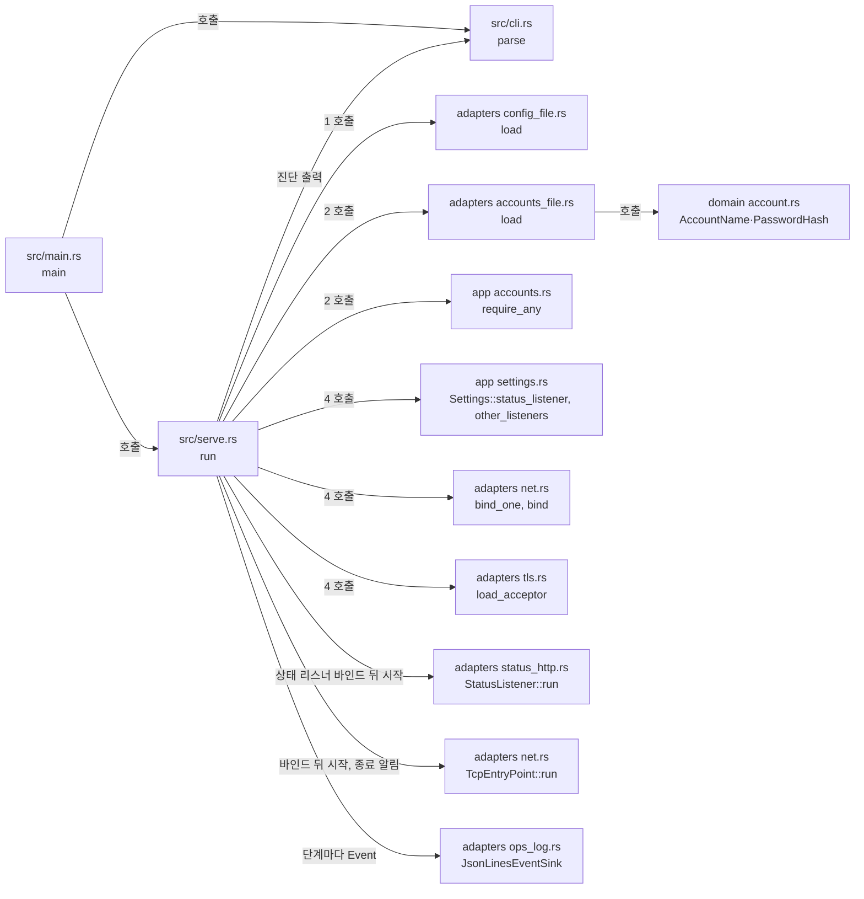

# `serve` 시작과 CLI 골격 모듈 설계

`vnc-relay` 실행파일의 명령행 해석, 오류 출력, 종료 코드와 `serve`의 시작 순서를 다룬다. `serve`는 설정 파일과 관리자 계정 파일을 검증하고, 필요한 리스너를 모두 바인드한 뒤 종료 요청을 기다린다. 어느 단계든 실패하면 그 단계의 오류를 모두 stderr에 쓰고, 운영 로그에 `startup_failed`를 남기고, 확보한 자원을 놓고, [CLI 계약 2.1절](../contracts/cli-v1.md#21-종료-코드)의 종료 코드로 끝난다. 운영 로그의 줄 형식과 출력은 [운영 로그 모듈 설계](ops-log.md)가 다룬다. TCP 진입점의 연결 수락은 [TCP 진입점 모듈 설계](tcp-entry-point.md)가 다룬다. 인증서·개인키 파일 검사는 바인드 앞에서 이 골격이 한다. 나머지 리스너의 연결 수락, TLS 연결 처리, 파일 변경 감지는 뒤 작업이 이 골격에 더한다.

| 항목 | 값 |
| --- | --- |
| 구조 시점 | Current |
| 문서 상태 | Draft |
| 구현 대조 | Verified — [대조 기록](#대조-기록) |
| 코드 위치 | `src/main.rs`, `src/cli.rs`, `src/serve.rs`, `crates/domain/src/account.rs`, `crates/app/src/accounts.rs`, `crates/app/src/settings.rs`(`ListenerPlan`, `Settings::status_listener`, `Settings::other_listeners`), `crates/adapters/src/accounts_file.rs`, `crates/adapters/src/net.rs`, `crates/adapters/src/tls.rs`, `crates/adapters/src/toml_text.rs` |
| 코드 지도 | [코드 지도 2절](code-map.md#2-코드-위치와-구성요소) |
| 관련 스펙 | [운영 스펙 3.1절](../specs/operations.md#31-설정-검증과-시작), OPS-001, OPS-002(일부), OPS-039(일부) |
| 관련 계약 | [CLI 계약](../contracts/cli-v1.md) 1.1·1.3·1.4·1.5·1.8·2절, [설정 계약 2.1절](../contracts/config-v1.md#21-설정-오류와-준비-실패), [운영 정보 계약](../contracts/ops-info-v1.md) 1.5·1.6절(시작·종료 사건)·[1.12절](../contracts/ops-info-v1.md#112-상태-리스너와-엔드포인트)(상태 리스너를 먼저 연다) |
| 관련 ADR | [ADR-0003 단일 인스턴스·메모리 상태](../decisions/ADR-0003-single-instance-memory-state.md) |

## 1. 책임과 경계

- 맡는 책임:
  - 명령행 해석: `serve --config <path>`(`--config=<path>` 포함, 한 번만), `--help`·`-h`, `--version`·`-V`. 그 밖의 하위 명령·옵션은 `usage_error`(종료 코드 2)다. `admin` 하위 명령의 해석은 `cli::parse`가 하고, 실행은 [관리자 계정 준비 CLI 모듈 설계](admin-accounts.md)가 맡는다.
  - 진단 출력: `error[<code>] key=<key>: <message>`, `warning[<code>] key=<key>: <message>`. 키가 없으면 ` key=`를 뺀다(1.5절).
  - 종료 코드 매핑: 사용법 2, 설정 3, 리스너 4, 계정 파일 5, 런타임 준비 1, 정상 종료 0.
  - `serve` 시작 순서(1.8절): 설정 읽기·검증·로그 출력 열기 → 계정 파일 읽기·검증 → 비동기 런타임·종료 신호 처리기 준비 → 인증서·개인키 파일 검사 → 리스너 바인드. 같은 단계의 오류는 모두 모은다.
  - 단계마다 운영 로그 사건을 기록한다: `server_starting`, 설정 경고(`phase` = `startup`), 진단마다 `startup_failed`, 정상 종료 때 `server_stopped`. 필드 규칙은 [운영 로그 모듈 설계 4·6절](ops-log.md#4-처리-순서)이다.
  - 계정 파일 읽기와 형식·해시 문자열 검사(1.3·1.4절), 계정이 없을 때의 시작 거절, Ubuntu의 권한 경고(1.6절).
  - 리스너 바인드 실패 수집과 실패 때 이미 바인드한 리스너 닫기.
  - 인증서·개인키 파일 검사(`tls_file_invalid`, 종료 코드 3). 활성화된 WSS 진입점과 관리 리스너의 인증서·개인키 파일을 어떤 리스너도 바인드하기 전에 검사하고, 오류는 모두 모은다([CLI 계약 1.8절](../contracts/cli-v1.md#18-수동-시작과-종료), [설정 계약 2.1절](../contracts/config-v1.md#21-설정-오류와-준비-실패)).
  - 종료 요청(Ctrl+C, Ubuntu의 SIGTERM, Windows의 Ctrl+Break)을 받으면 TCP 진입점 작업에 종료를 알리고, 그 작업이 끝난 뒤 나머지 리스너를 닫고 종료 코드 0으로 끝내기.
- 맡지 않는 책임:
  - `admin` 하위 명령의 실행. [관리자 계정 준비 CLI 모듈 설계](admin-accounts.md)가 맡는다.
  - 파일 변경 감지 준비(시작 순서 3단계, `watch_unavailable`). 작업 5.1·5.2가 맡는다(사용자 결정 2026-10-20).
  - 준비 상태, `server_ready`, 상태 리스너의 응답. [상태 리스너와 준비 상태 모듈 설계](status-listener.md)가 맡는다. 이 문서는 5·6단계에서 그 기능을 부르는 순서만 다룬다.
  - WS·WSS·관리 리스너의 연결 수락. 작업 3.2(WS·WSS), 4.2(관리)가 바인드한 리스너에 붙인다. 그 전까지 이 리스너는 바인드만 하고 연결을 받지 않는다(사용자 결정 2026-10-20). TCP 진입점의 수락은 작업 2.4가 붙였다([TCP 진입점 모듈 설계](tcp-entry-point.md)). 상태 리스너의 수락은 작업 2.6이 붙였다.
  - 종료 유예 G, 두 번째 종료 요청, 세션 정리. 작업 5.3이 맡는다.
  - 비밀번호 규칙(`Password`)은 [관리자 계정 준비 CLI 모듈 설계](admin-accounts.md)가 맡는다. 로그인 때 비밀번호 해시 검증은 작업 4.3이 맡는다.
- 다른 모듈에 공개하는 기능:
  - `vnc_relay_domain::account::{Account, AccountName, AccountNameError, PasswordHash, PasswordHashError, Argon2Params, Argon2ParamsError}`
  - `vnc_relay_app::accounts::{ACCOUNTS_FILE_KEY, AccountsError, AccountsDiagnostic, AccountsWarning, LoadedAccounts, require_any}`
  - `vnc_relay_app::settings::{ListenerPlan, Settings::status_listener, Settings::other_listeners}`
  - `vnc_relay_adapters::accounts_file::{load, parse}`
  - `vnc_relay_adapters::net::{bind, bind_one, BindFailure, BoundListener}`

## 2. 내부 구조

화살표는 실행 중 호출이다. crate 의존 방향은 [코드 지도 레이어 표](code-map.md#레이어와-의존-방향)를 따른다.

| 요소(파일·심볼) | 역할 | 만들어지는 시점과 소유자 | 의존 대상 |
| --- | --- | --- | --- |
| `src/main.rs` `main` | `cli::parse` 결과에 따라 도움말·버전을 쓰거나 `serve::run`을 부르고 `ExitCode`를 돌려준다. | 프로세스마다 한 번 | `cli`, `serve` |
| `src/cli.rs` `parse`, `Command`, `UsageError` | clap으로 인수를 해석한다. clap 오류를 한국어 `usage_error` 문장으로 바꾼다. `--help`·`--version`이 다른 인수와 함께 오면 사용법 오류다. | 호출마다 | clap |
| `src/cli.rs` `report`, `report_usage`, `HELP`, `EXIT_*` | 진단 한 줄을 stderr에 쓴다(`report`). 사용법 오류 줄과 사용법 문장을 stderr에 쓴다(`report_usage`). 도움말 문장과 종료 코드 상수를 둔다. | 호출마다 | 없음 |
| `src/serve.rs` `run`, `listen_until_shutdown` | 시작 순서 실행, 단계별 진단 출력과 종료 코드 결정, 운영 로그 사건 기록. 바인드 뒤 L 예산을 하나 만들고, TCP 진입점마다 허용 목록·L 예산·H·keepalive 값을 `AcceptPolicy`로 넘겨 작업을 띄우고, 종료 요청을 기다린다(`listen_until_shutdown`). | `serve` 실행마다 | adapters, app, domain, tokio, `cli` |
| `src/serve.rs` `ShutdownSignal::register`, `ShutdownSignal::wait` | 종료 요청 처리기. Ubuntu는 SIGINT·SIGTERM, Windows는 Ctrl+C·Ctrl+Break다. 바인드 전에 등록해 시작 중의 요청도 놓치지 않는다. `wait`가 첫 요청을 기다린다. | 4단계 처음 | tokio |
| `src/serve.rs` `tls_checks`, `tls_failure` | 활성화된 WSS 진입점과 관리 리스너의 TLS 파일 설정을 검사 목록으로 모은다. 파일 오류 한 건을 stderr 한 줄과 `startup_failed`로 쓴다. | 4단계 | adapters `tls.rs` |
| `crates/domain/src/account.rs` `AccountName` | 1~32자, `a-z0-9._-`만 받는 계정 이름 값 타입 | 계정 파일을 읽을 때 | 없음 |
| `crates/domain/src/account.rs` `PasswordHash`, `PasswordHashError`, `Argon2Params`, `Argon2ParamsError` | PHC 문자열 해석(1.4절): 알고리즘·버전·`m,t,p` 순서·솔트 16바이트 이상·해시 32바이트·패딩 없는 표준 Base64. 승인 범위 상수(`MEMORY_KIB` 등)와 범위 판정(하한 미만이 상한 초과보다 먼저다). `Debug`는 해시 문자열을 `"<redacted>"`로 가린다. | 계정 파일을 읽을 때 | 없음 |
| `crates/domain/src/account.rs` `Account` | 이름과 해시 한 쌍 | 계정 파일을 읽을 때, 호출한 쪽이 소유 | 위 두 타입 |
| `crates/app/src/accounts.rs` `AccountsError`, `AccountsDiagnostic`, `AccountsWarning` | 계정 파일 오류 코드 5종(`accounts_file_missing`·`accounts_file_unreadable`·`accounts_file_invalid`·`accounts_hash_below_minimum`·`accounts_none`)과 경고 `accounts_file_permissive`, 진단 한 건(`error`, `key`, `message`) | 값 타입 | domain |
| `crates/app/src/accounts.rs` `require_any` | 계정이 하나도 없으면 `accounts_none` 진단을 준다(운영 스펙 3.1절 5). | `serve` 2단계 | domain |
| `crates/app/src/settings.rs` `ListenerPlan`, `Settings::status_listener`, `Settings::other_listeners` | 바인드할 리스너 계획. `status_listener`는 상태 리스너 하나, `other_listeners`는 관리, 켠 진입점(`tcp_viewer`, `tcp_server`, `ws_viewer`, `wss_viewer`) 순서다. 각 항목은 리스너 이름, 설정 키(`status.listen` 등), 주소, 진입점이다. | 4단계 | domain |
| `crates/adapters/src/accounts_file.rs` `load`, `parse` | 파일 읽기, UTF-8 확인, TOML 해석, `version`·`[[account]]` 키 검사, 중복 이름 검사, 해시 하한·상한 판정, Ubuntu 권한 경고. 모든 진단을 모은다. `LoadedAccounts`(app `accounts.rs`)를 돌려준다. | 호출마다 | toml, domain, app |
| `crates/adapters/src/net.rs` `bind`, `bind_one`, `BindFailure`, `BoundListener` | `bind_one`은 `ListenerPlan` 하나를 tokio `TcpListener::bind`로 바인드한다. `bind`는 계획마다 `bind_one`을 부르고, 실패도 계속 시도해 모두 모은다. 하나라도 실패하면 성공한 리스너를 닫고 실패 목록을 돌려준다. 성공하면 계획과 리스너 쌍(`BoundListener`)을 돌려준다. 실패 원인은 주소를 뺀 한국어 문장이다. | 4단계 | tokio, app |
| `crates/adapters/src/toml_text.rs` `error_position` | TOML 구문 오류의 행·열. 설정 파일과 계정 파일이 함께 쓴다. 파일 내용은 돌려주지 않는다. | 호출마다 | toml |
| `crates/adapters/src/tls.rs` `load_acceptor`, `TlsError`, `TlsFile` | 인증서와 개인키 파일을 읽고 서로 맞는지 확인한 뒤 rustls 서버 설정을 만든다(암호 모듈 aws-lc-rs). 오류 코드는 모두 `tls_file_invalid`다. 설정 키의 파일 이름(`cert_file`·`key_file`)은 `TlsError::file`이 정한다. | 4단계, 검사마다 호출 | rustls, aws-lc-rs |

`crates/adapters/src/config_file.rs`는 `[admin.argon2]` 범위를 `Argon2Params`의 승인 범위 상수로 검사한다. 설정과 계정 파일이 같은 범위를 쓰게 하기 위해서다.

## 3. 데이터 모델

계정 파일 형식은 [CLI 계약 1.3·1.4절](../contracts/cli-v1.md#13-계정-파일-형식)이 기준이다. 여기서는 메모리 타입만 정한다.

| 이름 | 필드·형태 | 저장 위치 | 제약과 항상 지켜야 할 조건 |
| --- | --- | --- | --- |
| `Command` | `Help`, `Version`, `Serve { config: PathBuf }` | 메모리 | `Help`·`Version`은 다른 인수가 없을 때만 만든다. |
| `AccountName` | `String` | `Account` | 1~32자, `a-z0-9._-` |
| `PasswordHash` | 원문 PHC 문자열, `Argon2Params` | `Account` | 1.4절 형식을 통과한 값만 담는다. 원문은 로그인 때의 검증(작업 4.3)에 쓴다. `Debug`·오류 메시지에 원문을 넣지 않는다. |
| `Argon2Params` | `memory_kib`, `iterations`, `parallelism`: `u32` | `PasswordHash` | 승인 범위: 19456~1048576, 2~10, 1~16([설정 계약 1.2절](../contracts/config-v1.md#12-키-표)) |
| `AccountsDiagnostic` | `error: AccountsError`, `key: String`, `message: String` | 반환 값 | `key` 규칙은 [CLI 계약 1.3절](../contracts/cli-v1.md#13-계정-파일-형식). 빈 문자열이면 출력에서 ` key=`를 뺀다. 메시지에 해시·파일 내용을 넣지 않는다. |
| `LoadedAccounts` | `accounts: Vec<Account>`, `warnings: Vec<AccountsWarning>` | 반환 값 | 파일 순서를 유지한다. |
| `ListenerPlan` | `name: &'static str`(운영 정보 계약의 `listener` 값), `key: &'static str`(설정 키), `addr: SocketAddr`, `entry_point: Option<EntryPoint>`(상태·관리 리스너는 `None`) | 메모리 | 같은 주소가 두 번 나오지 않는다(설정 검사 `config_listen_conflict`가 보장). |
| `BindFailure` | `plan: ListenerPlan`, `cause: String` | 반환 값 | `cause`는 주소를 뺀 원인 문장이다. 이미 사용 중이면 "이미 사용 중이다." stderr 메시지는 `serve`가 주소와 원인을 합쳐 만든다. 운영 로그의 `detail`에는 원인만 쓴다. |

## 4. 처리 순서

대표 시나리오는 OPS-039(같은 설정의 두 번째 프로세스)다.

| 순서 | 코드 위치(파일·심볼) | 조건·계산 | 바뀌는 상태 | 결과를 쓰는 곳 |
| --- | --- | --- | --- | --- |
| 1 | `src/main.rs` `main`, `src/cli.rs` `parse` | 인수를 해석한다. 오류면 `error[usage_error]`와 사용법을 stderr에 쓰고 2로 끝난다. | `Command::Serve { config }` | 2단계 |
| 2 | `src/serve.rs` `run`, `config_file::load`, `JsonLinesEventSink::open` | 설정을 읽고 검증한다. 진단이 있으면 모두 쓰고 표준 출력에 진단마다 `startup_failed`를 쓴 뒤 3으로 끝난다. 로그 출력을 연다. 열 수 없으면 `log_file_unavailable`로 3. 열면 `server_starting`과 설정 경고를 기록한다. | `Settings`, 로그 출력 | 3단계 |
| 3 | `accounts_file::load`, `accounts::require_any` | `settings.admin.accounts_file`을 읽고 검증한다. 경고는 stderr에 쓴다. 진단이 있거나 계정이 없으면 모두 쓰고, 진단마다 `startup_failed`를 기록하고, 5로 끝난다. | `LoadedAccounts` | 4단계 |
| 4 | `src/serve.rs` `run`, `ShutdownSignal::register`, `listen_until_shutdown`(TLS 검사) | tokio 다중 스레드 런타임을 만들고 종료 신호 처리기를 등록한다. 실패하면 `runtime_unavailable`로 1. 이어 활성화된 WSS 진입점과 관리 리스너의 인증서·개인키를 `tls::load_acceptor`로 검사한다(`tls_checks`). 검사 대상을 모두 확인한 뒤 실패가 하나라도 있으면, 실패한 파일마다 `error[tls_file_invalid] key=<키>`를 쓰고 `startup_failed`(`config_key`, `listener`)를 기록한 뒤 3으로 끝난다. 키는 `relay.wss_viewer.cert_file`·`relay.wss_viewer.key_file`·`management.cert_file`·`management.key_file` 가운데 하나이고, `listener`는 WSS 진입점 이름 또는 `management`다. 통과한 acceptor는 `listen_until_shutdown`이 가진다. | 런타임, 신호 처리기, 검사 통과 acceptor | 5단계 |
| 5 | `Settings::status_listener`, `net::bind_one`, `Settings::other_listeners`, `net::bind` | 상태 리스너를 먼저 바인드해 `StatusListener::run`을 띄운다. 그 뒤 나머지를 목록 순서대로 바인드한다([상태 리스너와 준비 상태 모듈 설계 4절](status-listener.md#4-처리-순서)). 두 번째 프로세스는 모든 주소가 사용 중이라 실패 목록을 받는다. 실패가 있으면 성공한 리스너를 닫고 상태 리스너 작업을 멈춘다. 실패한 리스너마다 `error[listener_bind_failed] key=<설정 키>`를 쓰고 `startup_failed`(`listener`, `config_key`, `detail`)를 기록한 뒤 4로 끝난다. 첫 프로세스의 소켓에는 손대지 않는다. | 바인드한 리스너, 상태 리스너 작업 | 6단계 |
| 6 | `listen_until_shutdown`, `ShutdownSignal::wait` | 준비됨으로 바꾸고 `server_ready`를 기록한다. `ConnectionBudget::new(limits.relay_connections)`로 L 예산을 만든다. TCP 진입점 리스너마다 `TcpEntryPoint::run`을 띄우고 첫 종료 요청까지 기다린다([연결 상한과 시간 제한 모듈 설계 4절](connection-limits.md#4-처리-순서)). 받으면 종료 중으로 바꾸고, 종료를 알리고, 진입점 작업이 모두 끝나기를 기다린다([TCP 진입점 모듈 설계 4절](tcp-entry-point.md#4-처리-순서)). 그 뒤 나머지 리스너를 닫고 상태 리스너 작업을 멈추고 `server_stopped`를 기록한 뒤 런타임을 끝낸다. | 준비 상태, L 예산 | 종료 코드 0 |

## 5. 상태와 초기화

- 초기화 시점: 런타임과 신호 처리기는 계정 파일 검증이 끝난 뒤 만든다. 앞 단계에서 실패하면 스레드를 만들지 않는다.
- 상태 소유자와 제거 시점: `Settings`·계정 목록·리스너는 `serve::run`이 소유한다. 상태 리스너는 바인드 뒤 `StatusListener`가, TCP 진입점 리스너는 `TcpEntryPoint`가 넘겨받는다. 함수가 끝나면 모두 닫힌다. 프로세스 사이에 공유하는 상태는 없다(ADR-0003).
- 동시 실행과 순서: 바인드는 한 번에 하나씩 한다. 상태 리스너가 처음이고, 바인드 직후부터 응답한다([운영 정보 계약 1.12절](../contracts/ops-info-v1.md#112-상태-리스너와-엔드포인트)).
- TLS acceptor: 검사를 통과한 것만 `listen_until_shutdown`이 `_tls_acceptors`로 든다. 3.2·4.2 작업이 리스너에 붙이기 전까지 쓰지 않으며, 함수가 끝나면 버린다.

## 6. 오류 처리

| 실패 지점 | 처리 방법 | 남는 상태 | 관련 스펙 시나리오 |
| --- | --- | --- | --- |
| `cli::parse` | `usage_error` 한 줄과 사용법, 종료 코드 2 | 없음 | 없음(CLI 계약 1.1절) |
| `config_file::load` | 모든 `config_*` 진단, 표준 출력에 진단마다 `startup_failed`, 종료 코드 3 | 없음 | OPS-001 |
| `JsonLinesEventSink::open` | `log_file_unavailable`, 표준 출력에 `startup_failed`, 종료 코드 3 | 없음 | 없음(설정 계약 2.1절) |
| `accounts_file::load` | 파일이 없으면 `accounts_file_missing`, 읽을 수 없으면 `accounts_file_unreadable` 하나. 내용 오류는 모두 모은다. 종료 코드 5 | 없음 | OPS-001 |
| `accounts::require_any` | `accounts_none`, 종료 코드 5 | 없음 | OPS-001 |
| 런타임·신호 처리기 생성 | `runtime_unavailable`, 종료 코드 1 | 없음 | 없음 |
| `tls::load_acceptor`(검사마다) | `tls_file_invalid`, 실패한 파일마다 stderr 한 줄과 `startup_failed`. 모든 검사를 마친 뒤 종료 코드 3. 리스너는 바인드하지 않는다. | 없음 | OPS-002 |
| `net::bind_one`, `net::bind` | 실패마다 `listener_bind_failed`, 성공한 리스너를 닫고 상태 리스너 작업을 멈춘 뒤 종료 코드 4 | 없음 | OPS-002, OPS-039 |

## 7. 설계 선택

| 선택 | 이유 | 검토한 다른 방법 | 근거 |
| --- | --- | --- | --- |
| clap의 자동 도움말·버전·오류 출력을 끄고, 오류 종류(`ErrorKind`)를 한국어 `usage_error` 문장으로 바꾼다. | 계약 1.5절의 `error[<code>]` 형식과 한국어 문장을 지킨다. `--help`가 다른 인수와 함께 오면 거절해야 한다(1.1절). | clap 기본 출력. 영어 문장과 다른 형식이다. 직접 해석. PRD가 CLI에 clap을 정했다. | [PRD "구현 기술" 행](../requirements/PRD.md#확정-기준) |
| 루트 crate가 tokio에 의존한다(런타임 생성·종료 신호). | 런타임과 종료 신호는 실행파일 조립에 속한다. [코드 지도](code-map.md) 3절이 종료 신호 진입점을 `src/serve.rs`에 두었다. 레이어 표의 루트 외부 crate에 tokio를 더한다. | adapters가 런타임을 만들고 시작 순서를 가진다. 객체 연결 위치가 두 곳으로 나뉜다. | 코드 지도 3·5절 |
| 바인드 실패가 나도 남은 리스너를 계속 시도해 실패를 모두 보고한다. | 1.5절이 같은 단계의 오류를 모두 모으라고 한다. 두 번째 프로세스는 모든 주소의 충돌을 한 번에 본다. | 첫 실패에서 멈춤. 다시 실행해야 다음 충돌을 안다. | [CLI 계약 1.5절](../contracts/cli-v1.md#15-입력과-출력-규칙) |
| 바인드 순서는 상태, 관리, 진입점 순서다. | 운영 정보 계약 1.12절이 상태 리스너를 다른 필수 리스너보다 먼저 열라고 한다. 고정 순서는 출력도 고정한다. | 설정 파일 순서. TOML 표 순서가 키 정렬에 따라 달라진다. | [운영 정보 계약 1.12절](../contracts/ops-info-v1.md#112-상태-리스너와-엔드포인트) |
| PHC 해시 문자열은 domain이 직접 해석한다. | 1.4절 형식 검사만 필요하다. domain은 외부 crate를 쓰지 않는다. argon2 crate는 작업 4.x의 해시 생성·검증에서 adapters가 쓴다. | `argon2`의 `PasswordHash` 파서. domain 레이어 규칙을 어기고, `m,t,p` 순서·솔트 길이 규칙은 따로 검사해야 한다. | [코드 지도 레이어 표](code-map.md#레이어와-의존-방향) |
| 리스너는 tokio 기본 바인드를 쓴다. Unix에서는 `SO_REUSEADDR`를 켜고, Windows에서는 주소 공유 옵션을 켜지 않는다. | Linux의 `SO_REUSEADDR`는 다른 소켓이 듣고 있는 주소의 바인드를 막는다. Ubuntu에서 두 번째 프로세스의 바인드 실패를 테스트로 확인했다. Windows 동작은 관찰하지 않았다(9절). | `SO_EXCLUSIVEADDRUSE`(Windows). tokio 공개 API에 없다. socket2(작업 2.5에서 채택)로 켤 수 있지만 Windows 동작을 관찰하기 전에는 정하지 않는다. | [CLI 계약 1.8절](../contracts/cli-v1.md#18-수동-시작과-종료) "두 번째 인스턴스" |
| `--version`도 `--help`처럼 다른 인수와 함께 쓰면 사용법 오류다. | 1.1절은 `--help`만 단독 사용을 적었다. 같은 종류의 옵션을 같은 규칙으로 다루면 `--version serve …` 같은 입력의 뜻이 하나로 정해진다. | `--version`이 있으면 나머지를 무시하고 버전을 쓴다. 잘못 쓴 명령이 성공 종료 코드로 끝난다. | [CLI 계약 1.1절](../contracts/cli-v1.md#11-하위-명령과-옵션) |
| 계정 파일 권한 경고는 Ubuntu에서만 한다(그룹·기타 권한 비트 `0o077`). | 1.6절이 Ubuntu 경고만 정하고 Windows 권한 경고는 관찰로 확인한다고 했다. | Windows 접근 제어 목록 검사. 판정 규칙이 아직 없다. | [CLI 계약 1.6절](../contracts/cli-v1.md#16-저장과-파일-권한) |
| 인증서·개인키 검사는 어떤 리스너도 바인드하기 전에 한다. | CLI 계약 1.8절이 바인드 앞에서 검사하고 그 실패의 종료 코드를 3으로 정한다. 바인드 뒤에 검사하면 이미 바인드한 리스너를 닫아야 하고, 파일 오류가 바인드 실패(4)에 가려진다. | 바인드 뒤 검사. 실패 때 리스너를 닫아야 하고, 파일 오류를 바인드 실패로 보고할 수 있다. | [CLI 계약 1.8절](../contracts/cli-v1.md#18-수동-시작과-종료) |

## 8. 현재 코드와의 차이

없다. 2·4절의 파일·심볼이 현재 코드와 같다.

## 대조 기록

| 대조 범위 | 환경 | 확인 방법 | 결과 |
| --- | --- | --- | --- |
| 작업 2.2 변경(기준 커밋 `4e594f4` + 작업 트리) | Ubuntu 24.04.4(WSL2), Rust 1.99.1 | 2·4절의 파일·심볼과 실제 코드를 대조했다. 처리 순서와 종료 코드는 [CLI 계약의 계약 테스트 실행 기록](../contracts/cli-v1.md#계약-테스트-실행-기록)으로 확인했다. 레이어 규칙은 `cargo xtask layers`, Windows 분기(`cfg(windows)`)는 `cargo clippy --target x86_64-pc-windows-msvc`의 타입 검사로만 확인했다. | 통과 |
| 작업 2.3 변경(기준 커밋 `f25983a` + 작업 트리): 로그 출력 열기, 단계별 사건 기록, `BindFailure::cause` | Ubuntu 24.04.4(WSL2), Rust 1.99.1 | 1·2·4·6절과 `src/serve.rs`·`crates/adapters/src/net.rs`를 대조했다. 단계별 로그 줄은 `tests/serve.rs`로 확인했다([운영 정보 계약의 계약 테스트 실행 기록](../contracts/ops-info-v1.md#계약-테스트-실행-기록)). | 통과 |
| 작업 2.4 변경(기준 커밋 `6d6f789` + 작업 트리): 진입점 작업 시작·종료, `ListenerPlan::entry_point` | Ubuntu 24.04.4(WSL2), Rust 1.99.1 | 1·2·3·4·5절과 `src/serve.rs`·`crates/app/src/settings.rs`를 대조했다. 종료 순서는 `tests/serve.rs`의 `closes_and_logs_every_held_connection_when_stopping`으로 확인했다. | 통과 |
| 작업 2.5 변경(기준 커밋 `c89beb4` + 작업 트리): L 예산 만들기, `AcceptPolicy` 넘기기 | Ubuntu 24.04.4(WSL2), Rust 1.99.1 | 2·4절과 `src/serve.rs`를 대조했다. `tests/serve.rs`의 진입점 테스트가 모두 통과했다. | 통과 |
| 작업 2.6 변경(기준 커밋 `b1f2ad5` + 작업 트리): 상태 리스너 먼저 바인드, `Settings::status_listener`·`other_listeners`, `bind_one`, 준비됨·종료 중 전환 | Ubuntu 24.04.4(WSL2), Rust 1.99.1 | 1~6절과 `src/serve.rs`·`crates/app/src/settings.rs`·`crates/adapters/src/net.rs`를 대조했다. 바인드 실패 보고 순서는 `tests/serve.rs`의 `second_instance_fails_with_exit_code_4_and_leaves_the_first_running`, 사건 순서는 `writes_the_log_to_the_configured_file_from_start_to_stop`으로 확인했다. | 통과 |
| Windows 실행(기준 커밋 `e1cfc4f` + Windows 경고 수정) | Windows 11 Pro 10.0.26200, Rust 1.99.1(`x86_64-pc-windows-msvc`) | `tests/serve.rs` 12건이 통과했다. `second_instance_fails_with_exit_code_4_and_leaves_the_first_running`으로 같은 주소의 두 번째 프로세스가 `listener_bind_failed`·종료 코드 4로 끝나고 첫 프로세스의 리스너가 남는 것을 확인했다. 종료 신호 테스트는 Unix 신호를 쓰므로 실행하지 않았다. | 통과 |
| 작업 3.1 변경(작업 트리): 시작 때 TLS 파일 검사, `tls::load_acceptor` | Windows 11 Pro 10.0.26200, Rust 1.99.1(`x86_64-pc-windows-msvc`) | 1·4·6절과 `src/serve.rs`의 `listen_until_shutdown`·`tls_checks`·`tls_failure`를 대조했다. `tests/serve.rs`의 `fails_with_exit_code_3_when_wss_key_does_not_match`·`fails_with_exit_code_3_when_management_certificate_is_missing`이 종료 코드 3으로 끝나는 것을 확인했다. `checks_tls_files_before_binding_a_taken_status_port`는 상태 포트가 이미 점유된 상태에서 TLS 파일 오류가 바인드 실패(종료 코드 4)보다 먼저 보고되는 것을 확인했다. 종료 신호 테스트는 Unix 신호를 쓰므로 실행하지 않았다. OPS-007(`closes_and_logs_every_held_connection_when_stopping`)은 `cfg(unix)`라 Windows에서 실행하지 않았다. | 통과 |
| 작업 3.1 변경(작업 트리): 시작 때 TLS 파일 검사, `tls::load_acceptor` | Ubuntu 24.04.4(WSL2), Rust 1.99.1 | 1·4·6절과 `src/serve.rs`의 `listen_until_shutdown`·`tls_checks`·`tls_failure`를 대조했다. `tests/serve.rs` 21건이 모두 통과했다. 상태 포트가 점유된 경우의 TLS 파일 오류 종료 코드 3은 `checks_tls_files_before_binding_a_taken_status_port`로 확인했다. | 통과 |

## 9. 미결정 사항

| 항목 | 영향 | 확정 위치 |
| --- | --- | --- |
| Windows의 주소 공유·Ctrl+C·Ctrl+Break·콘솔 창 닫기 | 같은 설정의 두 번째 `vnc-relay`는 바인드에 실패했다(대조 기록). 다른 프로그램이 `SO_REUSEADDR`로 같은 주소를 공유할 수 있는지, Ctrl+C·Ctrl+Break·콘솔 닫기를 종료 요청으로 받는지는 관찰하지 않았다. | 작업 5.3, [CLI 계약 6절](../contracts/cli-v1.md#6-초안을-확정하기-전에-해결할-사항) |
