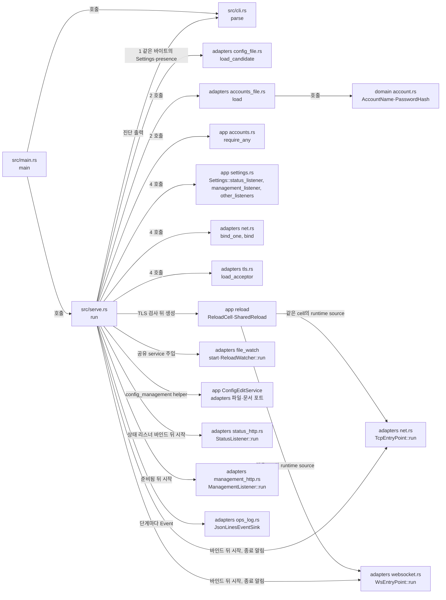

# `serve` 시작과 CLI 골격 모듈 설계

## 실행 값과 설정 편집 조립(Current)

`serve`는 시작 파일의 Settings·presence와 검사한 TLS로 `ReloadCell`을 만들고, `SharedReload` 하나를 watcher와 `ConfigEditService`에 주입한다. 같은 cell의 `RuntimeSettingsSource`는 중계·대상·수락·관리·상태 reader에 전달한다. status에는 U를 넣지 않는다. 종료 시작 때 현재 G를 한 번 읽어 deadline을 고정하고 watcher 적용을 멈춘다. 유예 중 관리 GET/PATCH는 유지한다([파일 감지 §10](file-watch.md#10-target--설정-v3-실행-값과-공유-트랜잭션), [설정 보기·편집 §2](config-edit.md#2-내부-구조와-초기화)).

이 문서는 실행파일의 CLI·진단·종료 코드와 `serve` 조립 순서를 다룬다. `serve`는 설정·계정·TLS·감시를 준비한 뒤 필요한 리스너를 바인드한다. 단계가 실패하면 진단을 모아 stderr와 `startup_failed`로 보고하고 확보한 자원을 회수한다. 구체 종료 코드는 [CLI 계약 2.1절](../contracts/cli-v1.md#21-종료-코드)을 따른다. 수락·TLS·재로드·설정 편집의 업무 규칙은 각 모듈이 맡고 `serve`는 객체와 수명을 연결한다.

| 항목 | 값 |
| --- | --- |
| 구조 시점 | Current |
| 문서 상태 | Draft |
| 구현 대조 | 2026-11-08 작업 트리의 소스 대조. WSS Server·프록시 TLS 종료·최근 로그 범위의 구현은 커밋 `3df0693`이다. 시험은 커밋 `51bd747`의 두 OS 게이트에서 통과했다([WSS Server·프록시·최근 로그 판정표](../how-to/set-up-and-verify.md#43-wss-server프록시-tls-종료최근-로그-판정표)). 이전 실행 증거는 [대조 기록](#대조-기록)에 보존한다. |
| 코드 위치 | `src/main.rs` `main`, `src/cli.rs` `parse`, `src/serve.rs` `run`·`listen_until_shutdown`·`config_management`·`begin_process_shutdown`, `crates/app/src/reload/snapshot.rs` `ReloadCell`, `crates/app/src/reload/service.rs` `ReloadService`, `crates/app/src/management/config.rs` `ConfigEditService`, `crates/adapters/src/file_watch.rs` `start`·`ReloadWatcher` |
| 코드 지도 | [코드 지도 2절](code-map.md#2-코드-위치와-구성요소) |
| 관련 스펙 | [운영 스펙 3.1절](../specs/operations.md#31-설정-검증과-시작), OPS-001, OPS-002(일부), OPS-039(일부) |
| 관련 계약 | [CLI 계약](../contracts/cli-v1.md) 1.1·1.3·1.4·1.5·1.8·2절, [설정 계약 2.1절](../contracts/config-v4.md#21-설정-오류와-준비-실패), [운영 정보 계약](../contracts/ops-info-v2.md) 1.5·1.6절(시작·종료 사건)·[1.12절](../contracts/ops-info-v2.md#112-상태-리스너와-엔드포인트)(상태 리스너를 먼저 연다) |
| 관련 ADR | [ADR-0003 단일 인스턴스·메모리 상태](../decisions/ADR-0003-single-instance-memory-state.md), [ADR-0006 설정 파일을 통한 편집](../decisions/ADR-0006-config-edit-through-file.md) |

후속: R1은 중계 리스너 네 개(`tcp_viewer`·`tcp_server`·`ws`·`wss`)와 진입점 여섯 개를 구분한다. `Settings::other_listeners`는 WS·WSS의 역할이 하나라도 켜져 있으면 공유 소켓을 한 번만 계획한다. WS·WSS의 부모 `listen`과 WSS 부모 TLS를 사용한다. `WsEntryPoint::new`에는 `Listener`, `TcpEntryPoint::new`에는 역할이 고정된 `EntryPoint`를 넘긴다. 같은 WSS 수락기를 두 역할이 공유한다.

`run`은 시작 설정의 `recent_logs.max_entries`로 `Arc<RecentLogs>`를 한 번 만든다. 이 참조를 `JsonLinesEventSink::with_recent_logs`와 `listen_until_shutdown`에 직접 넘긴다. 관리 서비스의 `logs`는 기록 싱크와 같은 버퍼다. `trusted_proxies`는 공유 재로드 설정을 통해 WS·WSS의 수락·업그레이드 검사에 전달한다. 최근 로그 구조와 잠금 순서는 [운영 로그 모듈](ops-log.md)을 따른다.

## 1. 책임과 경계

- 맡는 책임:
  - 명령행 해석: `serve --config <path>`(`--config=<path>` 포함, 한 번만), `--help`·`-h`, `--version`·`-V`. 그 밖의 하위 명령·옵션은 `usage_error`(종료 코드 2)다. `admin` 하위 명령의 해석은 `cli::parse`가 하고, 실행은 [관리자 계정 준비 CLI 모듈 설계](admin-accounts.md)가 맡는다.
  - 진단 출력: `error[<code>] key=<key>: <message>`, `warning[<code>] key=<key>: <message>`. 키가 없으면 ` key=`를 뺀다(1.5절).
  - 종료 코드 매핑: 사용법 2, 설정 3, 리스너 4, 계정 파일 5, 런타임 준비 1, 정상 종료 0.
  - `serve` 시작 순서: 설정·presence 읽기와 로그 열기 → 계정 검증·인증 서비스 → 런타임·종료 신호 → 시작 키 → TLS 검사 → snapshot·공유 재로드·설정 서비스·감시 등록 → 리스너 바인드. 같은 단계의 오류는 모은다.
  - 단계마다 운영 로그 사건을 기록한다: `server_starting`, 설정 경고(`phase` = `startup`), 진단마다 `startup_failed`, 정상 종료 때 `server_stopped`. 필드 규칙은 [운영 로그 모듈 설계 4·6절](ops-log.md#4-처리-순서)이다.
  - 계정 파일 읽기와 형식·해시 문자열 검사(1.3·1.4절), 계정이 없을 때의 시작 거절, Ubuntu의 권한 경고(1.6절).
  - 리스너 바인드 실패 수집과 실패 때 이미 바인드한 리스너 닫기.
  - 인증서·개인키 파일 검사(`tls_file_invalid`, 종료 코드 3). 활성화된 WSS 진입점과 관리 리스너의 인증서·개인키 파일을 어떤 리스너도 바인드하기 전에 검사하고, 오류는 모두 모은다([CLI 계약 1.8절](../contracts/cli-v1.md#18-수동-시작과-종료), [설정 계약 2.1절](../contracts/config-v4.md#21-설정-오류와-준비-실패)).
  - 종료 요청을 받으면 준비 상태·중계 lifecycle을 바꾸고 watcher와 TCP·WS·WSS 수락을 멈춘다. 관리·상태 작업은 중계 소유자 정리 뒤 종료한다.
  - 종료 시작 snapshot의 G를 한 번 읽어 유예를 고정한다. `finish_relay_shutdown`은 소유자가 끝날 때까지 G 감독을 유지한다. 유예 중 GET/PATCH와 G 편집은 이미 시작한 종료를 되돌리거나 연장하지 않는다.
  - 필수 리스너의 복구 불가능 수락 오류 감독. `SupervisedListener`의 최초 장애 채널과 OS 종료 요청을 `wait_for_shutdown`에서 함께 기다린다. 같은 turn에 둘 다 준비됐으면 요청을 우선한다. `begin_process_shutdown`이 준비 상태·중계 종료를 함께 시작한다. 장애가 먼저이면 `listener_failed`, `request_fatal_shutdown`, 종료 코드 1이다. G와 소유자 정리는 그대로다. 사용자 결정 2026-11-05(Q114).
- 맡지 않는 책임:
  - `admin` 하위 명령의 실행. [관리자 계정 준비 CLI 모듈 설계](admin-accounts.md)가 맡는다.
  - 변경 감지·후보 수용의 내부 동작. 조립은 여기서 하고 [파일 감지 모듈](file-watch.md)이 규칙을 맡는다.
  - 준비 상태·상태 응답은 [상태 리스너](status-listener.md), 관리 API·정적 파일은 [관리 리스너](management-listener.md)가 맡는다.
  - TCP 수락·WS 업그레이드·중계·설정 편집은 각 사용 사례/어댑터가 맡는다. 조립에 업무 규칙을 복제하지 않는다.
  - 비밀번호·로그인·계정 변경은 [계정 준비](admin-accounts.md)와 [관리 세션](management-session.md)이 맡는다.
- 다른 모듈에 공개하는 기능:
  - `vnc_relay_domain::account::{Account, AccountName, AccountNameError, PasswordHash, PasswordHashError, Argon2Params, Argon2ParamsError}`
  - `vnc_relay_app::accounts::{ACCOUNTS_FILE_KEY, AccountsError, AccountsDiagnostic, AccountsWarning, LoadedAccounts, require_any}`
  - `vnc_relay_app::settings::{ListenerPlan, Settings::status_listener, Settings::management_listener, Settings::other_listeners}`
  - `vnc_relay_adapters::accounts_file::{load, parse}`
  - `vnc_relay_adapters::net::{bind, bind_one, BindFailure, BoundListener}`

## 2. 내부 구조

화살표는 실행 중 호출이다. crate 의존 방향은 [코드 지도 레이어 표](code-map.md#레이어와-의존-방향)를 따른다.

| 요소(파일·심볼) | 역할 | 만들어지는 시점과 소유자 | 의존 대상 |
| --- | --- | --- | --- |
| `src/main.rs` `main` | `cli::parse` 결과에 따라 도움말·버전을 쓰거나 `serve::run`을 부르고 `ExitCode`를 돌려준다. | 프로세스마다 한 번 | `cli`, `serve` |
| `src/cli.rs` `parse`, `Command`, `UsageError` | clap으로 인수를 해석한다. clap 오류를 한국어 `usage_error` 문장으로 바꾼다. `--help`·`--version`이 다른 인수와 함께 오면 사용법 오류다. | 호출마다 | clap |
| `src/cli.rs` `report`, `report_usage`, `HELP`, `EXIT_*` | 진단 한 줄을 stderr에 쓴다(`report`). 사용법 오류 줄과 사용법 문장을 stderr에 쓴다(`report_usage`). 도움말 문장과 종료 코드 상수를 둔다. | 호출마다 | 없음 |
| `src/serve.rs` `run`, `listen_until_shutdown` | 시작 순서·오류·종료 코드·사건을 조립한다. Settings/presence/TLS로 만든 cell과 count-only L/Lw/Lm을 공유한다. `AcceptPolicy`·`WsPolicy`에는 현재 실행 값을 읽는 source와 예산을 전달한다. TLS는 `TlsSource::wss`/`management`로 새 협상 때 현재 acceptor를 고른다. | serve 실행마다 | adapters·app·domain·tokio·cli |
| `src/serve.rs` `config_management` | 설정 절대 경로와 base_dir를 정하고 `ConfigEditService`에 SharedReload·FsConfigFileStore·TomlConfigDocument·Clock·EventSink를 주입한다. 요청 전 파일을 열지 않는다. | reload 생성 뒤, 리스너 바인드 전 | app config·adapters config_edit |
| `crates/app/src/reload/snapshot.rs` `ReloadCell`; `crates/app/src/reload.rs` `SharedReload` | cell은 reader, mutex service는 watcher와 설정 GET/PATCH가 공유한다. | TLS 검사 뒤 생성, 프로세스 수명 | Settings·presence·TLS |
| `src/serve.rs` `ShutdownSignal::register`, `ShutdownSignal::wait` | 종료 요청 처리기. Ubuntu는 SIGINT·SIGTERM, Windows는 Ctrl+C·Ctrl+Break다. 바인드 전에 등록해 시작 중의 요청도 놓치지 않는다. `wait`가 첫 요청을 기다린다. | 4단계 처음 | tokio |
| `crates/adapters/src/listener.rs` `Listener`, `SupervisedListener`, `ListenerFailure` | TCP 수락 포트와 최초 장애 보고. `serve`는 모든 필수 리스너를 이 래퍼로 감싼다. 분류는 [운영 정보 계약 1.12절](../contracts/ops-info-v2.md#112-상태-리스너와-엔드포인트)을 따른다. | 바인드 직후, 감독 채널은 프로세스마다 하나 | tokio, std |
| `src/serve.rs` `wait_for_shutdown`, `begin_process_shutdown` | 최초 종료 원인을 선택한다. 정상 요청은 기존 동작이다. 장애는 상태를 바꾸고 `shutdown_started(fatal_error,error)`를 시작한다. | 준비 뒤 감독 단계 | adapters, app |
| `src/serve.rs` `tls_checks`, `tls_failure` | 활성화된 WSS 진입점과 관리 리스너의 TLS 파일 설정을 검사 목록으로 모은다. 파일 오류 한 건을 stderr 한 줄과 `startup_failed`로 쓴다. | 4단계 | adapters `tls.rs` |
| `crates/domain/src/account.rs` `AccountName` | 1~32자, `a-z0-9._-`만 받는 계정 이름 값 타입 | 계정 파일을 읽을 때 | 없음 |
| `crates/domain/src/account.rs` `PasswordHash`, `PasswordHashError`, `Argon2Params`, `Argon2ParamsError` | PHC 문자열 해석(1.4절): 알고리즘·버전·`m,t,p` 순서·솔트 16바이트 이상·해시 32바이트·패딩 없는 표준 Base64. 승인 범위 상수(`MEMORY_KIB` 등)와 범위 판정(하한 미만이 상한 초과보다 먼저다). `Debug`는 해시 문자열을 `"<redacted>"`로 가린다. | 계정 파일을 읽을 때 | 없음 |
| `crates/domain/src/account.rs` `Account` | 이름과 해시 한 쌍 | 계정 파일을 읽을 때, 호출한 쪽이 소유 | 위 두 타입 |
| `crates/app/src/accounts.rs` `AccountsError`, `AccountsDiagnostic`, `AccountsWarning` | 계정 파일 오류 코드 5종(`accounts_file_missing`·`accounts_file_unreadable`·`accounts_file_invalid`·`accounts_hash_below_minimum`·`accounts_none`)과 경고 `accounts_file_permissive`, 진단 한 건(`error`, `key`, `message`) | 값 타입 | domain |
| `crates/app/src/accounts.rs` `require_any` | 계정이 하나도 없으면 `accounts_none` 진단을 준다(운영 스펙 3.1절 5). | `serve` 2단계 | domain |
| `crates/app/src/settings.rs` `ListenerPlan`, `Settings::status_listener`, `Settings::management_listener`, `Settings::other_listeners` | 바인드할 리스너 계획. 상태·관리 뒤 중계는 `tcp_viewer`, `tcp_server`, `ws`, `wss` 순서다. 공유 WS·WSS는 어느 역할이든 켜면 각각 한 항목만 만든다. 각 항목은 이름, 부모 listen 설정 키, 주소, `Option<Listener>`를 담는다. | 4단계 | domain |
| `crates/adapters/src/accounts_file.rs` `load`, `parse` | 파일 읽기, UTF-8 확인, TOML 해석, `version`·`[[account]]` 키 검사, 중복 이름 검사, 해시 하한·상한 판정, Ubuntu 권한 경고. 모든 진단을 모은다. `LoadedAccounts`(app `accounts.rs`)를 돌려준다. | 호출마다 | toml, domain, app |
| `crates/adapters/src/net.rs` `bind`, `bind_one`, `BindFailure`, `BoundListener` | `bind_one`은 `ListenerPlan` 하나를 tokio `TcpListener::bind`로 바인드한다. `bind`는 계획마다 `bind_one`을 부르고, 실패도 계속 시도해 모두 모은다. 하나라도 실패하면 성공한 리스너를 닫고 실패 목록을 돌려준다. 성공하면 계획과 리스너 쌍(`BoundListener`)을 돌려준다. 실패 원인은 주소를 뺀 한국어 문장이다. | 4단계 | tokio, app |
| `crates/adapters/src/toml_text.rs` `error_position` | TOML 구문 오류의 행·열. 설정 파일과 계정 파일이 함께 쓴다. 파일 내용은 돌려주지 않는다. | 호출마다 | toml |
| `crates/adapters/src/tls.rs` `load_acceptor`, `TlsError`, `TlsFile` | 인증서와 개인키 파일을 읽고 서로 맞는지 확인한 뒤 rustls 서버 설정을 만든다(암호 모듈 aws-lc-rs). 오류 코드는 모두 `tls_file_invalid`다. 설정 키의 파일 이름(`cert_file`·`key_file`)은 `TlsError::file`이 정한다. | 4단계, 검사마다 호출 | rustls, aws-lc-rs |

`crates/adapters/src/config_file.rs`는 `[admin.argon2]` 범위를 `Argon2Params`의 승인 범위 상수로 검사한다. 설정과 계정 파일이 같은 범위를 쓰게 하기 위해서다.

## 3. 데이터 모델

계정 파일 형식은 [CLI 계약 1.3·1.4절](../contracts/cli-v1.md#13-계정-파일-형식)이 기준이다. 여기서는 메모리 타입만 정한다.

| 이름 | 필드·형태 | 저장 위치 | 제약과 항상 지켜야 할 조건 |
| --- | --- | --- | --- |
| `Command` | `Help`, `Version`, `Serve`, `Admin` | 메모리 | Help·Version은 다른 인수가 없을 때만 만든다. Serve/Admin은 경로와 해석한 하위 명령을 전달한다. |
| `AccountName` | `String` | `Account` | 1~32자, `a-z0-9._-` |
| `PasswordHash` | 원문 PHC 문자열, `Argon2Params` | `Account` | 검증된 해시는 AdminAuth의 로그인 검사에 쓴다. Debug·진단에는 원문을 넣지 않는다. |
| `Argon2Params` | `memory_kib`, `iterations`, `parallelism`: `u32` | `PasswordHash` | 승인 범위: 19456~1048576, 2~10, 1~16([설정 계약 1.2절](../contracts/config-v4.md#12-키-표)) |
| `AccountsDiagnostic` | `error: AccountsError`, `key: String`, `message: String` | 반환 값 | `key` 규칙은 [CLI 계약 1.3절](../contracts/cli-v1.md#13-계정-파일-형식). 빈 문자열이면 출력에서 ` key=`를 뺀다. 메시지에 해시·파일 내용을 넣지 않는다. |
| `LoadedAccounts` | `accounts: Vec<Account>`, `warnings: Vec<AccountsWarning>` | 반환 값 | 파일 순서를 유지한다. |
| `ListenerPlan` | `name: &'static str`(운영 정보 계약의 `listener` 값), `key: &'static str`(설정 키), `addr: SocketAddr`, `listener: Option<Listener>`(상태·관리 리스너는 `None`) | 메모리 | 같은 주소가 두 번 나오지 않는다. WS·WSS의 역할별로 바인드 계획을 중복 생성하지 않는다. |
| `BindFailure` | `plan: ListenerPlan`, `cause: String` | 반환 값 | `cause`는 주소를 뺀 원인 문장이다. 이미 사용 중이면 "이미 사용 중이다." stderr 메시지는 `serve`가 주소와 원인을 합쳐 만든다. 운영 로그의 `detail`에는 원인만 쓴다. |

## 4. 처리 순서

대표 시나리오는 OPS-039(같은 설정의 두 번째 프로세스)다.

| 순서 | 코드 위치(파일·심볼) | 조건·계산 | 바뀌는 상태 | 결과를 쓰는 곳 |
| --- | --- | --- | --- | --- |
| 1 | `src/main.rs` `main`, `src/cli.rs` `parse` | 인수를 해석한다. 오류면 `error[usage_error]`와 사용법을 stderr에 쓰고 2로 끝난다. | `Command::Serve { config }` | 2단계 |
| 2 | `src/serve.rs` `run`, `config_file::load_candidate`, `JsonLinesEventSink::open` | 같은 바이트에서 Settings와 presence를 얻는다. 설정 진단은 모두 출력하고 3으로 끝난다. 로그를 열지 못해도 3이다. 성공하면 server_starting·시작 경고를 쓴다. | ConfigCandidate·로그 출력 | 3단계 |
| 3 | `accounts_file::load`, `accounts::require_any` | `settings.admin.accounts_file`을 읽고 검증한다. 경고는 stderr에 쓴다. 진단이 있거나 계정이 없으면 모두 쓰고, 진단마다 `startup_failed`를 기록하고, 5로 끝난다. | `LoadedAccounts` | 4단계 |
| 4 | `src/serve.rs` `run`, `ShutdownSignal::register`, `generate_startup_keys`, `tls_checks` | 인증 서비스·tokio 런타임·신호·시작 키를 준비한다. 런타임 준비 실패는 1이다. 켜진 WSS·관리 TLS를 모두 검사한다. 오류가 있으면 파일별 진단과 startup_failed를 남기고 3으로 끝난다. | 인증·런타임·신호·키·검사 통과 acceptor | 5단계 |
| 5 | `listen_until_shutdown`, `config_management`, `file_watch::start` | 후보·TLS로 ReloadCell을 만든다. ReloadService를 Arc/Mutex로 감싸 설정 서비스와 watcher에 공유한다. 감시 등록 후 기준 해시를 읽고 watcher를 spawn한다. 감시 시작 실패는 바인드 전 watch_unavailable·1이다. | cell·SharedReload·ConfigManagement·감시 작업 | 6단계 |
| 6 | `Settings::status_listener`, `net::bind_one`, `Settings::management_listener`, `Settings::other_listeners`, `net::bind` | 상태→관리→나머지 순으로 바인드한다. 상태 작업은 바인드 직후 시작한다. 상태와 관리는 같은 count-only Lm과 현재 값 source를 쓴다. 실패는 모두 모아 성공 리스너·상태·감시를 회수하고 listener_bind_failed·4로 끝난다. | 바인드한 리스너·상태 작업 | 7단계 |
| 7 | `listen_until_shutdown`, `ManagementListener::new`, `TcpEntryPoint::run`, `WsEntryPoint::run` | ready 사건 뒤 count-only L/Lw, source를 가진 TcpTargetConnector·RelayRuntime·RelayService를 만든다. 관리 query/terminate/config와 DashboardHints를 주입하고 관리·중계·G 감독 작업을 실행한다. | 준비 상태·공유 runtime·작업 소유자 | 종료 감독 |

### 4.1 종료 요청 뒤 소유자 정리

`src/serve.rs`의 `finish_relay_shutdown`이 중계 소유자와 G 감독 작업을 정리한다. 아래 조립 방식은 **이 문서의 판단, 사용자 결정 없음**이다. Force에서도 먼저 관찰한 세션 종료 원인은 보존한다(사용자 결정 2026-11-01(Q82)).

1. `wait_for_shutdown`이 최초 원인을 고른다. `cell.current().settings.timeouts.shutdown_grace`를 한 번 읽어 `begin_process_shutdown`에 넘긴다. 정상 요청은 begin_shutdown/request_shutdown, 리스너 장애는 listener_failed/request_fatal_shutdown이다. `stop.send_replace(true)`는 watcher와 새 중계 수락을 멈춘다. 관리 GET/PATCH는 유예 동안 계속된다.
2. `finish_relay_shutdown`은 모든 `entry_points`의 완료와 두 번째 종료 요청을 함께 기다린다. 진입점은 자신이 가진 연결 소유자를 join한 뒤 반환한다. 소유자가 남아 있는 동안 `supervisor`를 취소하지 않는다. `drive_shutdown`이 G 만료를 계속 진행한다.
3. 두 번째 종료 요청이면 `request_shutdown(&runtime, Duration::ZERO)`를 호출한다. 남은 중계 소유자에게 `Force`를 전달한다. 그 뒤에도 모든 진입점 소유자의 완료를 기다린다.
4. 모든 진입점을 join한 뒤 `stop_task(Some(supervisor))`를 호출한다. 감독 작업을 abort하고 join한다. 처음부터 소유자가 없거나 먼저 모두 끝나면 G나 추가 종료 요청을 기다리지 않는다.
5. `idle` 리스너를 버린다. 관리 작업을 abort하고 join한다. 상태 작업도 abort하고 join한다. 감지 작업 `watch_task`를 await한다. 마지막에 `server_stopped`를 기록한다.

Force는 종료 교환 완료를 기다리는 새 유예가 아니다. 세션은 기존 원인에 맞는 Close action을 유지한 채 즉시 정리한다. typed 오류·첫 EOF·미완료 프레임의 경계는 [중계 수명 설계 4.4절](relay-session.md#44-ws를-나중에-연결하는-경계)을 따른다.

## 5. 상태와 초기화

- 초기화 시점: 런타임과 신호 처리기는 계정 파일 검증이 끝난 뒤 만든다. 앞 단계에서 실패하면 스레드를 만들지 않는다.
- 상태 소유: 시작 `ConfigCandidate`는 리스너 계획 등 비대상 조립 값이다. 실행 동적 값은 cell이 소유하고 서비스가 교체한다. L/Lw/Lm은 사용량만 저장한다. 프로세스 사이 공유 상태는 없다.
- 주입: 같은 cell을 RuntimeSettingsSource로 중계·대상 connector·관리 조회·수락·상태·DashboardHints에 전달한다. snapshot read callback은 동기적이고 I/O를 하지 않는다. 현재 상한과 permit CAS는 callback 안에서 함께 처리한다.
- TLS: 검사 통과 acceptor는 초기 snapshot에 들어간다. WSS와 관리는 TlsSource가 새 TLS 협상마다 현재 acceptor를 선택한다. 기존 TLS 연결의 세션을 교체하지 않는다.
- DashboardHints의 P/query_timeout은 시작값이다. 종료 응답 힌트는 응답 때 현재 E+5를 읽는다. 관리 U는 수락 때 고정되며 status에는 U가 없다.
- 종료 시 G는 한 번 고정한다. Grace 중 PATCH가 cell을 교체해도 이미 시작한 G·중지 신호·lifecycle은 바뀌지 않는다.

## 6. 오류 처리

| 실패 지점 | 처리 방법 | 남는 상태 | 관련 스펙 시나리오 |
| --- | --- | --- | --- |
| `cli::parse` | `usage_error` 한 줄과 사용법, 종료 코드 2 | 없음 | 없음(CLI 계약 1.1절) |
| `config_file::load_candidate` | 모든 설정 진단, 표준 출력에 진단마다 startup_failed, 종료 코드 3 | 없음 | OPS-001 |
| `JsonLinesEventSink::open` | `log_file_unavailable`, 표준 출력에 `startup_failed`, 종료 코드 3 | 없음 | 없음(설정 계약 2.1절) |
| `accounts_file::load` | 파일이 없으면 `accounts_file_missing`, 읽을 수 없으면 `accounts_file_unreadable` 하나. 내용 오류는 모두 모은다. 종료 코드 5 | 없음 | OPS-001 |
| `accounts::require_any` | `accounts_none`, 종료 코드 5 | 없음 | OPS-001 |
| 런타임·신호 처리기·시작 키 생성 | `runtime_unavailable`, 종료 코드 1 | 없음 | 없음 |
| `tls::load_acceptor`(검사마다) | `tls_file_invalid`, 실패한 파일마다 stderr 한 줄과 `startup_failed`. 모든 검사를 마친 뒤 종료 코드 3. 리스너는 바인드하지 않는다. | 없음 | OPS-002 |
| `config_management` 경로 준비·`file_watch::start` | 각각 runtime_unavailable 또는 watch_unavailable, 종료 코드 1. 리스너 바인드 전 종료 | 없음 | OPS-028(감시) |
| `net::bind_one`, `net::bind` | 실패마다 `listener_bind_failed`, 성공한 리스너를 닫고 상태 리스너 작업을 멈춘 뒤 종료 코드 4 | 없음 | OPS-002, OPS-039 |
| 실행 중 필수 리스너의 복구 불가능 수락 오류 | `listener_failed` 진단, `shutdown_started(fatal_error,error)`, 기존 G·정리 뒤 종료 코드 1. 시작 실패 사건은 없다. | 장애 준비 상태 유지 | OPS-046 |

## 7. 설계 선택

| 선택 | 이유 | 검토한 다른 방법 | 근거 |
| --- | --- | --- | --- |
| clap의 자동 도움말·버전·오류 출력을 끄고, 오류 종류(`ErrorKind`)를 한국어 `usage_error` 문장으로 바꾼다. | 계약 1.5절의 `error[<code>]` 형식과 한국어 문장을 지킨다. `--help`가 다른 인수와 함께 오면 거절해야 한다(1.1절). | clap 기본 출력. 영어 문장과 다른 형식이다. 직접 해석. PRD가 CLI에 clap을 정했다. | [PRD "구현 기술" 행](../requirements/PRD.md#확정-기준) |
| 루트 crate가 tokio에 의존한다(런타임 생성·종료 신호). | 런타임과 종료 신호는 실행파일 조립에 속한다. [코드 지도](code-map.md) 3절이 종료 신호 진입점을 `src/serve.rs`에 두었다. 레이어 표의 루트 외부 crate에 tokio를 더한다. | adapters가 런타임을 만들고 시작 순서를 가진다. 객체 연결 위치가 두 곳으로 나뉜다. | 코드 지도 3·5절 |
| 바인드 실패가 나도 남은 리스너를 계속 시도해 실패를 모두 보고한다. | 1.5절이 같은 단계의 오류를 모두 모으라고 한다. 두 번째 프로세스는 모든 주소의 충돌을 한 번에 본다. | 첫 실패에서 멈춤. 다시 실행해야 다음 충돌을 안다. | [CLI 계약 1.5절](../contracts/cli-v1.md#15-입력과-출력-규칙) |
| 바인드 순서는 상태, 관리, 진입점 순서다. | 운영 정보 계약 1.12절이 상태 리스너를 다른 필수 리스너보다 먼저 열라고 한다. 고정 순서는 출력도 고정한다. | 설정 파일 순서. TOML 표 순서가 키 정렬에 따라 달라진다. | [운영 정보 계약 1.12절](../contracts/ops-info-v2.md#112-상태-리스너와-엔드포인트) |
| PHC 해시 문자열은 domain이 직접 해석한다. | 1.4절 형식 검사만 필요하다. domain은 외부 crate를 쓰지 않는다. argon2 crate는 작업 4.x의 해시 생성·검증에서 adapters가 쓴다. | `argon2`의 `PasswordHash` 파서. domain 레이어 규칙을 어기고, `m,t,p` 순서·솔트 길이 규칙은 따로 검사해야 한다. | [코드 지도 레이어 표](code-map.md#레이어와-의존-방향) |
| 리스너는 tokio 기본 바인드를 쓴다. Unix에서는 `SO_REUSEADDR`를 켜고, Windows에서는 주소 공유 옵션을 켜지 않는다. | Linux의 `SO_REUSEADDR`는 다른 소켓이 듣고 있는 주소의 바인드를 막는다. Ubuntu에서 두 번째 프로세스의 바인드 실패를 테스트로 확인했다. Windows 동작은 관찰하지 않았다(9절). | `SO_EXCLUSIVEADDRUSE`(Windows). tokio 공개 API에 없다. socket2(작업 2.5에서 채택)로 켤 수 있지만 Windows 동작을 관찰하기 전에는 정하지 않는다. | [CLI 계약 1.8절](../contracts/cli-v1.md#18-수동-시작과-종료) "두 번째 인스턴스" |
| `--version`도 `--help`처럼 다른 인수와 함께 쓰면 사용법 오류다. | 1.1절은 `--help`만 단독 사용을 적었다. 같은 종류의 옵션을 같은 규칙으로 다루면 `--version serve …` 같은 입력의 뜻이 하나로 정해진다. | `--version`이 있으면 나머지를 무시하고 버전을 쓴다. 잘못 쓴 명령이 성공 종료 코드로 끝난다. | [CLI 계약 1.1절](../contracts/cli-v1.md#11-하위-명령과-옵션) |
| 계정 파일 권한 경고는 Ubuntu에서만 한다(그룹·기타 권한 비트 `0o077`). | 1.6절이 Ubuntu 경고만 정하고 Windows 권한 경고는 관찰로 확인한다고 했다. | Windows 접근 제어 목록 검사. 판정 규칙이 아직 없다. | [CLI 계약 1.6절](../contracts/cli-v1.md#16-저장과-파일-권한) |
| 인증서·개인키 검사는 어떤 리스너도 바인드하기 전에 한다. | CLI 계약 1.8절이 바인드 앞에서 검사하고 그 실패의 종료 코드를 3으로 정한다. 바인드 뒤에 검사하면 이미 바인드한 리스너를 닫아야 하고, 파일 오류가 바인드 실패(4)에 가려진다. | 바인드 뒤 검사. 실패 때 리스너를 닫아야 하고, 파일 오류를 바인드 실패로 보고할 수 있다. | [CLI 계약 1.8절](../contracts/cli-v1.md#18-수동-시작과-종료) |

## 8. 현재 코드와의 차이

본문은 2026-11-08 작업 트리의 `src/serve.rs`·reload·watcher·설정 서비스와 소스로 대조했다. 고정 상한 생성자, 시작 TLS `take()`, 시작값 G 전달 설명을 현재 source 주입·snapshot 선택·종료 시작 G 읽기로 바꿨다. 이번 개정은 테스트·빌드·포매터를 실행하지 않았다.

### 기존 종료 조립 회귀 시험

아래 네 함수는 `src/serve.rs`에 있다. 모두 `#[tokio::test(start_paused = true)]`를 쓴다. 현재 소스의 표식과 비교 항목을 기록한다. 이번 문서 개정에서는 실행하지 않았다.

| 기존 함수 | 실제 표식 | 비교하는 경계 |
| --- | --- | --- |
| `no_entry_point_owners_cancel_and_join_supervisor_without_waiting_for_g` | `operations.md:OPS-008 partial` | 소유자 0개이면 시각 진행 없이 감독 작업을 취소하고 join. Force 없음 |
| `last_entry_point_owner_finishing_early_cancels_and_joins_supervisor` | `operations.md:OPS-008 partial` | 마지막 소유자가 G 전에 끝나면 그 시점에 감독 작업도 정리 |
| `g_driver_remains_alive_until_entry_point_owners_finish_cleanup` | `operations.md:OPS-009 partial` | G 만료까지 감독 작업 유지. Force를 받은 소유자의 정리 완료까지 join |
| `second_request_forces_owners_then_cancels_and_joins_supervisor` | `operations.md:OPS-042 partial` | 두 번째 요청으로 Force. 소유자 정리 뒤 감독 작업 취소·join |

## 대조 기록

| 대조 범위 | 환경 | 확인 방법 | 결과 |
| --- | --- | --- | --- |
| 작업 2.2 변경(기준 커밋 `4e594f4` + 작업 트리) | Ubuntu 24.04.4(WSL2), Rust 1.99.1 | 2·4절의 파일·심볼과 실제 코드를 대조했다. 처리 순서와 종료 코드는 [CLI 계약의 계약 테스트 실행 기록](../contracts/cli-v1.md#계약-테스트-실행-기록)으로 확인했다. 레이어 규칙은 `cargo xtask layers`, Windows 분기(`cfg(windows)`)는 `cargo clippy --target x86_64-pc-windows-msvc`의 타입 검사로만 확인했다. | 통과 |
| 작업 2.3 변경(기준 커밋 `f25983a` + 작업 트리): 로그 출력 열기, 단계별 사건 기록, `BindFailure::cause` | Ubuntu 24.04.4(WSL2), Rust 1.99.1 | 1·2·4·6절과 `src/serve.rs`·`crates/adapters/src/net.rs`를 대조했다. 단계별 로그 줄은 `tests/serve.rs`로 확인했다([운영 정보 계약의 계약 테스트 실행 기록](../contracts/ops-info-v2.md#계약-테스트-실행-기록)). | 통과 |
| 작업 2.4 변경(기준 커밋 `6d6f789` + 작업 트리): 진입점 작업 시작·종료, `ListenerPlan::entry_point` | Ubuntu 24.04.4(WSL2), Rust 1.99.1 | 1·2·3·4·5절과 `src/serve.rs`·`crates/app/src/settings.rs`를 대조했다. 종료 순서는 `tests/serve.rs`의 `closes_and_logs_every_held_connection_when_stopping`으로 확인했다. | 통과 |
| 작업 2.5 변경(기준 커밋 `c89beb4` + 작업 트리): L 예산 만들기, `AcceptPolicy` 넘기기 | Ubuntu 24.04.4(WSL2), Rust 1.99.1 | 2·4절과 `src/serve.rs`를 대조했다. `tests/serve.rs`의 진입점 테스트가 모두 통과했다. | 통과 |
| 작업 2.6 변경(기준 커밋 `b1f2ad5` + 작업 트리): 상태 리스너 먼저 바인드, `Settings::status_listener`·`other_listeners`, `bind_one`, 준비됨·종료 중 전환 | Ubuntu 24.04.4(WSL2), Rust 1.99.1 | 1~6절과 `src/serve.rs`·`crates/app/src/settings.rs`·`crates/adapters/src/net.rs`를 대조했다. 바인드 실패 보고 순서는 `tests/serve.rs`의 `second_instance_fails_with_exit_code_4_and_leaves_the_first_running`, 사건 순서는 `writes_the_log_to_the_configured_file_from_start_to_stop`으로 확인했다. | 통과 |
| Windows 실행(기준 커밋 `e1cfc4f` + Windows 경고 수정) | Windows 11 Pro 10.0.26200, Rust 1.99.1(`x86_64-pc-windows-msvc`) | `tests/serve.rs` 12건이 통과했다. `second_instance_fails_with_exit_code_4_and_leaves_the_first_running`으로 같은 주소의 두 번째 프로세스가 `listener_bind_failed`·종료 코드 4로 끝나고 첫 프로세스의 리스너가 남는 것을 확인했다. 종료 신호 테스트는 Unix 신호를 쓰므로 실행하지 않았다. | 통과 |
| 작업 3.1 변경(작업 트리): 시작 때 TLS 파일 검사, `tls::load_acceptor` | Windows 11 Pro 10.0.26200, Rust 1.99.1(`x86_64-pc-windows-msvc`) | 1·4·6절과 `src/serve.rs`의 `listen_until_shutdown`·`tls_checks`·`tls_failure`를 대조했다. `tests/serve.rs`의 `fails_with_exit_code_3_when_wss_key_does_not_match`·`fails_with_exit_code_3_when_management_certificate_is_missing`이 종료 코드 3으로 끝나는 것을 확인했다. `checks_tls_files_before_binding_a_taken_status_port`는 상태 포트가 이미 점유된 상태에서 TLS 파일 오류가 바인드 실패(종료 코드 4)보다 먼저 보고되는 것을 확인했다. 종료 신호 테스트는 Unix 신호를 쓰므로 실행하지 않았다. OPS-007(`closes_and_logs_every_held_connection_when_stopping`)은 `cfg(unix)`라 Windows에서 실행하지 않았다. | 통과 |
| 작업 3.1 변경(작업 트리): 시작 때 TLS 파일 검사, `tls::load_acceptor` | Ubuntu 24.04.4(WSL2), Rust 1.99.1 | 1·4·6절과 `src/serve.rs`의 `listen_until_shutdown`·`tls_checks`·`tls_failure`를 대조했다. `tests/serve.rs` 21건이 모두 통과했다. 상태 포트가 점유된 경우의 TLS 파일 오류 종료 코드 3은 `checks_tls_files_before_binding_a_taken_status_port`로 확인했다. | 통과 |
| 작업 4.2 변경(기준 커밋 `ead7be0` + 작업 트리): 관리 리스너 바인드 순서, 준비됨 뒤 수락 시작, 종료 순서 | Ubuntu 24.04.4(WSL2)·Windows 11 Pro 10.0.26200, Rust 1.99.1 | 1·4·5·6절과 `src/serve.rs`의 `listen_until_shutdown`·`stop_task`를 대조했다. `tests/serve.rs`의 `refuses_management_connections_beyond_lm_and_keeps_lm_and_l_apart`·`refuses_to_start_without_a_usable_account_with_exit_code_5`가 두 환경에서 통과했다. | 통과 |
| 작업 3.2 변경(기준 커밋 `c1c24d2`, 코드 = HEAD `0f63227`): WS·WSS 진입점 시작, `wss_tls.take()`로 TLS 수락기 넘기기, `WsPolicy` | Ubuntu 24.04(WSL2), Rust 1.99.1 | 1·2·4·5·6절과 `src/serve.rs`의 `listen_until_shutdown`을 대조했다. 전체 검증 기록(Main 전달, 재실행 안 함): `vr-full.sh`, `시나리오 148건: 통과 9, 부분 22, 실패 0, 미실행 0, 미연결 117. 오류 0건.`, 마지막 줄 `ALL PASSED`. | 통과 |
| Windows 실행(기준 커밋 `c1c24d2`, 코드 = HEAD `0f63227`) | Windows 10.0.26200, Rust 1.99.1 | 전체 검증 기록(Main 전달, 재실행 안 함): `vr-win.ps1 -Only all`, `통과 8, 부분 22, 실패 0, 미실행 1, 미연결 117`, 마지막 줄 `ALL PASSED`. 미실행 1건은 [TCP 진입점 모듈 설계](tcp-entry-point.md) §9의 종료 정리 테스트로 보인다([INFERENCE]). | 통과 |

## 9. 미결정 사항

| 항목 | 영향 | 확정 위치 |
| --- | --- | --- |
| Windows의 주소 공유 | 같은 설정의 두 번째 프로세스의 바인드 실패는 아래 이전 실행 기록에 있다. 다른 프로그램이 주소 공유 옵션으로 같은 주소를 공유할 수 있는지는 이 문서에서 확인하지 않았다. | CLI 계약의 중복 시작 기준과 별도 OS 관찰 |
| Windows 종료 요청 | 현재 ShutdownSignal은 Ctrl+C·Ctrl+Break·콘솔 닫기를 처리한다. 콘솔 닫기는 같은 turn에 Grace/Force를 요청한다. 이번 문서 변경에서 재실행하지 않았다. | CLI 계약, `tests/windows_console.rs`, 중계 수명·종료 문서의 실행 기록 |
