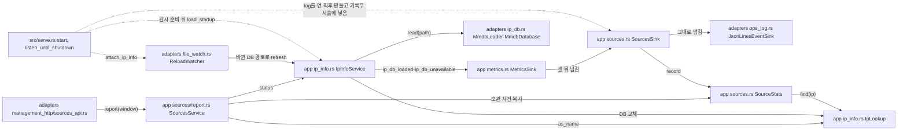

# 접속 출처 모듈 설계

중계 리스너의 연결 사건을 클라이언트 주소마다 세고, 조회할 때 주소·국가·ASN별로 묶는 구조를 정한다. 사건은 운영 로그 기록부 앞에 둔 `SourcesSink`가 받아 `SourceStats`에 넣는다. 국가와 ASN(인터넷 경로를 운영하는 조직의 번호)은 사건을 넣을 때 `IpLookup`이 메모리의 IP 정보 DB에서 찾는다. IP 정보 DB 파일은 `IpInfoService`가 시작 때 읽고, 파일 변경 감지가 내용 변경을 알리면 다시 읽는다. 관리 API의 `GET /api/v1/sources`는 `SourcesService`가 만든 보고서를 JSON으로 쓴다.

| 항목 | 값 |
| --- | --- |
| 구조 시점 | Current |
| 문서 상태 | Draft |
| 구현 대조 | Verified — [대조 기록](#대조-기록) |
| 코드 위치 | `crates/domain/src/ip_info.rs`, `crates/app/src/ip_info.rs`, `crates/app/src/sources.rs`와 `crates/app/src/sources/`, `crates/app/src/ports.rs`(`IpDbLoader`, `IpDatabase`), `crates/adapters/src/ip_db.rs`, `crates/adapters/src/management_http/sources_api.rs`, `crates/adapters/src/file_watch.rs`(IP 정보 DB 감시), `crates/adapters/src/config_file.rs`(`[ip_info]`), `src/serve.rs` |
| 코드 지도 | [코드 지도 2.1절](code-map.md#21-domain)·[2.2절](code-map.md#22-app)·[2.3절](code-map.md#23-adapters와-실행파일-조립)의 접속 출처 행 |
| 관련 스펙 | [운영 스펙 3.9절](../specs/operations.md#39-접속-출처-통계) OPS-095~099, [관리 스펙 2.6절](../specs/management.md#26-접속-출처) MGT-062~064, [화면 스펙 SCR-008](../specs/dashboard.md#scr-008-접속-출처) DASH-082~088 |
| 관련 계약 | [관리 API v1 1.17절](../contracts/management-api-v1.md#117-접속-출처-get-apiv1sources), [설정 v4](../contracts/config-v4.md)의 `[ip_info]`와 [1.12절](../contracts/config-v4.md#112-ip-정보-db-파일-형식), [운영 정보 v2](../contracts/ops-info-v2.md)의 `ip_db_loaded`·`ip_db_unavailable` |
| 관련 ADR | [ADR-0012](../decisions/ADR-0012-local-ip-info-databases.md) |

## 1. 책임과 경계

- 맡는 책임:
  - 중계 리스너의 연결 시도·거절·중단·세션 참여 사건을 클라이언트 주소와 함께 최대 100,000개 보관한다. 넘치면 가장 오래된 사건부터 버리고 버린 사건의 가장 늦은 시각을 기억한다.
  - WS·WSS의 수락 사건을 같은 `conn_id`의 다음 사건까지 보류해, 신뢰 프록시가 전달한 주소로 센다.
  - 사건을 넣을 때 그때 쓰는 IP 정보 DB에서 국가·ASN을 찾아 함께 보관한다. 로컬 주소는 찾지 않는다.
  - 조회 때 기간(1시간·24시간) 안 사건을 주소·국가·ASN별로 세고 계약 순서로 정렬한다. AS 이름은 조회 때 지금 DB에서 찾는다.
  - IP 정보 DB 파일을 시작 때 읽고, 내용이 바뀌면 다시 읽는다. 키마다 상태(설정 안 됨·사용 중·이전 DB 사용 중·사용 불가)와 실패 원인을 둔다.
  - MMDB 파일을 읽고 검사하고, 국가·ASN 필드 형식과 제공자를 정한다.
- 맡지 않는 책임:
  - HTTP 경로·인증·폴링 헤더·오류 본문: [관리 리스너](management-listener.md)와 [관리 세션](management-session.md)이 맡는다.
  - 로그 줄 쓰기: [운영 로그](ops-log.md)가 맡는다. `SourcesSink`는 사건을 넣은 뒤 그대로 넘긴다.
  - 파일 알림·주기 확인·안정화: [파일 변경 감지](file-watch.md)가 맡는다. 이 모듈은 바뀐 DB 경로를 받아 다시 읽는다.
  - `[ip_info]` 키 검증: [설정 로딩](config-loading.md)이 맡는다.
  - 국가 이름 표시, 출처 표시, 조회 링크: 대시보드가 맡는다([화면 스펙 SCR-008](../specs/dashboard.md#scr-008-접속-출처)).
- 다른 모듈에 공개하는 기능:
  - `vnc_relay_domain::ip_info`: `CountryCode`, `Asn`, `Provider::from_database_type`, `is_local`.
  - `vnc_relay_app::ip_info`: `IpLookup`, `IpInfoService`(`load_startup`, `refresh`, `paths`, `status`), `IpDbKey`, `IpDbFailure`, `IpDbMetadata`, `IpDbStatus`.
  - `vnc_relay_app::sources`: `SourceStats`, `SourcesSink`(`EventSink` 구현), `SourcesService::report`, `SourceWindow`, `SourcesReport`.
  - `vnc_relay_app::ports`: `IpDbLoader`, `IpDatabase`.
  - `vnc_relay_adapters::ip_db::MmdbLoader`.

## 2. 내부 구조

실선 화살표는 실행 중 호출이다. 점선 화살표는 시작할 때 주입하는 의존이다. 의존 방향은 [코드 지도](code-map.md)의 레이어 표를 따른다.

| 요소(파일·심볼) | 역할 | 만들어지는 시점과 소유자 | 의존 대상 |
| --- | --- | --- | --- |
| `crates/domain/src/ip_info.rs` | 국가 코드(영문 대문자 두 글자)·ASN(1~4294967295) 값 형식, `database_type`으로 제공자 판정, 로컬 주소 판정 | 값·함수. 상태 없음 | std |
| `crates/app/src/ports.rs` `IpDbLoader`·`IpDatabase` | 파일 하나를 읽어 DB 또는 실패 원인을 돌려주는 포트와, 읽은 DB의 메타데이터·국가·ASN·AS 이름 조회 | adapters가 구현한다 | 없음 |
| `crates/app/src/ip_info.rs` `IpLookup` | 지금 쓰는 국가 DB·ASN DB 두 칸. 사건 기록과 조회가 읽고 `IpInfoService`만 바꾼다 | `src/serve.rs` `start`가 기록부 사슬을 만들 때 빈 상태로 만든다 | `IpDatabase` |
| `crates/app/src/ip_info.rs` `IpInfoService` | 설정한 경로를 서로 다른 파일 단위로 묶어 읽고, 키마다 상태·실패 원인·마지막 내용 표시를 둔다. 성공하면 `IpLookup`의 칸을 바꾸고 사건을 기록한다 | `src/serve.rs` `listen_until_shutdown`이 파일 감시를 만들기 전에 만든다 | `IpDbLoader`, `IpLookup`, `Clock`, `EventSink` |
| `crates/app/src/sources.rs` `SourceStats` | 사건 고리 버퍼(최대 100,000개), 보류 중인 WS·WSS 수락(최대 65,536개), 버린 사건의 가장 늦은 시각 | `start`가 `Metrics`와 함께 만든다. 프로세스가 끝날 때 없어진다 | `IpLookup`, `Clock` |
| `crates/app/src/sources.rs` `SourcesSink` | `EventSink` 장식자. 사건을 `SourceStats`에 넣은 뒤 감싼 기록부에 넘긴다 | `start`가 운영 로그 기록부를 감싸 만들고, `MetricsSink`가 이것을 감싼다 | `SourceStats`, 감싼 `EventSink` |
| `crates/app/src/sources/report.rs` `SourcesService` | 보관 사건을 복사해 기간 안 사건을 주소·국가·ASN별로 세고 정렬해 `SourcesReport`를 만든다 | `listen_until_shutdown`이 관리 리스너를 만들기 전에 만든다 | `SourceStats`, `IpInfoService`, `IpLookup`, `Clock` |
| `crates/adapters/src/ip_db.rs` `MmdbLoader`·`MmdbDatabase` | 256 MiB 상한 확인, 전체 읽기, `maxminddb::Reader::from_source`와 `verify`, 앞쪽 레코드 4096개로 필드 형식 결정, 내용 해시 | `src/serve.rs`가 만든다. `MmdbDatabase`는 읽을 때마다 새로 만들어 `Arc`로 공유한다 | `maxminddb`, std |
| `crates/adapters/src/file_watch.rs` `ReloadWatcher::attach_ip_info` | DB 경로를 알림 대상과 주기 확인 대상에 더한다. DB 파일만을 위한 디렉터리는 등록 실패를 무시하는 선택 등록이다. 에피소드가 끝나면 내용 해시가 바뀐 DB 경로로 `IpInfoService::refresh`를 부른다 | `listen_until_shutdown`이 감시 시작 직후 부른다 | `IpInfoService` |
| `crates/adapters/src/management_http/sources_api.rs` | `GET /api/v1/sources`. 메서드·폴링 헤더·본문·`window` 검사와 JSON 직렬화 | 관리 리스너 라우터가 연결한다. 인증은 `session_api.rs`가 먼저 한다 | `SourcesService` |
| `src/serve.rs` | 생성·주입. 기록부 사슬 `MetricsSink → SourcesSink → JsonLinesEventSink`, 감시 준비 뒤 DB 첫 읽기 | 프로세스 시작 | 위 요소 모두 |

## 3. 데이터 모델

| 이름 | 위치 | 내용 |
| --- | --- | --- |
| `SourceEvent` | `sources.rs` | 시각(UTC 밀리초 `u64`), 클라이언트 IP, 종류(`Attempt`·`Rejected`·`Aborted`·`ViewerSession`·`ServerSession`), 국가 `Option<CountryCode>`, ASN `Option<Asn>`. 한 사건은 40바이트 이하이며 컴파일 때 검사한다. 100,000개면 약 4 MB다 |
| `Store` | `sources.rs` | 시각 오름차순 `VecDeque<SourceEvent>`(용량 100,000), 보류 표 `BTreeMap<ConnId, Pending>`(용량 65,536), `dropped_before: Option<u64>` |
| `Pending` | `sources.rs` | WS·WSS 수락 시각과 소켓 상대 IP. `ConnId`는 프로세스 안에서 늘어나는 순번이므로 키 순서가 수락 순서다 |
| `SourceWindow` | `sources/report.rs` | `Hour`(`1h`)·`Day`(`24h`)와 길이 |
| `SourcesReport` | `sources/report.rs` | 계약 1.17절 필드. `databases`는 `[IpDbStatus; 2]`, 세 목록은 이미 정렬하고 자른 행과 전체 수 |
| `IpDbStatus` | `ip_info.rs` | 상태(`NotConfigured`·`Loaded`·`Stale`·`Unavailable`), 실패 원인, 쓰는 DB의 `IpDbMetadata`와 읽은 시각 |
| `IpDbMetadata` | `ip_info.rs` | `database_type`(앞 128자), 빌드 시각, `Provider` |
| `Fingerprint` | `ip_info.rs` | 마지막 읽기의 내용 표시. 읽지 못함, 상한 초과(크기), 내용 해시. 같은 실패를 다시 경고하지 않는 데 쓴다 |

세션 사건은 쪽마다 하나다. 주소·국가·ASN 행의 `sessions`는 두 종류를 모두 센다. `totals.sessions`는 시작한 세션 수이므로 모든 세션에 하나씩 있는 `ViewerSession`만 센다.

## 4. 처리 순서

### 4.1 사건 기록

`SourcesSink::record`는 사건을 `SourceStats::record`에 넘긴 뒤 감싼 기록부에 넘긴다.

1. 사건 종류로 고른다([운영 스펙 3.9절](../specs/operations.md#39-접속-출처-통계) 규칙 2). `connection_rejected`의 `ConnectionRejected` 변형은 `listener`가 중계 리스너 이름일 때만 본다.
2. 사건에 `conn_id`가 있고 그 ID가 보류 표에 있으면 꺼낸다. 이 사건의 전달 주소가 있으면 그 주소, 없으면 보류한 소켓 상대 IP로 `Attempt`를 수락 시각에 넣는다. `SessionStarted`는 Viewer·Server 쪽 ID를 따로 꺼낸다. WSS의 TLS 단계 거절도 `conn_id`를 가진다.
3. 사건 자체를 센다. TCP `connection_accepted`는 곧바로 `Attempt`다. WS·WSS `connection_accepted`는 보류 표에 넣는다. 표가 65,536개를 넘으면 가장 작은 `ConnId`를 꺼내 소켓 상대 IP로 `Attempt`를 넣는다. 수락 단계 `connection_rejected`는 `Attempt`와 `Rejected`를 함께 넣는다. 다른 거절은 `Rejected`, 중단은 `Aborted`, `session_started`는 쪽마다 세션 사건이다.
4. 넣을 사건마다 `IpLookup::find`로 국가·ASN을 찾는다. 로컬 주소면 찾지 않는다. 같은 사건에서 같은 주소를 두 번 넣으면(수락 단계 거절의 `Attempt`와 `Rejected`) 한 번만 찾는다. 찾기는 잠금 밖에서 한다. 보관 잠금은 보류 표를 바꿀 때와 넣을 때만 잡는다.
5. 사건을 시각 순서 자리에 넣는다. 버퍼의 사건은 늘 시각 오름차순이다. 보류한 수락은 그 연결의 다음 사건보다 이른 시각으로 들어오고, 여러 스레드가 동시에 기록하므로 늦게 도착한 사건이 더 이른 시각일 수 있기 때문이다. 자리는 이진 탐색(`partition_point`)으로 찾는다. 들어오는 사건은 대개 끝 가까이에 들어가므로 `VecDeque::insert`가 옮기는 사건 수가 적다.
6. 넣은 뒤 100,000개를 넘으면 맨 앞(가장 이른 시각) 사건을 버리고 `dropped_before`를 그 시각과 기존 값 중 늦은 값으로 바꾼다.

### 4.2 조회

`sources_api.rs`가 `window`를 해석하고 `SourcesService::report`를 부른다.

1. `Clock::wall`로 `as_of`를 정하고 `window_start`를 뺀다.
2. 잠금을 잡고 기간 안 사건만 복사한다. 버퍼가 시각 순서이므로 `window_start` 이상인 첫 자리와 `as_of` 이하인 끝 자리를 이진 탐색으로 찾아 그 사이를 복사한다. 잠금은 복사 동안만 잡는다. `as_of`·`window_start`는 밀리초 단위로 맞춘 값이다.
3. 복사본을 주소·국가·ASN 키의 `HashMap`으로 센다. 주소 행의 국가·ASN·`last_seen_at`은 그 주소의 가장 늦은 사건 값이다. 국가·ASN 행의 `addresses`는 서로 다른 주소 수다.
4. 계약 순서로 정렬하고 주소·ASN 목록은 100개로 자른다.
5. 남은 주소 행과 ASN 행마다 `IpLookup::as_name`으로 지금 ASN DB에서 이름을 찾는다. 찾은 ASN이 행의 ASN과 같을 때만 이름을 넣는다.
6. `IpInfoService::status`로 두 DB 상태를 넣는다.

### 4.3 DB 첫 읽기

1. `listen_until_shutdown`이 `file_watch::start`로 감시 등록을 만들고 `attach_ip_info`로 DB 경로를 더한다. `attach_ip_info`는 이때 DB 파일의 내용 해시를 기준값으로 계산한다. 그 뒤 `IpInfoService::load_startup`을 `block_in_place` 안에서 부른다. 최대 256 MiB 파일을 읽고 검사하는 동안 비동기 작업자 스레드를 막기 때문이다. 리스너 바인드 전이다.
2. 서로 다른 경로마다 `IpDbLoader::read`를 한 번 부른다. 두 키가 같은 파일이면 한 번 읽어 두 키에 쓴다.
3. 키마다 `IpDatabase::supports`로 필드가 있는지 본다. 있으면 `IpLookup`의 칸에 넣고 `ip_db_loaded(phase=startup)`, 없거나 읽기에 실패하면 `ip_db_unavailable(phase=startup)`을 쓴다.
4. 감시 작업은 첫 읽기 뒤에 시작한다. 감시를 먼저 등록했으므로 그 사이 바뀐 파일은 알림이나 주기 확인으로 다시 읽는다.

### 4.4 다시 읽기

1. 파일 감시는 DB 경로의 내용을 64 KiB씩 읽어 해시한다(`stream_hashes`). 해시는 차단 허용 작업(`spawn_blocking`)에서 계산한다. 주기 확인은 이 해시를 마지막으로 처리한 해시와 비교해, 다르면 설정 파일이 같아도 에피소드를 시작한다. DB 경로를 읽지 못하면 `reload_watch_failed`를 쓰지 않고 "읽지 못함"으로 비교한다.
2. 에피소드가 설정 후보를 처리한 뒤(결과가 `Discarded`가 아닐 때) DB 해시를 다시 계산하고, 마지막으로 처리한 해시와 다른 경로를 모은다. 처리한 해시는 이 값으로 바꾼다. 바뀐 경로가 있고 종료 중이 아니면 `IpInfoService::refresh`를 차단 허용 작업으로 부르고 끝날 때까지 기다린다. 그래서 다시 읽기 사건은 `server_stopped`보다 먼저 기록된다. 설정 재로드 결과와 관계없다.
3. `refresh`는 그 경로의 파일을 다시 읽고 키마다 결과를 비교한다.
   - 성공이고 내용 해시가 지금 DB와 같으며 실패 기록이 없으면 아무것도 하지 않는다.
   - 성공이면 칸을 바꾸고 실패 기록을 지운 뒤 `ip_db_loaded(phase=reload)`를 쓴다.
   - 실패이고 원인과 내용 표시가 마지막 실패와 같으면 경고하지 않는다.
   - 그 밖의 실패는 실패 기록을 바꾸고 `ip_db_unavailable(phase=reload)`를 쓴다. 칸은 그대로라 이전 DB를 계속 쓴다.

## 5. 상태와 초기화

- `SourceStats`와 `IpLookup`은 `start`에서 운영 로그 기록부를 연 직후 만든다. 비어 있으며 재시작하면 다시 비어 있다. 설정 재로드는 둘을 지우지 않는다.
- `IpInfoService`는 경로가 없는 키를 `NotConfigured`로 시작한다. 경로가 있는 키는 첫 읽기 전까지 `Unavailable`이며 원인은 없다. 첫 읽기는 준비됨 전에 끝난다.
- DB 경로는 재시작 설정이므로 프로세스 동안 바뀌지 않는다. 감시 목록의 DB 경로도 고정이다.
- 관리 리스너는 준비됨 뒤에 열리므로 조회는 첫 읽기 뒤 상태만 본다.

## 6. 오류 처리

| 상황 | 처리 |
| --- | --- |
| DB 파일 없음·권한 없음·디렉터리·읽기 오류 | `file_unreadable`. 시작은 계속하고 그 키의 칸은 비어 있거나 이전 DB 그대로다 |
| 256 MiB 초과 | 메타데이터 크기로 먼저 보고, 읽는 중 늘어난 파일은 상한 + 1바이트에서 멈춘다. `file_too_large` |
| MMDB 아님·검사 실패 | `invalid_format`. `detail`은 라이브러리 오류 문장이며 경로가 없다 |
| 필드 없음 | 그 키만 `unsupported_data`. 같은 파일을 쓰는 다른 키는 따로 판정한다 |
| DB 파일만을 위한 디렉터리의 알림 등록 실패 | 경고하지 않는다. 주기 확인으로 감지하고 Dp마다 등록을 다시 시도한다 |
| 알림 실행 오류의 경로가 DB 파일이거나 DB 파일만을 위한 디렉터리 | 그 경로를 `detail`에서 뺀다. 남는 경로가 없으면 오류를 쓰지 않는다 |
| 보류 표 넘침 | 가장 오래된 보류를 소켓 상대 IP로 센다. 경고하지 않는다 |
| 고리 버퍼 넘침 | 가장 오래된 사건을 버리고 `dropped_before`로 알린다 |
| 잠금 오염(poison) | 다른 모듈과 같이 안의 값을 그대로 쓴다. 통계 때문에 중계를 멈추지 않는다 |

## 7. 설계 선택

- 기록부 사슬: 메트릭처럼 `EventSink` 장식자로 사건을 받는다. 중계 코드에 호출을 더하지 않으므로 세는 사건과 로그 사건이 어긋나지 않는다. `MetricsSink`에 넣지 않고 따로 둔 것은 메트릭 계약과 보관·노출 규칙이 다르기 때문이다.
- 사건 보관과 조회 때 집계: 분 단위 묶음 대신 사건을 그대로 둔다. 1시간·24시간 두 기간을 같은 자료로 정확히 세고, 주소 행의 마지막 시각을 밀리초로 낼 수 있다. 사건 버퍼는 100,000개 상한으로 약 4 MB에 묶인다. 보류 표는 65,536개 상한으로 따로 묶이며, 항목마다 키·값 40바이트에 `BTreeMap` 노드 부담이 더해져 수 MB 이하다[추정, 측정하지 않음]. 조회는 2초 폴링이어도 10만 개 집계가 수 ms 수준이라 부담이 작다[추정, 측정하지 않음].
- 보류 표 키: `ConnId`가 수락 순서로 늘어나므로 `BTreeMap`의 첫 항목이 가장 오래된 보류다. 별도 순서 목록이 필요 없다.
- WSS TLS 거절의 `conn_id`: TLS 계층이 거절할 때 바깥 리스너가 이미 `conn_id`를 줬다. 이 값을 TLS 계층에 넘겨 거절 사건에 쓴다. 같은 IP의 보류 연결 중 하나를 고르는 방식은 프록시처럼 한 IP에 연결이 몰릴 때 다른 연결의 시도를 잘못 꺼내므로 쓰지 않는다.
- DB 교체: `RwLock`의 `Arc<dyn IpDatabase>` 두 칸을 바꾼다. 찾기는 읽기 잠금 안에서 하며 다시 읽기는 새 DB를 만든 뒤 쓰기 잠금을 짧게 잡는다.
- 시각 순서 보관: 사건을 도착 순서로 뒤에 붙이면 보류한 수락처럼 이른 시각의 사건이 늦게 들어올 때 맨 앞 사건이 가장 이른 사건이 아니게 된다. 그러면 상한을 넘을 때 더 늦은 사건을 버리거나 `dropped_before`가 틀린다. 그래서 시각 순서 자리에 넣는다. 시각을 잠금 안에서 정해 도착 순서와 맞추는 방법은 보류한 수락의 이른 시각을 다룰 수 없어 쓰지 않는다. 조회도 이 순서로 기간 경계를 이진 탐색한다.
- 감시 해시: DB 파일은 수십~수백 MB일 수 있으므로 전체를 한 번에 메모리에 올리지 않고 나눠 해시한다. 크기·수정 시각만 비교하면 같은 크기·수정 시각을 보존한 교체를 놓치므로 내용을 비교한다. 해시 계산은 재로드 잠금 밖에서 한다.
- 다시 읽기 위치: 에피소드 안정화를 그대로 쓰되 설정 후보와 분리한다. 그래서 DB 오류가 설정 재로드를 거절하거나 재시작 대기에 막히지 않는다([ADR-0012](../decisions/ADR-0012-local-ip-info-databases.md) 4절).

## 8. 현재 코드와의 차이

없다. 2~6절의 파일·심볼이 현재 코드와 같다. 대시보드 화면(SCR-008)의 국가 이름·출처 표시·조회 링크는 이 문서의 범위가 아니다.

## 대조 기록

- 날짜·대상: 2026-11-20 작업 트리의 접속 출처 기록·조회, IP 정보 DB 읽기·다시 읽기, `src/serve.rs` 연결.
- 환경·방법: 2~6절의 파일·심볼을 코드와 대조했다. Windows 11 x64에서 `crates/domain/src/ip_info.rs`·`crates/app/src/ip_info/tests.rs`·`crates/app/src/sources/tests.rs`·`crates/adapters/src/management_http/sources_api.rs`의 단위 시험, `crates/adapters/src/file_watch.rs`의 DB 감시 단위 시험, `crates/adapters/tests/ip_db.rs`(생성한 MMDB 시험 파일), 실행파일 시험 `tests/sources.rs`를 실행했다.
- 결과: 본문과 일치한다. 실제 제공자 파일(DB-IP Lite·IPinfo Lite·MaxMind 시험 파일) 확인은 [수동 운영 안내 4절](../how-to/operate-relay.md)의 기록을 따른다. 시나리오별 결과는 `cargo xtask scenarios`가 만드는 `scenario-report.md`에서 확인한다([테스트 컨벤션](../conventions/testing.md#7-테스트와-스펙-시나리오-연결)).

## 9. 미결정 사항

없다.
