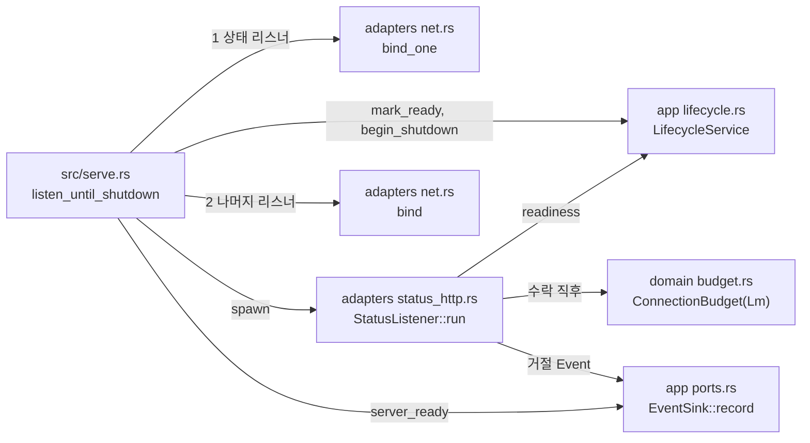

# 상태 리스너와 준비 상태 모듈 설계

상태 리스너(`[status] listen`)가 `/livez`·`/readyz`에 답하는 구조와, 그 답의 근거인 준비 상태(시작 중·준비됨·종료 중)를 다룬다. 상태 리스너는 다른 필수 리스너보다 먼저 열고, 상태 연결을 관리·상태 연결 상한 Lm으로 센다. 모든 필수 리스너가 준비되면 준비됨으로 바꾸고 `server_ready`를 기록한다(사용자 결정 2026-10-20, 작업 2.3에서 옮김).

| 항목 | 값 |
| --- | --- |
| 구조 시점 | Current |
| 문서 상태 | Draft |
| 구현 대조 | Verified — [대조 기록](#대조-기록) |
| 코드 위치 | `crates/app/src/lifecycle.rs`(`Readiness`, `LifecycleService`), `crates/app/src/events.rs`(`Event::ServerReady`, `RejectReason::AdminConnectionLimit`), `crates/app/src/settings.rs`(`Settings::status_listener`, `Settings::other_listeners`), `crates/adapters/src/status_http.rs`(`StatusListener`), `crates/adapters/src/net.rs`(`bind_one`), `src/serve.rs`(상태 리스너 먼저 열기, 준비됨 전환) |
| 코드 지도 | [코드 지도 2절](code-map.md#2-코드-위치와-구성요소), [3절](code-map.md#3-진입점) |
| 관련 스펙 | [운영 스펙 2절](../specs/operations.md#2-상태와-검증-매개변수)의 준비 상태와 Lm, OPS-R08·OPS-R19·OPS-R20, OPS-013(일부), OPS-032, OPS-004(일부), OPS-033(일부) |
| 관련 계약 | [운영 정보 계약 1.12절](../contracts/ops-info-v1.md#112-상태-리스너와-엔드포인트)·[2절](../contracts/ops-info-v1.md#2-오류)(상태 응답), [1.5절](../contracts/ops-info-v1.md#15-사건-목록)(`server_ready`), [1.6절](../contracts/ops-info-v1.md#16-원인-코드)(`admin_connection_limit`), [설정 계약 1.2절](../contracts/config-v1.md#12-키-표)(`status.listen`, `limits.admin_connections`) |
| 관련 ADR | [ADR-0004 tokio·rustls](../decisions/ADR-0004-tokio-rustls.md) |

## 1. 책임과 경계

- 맡는 책임:
  - 준비 상태: 프로세스는 시작 중(`starting`)으로 시작한다. 필수 리스너가 모두 바인드되면 준비됨이 된다. 종료 요청을 받으면 종료 중(`shutting_down`)이 된다. 상태는 앞으로만 간다. 시작 중에 종료가 시작되면 준비됨으로 돌아가지 않는다.
  - 상태 리스너를 다른 필수 리스너보다 먼저 바인드하고 바로 응답한다(1.12절). 다른 리스너를 바인드하는 동안 `/readyz`는 503 `starting`이다.
  - 응답(1.12·2절): `GET /livez`는 상태와 관계없이 200 `{"status":"alive"}`. `GET /readyz`는 준비됨이면 200 `{"status":"ready"}`, 아니면 503 `{"status":"not_ready","reason":"<code>"}`. 정의하지 않은 경로는 404 `not_found`, 정의한 경로의 `GET`이 아닌 메서드는 405 `method_not_allowed`와 `Allow: GET`. 모든 응답은 `Content-Type: application/json`과 `Cache-Control: no-store`를 가진다. 인증 헤더·쿠키·쿼리 문자열·본문은 무시한다.
  - Lm: 상태 연결은 수락 직후 Lm 예산의 자리를 잡는다. 자리가 없으면 `connection_rejected`(`listener` = `status`, `stage` = `accept`, `reason` = `admin_connection_limit`, `limit`)를 기록하고 HTTP 응답 없이 닫는다. 연결이 끝나면 자리를 돌려준다. L과는 다른 예산이다.
  - 준비됨으로 바뀔 때 `server_ready`(`listeners`: 바인드한 모든 리스너의 `name`·`listen`)를 기록한다. 설정 경고 뒤, 접속 사건 앞이다.
- 맡지 않는 책임:
  - `listener_failed`. 준비된 필수 리스너가 계속 운영할 수 없게 실패하는 경로가 아직 없다. TCP 진입점은 `accept` 오류 뒤 다시 수락한다([TCP 진입점 모듈 설계 6절](tcp-entry-point.md#6-오류-처리)). 그 실패를 판정하는 작업이 `Readiness`에 값을 더한다.
  - 종료 유예 G 동안의 응답 유지와 `shutdown_started`. 작업 5.3이 맡는다. 지금은 종료 요청을 받은 뒤 진입점 연결을 정리하는 동안만 `shutting_down`으로 답한다.
  - 관리 리스너의 Lm 집계. 작업 4.2가 같은 Lm 예산을 쓴다.
  - 관리 리스너·WS·WSS 리스너의 연결 수락. 이 리스너들은 바인드만 하고 준비됨 판정에 포함한다. 수락은 작업 3.2·4.2가 붙인다([`serve` 시작 모듈 설계 1절](serve-startup.md#1-책임과-경계)).
  - 인증서 검사(작업 3.1)와 파일 변경 감지 준비(작업 5.1). 그 작업이 준비됨 전의 단계에 넣는다.
- 다른 모듈에 공개하는 기능:
  - `vnc_relay_app::lifecycle::{Readiness, LifecycleService}`
  - `vnc_relay_app::events::{Event::ServerReady, RejectReason::AdminConnectionLimit}`
  - `vnc_relay_adapters::status_http::StatusListener`
  - `vnc_relay_adapters::net::bind_one`

## 2. 내부 구조

화살표는 실행 중 호출이다. crate 의존 방향은 [코드 지도 레이어 표](code-map.md#레이어와-의존-방향)를 따른다.

| 요소(파일·심볼) | 역할 | 만들어지는 시점과 소유자 | 의존 대상 |
| --- | --- | --- | --- |
| `crates/app/src/lifecycle.rs` `Readiness` | 준비 상태 세 가지와 `/readyz`의 `reason` 값(`not_ready_reason`) | 값 타입 | 없음 |
| `crates/app/src/lifecycle.rs` `LifecycleService` | 프로세스 하나의 준비 상태. `mark_ready`는 시작 중일 때만 준비됨으로 바꾼다. `begin_shutdown`은 어느 상태에서나 종료 중으로 바꾼다. | `serve`가 리스너를 바인드하기 전에 하나 만들고 `Arc`로 상태 리스너와 나눈다 | std 원자 변수 |
| `crates/app/src/events.rs` `Event::ServerReady`, `RejectReason::AdminConnectionLimit` | `server_ready`의 `listeners`, `admin_connection_limit`과 `limit` | 사건이 생길 때 | 없음 |
| `crates/adapters/src/net.rs` `bind_one` | 계획 하나를 바인드한다. `bind`도 계획마다 이 함수를 쓴다. | 4단계 | tokio, app |
| `crates/adapters/src/status_http.rs` `StatusListener` | 상태 리스너 하나. axum으로 HTTP/1.1을 처리한다. 수락 때 Lm 자리를 잡고, 응답은 1.12·2절 표를 따른다. | `serve`가 상태 리스너를 바인드한 직후 띄운다. 종료 끝에 `serve`가 작업을 멈춘다. | axum, serde_json, tokio, app, domain |
| `src/serve.rs` `listen_until_shutdown` | 상태 리스너를 먼저 바인드해 띄우고, 나머지를 바인드하고, 준비됨으로 바꾸고 `server_ready`를 기록한 뒤 TCP 진입점을 띄운다. 종료 요청을 받으면 종료 중으로 바꾼다. | `serve` 실행마다 | adapters, app, domain, tokio |

## 3. 데이터 모델

| 이름 | 필드·형태 | 저장 위치 | 제약과 항상 지켜야 할 조건 |
| --- | --- | --- | --- |
| `Readiness` | `Starting`, `Ready`, `ShuttingDown` | `LifecycleService` 안의 `AtomicU8` | `Starting → Ready → ShuttingDown` 또는 `Starting → ShuttingDown`. 되돌아가지 않는다. |
| `Event::ServerReady` | `listeners: Vec<(&'static str, SocketAddr)>` | 반환 값 | 바인드 순서(상태, 관리, 켠 진입점)다. 줄에는 `listeners` 배열의 객체마다 `listen`(주소 문자열)과 `name`을 쓴다. |
| `Event::ConnectionRejected` | `listener: &'static str`, `stage`, `reason`, `peer_ip` | 반환 값 | `listener`는 운영 정보 계약의 리스너 이름이다. TCP 진입점은 진입점 이름, 상태 리스너는 `status`다. `StartupFailed::listener`와 같은 방식이다. |
| 상태 응답 본문 | `{"status":"alive"}`, `{"status":"ready"}`, `{"status":"not_ready","reason":…}`, `{"error":{"code":…,"message":…}}` | HTTP 응답 | 이 밖의 필드를 넣지 않는다. `message`는 한국어 한 문장이다. |

## 4. 처리 순서

대표 시나리오는 OPS-032다. 기본 설정(`status.listen`이 루프백)으로 시작하고 로그인 없이 상태를 조회한다.

| 순서 | 코드 위치(파일·심볼) | 조건·계산 | 바뀌는 상태 | 결과를 쓰는 곳 |
| --- | --- | --- | --- | --- |
| 1 | `src/serve.rs` `listen_until_shutdown` | 종료 신호 처리기를 등록하고 `LifecycleService`(시작 중)와 Lm 예산을 만든다. | 시작 중 | 2단계 |
| 2 | `Settings::status_listener`, `net::bind_one`, `StatusListener::run` | 상태 리스너 계획을 바인드하고 바로 띄운다. 이때부터 `/readyz`는 503 `starting`이다. 바인드에 실패하면 실패를 모아 두고 3단계로 간다. | 상태 리스너 작업 | 3단계 |
| 3 | `Settings::other_listeners`, `net::bind` | 나머지 계획(관리, 켠 진입점)을 바인드한다. 실패가 하나라도 있으면(2단계 포함) 바인드한 리스너를 닫고, 상태 리스너 작업을 멈추고, 실패마다 `listener_bind_failed`를 쓰고, 4로 끝난다. | 바인드한 리스너 | 4단계 |
| 4 | `LifecycleService::mark_ready`, `EventSink::record` | 준비됨으로 바꾸고 `server_ready`를 기록한다. 그 뒤 TCP 진입점 작업을 띄운다. | 준비됨 | 운영 로그 |
| 5 | `StatusListener`의 수락 | 연결이 오면 Lm 자리를 잡는다. 인증 헤더·쿠키는 보지 않는다. | 자리 하나 | 6단계 |
| 6 | `StatusListener`의 응답 함수 | `GET /readyz`이면 `readiness()`가 준비됨이므로 200 `{"status":"ready"}`. `GET /livez`이면 200 `{"status":"alive"}`. | 없음 | HTTP 응답 |
| 7 | `serve`의 종료 처리 | 종료 요청을 받으면 `begin_shutdown`으로 종료 중이 된다. 진입점 연결을 모두 정리한 뒤 상태 리스너 작업을 멈추고 `server_stopped`를 기록한다. | 종료 중 | 운영 로그 |

## 5. 상태와 초기화

- 초기화 시점: `LifecycleService`와 Lm 예산은 바인드 전에 만든다. 상태 리스너 작업은 상태 리스너를 바인드한 직후 띄운다.
- 상태 소유자와 제거 시점: `LifecycleService`는 `serve`와 상태 리스너 작업이 `Arc`로 함께 소유한다. Lm 자리는 연결을 감싼 값(`Admitted`)이 소유하고, 연결을 닫을 때 돌려준다.
- 동시 실행과 순서: 상태 응답은 `readiness()`를 원자적으로 읽는다. 상태 리스너 작업은 axum이 연결마다 띄운 작업에서 응답한다.
- 상태 리스너 작업을 멈추면 리스너가 닫힌다. 그때 남은 상태 연결은 런타임이 끝날 때 닫힌다. 종료 마지막 단계이므로 그 연결의 응답을 기다리지 않는다.

## 6. 오류 처리

| 실패 지점 | 처리 방법 | 남는 상태 | 관련 스펙 시나리오 |
| --- | --- | --- | --- |
| 상태 리스너 바인드 실패 | 나머지 리스너도 바인드해 실패를 모두 모은다. 실패마다 `listener_bind_failed`(`listener` = `status`)이고 종료 코드 4다. | 없음 | OPS-002, OPS-039 |
| 다른 리스너 바인드 실패 | 상태 리스너 작업을 멈추고 모든 리스너를 닫은 뒤 종료 코드 4다. 그 사이의 `/readyz`는 503 `starting`이다. | 없음 | OPS-002 |
| Lm 고갈 | `admin_connection_limit`으로 거절하고 HTTP 응답 없이 닫는다. 중계 연결과 L은 영향이 없다. | 없음 | OPS-033 |
| 상태 리스너 `accept` 실패 | 100밀리초 기다린 뒤 다시 수락한다. 기록하지 않는다. TCP 진입점과 같은 방식이다. | 리스너 유지 | 없음 |
| HTTP 해석 오류 | hyper가 400으로 답하거나 연결을 닫는다. 운영 정보 계약에 이 경우의 사건이 없어 기록하지 않는다. | 자리 반환 | 없음 |

## 7. 설계 선택

| 선택 | 이유 | 검토한 다른 방법 | 근거 |
| --- | --- | --- | --- |
| HTTP는 axum(기본 기능 끔, `http1`·`tokio`만)으로 처리한다. | PRD가 HTTP 라이브러리로 axum을 정했다. 기본 기능의 `tracing`은 PRD가 뺀 crate다. 관리 HTTP(작업 4.x)도 같은 라이브러리를 쓴다. | HTTP/1.1 직접 해석. 요청 경계·keep-alive·오류 응답을 따로 구현해야 한다. | [PRD "구현 기술" 행](../requirements/PRD.md#확정-기준) |
| 라우팅 없이 대체 처리기(`fallback`) 하나가 메서드와 경로를 직접 판정한다. | axum의 `get` 라우트는 `HEAD`도 받는다. 계약은 `GET` 밖의 메서드를 405로 답하라고 한다. axum 기본 405·404 응답은 계약의 JSON 본문이 없다. | 라우트별 처리기와 오류 처리기 조합 | [운영 정보 계약 1.12·2절](../contracts/ops-info-v1.md#112-상태-리스너와-엔드포인트) |
| Lm 판정은 axum의 `Listener` 구현 안에서 수락 직후 한다. 잡은 자리는 연결 값에 넣어 연결이 끝날 때 돌려준다. | HTTP를 읽기 전에 거절해야 한다. 연결 수명과 자리 수명이 같아진다. | 요청 처리기에서 판정. 거절한 연결도 HTTP를 읽게 된다. | [운영 정보 계약 2절](../contracts/ops-info-v1.md#2-오류) Lm 문단 |
| 준비 상태는 app의 `AtomicU8` 하나로 둔다. | 읽기만 많고, 바뀌는 곳은 `serve` 한 곳이다. app이 tokio에 의존하지 않는다. | `tokio::sync::watch` | [코드 지도 레이어 표](code-map.md#레이어와-의존-방향) |
| `ConnectionRejected`의 리스너를 진입점 대신 리스너 이름 문자열로 둔다. | 상태·관리 리스너는 진입점이 아니다. `StartupFailed::listener`와 `ListenerPlan::name`이 같은 방식을 쓴다. | 리스너 enum을 새로 만든다. 같은 이름을 두 방식으로 갖게 된다. | 없음 |
| 상태 리스너 작업은 종료 마지막에 멈추고(`abort`) 남은 상태 연결을 기다리지 않는다. | 진입점 연결을 정리하는 동안 `shutting_down`으로 답해야 한다. 응답 중인 상태 연결이 종료를 붙잡지 않는다. | axum 정상 종료(`with_graceful_shutdown`). 요청을 보내다 멈춘 연결이 종료를 끝없이 막을 수 있다. | 없음 |
| `server_ready`의 `listeners`는 바인드한 모든 리스너다. 아직 수락하지 않는 관리·WS·WSS 리스너도 넣는다. | 그 리스너들은 바인드돼 있어 운영체제가 연결을 대기열에 넣는다. 수락은 해당 작업이 붙인다. | 수락하는 리스너만 넣기. 작업이 진행되며 목록 의미가 바뀐다. | [운영 정보 계약 1.5절](../contracts/ops-info-v1.md#15-사건-목록) |

## 8. 현재 코드와의 차이

없다. 2~4절의 파일·심볼이 현재 코드와 같다.

## 대조 기록

| 대조 범위 | 환경 | 확인 방법 | 결과 |
| --- | --- | --- | --- |
| 작업 2.6 변경(기준 커밋 `b1f2ad5` + 작업 트리) | Ubuntu 24.04.4(WSL2), Rust 1.99.1 | 1~4절의 파일·심볼과 실제 코드를 대조했다. 준비 상태 전이는 `crates/app/src/lifecycle.rs` 단위 테스트 2건, 상태별 응답·헤더·405·404·`server_ready`·`admin_connection_limit` 줄은 `crates/adapters/tests/ops_info_contract.rs`, 준비됨 뒤 응답과 Lm·L 독립은 `tests/serve.rs`의 `answers_status_queries_without_login_once_ready`·`refuses_status_connections_beyond_lm_and_keeps_lm_and_l_apart`로 확인했다([운영 정보 계약의 계약 테스트 실행 기록](../contracts/ops-info-v1.md#계약-테스트-실행-기록)). 실행 중인 프로세스에서 `starting`·`shutting_down` 응답은 관찰하지 않았다. 그 구간이 밀리초 단위라 시스템 테스트가 맞출 수 없다. | 통과 |
| Windows 실행(기준 커밋 `e1cfc4f` + Windows 경고 수정) | Windows 11 Pro 10.0.26200, Rust 1.99.1(`x86_64-pc-windows-msvc`) | 같은 단위·계약 테스트와 `tests/serve.rs`의 `answers_status_queries_without_login_once_ready`·`refuses_status_connections_beyond_lm_and_keeps_lm_and_l_apart`가 통과했다. | 통과 |

## 9. 미결정 사항

| 항목 | 영향 | 확정 위치 |
| --- | --- | --- |
| 상태 연결의 요청 대기 시간 | hyper에 시간 제한을 주지 않았다. 요청을 보내지 않는 연결이 Lm 자리를 계속 잡을 수 있다. 계약에 값이 없다. | 작업 4.2에서 관리 연결과 함께 정한다 |
| `listener_failed` | 판정할 실패 경로가 없다. | 리스너 실패를 판정하는 작업 |
