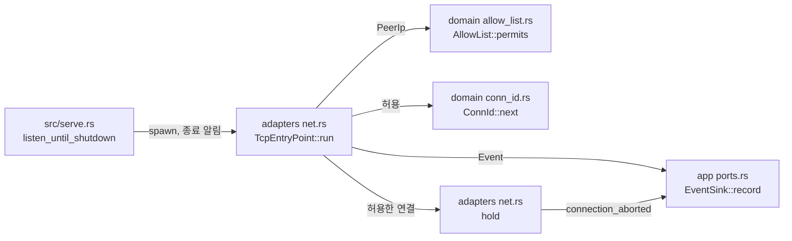

# TCP 진입점 모듈 설계

TCP Viewer·TCP Server 진입점이 접속을 수락하고, 데이터를 읽기 전에 그 진입점의 출발지 IP 허용 목록으로 판정하는 구조를 다룬다. 허용한 연결은 연결 식별자(`conn_id`)를 받고 초기 교환 단계에 들어간다. 초기 교환 해석은 작업 2.7이 맡는다. 작업 2.7은 [Repeater 초기 교환 계약](../contracts/repeater-handshake-v1.md)이 채택(작업 1.5)된 뒤에 할 수 있다. 그 전까지 허용한 연결은 읽지 않고 보류하다가 서버가 종료할 때 닫는다(사용자 결정 2026-10-20).

| 항목 | 값 |
| --- | --- |
| 구조 시점 | Current |
| 문서 상태 | Draft |
| 구현 대조 | Verified — [대조 기록](#대조-기록) |
| 코드 위치 | `crates/domain/src/allow_list.rs`(허용 판정), `crates/domain/src/entry_point.rs`(`Role`), `crates/domain/src/conn_id.rs`, `crates/app/src/events.rs`(접속 사건), `crates/app/src/settings.rs`(`ListenerPlan::entry_point`), `crates/adapters/src/net.rs`(`TcpEntryPoint`), `src/serve.rs`(진입점 작업 시작과 종료) |
| 코드 지도 | [코드 지도 2절](code-map.md#2-코드-위치와-구성요소), [3절](code-map.md#3-진입점) |
| 관련 스펙 | [중계 스펙 3.1절](../specs/relay.md#31-초기-교환)의 1항과 RLY-R16, [운영 스펙 4절](../specs/operations.md#4-보안과-신뢰-경계), RLY-023(일부), RLY-024, OPS-037(일부), OPS-038(일부), OPS-040(일부), OPS-007(일부) |
| 관련 계약 | [운영 정보 계약 1.4절](../contracts/ops-info-v1.md#14-필드-사전)(`conn_id`, `listener`, `role`, `peer_ip`), [1.5절](../contracts/ops-info-v1.md#15-사건-목록)(접속 수락·거절·중단), [1.6절](../contracts/ops-info-v1.md#16-원인-코드)(`stage`·`reason`), [설정 계약 1.3절](../contracts/config-v1.md#13-ip-항목-문법)(IP 항목) |
| 관련 ADR | [ADR-0002 출발지 IP 허용 목록](../decisions/ADR-0002-source-ip-allowlist.md) |

## 1. 책임과 경계

- 맡는 책임:
  - 켠 TCP 진입점(`tcp_viewer`, `tcp_server`)의 리스너에서 접속을 수락한다.
  - 수락 직후, 데이터를 읽기 전에 실제 소켓 상대 IP를 그 진입점의 허용 목록으로 판정한다(RLY-R16). IPv4-mapped IPv6 상대는 IPv4 주소로 판정한다. 빈 목록은 모든 출발지를 거절한다.
  - 거절: `connection_rejected`(`stage` = `accept`, `reason` = `ip_not_allowed`)를 기록하고 소켓을 닫는다. `conn_id`를 붙이지 않는다(운영 정보 계약 1.5절).
  - 허용: `conn_id`를 붙이고 `connection_accepted`를 기록한다. `role`은 진입점이 정한다(`tcp_viewer`는 `viewer`, `tcp_server`는 `server`).
  - 서버 종료: 새 접속 수락을 멈추고, 보류 중인 연결을 닫고, 연결마다 `connection_aborted`(`stage` = `initial_exchange`, `reason` = `server_shutdown`, `elapsed_ms`)를 기록한다. 모든 연결의 기록이 끝난 뒤 `serve`가 `server_stopped`를 쓴다.
- 맡지 않는 책임:
  - 초기 교환 읽기·해석, 제한 시간 H, 상대가 먼저 닫은 연결의 감지(`peer_eof`). 작업 2.7이 보류 대신 `RelayService::handle_connection`을 부른다. 그 전까지는 상대가 닫아도 서버 종료 때까지 소켓을 들고 있다.
  - 연결 상한 L과 `relay_connection_limit` 거절, TCP keepalive. 작업 2.5·2.11이 맡는다. 그 전까지는 허용한 연결의 수에 상한이 없다.
  - WS·WSS 진입점. 작업 3.2가 같은 허용 판정과 `conn_id`를 쓴다. 관리·상태 리스너의 연결 수락은 작업 4.2·2.6이 맡는다.
  - 재로드 뒤 새 허용 목록 적용. 작업 5.2가 맡는다. 지금은 시작할 때의 목록을 끝까지 쓴다.
  - 종료 유예 G와 신규 접속 중지 시점의 세부 규칙. 작업 5.3이 맡는다.
- 다른 모듈에 공개하는 기능:
  - `vnc_relay_domain::allow_list::AllowList::permits`
  - `vnc_relay_domain::entry_point::{Role, EntryPoint::role}`
  - `vnc_relay_domain::conn_id::ConnId`
  - `vnc_relay_app::events::{Event::ConnectionAccepted, Event::ConnectionRejected, Event::ConnectionAborted, Stage, RejectReason, AbortReason}`
  - `vnc_relay_app::settings::ListenerPlan::entry_point`
  - `vnc_relay_adapters::net::TcpEntryPoint`

## 2. 내부 구조

화살표는 실행 중 호출이다. crate 의존 방향은 [코드 지도 레이어 표](code-map.md#레이어와-의존-방향)를 따른다.

| 요소(파일·심볼) | 역할 | 만들어지는 시점과 소유자 | 의존 대상 |
| --- | --- | --- | --- |
| `crates/domain/src/allow_list.rs` `AllowList::permits`, `IpItem::contains` | 상대 IP가 항목 하나라도 만족하면 허용한다. 단일 IP는 같음, CIDR은 앞 `prefix` 비트가 같음, 범위는 시작·끝을 포함한다. 주소 체계가 다른 항목은 만족하지 않는다. | 설정을 읽을 때 만든 목록, 진입점 작업이 소유 | `peer_ip` |
| `crates/domain/src/entry_point.rs` `Role`, `EntryPoint::role` | 연결의 역할(`viewer`·`server`)과 진입점별 역할 | 값 타입 | 없음 |
| `crates/domain/src/conn_id.rs` `ConnId` | 연결 식별자. `ConnId::next`가 프로세스 전체에서 1부터 하나씩 늘린 순번을 준다. `Display`는 `c`와 10진 순번이다(예: `c1`). | 허용할 때 하나 | 없음 |
| `crates/app/src/events.rs` `Event::ConnectionAccepted`, `ConnectionRejected`, `ConnectionAborted`, `Stage`, `RejectReason`, `AbortReason` | 운영 정보 계약 1.5절의 접속 사건 세 가지와 1.6절의 `stage`·`reason` 값. 지금은 이 작업이 쓰는 값만 있다. | 사건이 생길 때 | domain |
| `crates/app/src/settings.rs` `ListenerPlan::entry_point` | 바인드 계획이 진입점이면 그 진입점. 상태·관리 리스너는 `None`이다. | `Settings::listeners` | domain |
| `crates/adapters/src/net.rs` `TcpEntryPoint::new`, `TcpEntryPoint::run` | 수락 반복. 종료 알림과 수락을 함께 기다린다. 허용한 연결마다 보류 작업을 띄우고, 종료 알림을 받으면 리스너를 닫고 보류 작업이 모두 끝나기를 기다린다. | `serve`가 바인드 뒤 진입점마다 하나 띄운다 | tokio, app, domain |
| `crates/adapters/src/net.rs` `hold` | 허용한 연결 하나를 읽지 않고 들고 있다가 종료 알림을 받으면 닫고 `connection_aborted`를 기록한다. 작업 2.7에서 초기 교환 처리로 바뀐다. | 허용한 연결마다, `TcpEntryPoint::run`의 작업 모음이 소유 | tokio, app |
| `src/serve.rs` `listen_until_shutdown` | 바인드한 리스너 가운데 TCP 진입점을 `TcpEntryPoint`로 띄운다. 종료 요청을 받으면 종료 알림을 보내고, 진입점 작업이 모두 끝난 뒤 나머지 리스너를 닫고 `server_stopped`를 기록한다. | `serve` 실행마다 | adapters, app, tokio |

## 3. 데이터 모델

줄 형식은 [운영 정보 계약 1.5절](../contracts/ops-info-v1.md#15-사건-목록)이 기준이다. 여기서는 메모리 타입과 필드 대응만 정한다.

| 이름 | 필드·형태 | 줄의 필드(순서대로) | 제약과 항상 지켜야 할 조건 |
| --- | --- | --- | --- |
| `Event::ConnectionAccepted` | `conn_id: ConnId`, `entry_point: EntryPoint`, `peer_ip: PeerIp` | `conn_id`, `listener`, `role`, `peer_ip` | `level`은 `info`. 허용 판정을 통과한 연결만 만든다. |
| `Event::ConnectionRejected` | `entry_point: EntryPoint`, `stage: Stage`, `reason: RejectReason`, `peer_ip: PeerIp` | `listener`, `stage`, `reason`, `peer_ip` | `level`은 `warn`. `stage`가 `accept`이면 `conn_id`가 없다. 선택 필드(`role`, `limit` 등)는 그 값을 쓰는 작업이 더한다. |
| `Event::ConnectionAborted` | `conn_id: ConnId`, `entry_point: EntryPoint`, `stage: Stage`, `reason: AbortReason`, `peer_ip: PeerIp`, `elapsed_ms: u64` | `conn_id`, `listener`, `stage`, `reason`, `peer_ip`, `elapsed_ms` | `level`은 `reason`이 `server_shutdown`(지금 유일한 값)이므로 `info`. `elapsed_ms`는 수락부터 닫을 때까지의 밀리초다. |
| `Stage` | `Accept`, `InitialExchange` | `stage`(`accept`, `initial_exchange`) | 계약 1.6절의 나머지 값은 그 단계를 만드는 작업이 더한다. |
| `RejectReason` | `IpNotAllowed` | `reason`(`ip_not_allowed`) | 같음 |
| `AbortReason` | `ServerShutdown` | `reason`(`server_shutdown`) | 같음 |
| `ConnId` | `u64` 순번 | `conn_id`(`c1`, `c2`, …) | 프로세스 안에서 유일하다. 재시작하면 다시 `c1`부터다(계약 1.4절이 허용한다). |
| `Role` | `Viewer`, `Server` | `role`(`viewer`, `server`) | TCP 진입점은 진입점이 역할을 정한다. WS·WSS는 항상 `viewer`다. |

## 4. 처리 순서

대표 시나리오는 RLY-024다. Viewer 진입점 목록에만 있는 IP가 Server 진입점에 접속한다.

| 순서 | 코드 위치(파일·심볼) | 조건·계산 | 바뀌는 상태 | 결과를 쓰는 곳 |
| --- | --- | --- | --- | --- |
| 1 | `src/serve.rs` `listen_until_shutdown` | 바인드가 모두 성공하면 `ListenerPlan::entry_point`가 `TcpViewer`·`TcpServer`인 리스너마다 `TcpEntryPoint::new(entry_point, listener, allow)`를 만들어 띄운다. `allow`는 그 진입점의 설정 목록이다. | 진입점 작업 | 2단계 |
| 2 | `TcpEntryPoint::run` | `accept`가 소켓과 상대 주소를 준다. `PeerIp::from(addr)`로 IPv4-mapped 주소를 IPv4로 바꾼다. | 없음 | 3단계 |
| 3 | `AllowList::permits` | `tcp_server` 목록에 그 IP가 없으므로 거절이다. 소켓에서 아무것도 읽지 않았다. | 없음 | 4단계 |
| 4 | `EventSink::record`, 소켓 닫기 | `connection_rejected`(`listener` = `tcp_server`, `stage` = `accept`, `reason` = `ip_not_allowed`, `peer_ip`)를 기록한 뒤 소켓을 닫는다. 상대는 연결 끊김을 본다. | 없음 | 운영 로그 |
| 5 | 2~3과 같은 경로 | 같은 IP가 `tcp_viewer`에 접속하면 허용이다. | 없음 | 6단계 |
| 6 | `ConnId::next`, `EventSink::record`, `hold` | `conn_id`를 받고 `connection_accepted`(`role` = `viewer`)를 기록한다. 보류 작업이 소켓을 읽지 않고 들고 있다. | 보류 중인 연결 하나 | 운영 로그 |
| 7 | `serve`의 종료 알림, `hold` | 종료 요청을 받으면 진입점 작업이 수락을 멈추고 리스너를 닫는다. 보류 작업은 소켓을 닫고 `connection_aborted`(`server_shutdown`)를 기록한다. | 보류 연결 없음 | 운영 로그 |
| 8 | `listen_until_shutdown` | 진입점 작업이 모두 끝나면 나머지 리스너를 닫고 `server_stopped`를 기록한다. | 없음 | 운영 로그, 종료 코드 0 |

거절 사건을 소켓을 닫기 전에 기록한다. 상대가 연결 끊김을 보았을 때 그 줄이 이미 로그에 있게 하기 위해서다. 시스템 테스트가 이 순서에 기댄다.

## 5. 상태와 초기화

- 초기화 시점: 진입점 작업은 모든 바인드가 성공한 뒤 띄운다. 바인드 전에 들어온 연결은 없다. 바인드 뒤 작업이 돌기 전에 들어온 연결은 운영체제 대기열에 있다가 수락된다.
- 상태 소유자와 제거 시점: `TcpEntryPoint`가 리스너와 허용 목록을 소유한다. 보류 작업은 `run` 안의 작업 모음(`JoinSet`)이 소유한다. `run`은 보류 작업이 모두 끝난 뒤 돌아온다. 운영 로그 싱크는 `Arc<dyn EventSink>`로 함께 쓴다.
- 동시 실행과 순서: 진입점마다 작업 하나가 수락한다. 연결마다 보류 작업 하나가 있다. 한 연결의 사건은 그 연결을 다루는 작업이 차례로 기록하므로 `connection_accepted`가 `connection_aborted`보다 먼저다. 종료 알림은 `tokio::sync::watch` 채널 하나로 모든 작업에 보낸다.
- `ConnId` 순번은 프로세스 전역 원자 변수다. 진입점이 여럿이어도 값이 겹치지 않는다.

## 6. 오류 처리

| 실패 지점 | 처리 방법 | 남는 상태 | 관련 스펙 시나리오 |
| --- | --- | --- | --- |
| 출발지 IP가 목록에 없음 | `connection_rejected`(`ip_not_allowed`)를 기록하고 소켓을 닫는다. 데이터를 읽지 않는다. 다른 연결에는 영향이 없다. | 없음 | RLY-023, RLY-024, OPS-037, OPS-038 |
| `accept` 실패(파일 디스크립터 부족 등) | 100밀리초 기다린 뒤 다시 수락한다. 같은 오류가 이어질 때 CPU를 다 쓰지 않게 하기 위해서다. 운영 정보 계약에 이 경우의 사건이 없어 기록하지 않는다. | 리스너 유지 | 없음 |
| 운영 로그 쓰기 실패 | [운영 로그 모듈 설계 6절](ops-log.md#6-오류-처리)대로 줄을 버린다. 접속 처리는 바뀌지 않는다. | 없음 | 없음 |

## 7. 설계 선택

| 선택 | 이유 | 검토한 다른 방법 | 근거 |
| --- | --- | --- | --- |
| 작업 2.7 전까지 허용한 연결을 읽지 않고 보류하고, 서버 종료 때 닫으며 `connection_aborted`(`server_shutdown`)를 기록한다. | 초기 교환 형식을 추정하지 않는다. 작업 2.7은 보류 자리에 초기 교환 처리를 넣기만 하면 된다. | 읽어서 해석 없이 보관(I 초과 처리를 미리 정해야 한다), 수락 직후 닫기(수락하지 않은 것과 구분되지 않는다), 작업 2.4를 2.7과 함께 하기 | 사용자 결정 2026-10-20, [TODO 2-B](../TODO.md#2-b-중계-기능) |
| `conn_id`는 `c`와 10진 순번이다(`c1`, `c2`, …). | 짧고 읽기 쉽다. 접두사가 있어 다른 숫자 필드·`session_id`와 섞이지 않는다. | 순번만, 무작위 16진수 | 사용자 결정 2026-10-20, [운영 정보 계약 1.4절](../contracts/ops-info-v1.md#14-필드-사전) |
| 순번은 domain의 프로세스 전역 원자 변수(`ConnId::next`)다. | 계약이 프로세스 안의 유일성을 요구한다. 작업 3.2의 WS·WSS 진입점이 같은 순번을 써야 한다. 값을 넘겨받는 생성기 객체를 두면 모든 진입점 조립이 그 객체를 받아야 한다. | `serve`가 만든 생성기 객체를 진입점마다 넘기기 | [rust.md 7절](../conventions/rust.md) `Id` suffix |
| 허용 판정은 `PeerIp`를 받는다. | `PeerIp`가 IPv4-mapped 주소를 IPv4로 바꾼다. 설정 항목에는 IPv4-mapped 주소가 없으므로(설정 계약 1.3절) 바꾸지 않은 주소로 판정하면 이중 스택 리스너의 IPv4 상대를 잘못 거절한다. | `IpAddr`를 받고 호출하는 쪽이 바꾸기 | [운영 정보 계약 1.10절](../contracts/ops-info-v1.md#110-상대-주소-표기) |
| 거절 줄은 `listener`, `stage`, `reason`, `peer_ip`만 쓴다. | 계약의 필수 필드다. `role`은 선택이고 `listener`에서 알 수 있다. | `role`도 쓴다 | [운영 정보 계약 1.5절](../contracts/ops-info-v1.md#15-사건-목록) |
| `accept` 오류 뒤 100밀리초 기다린다. | 파일 디스크립터가 모자라면 `accept`가 바로 다시 실패한다. 기다리지 않으면 반복이 CPU를 다 쓴다. | 기다리지 않고 반복, 진입점 작업 종료(진입점이 조용히 닫힌다) | 없음 |

## 8. 현재 코드와의 차이

없다. 2~4절의 파일·심볼이 현재 코드와 같다.

## 대조 기록

| 대조 범위 | 환경 | 확인 방법 | 결과 |
| --- | --- | --- | --- |
| 작업 2.4 변경(기준 커밋 `6d6f789` + 작업 트리) | Ubuntu 24.04.4(WSL2), Rust 1.99.1 | 1~4절의 파일·심볼과 실제 코드를 대조했다. 허용 판정은 `crates/domain/src/allow_list.rs`의 단위 테스트, 줄 필드는 `crates/adapters/tests/ops_info_contract.rs`, 수락·거절·보류·종료 순서는 `tests/serve.rs`의 진입점 테스트 4개로 확인했다([운영 정보 계약의 계약 테스트 실행 기록](../contracts/ops-info-v1.md#계약-테스트-실행-기록)). 레이어 규칙은 `cargo xtask layers`로 확인했다. | 통과 |

## 9. 미결정 사항

| 항목 | 영향 | 확정 위치 |
| --- | --- | --- |
| Windows에서 `127.0.0.2` 같은 루프백 주소를 출발지로 쓰는 시스템 테스트, 이중 스택 리스너의 IPv4 상대 | Windows에서 실행하지 않았다. Windows는 `[::]` 리스너가 기본으로 IPv6만 받는다. | 작업 0.1 Windows 빌드 뒤 |
