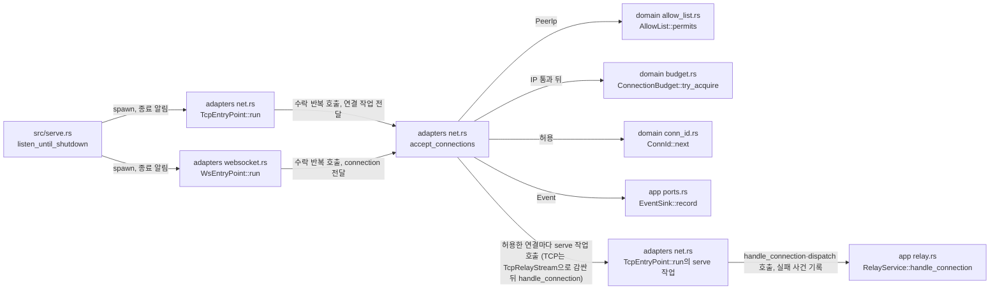

# TCP 진입점 모듈 설계

## 작업 6.2 수락 경계 (Current / Active)

`crates/adapters/src/net.rs`의 `AcceptPolicy`는 `AllowSource`와 사용량만 보관하는 L 예산을 가진다. `admit`는 `RuntimeSettingsSource::with_current` 안에서 출발지 IP와 현재 L을 검사하고 `try_acquire(limit)`의 CAS까지 끝낸다. 같은 세대의 B·H·U·K를 `AcceptedSettings`로 복사한다. TCP는 수락 시각을 초기 교환 시작 시각으로 쓰며, B·H를 `ConnectionContext`에 넘긴다. K는 수락 소켓에 한 번 설정한다. `target.rs`의 `TcpTargetConnector`는 새 대상 연결 시도에서 K를 별도로 읽는다. 기존 연결의 B·기한·소켓 옵션은 바꾸지 않는다([설정 §1.8](../contracts/config-v3.md#18-재로드-구분), OPS-050~053).

구현과 경계 단위 시험을 추가했다. 커밋 `eae442f`는 수락 쪽 K 시험 `net::accept_tests::reloaded_keepalive_applies_to_new_accepts_and_keeps_accepted_sockets`(Linux 전용)를 더했다. 대상 연결의 K는 `crates/adapters/tests/tcp_target.rs`의 `reloaded_keepalive_is_used_only_for_new_target_sockets`가 확인한다. 이 변경의 시험은 커밋 `eae442f`의 두 OS 게이트에서 통과했다([작업 6.9 판정표](../how-to/set-up-and-verify.md#42-작업-69-판정표)). 기존 대조 기록은 과거 범위의 증거다.

TCP Viewer·TCP Server 진입점이 접속을 수락하고, 데이터를 읽기 전에 그 진입점의 출발지 IP 허용 목록으로 판정하는 구조를 다룬다. WS·WSS 진입점(작업 3.2)도 같은 수락 반복과 같은 판정을 쓰며, 101 응답까지의 처리는 [WebSocket 진입점 모듈 설계](websocket-entry-point.md)가 다룬다. TCP 연결은 허용되면 연결 상한 L의 자리를 잡고, 연결 식별자(`conn_id`)를 받고, 초기 교환 단계에 들어간다. 초기 교환 읽기와 해석은 `RelayService::handle_connection`이 맡는다. 초기 교환 형식은 [Repeater 초기 교환 계약](../contracts/repeater-handshake-v1.md)을 따른다. 초기 교환은 H 만료, 바이트 전 상대 종료, 연결 재설정, 서버 종료 중 먼저 오는 것으로 끝난다. L·H·TCP keepalive의 규칙은 [연결 상한과 시간 제한 모듈 설계](connection-limits.md)가 다룬다.

| 항목 | 값 |
| --- | --- |
| 구조 시점 | Current |
| 문서 상태 | Draft |
| 구현 대조 | Verified — [대조 기록](#대조-기록) |
| 코드 위치 | `crates/domain/src/allow_list.rs`(허용 판정), `crates/domain/src/entry_point.rs`(`Role`), `crates/domain/src/conn_id.rs`, `crates/app/src/events.rs`(접속 사건), `crates/app/src/settings.rs`(`ListenerPlan::entry_point`), `crates/adapters/src/net.rs`(`TcpEntryPoint`, `TcpRelayStream`, 공통 수락 반복 `accept_connections`), `crates/app/src/relay.rs`(`RelayService::handle_connection`, `dispatch`), `crates/adapters/src/websocket.rs`(`WsEntryPoint`), `src/serve.rs`(진입점 작업 시작과 종료) |
| 코드 지도 | [코드 지도 2절](code-map.md#2-코드-위치와-구성요소), [3절](code-map.md#3-진입점) |
| 관련 스펙 | [중계 스펙 3.1절](../specs/relay.md#31-초기-교환)의 1항과 RLY-R16, [운영 스펙 4절](../specs/operations.md#4-보안과-신뢰-경계), RLY-023(일부), RLY-024, OPS-037(일부), OPS-038(일부), OPS-040(일부), OPS-007(일부) |
| 관련 계약 | [운영 정보 계약 1.4절](../contracts/ops-info-v1.md#14-필드-사전)(`conn_id`, `listener`, `role`, `peer_ip`), [1.5절](../contracts/ops-info-v1.md#15-사건-목록)(접속 수락·거절·중단), [1.6절](../contracts/ops-info-v1.md#16-원인-코드)(`stage`·`reason`), [설정 계약 1.3절](../contracts/config-v3.md#13-ip-항목-문법)(IP 항목) |
| 관련 ADR | [ADR-0002 출발지 IP 허용 목록](../decisions/ADR-0002-source-ip-allowlist.md) |

## 1. 책임과 경계

- 맡는 책임:
  - 켠 TCP 진입점(`tcp_viewer`, `tcp_server`)의 리스너에서 접속을 수락한다.
  - 수락 직후, 데이터를 읽기 전에 실제 소켓 상대 IP를 그 진입점의 허용 목록으로 판정한다(RLY-R16). IPv4-mapped IPv6 상대는 IPv4 주소로 판정한다. 빈 목록은 모든 출발지를 거절한다.
  - 거절: `connection_rejected`(`stage` = `accept`, `reason` = `ip_not_allowed`)를 기록하고 소켓을 닫는다. `conn_id`를 붙이지 않는다(운영 정보 계약 1.5절).
  - L: 허용한 연결은 L 예산의 자리를 잡는다. 자리가 없으면 `connection_rejected`(`reason` = `relay_connection_limit`, `limit`)를 기록하고 닫는다. 출발지 IP 판정이 먼저다.
  - 수락: `conn_id`를 붙이고 TCP keepalive를 설정하고 `connection_accepted`를 기록한다. `role`은 진입점이 정한다(`tcp_viewer`는 `viewer`, `tcp_server`는 `server`).
  - 초기 교환 끝: H 만료(`handshake_timeout`), 바이트 전 상대 종료(`peer_eof`), 연결 재설정(`connection_error`) 중 먼저 오는 것에서 소켓을 닫고 자리를 돌려준 뒤 `connection_aborted`(`stage` = `initial_exchange`)를 기록한다.
  - 서버 종료: 새 접속 수락을 멈추고, 초기 교환 중인 연결을 닫고, 연결마다 `connection_aborted`(`stage` = `initial_exchange`, `reason` = `server_shutdown`, `elapsed_ms`)를 기록한다. 모든 연결의 기록이 끝난 뒤 `serve`가 `server_stopped`를 쓴다.
- 맡지 않는 책임:
  - 초기 교환 읽기·해석. `RelayService::handle_connection`(app)이 맡는다. 이 진입점은 `TcpRelayStream`으로 감싼 소켓을 넘기고, 준비된 연결을 `dispatch`로 잇는다.
  - L 예산·H·keepalive 값의 규칙. [연결 상한과 시간 제한 모듈 설계](connection-limits.md)가 맡는다. 끊긴 연결의 판정(`dead_connection`)은 작업 2.11이 맡는다.
  - WS·WSS 진입점. 작업 3.2가 같은 허용 판정과 `conn_id`를 쓴다. 101 응답까지의 TLS·업그레이드 처리는 [WebSocket 진입점 모듈 설계](websocket-entry-point.md)가 맡는다. 작업 3.2는 101 응답까지의 처리를 맡았고(사용자 결정 Q16), 101 뒤의 중계는 [WS 스트림 어댑터 설계](websocket-stream.md)와 공통 서비스가 맡는다. 상태 리스너의 연결 수락은 [상태 리스너와 준비 상태 모듈 설계](status-listener.md)가, 관리 리스너의 연결 수락은 [관리 리스너 모듈 설계](management-listener.md)가 맡는다.
  - 재로드 뒤 새 허용 목록 적용. 작업 5.2가 맡았다. 진입점은 판정 때마다 `AllowSource`(`crates/adapters/src/net.rs`)로 현재 스냅샷의 허용 목록을 읽는다.
  - 종료 유예 G와 신규 접속 중지 시점의 세부 규칙. 작업 5.3에서 구현했다. [중계 수명 설계 5.2절](relay-session.md#52-정상-종료와-g)이 설명한다.
- 다른 모듈에 공개하는 기능:
  - `vnc_relay_domain::allow_list::AllowList::permits`
  - `vnc_relay_domain::entry_point::{Role, EntryPoint::role}`
  - `vnc_relay_domain::conn_id::ConnId`
  - `vnc_relay_app::events::{Event::ConnectionAccepted, Event::ConnectionRejected, Event::ConnectionAborted, Stage, RejectReason, AbortReason}`
  - `vnc_relay_app::settings::ListenerPlan::entry_point`
  - `vnc_relay_adapters::net::TcpEntryPoint`

## 2. 내부 구조

화살표는 실행 중 호출이다. crate 의존 방향은 [코드 지도 레이어 표](code-map.md#레이어와-의존-방향)를 따른다.

| 요소(파일·심볼) | 역할 | 만들어지는 시점과 소유자 | 의존 대상 |
| --- | --- | --- | --- |
| `crates/domain/src/allow_list.rs` `AllowList::permits`, `IpItem::contains` | 상대 IP가 항목 하나라도 만족하면 허용한다. 단일 IP는 같음, CIDR은 앞 `prefix` 비트가 같음, 범위는 시작·끝을 포함한다. 주소 체계가 다른 항목은 만족하지 않는다. | 설정을 읽을 때 만든 목록, 진입점 작업이 소유 | `peer_ip` |
| `crates/domain/src/entry_point.rs` `Role`, `EntryPoint::role` | 연결의 역할(`viewer`·`server`)과 진입점별 역할 | 값 타입 | 없음 |
| `crates/domain/src/conn_id.rs` `ConnId` | 연결 식별자. `ConnId::next`가 프로세스 전체에서 1부터 하나씩 늘린 순번을 준다. `Display`는 `c`와 10진 순번이다(예: `c1`). | 허용할 때 하나 | 없음 |
| `crates/app/src/events.rs` `Event::ConnectionAccepted`, `ConnectionRejected`, `ConnectionAborted`, `Stage`, `RejectReason`, `AbortReason` | 운영 정보 계약 1.5절의 접속 사건 세 가지와 1.6절의 `stage`·`reason` 값. 지금은 이 작업이 쓰는 값만 있다. | 사건이 생길 때 | domain |
| `crates/app/src/settings.rs` `ListenerPlan::entry_point` | 바인드 계획이 진입점이면 그 진입점. 상태·관리 리스너는 `None`이다. | `Settings::other_listeners` | domain |
| `crates/adapters/src/net.rs` `TcpEntryPoint::new`, `TcpEntryPoint::run` | `AcceptPolicy`는 현재 설정 원천을 가진 `AllowSource`와 L 사용량을 받는다. 허용 연결의 수락 당시 B/H는 `ConnectionContext`로 넘겨 `handle_connection`과 `dispatch`에 잇는다. | `serve`가 바인드 뒤 TCP 진입점마다 하나 띄운다 | tokio, app, domain |
| `crates/adapters/src/net.rs` `accept_connections` | TCP와 WS·WSS가 함께 쓰는 수락 반복. 종료 알림, 끝난 작업 거두기, 수락을 함께 기다린다. 접속마다 출발지 IP를 판정하고(거절은 `connection_rejected`를 소켓을 닫기 전에 기록), 통과하면 L의 자리를 잡고, `conn_id`를 받고, K를 설정하고, `connection_accepted`를 기록한 뒤 호출자가 준 작업을 띄운다. 수락 실패는 100밀리초 기다린 뒤 다시 수락한다. | 진입점 `run`마다 하나 | tokio, socket2, app, domain |
| `crates/adapters/src/net.rs` `TcpRelayStream` | 수락한 TCP 소켓을 감싸 `RelayStream`을 구현한다. `transport`는 `ViewerTransport::Tcp`, `pending_write_len`은 0이다. 닫을 때 쓰기 쪽을 닫는다(`poll_shutdown`). | 수락한 연결마다, `TcpEntryPoint::run`의 serve 작업이 만든다 | tokio, app, domain |
| `crates/adapters/src/websocket.rs` `WsEntryPoint::new`, `WsEntryPoint::run`, `connection` | WS·WSS 진입점. `run`은 같은 `accept_connections`에 허용 연결마다 `connection`을 넘긴다. `connection`은 U 안에서 WSS면 `TlsIo`로 TLS 핸드셰이크를 하고, 업그레이드 요청을 읽고 검사한 뒤 101 응답을 쓴다. 101 뒤에는 `WsRelayStream`으로 감싸 `RelayService::handle_connection`과 `dispatch`에 넘긴다. 거절은 `Event::UpgradeRejected`(`stage` = `upgrade`)로 기록한다. | `serve`가 바인드 뒤 WS·WSS 진입점마다 하나 띄운다 | tokio, tokio-rustls, tokio-tungstenite, app, domain |
| `src/serve.rs` `listen_until_shutdown` | L 예산을 하나 만들어 모든 진입점과 나눈다. 바인드한 리스너마다 TCP 진입점은 `TcpEntryPoint`, WS·WSS 진입점은 `WsEntryPoint`로 띄운다. WSS 진입점은 `wss_tls.take()`로 TLS 수락기를 받는다. 종료 요청을 받으면 종료 알림을 보내고, 진입점 작업이 모두 끝난 뒤 나머지 리스너를 닫고 `server_stopped`를 기록한다. | `serve` 실행마다 | adapters, app, domain, tokio |

## 3. 데이터 모델

줄 형식은 [운영 정보 계약 1.5절](../contracts/ops-info-v1.md#15-사건-목록)이 기준이다. 여기서는 메모리 타입과 필드 대응만 정한다.

| 이름 | 필드·형태 | 줄의 필드(순서대로) | 제약과 항상 지켜야 할 조건 |
| --- | --- | --- | --- |
| `Event::ConnectionAccepted` | `conn_id: ConnId`, `entry_point: EntryPoint`, `peer_ip: PeerIp` | `conn_id`, `listener`, `role`, `peer_ip` | `level`은 `info`. 허용 판정과 L을 통과한 연결만 만든다. |
| `Event::ConnectionRejected` | `listener: &'static str`(진입점은 `EntryPoint::name`), `stage: Stage`, `reason: RejectReason`, `peer_ip: PeerIp` | `listener`, `stage`, `reason`, `peer_ip`, `limit`(상한 거절만) | `level`은 `warn`. `stage`가 `accept`이면 `conn_id`가 없다. 상태 리스너도 같은 사건을 쓰므로 진입점 대신 리스너 이름을 받는다. 나머지 선택 필드(`role` 등)는 그 값을 쓰는 작업이 더한다. |
| `Event::UpgradeRejected` | `listener: &'static str`, `conn_id: ConnId`, `reason: RejectReason`과 나머지 필드 | `connection_rejected` 줄, `stage` = `upgrade` | `level`은 `warn`. WS·WSS가 101 응답 전에 거절할 때만 만든다. 나머지 필드는 [WebSocket 진입점 모듈 설계](websocket-entry-point.md)를 따른다. |
| `Event::ConnectionAborted` | `conn_id: ConnId`, `entry_point: EntryPoint`, `stage: Stage`, `reason: AbortReason`, `peer_ip: PeerIp`, `elapsed_ms: u64` | `conn_id`, `listener`, `stage`, `reason`, `peer_ip`, `elapsed_ms`, `error_kind`(`connection_error`만) | `level`은 `peer_eof`·`server_shutdown`이면 `info`, 나머지는 `warn`. `elapsed_ms`는 수락부터 닫을 때까지의 밀리초다. |
| `Stage` | `Accept`, `InitialExchange`, `Tls`, `Upgrade` | `stage`(`accept`, `initial_exchange`, `tls`, `upgrade`) | `tls`는 TLS 핸드셰이크 단계(버전 거절, 핸드셰이크 중 중단), `upgrade`는 101 전 업그레이드 단계다. 계약 1.6절의 나머지 값은 그 단계를 만드는 작업이 더한다. |
| `RejectReason` | `IpNotAllowed`, `RelayConnectionLimit { limit }`, `AdminConnectionLimit { limit }`(상태·관리 리스너), `TlsVersionUnsupported`, `InvalidUpgrade`, `OriginNotAllowed`, `SubprotocolNotSupported` | `reason`(`ip_not_allowed`, `relay_connection_limit`, `admin_connection_limit`, `tls_version_unsupported`, `invalid_upgrade`, `origin_not_allowed`, `subprotocol_not_supported`) | `limit`은 상한 거절 둘에만 있다. `tls_version_unsupported`는 WSS와 관리 리스너, 나머지 세 값은 WS·WSS 업그레이드 거절이다. |
| `AbortReason` | `HandshakeTimeout`, `TlsUpgradeTimeout`, `PeerEof`, `ConnectionError(ConnectionErrorKind)`, `ServerShutdown` | `reason`(`handshake_timeout`, `tls_upgrade_timeout`, `peer_eof`, `connection_error`, `server_shutdown`) | `tls_upgrade_timeout`은 WS·WSS가 U 안에 TLS 핸드셰이크나 업그레이드 요청을 끝내지 못한 경우다(작업 3.2). |
| `ConnId` | `u64` 순번 | `conn_id`(`c1`, `c2`, …) | 프로세스 안에서 유일하다. 재시작하면 다시 `c1`부터다(계약 1.4절이 허용한다). |
| `Role` | `Viewer`, `Server` | `role`(`viewer`, `server`) | TCP 진입점은 진입점이 역할을 정한다. WS·WSS는 항상 `viewer`다. |

## 4. 처리 순서

대표 시나리오는 RLY-024다. Viewer 진입점 목록에만 있는 IP가 Server 진입점에 접속한다.

| 순서 | 코드 위치(파일·심볼) | 조건·계산 | 바뀌는 상태 | 결과를 쓰는 곳 |
| --- | --- | --- | --- | --- |
| 1 | `src/serve.rs` `listen_until_shutdown` | 바인드한 진입점마다 `AcceptPolicy`(현재 설정 원천인 `AllowSource`, L 사용량)와 공통 서비스·runtime·clock을 주입한다. TCP는 `TcpEntryPoint`, WS·WSS는 `WsEntryPoint`로 만든다. | 진입점 작업 | 2단계 |
| 2 | `accept_connections`(`TcpEntryPoint::run`·`WsEntryPoint::run`이 부른다) | `accept`가 소켓과 상대 주소를 준다. `PeerIp::from(addr)`로 IPv4-mapped 주소를 IPv4로 바꾼다. | 없음 | 3단계 |
| 3 | `AllowList::permits` | `tcp_server` 목록에 그 IP가 없으므로 거절이다. 소켓에서 아무것도 읽지 않았다. | 없음 | 4단계 |
| 4 | `EventSink::record`, 소켓 닫기 | `connection_rejected`(`listener` = `tcp_server`, `stage` = `accept`, `reason` = `ip_not_allowed`, `peer_ip`)를 기록한 뒤 소켓을 닫는다. 상대는 연결 끊김을 본다. | 없음 | 운영 로그 |
| 5 | 2~3과 같은 경로 | 같은 IP가 `tcp_viewer`에 접속하면 허용이다. | 없음 | 6단계 |
| 6 | `ConnectionBudget::try_acquire`, `ConnId::next`, `EventSink::record`, `TcpRelayStream`, `RelayService::handle_connection` | L의 자리를 잡고, `conn_id`를 받고, `connection_accepted`(`role` = `viewer`)를 기록한다. 소켓을 `TcpRelayStream`으로 감싸 `handle_connection`에 자리(permit)와 함께 넘긴다. 초기 교환을 H 안에 읽는다(`crates/app/src/relay/handshake.rs` `exchange`). | 초기 교환 중인 연결 하나 | 운영 로그 |
| 7 | 종료 상태(`RelayLifecycle`), `handshake::exchange`, `RelayService::prepare` | 서버가 종료 중이면 초기 교환을 멈추고 소켓을 닫는다. 기록은 `connection_aborted`(`server_shutdown`)다. H가 먼저 지나거나 상대가 먼저 닫으면 그 원인으로 같은 정리를 한다([연결 상한과 시간 제한 모듈 설계 4절](connection-limits.md#4-처리-순서)). | 초기 교환 중인 연결 없음 | 운영 로그 |
| 8 | `listen_until_shutdown` | 진입점 작업이 모두 끝나면 나머지 리스너를 닫고 `server_stopped`를 기록한다. | 없음 | 운영 로그, 종료 코드 0 |

거절 사건을 소켓을 닫기 전에 기록한다. 상대가 연결 끊김을 보았을 때 그 줄이 이미 로그에 있게 하기 위해서다. 시스템 테스트가 이 순서에 기댄다.

## 5. 상태와 초기화

- 초기화 시점: 진입점 작업은 모든 바인드가 성공한 뒤 띄운다. 바인드 전에 들어온 연결은 없다. 바인드 뒤 작업이 돌기 전에 들어온 연결은 운영체제 대기열에 있다가 수락된다.
- 상태 소유자와 제거 시점: `TcpEntryPoint`가 리스너와 `AcceptPolicy`를 소유한다. 연결 작업은 `accept_connections` 안의 작업 모음(`JoinSet`)이 소유한다. 끝난 연결 작업은 수락 반복이 바로 거둔다. `accept_connections`는 연결 작업이 모두 끝난 뒤 돌아온다. 운영 로그 싱크는 `Arc<dyn EventSink>`로 함께 쓴다.
- 동시 실행과 순서: 진입점마다 작업 하나가 수락한다. 연결마다 연결 작업 하나가 있다. 한 연결의 사건은 그 연결을 다루는 작업이 차례로 기록하므로 `connection_accepted`가 `connection_aborted`보다 먼저다. 종료 알림은 `tokio::sync::watch` 채널 하나로 모든 작업에 보낸다.
- `ConnId` 순번은 프로세스 전역 원자 변수다. 진입점이 여럿이어도 값이 겹치지 않는다.

## 6. 오류 처리

| 실패 지점 | 처리 방법 | 남는 상태 | 관련 스펙 시나리오 |
| --- | --- | --- | --- |
| 출발지 IP가 목록에 없음 | `connection_rejected`(`ip_not_allowed`)를 기록하고 소켓을 닫는다. 데이터를 읽지 않는다. 다른 연결에는 영향이 없다. | 없음 | RLY-023, RLY-024, OPS-037, OPS-038 |
| L 고갈, H 만료, 초기 교환 중 상대 종료 | [연결 상한과 시간 제한 모듈 설계 6절](connection-limits.md#6-오류-처리)을 따른다. | 같음 | OPS-004, OPS-006, RLY-005 |
| `accept` 실패 | 일시 오류·파일 디스크립터 부족 등은 기존 100밀리초 뒤 재시도한다. 복구 불가능 오류는 `SupervisedListener`가 감독자에게 보고한다. 반복을 끝내고 리스너를 닫되 연결 소유 작업의 정리를 끝까지 기다린다. 정확한 OS 분류는 [운영 정보 계약 1.12절](../contracts/ops-info-v1.md#112-상태-리스너와-엔드포인트)을 따른다. | 일시 오류는 운영 유지, 장애는 전체 종료 | OPS-046 |
| 운영 로그 쓰기 실패 | [운영 로그 모듈 설계 6절](ops-log.md#6-오류-처리)대로 줄을 버린다. 접속 처리는 바뀌지 않는다. | 없음 | 없음 |

## 7. 설계 선택

| 선택 | 이유 | 검토한 다른 방법 | 근거 |
| --- | --- | --- | --- |
| 허용한 연결은 `RelayService::handle_connection`이 초기 교환을 읽는다. H 만료, 바이트 전 상대 종료, 서버 종료 중 먼저 오는 것으로 끝난다. | 초기 교환 형식을 이 진입점이 추정하지 않는다. H와 상대 종료로 끝내야 L 자리가 돌아온다. | 읽어서 해석 없이 보관(I 초과 처리를 미리 정해야 한다), 수락 직후 닫기(수락하지 않은 것과 구분되지 않는다), 서버 종료까지만 보류(L 자리가 돌아오지 않는다) | 사용자 결정 2026-10-20(작업 2.4 보류, 작업 2.5 H·상대 종료), [TODO 2-B](https://github.com/kayden-kim/vnc-relay/blob/556fab23d15e77125ca2ad5c575089857b312049/docs/TODO.md#2-b-중계-기능) |
| `conn_id`는 `c`와 10진 순번이다(`c1`, `c2`, …). | 짧고 읽기 쉽다. 접두사가 있어 다른 숫자 필드·`session_id`와 섞이지 않는다. | 순번만, 무작위 16진수 | 사용자 결정 2026-10-20, [운영 정보 계약 1.4절](../contracts/ops-info-v1.md#14-필드-사전) |
| 순번은 domain의 프로세스 전역 원자 변수(`ConnId::next`)다. | 계약이 프로세스 안의 유일성을 요구한다. 작업 3.2의 WS·WSS 진입점도 같은 순번을 쓴다. 값을 넘겨받는 생성기 객체를 두면 모든 진입점 조립이 그 객체를 받아야 한다. | `serve`가 만든 생성기 객체를 진입점마다 넘기기 | [rust.md 7절](../conventions/rust.md) `Id` suffix |
| 허용 판정은 `PeerIp`를 받는다. | `PeerIp`가 IPv4-mapped 주소를 IPv4로 바꾼다. 설정 항목에는 IPv4-mapped 주소가 없으므로(설정 계약 1.3절) 바꾸지 않은 주소로 판정하면 이중 스택 리스너의 IPv4 상대를 잘못 거절한다. | `IpAddr`를 받고 호출하는 쪽이 바꾸기 | [운영 정보 계약 1.10절](../contracts/ops-info-v1.md#110-상대-주소-표기) |
| 거절 줄은 `listener`, `stage`, `reason`, `peer_ip`만 쓴다. | 계약의 필수 필드다. `role`은 선택이고 `listener`에서 알 수 있다. | `role`도 쓴다 | [운영 정보 계약 1.5절](../contracts/ops-info-v1.md#15-사건-목록) |
| `accept` 오류 뒤 100밀리초 기다린다. | 파일 디스크립터가 모자라면 `accept`가 바로 다시 실패한다. 기다리지 않으면 반복이 CPU를 다 쓴다. | 기다리지 않고 반복, 진입점 작업 종료(진입점이 조용히 닫힌다) | 없음 |

## 8. 현재 코드와의 차이

TCP 경로는 2~4절과 같다. `hold`와 `closed_before_data`는 제거했다(`crates/adapters/src/net.rs`). WS·WSS 진입점은 `638cf09`에서 `handle_connection`과 `dispatch`에 연결했다(`crates/adapters/src/websocket.rs`의 `connection`). 연결 상태는 [WebSocket 진입점 모듈 설계](websocket-entry-point.md)를 따른다.

## 대조 기록

| 대조 범위 | 환경 | 확인 방법 | 결과 |
| --- | --- | --- | --- |
| 작업 2.4 변경(기준 커밋 `6d6f789` + 작업 트리) | Ubuntu 24.04.4(WSL2), Rust 1.99.1 | 1~4절의 파일·심볼과 실제 코드를 대조했다. 허용 판정은 `crates/domain/src/allow_list.rs`의 단위 테스트, 줄 필드는 `crates/adapters/tests/ops_info_contract.rs`, 수락·거절·보류·종료 순서는 `tests/serve.rs`의 진입점 테스트 4개로 확인했다([운영 정보 계약의 계약 테스트 실행 기록](../contracts/ops-info-v1.md#계약-테스트-실행-기록)). 레이어 규칙은 `cargo xtask layers`로 확인했다. | 통과 |
| 작업 2.5 변경(기준 커밋 `c89beb4` + 작업 트리): L 판정, 보류의 끝, `AcceptPolicy` | Ubuntu 24.04.4(WSL2), Rust 1.99.1 | 1~6절과 `crates/adapters/src/net.rs`·`src/serve.rs`를 대조했다. 2.4의 진입점 테스트 4개와 2.5의 L·H 테스트 2개가 `tests/serve.rs`에서 통과했다. | 통과 |
| 작업 2.6 변경(기준 커밋 `b1f2ad5` + 작업 트리): `ConnectionRejected::listener` | Ubuntu 24.04.4(WSL2), Rust 1.99.1 | 3절과 `crates/app/src/events.rs`·`crates/adapters/src/net.rs`를 대조했다. 진입점 테스트와 `writes_connection_events_with_their_contract_fields`가 통과했다. | 통과 |
| Windows 실행(기준 커밋 `e1cfc4f` + Windows 경고 수정) | Windows 11 Pro 10.0.26200, Rust 1.99.1(`x86_64-pc-windows-msvc`) | `tests/serve.rs`의 `checks_each_tcp_entry_point_against_its_own_allow_list`·`applies_item_boundaries_and_an_empty_list_at_accept`가 통과했다. Windows에서도 `127.0.0.2` 같은 루프백 주소를 출발지로 써서 허용·거절을 확인했다. 종료 때 보류 연결 정리(`closes_and_logs_every_held_connection_when_stopping`)와 이중 스택 테스트는 Unix·Linux 전용이라 실행하지 않았다. | 통과 |
| 작업 3.2 변경(기준 커밋 `c1c24d2`, 코드 = HEAD `0f63227`): `accept_connections` 공유, `WsEntryPoint`, `Stage::Tls`·`Upgrade` | Ubuntu 24.04(WSL2), Rust 1.99.1 | 1~4절과 `crates/adapters/src/net.rs`·`websocket.rs`·`crates/app/src/events.rs`를 대조했다. 전체 검증 기록(Main 전달, 재실행 안 함): `vr-full.sh`, `시나리오 148건: 통과 9, 부분 22, 실패 0, 미실행 0, 미연결 117. 오류 0건.`, 마지막 줄 `ALL PASSED`. | 통과 |
| Windows 실행(기준 커밋 `c1c24d2`, 코드 = HEAD `0f63227`) | Windows 10.0.26200, Rust 1.99.1 | 전체 검증 기록(Main 전달, 재실행 안 함): `vr-win.ps1 -Only all`, `통과 8, 부분 22, 실패 0, 미실행 1, 미연결 117`, 마지막 줄 `ALL PASSED`. 미실행 1건은 §9의 종료 정리 테스트로 보인다([INFERENCE]). | 통과 |

## 9. 미결정 사항

| 항목 | 영향 | 확정 위치 |
| --- | --- | --- |
| Windows의 이중 스택 리스너 검증 범위 | 이중 스택의 IPv4 상대 주소 시험(`tests/serve.rs`의 `checks_an_ipv4_peer_of_a_dual_stack_listener_against_ipv4_items`)은 Linux 전용이다. Windows의 같은 경로는 검증하지 않았다. 종료 때 미완성 연결 정리는 별개다. Windows의 `tests/windows_console.rs` `stop_unfinished_work`가 확인하며, Ctrl+C·Ctrl+Break 정상 종료 시험도 있다. | 종료 정리는 TODO 5.3 완료, 게이트 `de693ad`([완료 대조](relay-session.md#작업-53-완료-대조2026-11-04)). Windows 이중 스택 시험 부재는 별도 검증 범위다. |
