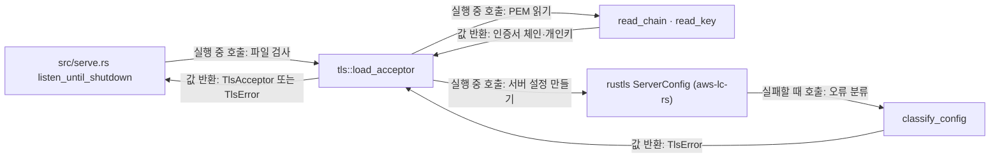

# 내장 TLS 모듈 설계

내장 TLS 모듈은 PEM 인증서 체인과 개인키를 읽어 TLS 1.2·1.3만 협상하는 `TlsAcceptor`를 만든다. 시작 때 WSS 진입점과 관리 리스너의 인증서·개인키 파일을 검사한다. 파일에 오류가 있으면 리스너를 바인드하기 전에 멈춘다. 암호 모듈은 aws-lc-rs 하나만 쓴다.

| 항목 | 값 |
| --- | --- |
| 구조 시점 | Current |
| 문서 상태 | Draft |
| 구현 대조 | Verified - [대조 기록](#대조-기록) |
| 코드 위치 | `crates/adapters/src/tls.rs` |
| 코드 지도 | [코드 지도](code-map.md) |
| 관련 스펙 | [운영 스펙](../specs/operations.md) OPS-002·OPS-026·OPS-036, [WebSocket 스펙](../specs/websocket.md) WS-013 |
| 관련 계약 | [설정 계약 1.9절](../contracts/config-v1.md#19-인증서개인키-파일-형식), [설정 계약 2.1절](../contracts/config-v1.md#21-설정-오류와-준비-실패), [CLI 계약 2.2절](../contracts/cli-v1.md#22-오류-코드) |
| 관련 ADR | [ADR-0001 내장 TLS](../decisions/ADR-0001-built-in-tls.md), [ADR-0004 tokio-rustls](../decisions/ADR-0004-tokio-rustls.md) |

## 1. 책임과 경계

- 맡는 책임: PEM 인증서 체인과 개인키를 읽어 rustls 서버 설정을 만든다. TLS 1.2·1.3만 협상하도록 설정한다. 파일 오류를 `TlsError`로 알린다.
- 맡지 않는 책임: 설정 파일 읽기와 설정 키 이름 붙이기([설정 로딩](config-loading.md)), 리스너 바인드와 접속 수락([`serve` 시작](serve-startup.md), WSS 진입점 작업 3.2, 관리 리스너 작업 4.2), TLS 협상 실패의 운영 로그 기록(리스너가 기록한다), 재로드 후보 검사와 인증서 교체(작업 5.x), 파일 변경 감시(작업 5.1).
- 다른 모듈에 공개하는 기능: `tls::load_acceptor(cert_file, key_file)`, `TlsError`, `TlsError::code()`.

## 2. 내부 구조

화살표는 실행 중 호출(함수 호출)과 값 반환(데이터 전달)만 뜻한다. 이 모듈은 실행 중에 주입받는 객체가 없다. 컴파일 의존은 `crates/adapters/Cargo.toml`에 적는다.

| 요소(파일·심볼) | 역할 | 만들어지는 시점과 소유자 | 의존 대상 |
| --- | --- | --- | --- |
| `crates/adapters/src/tls.rs` `load_acceptor` | 두 경로를 받아 검사하고 `TlsAcceptor`를 돌려준다. 공개 진입점이다. 안에서 aws-lc-rs 암호 모듈, TLS 1.2·1.3, 클라이언트 인증 없음으로 `ServerConfig`를 만든다. | 호출한 쪽이 시작 때 호출한다. 반환값의 소유자는 호출한 쪽이다. | `read_chain`, `read_key`, `classify_config`, `tokio_rustls::TlsAcceptor` |
| `crates/adapters/src/tls.rs` `read_chain` | 인증서 PEM을 끝까지 읽어 체인을 만든다. 항목이 없으면 실패한다. | 호출 중에만 존재한다. | `rustls_pki_types::CertificateDer::pem_file_iter` |
| `crates/adapters/src/tls.rs` `read_key` | 개인키 PEM 하나를 읽는다. | 호출 중에만 존재한다. | `rustls_pki_types::PrivateKeyDer::from_pem_file` |
| `crates/adapters/src/tls.rs` `classify_config` | rustls가 `ServerConfig`를 만들지 못한 오류를 `TlsError`로 나눈다. 인증서와 개인키가 맞는지 rustls가 확인한다. | 호출 중에만 존재한다. | `rustls::Error` |
| `crates/adapters/src/tls.rs` `TlsError` | 실패 원인을 `code()`와 한국어 `Display`로 알린다. 파일 내용과 키 바이트를 담지 않는다. | 값으로 반환된다. | `TlsFile` |

## 3. 데이터 모델

모듈 밖과 주고받는 형식은 [설정 계약 1.9절](../contracts/config-v1.md#19-인증서개인키-파일-형식)과 [설정 계약 2.1절](../contracts/config-v1.md#21-설정-오류와-준비-실패)에 둔다.

| 이름 | 필드·형태 | 저장 위치 | 제약과 항상 지켜야 할 조건 |
| --- | --- | --- | --- |
| `TlsError` | `Unreadable { file }`, `Malformed { file }`, `KeyUnsupported`, `KeyMismatch`, `Config(rustls::Error)` | 값 | `code()`는 항상 `tls_file_invalid`다. `Display`는 파일 경로·내용·키 바이트를 담지 않는다. |
| `TlsFile` | `Cert`, `Key` | 값 | 어느 파일인지만 가리킨다. 설정 키 이름(`relay.wss_viewer.cert_file` 등)은 호출한 쪽이 붙인다. |
| 개인키 종류 | RSA(PKCS#1·PKCS#8), ECDSA P-256·P-384·P-521(SEC1·PKCS#8), Ed25519(PKCS#8) | — | 시험으로 확인한 종류만 [설정 계약 1.9절](../contracts/config-v1.md#19-인증서개인키-파일-형식)에 적는다. X25519는 지원하지 않는다. |

## 4. 처리 순서

대표 시나리오 OPS-002(시작 중 TLS 준비 실패)를 따라 호출 순서대로 쓴다.

| 순서 | 코드 위치(파일·심볼) | 조건·계산 | 바뀌는 상태 | 결과를 쓰는 곳 |
| --- | --- | --- | --- | --- |
| 1 | `src/serve.rs` `listen_until_shutdown` | 종료 신호 처리기를 만든 뒤, 어떤 리스너도 바인드하기 전에 실행한다. WSS는 `relay.wss_viewer.enabled`가 참이고 `tls`가 있을 때만, 관리 리스너는 `management.tls`가 있을 때만 검사한다. | 없음 | 실패는 모아 두고, 성공한 acceptor는 함수 안에서 든다. |
| 2 | `crates/adapters/src/tls.rs` `read_chain` | 인증서 PEM 항목을 모두 읽는다. I/O 오류는 `Unreadable`, PEM 오류나 항목 0개는 `Malformed`다. | 없음 | 인증서 체인 |
| 3 | `crates/adapters/src/tls.rs` `read_key` | 개인키 PEM 하나를 읽는다. I/O 오류는 `Unreadable`, 키가 없거나 형식이 틀리면 `Malformed`다. | 없음 | 개인키 |
| 4 | `crates/adapters/src/tls.rs` `load_acceptor` | 암호 모듈 aws-lc-rs, 프로토콜 TLS 1.2·1.3, 클라이언트 인증 없음으로 설정한 뒤 인증서와 개인키를 넣는다. 실패하면 `classify_config`가 나눈다. 지원하지 않는 키 종류는 `KeyUnsupported`, 쌍이 맞지 않으면 `KeyMismatch`, 인증서 형식 오류는 `Malformed { file: Cert }`, 그 밖의 설정 오류는 `Config`다. | 없음 | `rustls::ServerConfig` |
| 5 | `crates/adapters/src/tls.rs` `load_acceptor` | 설정을 `Arc`로 감싸 `TlsAcceptor`로 바꾼다. | `TlsAcceptor` 생성 | 호출한 쪽 |
| 6 | `src/serve.rs` `listen_until_shutdown` | 실패가 하나라도 있으면 진단마다 stderr 줄과 `startup_failed`를 남기고 종료 코드 3(`EXIT_CONFIG`)으로 끝낸다. 모두 성공하면 다음 단계(바인드)로 간다. | 준비 완료 아님 | 종료 코드 |

## 5. 상태와 초기화

- 초기화·로딩 시점: 시작 4단계에서 런타임을 준비한 뒤, 리스너 바인드 전에 한 번 호출한다. 재로드는 작업 5.x에서 같은 함수로 후보를 만든다.
- 상태 소유자와 제거 시점: 성공한 `TlsAcceptor`(안에 `Arc<ServerConfig>`)는 `listen_until_shutdown`이 든다. 작업 3.1에서는 접속에 쓰지 않으므로 함수가 끝날 때 없어진다. 작업 3.2·4.2에서는 리스너 태스크가 복제해 든다.
- 동시 실행과 순서: `load_acceptor`는 공유 상태가 없다. 시작 때 한 번만 호출한다. 재로드 중 교체의 원자성은 작업 5.x가 정한다.

## 6. 오류 처리

| 실패 지점 | 처리 방법 | 남는 상태 | 관련 스펙 시나리오 |
| --- | --- | --- | --- |
| `read_chain` 파일 열기·읽기 | `Unreadable { file: Cert }` 반환 | 바인드 전이므로 리스너 없음 | OPS-002 |
| `read_chain` PEM 형식 오류·항목 없음 | `Malformed { file: Cert }` 반환 | 같음 | OPS-002 |
| `read_key` 파일 열기·읽기 | `Unreadable { file: Key }` 반환 | 같음 | OPS-002 |
| `read_key` 개인키 없음·형식 오류 | `Malformed { file: Key }` 반환 | 같음 | OPS-002 |
| `classify_config` 지원하지 않는 키 종류 | `KeyUnsupported` 반환 | 같음 | OPS-002 |
| `classify_config` 인증서와 개인키 불일치 | `KeyMismatch` 반환 | 같음 | OPS-002, OPS-026(재로드 후보) |
| `serve.rs` 실패 집계 | 모든 진단을 stderr 줄과 `startup_failed`(`reason=tls_file_invalid`)로 쓰고 종료 코드 3 | 준비 완료 아님, 리스너 없음 | OPS-002 |
| 협상 중 TLS 1.2 미만 요청 | rustls가 프로토콜 버전 경고로 거절한다. 이 모듈은 관여하지 않는다. | 해당 연결만 끝난다 | OPS-036(작업 3.2·4.2가 `tls_version_unsupported`를 기록한다) |
| 협상 중 만료·신뢰되지 않음·호스트 불일치 인증서 | 클라이언트가 협상을 거절한다. 이 모듈은 관여하지 않는다. | 해당 연결만 끝난다 | WS-013(작업 3.2·4.2가 `tls_failed`를 기록한다) |

## 7. 설계 선택

| 선택 | 이유 | 검토한 다른 방법 | 근거 |
| --- | --- | --- | --- |
| rustls, 암호 모듈 aws-lc-rs만 쓴다. `default-features = false`로 `std`·`tls12`·`aws_lc_rs`만 켠다. | 암호 모듈은 2026-10-20 사용자 결정으로 aws-lc-rs로 정했다. `log`와 `prefer-post-quantum`은 PRD 구현 기술 목록에 없어 켜지 않는다. | `ring` 단독. Cargo.lock의 `ring` 항목은 rustls-webpki의 약한 기능(`ring?/alloc`) 때문에 남고, 빌드에는 들어가지 않는다(`cargo tree -i ring` 결과 없음). | [설정 계약 1.9절](../contracts/config-v1.md#19-인증서개인키-파일-형식), [ADR-0004](../decisions/ADR-0004-tokio-rustls.md) |
| TLS 1.2·1.3만 `with_protocol_versions`로 명시한다. | 설정 계약 1.9절이 TLS 1.2 미만 거절을 정한다. 코드에 의도를 남긴다. | 기본값 사용 | [설정 계약 1.9절](../contracts/config-v1.md#19-인증서개인키-파일-형식), [OPS-036](../specs/operations.md) |
| 클라이언트 인증과 ALPN을 설정하지 않는다. | 3.1 범위는 서버 인증이다. ALPN 값은 WebSocket과 관리 HTTP를 붙이는 3.2·4.2에서 정한다. | 지금 `http/1.1` 설정 | [미결정 사항](#9-미결정-사항) |
| 개인키 종류는 시험한 것만 계약에 적는다. | 설정 계약 1.9절이 "구현에서 확인한 범위"로 정하라고 한다. rustls가 받는 종류를 모두 약속하지 않는다. | rustls가 받는 종류 전부 기록 | `crates/adapters/tests/tls.rs` 테스트 결과 |
| 개인키 파일 권한은 검사하지 않는다. | 설정 계약 1.9절은 권한 제한을 권장만 한다. | 시작 때 권한 검사 | [설정 계약 1.9절](../contracts/config-v1.md#19-인증서개인키-파일-형식) |
| 테스트 인증서는 커밋한 고정 파일로 두고 `rcgen`을 쓰지 않는다. | `rcgen`은 승인된 의존성과 PRD 구현 기술 목록에 없다. 생성 명령은 테스트 파일 머리 주석에 적는다. | 테스트마다 생성 | [테스트 규칙](../conventions/testing.md) |
| 시작 때 WSS와 관리 TLS 파일을 모두 검사하고 실패를 모두 보고한다. | 설정 계약 2.1절은 시작에서 가능한 모든 설정 오류를 모아 보고한다고 정한다. CLI 계약 1.8절은 시작 4단계에서 TLS 검사를 리스너 바인드보다 먼저 한다고 정한다. | 첫 실패에서 멈춤 | [CLI 계약 1.8절](../contracts/cli-v1.md#18-수동-시작과-종료) |
| 관리 TLS 파일도 시작 때 검사한다. | 운영 스펙 3.1절 2단계는 시작 검증 대상에 내장 TLS 인증서 설정을 넣는다. 설정 계약 1.8절은 관리 리스너의 `cert_file`·`key_file`을 재로드 대상으로 둔다. 시작 오류 `tls_file_invalid`는 설정 계약 2.1절이 정한다. | 관리 리스너를 작업 4.2에서 처음 검사 | [운영 스펙 3.1절](../specs/operations.md#31-설정-검증과-시작), [설정 계약 1.8절](../contracts/config-v1.md#18-재로드-구분), [설정 계약 2.1절](../contracts/config-v1.md#21-설정-오류와-준비-실패) |

## 8. 현재 코드와의 차이

작업 3.1 구현분(PEM 읽기, 서버 설정 만들기, 시작 때 검사)은 2~6절과 같다. 아래는 아직 없는 부분이다.

| 항목 | 현재 코드(파일·심볼) | 목표 설계 | 전환 계획 |
| --- | --- | --- | --- |
| WSS 연결에 acceptor 붙이기 | 없음 | WSS 리스너가 `TlsAcceptor`를 쓴다 | 작업 3.2 |
| 관리 HTTPS에 acceptor 붙이기 | 없음 | 관리 리스너가 `TlsAcceptor`를 쓴다 | 작업 4.2 |
| 재로드 때 인증서 교체 | 없음 | 후보를 같은 함수로 만든 뒤 교체한다 | 작업 5.x |

## 9. 미결정 사항

| 항목 | 영향 | 확정 위치 |
| --- | --- | --- |
| 재로드 때 인증서 교체 방식(새 `TlsAcceptor`를 원자적으로 바꾸는 방법) | 실행 중 인증서 교체와 연결 유지 | 작업 5.x |
| ALPN 값 | HTTP 종류 협상 | 작업 3.2·4.2 |
| 개인키 메모리를 명시적으로 지우는 방법 | 현재 코드는 지우지 않는다. rustls가 드롭 때 하는 일에 기대고 있다. | 보안 검토 작업 |

## 대조 기록

| 대조 범위 | 환경 | 확인 방법 | 결과 |
| --- | --- | --- | --- |
| 작업 3.1 변경(작업 트리): PEM 읽기, 서버 설정 만들기, 오류 분류, 시작 때 검사 | Windows 11 Pro 10.0.26200, Rust 1.99.1(`x86_64-pc-windows-msvc`) | 2~6절의 파일·심볼을 `crates/adapters/src/tls.rs`·`src/serve.rs`와 대조했다. `cargo xtask scenarios`(`cargo test --workspace` 포함)에서 `crates/adapters/tests/tls.rs`의 테스트 전부(TLS 1.2·1.3 핸드셰이크, TLS 1.0·1.1 거절, 개인키 종류, 키 불일치, 파일 오류, 인증서 거절 3종)가 통과했다. `tests/serve.rs`의 `fails_with_exit_code_3_when_wss_key_does_not_match`·`fails_with_exit_code_3_when_management_certificate_is_missing`·`checks_tls_files_before_binding_a_taken_status_port`도 통과했다. | 통과 |
| 작업 3.1 변경(작업 트리): PEM 읽기, 서버 설정 만들기, 오류 분류, 시작 때 검사 | Ubuntu 24.04.4(WSL2), Rust 1.99.1, `CARGO_TARGET_DIR=~/vnc-relay-target` | `cargo build`, `cargo fmt --all --check`, `cargo clippy --workspace --all-targets -- -D warnings`, `cargo xtask layers`, `cargo xtask scenarios`, `cargo deny check licenses`로 확인했다. `crates/adapters/tests/tls.rs` 11건과 `tests/serve.rs` 21건이 모두 통과했다. | 통과 |
