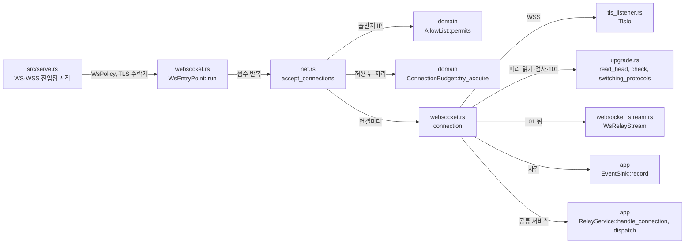

# WebSocket 진입점 모듈 설계

이 문서는 공유 WS·WSS 리스너가 Viewer·Server 접속을 받은 뒤의 흐름을 다룬다. 접속을 받고, 켜진 역할 허용 목록의 합집합과 L을 거치고, TLS(WSS)를 협상한다. HTTP 경로로 역할을 정한 뒤 역할별 Origin·서브프로토콜·ticket·IP를 검사하고 101 응답을 보낸다. 101 뒤는 WS 스트림과 공통 서비스가 맡는다. 수락 반복은 TCP와 같은 `accept_connections`다.

101 뒤 연결은 `connection`이 `WsRelayStream`으로 감싸 공통 서비스(`handle_connection` → `dispatch`)에 넘긴다. H는 101 응답 전송 완료 시각(`ConnectionContext.exchange_at`)부터 잰다. 머리 뒤 바이트는 `suffix`로 보존한다.

| 항목 | 값 |
| --- | --- |
| 구조 시점 | Current |
| 문서 상태 | Draft |
| 구현 대조 | Verified — [대조 기록](#대조-기록) |
| 코드 위치 | `crates/adapters/src/websocket.rs`(`WsPolicy`, `WsEntryPoint`, 연결 처리, 101 뒤 전달), `crates/adapters/src/upgrade.rs`(머리 읽기, 검사, 101 응답, 거절 응답), `crates/adapters/src/net.rs`(`accept_connections`, `AcceptPolicy`), `crates/adapters/src/tls_listener.rs`(`TlsIo`), `crates/adapters/src/websocket_stream.rs`(`WsRelayStream`), `crates/domain/src/origin.rs`(`Origin`), `src/serve.rs`(WS·WSS 진입점 시작) |
| 코드 지도 | [코드 지도 2절](code-map.md#2-코드-위치와-구성요소), [3절](code-map.md#3-진입점) |
| 관련 스펙 | [WebSocket 스펙 7절](../specs/websocket.md#7-수용-테스트)의 WS-012(일부), WS-013(일부), WS-014, WS-015(WS·WSS), WS-021(일부), WS-022(일부), WS-023(WSS), WS-027(WS·WSS); [운영 스펙 7절](../specs/operations.md#7-수용-테스트)의 OPS-006(일부), OPS-037(WS·WSS, 일부) |
| 관련 계약 | [WebSocket 중계 v2 1.1절](../contracts/websocket-relay-v2.md#11-업그레이드-요청), [1.2절](../contracts/websocket-relay-v2.md#12-업그레이드-응답과-서브프로토콜), [1.3절](../contracts/websocket-relay-v2.md#13-origin-비교), [1.5절](../contracts/websocket-relay-v2.md#15-close-코드), [2.1절](../contracts/websocket-relay-v2.md#21-http-단계의-거절), [설정 계약 1.4절](../contracts/config-v4.md#14-origin-값-문법과-비교), [운영 정보 계약 1.5·1.6절](../contracts/ops-info-v2.md) |
| 관련 ADR | [ADR-0001 내장 TLS](../decisions/ADR-0001-built-in-tls.md), [ADR-0002 출발지 IP 허용 목록](../decisions/ADR-0002-source-ip-allowlist.md), [ADR-0013 출발지 IP 차단 목록](../decisions/ADR-0013-relay-source-deny-list.md). 수락 때 `trusted_proxies`가 아닌 소켓 상대 IP를 차단 목록과 비교해 TLS·HTTP 전에 닫는다. 업그레이드 직전에는 ticket 검사 뒤, 역할 허용 검사 앞에서 클라이언트 주소를 비교해 `Refusal::IpDenied`(403, ticket 미소비)로 거절한다. |
| 관련 문서 | [접속 ticket 모듈 설계](relay-access-ticket.md) |

## 1. 책임과 경계

- 맡는 책임:
  - 켠 `ws`·`wss` 공유 리스너에서 접속을 받는다. 데이터 읽기 전에 소켓 IP가 `trusted_proxies` 또는 켜진 역할의 `allow` 합집합에 있는지 판정하고 L 자리를 잡는다. 이 두 단계는 `accept_connections`가 맡는다.
  - 수락 포트는 `listener::Listener`다. `serve`가 `SupervisedListener`로 감싼다. 일시 오류는 공통 수락 반복이 재시도하고, 복구 불가능 오류는 같은 감독 채널로 전체 종료를 시작한다([상태 리스너 설계](status-listener.md)).
  - WSS에서는 `TlsIo`로 TLS 협상을 U 안에 끝낸다. 협상 실패는 평문으로 바꾸지 않는다.
  - 업그레이드 요청의 머리를 U 안에 읽고 `check`로 검사한다. 거절하면 사건을 쓰고 HTTP 거절 응답을 보낸 뒤 닫는다.
  - 업그레이드 경로로 켜진 역할을 정한다. 신뢰 프록시 연결이면 전달 주소를 판정한다. 역할별 Origin·서브프로토콜·ticket·클라이언트 주소 IP 순서로 검사한다. 재로드는 새 검사부터 적용한다.
  - 통과하면 `101 Switching Protocols`를 보낸다.
  - 101 뒤에는 `WsRelayStream`으로 감싸 공통 서비스에 넘긴다. H는 101 응답 뒤 `exchange_at`부터 잰다. 상대 종료·서버 멈춤의 Close 처리는 [WS 스트림 어댑터 설계](websocket-stream.md)와 [세션 설계](relay-session.md)가 맡는다.
- 맡지 않는 책임:
  - 101 뒤의 프레임 읽기·쓰기와 Repeater 초기 교환(공통 서비스와 WS 스트림 어댑터가 맡는다).
  - TLS 설정 읽기, 인증서 적재, TLS 1.2 판정 규칙([TLS 모듈 설계](tls.md)).
  - L·H·U의 값과 예산 규칙([연결 상한과 시간 제한 모듈 설계](connection-limits.md)).
  - 평문 WS 시작 경고. 설정 검사가 `ConfigWarning::PlaintextWsEnabled`를 만들고 운영 로그가 쓴다([운영 로그 모듈 설계](ops-log.md)). 이 모듈은 쓰지 않는다.
  - 허용 목록 재로드. 이 모듈은 판정 때마다 `AllowSource`로 현재 목록을 읽는다.
- 다른 모듈에 공개하는 기능:
  - `vnc_relay_adapters::websocket::{WsEntryPoint, WsPolicy}`: `serve`가 진입점을 만들고 띄운다.
  - `vnc_relay_domain::origin::Origin`: 허용 Origin 값과 비교([설정 계약 1.4절](../contracts/config-v4.md#14-origin-값-문법과-비교)).

## 2. 내부 구조

수락·TLS·경로 판정 전에는 역할이 없다. `upgrade.rs`의 `VIEWER_PATH`는 `/relay/viewer`다. `/relay/server`는 Server이며 Mode II 요청만 받고 시작 바이트를 보내지 않는다. 꺼진 역할이나 다른 경로는 404 `invalid_upgrade`다.

신뢰 프록시의 `X-Forwarded-For`는 오른쪽부터 검사한다. 헤더가 없거나 비었거나 검사 중 잘못된 요소가 있거나 모든 요소가 신뢰 프록시면 400 `forwarded_for_invalid`다. 비신뢰 상대의 헤더는 무시한다. 역할 allow는 클라이언트 주소를 검사한다. 전달 주소는 `ConnectionContext`와 사건의 `forwarded_ip`로 넘긴다.

| 요소(파일·심볼) | 역할 | 만들어지는 시점과 소유자 | 의존 대상 |
| --- | --- | --- | --- |
| `websocket.rs` `WsPolicy` | 현재 설정 원천과 L 사용량을 가진 `accept: AcceptPolicy`, 공유 `ticket_uses`, 기동 시각 `started_at`을 보관한다. U/B/K는 수락 문맥, Origin/ticket/IP/M/Kw는 업그레이드 판단, H는 101 flush 뒤에 읽는다. | `serve`가 진입점마다 만든다. 사용 기록은 WS·WSS가 공유한다. | `net.rs`, app, domain ticket |
| `websocket.rs` `WsEntryPoint::new`, `run` | `run`은 로그와 정책, TLS 수락기를 담은 공유 상태를 만들고 `accept_connections`에 연결 처리(`connection`)를 넘긴다. TLS 수락기는 WSS에만 있다. | `serve`가 리스너를 바인드한 뒤 띄운다. 리스너와 TLS 수락기를 소유한다. | `net.rs`, `tls_listener.rs` |
| `net.rs` `accept_connections`, `AcceptPolicy` | TCP와 WS가 같이 쓰는 접수 반복이다. 출발지 IP 허용 판정, L 자리 확보, keepalive 설정, `connection_accepted` 기록, 연결마다 작업 생성을 맡는다. 멈춤 신호가 오면 리스너를 닫고 연결 작업이 모두 끝날 때까지 기다린다. | `run`이 호출한다. 연결 작업 모음을 소유한다. | `domain`, `app` |
| `websocket.rs` `Wire` | 연결의 전송 계층이다. `Plain(TcpStream)` 또는 `Tls(Box<TlsIo<TcpStream>>)`. `stage()`는 TLS가 끝나지 않았으면 `tls`, 아니면 `upgrade`를 준다. | `connection`이 만든다. 박싱은 구현 판단이다(7절). | `tls_listener.rs` |
| `websocket.rs` `connection` | 한 연결의 업그레이드 단계 전체다. 마감은 `accepted_at + U`다. `biased` select로 깨어날 때마다 멈춤 신호, U 마감, `upgrade` 순서로 확인한다. 이미 `upgrade` 안에서 진행 중인 poll은 select가 막지 못한다. 그래서 `upgrade`가 응답 바이트를 만든 뒤 쓰기 직전에 U를 다시 확인한다(`expired`). 그 확인과 쓰기 사이에는 거절 사건 기록만 있다. 결과를 `Switched`(→ `WsRelayStream`, `handle_connection`, `dispatch`), `Refused`(사건 기록 끝), `PeerEof`, I/O 오류(→ `io_reason`), `TimedOut`(U가 지난 뒤 응답 없이 닫음, `tls_upgrade_timeout`), 멈춤(`server_shutdown`)으로 나눈다. | 연결마다 작업 하나. | `upgrade.rs`, `tls_listener.rs` |
| `upgrade.rs` `read_head` | 빈 줄까지 머리를 읽는다. 빈 줄 뒤 바이트는 `suffix`로 돌려준다. 요청 줄·헤더·끝 빈 줄을 합친 머리는 `HEAD_LIMIT`(16 KiB, 16,384바이트) 이하면 허용한다. 끝 위치가 정확히 16,384바이트여도 허용한다. 그 안에 끝나지 않으면 `TooLarge`, 머리가 끝나기 전에 상대가 닫으면 `Eof`. | 업그레이드 단계 안에서 호출된다. | tokio I/O |
|`upgrade.rs` `check` | 머리 바이트, `WsListenerSettings`, 소켓 `PeerIp`, 판정한 역할을 보관할 `Option<Role>`, 전달 주소를 보관할 `Option<PeerIp>`를 받는다. 정확한 켜진 경로를 찾으면 역할을 먼저 보관한다. 소켓 IP가 `trusted_proxies`에 있으면 `vnc_relay_domain::forwarded_for::client_ip`로 전달 주소를 도출한다. 이후 헤더·역할별 Origin·서브프로토콜 검사 결과로 역할을 포함한 `ValidUpgrade` 또는 `Refusal`을 반환한다. 입출력은 하지 않는다. | 머리마다 한 번. | domain Origin·Role·PeerIp·forwarded_for, app settings, 키 계산 |
| `upgrade.rs` `Refusal` | 기존 거절 사유와 `Ticket { reason, jti }`를 담는다. `reason()`은 운영 사유를, `answer()`는 HTTP 응답 머리를 준다(3절 데이터 모델). | `check` 또는 `check_upgrade`가 만든다. | domain ticket |
| `upgrade.rs` `switching_protocols` | 101 응답 바이트를 만든다. `Upgrade`, `Connection`, `Sec-WebSocket-Accept`를 담고, 요청에 `binary`가 있을 때만 `Sec-WebSocket-Protocol: binary`를 쓴다. 확장은 받지 않는다. | 통과한 머리마다. | `tokio_tungstenite` 키 계산 |
| `websocket.rs` `refuse` | `connection_rejected`(`stage` = `upgrade`, `conn_id` 있음)를 먼저 기록하고, 거절 응답을 최선으로 보낸 뒤 닫는다. | `connection`이 호출한다. | `app` |
| `websocket_stream.rs` `WsRelayStream` | 101 뒤 연결의 전송 스트림이다. `connection`이 `suffix`, M, B, 전송 종류를 넘겨 만든다. | 101 뒤 연결마다 한 번. | 공통 서비스 |
| `websocket.rs` `io_reason`, `log_abort` | 전송 I/O 오류를 `AbortReason`과 `ConnectionErrorKind`로 바꿔 `connection_aborted`를 쓴다. `VersionUnsupported`면 줄을 더 쓰지 않는다. TLS 계층이 이미 기록했다. | `connection`이 쓴다. | `app` |
| `tls_listener.rs` `TlsIo` | WSS 협상을 한다. 첫 읽기·쓰기에서 협상이 돈다. TLS 1.2 미만은 `connection_rejected`(`stage` = `tls`, `reason` = `tls_version_unsupported`)를 스스로 쓰고 `TlsHandshakeError::VersionUnsupported`를 준다. | WSS 연결마다. | [TLS 모듈 설계](tls.md) |
| `domain/src/origin.rs` `Origin` | `Origin` 값의 문법과 정확 일치 비교다([설정 계약 1.4절](../contracts/config-v4.md#14-origin-값-문법과-비교)). | 설정 읽기와 `check`가 쓴다. | — |
| `src/serve.rs` `listen_until_shutdown` | WS는 TLS 없이, WSS는 `TlsSource`를 받아 공유 리스너당 한 번 띄운다. `WsEntryPoint::new`는 `ListenerKind`를 받는다. `WsPolicy`에는 `AllowSource::ws` 또는 `wss`와 공통 L 사용량을 넣는다. | 설정과 바인드가 끝난 뒤 한 번 | `websocket.rs`, app |

## 3. 데이터 모델

| 이름 | 필드·형태 | 줄의 필드(순서대로) | 제약과 항상 지켜야 할 조건 |
| --- | --- | --- | --- |
| `Event::UpgradeRejected` | `listener`, `role: Option<Role>`, `conn_id`, `reason`, `peer_ip`, `forwarded_ip: Option<PeerIp>`, `origin`, `ticket_jti` | `listener`, 선택 `role`, `conn_id`, `stage=upgrade`, `reason`, `peer_ip`, 선택 `forwarded_ip`, 선택 `origin`·`ticket_jti` | 경로 판정 전·꺼진 경로는 role이 없다. 켜진 경로 판정 뒤의 거절은 role을 유지한다. 전달 주소 판정 성공 뒤 거절은 `forwarded_ip`를 유지하고, `forwarded_for_invalid`에는 없다. Origin 거절 원문은 문자 경계에서 최대 256바이트만 기록한다. `ticket_jti`는 서명을 확인한 뒤 유효한 값일 때만 쓴다. |
| `Event::ConnectionAborted` | `conn_id`, `listener: ListenerKind`, `role: Option<Role>`, `stage`, `reason`, `peer_ip`, `elapsed_ms` | 연결 정보, 선택 `role`, `stage`, `reason`, `elapsed_ms`, 선택 `error_kind` | TLS·경로 판정 전에는 role이 없다. 경로 판정 뒤와 101 뒤에는 선택한 role을 보존한다. |
| `Stage`(WS에서 쓰는 값) | `Accept`, `InitialExchange`, `Tls`, `Upgrade` | `accept`, `initial_exchange`, `tls`, `upgrade` | WS 머리 단계는 `upgrade`, WSS 협상 단계는 `tls`다. |
| `RejectReason`(WS에서 쓰는 값) | `InvalidUpgrade`, `ForwardedForInvalid`, `OriginNotAllowed`, `SubprotocolNotSupported`, `IpNotAllowed`, `TlsVersionUnsupported` | `invalid_upgrade`, `forwarded_for_invalid`, `origin_not_allowed`, `subprotocol_not_supported`, `ip_not_allowed`, `tls_version_unsupported` | `TlsVersionUnsupported`는 `tls` 단계의 거절이다([TLS 모듈 설계](tls.md)). |
| `AbortReason`(WS에서 쓰는 값) | `TlsUpgradeTimeout`, `ServerShutdown`, `HandshakeTimeout`, `PeerEof`, `ConnectionError` | `tls_upgrade_timeout`(warn), `server_shutdown`, `handshake_timeout`, `peer_eof`, `connection_error` | `tls_upgrade_timeout`은 U 마감이다. `handshake_timeout`은 H 마감이다. |
| `ConnectionErrorKind` | `IoError`, `TlsFailed` | `io_error`, `tls_failed` | `connection_error`와 함께만 쓴다. WSS 협상 실패는 `tls_failed`, 그 밖의 I/O 오류는 `io_error`다. |
| `Refusal` | `Invalid`, `NotFound`, `MethodNotAllowed`, `VersionUnsupported`, `ForwardedForInvalid`, `OriginNotAllowed(String)`, `SubprotocolNotSupported`, `IpNotAllowed(Option<String>)`, `Ticket { reason, jti }` | `reason()`: 기존 업그레이드 사유 또는 ticket 오류 코드. `ticket_jti()`: `Ticket`과 `IpNotAllowed`가 담은 서명 확인 뒤의 `jti`. `answer()`: 기존 `400`·`404`·`405`·`426`·`403` 또는 ticket의 `401 Unauthorized` + `WWW-Authenticate: VncRelayTicket` | 응답은 `Content-Length: 0`과 `Connection: close`를 붙인다. 본문이 없다([WebSocket 계약 2.1절](../contracts/websocket-relay-v2.md#21-http-단계의-거절)). ticket 오류는 [접속 ticket 모듈 설계](relay-access-ticket.md#42-업그레이드대표-시나리오-ws-038)를 따른다. |
| `ValidUpgrade` | `accept_key: String`, `binary: bool`, `role: Role`, `ticket: TicketOffer` | 101 응답 값과 선택한 역할, ticket 제시 개수·값 | `EntryPoint::from_parts(listener, role)`로 공통 서비스 문맥의 진입점을 만든다. ticket 원문을 응답에 넣지 않는다. |
| `HeadRead` | `Complete { head, suffix }`, `Eof`, `TooLarge` | 머리와 뒤따른 원시 바이트, 상대 닫힘, 상한 초과 | 빈 줄 뒤 바이트를 버리지 않고 스트림 어댑터로 옮긴다. |
| `WsPolicy` | `accept: AcceptPolicy`, `ticket_uses: Arc<Mutex<ticket::UseTable>>`, `started_at: SystemTime` | 접수 정책·현재 설정 원천·공유 사용 기록·기동 시각 | U/B/K는 수락 당시 값, Origin/ticket/IP/M/Kw는 업그레이드 당시 값이다. |

## 4. 처리 순서

`WsPolicy`는 `AcceptPolicy`, 공유 사용 기록 `ticket_uses`, 기동 시각 `started_at`을 가진다. `net.rs`의 `admit`가 수락 당시 allow/L/B/U/TCP K를 같은 설정 세대에서 읽는다. `websocket.rs`의 `check_upgrade`는 업그레이드 요청의 Origin·ticket·출발지 IP를 한 callback의 현재 설정으로 검사하고 M/WS ping/pong을 보관한다. 101 flush 뒤 `exchange_handshake`가 현재 H를 읽어 `ConnectionContext`에 넘긴다. `WsRelayStream`은 수락 당시 B와 업그레이드 당시 M/Kw를 받는다. U는 수락값이며 기존 연결·교환 값은 바꾸지 않는다([설정 §1.8](../contracts/config-v4.md#18-재로드-구분), OPS-047~050). ticket의 키·사용 기록·기한은 [접속 ticket 모듈 설계](relay-access-ticket.md)가 정한다.

| 순서 | 코드 위치(파일·심볼) | 조건·계산 | 바뀌는 상태 | 결과를 쓰는 곳 |
| --- | --- | --- | --- | --- |
| 1 | `serve.rs` `listen_until_shutdown` | WS·WSS 리스너마다 `WsPolicy`를 만든다. WSS는 TLS 수락기가 있어야 진입점을 띄운다. | 진입점 작업 하나 | 2 |
| 2 | `net.rs` `accept_connections` | `accept`가 소켓과 상대 주소를 준다. 상대 주소를 `PeerIp`로 바꾼다. | 없음 | 3 |
| 3 | `AllowSource`·`AllowList::permits` | 소켓 IP가 `trusted_proxies` 또는 켜진 어느 역할의 allow에도 없으면 거절이다. 꺼진 역할의 목록은 합집합에 넣지 않는다. 아직 소켓에서 읽지 않았다. | 없음 | 4 |
| 4 | `EventSink::record`, 소켓 닫기 | `connection_rejected`(`listener`, `stage` = `accept`, `reason` = `ip_not_allowed`)를 쓰고 닫는다. TLS 협상도 HTTP 읽기도 없다(WS-014, WS-023). | 없음 | 운영 로그 |
| 5 | `ConnectionBudget::try_acquire`, `set_keepalive`, `ConnId::next` | 자리가 없으면 `relay_connection_limit`으로 닫는다. 있으면 `conn_id`와 `listener=ws/wss`의 `connection_accepted`를 기록한다. role은 생략한다. | 자리 하나, `conn_id` | 6 |
| 6 | `websocket.rs` `connection` | 마감 = 수락 시각 + U. WSS면 `TlsIo::handshaking`으로 감싸고, WS면 평문 그대로 둔다. | 연결 상태 | 7 |
| 7 | `upgrade.rs` `read_head`, `websocket.rs` `upgrade` | WSS는 첫 읽기에서 TLS 협상이 돈다. 빈 줄까지 읽는다. 읽기가 끝난 뒤 U가 지났으면 응답 없이 `TimedOut`으로 끝낸다(`tls_upgrade_timeout`). 그 전에 `TooLarge`면 400으로 거절하고, `Eof`면 `peer_eof`로 끝낸다. | 머리 바이트 | 8 |
| 8 | `upgrade.rs` `check` | 아래 검사 순서를 따른다. 신뢰 프록시의 전달 주소를 판정한다. 실패는 `Refusal`이다. | 없음 | 거절이면 `refuse`, 통과면 9 |
| 9 | `websocket.rs` `check_upgrade` | 역할의 ticket이 켜졌으면 ticket을 확인한다. 실패는 401과 `WWW-Authenticate: VncRelayTicket`이다. 이어 역할의 `allow`로 클라이언트 주소를 재검사한다. 실패는 role이 있는 403 `ip_not_allowed`다. 통과하면 사용 기록을 원자적으로 쓴다. 이미 쓴 ticket은 401 `ticket_reused`다. Origin·ticket·IP·M/Kw는 같은 현재 설정 callback에서 읽는다. | 선택한 role, ticket 사용 기록 | 10 또는 거절 |
| 10 | `websocket.rs` `upgrade`, `upgrade.rs` `switching_protocols` | ticket 확인 성공이면 `ticket_accepted`를 먼저 쓴다. 기존 U 재확인 뒤 101 응답을 쓰고 flush한다. 응답 서브프로토콜은 `binary`뿐이다. | 연결 상태 `Switched` | 11 |
| 11 | `websocket.rs` `connection` | 101 뒤 `WsRelayStream`을 만들고 `EntryPoint::from_parts(listener, role)`과 `exchange_at`을 `ConnectionContext`에 담는다. ticket의 `jti`·`rid`·단조 세션 만료 기한은 별도 `TicketBinding`으로 넘긴다. | Viewer 또는 Server의 공통 서비스 연결 하나 | 12 |
| 12 | `app` `RelayService::handle_connection` | 초기 교환 H는 `exchange_at`부터 잰다. ticket의 세션 만료 기한이 더 이르면 그 기한을 쓴다. 실패는 사유에 맞는 close action과 사건으로 끝난다. 전송과 자리를 돌려준 뒤 사건을 쓴다. | 없음 | 운영 로그 |

거절 경로는 `refuse`가 맡는다. `connection_rejected`(`stage` = `upgrade`, `conn_id` 있음)를 먼저 쓰고, 거절 응답을 최선으로 보낸 뒤 닫는다. 연결 중단은 `connection`이 맡는다. 전송과 자리를 돌려준 뒤 `connection_aborted`를 쓴다. 이 순서는 [TCP 진입점 모듈 설계 4절](tcp-entry-point.md#4-처리-순서)과 같다.

### 검사 순서(`check`)

`check`는 아래 순서로 본다. 처음 실패한 항목이 응답을 정한다.

1. 요청 줄과 헤더 줄의 구문. 요청 줄은 세 부분이어야 하고, 제어 문자가 없어야 한다. 헤더 이름은 토큰이어야 하고, 헤더 값에는 제어 문자가 없어야 한다. 실패는 `Invalid`(400).
2. 쿼리를 뺀 경로가 정확히 `/relay/viewer` 또는 `/relay/server`이고 해당 역할이 켜졌는가. 실패는 `NotFound`(404)이며 role은 없다. 통과하면 role을 보관한다. 끝의 `/`는 다른 경로다. 1.x의 Viewer 경로 `/relay`도 `NotFound`다.
3. 메서드가 GET인가. 실패는 `MethodNotAllowed`(405).
4. HTTP 버전이 1.1 이상인가. 실패는 `Invalid`(400).
5. `Host`가 있고, `Upgrade`가 `websocket`이며, `Connection`에 `upgrade` 토큰이 있는가. 실패는 `Invalid`(400).
6. `Sec-WebSocket-Version`이 정확히 하나이고 값이 `13`인가. 실패는 `VersionUnsupported`(426).
7. `Sec-WebSocket-Key`가 정확히 하나이고 Base64 해독 결과가 16바이트인가. 실패는 `Invalid`(400).
8. 소켓 IP가 `trusted_proxies`에 있으면 `X-Forwarded-For`로부터 전달 주소를 판정한다. 실패는 `ForwardedForInvalid`(400). 신뢰하지 않는 상대의 헤더는 무시한다.
9. `Origin`. 헤더가 둘 이상이면 `Invalid`(400). 없으면 건너뛴다. 있으면 선택한 역할의 `allowed_origins`와 비교한다. 불일치는 `OriginNotAllowed`(403, 원문 기록)다.
10. `Sec-WebSocket-Protocol`. 토큰이 있는데 `binary`가 없으면 `SubprotocolNotSupported`(400). 있으면 `binary`를 echo한다.

이후 `check_upgrade`는 ticket 확인(401) → 두 번째 IP 검사(403) → 사용 기록 쓰기(재사용은 401) 순서로 진행한다. `upgrade`는 `ticket_accepted` → U 재확인 → 101 순서로 진행한다. Origin 403과 서브프로토콜 400은 ticket 검사보다 먼저다. ticket이 꺼진 역할은 기존 흐름을 유지한다. 세부 순서는 [접속 ticket 모듈 설계](relay-access-ticket.md#42-업그레이드대표-시나리오-ws-038)를 따른다.

구문을 경로보다 먼저, WebSocket 버전(426)을 키(400)보다 먼저 본다. [계약 1.1절](../contracts/websocket-relay-v2.md#11-업그레이드-요청)이 이 순서를 정한다.

## 5. 상태와 초기화

- 초기화: `serve`는 설정과 바인드가 모두 성공한 뒤 진입점을 띄운다. WSS는 인증서와 키를 적재한 뒤 TLS 수락기를 넘긴다. 수락기가 없으면 진입점을 띄우지 않는다(평문으로 대신 열지 않는다).
- 소유자: `WsEntryPoint`가 리스너, TLS 수락기(`Option`), `WsPolicy`를 소유한다. `run`이 만든 공유 상태(로그, 정책, TLS 수락기)를 연결 작업마다 넘긴다.
- 연결 상태: 연결 작업 하나가 `Wire`, 자리(`budget::Permit`), 수락 정보(`conn_id`, `peer_ip`, 수락 시각)를 가진다. 자리는 연결 작업이 끝날 때 돌려준다. 101 뒤에도 H가 끝날 때까지 자리를 쥔다.
- 동시 실행: 진입점마다 접수 반복 하나가 돈다. 연결마다 작업 하나가 돈다. 한 연결의 사건은 그 작업이 순서대로 쓴다. `connection_accepted`는 같은 연결의 다른 사건보다 먼저 나온다.
- 멈춤: 멈춤 신호를 받으면 새 접수를 멈추고 리스너를 닫는다. 새 접속은 TCP에서 거절되며 HTTP 503은 보내지 않는다. 101 전 연결은 응답 없이 닫고 `connection_aborted`(`reason` = `server_shutdown`)를 쓴다. `Wire::stage`에 따라 WS는 `upgrade`, WSS는 TLS 협상 완료 전 `tls`, 완료 뒤 `upgrade`다. 101 뒤 연결의 Close 1001 조건은 [WebSocket 계약 1.6절](../contracts/websocket-relay-v2.md#16-종료-의미)을 따른다.
- `ConnId`는 TCP 진입점과 같은 프로세스 전역 카운터다([TCP 진입점 모듈 설계 5절](tcp-entry-point.md#5-상태와-초기화)).

## 6. 오류 처리

| 실패 지점 | 처리 방법 | 남는 상태 | 관련 스펙 시나리오 |
| --- | --- | --- | --- |
| 출발지 IP가 허용 목록 밖(WS와 WSS 공통) | `connection_rejected`(`ip_not_allowed`, `stage` = `accept`)를 쓰고 닫는다. TLS도 HTTP도 읽지 않는다. | 없음 | WS-014, WS-023(WSS) |
| L 자리 고갈 | `connection_rejected`(`relay_connection_limit`)를 쓰고 닫는다. | 없음 | [연결 상한 6절](connection-limits.md#6-오류-처리) |
| WSS 협상 실패(인증서 만료, 신뢰되지 않음, 호스트 불일치 등) | `connection_aborted`(`stage` = `tls`, `reason` = `connection_error`, `error_kind` = `tls_failed`)를 쓴다. 평문으로 바꾸지 않는다. | 없음 | WS-013(일부, 클라이언트 쪽 실패만 확인) |
| TLS 1.2 미만 요청 | `TlsIo`가 `connection_rejected`(`tls_version_unsupported`, `stage` = `tls`)를 쓴다. 이 모듈은 줄을 더 쓰지 않는다. | 없음 | OPS-036 |
| U 안에 TLS 협상 또는 머리 읽기가 끝나지 않음 | 응답 없이 닫고 `connection_aborted`(`tls_upgrade_timeout`)를 쓴다. `stage`는 협상 중이면 `tls`, 아니면 `upgrade`다. | 없음 | OPS-006(일부). 테스트 `stalled_upgrade_request_is_closed_at_u_without_a_reply`, `stalled_tls_handshake_on_wss_is_closed_at_u_without_a_reply` |
| U가 지난 뒤 머리 읽기가 끝남(상대 닫힘 포함) | 응답 없이 닫고 `connection_aborted`(`tls_upgrade_timeout`)를 쓴다. 읽기 결과가 `Complete`, `Eof`, `TooLarge` 어느 쪽이든 응답하지 않는다. U 뒤 상대 닫힘도 `peer_eof`가 아니다. | 없음 | OPS-006(일부). 테스트 `head_completed_after_u_gets_no_answer` |
| 머리가 16 KiB 안에 끝나지 않음 | 400으로 거절하고 `connection_rejected`(`invalid_upgrade`)를 쓴다. 상한은 WebSocket 계약 1.1절을 따른다. | 없음 | WS-012(일부) |
| 잘못된 요청(구문, 경로, 메서드, HTTP 버전, 헤더, 버전, 키) | 먼저 걸리는 검사 하나의 응답을 쓴다(4절 순서). 426은 버전이 `13`이 아닐 때만 쓴다. `connection_rejected`(`invalid_upgrade`)를 쓴다. | 없음 | WS-012(일부). 단위 테스트 `header_names_must_be_tokens`, `control_characters_in_the_head_are_refused`, `syntax_is_checked_before_the_path`, `wrong_version_is_refused_before_a_bad_key`(`upgrade.rs`); 접속 테스트 `management_paths_and_malformed_upgrades_are_refused_without_upgrade` |
| Origin이 허용 목록에 없음 | 403으로 거절하고 `connection_rejected`(`origin_not_allowed`, 원문)를 쓴다. | 없음 | WS-015, WS-027 |
| 서브프로토콜에 `binary`가 없음 | 400으로 거절하고 `connection_rejected`(`subprotocol_not_supported`)를 쓴다. | 없음 | 테스트 있음(표시 없음) |
| ticket 확인·사용 기록 실패 | 401과 `WWW-Authenticate: VncRelayTicket`로 거절한다. `connection_rejected(stage=upgrade)`에 ticket 오류 사유를 쓴다. | 확인 실패는 사용 기록 없음. 101 전송 실패는 이미 쓴 기록 유지 | WS-039~045 |
| 업그레이드 직전 IP 재검사 실패 | 403으로 거절하고 `connection_rejected`(`ip_not_allowed`, `stage` = `upgrade`)를 쓴다. ticket을 켠 역할이면 확인을 통과한 ticket의 `ticket_jti`도 쓰고 사용 기록은 쓰지 않는다. | 없음 | WS-022(부분: `tests/reload.rs` `removed_source_is_refused_at_upgrade_on_connections_opened_before_the_removal`), WS-042·044(`crates/adapters/tests/websocket_ticket.rs`) |
| 머리 읽기 중 상대가 U 안에 먼저 닫음 | `connection_aborted`(`peer_eof`)를 쓴다. `stage`는 TLS 중이면 `tls`, 아니면 `upgrade`다. | 없음 | 단위 테스트 `read_head_reports_a_closed_peer`(읽기 결과만). 사건 테스트 없음 |
| 그 밖의 전송 I/O 오류 | `connection_aborted`(`connection_error`, `error_kind` = `io_error`)를 쓴다. TLS 버전 거절이면 줄을 더 쓰지 않는다. | 없음 | 테스트 없음 |
| 101 뒤 H 만료 | 공통 `handle_connection`이 `HandshakeTimeout`을 내고, `websocket_stream.rs`가 Close 4009(`handshake_timeout`)로 보낸다. 사건은 `connection_aborted`(`stage` = `initial_exchange`, `handshake_timeout`). | 없음 | 테스트 없음(WS 경로) |
| 101 뒤 서버 멈춤 | Close 1001(`server_shutdown`)을 보내고 `connection_aborted`(`server_shutdown`)를 쓴다. | 없음 | 테스트 없음(WS 경로) |
| 101 전 서버 멈춤 | 응답 없이 닫고 `connection_aborted`(`server_shutdown`)를 쓴다. | 없음 | WebSocket 계약 2.1절 |

## 7. 설계 선택

| 선택 | 이유 | 검토한 다른 방법 | 근거 |
| --- | --- | --- | --- |
| 접수와 허용 판정, L을 TCP와 같은 `accept_connections`로 묶는다. | 순서(허용 판정 → L → `conn_id` → 사건)가 한 곳에 있어 두 진입점이 어긋나지 않는다. | 진입점마다 접수 반복을 따로 쓰기 | 구현 판단. [TCP 진입점 모듈 설계 2절](tcp-entry-point.md#2-내부-구조) |
| 101 뒤 H는 101 응답부터 잰다. 101 전의 시간은 U가 맡는다. | 초기 교환 시간은 업그레이드가 끝난 뒤의 시간이다. 수락부터 재면 U와 겹쳐 실제 교환 시간이 짧아진다. | 수락부터 H를 재기 | H의 정의는 [연결 상한 문서 1절](connection-limits.md#1-책임과-경계)에 적는다. |
| 101 뒤 프레임은 `WsRelayStream`으로 공통 서비스에 넘긴다. | 프레임의 해석과 초기 교환은 공통 서비스와 스트림 어댑터가 맡는다. 진입점은 읽지 않는다. | 진입점에서 프레임을 읽고 버리기 | [WS 스트림 어댑터 설계](websocket-stream.md) |
| 머리 뒤 바이트를 `suffix`로 보존해 `WsRelayStream`에 넘긴다. | 공통 서비스가 이 바이트를 먼저 소비해야 초기 교환 바이트가 빠지지 않는다. | 머리 뒤 바이트 버리기 | 구현 판단. |
| 머리 상한 16 KiB | 계약의 최대 머리 크기를 적용해 메모리 사용을 제한한다. | 상한 없음, 설정 항목 추가 | 구현 판단. |
| Key 검사는 16바이트 해독만 본다. 남는 비트는 보지 않는다. | 엄격한 Base64 검사는 계약이 요구하지 않으며 클라이언트 호환 위험만 키운다. | 남는 비트까지 엄격하게 검사 | 구현 판단. |
| 버전 검사(426)를 키 검사(400)보다 먼저 한다. | 계약 1.1절 3번의 라·마 항목이 버전(426)을 키(400)보다 먼저 둔다. | 키 검사를 먼저 | [WebSocket 계약 1.1절](../contracts/websocket-relay-v2.md#11-업그레이드-요청) |
| 구문 검사를 경로 검사보다 먼저 한다. | 계약 1.1절 3번의 가·나 항목이 구문을 경로보다 먼저 둔다. 깨진 요청 줄을 경로 404로 답하면 잘못된 응답이다. | 경로 검사를 먼저 | [WebSocket 계약 1.1절](../contracts/websocket-relay-v2.md#11-업그레이드-요청) |
| `Wire::Tls`를 `Box`로 감싼다. | 두 전송 계층의 크기 차이로 `large_enum_variant` 경고를 피하고 `clippy -D warnings`를 통과한다. 비용은 WSS 연결마다 힙 할당 한 번이다. | 박싱 없이 둠(경고 발생) | 구현 판단. |
| WSS 수락기는 WSS 진입점에서만 쓴다. 수락기가 없으면 진입점을 띄우지 않는다. | 협상 없이 평문으로 열리는 일을 구조로 막는다. | 수락기가 없을 때 평문으로 열기 | 계약 1.1절(WSS는 TLS 1.2 이상 뒤에 요청한다), WS-013. [TLS 모듈 설계](tls.md) |
| 수락은 `trusted_proxies` 및 켜진 역할 allow의 합집합, 업그레이드는 선택한 역할 allow를 쓴다. | 공유 소켓에서는 HTTP 경로를 읽기 전 역할을 알 수 없다. 신뢰 프록시는 수락 허용 검사를 건너뛰고 업그레이드 때 전달 주소를 역할 allow로 검사한다. 한 역할에만 허용된 IP도 다른 역할의 경로에서는 거절한다. 두 검사는 각각 현재 snapshot을 읽는다. | 리스너별 단일 allow로 두 역할을 합치기 | [WS-030](../specs/websocket.md#7-수용-테스트), [WS-032](../specs/websocket.md#7-수용-테스트). |
| 거절 사건을 응답보다 먼저 쓴다. | 응답 쓰기가 실패해도 거절 사건이 남는다. | 응답 뒤에 쓰기 | 구현 판단. [TCP 진입점 모듈 설계 4절](tcp-entry-point.md#4-처리-순서)과 같은 방식. |
| 거절 사건의 `origin`은 256바이트까지 쓰고 문자 경계에서 자른다. 자르기 전 원문은 `Refusal::OriginNotAllowed`에 남는다. | 운영 정보 계약 1.1절이 `origin`의 길이를 256바이트로 정했다. | 상한 없이 원문 쓰기, 정규화된 값만 쓰기 | 운영 정보 계약 1.1절 기준. 원문을 `Refusal`에 남기는 방식은 구현 판단. |
| 서브프로토콜 토큰을 제시했으면 `binary`가 있어야 한다. 없으면 400이다. | Repeater 초기 교환은 바이너리 프레임으로 가정한다. 계약 1.2절이 서브프로토콜 응답을 정한다. | 서브프로토콜 없이 받기, 426으로 거절하기 | [WebSocket 계약 1.2절](../contracts/websocket-relay-v2.md#12-업그레이드-응답과-서브프로토콜). |
| 서버 멈춤 Close는 1001(`CloseCode::Away`), H 만료는 4009다. | 계약 1.5절의 코드 뜻과 맞춘다. | 다른 코드 | [WebSocket 계약 1.5절](../contracts/websocket-relay-v2.md#15-close-코드) |
| 평문 WS 시작 경고는 설정 검사가 만든다. | 설정이 평문 WS를 켰는지는 설정 단계에서만 알 수 있다. | 접수 때마다 경고 | 구현 판단. [운영 스펙 OPS-016](../specs/operations.md#7-수용-테스트)·WS-024. |

## 대조 기록

- 날짜·대상: 2026-11-19, 커밋 `c0fa253`과 이 문서의 현재 상태 정리 작업 트리다. 제품 코드는 변경하지 않았다.
- 환경: Windows 10.0.26200 x64의 저장소 소스다.
- 방법: `websocket.rs`의 `connection`·`upgrade`·`check_upgrade`, 수락 문맥과 공통 서비스의 `ConnectionContext`를 읽고 101·기한·소유권 인계를 대조했다.
- 결과: WS·WSS는 역할별 검사 뒤 101을 flush하고 수락 B·업그레이드 M/Kw·초기 교환 H를 공통 스트림과 문맥에 넘긴다. 구조 대조는 동작 시험의 통과를 뜻하지 않는다.

현재 시나리오 결과는 [테스트 컨벤션](../conventions/testing.md#7-테스트와-스펙-시나리오-연결)에 따라 `cargo xtask scenarios`로 생성하는 `scenario-report.md`와 CI에서 확인한다.

