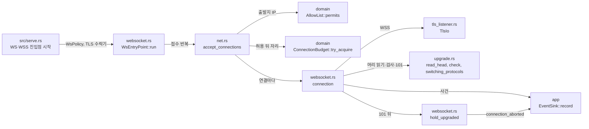

# WebSocket 진입점 모듈 설계

이 문서는 WS·WSS Viewer 진입점이 접속을 받은 뒤의 흐름을 다룬다. 접속을 받고, 허용 판정과 L을 거치고, TLS(WSS)를 협상하고, 업그레이드 요청을 검사하고, 101 응답을 보내는 데까지가 범위다. 101 뒤 Repeater 초기 교환과 중계는 작업 2.7이 맡는다. 작업 2.7은 Repeater 초기 교환 계약이 채택된 뒤(작업 1.5)에 한다([사용자 결정 2026-10-21, Q16](../../docs/TODO.md)). 접수 반복은 TCP 진입점과 같은 함수(`accept_connections`)를 쓴다. TLS 협상 세부는 [TLS 모듈 설계](tls.md), L·H·U의 값과 규칙은 [연결 상한과 시간 제한 모듈 설계](connection-limits.md)가 맡는다.

**임시 동작:** 작업 2.7 전까지 101 뒤 연결은 프레임을 읽지 않고, H가 지나거나 서버가 멈출 때까지 기다린다. 그래서 업그레이드한 연결은 모두 Close 4009(`handshake_timeout`)로 끝난다. 이 보류 방식은 사용자 결정 2026-10-22(Q21)로 작업 2.7까지 유지한다(9절 항목 11). 작업 3.2는 101까지만 구현했으므로 완료 표시를 하지 않는다.

| 항목 | 값 |
| --- | --- |
| 구조 시점 | Current |
| 문서 상태 | Draft |
| 구현 대조 | Verified — [대조 기록](#대조-기록) (기준 커밋 `c1c24d2`) |
| 코드 위치 | `crates/adapters/src/websocket.rs`(`WsPolicy`, `WsEntryPoint`, 연결 처리, 101 뒤 보류), `crates/adapters/src/upgrade.rs`(머리 읽기, 검사, 101 응답, 거절 응답), `crates/adapters/src/net.rs`(`accept_connections`, `AcceptPolicy`), `crates/adapters/src/tls_listener.rs`(`TlsIo`), `crates/domain/src/origin.rs`(`Origin`), `src/serve.rs`(WS·WSS 진입점 시작) |
| 코드 지도 | [코드 지도 2절](code-map.md#2-코드-위치와-구성요소), [3절](code-map.md#3-진입점) |
| 관련 스펙 | [WebSocket 스펙 7절](../specs/websocket.md#7-수용-테스트)의 WS-012(일부), WS-013(일부), WS-014, WS-015(WS·WSS), WS-021(일부), WS-022(일부), WS-023(WSS), WS-027(WS·WSS); [운영 스펙 7절](../specs/operations.md#7-수용-테스트)의 OPS-006(일부), OPS-037(WS·WSS, 일부) |
| 관련 계약 | [WebSocket 중계 v1 1.1절](../contracts/websocket-relay-v1.md#11-업그레이드-요청), [1.2절](../contracts/websocket-relay-v1.md#12-업그레이드-응답과-서브프로토콜), [1.3절](../contracts/websocket-relay-v1.md#13-origin-비교), [1.5절](../contracts/websocket-relay-v1.md#15-close-코드), [2.1절](../contracts/websocket-relay-v1.md#21-http-단계의-거절), [설정 계약 1.4절](../contracts/config-v2.md#14-origin-값-문법과-비교), [운영 정보 계약 1.5·1.6절](../contracts/ops-info-v1.md) |
| 관련 ADR | [ADR-0001 내장 TLS](../decisions/ADR-0001-built-in-tls.md), [ADR-0002 출발지 IP 허용 목록](../decisions/ADR-0002-source-ip-allowlist.md) |

## 1. 책임과 경계

- 맡는 책임:
  - 켠 `ws_viewer`·`wss_viewer` 리스너에서 접속을 받는다. 받은 뒤 출발지 IP 허용 판정을 데이터 읽기 전에 하고, L 자리를 잡는다. 이 두 단계는 TCP 진입점과 같은 `accept_connections`가 한다.
  - WSS에서는 `TlsIo`로 TLS 협상을 U 안에 끝낸다. 협상 실패는 평문으로 바꾸지 않는다.
  - 업그레이드 요청의 머리를 U 안에 읽고 `check`로 검사한다. 거절하면 사건을 쓰고 HTTP 거절 응답을 보낸 뒤 닫는다.
  - 업그레이드 직전에 출발지 IP를 다시 검사한다(WS-022).
  - 통과하면 `101 Switching Protocols`를 보낸다.
  - 101 뒤에는 프레임을 읽지 않고 H 동안 기다린다(임시 동작, 머리말과 9절 항목 11). H가 지나면 Close 4009(`handshake_timeout`), 서버가 멈추면 Close 1001(`server_shutdown`)을 보내고 `connection_aborted`를 쓴다.
- 맡지 않는 책임:
  - 101 뒤의 프레임 읽기·쓰기와 Repeater 초기 교환(작업 2.7, 1.5 뒤).
  - TLS 설정 읽기, 인증서 적재, TLS 1.2 판정 규칙([TLS 모듈 설계](tls.md)).
  - L·H·U의 값과 예산 규칙([연결 상한과 시간 제한 모듈 설계](connection-limits.md)).
  - 평문 WS 시작 경고. 설정 검사가 `ConfigWarning::PlaintextWsEnabled`를 만들고 운영 로그가 쓴다([운영 로그 모듈 설계](ops-log.md)). 이 모듈은 쓰지 않는다.
  - 허용 목록 재로드(작업 5.2). 이 모듈은 판정 때마다 `AllowSource`로 현재 목록을 읽는다. 종료 유예 503(작업 5.3).
- 다른 모듈에 공개하는 기능:
  - `vnc_relay_adapters::websocket::{WsEntryPoint, WsPolicy}`: `serve`가 진입점을 만들고 띄운다.
  - `vnc_relay_domain::origin::Origin`: 허용 Origin 값과 비교([설정 계약 1.4절](../contracts/config-v2.md#14-origin-값-문법과-비교)).

## 2. 내부 구조

| 요소(파일·심볼) | 역할 | 만들어지는 시점과 소유자 | 의존 대상 |
| --- | --- | --- | --- |
| `websocket.rs` `WsPolicy` | 진입점 정책 세 값을 묶는다. `accept`(허용 목록, L, H, keepalive를 담은 `AcceptPolicy`), `upgrade`(U), `origins`(허용 Origin 목록). | `serve`가 진입점마다 만든다. 값 타입. | `net.rs`, `domain` |
| `websocket.rs` `WsEntryPoint::new`, `run` | `run`은 로그와 정책, TLS 수락기를 담은 공유 상태를 만들고 `accept_connections`에 연결 처리(`connection`)를 넘긴다. TLS 수락기는 WSS에만 있다. | `serve`가 리스너를 바인드한 뒤 띄운다. 리스너와 TLS 수락기를 소유한다. | `net.rs`, `tls_listener.rs` |
| `net.rs` `accept_connections`, `AcceptPolicy` | TCP와 WS가 같이 쓰는 접수 반복이다. 출발지 IP 허용 판정, L 자리 확보, keepalive 설정, `connection_accepted` 기록, 연결마다 작업 생성을 맡는다. 멈춤 신호가 오면 리스너를 닫고 연결 작업이 모두 끝날 때까지 기다린다. | `run`이 호출한다. 연결 작업 모음을 소유한다. | `domain`, `app` |
| `websocket.rs` `Wire` | 연결의 전송 계층이다. `Plain(TcpStream)` 또는 `Tls(Box<TlsIo<TcpStream>>)`. `stage()`는 TLS가 끝나지 않았으면 `tls`, 아니면 `upgrade`를 준다. | `connection`이 만든다. 박싱은 구현 판단이다(7절). | `tls_listener.rs` |
| `websocket.rs` `connection` | 한 연결의 업그레이드 단계 전체다. 마감은 `accepted_at + U`다. `biased` select로 깨어날 때마다 멈춤 신호, U 마감, `upgrade` 순서로 확인한다. 이미 `upgrade` 안에서 진행 중인 poll은 select가 막지 못한다. 그래서 `upgrade`가 응답 바이트를 만든 뒤 쓰기 직전에 U를 다시 확인한다(`expired`). 그 확인과 쓰기 사이에는 거절 사건 기록만 있다. 결과를 `Switched`(→ `hold_upgraded`), `Refused`(사건 기록 끝), `PeerEof`, I/O 오류(→ `io_reason`), `TimedOut`(U가 지난 뒤 응답 없이 닫음, `tls_upgrade_timeout`), 멈춤(`server_shutdown`)으로 나눈다. | 연결마다 작업 하나. | `upgrade.rs`, `tls_listener.rs` |
| `upgrade.rs` `read_head` | 빈 줄까지 머리를 읽는다. 빈 줄 뒤 바이트는 버린다. 머리가 `HEAD_LIMIT`(16 KiB) 안에 끝나지 않으면 `TooLarge`, 머리가 끝나기 전에 상대가 닫으면 `Eof`. | 업그레이드 단계 안에서 호출된다. | tokio I/O |
| `upgrade.rs` `check` | 머리 바이트와 허용 Origin 목록을 받아 `ValidUpgrade`(수락 키, 서브프로토콜 `binary` 여부) 또는 `Refusal`을 준다. 구문 검사는 `is_token`(헤더 이름)과 `has_control`(제어 문자)을 쓴다. 입출력이 없는 함수다. | 머리마다 한 번. | `domain` Origin, `tokio_tungstenite` 키 계산 |
| `upgrade.rs` `Refusal` | 거절 사유 일곱 개. `reason()`은 운영 사유를, `answer()`는 HTTP 응답 머리를 준다(5절 데이터 모델). | `check`가 만든다. | — |
| `upgrade.rs` `switching_protocols` | 101 응답 바이트를 만든다. `Upgrade`, `Connection`, `Sec-WebSocket-Accept`를 담고, 요청에 `binary`가 있을 때만 `Sec-WebSocket-Protocol: binary`를 쓴다. 확장은 받지 않는다. | 통과한 머리마다. | `tokio_tungstenite` 키 계산 |
| `websocket.rs` `refuse` | `connection_rejected`(`stage` = `upgrade`, `conn_id` 있음)를 먼저 기록하고, 거절 응답을 최선으로 보낸 뒤 닫는다. | `connection`이 호출한다. | `app` |
| `websocket.rs` `hold_upgraded` | 101 뒤 보류다. `WebSocketStream::from_raw_socket(wire, Role::Server, None)`로 감싸고, 101 응답 뒤부터 H를 잰다. 프레임은 읽지 않는다(임시 동작, 9절 항목 11). | 101 뒤에만 호출된다. | `tokio_tungstenite` |
| `websocket.rs` `io_reason`, `log_abort` | 전송 I/O 오류를 `AbortReason`과 `ConnectionErrorKind`로 바꿔 `connection_aborted`를 쓴다. `VersionUnsupported`면 줄을 더 쓰지 않는다. TLS 계층이 이미 기록했다. | `connection`과 `hold_upgraded`가 쓴다. | `app` |
| `tls_listener.rs` `TlsIo` | WSS 협상을 한다. 첫 읽기·쓰기에서 협상이 돈다. TLS 1.2 미만은 `connection_rejected`(`stage` = `tls`, `reason` = `tls_version_unsupported`)를 스스로 쓰고 `HandshakeFailure::VersionUnsupported`를 준다. | WSS 연결마다. | [TLS 모듈 설계](tls.md) |
| `domain/src/origin.rs` `Origin` | `Origin` 값의 문법과 정확 일치 비교다([설정 계약 1.4절](../contracts/config-v2.md#14-origin-값-문법과-비교)). | 설정 읽기와 `check`가 쓴다. | — |
| `src/serve.rs` `listen_until_shutdown` | WS 진입점은 TLS 없이 띄운다. WSS 진입점은 인증서 검사를 통과한 TLS 수락기를 옮겨 준다. 수락기가 없으면 진입점을 띄우지 않고 바인드한 리스너를 `idle`에 둔다. `WsPolicy`는 그 진입점의 `allow`, `timeouts.tls_upgrade_secs`(U), `allowed_origins`로 만든다. | 설정을 읽은 뒤 시작할 때 한 번. | `websocket.rs`, `settings` |

## 3. 데이터 모델

| 이름 | 필드·형태 | 줄의 필드(순서대로) | 제약과 항상 지켜야 할 조건 |
| --- | --- | --- | --- |
| `Event::UpgradeRejected` | `listener`, `conn_id`, `reason`(`RejectReason`), `peer_ip`, `origin`(`Option<String>`) | `listener`, `conn_id`, `stage`(`upgrade`), `reason`, `peer_ip`, `origin` | 수락 뒤 단계이므로 `conn_id`가 있다. `origin`은 Origin 거절에서만 쓴다. 사건 줄에는 256바이트까지 쓰고, 넘는 부분은 문자 경계에서 자른다(운영 정보 계약 1.1절, `ops_log.rs`의 `ORIGIN_MAX_BYTES`). 자르기 전 원문은 `Refusal::OriginNotAllowed`에 남는다. 수준은 warn. |
| `Event::ConnectionAborted` | `conn_id`, `entry_point`, `stage`(`Stage`), `reason`(`AbortReason`), `peer_ip`, `elapsed_ms`(`u64`) | 연결 정보, `stage`, `reason`, `elapsed_ms`. `error_kind`는 `reason`이 `ConnectionError(ConnectionErrorKind)`일 때만 따라 나온다. | `stage`는 `tls`, `upgrade`, `initial_exchange` 중 하나다. 101 뒤 사건은 `initial_exchange`다. |
| `Stage`(WS에서 쓰는 값) | `Accept`, `InitialExchange`, `Tls`, `Upgrade` | `accept`, `initial_exchange`, `tls`, `upgrade` | WS 머리 단계는 `upgrade`, WSS 협상 단계는 `tls`다. |
| `RejectReason`(WS에서 추가된 값) | `InvalidUpgrade`, `OriginNotAllowed`, `SubprotocolNotSupported`, `IpNotAllowed`, `TlsVersionUnsupported` | `invalid_upgrade`, `origin_not_allowed`, `subprotocol_not_supported`, `ip_not_allowed`, `tls_version_unsupported` | `TlsVersionUnsupported`는 `tls` 단계의 거절이다([TLS 모듈 설계](tls.md)). |
| `AbortReason`(WS에서 추가된 값) | `TlsUpgradeTimeout`, `ServerShutdown`, `HandshakeTimeout`, `PeerEof`, `ConnectionError` | `tls_upgrade_timeout`(warn), `server_shutdown`, `handshake_timeout`, `peer_eof`, `connection_error` | `tls_upgrade_timeout`은 U 마감이다. `handshake_timeout`은 H 마감이다. |
| `ConnectionErrorKind` | `IoError`, `TlsFailed` | `io_error`, `tls_failed` | `connection_error`와 함께만 쓴다. WSS 협상 실패는 `tls_failed`, 그 밖의 I/O 오류는 `io_error`다. |
| `Refusal` | `Invalid`, `NotFound`, `MethodNotAllowed`, `VersionUnsupported`, `OriginNotAllowed(String)`, `SubprotocolNotSupported`, `IpNotAllowed` | `reason()`: `invalid_upgrade`(앞 네 개), `origin_not_allowed`, `subprotocol_not_supported`, `ip_not_allowed`. `answer()`: `400`(`Invalid`, `SubprotocolNotSupported`), `404`(`NotFound`), `405` + `Allow: GET`(`MethodNotAllowed`), `426` + `Sec-WebSocket-Version: 13`(`VersionUnsupported`), `403`(`OriginNotAllowed`, `IpNotAllowed`) | 응답은 `Content-Length: 0`과 `Connection: close`를 붙인다. 본문이 없다([WebSocket 계약 2.1절](../contracts/websocket-relay-v1.md#21-http-단계의-거절)). |
| `ValidUpgrade` | `accept_key`(`String`), `binary`(`bool`) | 101 응답의 `Sec-WebSocket-Accept`와 서브프로토콜 여부 | `binary`는 요청의 `Sec-WebSocket-Protocol`에 `binary`가 있을 때만 참이다. |
| `HeadRead` | `Complete(Vec<u8>)`, `Eof`, `TooLarge` | 머리 바이트, 상대 닫힘, 상한 초과 | `Complete`의 바이트는 빈 줄까지다. 뒤 바이트는 버린다. |
| `WsPolicy` | `accept: AcceptPolicy`, `upgrade: Duration`, `origins: Vec<Origin>` | 접수 정책, U, 허용 Origin | `upgrade`는 `timeouts.tls_upgrade_secs`다. 설정 파일에 없는 값을 쓰지 않는다. |

## 4. 처리 순서

| 순서 | 코드 위치(파일·심볼) | 조건·계산 | 바뀌는 상태 | 결과를 쓰는 곳 |
| --- | --- | --- | --- | --- |
| 1 | `serve.rs` `listen_until_shutdown` | WS·WSS 리스너마다 `WsPolicy`를 만든다. WSS는 TLS 수락기가 있어야 진입점을 띄운다. | 진입점 작업 하나 | 2 |
| 2 | `net.rs` `accept_connections` | `accept`가 소켓과 상대 주소를 준다. 상대 주소를 `PeerIp`로 바꾼다. | 없음 | 3 |
| 3 | `AllowList::permits` | 출발지가 허용 목록 밖이면 거절이다. 소켓에서 아무것도 읽지 않았다. | 없음 | 4 |
| 4 | `EventSink::record`, 소켓 닫기 | `connection_rejected`(`listener`, `stage` = `accept`, `reason` = `ip_not_allowed`)를 쓰고 닫는다. TLS 협상도 HTTP 읽기도 없다(WS-014, WS-023). | 없음 | 운영 로그 |
| 5 | `ConnectionBudget::try_acquire`, `set_keepalive`, `ConnId::next` | 자리가 없으면 `connection_rejected`(`relay_connection_limit`)를 쓰고 닫는다. 있으면 `conn_id`를 받고 `connection_accepted`(`role` = `viewer`)를 쓴 뒤 `connection`을 띄운다. | 자리 하나, `conn_id` | 6 |
| 6 | `websocket.rs` `connection` | 마감 = 수락 시각 + U. WSS면 `TlsIo::handshaking`으로 감싸고, WS면 평문 그대로 둔다. | 연결 상태 | 7 |
| 7 | `upgrade.rs` `read_head`, `websocket.rs` `upgrade` | WSS는 첫 읽기에서 TLS 협상이 돈다. 빈 줄까지 읽는다. 읽기가 끝난 뒤 U가 지났으면 응답 없이 `TimedOut`으로 끝낸다(`tls_upgrade_timeout`). 그 전에 `TooLarge`면 400으로 거절하고, `Eof`면 `peer_eof`로 끝낸다. | 머리 바이트 | 8 |
| 8 | `upgrade.rs` `check` | 아래 검사 순서를 따른다. 실패는 `Refusal`이다. | 없음 | 거절이면 `refuse`, 통과면 9 |
| 9 | `websocket.rs` `upgrade` | 업그레이드 직전에 `allow.permits(conn.peer_ip)`를 다시 본다. 실패는 403(`ip_not_allowed`, `stage` = `upgrade`)이다. | 없음 | 10 또는 거절 |
| 10 | `upgrade.rs` `switching_protocols` | 101 응답을 쓰고 flush한다. | 연결 상태 `Switched` | 11 |
| 11 | `websocket.rs` `hold_upgraded` | 101 응답 뒤부터 H(`accept.handshake`)를 잰다. `WebSocketStream`으로 감싸고 프레임은 읽지 않는다(임시 동작, 9절 항목 11). | 보류 중인 연결 하나 | 12 |
| 12 | `websocket.rs` `hold_upgraded` | H가 지나면 Close 4009(`handshake_timeout`), 멈추면 Close 1001(`server_shutdown`)을 보낸다. 상대가 이미 떠났으면 Close가 실패하지만 기록은 한다. 전송과 자리를 돌려준 뒤 `connection_aborted`(`stage` = `initial_exchange`)를 쓴다. 2.7 전에는 업그레이드한 모든 연결이 이 경로로 끝난다. | 없음 | 운영 로그 |

거절 경로는 `refuse`가 맡는다. `connection_rejected`(`stage` = `upgrade`, `conn_id` 있음)를 먼저 쓰고, 거절 응답을 최선으로 보낸 뒤 닫는다. 연결 중단은 `connection`이 맡는다. 전송과 자리를 돌려준 뒤 `connection_aborted`를 쓴다. 이 순서는 [TCP 진입점 모듈 설계 4절](tcp-entry-point.md#4-처리-순서)과 같다.

### 검사 순서(`check`)

`check`는 아래 순서로 본다. 처음 실패한 항목이 응답을 정한다.

1. 요청 줄과 헤더 줄의 구문. 요청 줄은 세 부분이어야 하고, 제어 문자가 없어야 한다. 헤더 이름은 토큰이어야 하고, 헤더 값에는 제어 문자가 없어야 한다. 실패는 `Invalid`(400).
2. 경로가 `/relay`인가. 쿼리는 무시한다. 실패는 `NotFound`(404).
3. 메서드가 GET인가. 실패는 `MethodNotAllowed`(405).
4. HTTP 버전이 1.1 이상인가. 실패는 `Invalid`(400).
5. `Host`가 있고, `Upgrade`가 `websocket`이며, `Connection`에 `upgrade` 토큰이 있는가. 실패는 `Invalid`(400).
6. `Sec-WebSocket-Version`이 정확히 하나이고 값이 `13`인가. 실패는 `VersionUnsupported`(426).
7. `Sec-WebSocket-Key`가 정확히 하나이고 Base64 해독 결과가 16바이트인가. 실패는 `Invalid`(400).
8. `Origin`. 헤더가 둘 이상이면 `Invalid`(400). 없으면 이 항목을 건너뛴다. 있는데 허용 목록에 없으면 `OriginNotAllowed`(403, 원문 기록).
9. `Sec-WebSocket-Protocol`. 토큰이 있는데 `binary`가 없으면 `SubprotocolNotSupported`(400). 있으면 `binary`를 echo한다.

업그레이드 검사 순서는 사용자 결정 2026-10-22(Q24)로 확인했다. 구문을 경로보다 먼저, WebSocket 버전(426)을 키(400)보다 먼저 본다. 계약 1.1절 3번이 이 순서를 가~마 항목으로 정한다(9절 항목 3).

## 5. 상태와 초기화

- 초기화: `serve`는 설정과 바인드가 모두 성공한 뒤 진입점을 띄운다. WSS는 인증서와 키를 적재한 뒤 TLS 수락기를 넘긴다. 수락기가 없으면 진입점을 띄우지 않는다(평문으로 대신 열지 않는다).
- 소유자: `WsEntryPoint`가 리스너, TLS 수락기(`Option`), `WsPolicy`를 소유한다. `run`이 만든 공유 상태(로그, 정책, TLS 수락기)를 연결 작업마다 넘긴다.
- 연결 상태: 연결 작업 하나가 `Wire`, 자리(`BudgetPermit`), 수락 정보(`conn_id`, `peer_ip`, 수락 시각)를 가진다. 자리는 연결 작업이 끝날 때 돌려준다. 101 뒤에도 H가 끝날 때까지 자리를 쥔다.
- 동시 실행: 진입점마다 접수 반복 하나가 돈다. 연결마다 작업 하나가 돈다. 한 연결의 사건은 그 작업이 순서대로 쓴다. `connection_accepted`는 같은 연결의 다른 사건보다 먼저 나온다.
- 멈춤: 멈춤 신호를 받으면 새 접수를 멈추고 리스너를 닫는다. 업그레이드 전 연결은 응답 없이 닫고 `connection_aborted`(`server_shutdown`)를 쓴다. 101 뒤 연결은 Close 1001을 보낸다. 종료 유예 503은 아직 없다(9절).
- `ConnId`는 TCP 진입점과 같은 프로세스 전역 카운터다([TCP 진입점 모듈 설계 5절](tcp-entry-point.md#5-상태와-초기화)).

## 6. 오류 처리

| 실패 지점 | 처리 방법 | 남는 상태 | 관련 스펙 시나리오 |
| --- | --- | --- | --- |
| 출발지 IP가 허용 목록 밖(WS와 WSS 공통) | `connection_rejected`(`ip_not_allowed`, `stage` = `accept`)를 쓰고 닫는다. TLS도 HTTP도 읽지 않는다. | 없음 | WS-014, WS-023(WSS) |
| L 자리 고갈 | `connection_rejected`(`relay_connection_limit`)를 쓰고 닫는다. | 없음 | [연결 상한 6절](connection-limits.md#6-오류-처리) |
| WSS 협상 실패(인증서 만료, 신뢰되지 않음, 호스트 불일치 등) | `connection_aborted`(`stage` = `tls`, `reason` = `connection_error`, `error_kind` = `tls_failed`)를 쓴다. 평문으로 바꾸지 않는다. | 없음 | WS-013(일부, 클라이언트 쪽 실패만 확인) |
| TLS 1.2 미만 요청 | `TlsIo`가 `connection_rejected`(`tls_version_unsupported`, `stage` = `tls`)를 쓴다. 이 모듈은 줄을 더 쓰지 않는다. | 없음 | OPS-036 |
| U 안에 TLS 협상 또는 머리 읽기가 끝나지 않음 | 응답 없이 닫고 `connection_aborted`(`tls_upgrade_timeout`)를 쓴다. `stage`는 협상 중이면 `tls`, 아니면 `upgrade`다. | 없음 | OPS-006(일부). 테스트 `stalled_upgrade_request_is_closed_at_u_without_a_reply`, `stalled_tls_handshake_on_wss_is_closed_at_u_without_a_reply` |
| U가 지난 뒤 머리 읽기가 끝남(상대 닫힘 포함) | 응답 없이 닫고 `connection_aborted`(`tls_upgrade_timeout`)를 쓴다. 읽기 결과가 `Complete`, `Eof`, `TooLarge` 어느 쪽이든 응답하지 않는다. U 뒤 상대 닫힘도 `peer_eof`가 아니다(사용자 결정 2026-10-22(Q28), 9절 항목 12). | 없음 | OPS-006(일부). 테스트 `head_completed_after_u_gets_no_answer` |
| 머리가 16 KiB 안에 끝나지 않음 | 400으로 거절하고 `connection_rejected`(`invalid_upgrade`)를 쓴다. 상한은 구현 판단이다(9절). | 없음 | WS-012(일부) |
| 잘못된 요청(구문, 경로, 메서드, HTTP 버전, 헤더, 버전, 키) | 먼저 걸리는 검사 하나의 응답을 쓴다(4절 순서). 426은 버전이 `13`이 아닐 때만 쓴다. `connection_rejected`(`invalid_upgrade`)를 쓴다. | 없음 | WS-012(일부). 단위 테스트 `header_names_must_be_tokens`, `control_characters_in_the_head_are_refused`, `syntax_is_checked_before_the_path`, `wrong_version_is_refused_before_a_bad_key`(`upgrade.rs`); 접속 테스트 `management_paths_and_malformed_upgrades_are_refused_without_upgrade` |
| Origin이 허용 목록에 없음 | 403으로 거절하고 `connection_rejected`(`origin_not_allowed`, 원문)를 쓴다. | 없음 | WS-015, WS-027 |
| 서브프로토콜에 `binary`가 없음 | 400으로 거절하고 `connection_rejected`(`subprotocol_not_supported`)를 쓴다. | 없음 | 테스트 있음(표시 없음) |
| 업그레이드 직전 IP 재검사 실패 | 403으로 거절하고 `connection_rejected`(`ip_not_allowed`, `stage` = `upgrade`)를 쓴다. | 없음 | WS-022(부분: `tests/reload.rs` `removed_source_is_refused_at_upgrade_on_connections_opened_before_the_removal`, 9절) |
| 머리 읽기 중 상대가 U 안에 먼저 닫음 | `connection_aborted`(`peer_eof`)를 쓴다. `stage`는 TLS 중이면 `tls`, 아니면 `upgrade`다. | 없음 | 단위 테스트 `read_head_reports_a_closed_peer`(읽기 결과만). 사건 테스트 없음 |
| 그 밖의 전송 I/O 오류 | `connection_aborted`(`connection_error`, `error_kind` = `io_error`)를 쓴다. TLS 버전 거절이면 줄을 더 쓰지 않는다. | 없음 | 테스트 없음 |
| 101 뒤 H 만료(임시 동작, 9절 항목 11) | Close 4009(`handshake_timeout`)를 보내고 `connection_aborted`(`stage` = `initial_exchange`, `handshake_timeout`)를 쓴다. | 없음 | 테스트 없음(WS 경로) |
| 101 뒤 서버 멈춤 | Close 1001(`server_shutdown`)을 보내고 `connection_aborted`(`server_shutdown`)를 쓴다. | 없음 | 테스트 없음(WS 경로) |
| 101 전 서버 멈춤 | 응답 없이 닫고 `connection_aborted`(`server_shutdown`)를 쓴다. | 없음 | 9절 |

## 7. 설계 선택

| 선택 | 이유 | 검토한 다른 방법 | 근거 |
| --- | --- | --- | --- |
| 접수와 허용 판정, L을 TCP와 같은 `accept_connections`로 묶는다. | 순서(허용 판정 → L → `conn_id` → 사건)가 한 곳에 있어 두 진입점이 어긋나지 않는다. | 진입점마다 접수 반복을 따로 쓰기 | 구현 판단(사용자 결정 없음). [TCP 진입점 모듈 설계 2절](tcp-entry-point.md#2-내부-구조) |
| 101 뒤 H는 101 응답부터 잰다. 101 전의 시간은 U가 맡는다. | 초기 교환 시간은 업그레이드가 끝난 뒤의 시간이다. 수락부터 재면 U와 겹쳐 실제 교환 시간이 짧아진다. | 수락부터 H를 재기 | 사용자 결정 2026-10-22(Q22). H의 정의는 [연결 상한 문서 1절](connection-limits.md#1-책임과-경계)에 적는다. |
| 101 뒤 프레임을 읽지 않는다(임시 동작, 9절 항목 11). | 사용자 결정 2026-10-21(Q16)에 따라 중계는 초기 교환(2.7)을 기다린다. 읽으면 초기 교환 바이트를 해석하거나 버려야 하는데 그 규칙이 아직 없다. | 프레임을 읽고 버리기, 초기 교환을 미리 구현하기 | 사용자 결정 2026-10-21(Q16)은 중계 시점만 정한다. 보류 방식(H 뒤 4009)은 사용자 결정 2026-10-22(Q21)로 작업 2.7까지 유지한다. |
| 머리 뒤 바이트를 버린다. | 2.7 전까지 이 바이트를 해석하는 규칙이 없다. | 버퍼에 남기고 2.7에 넘기기 | 구현 판단(사용자 결정 없음). 9절 항목 5. |
| 머리 상한 16 KiB | 계약이 상한을 정하지 않으며, 상한이 없으면 메모리를 무한히 쓸 수 있다. | 상한 없음, 설정 항목 추가 | 구현 판단(사용자 결정 없음). 9절 항목 4. |
| Key 검사는 16바이트 해독만 본다. 남는 비트는 보지 않는다. | 엄격한 Base64 검사는 계약이 요구하지 않으며 클라이언트 호환 위험만 키운다. | 남는 비트까지 엄격하게 검사 | 구현 판단(사용자 결정 없음). |
| 버전 검사(426)를 키 검사(400)보다 먼저 한다. | 계약 1.1절 3번의 라·마 항목이 버전(426)을 키(400)보다 먼저 둔다. 키 검사를 먼저 하던 이전 구현은 검토 결함 3번으로 바뀌었다. | 키 검사를 먼저 | 사용자 결정 2026-10-22(Q24). 9절 항목 3. |
| 구문 검사를 경로 검사보다 먼저 한다. | 계약 1.1절 3번의 가·나 항목이 구문을 경로보다 먼저 둔다. 깨진 요청 줄을 경로 404로 답하면 잘못된 응답이다. 경로를 먼저 보던 이전 구현은 검토 결함 2번으로 바뀌었다. | 경로 검사를 먼저 | 사용자 결정 2026-10-22(Q24). 9절 항목 3. |
| `Wire::Tls`를 `Box`로 감싼다. | 두 전송 계층의 크기 차이로 `large_enum_variant` 경고를 피하고 `clippy -D warnings`를 통과한다. 비용은 WSS 연결마다 힙 할당 한 번이다. | 박싱 없이 둠(경고 발생) | 구현 판단(사용자 결정 없음). |
| WSS 수락기는 WSS 진입점에서만 쓴다. 수락기가 없으면 진입점을 띄우지 않는다. | 협상 없이 평문으로 열리는 일을 구조로 막는다. | 수락기가 없을 때 평문으로 열기 | 계약 1.1절(WSS는 TLS 1.2 이상 뒤에 요청한다), WS-013. [TLS 모듈 설계](tls.md) |
| 업그레이드 직전 IP 재검사는 수락 때와 같은 허용 목록(`AllowSource`)을 쓴다. 판정 때마다 셀에서 현재 값을 읽는다. | 계약 1.1절 6번은 "그 순간의 유효한 목록"이라고 한다. 재로드 뒤에도 같은 원천에서 그 순간의 값을 읽는다. | 다른 목록을 쓰기 | 구현 판단(사용자 결정 없음). 재로드 뒤 제거는 `tests/reload.rs` `removed_source_is_refused_at_upgrade_on_connections_opened_before_the_removal`이 확인한다(WS-022 부분). |
| 거절 사건을 응답보다 먼저 쓴다. | 응답 쓰기가 실패해도 거절 사건이 남는다. | 응답 뒤에 쓰기 | 구현 판단. [TCP 진입점 모듈 설계 4절](tcp-entry-point.md#4-처리-순서)과 같은 방식. |
| 거절 사건의 `origin`은 256바이트까지 쓰고 문자 경계에서 자른다. 자르기 전 원문은 `Refusal::OriginNotAllowed`에 남는다. | 운영 정보 계약 1.1절이 `origin`의 길이를 256바이트로 정했다. 상한 없이 쓰던 이전 구현은 이 계약과 어긋났다(검토 결함 4번). | 상한 없이 원문 쓰기, 정규화된 값만 쓰기 | 운영 정보 계약 1.1절 기준. 원문을 `Refusal`에 남기는 방식은 구현 판단(사용자 결정 없음). 9절 항목 9. |
| 서브프로토콜은 `binary`만 받는다. 없으면 400이다. | Repeater 초기 교환은 바이너리 프레임으로 가정한다. 계약 1.2절이 서브프로토콜 응답을 정한다. | 서브프로토콜 없이 받기, 426으로 거절하기 | [WebSocket 계약 1.2절](../contracts/websocket-relay-v1.md#12-업그레이드-응답과-서브프로토콜), [6절](../contracts/websocket-relay-v1.md#6-초안을-확정하기-전에-해결할-사항)의 "서브프로토콜 거절 400" 항목. |
| 서버 멈춤 Close는 1001(`CloseCode::Away`), H 만료는 4009다. | 계약 1.5절의 코드 뜻과 맞춘다. | 다른 코드 | [WebSocket 계약 1.5절](../contracts/websocket-relay-v1.md#15-close-코드) |
| 평문 WS 시작 경고는 설정 검사가 만든다. | 설정이 평문 WS를 켰는지는 설정 단계에서만 알 수 있다. | 접수 때마다 경고 | 구현 판단. [운영 스펙 OPS-016](../specs/operations.md#7-수용-테스트)·WS-024. |

## 8. 현재 코드와의 차이

2~4절의 파일·심볼과 검사 순서는 결함 수정 커밋(`732f652`, `6c45dc6`, `349c2af`)과 테스트 커밋(`117c687`) 뒤의 코드를 기준으로 고쳤다. 실제 대조 결과는 [대조 기록](#대조-기록)에 적는다. 101 뒤 보류는 임시 동작이며 작업 2.7이 바꾼다(9절 항목 1, 11).

## 대조 기록

| 대조 범위 | 환경 | 확인 방법 | 결과 |
| --- | --- | --- | --- |
| 작업 3.2 업그레이드 단계(기준 커밋 `ba80d7b`, 작업 트리 깨끗함. 결함 수정 전 대조) | Ubuntu 24.04.4(WSL2), Rust 1.99.1 | 1~8절의 파일·심볼을 실제 코드와 대조했다. 접속 테스트 `crates/adapters/tests/websocket.rs` 10개(표시 8개, 표시 없음 2개), `tests/tls.rs`의 WS-013 테스트 3개(일부), 검사 단위 테스트(`upgrade.rs`)를 확인했다. `wsl -d Ubuntu -- bash /mnt/d/vr-tools/vr-dev.sh`와 `vr-full.sh`를 실행했다. | `vr-dev.sh` exit=0. `vr-full.sh` ALL PASSED. 시나리오 148건: 통과 7, 부분 22, 실패 0, 미실행 0, 미연결 119. WS-013의 WSS 사건 기록(`tls_failed`)은 테스트가 없다. |
| 작업 3.2 업그레이드 단계(기준 커밋 `ba80d7b`, 작업 트리 깨끗함. 결함 수정 전 대조) | Windows 11(10.0.26200), Rust 1.99.1(`x86_64-pc-windows-msvc`) | `powershell -NoProfile -ExecutionPolicy Bypass -File D:/vr-tools/vr-win.ps1 -Only all`을 실행했다. | `ALL PASSED (all)`. 시나리오 148건: 통과 6, 부분 22, 실패 0, 미실행 1, 미연결 119. 미실행 1건은 Unix 전용 테스트로 보인다([INFERENCE]). |
| 작업 3.2 업그레이드 단계(기준 커밋 `c1c24d2`, 문서 커밋 `9c07cf4` 뒤. 검토 결함 5건 수정 뒤. 작업 트리에 `docs/contracts/config-v1.md`의 커밋 안 된 변경 1개가 있었으나 이 작업과 무관하다) | Ubuntu 24.04.4(WSL2), Rust 1.99.1 | 1~8절의 파일·심볼(`WsPolicy`, `WsEntryPoint`, `connection`, `upgrade`, `hold_upgraded`, `refuse`, `read_head`, `check`, `Refusal`, `switching_protocols`, `Wire`, `TlsIo`, `Origin`, `accept_connections`, `AcceptPolicy`, `ORIGIN_MAX_BYTES`, `Event::ConnectionRejected`, `Event::ConnectionAborted`, `AbortReason`, `ConnectionErrorKind::TlsFailed`, `Stage::InitialExchange`, `listen_until_shutdown`)을 실제 코드와 대조했다. 4절의 `check` 검사 순서와 3절의 `Refusal` 응답 표를 코드와 대조했다. 접속 테스트 `crates/adapters/tests/websocket.rs` 14건과 검사 단위 테스트 4건을 확인했다. `wsl -d Ubuntu -- bash /mnt/d/vr-tools/vr-full.sh`를 실행했다. | 불일치 0건. `vr-full.sh` ALL PASSED. 테스트 223건 통과, 실패 0. 시나리오 148건: 통과 9, 부분 22, 실패 0, 미실행 0, 미연결 117. 오류 0건. |
| 같은 커밋 `c1c24d2`, 같은 작업 트리 | Windows 11(10.0.26200), Rust 1.99.1(`x86_64-pc-windows-msvc`), Visual Studio Build Tools 2022 17.14.37806.7 | `powershell -NoProfile -ExecutionPolicy Bypass -File D:/vr-tools/vr-win.ps1 -Only all`을 실행했다. | 불일치 0건. `ALL PASSED (all)`. 테스트 207건 통과, 실패 0. 시나리오 148건: 통과 8, 부분 22, 실패 0, 미실행 1, 미연결 117. 미실행 1건은 OPS-007(Unix 전용 `closes_and_logs_every_held_connection_when_stopping`)이다. 오류 0건. |
| 커밋 `c4c7a15`(작업 트리 변경: 이 문서, `connection-limits.md`, `management-listener.md`, `docs/specs/dashboard.md`의 문서만). 결함 1 후속 수정 뒤 | Ubuntu 24.04.4(WSL2)와 Windows 11(10.0.26200), Rust 1.99.1 | `connection`의 select를 코드와 대조했다. `wsl -d Ubuntu -- bash /mnt/d/vr-tools/vr-full.sh`와 `powershell -NoProfile -ExecutionPolicy Bypass -File D:/vr-tools/vr-win.ps1 -Only all`을 실행했다. | 불일치 0건. Ubuntu `ALL PASSED`, 시나리오 148건: 통과 11, 부분 20, 실패 0, 미실행 0, 미연결 117. Windows `ALL PASSED (all)`, 통과 10, 부분 20, 실패 0, 미실행 1(OPS-007), 미연결 117. 두 환경 모두 `licenses ok`. |
| 커밋 `e1f1ea7`(작업 트리 변경: 이 문서만). 쓰기 직전 U 재확인 뒤 | Ubuntu 24.04.4(WSL2)와 Windows 11(10.0.26200), Rust 1.99.1 | `upgrade`·`expired`·`refuse`를 코드와 대조했다. `wsl -d Ubuntu -- bash /mnt/d/vr-tools/vr-full.sh`와 `powershell -NoProfile -ExecutionPolicy Bypass -File D:/vr-tools/vr-win.ps1 -Only all`을 실행했다. | 불일치 0건. Ubuntu `ALL PASSED`, 시나리오 148건: 통과 11, 부분 20, 실패 0, 미실행 0, 미연결 117. Windows `ALL PASSED (all)`, 통과 10, 부분 20, 실패 0, 미실행 1(OPS-007), 미연결 117. 두 환경 모두 `licenses ok`. |

### 검토 결함 기록

리뷰가 찾은 결함 다섯 개의 수정 기록이다. 수정 전 실패는 수정 전 코드에서 같은 테스트를 돌려 관찰한 결과다.

| 번호 | 결함 | 수정 커밋 | 테스트 | 수정 전 실패 확인 | 근거 |
| --- | --- | --- | --- | --- | --- |
| 1 | U가 지난 뒤 끝난 머리에도 101을 보냈다. 마감이 `timeout_at`의 poll 순서에만 기대고 있었다. `timeout_at`은 안쪽 작업을 먼저 poll하므로, U 뒤에 준비된 응답 쓰기도 끝날 수 있었다. | `6c45dc6`(머리 읽기 직후 마감 확인), `c4c7a15`(`biased` select로 멈춤 신호와 U를 `upgrade`보다 먼저 확인), `e1f1ea7`(응답 바이트를 만든 뒤 쓰기 직전에 U를 다시 확인. 검사·IP 재검사 중에 U가 지나는 경우) | `head_completed_after_u_gets_no_answer`(`crates/adapters/tests/websocket.rs`) | 확인: `HTTP/1.1 101 Switching Protocols` 응답을 보냈다(관찰, `6c45dc6` 전). 뒤의 두 수정이 막는 경합은 재현하지 않았다. 남은 틈은 쓰기 직전 확인과 쓰기 사이의 거절 사건 기록뿐이다. | 계약 1.1절 U 규칙(`101` 전에 U가 지나면 응답 없이 닫는다). |
| 2 | 헤더 이름과 제어 문자를 검사하지 않았다. 구문 검사가 경로 검사 뒤에 있었다. | `349c2af` | `header_names_must_be_tokens`, `control_characters_in_the_head_are_refused`, `syntax_is_checked_before_the_path`(`upgrade.rs`) | 확인: `Bad(Name: x` 헤더 이름이 통과했고(`Ok`), 제어 문자는 `NotFound`로, 구문 오류는 경로 404로 답했다(관찰). | 계약 1.1절 3번 '요청 구문, 경로'. |
| 3 | 키 검사를 버전 검사보다 먼저 했다. | `349c2af` | `wrong_version_is_refused_before_a_bad_key`(`upgrade.rs`) | 확인: `Invalid`(400)를 돌려줬다. 기대값은 `VersionUnsupported`(426)였다(관찰). | 계약 1.1절 3번 '업그레이드 헤더와 버전, 키'. 순서는 구현 판단(9절 항목 3). |
| 4 | 거절 사건의 `origin`을 길이 상한 없이 썼다. | `732f652` | `cuts_origin_to_256_bytes_on_a_character_boundary`(`ops_log.rs`) | 확인: 257바이트 값이 그대로 기록됐다(관찰). | 운영 정보 계약 1.1절(`origin` 256바이트). |
| 5 | WSS에서 WS-015와 WS-027을 확인하는 접속 테스트가 없었다(시험 공백). | `117c687` | `origin_must_equal_the_allowed_value_on_wss`, `allowed_source_with_disallowed_origin_is_refused_with_403_on_wss`(`crates/adapters/tests/websocket.rs`) | 해당 없음. 두 테스트는 WS와 같은 `upgrade` 경로를 지나므로 수정 전에도 통과했다(관찰). 코드 결함이 아니라 시험 공백이다. | WS-015, WS-027. |

## 9. 미결정 사항

| 항목 | 영향 | 확정 위치 |
| --- | --- | --- |
| 1. 101 뒤 프레임 읽기와 초기 교환 | 상대 종료(EOF)를 H가 지나기 전에는 알 수 없다. 101 뒤 바이트 처리 규칙도 없다. | 작업 2.7(작업 1.5 뒤) |
| 2. 101 전 서버 멈춤 응답 | 계약 2.1절은 종료 유예 503을 말한다. 지금은 응답 없이 닫는다. 종료 유예(OPS-007)는 아직 없다. | 작업 5.3 |
| 3. (해결) 검사 순서 | 구문, 경로, 메서드, HTTP 버전, 헤더, 버전, 키 순서는 계약 1.1절 3번의 가~마 항목을 따른다. 두 결함이 함께 있는 요청은 순서에 따라 응답 코드가 바뀐다(예: 경로 오류와 구문 오류, 버전 오류와 키 오류). | 사용자 결정 2026-10-22(Q24) |
| 4. 머리 상한 16 KiB | 계약이 상한을 정하지 않았다. 상한을 바꾸면 큰 머리를 보내는 클라이언트의 동작이 바뀐다. | 계약 1.1절 보강 또는 사용자 확인 |
| 5. 머리 뒤 바이트 버림 | 클라이언트가 101 전에 보낸 바이트(선행 전송)를 버린다. 초기 교환을 시작하면 이 바이트가 필요할 수 있다. | 작업 2.7 |
| 6. WSS 협상 실패 기록 | WS-013 실패는 `connection_aborted`(`tls_failed`)를 쓴다. 관리 리스너는 버전이 아닌 TLS 실패를 기록하지 않는다(사용자 결정 2026-10-21, Q13). 두 진입점의 기록 방식이 다르다. | 사용자 확인 |
| 7. Close 4009의 운영 로그 열 | [WebSocket 계약 2.2절](../contracts/websocket-relay-v1.md#22-close-코드와-스펙-오류의-대응)의 4009 행은 운영 로그 열을 "해당 없음"으로 둔다. [운영 정보 계약 1.6절](../contracts/ops-info-v1.md)은 `handshake_timeout`을 `connection_aborted`에 쓴다고 한다. 코드는 운영 정보 계약을 따른다. | 계약 2.2절 보강 |
| 8. WS-022, WS-024, WS-025 테스트 | WS-022의 업그레이드 시점 조건(제거된 출발지의 업그레이드 거절)은 `tests/reload.rs` `removed_source_is_refused_at_upgrade_on_connections_opened_before_the_removal`이 확인한다(작업 5.2, 부분). 중계 중 제거와 WS-025는 2.7 뒤에 검증한다. WS-024의 기본 꺼짐과 시작 경고는 `tests/serve.rs`의 `plaintext_ws_listener_is_off_by_default_and_warns_at_start_when_enabled`가 확인한다(WS-024 전부). 재로드 때의 전체 허용 경고는 `tests/reload.rs`의 `all_source_allow_warns_at_reload_and_an_empty_list_refuses_everyone`이 확인한다(OPS-038 완전. 같은 시험의 OPS-025 조항은 부분이다). WS-015와 WS-027은 WS와 WSS 모두 접속 테스트가 있다(검토 결함 5번). | 작업 2.7(WS-022 나머지, WS-025). 작업 5.2는 WS-022 업그레이드 시점 부분을 마쳤다. |
| 9. Origin 원문 길이 | 사건 줄의 `origin`은 운영 정보 계약 1.1절의 256바이트 상한을 따른다(검토 결함 4번). 자르기 전 원문은 `Refusal`에 남긴다. 원문을 `Refusal`에 남기는 방식은 구현 판단(사용자 결정 없음). | 운영 정보 계약 1.1절(채택됨), 구현 판단 |
| 10. (해결) H의 시작점 | WS·WSS의 H는 101 응답부터 잰다. 계약이 WS·WSS의 H 시작점을 정한다(websocket-relay-v1 H 문단). 운영 스펙 2절 H 행도 같은 시작점을 적는다. | 사용자 결정 2026-10-22(Q22) |
| 11. (해결) 101 뒤 보류 방식 | 작업 2.7 전까지 업그레이드한 모든 연결은 H가 지나면 Close 4009(`handshake_timeout`)로 끝난다. 상대가 보낸 프레임과 Close는 읽지 않는다. 대안 (1) 지금 방식 유지를 사용자 결정 2026-10-22(Q21)로 택했다. 대안 (2) H 없이 서버가 멈출 때까지 기다리기와 (3) 다른 방식은 택하지 않았다. TODO 3.2는 `[ ]`로 둔다. | 사용자 결정 2026-10-22(Q21) |
| 12. (해결) U 뒤에 끝난 머리 읽기 | U가 지난 뒤 머리 읽기가 끝나면(상대 닫힘 포함) 응답 없이 `tls_upgrade_timeout`으로 기록한다. U 전에 상대가 닫은 경우만 `peer_eof`다. U 뒤 상대 닫힘도 `tls_upgrade_timeout`으로 기록한다. | 사용자 결정 2026-10-22(Q28) |
