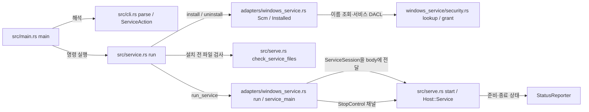

# Windows 서비스 모듈 설계

Windows 서비스는 같은 서버 시작 경로를 터미널 대신 서비스 제어 관리자(SCM)에 연결한다. `service install`은 필요한 파일을 검사한 뒤 서비스를 등록한다. `service run`은 SCM의 중지·시스템 종료 요청을 서버에 전달하고 서버 상태를 SCM에 보고한다. 예를 들어 설정 오류로 시작하지 못하면 실행 중을 보고하지 않고 종료 코드 3을 서비스 고유 종료 코드로 남긴다.

| 항목 | 값 |
| --- | --- |
| 구조 시점 | Current |
| 문서 상태 | Draft |
| 구현 대조 | [코드 대조 범위](#8-코드-대조와-시험-범위). 수동 실행 결과는 [Windows 서비스 시험](../how-to/set-up-and-verify.md#windows-서비스-시험)을 따른다. |
| 코드 위치 | `src/main.rs`, `src/cli.rs`, `src/service.rs`, `src/serve.rs`, `crates/adapters/src/windows_service.rs`, `crates/adapters/src/windows_service/security.rs` |
| 코드 지도 | [코드 지도 2절](code-map.md#2-코드-위치와-구성요소) |
| 관련 스펙 | [운영 스펙 3.7절](../specs/operations.md#37-windows-서비스-실행), OPS-074~081 |
| 관련 계약 | [CLI 계약 1.9절](../contracts/cli-v1.md#19-windows-서비스-실행) |
| 관련 ADR | [ADR-0010 Windows 서비스와 트레이 앱](../decisions/ADR-0010-windows-service-and-tray.md) |

## 1. 책임과 경계

- `src/cli.rs`는 Windows에서만 `service install --config <path> [--operator <name>]...`, `service uninstall`, `service run --config <path>`를 해석한다. 다른 OS에서는 사용법 오류다.
- `src/service.rs`는 설치·해제 순서, 진단과 종료 코드를 조립한다. SCM 호출은 adapters에 둔다.
- `src/serve.rs`는 `Host::Terminal`과 `Host::Service`가 같은 `start`를 쓰게 한다. 설정·계정·TLS·접속 ticket 공개 키 검사는 기존 함수를 재사용한다. 서비스 설치용 `check_service_files`는 로그 파일을 열거나 감시·리스너를 준비하지 않는다.
- `crates/adapters/src/windows_service.rs`는 서비스 등록·삭제, 제어 처리기, 상태 보고를 맡는다. 중계 규칙이나 G 계산은 맡지 않는다.
- 설치는 파일 ACL을 검사하거나 바꾸지 않는다. 관리자 권한으로 검사한 파일을 서비스 계정도 읽을 수 있다고 보장하지 않는다. 파일 권한과 운영 절차는 [운영 안내](../how-to/operate-relay.md)가 맡는다.
- 트레이의 메뉴·준비 상태 조회·로그인할 때 시작은 [트레이 모듈](windows-tray.md)이 맡는다.
- 조립 진입점은 `service::run`이다. adapters의 공개 경계는 `Scm`, `Installed`, `lookup_operator`, `run`, `ServiceSession`, `StatusReporter`, `StopControl`이다.

## 2. 내부 구조

화살표는 실행 중 호출 또는 값 전달이다. `ServiceInstallGateway`는 루트 조립 모듈 내부의 설치 경계다. 제품 구현은 `Scm`이고 단위 시험은 `FakeScm`을 주입한다. app·domain은 이 경계나 SCM을 알지 못한다.

| 요소(파일·심볼) | 역할 | 만들어지는 시점과 소유자 | 의존 대상 |
| --- | --- | --- | --- |
| `src/main.rs` `main`; `src/cli.rs` `parse`, `parse_service`, `ServiceAction` | 명령을 해석하고 `service::run`에 넘긴다. | 프로세스 진입 | clap·service |
| `src/service.rs` `run`, `install`, `install_with`, `ServiceInstallGateway` | 설치 순서를 수행하고 등록 후 실패를 되돌린다. `impl ServiceInstallGateway for Scm`이 실제 SCM 호출을 연결한다. | 설치 명령 동안 | cli·serve·adapters |
| `src/service.rs` `uninstall`, `run_service` | 중지된 서비스만 해제하거나 SCM dispatcher에 서버 body를 등록한다. | 각 명령 동안 | Scm·adapters `run` |
| `src/serve.rs` `Host`, `start`, `check_service_files`, `Requests`, `HostStatus` | 시작 경로를 공유하고 종료 요청 출처와 보고 대상을 바꾼다. | 서버 실행 또는 설치 전 검사 | 기존 서버 구성요소 |
| `crates/adapters/src/windows_service.rs` `Scm`, `Installed`, `lookup_operator` | SCM 핸들·등록 핸들을 소유하고 안전한 API로 설치·해제를 수행한다. | 명령 동안 | windows-service·security |
| 같은 파일의 `run`, `service_main`, `ServiceSession` | dispatcher와 서비스 스레드를 잇고 제어 채널·상태 보고자를 body에 넘긴다. | SCM 실행 동안 | windows-service·tokio mpsc |
| 같은 파일의 `StatusReporter`, `Reporter`, `Progress` | 상태 잠금을 공유하고 시작·중지 중 checkpoint를 갱신한다. | 처리기 등록 뒤부터 Stopped까지 | std 동기화·windows-service |
| `crates/adapters/src/windows_service/security.rs` `Operator`, `lookup`, `grant`, `LocalMemory` | 이름을 SID로 바꾸고 서비스 DACL에 운영자 권한을 추가한다. Win32 할당 메모리는 drop에서 해제한다. | 이름 조회·권한 부여 동안 | windows-sys |

## 3. 데이터 모델

외부 속성과 명령 형식은 CLI 계약 1.9절을 따른다. 다음은 내부 값이다.

| 이름 | 필드·형태 | 저장 위치 | 제약과 항상 지켜야 할 조건 |
| --- | --- | --- | --- |
| `ServiceAction` | `Install { config, operators }`, `Uninstall`, `Run { config }` | 메모리 | Windows에서만 정의한다. |
| `Failure` | `Reported(u8)` 또는 `Error { code, message, exit }` | 명령 반환 값 | 이미 출력한 파일 진단은 다시 출력하지 않는다. |
| `Operator` | 정렬을 보장하는 `Vec<u32>` SID와 trustee 종류 | 설치 동안 | 사용자·그룹 종류만 받는다. |
| `ScmError` | 원시 OS 번호 `i32` | 오류 반환 값 | OS 번호 없는 라이브러리 오류는 87이다. |
| `ServiceSession` | `controls`, `status` | 서버 body | 제어 수신기와 복제 가능한 상태 보고자를 전달한다. |
| `StopControl` | `Stop`, `SystemShutdown` | 무제한 mpsc 채널 | 도착 순서대로 처리한다. |
| `Progress` | `state`, `checkpoint` | `Reporter`의 Mutex | Stopped 뒤에는 다른 상태로 바꾸지 않는다. |
| `BODY`, `OUTCOME` | 서비스 body와 반환 결과의 `Mutex<Option<_>>` | 프로세스 정적 메모리 | dispatcher가 요구하는 일반 함수와 main 스레드를 잇는다. 한 프로세스의 서비스 실행 한 번을 전제로 한다. |

## 4. 처리 순서

### 4.1 설치와 되돌림

대표 입력은 `service install --config <설정 경로> --operator <사용자 또는 그룹>`이다(OPS-074·075).

| 순서 | 코드 위치(파일·심볼) | 조건·계산 | 바뀌는 상태 | 결과를 쓰는 곳 |
| --- | --- | --- | --- | --- |
| 1 | `src/service.rs` `install`; adapters `Scm::open_for_install` | CONNECT·CREATE_SERVICE로 SCM을 연다. | 설치 권한을 가진 핸들 | `install_with` |
| 2 | `src/service.rs` `install_with` | 기존 서비스가 있으면 거절한다. 모든 `--operator`를 차례로 조회한다. | `Operator` 목록 | 파일 검사·권한 부여 |
| 3 | 같은 함수; `src/serve.rs` `check_service_files` | `std::path::absolute`로 설정 경로를 바꾼 뒤 파일을 검사한다. 절대 경로 변환 실패는 원래 경로로 파일 검사에 넘긴다. | 검사 통과한 경로 | 등록 |
| 4 | `src/service.rs` `install_with` | `current_exe`를 얻고 `ServiceInstallGateway::create`를 부른다. | 새 등록 | configure |
| 5 | adapters `Scm::create`; `Installed::set_delayed_start` | OWN_PROCESS·AutoStart·가상 계정으로 등록하고 지연 자동 시작을 켠다. 복구 동작은 설정하지 않는다. | 중지된 서비스 등록 | 권한 부여 |
| 6 | `src/service.rs`의 `ServiceInstallGateway::configure`; adapters `Installed::grant` | 운영자에게 시작·중지·상태 조회·구성 조회를 허용한다. 기존 DACL 항목은 유지한다. | 서비스 접근 권한 | 명령 결과 |
| 7 | `src/service.rs` `install_with`, `run` | configure 실패면 방금 만든 등록을 삭제한다. 성공이면 설치 문장을 stdout에 쓴다. | 성공 등록 또는 되돌림 결과 | 운영자 |

설치는 서비스를 시작하지 않는다. 되돌림 삭제도 실패하면 두 OS 오류 번호와 `sc.exe delete vnc-relay` 안내를 진단에 넣는다. 성공 문장을 출력하지 못해도 이미 끝난 등록을 되돌리지 않는다.

### 4.2 SCM 실행과 종료

1. `run_service`가 adapters의 `run`에 body를 넘긴다. dispatcher가 `service_main`을 호출하면 제어 처리기를 등록하고 StartPending을 보고한다.
2. body는 `cli::silence`를 호출한 뒤 `serve::start(config, Host::Service(session))`를 실행한다. 설정 오류와 로그 열기 전 실패도 stdout·stderr에 쓰지 않는다.
3. `start`는 `serve`와 같은 순서로 서버를 준비한다. 서비스에서 `log.output = "stdout"`은 거절한다. 로그 파일을 연 뒤의 시작 오류는 운영 로그에 남긴다.
4. 서버가 준비됨에 들어가면 `HostStatus::ready`가 `StatusReporter::running`을 부른다. 시작 실패이면 이 단계를 거치지 않는다.
5. 처리기는 Stop을 `StopControl::Stop`, Shutdown을 `StopControl::SystemShutdown`으로 보낸다. Interrogate에는 성공으로 답하고 그 밖의 제어는 NotImplemented다. `Requests::wait`는 각각 `ShutdownRequest::Requested`, `CloseNow`로 바꾼다. 콘솔 신호는 등록하지 않는다.
6. 서버가 종료를 시작하면 `HostStatus::stopping`이 StopPending을 보고한다. Stop은 현재 G를 적용한다. SystemShutdown은 기존 콘솔 닫기와 같은 즉시 강제 정리 경로를 쓴다.
7. body가 반환하면 `service_main`이 Stopped를 보고한다. 0은 NO_ERROR, 그 밖은 `ServiceSpecific(code)`다. dispatcher가 돌아오면 프로세스도 그 코드로 끝난다.

StopPending은 STOP을 받지 않는다. 따라서 두 번째 `sc.exe stop`은 서비스의 두 번째 정상 종료 요청이 되지 않는다. 이 제어 경계의 실행 관찰과 1061 결과는 [Windows 서비스 시험](../how-to/set-up-and-verify.md#windows-서비스-시험)에 있다.

### 4.3 해제

`uninstall`은 CONNECT로 SCM을 열고 QUERY_STATUS·DELETE로 서비스를 연다. `Scm::uninstall`은 Stopped인지 검사한 뒤 등록만 지운다. 실행파일·설정·계정·인증서·로그에는 삭제 요청을 하지 않는다. 실행 중이면 자동으로 중지하지 않는다.

## 5. 상태와 초기화

| SCM 상태 | 수락 제어 | checkpoint·wait hint |
| --- | --- | --- |
| StartPending | 없음 | 처음 1, 1초마다 증가, 5초 hint |
| Running | STOP·SHUTDOWN | 0·0 |
| StopPending | SHUTDOWN만 | 처음 1, 1초마다 증가, 5초 hint |
| Stopped | 없음 | 0·0, 최종 종료 코드 |

일시정지·계속 제어는 제공하지 않는다. checkpoint 스레드는 Stopped가 되면 끝난다. `Reporter`는 Mutex로 상태 전이와 주기 보고를 직렬화한다. `set_service_status` 실패는 재시도용 별도 오류로 바꾸지 않는다. 코드상 SCM에는 마지막으로 성공한 상태가 남을 수 있다.

`security.rs`만 서비스 코드의 직접 `unsafe` 경계다. `windows_service.rs`의 모듈 선언에서 `#[expect(unsafe_code, reason = "Win32 account lookup and service DACL change; see docs/conventions/rust.md")]`를 적용한다. SID·DACL 포인터의 수명과 정렬, 서비스 핸들의 권한, `LocalFree` 소유권은 호출별 `SAFETY` 주석으로 설명한다. 상세 허용 범위는 [Rust 컨벤션](../conventions/rust.md#2-규칙)을 따른다.

## 6. 오류 처리

| 실패 지점 | 처리 방법 | 남는 상태 | 관련 스펙 시나리오 |
| --- | --- | --- | --- |
| 기존 등록·등록 경합 1073 | `service_exists`, 종료 1 | 기존 등록 유지 | OPS-075 |
| 운영자 이름 조회 결과 없음 | `service_operator_unknown`, 종료 2 | 등록 없음 | OPS-075 |
| 설정·TLS·ticket 공개 키 또는 stdout 로그 | 기존 진단 또는 `service_log_stdout`, 종료 3 | 등록 없음 | OPS-075 |
| 계정 파일·계정 없음 | 기존 계정 진단, 종료 5 | 등록 없음 | OPS-075 |
| SCM 접근 거절 5 | `service_access_denied`, 종료 1 | 설치 전 또는 기존 등록 유지 | OPS-075·079·080 |
| 등록 뒤 configure 실패 | `service_failed`, 종료 1, 새 등록 삭제 시도 | 삭제 실패 때만 등록 잔류 가능 | OPS-075 |
| 해제 대상 없음·중지됨 아님 | `service_not_found` 또는 `service_running`, 종료 1 | 기존 상태 유지 | OPS-080 |
| 그 밖의 SCM·실행파일 경로 오류 | `service_failed`와 OS 번호, 종료 1 | 실패 단계에 따름 | OPS-075·080 |
| dispatcher의 SCM 연결 없음 1063 | `DispatchError::NotService` → `service_controller_unavailable` 한 줄, 종료 2 | 서버를 시작하지 않음 | OPS-081 |
| 그 밖의 dispatcher·처리기 등록 실패 | `DispatchError::Failed`, 출력 없이 종료 1 | 서버 미시작 또는 SCM에 상태 미보고 | OPS-081 일부 |
| 서버 시작 실패 | Running 없이 Stopped와 기존 서버 종료 코드 보고 | 확보한 서버 자원 회수 | OPS-077 |

## 7. 설계 선택

| 선택 | 이유 | 검토한 다른 방법 | 근거 |
| --- | --- | --- | --- |
| 등록·해제 조립과 SCM API를 분리하고 `ServiceInstallGateway`로 설치 순서를 시험한다. | 실제 서비스 등록 없이 실패 단계·되돌림을 확인한다. | 각 단위 시험이 실제 SCM을 바꾸면 승격과 고정 서비스 이름이 필요하다. | 없음 |
| `Host`로 시작 경로를 공유한다. | 서비스와 터미널에서 파일 검사·리스너·중계 종료 규칙을 따로 구현하지 않는다. | 서비스용 서버 시작 코드를 복제하면 검사 순서가 갈릴 수 있다. | [CLI 계약 1.9절](../contracts/cli-v1.md#19-windows-서비스-실행) |
| `windows-service`가 등록 명령의 인수를 인용하게 한다. | Windows용 인수 전달을 라이브러리에 맡긴다. 공백 없는 경로는 따옴표 없이 등록될 수 있다. | 따옴표를 인수에 미리 넣으면 중복 인용이 된다. | 정확한 형식은 CLI 계약 1.9절 |
| 서비스 계정·지연 시작·복구 없음·운영자 권한·한 서비스 이름을 고정한다. | 채택된 서비스 운영 범위를 따른다. | 이 모듈에서 별도 선택하지 않는다. | ADR-0010 |
| 제어와 상태는 adapters 값으로 넘기고 `serve`가 종료 의미를 결정한다. | SCM 호출과 중계 수명 규칙의 경계를 유지한다. | 처리기에서 직접 중계 상태를 바꾸면 app 규칙을 OS 어댑터가 소유하게 된다. | 없음 |

## 8. 코드 대조와 시험 범위

- 날짜·대상: 2026-11-18 작업 트리의 위 파일·심볼과 테스트 소스.
- 환경·방법: 저장소 소스를 읽고 호출 순서·속성·오류 매핑·수락 제어를 본문과 대조했다.
- 결과: 본문은 대조한 코드 구조와 일치한다. 테스트 소스 대조는 실행 통과를 뜻하지 않는다. 실행 결과는 시나리오 보고서와 [Windows 서비스 시험](../how-to/set-up-and-verify.md#windows-서비스-시험)을 따른다.

| 코드 위치·시험 | 확인하는 경계 |
| --- | --- |
| `src/service.rs` `install_runs_the_steps_in_order_and_grants_every_operator` | 조회→파일 검사→등록→권한 순서와 상대 설정 경로의 절대화 |
| 같은 파일의 `install_refuses_before_registering_anything` | 기존 서비스·없는 운영자·파일 검사 실패·등록 경합·권한 거절 |
| 같은 파일의 `install_deletes_its_registration_when_a_later_step_fails` | configure 실패 뒤 삭제와 삭제 실패 안내 |
| 같은 파일의 `uses_the_start_checks_and_needs_a_log_file` | 실제 파일 검사·stdout 거절·계정 오류·로그 미생성 |
| `tests/windows_service.rs` `service_run_from_a_terminal_exits_2_without_opening_anything` | 기본 시험. 터미널 직접 run의 종료 2·한 줄 진단·로그 미생성(OPS-081 부분) |
| 같은 파일의 `install_registers_a_stopped_service_and_uninstall_keeps_the_files` | 승격 `#[ignore]`. 등록 속성·명령·DACL 추가·미시작·파일 보존(OPS-074·080 부분) |
| 같은 파일의 `install_refuses_bad_input_and_leaves_no_registration` | 승격 `#[ignore]`. 잘못된 운영자·파일·stdout과 기존 등록 보존(OPS-075 부분) |
| 같은 파일의 `the_scm_runs_the_server_and_a_stop_request_applies_the_grace` | 승격 `#[ignore]`. 준비 뒤 Running·G 중 중계·두 번째 stop 거절·자원 회수(OPS-076·080 부분) |
| 같은 파일의 `a_start_failure_stops_the_service_with_the_serve_exit_code` | 승격 `#[ignore]`. 설정·바인드·계정 읽기 오류의 서비스 고유 종료 코드(OPS-077) |
| `tests/cli.rs` `service_commands_are_usage_errors_outside_windows` | Windows가 아닌 대상의 사용법 오류 2(OPS-081 부분) |

승격 시험의 `Fixture`는 `%ProgramData%\vnc-relay-tests\<pid>-<name>`에 실행파일 복사본과 파일을 만든다. 기존 서비스나 같은 디렉터리가 있으면 시작하지 않는다. drop은 등록 명령의 실행파일 토큰이 자기 복사본과 정확히 같은 서비스만 정리한다. 실행 방법·실제 결과·미실행 항목은 [Windows 서비스 시험](../how-to/set-up-and-verify.md#windows-서비스-시험)을 따른다.

## 9. 미결정 사항

| 항목 | 영향 | 확정 위치 |
| --- | --- | --- |
| Windows 시스템 종료 시 OS 제한 시간 | 강제 정리와 로그 쓰기를 OS가 허용하는 시간 안에 끝낼 수 있는지는 코드 대조만으로 확인할 수 없다. OPS-078 재시작 시험은 미실행이다. | 서비스 검증 담당자, 운영 스펙 OPS-TBD-014, [Windows 서비스 시험](../how-to/set-up-and-verify.md#windows-서비스-시험) |
