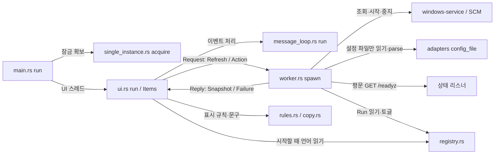

# Windows 트레이 앱 모듈 설계

트레이 앱은 Windows 서비스 `vnc-relay`의 상태를 보여 주고 시작·중지를 요청한다. UI 스레드는 Windows 기본 메뉴와 아이콘만 다룬다. 작업 스레드는 서비스 조회, 설정 읽기, `/readyz` 조회와 메뉴 동작을 처리한다. 예를 들어 서비스가 없으면 다음 조회 결과가 상태 줄과 아이콘 글을 `서비스 없음`으로 바꾸고 서비스 관련 항목을 끈다.

| 항목 | 값 |
| --- | --- |
| 구조 시점 | Current |
| 문서 상태 | Draft. ADR의 채택 범위를 구현한다. 아래 구현 판단은 사용자 채택을 뜻하지 않는다. |
| 구현 대조 | 2026-11-18 작업 트리의 `crates/tray/src/*.rs`와 시험 소스를 대조했다. 구현은 미커밋 상태다. 실행 결과는 [Windows 서비스 시험](../how-to/set-up-and-verify.md#windows-서비스-시험)에 둔다. |
| 코드 위치 | `crates/tray/src/`, `crates/tray/tests/single_instance.rs` |
| 코드 지도 | [코드 지도](code-map.md) |
| 관련 스펙 | [Windows 트레이 앱 스펙](../specs/windows-tray.md), TRAY-001~013 |
| 관련 계약 | [CLI 1.9절](../contracts/cli-v1.md#19-windows-서비스-실행), [설정 파일](../contracts/config-v4.md), [상태 엔드포인트](../contracts/ops-info-v2.md#112-상태-리스너와-엔드포인트) |
| 관련 ADR | [ADR-0010](../decisions/ADR-0010-windows-service-and-tray.md) |

## 1. 책임과 경계

- 서비스 제어 관리자(SCM)가 알려 주는 상태와 `/readyz` 결과를 스펙 2절의 표시 상태로 바꾼다. 상태별 메뉴 켜짐은 스펙 4절을 따른다.
- 등록 명령의 `--config`에서 설정 파일을 찾는다. 설정 파서는 `adapters::config_file::parse`를 재사용한다. 이 함수와 하위 설정 리더는 텍스트와 경로 값만 검사하며 다른 파일을 열지 않는다.
- 설정 중 `management.listen`, 관리 인증서의 존재 여부, `status.listen`, `log.output`만 사용한다. 계정 파일·개인키·ticket 키 파일은 열지 않는다.
- 관리 API, 관리자 로그인, 서비스 설치·해제와 서비스 설정·접근 권한 변경은 맡지 않는다.
- 외부에 공개하는 라이브러리 API는 없다. 배포 진입점은 `vnc-relay-tray.exe`다. Windows가 아닌 대상은 실패 종료 코드만 반환하며 Windows 의존성을 빌드하지 않는다.

## 2. 내부 구조

아래 화살표는 실행 중 호출 또는 채널을 통한 데이터 전달이다. UI와 작업 스레드 사이에는 메뉴 객체나 서비스 핸들을 보내지 않는다. tray는 바깥 조립 계층이며 adapters·app을 참조한다. 안쪽 계층은 tray를 참조하지 않는다.

| 파일·심볼 | 역할 | 소유자·수명 | 의존 대상 |
| --- | --- | --- | --- |
| `crates/tray/Cargo.toml` | Windows 전용 의존성과 실행파일 선언 | Cargo | 작업 공간 의존성·lint |
| `src/main.rs` `main`, `run` | GUI 서브시스템, 단일 인스턴스 확보, UI 시작 | 주 스레드, 프로세스 전체 | std, single_instance, ui |
| `src/single_instance.rs` `acquire` | 잠금 파일을 열고 비차단 배타 잠금 확보 | 반환한 `File`을 main이 끝까지 보유 | std 파일 잠금 |
| `src/ui.rs` `run`, `Items`, `icon` | 메뉴 순서·동적 줄·체크·활성 상태와 아이콘 | UI 스레드 | tray-icon, copy, rules, worker |
| `src/message_loop.rs` `run` | Win32 메시지 펌프, 최대 약 100 ms마다 안전한 callback 실행 | UI 스레드 | windows-sys |
| `src/worker.rs` `spawn`, `refresh`, `perform`, `probe_readyz` | 느린 I/O와 동작 직후·주기적 상태 갱신 | 작업 스레드 하나 | std, windows-service, adapters, app, registry, rules |
| `src/registry.rs` `language`, `sign_in`, `toggle_sign_in` | 표시 언어와 사용자 Run 값 | 호출 동안만 레지스트리 핸들 보유 | windows-registry, rules |
| `src/rules.rs` `State`, `Reason`, `config_path`, `dashboard_url` | 상태·오류·주소·명령행의 순수 규칙 | 반환 값 | std, windows-service 값 타입, copy |
| `src/copy.rs` `Language`, `Text` | 제안 TRC-001~023의 두 언어 문구 | 정적 문자열 | 없음 |
| `tests/single_instance.rs` | 자식 프로세스의 중복 실행 종료 검사 | 시험 전용 임시 디렉터리 | std |

표의 `src/` 경로는 `crates/tray/` 기준이다.

## 3. 데이터와 상태

- `Snapshot`: 표시 상태, 설정 경로, 설정 오류, 대시보드 URL, 로그 경로, Run 체크 상태다. 작업 스레드는 갱신마다 새 값을 만들고 `Arc<Snapshot>`을 UI에 전달한다. 채널 전달 때 문자열과 경로를 별도로 복제하지 않는다.
- `Request`: `Refresh` 또는 동작과 세대 번호다. `Reply`는 새 snapshot 또는 실패 동작·세대·원인이다.
- UI는 메뉴 동작마다 세대 번호를 올리고 실패 줄을 지운다. 이전 동작의 늦은 실패 응답은 버린다. 주기적 갱신은 실패 줄을 지우지 않는다.
- 설정 오류 줄은 읽기 실패 동안만 존재한다. 서비스 없음 또는 SCM 조회 실패에서는 이전 설정 경로를 보존하지 않는다.
- Run 체크는 읽은 값이 현재 실행파일을 가리킬 때만 켠다. 따옴표를 벗겨 대소문자를 구분하지 않고 비교한다. 자동 토글된 메뉴 체크는 실제 조회 값으로 되돌린 뒤 작업 결과를 반영한다.
- `rules::State::from_service`는 Stopped의 Win32 종료 코드 1077(`ERROR_SERVICE_NEVER_STARTED`)을 0으로 바꾼다. 부팅 뒤 한 번도 실행하지 않은 서비스에는 표시할 종료 코드가 없기 때문이다. `State::label`은 0을 생략하고 그 밖의 Win32·서비스 고유 코드를 표시한다.

## 4. 처리 순서와 수명

1. `main::run`은 `%LOCALAPPDATA%\vnc-relay`를 만들고 `tray.lock`을 연다. `single_instance::acquire`가 이미 잠겼다고 보고하면 GUI 객체를 만들기 전에 성공 종료한다.
2. 잠금을 얻으면 `ui::run`이 `registry::language`로 언어를 한 번 정한다. `Items::new`가 기본 메뉴를 만들고 `TrayIconBuilder`가 초기 tooltip `VNC Relay`로 아이콘을 만든다. 첫 조회 응답부터 `VNC Relay: <상태>`로 바꾼다. 왼쪽·오른쪽 클릭 모두 기본 메뉴를 연다.
3. `worker::spawn`이 채널과 작업 스레드를 만든다. UI는 `Refresh`를 보내고 메시지 펌프를 시작한다.
4. `worker::refresh`는 SCM을 CONNECT로 열고 서비스를 QUERY_STATUS·QUERY_CONFIG로만 연다. 상태·등록 명령을 얻은 즉시 두 핸들을 닫는다. 파일 읽기와 HTTP 조회 동안 서비스 핸들을 보유하지 않는다.
5. `rules::config_path`는 Windows의 따옴표·역슬래시 규칙으로 인수를 나눈다. `--config 값`과 `--config=값`을 받는다. 누락·빈 값·중복은 경로 없음이다. 서비스 등록 계약은 절대 경로를 보장한다.
6. `read_config`가 설정 파일 바이트를 읽고 UTF-8과 설정을 검사한다. 서비스 실행 중에만 `probe_readyz`가 조회한다. TCP 연결·쓰기·읽기는 하나의 1초 마감 시간을 공유한다. 제한된 상태 줄만 읽으며 HTTP 200만 준비됨으로 본다.
7. UI callback은 응답을 꺼내 상태 줄·tooltip·활성 항목·동적 줄을 바꾼다. 시작·중지는 작업 스레드가 각각 START 또는 STOP 권한만 열어 요청한다. 모든 메뉴 동작 뒤에는 성공·실패와 관계없이 곧바로 다시 조회한다. 주기 조회는 직전 조회 시작 시각 기준 2초 간격이다. I/O는 한 작업 스레드에서 순서대로 처리하므로 진행 중인 호출이 길어지면 다음 조회도 늦어진다.
8. 대시보드와 파일 위치는 GUI 프로그램인 `explorer.exe`만 실행한다. 로그 파일이 없으면 부모 디렉터리를 검사하고 연다. 파일 선택에는 `/select,<path>`를 쓴다.
9. 종료는 아이콘과 메뉴를 UI 스레드에서 해제한다. 서비스와 Run 값을 변경하지 않는다. 요청 채널이 닫히면 작업 스레드도 끝난다. UI 종료는 SCM 호출의 완료를 기다리지 않는다.

잠금은 파일 존재 여부가 아니라 열린 파일 핸들에 붙는다. OS는 보유 프로세스가 끝날 때 잠금을 해제한다. 충돌로 끝나도 같다. 따라서 이전 실행이 남긴 `tray.lock` 파일은 다음 실행을 막지 않는다. 잠금 파일은 일부러 지우지 않는다. 잠근 파일을 지우고 다시 만드는 경합을 피하기 위해서다.

## 5. 오류와 직접 Win32 호출

| 실패 | 처리 | 관련 시나리오 |
| --- | --- | --- |
| SCM 오류 1060 | 서비스 없음 | TRAY-007 |
| 그 밖의 SCM 조회 실패·알 수 없는 서비스 상태 | 확인 불가 | TRAY-006 |
| 설정 권한 없음·파일 없음·비 UTF-8·파싱 오류 | 원인 줄, 대시보드·로그 꺼짐, 실행 중이면 준비 안 됨 | TRAY-009 |
| 동작 오류 5 | 권한 없음 실패 줄 | TRAY-006, TRAY-011 |
| 탐색기·브라우저 실행 실패·디렉터리 조회 실패 | 원시 OS 번호 실패 줄 | TRAY-010 |
| Run 쓰기·삭제 실패 | 실패 줄, 다음 snapshot의 실제 체크 상태 유지 | TRAY-011 |
| 잠금·GUI 초기화·메시지 루프 실패 | 콘솔·승격 없이 실패 종료 | TRAY-001 일부 |

직접 `unsafe` 호출은 `crates/tray/src/message_loop.rs` 하나에만 있다(사용자 결정 2026-11-17(Q241)). `main.rs`의 모듈 선언은 `#[expect(unsafe_code, reason = "Win32 message loop that tray-icon needs; see docs/conventions/rust.md")]`로 이 파일에만 작업 공간의 금지를 푼다. `MsgWaitForMultipleObjects`는 메시지나 최대 100 ms 대기를 마치면 반환한다. `PeekMessageW`로 이 스레드의 메시지를 꺼내고 `TranslateMessage`·`DispatchMessageW`로 전달한다. 호출마다 포인터 수명과 스레드 소유권을 `SAFETY` 주석으로 설명한다. `WM_QUIT`을 받으면 끝난다. 레지스트리·서비스·프로그램 실행에는 안전한 라이브러리 API만 쓴다.

## 6. 구현 판단과 미결정 사항

아래 선택은 모두 **이 문서의 판단, 사용자 결정 없음**이다. 지정 라이브러리·서비스 이름·메뉴 범위·Run 경로 자체의 채택은 ADR과 스펙을 따른다.

| 판단 | 이유와 대안 | 채택 상태 |
| --- | --- | --- |
| 표시 언어: HKCU `Control Panel\Desktop`의 `PreferredUILanguages`, HKCU `Control Panel\Desktop\MuiCached`의 `MachinePreferredUILanguages`, HKLM `SYSTEM\CurrentControlSet\Control\Nls\Language`의 `InstallLanguage` 순서 | 각 MULTI_SZ에서 첫 항목만 본다. 값이 없거나 읽기 실패·빈 목록·빈 첫 항목이면 다음 값으로 넘어간다. 첫 항목의 기본 언어가 대소문자 구분 없이 `ko`이면 한국어이고 그 밖은 영어다. 두 HKCU 값 모두 쓰지 못하면 `InstallLanguage`가 `0412`일 때만 한국어다. windows-registry를 써서 직접 Win32 호출을 늘리지 않는다. | ADR-0010 6절의 구현 판단이다. 사용자 채택과 언어 전환 실행 확인은 별개다. |
| 단일 인스턴스: 사용자 LOCALAPPDATA의 파일과 `File::try_lock` | 안전한 표준 API를 쓰며 충돌 후 남은 파일도 재사용한다. Win32 이름 있는 mutex는 직접 호출 범위를 늘린다. | 스펙 3.3절의 구현 선택 |
| 아이콘: 32×32 RGBA의 둥근 녹색 사각형과 흰 연결 표식, 모든 상태에 동일 | [디자인 기준](../design/DESIGN.md)의 `primary` #12352b와 `primary-foreground` #ffffff를 재사용한다. 외부 이미지·아이콘 의존성을 추가하지 않는다. 메뉴는 Windows 기본 색·글꼴 그대로다. | TRAY-TBD-002, 사용자 채택 전 |
| 문구: 스펙 4.1절 TRC-001~023을 `copy.rs`에 모은다 | 미채택 제안을 두 언어로 구현하되 원문 관리 위치를 늘리지 않는다. | TRAY-TBD-001, 사용자 채택 전 |
| 갱신: 작업 스레드 하나·std mpsc·2초 간격·동작 직후 조회·100 ms UI wake | 느린 SCM·설정·HTTP가 메뉴 스레드를 막지 않는다. 비동기 런타임과 추가 이벤트 루프 라이브러리를 넣지 않는다. 실패 세대로 이전 응답이 다음 동작의 실패 줄을 되살리지 않게 한다. | 스펙 2절의 주기·제한 시간 판단 구현 |
| 초기 tooltip은 상태 없는 `VNC Relay`다. | Windows가 첫 tooltip을 작업 표시줄 설정의 아이콘 이름으로 보관하기 때문이다. 처음부터 상태를 넣으면 그 상태가 이름에 남는다. 첫 조회 뒤의 tooltip에는 현재 상태를 넣는다. `NotifyIconSettings`의 `InitialTooltip` 관찰은 [Windows 서비스 시험](../how-to/set-up-and-verify.md#windows-서비스-시험)에 둔다. | 이 문서의 판단, 사용자 결정 없음 |
| HTTP: std TCP, 전체 1초, 최대 128바이트 상태 줄 | HTTP 라이브러리 없이 상태 코드만 얻는다. 각 I/O에 별도 1초를 주면 전체 제한을 넘을 수 있어 남은 시간만 적용한다. 와일드카드 주소는 루프백으로 바꾼다. | ADR-0010 6절·스펙 3.7절의 구현 판단 |
| 초기화 실패: 오류 대화상자 없이 실패 종료 | 스펙은 오류 대화상자를 정하지 않았다. 서비스·Run 값에 부작용을 남기지 않는다. | 별도 오류 UI는 채택하지 않았다. |

## 7. 시험 연결과 확인 범위

모든 연결은 테스트의 `/// spec: windows-tray.md:TRAY-0NN partial`에 있다. 순수 규칙 검사는 실제 SCM·메뉴·브라우저·로그인 동작 전체를 검증하지 않으므로 부분 연결이다. Windows 전용 통합 시험은 자식의 LOCALAPPDATA를 임시 디렉터리로 바꾸고 잠금을 먼저 보유한다. 자식은 아이콘·레지스트리 접근 전 종료한다. 실제 Run 값이나 서비스는 바꾸지 않는다.

| 자동 시험 | 부분 연결 | 확인 범위 |
| --- | --- | --- |
| `rules::tests::maps_states_and_enable_table` | TRAY-003, TRAY-007 | SCM 상태 대응·메뉴 활성 표·서비스 없음의 위치 항목 |
| `displays_service_specific_and_win32_exit_codes` | TRAY-003, TRAY-007 | 서비스 고유 코드·Win32 코드·0과 Win32 1077 생략·두 언어 |
| `unreadable_config_disables_dashboard_and_log_only` | TRAY-009 | 설정 오류 때 활성 항목 |
| `constructs_dashboard_urls` | TRAY-008 | IPv4·IPv6·와일드카드·TLS URL |
| `maps_readyz_wildcards_and_preserves_other_addresses` | TRAY-003 | 상태 조회 대상 주소 |
| `parses_config_with_windows_quoting_and_equals` | TRAY-009, TRAY-010 | 인수 인용·역슬래시·두 config 형식·누락·빈 값·중복 |
| `maps_korean_primary_language_only` | TRAY-012 | 한국어·영어·일본어 태그 |
| `matches_run_value_without_quotes_and_case` | TRAY-011 | 따옴표·대소문자·다른 실행파일·추가 인수 |
| `single_instance::tests::acquires_a_stale_unlocked_file` | TRAY-002 | 남은 파일의 재사용 |
| `detects_another_handle_and_reacquires_after_release` | TRAY-002 | 보유 중 거절·해제 후 확보 |
| `worker::tests::readyz_accepts_only_http_200` | TRAY-003 | 루프백 TCP의 200·503·잘못된 응답 |
| 통합 `second_process_exits_successfully_before_creating_an_icon` | TRAY-002 | 실제 실행파일이 다른 핸들의 잠금 보유 중 0으로 종료 |

수동 확인이 필요한 범위는 TRAY-001의 메뉴·콘솔·UAC, TRAY-002의 아이콘 개수, TRAY-003의 실제 서비스 전이·시간, TRAY-004·005의 시작·중지, TRAY-006의 권한·실패 줄 수명, TRAY-007의 실행 중 설치·해제, TRAY-008의 기본 브라우저, TRAY-009의 실제 파일 권한·복구, TRAY-010의 탐색기 선택·누락 디렉터리, TRAY-011의 실제 Run 값·로그인, TRAY-012의 Windows 표시 언어, TRAY-013의 부작용·접근 파일·네트워크 관찰이다.

### 코드 대조 기록

2026-11-18 작업 트리의 `main.rs`, `single_instance.rs`, `ui.rs`, `message_loop.rs`, `worker.rs`, `registry.rs`, `rules.rs`, `copy.rs`를 읽고 본문과 대조했다. 이 절의 파일은 `crates/tray/src/` 기준이다. 스레드 분리·핸들 수명·상태 매핑·레지스트리 조회 순서는 코드에서 확인한 사실이다. 6절의 선택 이유는 구현 판단으로 구분했다. 이번 문서 변경에서는 빌드·시험·GUI 확인을 실행하지 않았다.

자동 시험·실제 SCM·메뉴·권한·탐색기·Run 값의 실행 결과와 미실행 이유는 [Windows 서비스 시험](../how-to/set-up-and-verify.md#windows-서비스-시험)에 둔다. 단위 시험의 부분 통과를 TRAY 시나리오 전체 통과로 읽지 않는다.
