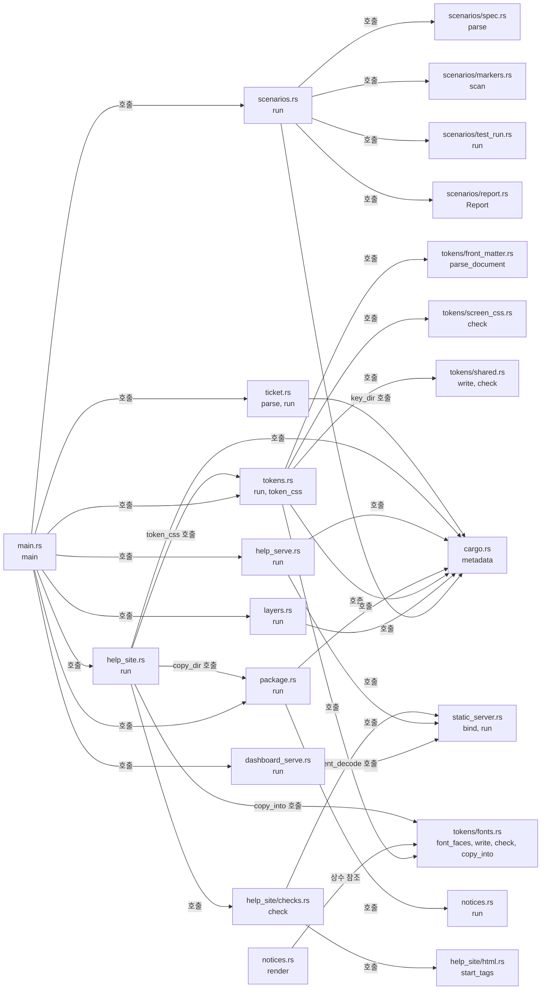

# xtask 개발 도구 모듈 설계

`xtask`는 개발 전용 crate다. `cargo xtask scenarios`는 스펙 수용 테스트 표, 테스트 코드의 시나리오 표식, `cargo test` 결과를 대조해 시나리오별 상태 보고서를 만든다. `cargo xtask layers`는 `cargo metadata`의 crate 의존을 코드 지도의 레이어 표와 대조한다. 이 두 명령은 Cargo가 주는 정보(`cargo metadata`, 테스트 빌드 JSON 메시지, 테스트 출력)만 읽고 제품 crate를 링크하지 않는다. `cargo xtask tokens`는 DESIGN.md 머리말에서 토큰 CSS를 만들고 저장된 파일과 대조한다. `cargo xtask dashboard-serve`는 `web/dashboard/`를 `127.0.0.1`에서 제공하는 로컬 미리보기 서버다. `cargo xtask help-site`는 운영자 도움말 사이트를 만들고 검사한다. `cargo xtask help-serve`는 만든 도움말 사이트를 GitHub Pages와 같은 경로로 제공하는 로컬 미리보기 서버다. `cargo xtask ticket`은 접속 ticket을 손으로 확인할 때 외부 발급 쪽을 대신해 시험용 키와 ticket을 만든다.

작업 0.9의 결정에 따라 `cargo xtask tokens`와 `cargo xtask dashboard-serve`를 추가했다(사용자 결정 2026-10-22(Q32)·(Q34)). 두 명령은 작업 4.8에서 구현했다.

`cargo xtask help-site`와 `cargo xtask help-serve`는 운영자 도움말 사이트(사용자 결정 2026-11-11(Q220~Q227))를 위해 추가했다. mdBook 0.5.4로 만든다는 것은 사용자 결정 2026-11-11(Q223)이다. 빌드·검사를 xtask 명령으로 두는 형태는 이 문서의 판단이다(사용자 결정 없음). 사이트 화면과 동작은 [도움말 사이트 화면 스펙](../specs/help-site.md)이, 설치·빌드·게시 절차는 [도움말을 빌드하고 게시하는 방법](../how-to/publish-help.md)이 정한다.

`cargo xtask notices [--check]`는 두 배포 대상의 일반·빌드 의존성 합집합과 라이선스 전문을 루트 `THIRD-PARTY-NOTICES.txt`에 만든다. 실행 파일에 넣는 대시보드 글꼴(Pretendard)의 라이선스 전문도 같은 파일에 넣는다. `--check`는 저장된 파일과 다시 만든 내용을 대조한다. 허용 라이선스 판정은 계속 `cargo deny`가 맡는다. 절차와 OPS-021 부분 증거는 [라이선스 검사 how-to](../how-to/check-dependency-licenses.md)에 있다.

`cargo xtask package`는 실행한 OS(Windows x64 또는 Linux x64)용 배포 묶음을 만든다. release 빌드와 `notices --check`를 거친 뒤 [수동 운영 안내 3.1절](../how-to/operate-relay.md#31-release-빌드와-묶음)의 파일을 모아 Windows는 zip, Linux는 tar.gz로 압축하고 SHA-256 파일을 쓴다(사용자 결정 2026-11-08(Q161·Q164)). 버전이 `연.월.순서` 규칙(Q165)이 아니면 빌드 전에 실패한다. 절차는 [릴리스 how-to](../how-to/release.md)에 있다.

`cargo xtask ticket keys`와 `cargo xtask ticket issue`는 접속 ticket을 손으로 확인하는 시험 도구다. 제품은 외부 발급 쪽이 서명한 ticket을 확인만 하고 발급하지 않는다([ADR-0009](../decisions/ADR-0009-optional-relay-access-ticket.md)). 시험용 발급은 개발 전용 xtask 명령으로 두고 실행파일과 배포 묶음에는 넣지 않는다(사용자 결정 2026-11-13(Q233)). `keys`는 역할의 P-256 키 쌍을 만들어 공개 키 JWKS 파일과 개인 JWK 파일을 쓴다. `issue`는 그 개인키로 ES256 ticket 하나를 서명해 표준 출력에 쓴다. 형식은 [WebSocket 계약 1.9.2절](../contracts/websocket-relay-v2.md#192-ticket-형식과-클레임)과 [설정 계약 1.11절](../contracts/config-v4.md#111-접속-ticket-공개-키-파일-형식)을 따른다. 사용 절차는 [수동 운영 안내 3.10.1절](../how-to/operate-relay.md#3101-시험용-키와-ticket으로-확인하기)에 있다.

| 항목 | 값 |
| --- | --- |
| 구조 시점 | Current |
| 문서 상태 | Draft |
| 구현 대조 | Verified — [대조 기록](#대조-기록) |
| 코드 위치 | `xtask/` |
| 코드 지도 | [코드 지도 2절](code-map.md#2-코드-위치와-구성요소) |
| 관련 스펙 | 없음. 모든 스펙의 수용 테스트 표를 읽는다. `help-site`의 검사는 [도움말 사이트 화면 스펙](../specs/help-site.md) HELP-004·HELP-016의 정적 부분을 맡는다. |
| 관련 계약 | `ticket`만 해당한다. [WebSocket 계약 1.9.2절](../contracts/websocket-relay-v2.md#192-ticket-형식과-클레임)의 ticket 형식과 [설정 계약 1.11절](../contracts/config-v4.md#111-접속-ticket-공개-키-파일-형식)의 공개 키 파일 형식을 따른다. |
| 관련 ADR | `ticket`만 해당한다. [ADR-0009](../decisions/ADR-0009-optional-relay-access-ticket.md)의 외부 발급 쪽을 시험에서 대신한다. |

## 1. 책임과 경계

- 맡는 책임:
  - 시나리오 ID 수집, 표식 해석, 테스트 결과 대조, 보고서 작성([테스트 컨벤션 7절](../conventions/testing.md#7-테스트와-스펙-시나리오-연결))
  - 작업 공간 crate 의존 검사([코드 지도 레이어 표](code-map.md#레이어와-의존-방향))
  - 배포 의존성 고지 생성과 대조. 외부 소스 구현은 읽거나 복사하지 않고 crate 메타데이터와 고지 파일만 읽는다.
  - 실행한 OS의 배포 묶음 생성과 버전 형식 검사
  - 도움말 사이트 생성과 정적 검사: 두 책을 mdBook으로 빌드하고 사이트 루트·토큰 CSS·글꼴을 더한 뒤 목차·제목·언어·링크·그림·외부 주소를 검사한다.
  - 로컬 미리보기 서버: 대시보드 파일과 만든 도움말 사이트를 `127.0.0.1`에서 제공한다. 두 명령은 한 정적 서버 구현(`static_server.rs`)을 함께 쓴다.
  - 접속 ticket 시험 도구: 역할의 P-256 키 쌍, 공개 키 JWKS 파일, 개인 JWK 파일, ES256 ticket을 만든다(사용자 결정 2026-11-13(Q233)).
- 맡지 않는 책임:
  - 라이선스 검사. [의존성 라이선스 검사](../how-to/check-dependency-licenses.md)의 `cargo deny`가 맡는다.
  - 모듈 안의 입출력 타입 금지. `crates/app/clippy.toml`과 `cargo clippy`가 맡는다.
  - 대시보드 테스트 결과 수집. 대시보드 브라우저 테스트는 Rust 통합 테스트라서 기존 스캐너가 읽는다(사용자 결정 2026-10-22(Q35)). 이 명령이 따로 모으지 않는다.
  - mdBook 설치와 GitHub Pages 게시. mdBook은 [도움말 how-to](../how-to/publish-help.md)의 절차로 설치하고, 게시는 `.github/workflows/help.yml`이 맡는다. 도움말 사이트의 브라우저 동작 검사는 루트 `tests/help_site.rs`가 맡는다.
  - 운영 ticket 발급과 운영 서명 키 보관. 외부 발급 쪽이 맡는다. `ticket`이 만든 키는 시험에만 쓴다. 거절을 일으키는 잘못된 ticket(DER 서명, 잘못된 클레임 등)도 만들지 않는다. 그런 거절은 자동 시험(WS-037~046)이 확인한다.
- 다른 모듈에 공개하는 기능: 없음. 명령행은 `cargo xtask scenarios [--require-all]`, `cargo xtask layers`, `cargo xtask tokens [--check]`(사용자 결정 2026-10-22(Q32)), `cargo xtask dashboard-serve [--port N]`(사용자 결정 2026-10-22(Q34), 기본 포트 8080), `cargo xtask notices [--check]`, `cargo xtask package`(사용자 결정 2026-11-08(Q161)), `cargo xtask help-site`, `cargo xtask help-serve [--port N]`(기본 포트 8090), `cargo xtask ticket keys <viewer|server> [--dir <디렉터리>]`, `cargo xtask ticket issue <viewer|server> <중계 ID> [--dir <디렉터리>] [--issuer <값>] [--relay-host <값>] [--lifetime <초>] [--session <초>] [--subject <값>]`(사용자 결정 2026-11-13(Q233))이다. 두 미리보기 명령은 포트 `0`을 받으면 OS가 고른 빈 포트를 쓰고 그 주소를 출력한다. 별칭은 `.cargo/config.toml`의 `[alias] xtask`다.

## 2. 내부 구조

화살표는 실행 중 호출이다.

| 요소(파일·심볼) | 역할 | 만들어지는 시점과 소유자 | 의존 대상 |
| --- | --- | --- | --- |
| `xtask/src/main.rs` `main`, `Error` | 하위 명령 선택, 사용법 오류(종료 코드 2. `ticket`은 이유를 먼저 출력), 오류 출력 | 명령 실행마다 | `scenarios`, `layers`, `tokens`, `dashboard_serve`, `notices`, `package`, `help_site`, `help_serve`, `ticket` |
| `xtask/src/cargo.rs` `metadata`, `Workspace`, `command` | `cargo metadata --no-deps`를 읽어 패키지(이름·버전)·대상·의존 목록을 만든다. 하위 Cargo 명령은 환경 변수 `CARGO`의 Cargo로 실행한다. | 명령마다 한 번 | serde_json |
| `xtask/src/scenarios.rs` `run`, `locate`, `link` | 보고 순서 조정, 표식 파일을 테스트 대상과 모듈 경로로 바꾸기, 시나리오별 테스트 연결 | `scenarios` 실행마다 | 하위 모듈, `cargo` |
| `xtask/src/scenarios/spec.rs` `parse` | `## ` 제목에 "수용 테스트"가 들어간 절의 표에서 첫 칸이 `<접두어>-<숫자>`인 행을 시나리오로 읽는다. | 스펙 파일마다 | 없음 |
| `xtask/src/scenarios/markers.rs` `scan`, `Marker` | 주석·문자열·문자 리터럴을 건너뛰는 작은 어휘 분석기로 `/// spec:` 표식, 테스트 속성, 인라인 `mod` 중첩, 함수 이름을 찾는다. 표식 끝의 ` partial`은 `Marker::partial`이 된다. 다른 낱말이 붙으면 표식 오류다. | `.rs` 파일마다 | `spec::is_scenario_id` |
| `xtask/src/scenarios/test_run.rs` `run` | 테스트 빌드 JSON에서 실행파일과 대상 소스 파일을 짝짓고, `cargo test` 출력에서 테스트별 결과를 읽는다. | `scenarios` 실행마다 | `cargo` |
| `xtask/src/scenarios/report.rs` `Report`, `Status` | 시나리오 상태 판정, 판정 사유, Markdown 보고서 작성 | `scenarios` 실행마다 | 없음 |
| `xtask/src/layers.rs` `RULES`, `APPROVED`, `check` | 패키지별 허용 내부 crate·외부 crate 규칙, 같은 외부 crate의 버전 요구 일치 검사 | `layers` 실행마다 | `cargo` |
| `xtask/src/tokens.rs` `run`, `tokens_from`, `render_css`, `write_outputs`, `check_outputs`, `token_css`, `MOCKUP_PATHS` | DESIGN.md 머리말의 `colors`·`spacing`·`rounded`·`typography`를 CSS 사용자 정의 속성 목록으로 바꾸고 `:root` 블록과 글꼴 `@font-face` 규칙을 만든다. `@font-face`의 `url()` 기준만 토큰 파일(`fonts`)과 목업(`../../../web/dashboard/fonts`)이 다르다. 기본 실행은 토큰 CSS 두 파일, `MOCKUP_PATHS`의 목업 두 개(`dashboard.html`·`help-site.html`)의 표식 사이 블록, 로그인 공통 복사본(`tokens/shared.rs`), 글꼴 복사본(`tokens/fonts.rs`)을 쓴다. `--check`는 같은 곳을 비교하고 화면 CSS 검사를 더한다. `token_css`는 토큰 파일과 같은 CSS를 돌려준다. `help_site`가 도움말 사이트의 `assets/tokens.css`로 쓴다. | 명령마다 | `tokens/front_matter.rs`, `tokens/screen_css.rs`, `tokens/shared.rs`, `tokens/fonts.rs`, `cargo.rs`의 `metadata` |
| `xtask/src/tokens/front_matter.rs` `parse_document`, `Value` | 머리말의 YAML 부분집합(들여쓰기 맵, 한 줄 스칼라)만 읽는다. 지원하지 않는 문법은 `DESIGN.md:줄번호:` 형식의 오류로 보고한다. | 명령마다 | 없음 |
| `xtask/src/tokens/screen_css.rs` `check` | 토큰 CSS 파일을 뺀 `web/dashboard/`와 `web/help/` 아래 `.css`에서 `#` 색, `rgb(`·`hsl(`·`url(`·`@import`, `@media` 밖의 `px`·`em`·`rem`, `font-weight` 값, 정의되지 않은 `var(--…)`를 찾는다. | `--check` 실행마다 | 없음 |
| `xtask/src/tokens/shared.rs` `SHARED_FILES`, `write`, `check` | `SHARED_FILES` 목록 8개(`app/components/`·`app/styles/` 파일 7개와 `app/language.js`)를 `login/`의 같은 상대 경로에 쓴다. 파일 첫 줄에 원본 경로를 밝히는 머리말을 붙인다. `--check`는 복사본을 원본과 비교하고, 복사 디렉터리에 목록에 없는 파일이 있으면 알린다. | 명령마다 | `tokens.rs`의 `first_difference`·`read_text`, `cargo.rs`의 `display_path` |
| `xtask/src/tokens/fonts.rs` `FONT_FACES`, `font_faces`, `write`, `check`, `copy_into`, `LICENSE_PATH`, `NOTICE_TITLE` | 글꼴 원본 `web/dashboard/fonts/`의 woff2 두 개(400·700)를 `app/fonts/`와 `login/fonts/`에 바이트 그대로 쓴다. 머리말은 붙이지 않는다. `@font-face` 규칙 문자열을 만든다. `--check`는 복사본 바이트를 원본과 비교하고, 두 `fonts/`에 목록에 없는 파일이 있으면 알린다. `copy_into`는 woff2 두 개와 `LICENSE.txt`를 주어진 디렉터리(도움말 사이트의 `assets/fonts/`)에 쓴다. | 명령마다 | `cargo.rs`의 `display_path` |
| `xtask/src/static_server.rs` `Site`, `bind`, `run`, `resolve`, `respond`, `content_type`, `percent_decode` | `127.0.0.1:포트`에 HTTP/1.1 정적 서버를 연다. 연결은 한 번에 하나씩 처리하고 GET·HEAD만 받는다(그 밖은 405). `/`는 `Site::home`으로 302 보낸다. 마운트에서 끝 `/`가 빠진 주소와 끝 `/`가 빠진 디렉터리 주소는 `/`를 붙여 302 보낸다. 디렉터리는 그 안의 `index.html`을 준다. 마운트 밖이거나, 없거나, 정규화한 경로가 루트 밖이면 404다. 404 본문은 `Site::not_found` 페이지이며, 없으면 빈 본문이다. 모든 응답에 `X-Content-Type-Options: nosniff`, `Cache-Control: no-store`, `Referrer-Policy: no-referrer`를 붙이고, `Site::csp`가 있으면 CSP 헤더를 더한다. 확장자 `.html`·`.css`·`.js`·`.svg`·`.png`·`.woff2`·`.txt`만 제공한다. | 미리보기 명령마다, 프로세스를 끝낼 때까지 | `std::net`만 쓴다. |
| `xtask/src/dashboard_serve.rs` `run`, `CSP` | `web/dashboard/`를 `Site`로 정한다. 마운트는 `/`, `/`의 이동 위치는 `/preview/index.html`, CSP는 `default-src 'self'; frame-ancestors 'none'`, 없는 경로는 빈 404다. 미리보기와 테스트 페이지 주소를 출력한다. | 명령마다 | `static_server` |
| `xtask/src/help_site.rs` `run`, `mdbook`, `LANGUAGES`, `THEME_DIR`, `SITE_DIR` | 환경 변수 `MDBOOK`의 경로나 `PATH`의 `mdbook`을 실행해 버전 출력이 `mdbook v0.5.4`인지 확인한다. `<대상 디렉터리>/help-stage/`와 `help-site/`를 지운다. 책마다 `docs/help/<언어>/`와 테마 `web/help/theme/`을 `help-stage/<언어>/`(테마는 그 안의 `theme/`)에 모으고 `mdbook build`로 `help-site/<언어>/`에 만든다. mdBook의 영어 404 페이지 `<언어>/404.html`을 지운다. `web/help/site/`(언어 선택·404 페이지·`assets/`)를 복사하고 `assets/tokens.css`·`assets/fonts/`·`assets/favicon.svg`를 쓴다. 마지막으로 `checks::check`의 문제를 한 줄씩 출력한다. | `help-site` 실행마다 | `cargo::metadata`, `tokens::token_css`, `tokens::fonts::copy_into`, `package::copy_dir`, `help_site/checks.rs` |
| `xtask/src/help_site/checks.rs` `check`, `ALLOWED_LINKS`, `REPOSITORY_BLOB` | 만든 사이트를 검사한다. ① 두 `SUMMARY.md`의 장 파일 목록과 순서가 같다. ② 장마다 `<언어>/<이름>.html`이 있고, `html`의 `lang`이 책 언어이며, `main` 안 `h1`이 하나다. ③ `<언어>/404.html`이 없다. ④ 모든 HTML의 `a`·`link`의 `href`와 `script`·`img`·`iframe`·`source`·`audio`·`video`·`embed`·`object`의 주소를 검사한다. 빈 주소(공백뿐인 값 포함)는 실패다. 사이트 안 상대 경로와 `/vnc-relay/` 절대 경로는 출력 디렉터리 안의 파일을 가리켜야 하고, `#절`은 대상 HTML의 `id`여야 한다(퍼센트 디코딩 후 비교). `http(s)://`·`//` 주소는 `a`에서만 허용 목록 `ALLOWED_LINKS` 안일 때 통과하고, 그 밖의 요소는 외부 자원이라 실패다. `REPOSITORY_BLOB` 아래 링크는 저장소에 그 경로가 있어야 한다. 그 밖의 주소 형식(`mailto:`·`javascript:`·`data:` 등)은 실패다. ⑤ `img`의 `alt`가 비어 있지 않다. ⑥ 모든 CSS의 `url(…)`·`@import`가 외부 주소가 아니고, 상대 경로의 대상 파일이 있다. `data:` 주소는 외부 요청이 없으므로 통과한다. | `help-site` 실행마다 | `help_site/html.rs`, `static_server::percent_decode` |
| `xtask/src/help_site/html.rs` `start_tags`, `Tag` | 주석, `<!…>`·`<?…>`, `script`·`style`의 내용을 건너뛰고 시작 태그의 이름과 속성(큰따옴표·작은따옴표·따옴표 없는 값, 값 없는 속성)을 읽는다. 속성 값의 문자 참조는 `&amp;`·`&quot;`·`&#39;`·`&lt;`·`&gt;`와 숫자 참조만 푼다. | 검사할 HTML 파일마다 | 없음 |
| `xtask/src/help_serve.rs` `run`, `MOUNT` | `<대상 디렉터리>/help-site/`를 `Site`로 정한다. 마운트와 `/`의 이동 위치는 `/vnc-relay/`, CSP 헤더는 없다(GitHub Pages처럼 페이지의 `meta` CSP가 적용된다). 없는 경로는 사이트 루트의 `404.html`을 404로 준다. 사이트가 없으면 `help-site`를 먼저 실행하라는 오류로 멈춘다. | 명령마다, 프로세스를 끝낼 때까지 | `cargo::metadata`, `static_server` |
| `xtask/src/notices.rs` `run`, `render`, `tree_packages`, `collect_texts` | 두 대상의 `cargo tree --edges normal,build` 합집합을 `cargo metadata`의 이름·버전·라이선스·패키지 경로와 연결한다. 고지 파일을 재귀 수집하고 정렬해 저장하거나 대조한다. crate 고지 뒤에 `tokens/fonts.rs`의 `LICENSE_PATH` 전문을 붙인다. | 명령마다 | std, serde_json, `cargo::command`·`cargo::display_path`, `tokens/fonts.rs`의 상수 |
| `xtask/src/package.rs` `run`, `check_version`, `archive_command`, `copy_dir`, `sha256` | 버전 형식 검사, `cargo fetch --locked`, release 빌드, `notices::run(true)`, 묶음 디렉터리 구성, OS `tar`로 압축, SHA-256 파일 쓰기. Windows는 `%SystemRoot%\System32\tar.exe -a`(zip), Linux는 GNU `tar`(소유자 0)다. SHA-256은 FIPS 180-4를 직접 구현했다. `copy_dir`는 디렉터리를 재귀 복사하고 Unix 권한을 디렉터리 `0755`, 파일 `0644`로 맞춘다. `help_site`도 이 함수를 쓴다. | `package` 실행마다 | std, `cargo::metadata`·`command`·`display_path`, `notices::run` |
| `xtask/src/ticket.rs` `parse`, `run`, `key_dir`, `write_keys`, `load_key`, `issue`, `Role`, `Claims` | 인자 검사와 기본값, 키 디렉터리 결정, P-256 키 쌍 생성과 두 키 파일 쓰기, 개인 JWK 읽기, 클레임 구성과 ES256 서명, base64url 인코딩·디코딩, RFC 7638 지문 | `ticket` 실행마다 | aws-lc-rs(키 생성·서명·SHA-256·난수), serde_json, `cargo::metadata` |

## 3. 데이터 모델

| 이름 | 필드·형태 | 저장 위치 | 제약과 항상 지켜야 할 조건 |
| --- | --- | --- | --- |
| `TestKey` | (테스트 대상 루트 소스 파일 경로, 대상 안 테스트 경로 `a::b::fn`) | 메모리 | 표식 쪽 키와 `cargo test` 출력 쪽 키가 같은 규칙으로 만들어진다. |
| `Outcome` | `Passed`, `Failed`, `Ignored` | 메모리 | `cargo test` 출력 한 줄에서 하나 |
| `TestEntry` | 파일, 테스트 경로, `Outcome`(없으면 이번 실행에 없음), `partial` | 메모리 | `partial`은 그 테스트를 시나리오에 연결한 표식의 값이다. 한 테스트가 시나리오마다 다른 값을 가질 수 있다. |
| `Status` | `Passed`(통과), `Partial`(부분), `Failed`(실패), `NotRun`(미실행), `Unlinked`(미연결) | 메모리 | 이 순서로 판정한다. 실패가 하나라도 있으면 실패, ` partial`이 없는 통과가 있으면 통과, 통과가 모두 ` partial`이면 부분, 테스트는 있으나 실행 결과가 없거나 무시되면 미실행, 테스트가 없으면 미연결 |
| `Problem` | 위치(`파일:줄`), 내용 | 메모리 | 보고서의 `오류`. 1건이라도 있으면 판정은 실패다. |
| `Token` | `name`(`--color-…`처럼 CSS 사용자 정의 속성 이름), `value`(DESIGN.md 원문 값) | 메모리 | 머리말 순서를 따른다. 허용하지 않는 키는 오류다. |
| 보고서 | Markdown | `<Cargo 대상 디렉터리>/scenario-report.md` | 저장소에 넣지 않는다. 실행마다 덮어쓴다. |
| `Site` | `root`(정규화한 디렉터리), `mount`(`/`로 시작하고 끝나는 URL 경로), `home`(`/`의 이동 위치), `csp`(CSP 헤더 값 또는 없음), `not_found`(404 본문 파일 또는 없음) | 메모리 | `root` 밖의 파일은 제공하지 않는다. |
| 도움말 사이트 | `index.html`·`404.html`(사이트 루트), `assets/`(`tokens.css`·`site.css`·`lang.js`·`favicon.svg`·`fonts/`), `ko/`·`en/`(mdBook 출력) | `<Cargo 대상 디렉터리>/help-site/`. 모으는 중간 파일은 `help-stage/` | 저장소에 넣지 않는다. 실행마다 지우고 다시 만든다. GitHub Pages에는 이 디렉터리를 그대로 올린다. |
| 키 디렉터리 | `--dir` 값 또는 `<Cargo 대상 디렉터리>/ticket/` | 파일 시스템 | 기본 위치는 저장소에 넣지 않는 대상 디렉터리 안이다. 같은 이름의 파일이 있으면 `keys`가 쓰지 않는다. |
| 시험 공개 키 파일 | `{"keys":[{"alg","crv","kid","kty","use","x","y"}]}` | `<키 디렉터리>/<역할>-ticket.jwks` | [설정 계약 1.11절](../contracts/config-v4.md#111-접속-ticket-공개-키-파일-형식) 형식이다. 키 하나, `d` 없음. `kid`는 공개 키의 RFC 7638 JWK 지문(SHA-256, base64url 43자)이다. |
| 시험 개인 JWK | 공개 키의 멤버와 `d`(개인 스칼라 32바이트, base64url) | `<키 디렉터리>/<역할>-ticket.private.jwk` | Unix에서는 권한 `0600`으로 만든다. Windows에서는 디렉터리 권한을 따른다. 저장소와 배포 묶음에 넣지 않는다. |
| 시험 ticket | 헤더 `{"alg":"ES256","kid"}`, 클레임 `iss`·`aud`·`rh`·`rid`·`jti`·`iat`·`exp`와 선택 `sx`·`sub`, R‖S 64바이트 서명 | 표준 출력 한 줄 | `aud`는 역할의 고정 값이다. `jti`는 16바이트 난수, `iat`는 현재 Unix 초, `exp = iat + 수명`, `sx = iat + --session`이다. |

## 4. 처리 순서

대표 흐름은 `cargo xtask scenarios`다.

| 순서 | 코드 위치(파일·심볼) | 조건·계산 | 바뀌는 상태 | 결과를 쓰는 곳 |
| --- | --- | --- | --- | --- |
| 1 | `xtask/src/cargo.rs` `metadata` | `cargo metadata --format-version 1 --no-deps` | 작업 공간 루트, 대상 디렉터리, 패키지 목록 | 2~4단계 |
| 2 | `xtask/src/scenarios.rs` `load_specs`, `spec::parse` | `docs/specs/` 아래 `.md` 중 `README.md`·`AGENTS.md`를 뺀 파일. 수용 테스트 절이 없거나, 시나리오가 없거나, ID가 중복되면 오류 | 스펙별 시나리오 ID 목록 | 5단계 |
| 3 | `xtask/src/scenarios.rs` `collect_marked_tests`, `markers::scan`, `locate` | `xtask`를 뺀 패키지의 `src/`·`tests/` 아래 `.rs` 파일. 파일 위치로 테스트 대상과 모듈 경로를 정한다. `foo/mod.rs`는 `foo`다. | 표식이 붙은 테스트와 `TestKey`, 표식 오류 | 5단계 |
| 4 | `xtask/src/scenarios/test_run.rs` `build`, `run` | `cargo test --workspace --no-run --message-format=json-render-diagnostics`로 실행파일 이름을 대상 소스 파일에 짝짓는다. 이어 `cargo test --workspace --no-fail-fast`를 실행하고 표준 출력과 표준 오류를 한 파이프로 읽는다. `Running ... (<실행파일>)` 줄이 다음 테스트 결과의 대상을 정한다. 문서 테스트는 건너뛴다. | `TestKey`별 `Outcome`, `cargo test` 종료 상태 | 5단계. 출력은 표준 오류에 그대로 보인다. |
| 5 | `xtask/src/scenarios.rs` `link` | 표식의 스펙 경로와 ID가 2단계 목록에 없으면 오류 | 시나리오별 테스트와 `Status` | 6단계 |
| 6 | `xtask/src/scenarios/report.rs` `Report::render`, `verdict_text` | 판정 실패 사유: 오류, 실패 시나리오, `cargo test` 실패, `--require-all`이면 부분·미실행·미연결 | 보고서 파일 | 표준 출력에 요약·보고서 경로·판정, 종료 코드 0(통과) 또는 1(실패) |

`cargo xtask layers`는 1단계 다음에 `layers::check`를 실행한다. 패키지마다 `RULES`의 허용 내부 crate와 외부 crate 규칙을 적용하고, 같은 외부 crate의 버전 요구가 패키지마다 다르면 위반으로 본다. `RULES`에 없는 패키지도 위반이다.

`cargo xtask tokens`와 `cargo xtask tokens --check`는 앞부분이 같다. `cargo metadata`로 루트를 찾고, DESIGN.md 머리말을 `parse_document`로 읽어 `tokens_from`으로 토큰 목록을 만든다(`version`·`name`·`description`·`components`는 뺀다). `render_css`가 `:root` 블록을 만든다. 기본 실행(`write_outputs`)은 토큰 CSS 두 파일과 `MOCKUP_PATHS`의 목업마다 `DESIGN-TOKENS:START`·`END` 표식 사이 블록을 쓴다(`replace_mockup_block`). `shared::write`가 로그인 공통 복사본도 함께 쓴다. `--check`(`check_outputs`)는 같은 곳을 비교하고 화면 CSS 검사를 더한다. 목업의 차이는 목업 파일 경로와 표식 사이 블록 안의 줄 번호로 알린다. 복사본은 `shared::check`가 원본과 비교하고, 복사 디렉터리에서 목록에 없는 파일을 찾는다. 차이는 한 건씩 출력하고 `tokens --check: 실패 (N건)`, 종료 코드 1이다. 차이가 없으면 `통과`, 종료 코드 0이다.

`cargo xtask dashboard-serve`는 `web/dashboard/`의 `Site`를 정하고 `static_server::run`을 실행한다. 서버는 `127.0.0.1:포트`에 연결한 뒤 연결마다 요청 하나를 처리한다. 요청 머리는 8KiB까지 읽고(`MAX_HEAD`), 읽기와 쓰기 제한 시간은 5초(`IO_TIMEOUT`)다.

`cargo xtask help-site`는 다음 순서로 진행한다. ① `cargo metadata`로 루트와 대상 디렉터리를 읽는다. ② `mdbook --version`이 `mdbook v0.5.4`인지 확인한다. ③ `help-stage/`와 `help-site/`를 지운다. ④ 언어(`ko`, `en`)마다 `docs/help/<언어>/`를 `help-stage/<언어>/`로, `web/help/theme/`을 `help-stage/<언어>/theme/`으로 복사하고 `mdbook build help-stage/<언어> --dest-dir help-site/<언어>`를 실행한다. 이어 `help-site/<언어>/404.html`을 지운다. ⑤ `web/help/site/`를 `help-site/`에 복사한다. `token_css`의 결과를 `assets/tokens.css`에 쓰고, `fonts::copy_into`로 `assets/fonts/`를 채우고, `web/help/theme/favicon.svg`를 `assets/favicon.svg`로 복사한다. ⑥ `checks::check`가 1~6번 검사를 한다(2절 표). 문제는 `<출력 기준 경로>: <내용>` 한 줄씩 출력하고 `help-site: 실패 (N건)`, 종료 코드 1이다. 문제가 없으면 `help-site: 통과`와 사이트 경로를 출력하고 종료 코드 0이다.

`cargo xtask help-serve`는 `help-site/index.html`이 있는지 확인하고, 그 디렉터리의 `Site`로 `static_server::run`을 실행한다. 시작할 때 `http://127.0.0.1:<포트>/vnc-relay/`를 출력한다.

`cargo xtask notices`는 Cargo 메타데이터에서 루트를 찾는다. Windows·Linux 대상의 메타데이터와 일반·빌드 의존성 트리를 오프라인으로 각각 읽는다. 타깃 필터는 호스트 빌드 의존성을 빠뜨릴 수 있으므로 두 메타데이터를 먼저 합친다. 트리 합집합과 메타데이터의 빌드 의존성 하위 그래프에 있는 외부 crate를 고른다. 이 추가 합집합은 호스트별 빌드 간선 차이를 보수적으로 포함해 두 OS에서 같은 고지를 만든다. `collect_texts`는 패키지 안의 `LICENSE*`·`LICENCE*`·`COPYING*`·`NOTICE*`·`UNLICENSE*`·`COPYRIGHT*` 파일과 명시된 `license_file`을 모은다. crate·상대 경로 순으로 전문을 넣고 마지막에 Cargo.lock 입력 전체를 넣는다. 줄 끝만 LF로 통일한다. `--check`는 이 결과 전체가 같을 때만 통과한다. 경로·시각·대상 디렉터리는 산출물에 넣지 않는다.

고지 파일이 없거나 crate를 메타데이터에 연결하지 못하면 종료 코드 1로 중단한다. 읽기·쓰기 오류와 패키지 안 심볼릭 링크도 오류다. `--check`는 저장소를 바꾸지 않는다. 생성 도중 실패하면 기존 고지 파일을 덮어쓰지 않는다. 마지막 파일 쓰기 자체의 오류는 파일을 일부 바꿀 수 있으므로 다시 생성한다.

`cargo xtask package`는 다음 순서로 진행한다. ① `cargo metadata`로 루트·대상 디렉터리·`vnc-relay` 버전을 읽고 `check_version`으로 형식을 검사한다. ② `cargo fetch --locked`로 두 대상의 의존성 소스를 받는다. `notices --check`가 오프라인으로 두 대상의 고지 파일을 읽기 때문이다. ③ `cargo build --release --locked --package vnc-relay`. ④ `notices::run(true)`. 대조가 실패하면 묶음을 만들지 않고 종료 코드 1이다. ⑤ `<대상 디렉터리>/package/vnc-relay-<버전>-<os>-x64/`를 지우고 다시 만든 뒤 실행파일, `examples/relay.toml`(`relay.toml`로), `README.md`·`LICENSE`·`THIRD-PARTY-NOTICES.txt`·`GLOSSARY.md`, `docs/` 전체를 복사한다. Unix에서는 원본 권한과 관계없이 디렉터리·실행파일을 `0755`, 나머지 파일을 `0644`로 맞춘다. WSL에서 Windows 드라이브(`/mnt/d`)의 파일은 모두 `0777`로 보이기 때문이다. ⑥ 같은 이름의 묶음 파일을 지우고 `package/`에서 OS `tar`로 디렉터리 하나를 압축한다. ⑦ 묶음 바이트의 SHA-256을 `<묶음>.sha256`에 `sha256sum` 형식으로 쓰고, 표준 출력에 `package: <경로>`와 `sha256: <값>`을 쓴다. 경로는 저장소 안이면 상대 경로, 밖이면 절대 경로다.

`cargo xtask ticket keys <역할>`은 다음 순서로 진행한다. ① 인자를 검사한다. ② `--dir`가 없으면 `cargo metadata`의 대상 디렉터리 아래 `ticket/`을 키 디렉터리로 쓴다(`key_dir`). ③ `<역할>-ticket.jwks`나 `<역할>-ticket.private.jwk`가 이미 있으면 아무것도 쓰지 않고 멈춘다. ④ `EcdsaKeyPair::generate`로 P-256 키를 만든다. 공개 점에서 `x`·`y`를, 개인 스칼라에서 `d`를, `x`·`y`의 RFC 7638 지문에서 `kid`를 구한다. ⑤ 디렉터리를 만들고 개인 JWK, 공개 키 JWKS 순서로 새 파일을 쓴다. 공개 키 파일을 쓰지 못하면 방금 쓴 개인 JWK를 지운다. ⑥ 두 파일 경로와 `kid`를 출력한다.

`cargo xtask ticket issue <역할> <중계 ID>`는 다음 순서로 진행한다. ① 인자를 검사하고 기본값을 채운다. 발급자는 `issuer.example/prod`, 중계 호스트는 `relay.example`, 수명은 60초다. 이 값은 `examples/relay.toml`의 주석 예시와 [수동 운영 안내 3.10절](../how-to/operate-relay.md#310-접속-ticket-켜기와-공개-키-교체) 3단계의 값과 같다. ② 키 디렉터리의 `<역할>-ticket.private.jwk`를 읽는다. `from_private_key_and_public_key`가 개인 스칼라와 공개 점이 맞는지 확인한다. ③ 시스템 시각의 Unix 초를 `iat`로 쓰고 클레임을 만든다. `jti`는 OS 난수 16바이트다. ④ `ECDSA_P256_SHA256_FIXED_SIGNING`으로 서명하고 JWS 압축 형식 한 줄을 표준 출력에 쓴다. 표준 출력에는 ticket만 쓰므로 셸 변수에 바로 담을 수 있다.

## 5. 상태와 초기화

- 초기화·로딩 시점: 명령 실행마다 처음부터 읽는다. 캐시는 없다.
- 상태 소유자와 제거 시점: 모든 상태는 명령 실행 동안 메모리에만 있다. 보고서 파일, 도움말 사이트(`help-stage/`·`help-site/`), `ticket`의 키 파일만 남는다. 다음 `help-site` 실행이 도움말 사이트를 지우고 다시 만든다. 키 파일은 사용자가 지울 때까지 남는다.
- 동시 실행과 순서: 같은 대상 디렉터리에서 두 번 동시에 실행하면 Cargo 빌드 잠금을 기다리고 보고서는 나중에 끝난 실행이 덮어쓴다. `help-site`가 `help-stage/`·`help-site/`를 지우고 다시 만드는 일은 이 잠금 밖에서 일어난다. 그래서 `help-site`를 동시에 두 번 실행하거나, `help-serve`나 도움말 시험(`tests/help_site.rs`)이 같은 대상 디렉터리의 사이트를 쓰는 동안 실행하면 서로의 산출물을 지울 수 있다. 이런 실행은 차례로 한다(이 문서의 판단, 사용자 결정 없음).

## 6. 오류 처리

| 실패 지점 | 처리 방법 | 남는 상태 | 관련 스펙 시나리오 |
| --- | --- | --- | --- |
| `xtask/src/cargo.rs` `metadata` | `cargo metadata` 실패나 JSON 해석 실패면 중단, 종료 코드 1 | 없음 | 없음 |
| `xtask/src/scenarios/test_run.rs` `build` | 테스트 빌드 실패면 중단, 종료 코드 1. 컴파일 오류는 표준 오류에 보인다. | 이전 보고서 그대로 | 없음 |
| `xtask/src/scenarios/markers.rs` `scan` | 형식이 틀린 표식, 테스트 함수에 붙지 않은 표식은 `오류`로 기록하고 계속 | 보고서에 오류 행 | 없음 |
| `xtask/src/scenarios.rs` `locate` | 파일이 속한 테스트 대상을 정할 수 없으면(예: `tests/common/mod.rs`) `오류`로 기록하고 계속 | 보고서에 오류 행 | 없음 |
| `xtask/src/scenarios/test_run.rs` `run` | 표식이 붙은 테스트가 출력에 없으면(예: 이 OS에서 `#[cfg]`로 빠짐) 그 테스트를 `미실행(이번 실행에 없음)`으로 표시 | 보고서에 미실행 | 없음 |
| `xtask/src/tokens.rs` `tokens_from` | DESIGN.md 머리말 파싱 실패, 허용하지 않는 키, `typography` 항목의 필수 키 빠짐이면 중단, 오류 출력 후 종료 코드 1 | 없음 | 없음 |
| `xtask/src/tokens.rs` `write_outputs` | 쓰기 실패면 중단, 종료 코드 1. 앞서 쓴 파일은 그대로 남는다. | 일부 파일만 갱신 | 없음 |
| `xtask/src/tokens.rs` `check_outputs` | 비교할 파일을 읽지 못하면 중단, 종료 코드 1. 차이는 모두 출력하고 `실패 (N건)`으로 끝낸다. | 없음 | 없음 |
| `xtask/src/tokens/shared.rs` `write`, `check` | 원본이나 복사본을 읽지 못하거나 복사본을 쓸 수 없으면 중단, 종료 코드 1. 오류 메시지에 파일 경로가 붙는다. `check`는 그 자리에서 멈추므로 뒤의 복사본과 목록에 없는 파일은 보고하지 않는다. | `write`는 앞서 쓴 복사본이 남는다. `check`는 없음 | 없음 |
| `xtask/src/tokens/fonts.rs` `write`, `check` | 원본이나 복사본을 읽지 못하거나 복사본을 쓸 수 없으면 중단, 종료 코드 1. 오류 메시지에 파일 경로가 붙는다. | `write`는 앞서 쓴 복사본이 남는다. `check`는 없음 | 없음 |
| `xtask/src/static_server.rs` `bind`, `run` | `127.0.0.1:포트` 연결 실패면 중단, 종료 코드 1. 형식이 틀린 요청은 400, 없는 파일은 404로 답하고 서버는 계속 돈다. 연결 하나의 읽기·쓰기 실패는 무시하고 다음 연결을 받는다. | 없음 | 없음 |
| `xtask/src/help_site.rs` `mdbook` | mdBook을 실행할 수 없거나 버전이 0.5.4가 아니면 빌드 전에 중단, 종료 코드 1. 오류에 찾은 경로·버전과 [도움말 how-to](../how-to/publish-help.md)의 설치 절을 붙인다. | 없음 | 없음 |
| `xtask/src/help_site.rs` `run` | `mdbook build`가 실패하면 그 표준 오류를 붙여 중단, 종료 코드 1. 복사·쓰기 오류도 중단한다. | 실패 지점까지 만든 `help-stage/`·`help-site/`가 남는다. 다음 실행이 지우고 다시 만든다. | 없음 |
| `xtask/src/help_site/checks.rs` `check` | 검사 문제는 모두 모아 한 줄씩 출력하고 `help-site: 실패 (N건)`, 종료 코드 1이다. 같은 문제 줄이 이어지면 한 번만 출력한다. mdBook은 그림마다 확대용 사본을 하나 더 쓰므로 그림 문제가 두 번 나오기 때문이다. 검사할 파일을 읽지 못하면 그 자리에서 중단한다. | 만든 사이트는 남는다. 게시 워크플로는 실패한 사이트를 올리지 않는다. | [HELP-004](../specs/help-site.md#7-수용-테스트), [HELP-016](../specs/help-site.md#7-수용-테스트) |
| `xtask/src/help_serve.rs` `run` | `help-site/index.html`이 없으면 `cargo xtask help-site`를 먼저 실행하라는 오류로 중단, 종료 코드 1 | 없음 | 없음 |
| `xtask/src/package.rs` `run` | Windows x64·Linux x64가 아닌 OS, 버전 형식 오류, `cargo fetch`·`cargo build` 실패, `tar` 실패, 읽기·쓰기 오류면 중단, 종료 코드 1. `notices --check` 불일치도 종료 코드 1이다. | 실패 지점까지 만든 묶음 디렉터리나 묶음 파일이 `<대상 디렉터리>/package/`에 남는다. 다음 실행이 지우고 다시 만든다. | 없음 |
| `xtask/src/ticket.rs` `parse` | 역할이 `viewer`·`server`가 아니거나, 중계 ID가 ASCII 숫자 1~247자리가 아니거나, 알 수 없는·값 없는·두 번 준 옵션이면 이유와 사용법을 출력하고 종료 코드 2다. 값 범위는 `--issuer`·`--relay-host` 1~256바이트, `--subject` 1~128바이트, `--lifetime` 1~600초, `--session` 1초 이상이다. | 없음 | 없음 |
| `xtask/src/ticket.rs` `write_keys` | 같은 이름의 파일이 있으면 덮어쓰지 않고 종료 코드 1이다. 쓰기 실패도 종료 코드 1이다. 공개 키 파일을 쓰지 못하면 같은 실행에서 만든 개인 JWK를 지운다. | 기존 파일은 그대로다. | 없음 |
| `xtask/src/ticket.rs` `load_key`, `issue` | 개인 JWK가 없으면 `keys`를 먼저 실행하라는 오류, 형식이나 좌표가 맞지 않으면 형식 오류로 종료 코드 1이다. 오류에 파일 내용을 넣지 않는다. `iat`에 수명이나 `--session`을 더한 값이 2^64 − 1을 넘어도 종료 코드 1이다. | 없음 | 없음 |

## 7. 설계 선택

| 선택 | 이유 | 검토한 다른 방법 | 근거 |
| --- | --- | --- | --- |
| 시나리오 보고를 Rust `xtask`로 구현 | 두 OS에서 Rust 도구만으로 실행한다. 별도 스크립트 언어를 설치하지 않는다. | Python·셸 스크립트. 두 OS 실행 환경이 갈린다. | 사용자 결정(2026-10-20) |
| 표식을 직접 어휘 분석 | 외부 파서 crate 없이 주석·문자열 안의 중괄호를 구분하면 충분하다. 승인 목록 밖 crate(`syn`)를 직접 쓰지 않는다. | `syn`으로 구문 분석. PRD 승인 목록에 없다. | [PRD "구현 기술" 행](../requirements/PRD.md#확정-기준) |
| 실행파일 이름으로 테스트 대상 식별 | `cargo test` 출력의 `Running` 줄은 패키지 기준 상대 경로만 보여 같은 이름의 테스트 파일을 구분하지 못한다. 실행파일 이름에는 해시가 붙어 유일하다. | 패키지마다 `cargo test -p` 실행. 빌드가 반복되고 기능 통합이 달라진다. | 이 문서 4절 4단계 |
| 안정판 테스트 출력 형식만 사용 | libtest JSON 출력은 불안정 옵션(`-Z unstable-options`)이다. | `--format json`. 안정판에서 쓸 수 없다. | 고정 도구 모음 Rust 1.99.1 |
| `layers`의 승인 crate 목록을 코드 상수로 유지 | PRD 표는 사람이 읽는 문장이라 기계적으로 읽기 어렵다. 목록을 바꿀 때 PRD 행과 같은 변경에서 고친다. | PRD 문장 해석. 문구가 바뀌면 깨진다. | `xtask/src/layers.rs` `APPROVED` 주석 |
| 일부만 확인하는 테스트를 ` partial` 표식과 `부분` 상태로 구분 | 시스템 동작보다 먼저 만든 계약 테스트가 시나리오의 일부만 확인해도 보고서가 시나리오 전체를 `통과`로 보이지 않게 한다. | 부분 테스트에 표식을 달지 않기. 문서 규칙상 연결해야 할 테스트가 보고서에서 빠진다. 표식은 그대로 두고 `통과`로 읽기. 완료 여부를 오해한다. | 사용자 결정(2026-10-20) |
| 대시보드 브라우저 테스트를 Rust 통합 테스트로 두고 기존 스캐너가 읽는다 | 테스트 결과를 별도 경로로 합치지 않아 보고 도구의 판정 규칙과 표식 문법을 바꾸지 않는다. Chromium을 실행하고 판정하는 일은 테스트 안에서 한다. | 별도 결과 파일을 `xtask`가 합치는 방법. 보고서가 두 곳으로 나뉜다. | 사용자 결정 2026-10-22(Q35) |
| 토큰 머리말은 xtask 안의 YAML 부분집합 파서로 읽는다 | 승인 목록 밖 crate를 쓰지 않는다. DESIGN.md가 쓰는 문법(들여쓰기 맵, 한 줄 스칼라)만 읽으면 된다. | YAML crate(예: `serde_yaml`). `layers.rs` `APPROVED`와 PRD 승인 행을 함께 바꿔야 한다. | [PRD "구현 기술" 행](../requirements/PRD.md#확정-기준). 승인 없이 부분집합 파서를 택했다(작업 4.8 지시). 승인이 필요하면 이 행을 바꾼다. |
| 미리보기 서버는 `std::net`만 쓴다 | `127.0.0.1` 전용 정적 파일 제공에 HTTP crate가 필요 없다. | `tiny_http`·`axum`. 승인 목록 밖이다. | 사용자 결정 2026-10-22(Q34): 로컬 전용, 바이너리에 넣지 않는다. |
| 목업 토큰 블록도 `tokens`가 쓰고 `--check`가 비교한다 | 토큰 값이 목업과 어긋나는 것을 같은 명령에서 잡는다. | 목업 블록을 손으로 맞춘다. 어긋남을 놓칠 수 있다. | 사용자 결정 2026-10-22(Q32). |
| 로그인 화면의 공통 컴포넌트와 스타일은 복사본으로 둔다 | `login/`은 세션 없이 받으므로 `/app/` 파일을 참조할 수 없다. 복사본은 `tokens`가 쓰고 `--check`가 원본과 비교한다. | `login/`이 `app/` 파일을 직접 가리킨다. 세션 없는 로그인 화면이 `/app/` 파일을 받지 못한다. 마크업과 스타일을 손으로 복제한다. | 구현 판단(사용자 결정 없음). 리뷰어 지시에 따른다. |
| 글꼴 원본은 제공하지 않는 `web/dashboard/fonts/`에 두고, `tokens`가 `app/fonts/`·`login/fonts/`에 바이트 그대로 복사한다 | `app/`과 `login/`은 파일을 공유하지 않는다. 원본 폴더에 둔 `LICENSE.txt`는 제공 표 대조 범위(`login/`·`app/`) 밖이라 제공되지 않는다. `@font-face`는 생성 토큰 파일에 있어 화면 CSS의 `url(` 금지를 바꾸지 않는다. | `app/fonts/`를 원본으로 두고 로그인만 복사. `LICENSE.txt`가 제공 경로 아래에 놓이거나 원본 위치가 둘로 갈린다. 화면 CSS에 `@font-face` 작성. `url(` 금지에 예외가 생긴다. | **이 문서의 판단, 사용자 결정 없음**. 글꼴 내장은 사용자 결정 2026-11-07(Q139) |
| 고지 생성은 기존 xtask의 std·serde_json만 사용 | Rust만 준비된 두 OS에서 같은 절차를 쓴다. `Cargo.lock` 원문을 넣어 해시 crate 없이 입력 변화도 감지한다. | cargo-about·cargo-license 추가 설치, Python 스크립트, 고지 수동 편집. 도구·설치 경로가 늘거나 갱신 누락을 잡기 어렵다. | **이 문서의 판단, 사용자 결정 없음**. [OPS-021](../specs/operations.md#7-수용-테스트)의 고지 의무를 구현한다. |
| 루트 통합 시험이 오프라인 `notices --check`를 실행 | xtask 시험은 시나리오 스캐너에서 제외된다. 루트 `tests/dependency_notices.rs`의 OPS-021 `partial`만 연결한다. Cargo가 실행파일 위치를 정하므로 `CARGO_TARGET_DIR` 값에 의존하지 않는다. | xtask 시험에 표식 추가. 기존 스캐너가 읽지 않는다. | **이 문서의 판단, 사용자 결정 없음**. 시험은 의존성 고지만 대조하므로 전체 표식은 쓰지 않는다. 프로젝트 MIT LICENSE는 [라이선스 검사 4.2절](../how-to/check-dependency-licenses.md#42-프로젝트-license-검토-기록2026-11-07)에서 수동 검토한다. |
| 묶음 압축은 OS 기본 `tar`를 호출 | Windows 10 이후 기본 bsdtar는 `-a`로 zip을 쓰고, Ubuntu GNU tar는 tar.gz를 쓴다. 승인 목록 밖 압축 crate가 필요 없다. Windows는 PATH의 다른 `tar`(Git의 GNU tar 등)가 zip을 못 쓰므로 `%SystemRoot%\System32\tar.exe`를 직접 부른다. | `zip`·`flate2` crate. PRD 승인 목록과 `layers.rs` `APPROVED`를 바꿔야 한다. PowerShell `Compress-Archive`. Linux 명령이 따로 필요하다. | **이 문서의 판단, 사용자 결정 없음**. 새 crate 없이 만든다는 조건은 사용자 결정 2026-11-08(Q161) |
| SHA-256을 xtask 안에 직접 구현 | 해시 crate 없이 두 OS에서 같은 `sha256sum` 형식 파일을 쓴다. FIPS 180-4 예제 해시 네 개로 단위 시험한다. | `sha2` crate. 승인 목록 밖이다. `certutil`·`sha256sum` 출력 해석. OS마다 출력 형식이 다르다. | **이 문서의 판단, 사용자 결정 없음** |
| 도움말 빌드는 xtask가 mdBook 실행 파일을 부르고 버전을 확인한다 | 사용자 결정의 도구(mdBook 0.5.4)를 바꾸지 않고 두 OS와 Actions에서 같은 명령을 쓴다. mdBook crate를 링크하지 않으므로 승인 crate 목록과 `layers.rs` `APPROVED`가 바뀌지 않는다. 버전 확인은 테마가 기대하는 템플릿 구조가 다른 버전에서 바뀌는 것을 막는다. | mdBook을 라이브러리로 링크한다. 승인 목록 밖 crate가 늘어난다. 셸 스크립트로 빌드한다. 두 OS 명령이 갈린다. | **이 문서의 판단, 사용자 결정 없음**. 도구는 사용자 결정 2026-11-11(Q223) |
| 책과 테마를 `help-stage/`에 모아 빌드한다 | 테마 원본을 `web/help/theme/` 한 곳에 두고 두 책이 함께 쓴다. mdBook은 `additional-css`·`additional-js`의 상대 경로를 출력 디렉터리 안의 같은 상대 경로에 쓴다. 책 밖을 가리키는 `../` 경로는 출력 디렉터리 밖에 파일을 만들 수 있다. | 책마다 테마를 복사해 커밋한다. 원본이 둘로 갈린다. `book.toml`에서 `../../../web/help/theme`을 가리킨다. 출력 위치가 책 밖으로 나간다. | **이 문서의 판단, 사용자 결정 없음** |
| 도움말 사이트의 토큰 CSS와 글꼴은 빌드 때 만들고 커밋하지 않는다 | 사이트 전체가 빌드 산출물이다. 원본(DESIGN.md, `web/dashboard/fonts/`)은 `tokens --check`가 이미 지킨다. 커밋한 복사본이 하나 더 생기지 않는다. | `web/help/`에 생성 파일을 커밋하고 `tokens --check`로 대조한다. 대조할 복사본이 늘어난다. | **이 문서의 판단, 사용자 결정 없음** |
| 도움말 검사는 xtask 안의 작은 HTML 스캐너로 한다 | 승인 목록 밖 HTML 파서 crate를 쓰지 않는다. 검사는 시작 태그의 이름과 속성, `id`, CSS의 `url()`만 읽으면 된다. 입력은 mdBook과 이 저장소가 만든 HTML이다. | `html5ever`·`scraper` crate. 승인 목록을 바꿔야 한다. 브라우저 시험에서만 검사한다. 그림·링크 문제를 빌드 단계에서 잡지 못한다. | **이 문서의 판단, 사용자 결정 없음** |
| 외부 링크는 허용 목록으로 검사한다 | [도움말 작성 규칙](../help/AGENTS.md)의 링크 규칙(저장소 파일, GitHub Releases, 고지 페이지의 제3자 출처와 라이선스, UltraVNC·noVNC 공식 사이트)을 기계로 확인한다. 저장소 파일 링크는 존재까지 확인한다. 외부 사이트에 요청하지 않으므로 오프라인에서도 같은 결과다. | 모든 외부 링크에 HTTP 요청. 네트워크 상태에 따라 결과가 바뀐다. 외부 링크를 검사하지 않는다. 규칙 위반을 놓친다. | **이 문서의 판단, 사용자 결정 없음** |
| 두 미리보기 명령이 `static_server.rs` 하나를 쓴다 | 두 사이트는 마운트, `/`의 이동 위치, CSP, 404 본문만 다르다. 요청 해석과 경로 검사를 한 곳에서 고친다. | 명령마다 서버를 따로 둔다. 같은 경로 검사 코드가 둘이 된다. | **이 문서의 판단, 사용자 결정 없음** |
| `help-serve`는 GitHub Pages처럼 `/vnc-relay/` 아래에 제공하고 없는 경로에 루트 `404.html`을 준다. CSP 헤더는 보내지 않는다 | 게시 주소와 같은 경로에서 404 페이지의 절대 경로와 언어 이동을 확인한다. GitHub Pages는 CSP 헤더를 보내지 않으므로 페이지의 `meta` CSP만 적용되는 상태를 그대로 본다. | 대시보드처럼 `/`에 제공한다. 404 페이지의 `/vnc-relay/` 경로를 확인할 수 없다. | **이 문서의 판단, 사용자 결정 없음** |
| 끝 `/`가 빠진 디렉터리 주소는 `/`를 붙여 302 보낸다 | 디렉터리의 `index.html`이 상대 경로로 다른 파일을 읽으려면 주소가 `/`로 끝나야 한다. GitHub Pages도 같은 주소로 보낸다. 대시보드 미리보기에도 같이 적용된다. | `index.html`을 바로 준다. 상대 경로가 한 단계 위를 가리킨다. | **이 문서의 판단, 사용자 결정 없음** |
| 시험용 발급을 개발 전용 xtask 명령으로 둔다 | 제품은 외부 발급 쪽이 서명한 ticket만 확인한다. 서명 개인키 처리가 실행파일과 배포 묶음에 들어가지 않는다. 저장소가 있으면 두 OS에서 같은 명령으로 시험한다. | 실행파일 하위 명령. 개인키 처리가 제품에 들어간다. 관리 API 발급. ADR-0009의 발급 쪽 분리와 충돌한다. 저장소 밖 스크립트. Node·Python 실행 환경이 더 필요하다. | 사용자 결정 2026-11-13(Q233) |
| 키 생성·서명·지문·난수는 aws-lc-rs를 쓴다 | adapters가 ticket 확인에 쓰는 승인 crate다. 새 crate가 없으므로 PRD 승인 목록과 `layers.rs` `APPROVED`를 바꾸지 않는다. | 암호 연산을 직접 구현한다. 잘못 구현할 위험이 크다. | **이 문서의 판단, 사용자 결정 없음** |
| 개인키는 개인 JWK 파일로 둔다 | 키와 `kid`를 한 파일에 담으므로 `issue`가 `kid`를 따로 받지 않는다. 기존 serde_json으로 읽고 쓴다. 이 파일을 공개 키 파일 자리에 잘못 두면 vnc-relay가 `d` 멤버 때문에 거절한다. | PKCS#8 PEM. `kid`를 따로 관리하고 PEM 인코더를 더 만들어야 한다. | **이 문서의 판단, 사용자 결정 없음** |
| `kid`는 RFC 7638 JWK 지문이다 | 키마다 다르므로 공개 키 교체 시험에서 두 키를 한 파일에 넣어도 `kid`가 겹치지 않는다. | 역할별 고정 이름. 교체 시험에서 `kid`가 겹쳐 `ticket_keys_invalid`가 된다. | **이 문서의 판단, 사용자 결정 없음** |
| 기본 키 디렉터리는 Cargo 대상 디렉터리 안이고 기존 파일을 덮어쓰지 않는다 | 개인키가 저장소 추적 파일이 되지 않는다. 이미 배치한 공개 키와 짝인 개인키를 실수로 바꾸지 않는다. | 현재 디렉터리에 쓴다. 저장소 루트에 개인키가 생긴다. 덮어쓴다. 배치한 공개 키와 맞지 않게 된다. | **이 문서의 판단, 사용자 결정 없음** |
| 기본 발급자·중계 호스트·수명은 예시 설정의 주석 값이다 | 예시 설정의 주석만 풀면 옵션 없이 시험할 수 있다. | 필수 옵션. 매번 같은 값을 입력해야 한다. | **이 문서의 판단, 사용자 결정 없음** |
| 올바른 ticket만 만든다 | 손으로 확인할 거절(재사용, ticket 없음, 중계 ID 불일치, 기동 전 발급, 만료)은 올바른 ticket과 시간 경과로 만들 수 있다. 나머지 거절은 자동 시험이 맡는다. | DER 서명·잘못된 클레임을 만드는 옵션. 도구와 시험이 커진다. | **이 문서의 판단, 사용자 결정 없음** |

## 대조 기록

| 대조 범위 | 환경 | 확인 방법 | 결과 |
| --- | --- | --- | --- |
| 이 문서를 추가한 커밋의 `xtask/` | Ubuntu 24.04.4(WSL2), Rust 1.99.1 | 2·4절의 파일·심볼과 실제 코드를 대조했다. 단위 테스트 12건(`cargo test --workspace`)과 [테스트 컨벤션의 보고 도구 확인 기록](../conventions/testing.md#보고-도구-확인-기록)의 시험 실행으로 처리 순서를 확인했다. | 통과 |
| 부분 표식을 추가한 변경(기준 커밋 `4fb7acb` + `xtask/src/scenarios*` 수정) | 같음 | 2·3·4절의 `Marker`·`TestEntry`·`Status`와 실제 코드를 대조했다. 단위 테스트 12건과 [보고 도구 확인 기록](../conventions/testing.md#보고-도구-확인-기록)의 부분 표식 실행으로 판정을 확인했다. | 통과 |
| Windows 실행(기준 커밋 `e1cfc4f` + Windows 경고 수정) | Windows 11 Pro 10.0.26200, Rust 1.99.1(`x86_64-pc-windows-msvc`) | `cargo xtask layers`는 `레이어 검사: 통과 (패키지 5개)`였다. `cargo xtask scenarios`가 `target\scenario-report.md`를 만들었다. 보고서의 테스트 위치는 `/` 구분자(`tests/serve.rs`)로 나왔고, `#[cfg(unix)]`로 빠진 테스트는 `미실행(이번 실행에 없음)`으로 표시됐다. | 통과 |
| 토큰 CSS와 미리보기 명령(기준 커밋 `c96b948`~`75d7906`) | Windows 10.0.26200 | 2·4·6·7절의 파일·함수·오류 경로를 실제 코드와 대조했다. `cargo xtask tokens --check`는 `tokens --check: 통과`, 종료 코드 0이었다. DESIGN.md 6행(`colors`)의 `#f4f6f5`를 `#f4f6f6`으로 바꾸면 `tokens --check: 실패 (3건)`, 종료 코드 1이었고 되돌려 다시 통과했다. `cargo xtask dashboard-serve`로 띄운 미리보기를 6폭 × ko/en 12회 캡처해 콘솔 오류와 CSP 위반이 없었다. | 통과 |
| 배포 고지 생성·대조와 루트 부분 시험(2026-11-04 작업 트리) | WSL Ubuntu·Windows, Rust 1.99.1 | `cargo test --offline --locked --test code_map --test dependency_notices`, WSL `cargo test --offline --locked -p xtask`. [출처·라이선스 실행 기록](../how-to/check-dependency-licenses.md#43-실행-기록-2026-11-04) | 통과. 두 OS에서 코드 지도 4개·고지 대조 1개. WSL 도구 단위 시험 14개. 제품 MIT LICENSE는 별도 미완료다. |
| 배포 묶음 명령(커밋 `7859b5d`) | Windows 11 Pro 10.0.26200, WSL2 Ubuntu 24.04.4, Rust 1.99.1, GitHub Actions `windows-2025`·`ubuntu-24.04` | 2·4·6·7절의 `package.rs` 심볼과 처리 순서를 실제 코드와 대조했다. xtask 단위 시험 16건(SHA-256 FIPS 180-4 예제 4개, 버전 형식 규칙 포함)이 통과했다. 두 OS와 Actions에서 `cargo xtask package`를 실행했다. [릴리스 how-to 4절](../how-to/release.md#4-검증) | 통과 |
| 도움말 사이트 도구(커밋 `92749c8`) | Windows 11 Pro 10.0.26200, WSL2 Ubuntu 24.04.4, Rust 1.99.1, mdBook 0.5.4, GitHub Actions `ubuntu-24.04` | 도움말 도구 행(`help_site.rs`·`help_site/checks.rs`·`help_site/html.rs`·`help_serve.rs`·`static_server.rs`)에 적은 심볼 25개가 모두 해당 파일에 정의되어 있음을 확인했다. `cargo xtask help-site`를 두 OS와 Actions에서 실행했다. 루트 시험 `tests/help_site.rs`(HELP-001~018)와 xtask 단위 시험이 두 OS 전체 게이트에서 통과했다. [도움말 게시 how-to 4절](../how-to/publish-help.md#4-검증) | 통과 |
| 도움말 검사 보강(커밋 `8f99434`) | Windows 11 Pro 10.0.26200, WSL2 Ubuntu 24.04.4, Rust 1.99.1, mdBook 0.5.4 | `help_site/checks.rs` 행의 빈 주소 규칙을 `check_url`과, 5절의 동시 실행 설명을 `help_site.rs` `run`의 지우기·만들기 순서와 대조했다. xtask 단위 시험 25건(`empty_addresses_are_reported` 포함)과 루트 시험 `tests/help_site.rs`가 두 OS 전체 게이트에서 통과했다. [개발 환경·검증 4.6절](../how-to/set-up-and-verify.md#46-운영-도움말-판정표) | 통과 |

## 8. 미결정 사항

이 문서 자체에 열린 항목은 없다. 대시보드 테스트 결과 수집은 사용자 결정 2026-10-22(Q35)로 정했다(1절과 7절). `tests/dashboard_browser.rs`와 `tests/dashboard_live.rs`의 `/// spec:` 표식이 DASH 시나리오를 연결한다. 브라우저 시험은 Windows와 WSL Ubuntu 모두에서 실행한다(사용자 결정 2026-10-22(Q41), [대시보드 컴포넌트 설계 8절](dashboard-components.md#8-미결정-사항)). 현재 보고서 상태와 수동 증거를 합친 판정은 [작업 5.9 판정표](../how-to/set-up-and-verify.md#41-작업-59-판정표)를 따른다.
